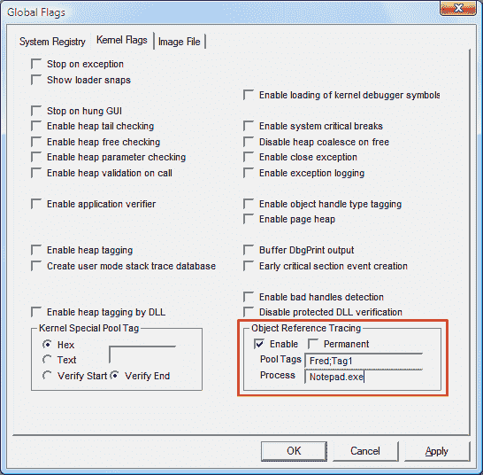
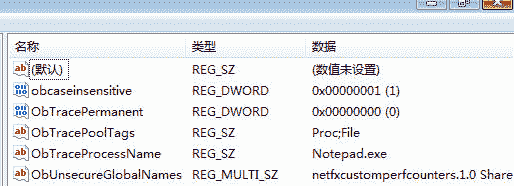

# 深入分析 Win7 的对象引用跟踪机制

> 原文：[`www.pediy.com/kssd/pediy11/120296.html`](https://www.pediy.com/kssd/pediy11/120296.html)

Win7 的内核新增了一系列带有 Tag 参数的对象增加引用（`Refrence`）/减少引用（`Derefrence`）函数，更易于找出对象使用中的“泄漏”（即 `Refrence` 和 `Derefrence` 次数不匹配）。

在 Win7 中，以下所有不带 Tag 的函数均使用一个默认的 Tag（`"tlfD"`）直接调用带 Tag 参数的函数完成相应功能。相关函数如下：

`ObfDereferenceObjectWithTag`/`ObfReferenceObjectWithTag`

`ObDereferenceObjectDeferDelete`/`ObDereferenceObjectDeferDeleteWithTag`

`ObReferenceObjectByHandle`/`ObReferenceObjectByHandleWithTag`

`ObReferenceObjectByPointer`/`ObReferenceObjectByPointerWithTag`

`ObfReferenceObject`/`ObfReferenceObjectWithTag`

`ObOpenObjectByPointer`/`ObOpenObjectByPointerWithTag`

本文将具体分析该机制的内部实现。由于内容实在太多，有些细节只好略过了。

### 概述

对象的引用跟踪机制类似于我们所熟悉的 `PoolTag` 内存泄漏跟踪机制，不同的是 `PoolTag` 跟踪的是内存的申请/释放操作，通过比对内存的申请/释放计数判断是否存在内存泄漏。而对象引用跟踪则跟踪的是对象的增加引用（`Refrence`）/减少引用（`Derefrence`）过程，通过比对两个操作的计数判断是否存在对象引用的“泄漏”。Win7 内核提供了这样一种跟踪机制，在对象增加引用（`Refrence`）/减少引用（`Derefrence`）时插入一个操作，获取当前调用的上下文及引用的对象、引用计数等信息存入全局变量中，通过 `Windbg` 的辅助观察，可以很容易找到问题所在，方便程序员快速排查代码问题。

## 一、如何进行对象跟踪设置？

对象跟踪的相关参数主要有两个：

- 第一个是拥有哪些 Tag 的对象的增加引用（`Refrence`）/减少引用（`Derefrence`）操作将会被跟踪
- 第二个是哪些进程的增加引用（`Refrence`）/减少引用（`Derefrence`）操作会被跟踪

进程这个可能好理解一点，而这个 Tag 参数的理解则稍有点困难（我最初因为那些带 Tag 的内核函数所影响就理解错了）。这个值实际上应该是对象类型中的 Key 值，即 `_OBJECT_TYPE->Key`。如果你要跟踪某一类型的对象，那么就把这个 Tag 参数设置成那个对象类型的 Key 值就行了，也就是申请/释放那个对象内存时使用的 `PoolTag`。这样的 Tag 最多可以设置 16 个，也就是说最多可以跟踪 16 种不同类型的对象的引用操作。

设置对象跟踪的相关参数有两种方法，一种是通过注册表，可以使用 `gFlags` 工具来完成设置。具体地参考以下文章：

`Configuring Object Reference Tracing` ([`msdn.microsoft.com/en-us/libr...(v=VS.85).aspx`](http://msdn.microsoft.com/en-us/library/ff539214\(v=VS.85\).aspx))

附张图，一目了然：



通过 `gFlags` 设置的内容实际上被保存在 `HKLM\\SYSTEM\\CurrentControlSet\\Control\\Session Manager\\Kernel`，如下：



通过注册表设置的内容需要重新启动才能起作用。

另一种方式则是实时设置，只需调用相关函数正确设置就可以立即开始对象跟踪。不过该方式 MS 似乎并未公开相关的内容。但是通过对内核中相关函数的逆向，我完整得出了这种设置方法的过程。设置对象跟踪参数是通过 `ZwSetSystemInformation` 实现的，`InfoClass` 的值为 86。

代码：

```c
#define   SystemObjectTraceInfoClass  (86)

typedef struct _SYSTEM_OBTRACE_INFORMAION{
    /*off=0x00*/BOOLEAN bTraceOn;//是否开启对象引用跟踪
    /*off=0x01*/BOOLEAN bPermanent;//是否启用 Permanent 标志
    /*off=0x02*/BOOLEAN bUnknow1;
    /*off=0x03*/BOOLEAN bUnknow2;
    /*off=0x04*/ULONG InputProcessNameLength;//传入的进程名称的长度
    /*off=0x08*/WCHAR *InputProcessName;//进程名称
    /*off=0x0C*/ULONG InputTagsLen;//传入的 Tags 缓冲的长度
    /*off=0x10*/WCHAR *InputTags;//传入的 Tags
}SYSTEM_OBTRACE_INFORMAION,*PSYSTEM_OBTRACE_INFORMAION;//size=0x14

使用该功能需要启用 SeDebugPrevilege。具体的代码如下:

    WCHAR ProcessName[MAX_PATH]=L"notepad.exe";//进程名称
    WCHAR TraceTags[100]=L"Proc\\0Thri\\0File\\0";//要跟踪的对象类型，注意格式
    ULONG TagCnt=3;//对象类型个数，本次为 3 个

    NTSTATUS status;
    SYSTEM_OBTRACE_INFORMAION SystemObTraceInfo={0};
    ZeroMemory(&SystemObTraceInfo,sizeof(SYSTEM_OBTRACE_INFORMAION));
    SystemObTraceInfo.bTraceOn=TRUE;
    SystemObTraceInfo.InputProcessNameLength=wcslen(ProcessName)*sizeof(WCHAR);
    SystemObTraceInfo.InputProcessName=ProcessName;
    SystemObTraceInfo.InputTags=TraceTags;
    SystemObTraceInfo.InputTagsLen=TagCnt*(wcslen(TraceTags)+1)*sizeof(WCHAR);//总长度
    printf("InputProcessNameLen=%d   InputTagsLen=%d\n",SystemObTraceInfo.InputProcessNameLength,SystemObTraceInfo.InputTagsLen);
    if (SetPrivilege()==FALSE)
    {
        printf("无法提升 SeDebugPrevilege!\n");
        return 0;
    }
    status=ZwSetSystemInformation((enum _SYSTEM_INFORMATION_CLASS)SystemObjectTraceInfoClass,&SystemObTraceInfo,sizeof(SYSTEM_OBTRACE_INFORMAION));
    //要停止跟踪时，只要设置 SystemObTraceInfo.bTraceOn 为 FALSE 再次调用 ZwSetSystemInformation 就可以了。
```

需要注意的是，进程名称这个参数是可选参数，未设置这个参数就是跟踪所有的调用，否则就只是相关进程的调用。

## 二、对象引用跟踪机制的运作原理

### (1)内核中相关变量的初始化

与对象引用跟踪有关的一些关键内核变量如下：

```c
//
//
//  Stack Trace code
//
//以下三项来自 gflags 程序在注册表中的设置
WCHAR ObpTraceProcessNameBuffer[128] = { 0 }; //进程名称，与该名称匹配的进程的对象引用过程才会被跟踪记录，详见 gflags 程序
WCHAR ObpTracePoolTagsBuffer[128] = { 0 }; //Tag 标志，最多 32 个，凡是与该 Tag 匹配的对象被引用时才会被跟踪，详见 gflags 程序
ULONG ObpTracePermanent = 0 ; //永久性标志，详见 gflags 程序
ULONG ObpTracePoolTagsLength = sizeof(ObpTracePoolTagsBuffer);

//对象引用跟踪有关的 Tag 信息
PVOID ObpTracePoolTags;//指向 ObpRTTracePoolTags 或 ObpRegTracePoolTags 中的一个
ULONG ObpRegTracePoolTags[16];//来自注册表设置的 Tag
ULONG ObpRTTracePoolTags[16];//实时跟踪的 Tag

//对象引用跟踪有关的 Process 信息
PUNICODE_STRING ObpTraceProcessName;//指向以下两个结构中的一个
UNICODE_STRING ObpRegTraceProcessName = { 0 };//保存被跟踪的进程的名称，名称来自注册表
UNICODE_STRING ObpRTTraceProcessName = { 0 };//保存被跟踪的进程的名称,名称来自实时设置

//ObpTraceFlags 具体每位的涵义，逆向而来
#define OBTRACE_FLAG_REGSET            0x01    //是否来自注册表设置
#define OBTRACE_FLAG_REALTIME          0x02    //是否来自实时设置
#define OBTRACE_FLAG_TAGS              0x10    //是否指定了 Tag
#define OBTRACE_FLAG_PROCESSNAME       0x20    //是否指定了进程名称
#define OBTRACE_FLAG_PERMANENT         0x40    //是否指定了永久标志
ULONG ObpTraceFlags = 0; //跟踪标志

....

OBJECT_TRACE_STACK_TABLE *ObpStackTable = NULL;
POBJECT_REF_INFO *ObpObjectTable = NULL;

//完整内容可参考附件中的 ObTrace.h
```

如果跟踪设置来自注册表，那么相关变量在 `ObInitSystem()` -> `ObInitStackTrace()` 中设置，相关变量为 `ObpRegXxxx`。

如果跟踪设置来自实时设置，那么相关变量在 `NtSetSystemInformation()` -> `ObSetRefTraceInformation()` -> `ObpStartRTStackTrace()` 中设置，相关变量为 `ObpRTXxxx`。

不管来自哪种设置方式，最终有关的参数被保存在以下关键变量中：

- `ULONG ObpTraceFlags = 0;` //跟踪标志
- `PUNICODE_STRING ObpTraceProcessName;` //指定的进程名称
- `PVOID ObpTracePoolTags;` //待跟踪的 Tag

同时，与存储跟踪信息相关的两个重要表 `ObpObjectTable` 和 `ObpStackTable` 也完成初始化。

### (2)设置的跟踪参数如何生效？

一个对象的增加引用（`Refrence`）/减少引用（`Derefrence`）是否会被跟踪记录，是在它“出生”的时候就已经决定了的。`ObCreateObject()` 在对象创建完毕后检查 `ObpTraceFlags` 标志是否有效，若有效，则调用 `ObRegisterObject()` 向 `ObpObjectTable` 表中注册这个对象。`ObRegisterObject()` 首先会检查所创建的这个对象的 Tag 是不是包含在 `ObpTracePoolTags` 中（若设置了 `ObpTraceProcessName` 的话会先检查当前进程的 `EPROCESS->Flag2` 是否有 `0x200` 对象引用跟踪标志），若包含，说明该类型的对象被设置为被跟踪，那么就将其按照一定的 Hash 算法放入 `ObpObjectTable`（有关重要常量为 `ObpObjectBuckets`，具体算法后面有讲述），并设置该对象的 `ObjectHeader->TraceFlags` 为 1，表明以后该对象的增加引用（`Refrence`）/减少引用（`Derefrence`）操作将会被跟踪记录。

而指定的进程名称，也就是 `ObpTraceProcessName` 的生效，是在目标进程创建时决定的。进程创建函数 `NtCreateUserProcess` 和 `PspCreateProcess` 都调用了 `PspInsertProcess()`。`PspInsertProcess()` 内部调用了 `ObCheckRefTraceProcess()`。原型如下：

```c
VOID _stdcall ObCheckRefTraceProcess(PEPROCESS Process);
```

该函数先判断 `ObpTraceFlags` 是否具备 `0x20` 标志（即进程名称标志），若有，则取参数 `Process->ImageFileName` 与 `ObpTraceProcessName` 比较，看进程名称是否匹配，若匹配，则设置 `EPROCESS->Flags2` 标志里的 `RefTraceEnabled` 标志位 `0x200`，这样，该进程就具备了跟踪对象引用的先天条件。

### (3)真正的跟踪记录过程

前面所说的都是准备工作，所有与对象引用有关的函数（文章开头提到的那些，及部分句柄复制有关的函数）内部都会检查 `ObpTraceFlags` 标志的有效性和 `ObjectHeader->TraceFlags` 的有效性，在这些函数中都可以见到以下代码：

代码：

```c
    if ( ObpTraceFlags )//检查 Trace 标志是否有效
    {
        if (ObjectHeader->TraceFlags & 1 )//检查当前对象是否被标记为 Trace
        {
            ObpPushStackInfo(ObjectHeader, 1, 1, 'tlfD');
        }
    }
```

若都有效，就会调用函数 `ObPushStackInfo()` 来完成记录工作。该函数还原如下：

代码：

```c
BOOLEAN __stdcall
ObpPushStackInfo(
    PVOID ObjectHeader, //对象头
    char bRefrenceOrDefrence, //当前操作是增加引用还是减少引用
    WORD Count,//当前操作增加或减少的计数
    LONG Tag//当前增加或减少引用时所使用的 Tag 参数
)
{
    BOOLEAN result;
    PVOID CallStack[16];
    ULONG NextSequence;

    memset(CallStack, 0, 0x40);//初始化为零
    if ( KeAreInterruptsEnabled() )
    {
        if ( KeGetCurrentIrql() <= DISPATCH_LEVEL )
        {
            if ( RtlCaptureStackBackTrace(1, 16, CallStack, 0) >= 1 )//关键，获取调用栈中的所有返回地址
            {
                NextSequence=InterlockedIncrement(ObpStackSequence);
                if ( MmCanThreadFault() == TRUE )
                  result = ObpPushRefDerefInfo(ObjectHeader, bRefrenceOrDefrence, Count, NextSequence, CallStack, Tag);//记录调用信息
                else
                  result = ObpDeferPushRefDerefInfo(ObjectHeader, bRefrenceOrDefrence, Count, NextSequence, CallStack, Tag);
            }
        }
    }
    return result;
}
```

该函数调用 `RtlCaptureStackBackTrace` 取得调用栈信息（内部调用了 `RtlWalkFrameChain`），即返回地址，回溯的层数上限由 `ObpTraceDepth` 决定，Win7 下该值为 16。


并取全局变量 `ObpStackSequence` 作为序数(用后将其增 1)，调用 `ObpPushRefDerefInfo()`，(此时若 `MmCanThreadFault()` 返回 FALSE，则调用 `ObpDeferPushRefDerefInfo` 在一个 WorkItem 中完成该操作，关键过程相同)

该函数还原成代码如下,具体过程已经写在注释中了：

```
BOOLEAN __stdcall 
ObpPushRefDerefInfo(
    PVOID ObjectHeader,//对象头
    BOOLEAN bRefrenceOrDefrence,//当前操作是增加引用还是减少引用
    WORD Count,//当前操作增加或减少的计数
    ULONG CurrentSequence,//一个序数
    POBJECT_REF_TRACE Stacks,//当前调用栈地址信息
    LONG Tag//当前增加或减少引用时所使用的 Tag 参数
    )
{
    WORD Index=0;
    WORD NextPos;
    OBJECT_REF_INFO RefInfo={0};
    POBJECT_REF_STACK_INFO pObjRefStackInfo;
    POBJECT_REF_STACK_INFO RefStackInfo,PreRefStackInfo;
    //判断 ObpTraceFlag 及获取 ObpStackTraceLock 这个锁，过程略过略过
    if ( NT_SUCCESS(ObpGetObjectRefInfo(ObjectHeader, &RefInfo))) //查找 ObpObjectTable 获取该 Object 对应的 RefInfo，此 RefInfo->ObjectHeader 即查找的目标
    {
        CurRefInfo = RefInfo;
        if ( RefInfo )
        {
            Index = ObpGetTraceIndex(Stacks);//该函数通过计算调用栈地址的 Hash 值，将其存入 ObpStackTable 表中，并返回在表中的索引
            if ( Index >= 16381 )  //判断 Index 是否超过了允许的最大值，若超过则认为溢出
            {
                DbgPrintEx(0, 1, "ObpPushRefDerefInfo - ObpStackTable overflow\n");
            }
            else   //若没有超过最大值，正常处理
            {
                NextPos = RefInfo->NextPos;//取当前可用的位置指针
                while ( NexPos }//若有效
                {
                    RefStackInfo=RefInfo.StackInfo[NextPos];//当前要保存栈信息的位置
                    PreRefStackInfo=RefInfo.StackInfo[NextPos-1];//最后一次保存栈信息的位置
                    if ( CurrentSequence >= PreRefStackInfo->Sequence )//上一序数未超过当前值，则认为正常，跳出循环
                        break;
                    //超出的情况处置
                    RefStackInfo->Sequence=PreRefStackInfo->Sequence;
                    RefStackInfo->Index=PreRefStackInfo->Index;
                    RefStackInfo->NumTraces=PreRefStackInfo->NumTraces;
                    RefStackInfo->Tag=PreRefStackInfo->Tag;
                    NextPos -= 1;//上移一个位置
                }
                pObjRefStackInfo=RefInfo.StackInfo[NextPos];//取当前可用的位置
                pObjRefStackInfo->Index = Index | (WORD)(-(bRefrenceOrDefrence != 0) & 0x8000);//保存 Index，并根据是增加引用还是减少引用设置标志位
                pObjRefStackInfo->NumTraces = Count;//保存此次的引用计数
                pObjRefStackInfo->Sequence = NextSequence;
                pObjRefStackInfo->Tag = Tag;
                RefInfo->NextPos+=1;   //NextPos 加 1,指向下一个可用位置
            }
        }
    }
    //释放锁及其它，略
}
```

上述函数执行结束以后，本次对象引用时的调用上下文、引用时的 Tag、引用记数、增加还是减少等信息就被记录到了 `ObpStackTable` 中.

其中 `ObpGetTraceIndex()` 计算调用地址 Hash 的算法如下:

```
ULONG GetStackInfoHash(PVOID Addrs)
{
    ULONG Index=0;
    ULONG Value=0;
    ULONG Hash;
    PUSHORT Key = (PUSHORT)Addrs;
    for (Index = 0; Index < 0x40 / sizeof(*Key); Index += 2) {

        Value += Key[Index] ^ Key[Index + 1];
    }
    Hash = ((ULONG)Value) % OBTRACE_STACKS;
    return Hash;
}
```

### 三、如何查看跟踪记录的结果？

根据 MS 的说明，Windbg 提供了命令 `!obtrace` 来查看某一对象的增加引用(Refrence)/减少引用(Derefrence)跟踪信息。

具体用法: `!obtrace [对象地址]`

然后 Windbg 将显示出所有对该对象的增加引用(Refrence)/减少引用(Derefrence)操作的记录。在这个记录中，可以清楚看到每次调用的调用栈，便于查找出问题的位置，同时还有 Tag、计数等信息。可参考 [`msdn.microsoft.com/en-us/libr...(v=VS.85).aspx`](http://msdn.microsoft.com/en-us/library/ff564594\(v=VS.85\).aspx)

下面我们来手工实现一下这个过程，同时也是从反方向加深对上述存储过程及相关结构的理解。

命令: `!obtrace 0x862551b8`

#### (1)在 `ObpObjectTable` 表中查找该对象

`ObpObjectTable` 的地址为 `0x84daf548`

Hash 算法是：

```
#define GetObjHash(Object) ((((ULONG)Object>>4)&0xFFFFF)% 401)
```

`Object=0x862551b8`

计算 Hash, `GetObjHash(Object)=0x4E,`

`Offset=Hash*4=0x138;`

所以位于 `ObpObjectTable+0x138` 处

```
kd>dd ObpObjectTable+130

84daf678  00000000 00000000 8626a000 00000000

84daf688  00000000 00000000 00000000 00000000
```

可以看到，偏移 `0x138` 处的值为 `8626a000`，这是一个 `_OBJECT_REF_INFO` 结构的指针。

```
kd> dt _OBJECT_REF_INFO  8626a000 

nt!_OBJECT_REF_INFO 

   +0x000 ObjectHeader     : 0x862551a0 _OBJECT_HEADER 

   +0x004 NextRef          : (null) //用于链接 Hash 值相同的 Object 

   +0x008 ImageFileName    : [16]  "svchost.exe" 

   +0x018 NextPos          : 0x243//本结构中 StackInfo 数组的索引，表明下一个可用的位置，达到 MaxStacks 时会自动申请更大的空间 

   +0x01a MaxStacks        : 0x3fc//当前最大可用 StackIndex 

   +0x01c StackInfo        : [0] _OBJECT_REF_STACK_INFO//_OBJECT_REF_STACK_INFO 数组，偏移为 0x1C 
```

接下来查看本进程的第一次引用跟踪记录：

```
kd> dt _OBJECT_REF_STACK_INFO 8626a000+1C//第一个 StackInfo

nt!_OBJECT_REF_STACK_INFO 

   +0x000 Sequence         : 0x230//序列号,即 ObpPushRefDerefInfo 函数中的 Sequence 参数，只是一个全局的序数 

   +0x004 Index            : 0x8000//在 ObpStackTable 中的索引，需要去掉 0x8000 标志位 

   +0x006 NumTraces        : 1//此次引用的计数 

   +0x008 Tag              : 0x746c6644//该次引用的 Tag 
```

这里得到一些有用的信息，`Sequence` 为 `0x230`，而 `Index` 为 0(需要去掉 `0x8000` 标志位，有这个标志表明本次操作是增加计数的，否则是减少计数的，这个可以在 `ObpPushRefDerefInfo()` 的代码中得到印证)，`Tag` 为 `0x746c6644`，即 Dflt，这是内核中相关函数使用的默认 Tag。这里面的 `Index` 是个很关键的值，它就是实际存储的调用栈信息在 `ObpStackTable` 中的索引。

`ObpStackTable` 是下面这样一个结构(逆向得来):

```
typedef struct _OBJECT_TRACE_STACK_TABLE

{

    WORD CurUsedStacksCnt;//当前已经使用的数目，从 0 开始递增,直至 1024 时对表项进行扩充

    WORD TotalStacksCnt;//当前可用栈的总数目

    POBJECT_REF_TRACE StackBuckets[16];//总共 16 个表项,每个表的大小为 0x10000，共包括 0x10000/0x40=0x400=1024 个项目

    WORD IndexTable[16382];//最大的 Index 为 16381，最后一项为 0,其余初始化为 0xFFFF，该值与_OBJECT_REF_STACK_INFO 结构中的 Index 值对应

}OBJECT_TRACE_STACK_TABLE,*POBJECT_TRACE_STACK_TABLE;//TotalSize=0x8040
```

实际观察如下：

```
kd> dd 84e35000  //ObpStackTable
84e35000  0400009f 84e3e000 00000000 00000000
84e35010  00000000 00000000 00000000 00000000
84e35020  00000000 00000000 00000000 00000000
84e35030  00000000 00000000 00000000 00000000
84e35040  00000000 ffffffff ffffffff ffffffff
84e35050  ffffffff ffffffff ffffffff ffffffff
84e35060  ffffffff ffffffff ffffffff ffffffff
84e35070  ffffffff ffffffff ffffffff ffffffff
```

可以看到，总共有 16 张表来存储调用栈地址，每个调用栈结构的大小为回溯深度 `16*sizeof(PVOID)=0x40`，而每张表的大小为 `0x10000`，所以每张表可放置 `0x400` 项内容。当超出 `0x400` 时，会申请第二张表，整体结构和三层句柄表有些相似，也是可扩充的。因为我们刚才得到的索引是 0，所以显然是位于第一张表里，并且是第一项;如果索引是 `0x403`，那么将位于第二张表里，位于第四项。

```
kd> dd 84e3e000+0*0x40
84e3e000  83c25eff 83c70c43 83c582fa 83a4542a 
84e3e010  00000000 00000000 00000000 00000000
84e3e020  00000000 00000000 00000000 00000000
84e3e030  00000000 00000000 00000000 00000000
```

可以看到，调用栈的返回地址已经在这里躺着了，共有 4 个有效的地址，看一看第一个地址:

```
kd> u 83c25eff

nt!ObCreateObject+0x1c4:

83c25eff 8b4528           mov     eax,dword ptr [ebp+28h]
```

这和我们用 `!obtrace` 看到的结果是一样的：

```
     230    +1     Dflt       nt!ObCreateObject+1c4 
                                nt!PspAllocateProcess+e0 
                                nt!NtCreateUserProcess+51a 
                                nt!KiFastCallEntry+12a
```

这样，就对整个实现过程有了一个清晰的认识。

关于 Win7 的对象引用跟踪机制，分析到此结束，部分内容参考自 Wrk,其它为逆向所得。

|  || ObTrace.rar |
