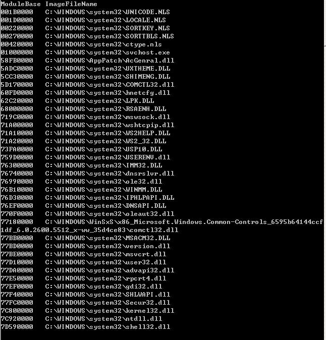

# 调用 ZwQueryVirtualMemory 遍历进程模块示例（再次更新）

> 原文：[www.pediy.com/kssd/pediy10/85453.html](https://www.pediy.com/kssd/pediy10/85453.html)

菜鸟学习帖，高手请飘过！

一直只知道 `IceSword`（以及看雪论坛上开源的山寨版 `IceSword`）是用 `ZwQueryVirtualMemory` 来遍历进程的虚拟内存，从而得到加载的模块的，不过从来没有自己试过。

看了山寨版 `IceSword` 相关代码，原来是在 Ring3 中实现的，就想自己动手整一整，结果发现原来不是那么难。于是用汇编写了个 Win32 控制台程序来做演示。

基本原理不复杂，倒是细枝末节耗去很多时间。

首先我是以区段内存对齐的单位 `0x1000` 字节进行遍历，这样会出现多个区段属于同一个文件。这样我使用两次调用 `ZwQueryVirtualMemory`：

- 第一次使用参数 `MemoryBasicInformation`，判断传回的 `MEMORY_BASIC_INFORMATION` 结构中的 `AllocationBase` 字段值与传入的 `Base` 是否相等，相等则说明这是文件的第一个区段，这时才进行第二次调用；
- 第二次使用参数 `MemorySectionName`，获得区段文件名。

山寨版 `IceSword` 使用的是 `0x10000` 字节为间隔，似乎就避免了这个麻烦，而且也不会漏掉模块。

第一次写 Win32 控制台程序，也是第一次用 `msvcrt.dll` 中的函数（由 `masm32rt.inc` 中封装）做字符串处理，发现自己这一块居然超不熟，耗费了不少时间。

其实说原创也不是太合适了，因为参考了一些网上的代码，比如山寨版 `IceSword`，还有提 `SeDebugPrivilege` 的那部分也是直接 copy 的网上的代码（其实只要不是访问系统进程，提权不是必须的）。

代码写得比较挫，又一次证实了自己在 Win32 汇编这块还很菜！

**调用方法**：把进程 `ID` 作为命令行参数传入，如 `Query.exe 1000`

**update**: 看了大家的回帖之后又修改了一下，主要是在盘符转换方面不再偷懒，现在应该可以支持非本地磁盘了。

对这个功能，发现 `KsBinSword` 好像没有做？

网上搜索发现 `QueryDosDevice`，但据说没有功能反过来的，这样只能先对 `A-Z` 的盘符调用 `QueryDosDevice`，把结果保存起来，然后需要转换的时候再跟全文件名比对。

另外调试了一下 `ZwQueryVirtualMemory` 的调用，因为我很在意那几个 `nls` 文件，记得好像说是内核创建进程过程中将其映射的。想看看怎么把它们跟后面的 `Module` 区分开来。

发现这几个 `nls` 映像头部的 `AllocationProtect` 都有 `PAGE_EXECUTE` 属性，而其他各个 `exe` 和 `dll` 的映像头部的 `AllocationProtect` 属性没有 `PAGE_EXECUTE`，但两者当前的 `Protect` 属性都有 `PAGE_EXECUTE`。

因此加了几行代码来做检测，在原文中被注释掉了，如果把注释掉的还原，则显示出来的模块中不包括 `nls` 文件。

**update2**:

之前的版本只能取 `A-Z` 盘符，现在是遍历所有 DOS 符号设备，对所有设备取其映射的设备名，与 `ZwQueryVirtualMemory` 得到的结果一一做比对，找到相应的 DOS 符号设备名。

由于同一个设备可能映射到多个 DOS 设备，比如 `\Device\HarddiskVolume1`，除了 `C:` 之外还有其他的 DOS 设备与之对应，为了取到 `C:`，这里我取长度最短的一个 DOS 设备名来显示。

实现还是用 `QueryDosDevice`，代码写得一团乱！不禁想 Ring0 真好啊，有 `Rtl(Io)VolumeDeviceToDosName` 可以用……

**代码**:


```asm
;===============================================================================
;use ZwQueryVirtualMemory to enum Modules of a process
;subsystem:console
;OS Platform:tested on Windows XP Professional simplified with Service Pack 3
;轩辕小聪 http://hi.baidu.com/yicong2007
;
;release notes:
;2009.04.11
;完全改写 CreateDeviceList 和 ConvertDeviceStr 两个函数，Ring3 下使用 QueryDosDevice，
;通过对所有的 DOS 符号连接获取其对应设备名，与得到的模块路径一一对照，克服了上一版本
;只能转换 A-Z 盘符的问题。
;
;2009.04.06 
;改写 ConvertDeviceStr 函数，实现 A-Z 盘符的转换，以支持非本地磁盘盘符的获取。
;遍历时只对具有 PAGE\_EXECUTE 属性的内存查找 MemorySectionName。
;如将被注释掉的四处代码还原，可过滤掉 nls 文件的显示。
;
;2009.04.05 
;第一个版本
;
;===============================================================================
include \masm32\include\masm32rt.inc
include \masm32\include\w2k\native.inc
includelib \masm32\lib\masm32.lib
include \masm32\macros\macros.asm
include \masm32\include\advapi32.inc
includelib \masm32\lib\advapi32.lib

.data
PID dd 0
Base dd 0
hProcess dd 0
DataLength dd 0
lpszPID db 120 dup(0)
lpoutdata db 300h dup(0)
lpFileName db 120h dup(0)
lpDosList dd 0
lpDeviceList dd 0
lpDosBuffer dd 0
lpDeviceBuffer dd 0
.code

CreateDeviceList proto

CreateDeviceList proc uses esi edi ebx edx
  local  num
  local  lpBuffer
  local  BufferLen

  mov  edi, 0
  xor  esi, esi
  .repeat   
    .if  esi!=0
      hfree(esi)   
    .endif
    add  edi, 1000h     
    mov  esi,halloc(edi)
    invoke  QueryDosDevice, NULL, esi, edi
  .until  eax!=0
  mov  lpDosBuffer, esi   
  mov  num, 0
  xor  eax, eax
  .repeat   
    inc  num
    invoke  crt\_strlen, esi     
    lea  esi, \[esi+eax+1\]
  .until eax==0
  dec  num
  mov  eax, num
  lea  eax, \[eax\*4+4\]
  mov  lpDosList, halloc(eax)
  mov  edi, lpDosList
  mov  eax, num
  mov  \[edi\], eax
  add  edi, 4
  xor  ebx, ebx
  mov  esi, lpDosBuffer
  .repeat   
    inc  ebx
    mov  \[edi\], esi
    add  edi, 4
    invoke  crt\_strlen, esi     
    lea  esi, \[esi+eax+1\]
  .until ebx==num     
  mov  eax, num
  shl  eax, 8
  mov  ebx, num
  shl  ebx, 2
  add  eax, ebx
  push  eax
  mov  esi, halloc(eax)   
  mov  lpBuffer, esi
  pop  eax
  invoke  RtlZeroMemory, lpBuffer, eax
  mov  eax, num
  lea  eax, \[eax\*4+4\]
  mov  lpDeviceList, halloc(eax)
  mov  edx, lpDeviceList
  mov  eax, num
  mov  \[edx\], eax
  mov  edi, lpDosList
  add  edi, 4
  xor  ebx, ebx
  mov  BufferLen, 0
  .repeat
    inc  ebx
    mov  ecx, \[edi\]
    invoke  QueryDosDevice, ecx, esi, MAX\_PATH
    .if  eax!=0
      invoke  crt\_strlen, esi
      inc  eax
      add  BufferLen, eax   
    .endif     
    add  edi, 4
    lea  esi, \[esi+MAX\_PATH\]   
  .until  ebx==num
  inc  BufferLen
  mov  lpDeviceBuffer, halloc(BufferLen)
  invoke  RtlZeroMemory, lpDeviceBuffer, BufferLen
  mov  edi, lpDeviceBuffer
  mov  edx, lpDeviceList
  add  edx, 4
  mov  esi, lpBuffer
  xor  ebx, ebx
  .repeat
    inc  ebx
    push  edx
    invoke  crt\_strlen, esi
    pop  edx
    .if  eax!=0   
      inc  eax
      push  eax
      push  edx
      invoke  crt\_strncpy, edi, esi, eax
      pop  edx
      mov  \[edx\], edi
      pop  eax
      add  edi, eax
    .else
      mov  \[edx\], eax
    .endif   
    add  edx, 4   
    lea  esi, \[esi+MAX\_PATH\]   
  .until  ebx==num
  hfree(lpBuffer)   
  mov  eax, 1     
  ret   
CreateDeviceList endp

ConvertDeviceStr proto :DWORD, :DWORD

;=====================================================
;把得到的文件名中的盘符翻成平常的 C、D……并将字符串改
;成输出所需的格式
;=====================================================
ConvertDeviceStr proc uses esi edi ebx lpSource:DWORD, ImageBase:DWORD

  local  lptmp\[MAX\_PATH\]:byte
  local  totalnum
  local  match
  local  lpmatchDev
  local  DevLen
  local  NameLen
  lea  edi, lptmp
  xor  eax, eax
  mov  match, eax
  mov  lpmatchDev, eax
  mov  NameLen, eax
  mov  DevLen, eax
  mov  ecx, MAX\_PATH
  rep  stosb
  mov  esi, lpDeviceList
  mov  eax, \[esi\]
  mov  totalnum, eax
  add  esi, 4
  xor  ebx, ebx
  .repeat
    inc  ebx
    push  esi
    mov  edi, \[esi\]
    .if  edi!=0
      invoke  crt\_strstr, lpSource, edi
      .if  eax==lpSource 
        .if  match==0
          mov  match, 1
        .endif   
        mov  eax, ebx
        lea  eax, \[eax\*4\]
        mov  esi, lpDosList
        add  esi, eax
        mov  esi, \[esi\]
        invoke  crt\_strlen, esi
        .if  NameLen==0 || NameLen>eax
          mov  NameLen, eax
          invoke  crt\_strlen, edi
          mov  DevLen, eax
          mov  lpmatchDev, esi
        .endif   
      .endif   
    .endif   
    pop  esi
    add  esi, 4
  .until  ebx==totalnum   

  .if  match==0
    invoke  crt\_strncpy, addr lptmp, lpSource, MAX\_PATH
  .else   
    mov  ebx, lpmatchDev
    mov  eax, DevLen
    mov  esi, lpSource
    lea  esi, \[esi+eax\]
    invoke  crt\_sprintf, addr lptmp, CTXT('%s%s'), ebx, esi
  .endif   
  invoke  crt\_sprintf, lpSource, CTXT('%08X   %s',0dh,0ah), ImageBase, addr lptmp
  ret
       
ConvertDeviceStr endp

CleanUp proto

CleanUp proc uses esi edi ebx

  hfree(lpDosBuffer)
  hfree(lpDosList)
  hfree(lpDeviceList)
  hfree(lpDeviceBuffer)
  ret
CleanUp endp

DebugPrivilege   PROTO :DWORD

;=====================================================
;提 SeDebugPrivilege，copy from network
;=====================================================

DebugPrivilege    proc uses esi edi ebx dwEnbled

  local  hToken
  local  tmpLuid:LUID,tkp:TOKEN\_PRIVILEGES
     

  invoke  GetCurrentProcess
  lea  ebx,hToken
  invoke  OpenProcessToken, eax, TOKEN\_ADJUST\_PRIVILEGES Or TOKEN\_QUERY, ebx
  invoke  LookupPrivilegeValue, NULL, CTXT('SeDebugPrivilege'), addr tmpLuid
  mov  tkp.PrivilegeCount,1
  push  tmpLuid.LowPart
  pop  tkp.Privileges\[0\].Luid.LowPart
  push  tmpLuid.HighPart
  pop  tkp.Privileges\[0\].Luid.HighPart
  .if  dwEnbled
    mov  tkp.Privileges\[0\].Attributes, SE\_PRIVILEGE\_ENABLED
  .else   
    mov  tkp.Privileges\[0\].Attributes,NULL
  .endif   
  invoke  AdjustTokenPrivileges, hToken, FALSE, addr tkp, sizeof TOKEN\_PRIVILEGES, NULL, NULL
  invoke  GetLastError
  .if  eax == ERROR\_SUCCESS
    push  TRUE
  .else   
    push  FALSE
  .endif          
  
  invoke  CloseHandle,hToken
  pop  eax
  ret
   

DebugPrivilege    endp

Start        proc uses esi edi ebx

  invoke  GetCL, 1, offset lpszPID   
  invoke  crt\_sscanf, offset lpszPID, CTXT('%d'), offset PID
  .if  PID==0
    invoke  StdOut, CTXT('Invaild PID.')
    ret   
  .endif   
  invoke  DebugPrivilege, 1
  .if  eax==FALSE
    invoke  StdOut, CTXT('Enable SeDebugPrivilege failed.')
    ret
  .endif   
  invoke  OpenProcess, PROCESS\_QUERY\_INFORMATION, 0, PID
  .if  eax==0
    invoke  StdOut, CTXT('OpenProcess failed.')
    ret
  .endif   
  mov  hProcess, eax
  invoke  GetModuleHandle, CTXT('ntdll.dll')
  mov  esi, eax
  invoke  GetProcAddress, esi, CTXT('ZwQueryVirtualMemory')
  mov  edi, eax
  invoke  StdOut, CTXT('ModuleBase ImageFileName',0dh,0ah)
  invoke  CreateDeviceList
  .repeat   
    push  offset DataLength
    push  300h
    push  offset lpoutdata
    push  MemoryBasicInformation
    push  Base
    push  hProcess
    call  edi
    mov  esi, offset lpoutdata
    ;mov  edx, \[esi+18h\]
    assume  esi:ptr MEMORY\_BASIC\_INFORMATION
    ;mov  ebx, \[esi\].AllocationProtect
    ;and  ebx, WSLE\_PAGE\_EXECUTE
    mov  ecx, \[esi\].Protect
    and  ecx, WSLE\_PAGE\_EXECUTE
    mov  esi, \[esi\].AllocationBase
    assume  esi:nothing
    .if  eax==0 && esi==Base && ecx!=0 ;&& edx == SEC\_IMAGE && ebx==0     
      push  offset DataLength
      push  300h
      push  offset lpoutdata
      push  MemorySectionName
      push  Base
      push  hProcess
      call  edi   
      .if  eax==0
        mov  esi, offset lpoutdata
        assume  esi:ptr MEMORY\_SECTION\_NAME
        movzx  eax, \[esi\].SectionFileName.\_Length
        .if  eax!=0
          mov  esi, \[esi\].SectionFileName.Buffer
          assume  esi:nothing
          invoke  crt\_sprintf, offset lpFileName, CTXT('%ws'),esi
          invoke  ConvertDeviceStr, offset lpFileName, Base
          invoke  StdOut, offset lpFileName
        .endif           
      .endif
    .endif   
    mov  eax, Base
    add  eax, 1000h
    mov  Base, eax
  .until  Base==80000000h
  invoke  CleanUp
  ret

Start endp

end Start
```


结果演示：以下是一个 `svchost.exe` 进程的内存模块：



上传的附件

|  || Query.rar  
|
