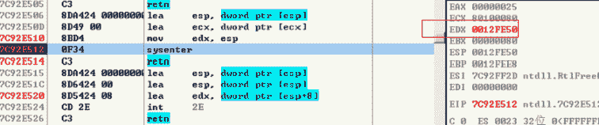
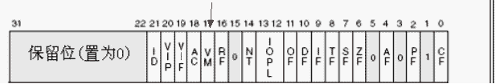

# 3 环到 0 环系统调用分析报告

> 原文：[`www.pediy.com/kssd/pediy12/144696.html`](https://www.pediy.com/kssd/pediy12/144696.html)

//科锐十班：  网名米汤  
//于武汉桂子花园     2011.12.21 13:47  

首先 `VC` 写个用户代码:  

```c
#include "stdafx.h"
#include <windows.h>

int main(int argc, char* argv[])
{
  HANDLE hFile;
  while (1)
  {
    printf("Read Going.... 4 !!!\n");
    Sleep(4000);   
    hFile = CreateFile("MYFILE.TXT",          // open MYFILE.TXT  25 号系统调用服务
      GENERIC_READ,             // open for reading 
      FILE_SHARE_READ,         // share for reading 
      NULL,                    // no security 
      OPEN_EXISTING,           // existing file only 
      FILE_ATTRIBUTE_NORMAL,    // normal file 
      NULL);                   // no attr. template 
    if (hFile == INVALID_HANDLE_VALUE) 
    { 
      puts("Could not open file.");   // process error 
    }
    CloseHandle(hFile);
  }
  return 0;
}
```

//为什么用循环呢，因为我们在系统服务下断点的来的频率太快了，太短了．．．一下条件断点就无法手标操作虚似机．  
//通过 `od` 分析如图：  



那么在 `windbg` 中下个条件断点

```
bp KiFastCallEntry ".if @edx== 0x0012FE50{} .else{gc}"    用符号不知道为什么容易 假死机
bp 8053e550 ".if @edx== 0x0012FE50{} .else{gc}"    这样就可以断下来，why!!! Why!!!
```

这样就在快速系统调用总入口下了一个条件断点，很大的机率上 "确定" 是我们 `r3` 程序触发的  

`nt!KiFastCallEntry`:  

```asm
0008:8053e550 b923000000      mov     ecx,23h               ecx --> GDT_R3_DATA   
0008:8053e555 6a30            push    30h         
0008:8053e557 0fa1            pop     fs            //fs  -->KPCR ffdff000
0008:8053e559 8ed9            mov     ds,cx
0008:8053e55b 8ec1            mov     es,cx           //ds,es --> GDT_R3_DATA   
0008:8053e55d 8b0d40f0dfff    mov     ecx,dword ptr ds:[0FFDFF040h]  //ecx --> TSS
0008:8053e563 8b6104          mov     esp,dword ptr [ecx+4]        esp 临时堆栈过渡到自己的内核堆栈
0008:8053e566 6a23            push    23h               //开始保护 R3 现场 TRAP_FRAME    
0008:8053e568 52              push    edx               //r3 SS:ESP
0008:8053e569 9c              pushfd                //r3 状态标志寄存器
0008:8053e56a 6a02            push    2                
0008:8053e56c 83c208          add     edx,8             //edx --> r3 栈中参数块
0008:8053e56f 9d              popfd                 //r0 状态标志寄存器 置 0,关中断
0008:8053e570 804c240102      or      byte ptr [esp+1],2          //置 r3 状态标志寄存器 开中断
0008:8053e575 6a1b            push    1Bh               //0001 1011 r3 cs  GDT_R3_CODE
0008:8053e577 ff350403dfff    push    dword ptr ds:[0FFDF0304h]     //r3 KTRAP_FRAME.eip= iFastSystemCallRet
0008:8053e57d 6a00            push    0                 //为了框架统一.压入 0,对本次系统调用无意义
0008:8053e57f 55              push    ebp
0008:8053e580 53              push    ebx               //无限 r3 现场保护
0008:8053e581 56              push    esi
0008:8053e582 57              push    edi               //....
0008:8053e583 8b1d1cf0dfff    mov     ebx,dword ptr ds:[0FFDFF01Ch]  //ebx --> +0x01c SelfPcr : Ptr32 _KPCR
0008:8053e589 6a3b            push    3Bh               //0011 1011 r3 fs  KGDT_R3_TEB
0008:8053e58b 8bb324010000    mov     esi,dword ptr [ebx+124h]      //esi --> CurrentThread  
0008:8053e591 ff33            push    dword ptr [ebx]         //保存线程原先异常表
0008:8053e593 c703ffffffff    mov     dword ptr [ebx],0FFFFFFFFh     //目前 seh 置空
0008:8053e599 8b6e18          mov     ebp,dword ptr [esi+18h]     //ebp --> 当前线程的最高栈顶.
0008:8053e59c 6a01            push    1                 //保存先前模式 用户模式
0008:8053e59e 83ec48          sub     esp,48h             //TRAP_FRAME 预留其它 空间
0008:8053e5a1 81ed9c020000    sub     ebp,29Ch          //ebp--> 当前 KTRAP_FRAME   
0008:8053e5a7 c6864001000001  mov     byte ptr [esi+140h],1        //设置 当前 先前模式
0008:8053e5ae 3bec            cmp     ebp,esp           
0008:8053e5b0 759a            jne     nt!KiFastCallEntry2+0x47 (8053e54c)
0008:8053e5b2 83652c00        and     dword ptr [ebp+2Ch],0        //KTRAP_FRAME.dr7 = 0
0008:8053e5b6 f6462cff        test    byte ptr [esi+2Ch],0FFh        //当前线程是否在调试状态
0008:8053e5ba 89ae34010000    mov     dword ptr [esi+134h],ebp     //设置当前线程的当前框架地址
0008:8053e5c0 0f854afeffff    jne     nt!Dr_FastCallDrSave (8053e410)    //如果调试状态跳走
0008:8053e5c6 8b5d60          mov     ebx,dword ptr [ebp+60h]     //调试相关
0008:8053e5c9 8b7d68          mov     edi,dword ptr [ebp+68h]     //调试相关
0008:8053e5cc 89550c          mov     dword ptr [ebp+0Ch],edx     //调试相关
0008:8053e5cf c74508000ddbba  mov     dword ptr [ebp+8],0BADB0D00h  //调试相关
0008:8053e5d6 895d00          mov     dword ptr [ebp],ebx        //调试相关
0008:8053e5d9 897d04          mov     dword ptr [ebp+4],edi        /调试相关
```

//不开中断 (临时用置为 90 这样别的系统调用再也进不来了，就可以安心调试本次调用)  `eb 8053e5dc 90`

```asm
0008:8053e5dc fb              "sti" 不让她执行  本句代码
0008:8053e5dd 8bf8            mov     edi,eax           //edi = 系统调用服务号
0008:8053e5df c1ef08          shr     edi,8             
0008:8053e5e2 83e730          and     edi,30h             
0008:8053e5e5 8bcf            mov     ecx,edi           //ecx = edi bit11,bit12  00 /10
0008:8053e5e7 03bee0000000    add     edi,dword ptr [esi+0E0h]     //edi-->ServiceTable   
0008:8053e5ed 8bd8            mov     ebx,eax           //ebx = 系统调用服务号 
0008:8053e5ef 25ff0f0000      and     eax,0FFFh         
0008:8053e5f4 3b4708          cmp     eax,dword ptr [edi+8]        //检查统调用服务号 的合法性
0008:8053e5f7 0f8345fdffff    jae     nt!KiBBTUnexpectedRange (8053e342)
0008:8053e5fd 83f910          cmp     ecx,10h           //是否扩展系统调用
0008:8053e600 751a            jne     nt!KiFastCallEntry+0xcc (8053e61c)   //否则跳走
.......
0008:8053e61c ff0538f6dfff      inc     dword ptr ds:[0FFDFF638h]      
0008:8053e622 8bf2            mov     esi,edx           //esi-->r3 参数块
0008:8053e624 8b5f0c          mov     ebx,dword ptr [edi+0Ch]     //ebx-->参数大小数组   
0008:8053e627 33c9            xor     ecx,ecx
0008:8053e629 8a0c18          mov     cl,byte ptr [eax+ebx]        //ecx = 参数块大小
0008:8053e62c 8b3f            mov     edi,dword ptr [edi]        //edi-->系统服务函数指针数组   
0008:8053e62e 8b1c87          mov     ebx,dword ptr [edi+eax*4]       //ebx = 服务函数地址
0008:8053e631 e9f2cb0e01      jmp     8162b228             
......
0008:8162b228 e915f4276f      jmp     hookport+0xa642 (f08aa642)       
```

//...我的机器被谁 hook 了?????我不看了．我估计跟３６０有关，所以还原系统，因为现在只是学习基础！不找没趣吧

.....

//回到正常机器，接着被 hook 地方(`8053e631` )，当然这次是系统正常代码

```asm
8053e631 2be1            sub     esp,ecx               //预留栈空间，准备复制用户参数了
8053e633 c1e902          shr     ecx,2                 
8053e636 8bfc            mov     edi,esp             //edi-->当前 esp   
8053e638 3b35549a5580    cmp     esi,dword ptr [nt!MmUserProbeAddress (80559a54)]
8053e63e 0f83a8010000    jae     nt!KiSystemCallExit2+0x9f (8053e7ec)    //if(esi >7fff0000 )(跳走) 检查 esi 是否 r3 地址
8053e644 f3a5            rep movs dword ptr es:[edi],dword ptr [esi]     //复制 r3 参数
8053e646 ffd3            call    ebx                 //调用系统服务函数
8053e648 8be5            mov     esp,ebp             
8053e64a 8b0d24f1dfff    mov     ecx,dword ptr ds:[0FFDFF124h]    //ecx-->CurrentThread
8053e650 8b553c          mov     edx,dword ptr [ebp+3Ch]        //edx=trap_frame.edx 0xffffffff
8053e653 899134010000    mov     dword ptr [ecx+134h],edx        //Kthread.Trapframe = 0xfffffffff
```

`nt!KiServiceExit`:  

```asm
8053e659 fa              cli             
```



```asm
8053e65a f7457000000200  test    dword ptr [ebp+70h],20000h        //trap_frame.eflag 测试划是否虚拟 8086 模式   
8053e661 7506            jne     nt!KiServiceExit+0x10 (8053e669)    //是则跳走
8053e663 f6456c01        test    byte ptr [ebp+6Ch],1            //trap_frame.SegCs 是否为 r3  选择子
```


8053e667 7457            je      nt!KiServiceExit+0x67 (8053e6c0)    //不是则跳走  

8053e669 8b1d24f1dfff    mov     ebx,dword ptr ds:\[0FFDFF124h\]    //ebx-->CurrentThread  

8053e66f c6432e00        mov     byte ptr \[ebx+2Eh\],0           //kthread.afterd= 0 清除＂警觉＂　apc 相关  

8053e673 807b4a00        cmp     byte ptr \[ebx+4Ah\],0           //kthread．KAPC\_STATE.UserApcPending  

8053e677 7447            je      nt!KiServiceExit+0x67 (8053e6c0)    //没有 apc 挂起  

..............  

8053e6c0 8b54244c        mov     edx,dword ptr \[esp+4Ch\]          //edx = ktrap\_frame.seh 链   

8053e6c4 648b1d50000000  mov     ebx,dword ptr fs:\[50h\]          //ebx = kpcr.DebugActive 0  

8053e6cb 64891500000000  mov     dword ptr fs:\[0\],edx          //kpcr.tib.ExceptionList = edx 还原线程 seh  

8053e6d2 8b4c2448        mov     ecx,dword ptr \[esp+48h\]        //ecx = ktrap\_frame.PreviousPreviousMode  

8053e6d6 648b3524010000  mov     esi,dword ptr fs:\[124h\]        //esi-->CurrentThread  

8053e6dd 888e40010000    mov     byte ptr \[esi+140h\],cl          //kthread.PreviousMode = ecx 还原先前模式  

8053e6e3 f7c3ff000000    test    ebx,0FFh               //当前线程是否在调试  

8053e6e9 7579            jne     nt!KiSystemCallExit2+0x17 (8053e764)  //是，则跳走  

8053e6eb f744247000000200 test    dword ptr \[esp+70h\],20000h        //trap\_frame.eflag 测试划是否虚拟 8086 模式   

8053e6f3 0f85eb080000    jne     nt!KiExceptionExit+0x12c (8053efe4)    //是，则跳走  

8053e6f9 66f744246cf8ff  test    word ptr \[esp+6Ch\],0FFF8h          //trap\_frame.cs 高１３位  

8053e700 0f84b4000000    je      nt!KiSystemCallExit2+0x6d (8053e7ba)   //为 0 则跳走  

8053e706 66837c246c1b    cmp     word ptr \[esp+6Ch\],1Bh         

8053e70c 660fba64246c00  bt      word ptr \[esp+6Ch\],0  

8053e713 f5              cmc  

8053e714 0f878e000000    ja      nt!KiSystemCallExit2+0x5b (8053e7a8)  

8053e71a 66837d6c08      cmp     word ptr \[ebp+6Ch\],8  

8053e71f 7405            je      nt!KiServiceExit+0xcd (8053e726)  

8053e721 8d6550          lea     esp,\[ebp+50h\]           

8053e724 0fa1            pop     fs                //还原 r3 ss  

8053e726 8d6554          lea     esp,\[ebp+54h\]           //一路还原.....  

8053e729 5f              pop     edi  

8053e72a 5e              pop     esi  

8053e72b 5b              pop     ebx  

8053e72c 5d              pop     ebp              

8053e72d 66817c24088000  cmp     word ptr \[esp+8\],80h          //检查 trap\_frame.cs 选择子的合法性  

8053e734 0f87c6080000    ja      nt!KiExceptionExit+0x148 (8053f000)  

8053e73a 83c404          add     esp,4               //跳过 trap\_errcode  

8053e73d f744240401000000 test    dword ptr \[esp+4\],1          // ss:0010:f959fdd0=0000001b  还是检查  

nt!KiSystemCallExitBranch:  

8053e745 7506            jne     nt!KiSystemCallExit2 (8053e74d)      //trap\_frame.cs 是 r3 选择子则跳走  

......  

nt!KiSystemCallExit2:  

8053e74d f644240901      test    byte ptr \[esp+9\],1          //trap\_frame.tf 位是否为 １ 单步状态  

8053e752 75f8            jne     nt!KiSystemCallExit (8053e74c)      //单步状态则跳走  

8053e754 5a              pop     edx               //edx = tramp\_frame.eip  

8053e755 83c404          add     esp,4             

8053e758 80642401fd      and     byte ptr \[esp+1\],0FDh          //1111 1101  清掉 trap\_frame.eflag 位２  

8053e75d 9d              popfd              //还原 eflag  

8053e75e 59              pop     ecx               //ecx = tramp\_frame.esp  r3 的栈顶  

8053e75f fb              sti               //开中断  

8053e760 0f35            sysexit              //退出内模式  

......  

sysenter 所做操作:  箭头方向表示    源 赋值给  目标  

1,SYSENTER\_CS\_MSR-->CS    174  (对应 KGDT\_R0\_CODE)   

2,SYSENTER\_CS\_MSR+8-->SS     (对应 KGDT\_R0\_DATA)  

3,SYSENTER\_EIP\_MSR-->EIP    176  

4,SYSENTER\_ESP\_MSR-->ESP    175  

sysexit 所做操作:  

1,SYSENTER\_CS\_MSR+16-->CS  且 rpl 位 自动置 3(对应 KGDT\_R3\_CODE)  

2, edx --> eip  

3, SYSENTER\_CS\_MSR+24-->SS 且 rpl 位置 3 (对应 KGDT\_R3\_DATA)  

4, ecx-->esp  

引起反思:  

从这这两个指令操作,就可以想像为什么 GDT 中前几项表项的是那样的顺序!!
