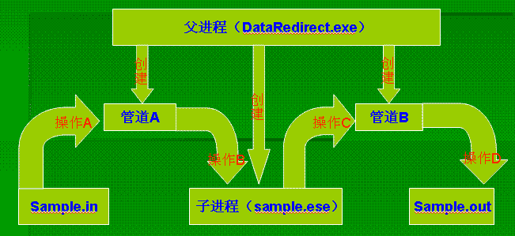
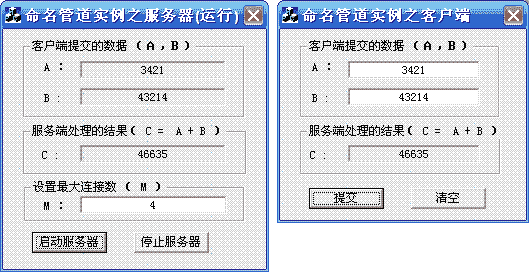

# Windows 系统编程之进程间通信

> 原文：[`www.pediy.com/kssd/pediy08/pediy8-724.htm`](https://www.pediy.com/kssd/pediy08/pediy8-724.htm)

Windows 系统编程之进程间通信

作者：北极星 2003

来源：看雪论坛（`www.pediy.com`）

附件：`windowipc.rar`

Windows 的 IPC（进程间通信）机制主要是异步管道和命名管道。（至于其他的 IPC 方式，例如内存映射、邮槽等这里就不介绍了）

管道（pipe）是用于进程间通信的共享内存区域。创建管道的进程称为管道服务器，而连接到这个管道的进程称为管道客户端。一个进程向管道写入信息，而另外一个进程从管道读取信息。

异步管道是基于字符和半双工的（即单向），一般用于程序输入输出的重定向；命名管道则强大地多，它们是面向消息和全双工的，同时还允许网络通信，用于创建客户端/服务器系统。

## 一、异步管道(实现比较简单，直接通过实例来讲解)

实验目标：当前有 `sample.cpp`, `sample.exe`, `sample.in` 这三个文件，`sample.exe` 为 `sample.cpp` 的执行程序，`sample.cpp` 只是一个简单的程序示例（简单求和），如下：

```cpp
#include <iostream.h>
int main()
{
  int a, b ;
  while ( cin >> a >> b && ( a || b ) )
    cout << a + b << endl ;
  return 0;
}
```

`Sample.in` 文件是输入文件，内容：

```
32 433
542 657
0 0
```

要求根据 `sample.exe` 和它的输入数据，把输出数据重定向到 `sample.out`

流程分析：实际这个实验中包含两个部分，把输入数据重定向到 `sample.exe` 和把输出数据重定向到 `sample.out`。在命令行下可以很简单的实现这个功能“`sample <sample.in >sample.out`”，这个命令也是利用管道特性实现的，现在我们就根据异步管道的实现原理自己来实现这个功能。

管道是基于半双工（单向）的，这里有两个重定向的过程，显然需要创建两个管道，下面给出流程图：



异步管道实现的流程图说明：

1. 父进程是我们需要实现的，其中需要创建管道 A，管道 B，和子进程，整个实现流程分为 4 个操作。
2. 管道 A：输入管道
3. 管道 B：输出管道
4. 操作 A：把输入文件 `sample.in` 的数据写入输入管道（管道 A）
5. 操作 B：子进程从输入管道中读取数据，作为该进程的加工原料。通常，程序的输入数据由标准的输入设备输入，这里实现输入重定向，即把输入管道作为输入设备。
6. 操作 C：子进程把加工后的成品（输出数据）输出到输出管道。通常，程序的输出数据会输出到标准的输出设备，一般为屏幕，这里实现输出重定向，即把输出管道作为输出设备。
7. 操作 D：把输出管道的数据写入输出文件

需要注意的是，管道的本质只是一个共享的内存区域。这个实验中，管道区域处于父进程的地址空间中，父进程的作用是提供环境和资源，并协调子进程进行加工。

程序源码：

```cpp
#include <windows.h> 
#include <iostream.h>

const int BUFSIZE = 4096 ; 
HANDLE  hChildStdinRd, hChildStdinWr, hChildStdinWrDup, 
        hChildStdoutRd,hChildStdoutWr,hChildStdoutRdDup, 
    hSaveStdin,    hSaveStdout; 

BOOL CreateChildProcess(LPTSTR); 
VOID WriteToPipe(LPTSTR); 
VOID ReadFromPipe(LPTSTR); 
VOID ErrorExit(LPTSTR); 
VOID ErrMsg(LPTSTR, BOOL); 
void main( int argc, char *argv[] ) 
{   
  // 处理输入参数
  if ( argc != 4 )
    return ;

  // 分别用来保存命令行，输入文件名（CPP/C），输出文件名（保存编译信息）
  LPTSTR lpProgram = new char[ strlen(argv[1]) ] ;
  strcpy ( lpProgram, argv[1] ) ;
  LPTSTR lpInputFile = new char[ strlen(argv[2]) ];
  strcpy ( lpInputFile, argv[2] ) ;
  LPTSTR lpOutputFile = new char[ strlen(argv[3]) ] ;
  strcpy ( lpOutputFile, argv[3] ) ;     
  
  SECURITY_ATTRIBUTES saAttr; 
  saAttr.nLength = sizeof(SECURITY_ATTRIBUTES); 
  saAttr.bInheritHandle = TRUE; 
  saAttr.lpSecurityDescriptor = NULL; 
  
  /**************************************************************************
   *    redirecting child process's STDOUT  *
   **************************************************************************/
  hSaveStdout = GetStdHandle(STD_OUTPUT_HANDLE); 
  
  if (! CreatePipe(&hChildStdoutRd, &hChildStdoutWr, &saAttr, 0)) 
    ErrorExit("Stdout pipe creation failed\n"); 
    
  if (! SetStdHandle(STD_OUTPUT_HANDLE, hChildStdoutWr)) 
    ErrorExit("Redirecting STDOUT failed"); 
  
  BOOL fSuccess = DuplicateHandle(
    GetCurrentProcess(), 
    hChildStdoutRd,
        GetCurrentProcess(), 
    &hChildStdoutRdDup ,
    0,
        FALSE,
        DUPLICATE_SAME_ACCESS);
    if( !fSuccess )
        ErrorExit("DuplicateHandle failed");
    CloseHandle(hChildStdoutRd);
  
  /**************************************************************************
   *    redirecting child process's STDIN    *
   **************************************************************************/
  hSaveStdin = GetStdHandle(STD_INPUT_HANDLE); 

  if (! CreatePipe(&hChildStdinRd, &hChildStdinWr, &saAttr, 0)) 
    ErrorExit("Stdin pipe creation failed\n"); 
  
  if (! SetStdHandle(STD_INPUT_HANDLE, hChildStdinRd)) 
    ErrorExit("Redirecting Stdin failed"); 
  
  fSuccess = DuplicateHandle(
    GetCurrentProcess(), 
    hChildStdinWr, 
    GetCurrentProcess(),
    &hChildStdinWrDup, 
    0, 
    FALSE,                    
    DUPLICATE_SAME_ACCESS); 
  if (! fSuccess) 
    ErrorExit("DuplicateHandle failed"); 
  CloseHandle(hChildStdinWr);    

  /**************************************************************************
   *      创建子进程（即启动 SAMPLE.EXE）    *
   **************************************************************************/
  fSuccess = CreateChildProcess( lpProgram );
  if ( !fSuccess ) 
    ErrorExit("Create process failed"); 
  
  // 父进程输入输出流的还原设置
  if (! SetStdHandle(STD_INPUT_HANDLE, hSaveStdin)) 
    ErrorExit("Re-redirecting Stdin failed\n"); 
  if (! SetStdHandle(STD_OUTPUT_HANDLE, hSaveStdout)) 
    ErrorExit("Re-redirecting Stdout failed\n"); 

  WriteToPipe( lpInputFile ) ;
  ReadFromPipe( lpOutputFile ) ; 
          delete lpProgram ;
          delete lpInputFile ;
          delete lpOutputFile ;
} 

BOOL CreateChildProcess( LPTSTR lpProgram ) 
{ 
  PROCESS_INFORMATION piProcInfo; 
  STARTUPINFO siStartInfo;
  BOOL bFuncRetn = FALSE; 
  
  ZeroMemory( &piProcInfo, sizeof(PROCESS_INFORMATION) );
  ZeroMemory( &siStartInfo, sizeof(STARTUPINFO) );
  siStartInfo.cb = sizeof(STARTUPINFO); 
  
  bFuncRetn = CreateProcess ( NULL, lpProgram, NULL, NULL, TRUE, \
            0, NULL, NULL, &siStartInfo, &piProcInfo);
  if (bFuncRetn == 0) 
  {
    ErrorExit("CreateProcess failed\n");
    return 0;
  } 
  else 
  {
    CloseHandle(piProcInfo.hProcess);
    CloseHandle(piProcInfo.hThread);
    return bFuncRetn;
  }
}

VOID WriteToPipe( LPTSTR lpInputFile ) 
{ 
  HANDLE hInputFile = CreateFile(lpInputFile, GENERIC_READ, 0, NULL, 
    OPEN_EXISTING, FILE_ATTRIBUTE_READONLY, NULL); 
  if (hInputFile == INVALID_HANDLE_VALUE) 
    return ;

  BOOL fSuccess ;
  DWORD dwRead, dwWritten; 
  CHAR chBuf[BUFSIZE] = {0} ; 
  
  for (;;) 
  { 
    fSuccess = ReadFile( hInputFile, chBuf, BUFSIZE, &dwRead, NULL) ;
    if ( !fSuccess || dwRead == 0)
      break; 

    fSuccess = WriteFile( hChildStdinWrDup, chBuf, dwRead, &dwWritten, NULL) ;
    if ( !fSuccess ) 
      break; 
  } 
    
  if (! CloseHandle(hChildStdinWrDup)) 
    ErrorExit("Close pipe failed\n"); 

  CloseHandle ( hInputFile ) ;
} 

VOID ReadFromPipe( LPTSTR lpOutputFile ) 
{ 
  HANDLE hOutputFile = CreateFile( lpOutputFile, GENERIC_READ|GENERIC_WRITE, 
    FILE_SHARE_WRITE, NULL, CREATE_ALWAYS, FILE_ATTRIBUTE_NORMAL, NULL); 
  if (hOutputFile == INVALID_HANDLE_VALUE) 
    return ;

  BOOL fSuccess ;
  DWORD dwRead, dwWritten; 
  CHAR chBuf[BUFSIZE] = { 0 }; 
  
  if (!CloseHandle(hChildStdoutWr)) 
    ErrorExit("Closing handle failed"); 
  
  for (;;) 
  { 
    fSuccess = ReadFile( hChildStdoutRdDup, chBuf, BUFSIZE, &dwRead, NULL) ;
    if( !fSuccess || dwRead == 0) 
    {
      break; 
    }
    fSuccess = WriteFile( hOutputFile, chBuf, dwRead, &dwWritten, NULL) ;
    if ( !fSuccess ) 
      break; 
  } 

  CloseHandle ( hOutputFile ) ;
} 
VOID ErrorExit (LPTSTR lpszMessage) 
{ 
  MessageBox( 0, lpszMessage, 0, 0 ) ;
}
```

## 二、命名管道

命名管道具有以下几个特征：

1. 命名管道是双向的，所以两个进程可以通过同一管道进行交互。
2. 命名管道不但可以面向字节流，还可以面向消息，所以读取进程可以读取写进程发送的不同长度的消息。
3. 多个独立的管道实例可以用一个名称来命名。例如几个客户端可以使用名称相同的管道与同一个服务器进行并发通信。
4. 命名管道可以用于网络间两个进程的通信，而其实现的过程与本地进程通信完全一致。

实验目标：在客户端输入数据 `a` 和 `b`，然后发送到服务器并计算 `a+b`,然后把计算结果发送到客户端。可以多个客户端与同一个服务器并行通信。

界面设计：



难点所在：


实现的过程比较简单，但有一个难点。原本当服务端使用 `ConnectNamedPipe` 函数后，如果有客户端连接，就可以直接进行交互。原来我在实现过程中，当管道空闲时，管道的线程函数会无限（`INFINITE`）阻塞。若现在需要停止服务，就必须结束所有的线程，`TerminateThread` 可以作为一个结束线程的方法，但我基本不用这个函数。一旦使用这个函数之后，目标线程就会立即结束，但如果此时的目标线程正在操作互斥资源、内核调用、或者是操作共享 `DLL` 的全局变量，可能会出现互斥资源无法释放、内核异常等现象。这里我用重叠 `I/O` 来解决这个问题，在创建 `PIPE` 时使用 `FILE_FLAG_OVERLAPPED` 标志，这样使用 `ConnectNamedPipe` 后会立即返回，但线程的阻塞由等待函数 `WaitForSingleObject` 来实现，等待 `OVERLAPPED` 结构的事件对象被设置。

客户端主要代码：

```cpp
void CMyDlg::OnSubmit() 
{
  // 打开管道
  HANDLE hPipe = CreateFile("\\\\.\\"Pipe\NamedPipe", GENERIC_READ | GENERIC_WRITE, \
    0, NULL, OPEN_EXISTING, FILE_ATTRIBUTE_NORMAL, NULL) ;
  if ( hPipe == INVALID_HANDLE_VALUE )
  {
    this->MessageBox ( "打开管道失败，服务器尚未启动,或者客户端数量过多" ) ;
    return ;
  }

  DWORD nReadByte, nWriteByte ;
  char szBuf[1024] = {0} ;
  // 把两个整数(a,b)格式化为字符串
  sprintf ( szBuf, "%d %d", this->nFirst, this->nSecond ) ;
  // 把数据写入管道
  WriteFile ( hPipe, szBuf, strlen(szBuf), &nWriteByte, NULL ) ;

  memset ( szBuf, 0, sizeof(szBuf) ) ;
  // 读取服务器的反馈信息
  ReadFile ( hPipe, szBuf, 1024, &nReadByte, NULL ) ;
  // 把返回信息格式化为整数
  sscanf ( szBuf, "%d", &(this->nResValue) ) ;
  this->UpdateData ( false ) ;
  CloseHandle ( hPipe ) ;
}
```

服务端主要代码：

```cpp
// 启动服务
void CMyDlg::OnStart() 
{
  CString lpPipeName = "\\\\.\\Pipe\\NamedPipe" ;
  for ( UINT i = 0; i < nMaxConn; i++ )
  {
    // 创建管道实例
    PipeInst[i].hPipe =  CreateNamedPipe ( lpPipeName, PIPE_ACCESS_DUPLEX|FILE_FLAG_OVERLAPPED, \
        PIPE_TYPE_BYTE|PIPE_READMODE_BYTE|PIPE_WAIT, nMaxConn, 0, 0, 1000, NULL ) ;
    if ( PipeInst[i].hPipe == INVALID_HANDLE_VALUE )
    {
      DWORD dwErrorCode = GetLastError () ;
      this->MessageBox ( "创建管道错误！" ) ;
      return ;
    }
    // 为每个管道实例创建一个事件对象，用于实现重叠 IO
    PipeInst[i].hEvent  =  CreateEvent ( NULL, false, false, false ) ;
    // 为每个管道实例分配一个线程，用于响应客户端的请求
    PipeInst[i].hTread = AfxBeginThread ( ServerThread, &PipeInst[i], THREAD_PRIORITY_NORMAL ) ;
  }
  
  this->SetWindowText ( "命名管道实例之服务器(运行)" ) ;
  this->MessageBox ( "服务启动成功" ) ;
}
// 停止服务
void CMyDlg::OnStop() 
{
  DWORD dwNewMode = PIPE_TYPE_BYTE|PIPE_READMODE_BYTE|PIPE_NOWAIT ;
  for ( UINT i = 0; i < nMaxConn; i++ )
  {
    SetEvent ( PipeInst[i].hEvent ) ;
    CloseHandle ( PipeInst[i].hTread ) ;
    CloseHandle ( PipeInst[i].hPipe ) ;
  }
    
  this->SetWindowText ( "命名管道实例之服务器" ) ;
  this->MessageBox ( "停止启动成功" ) ;
}

// 线程服务函数
UINT ServerThread ( LPVOID lpParameter )
{
  DWORD  nReadByte = 0, nWriteByte = 0, dwByte = 0 ;   
  char  szBuf[MAX_BUFFER_SIZE] = {0} ;
  PIPE_INSTRUCT  CurPipeInst = *(PIPE_INSTRUCT*)lpParameter ;
  OVERLAPPED OverLapStruct = { 0, 0, 0, 0, CurPipeInst.hEvent } ;
  while ( true )
  {
    memset ( szBuf, 0, sizeof(szBuf) ) ;   
    // 命名管道的连接函数，等待客户端的连接（只针对 NT）
    ConnectNamedPipe ( CurPipeInst.hPipe, &OverLapStruct ) ;
    // 实现重叠 I/0，等待 OVERLAPPED 结构的事件对象
    WaitForSingleObject ( CurPipeInst.hEvent, INFINITE ) ;
    // 检测 I/0 是否已经完成，如果未完成，意味着该事件对象是人工设置，即服务需要停止
    if ( !GetOverlappedResult ( CurPipeInst.hPipe, &OverLapStruct, &dwByte, true ) )
      break ;

    // 从管道中读取客户端的请求信息
    if ( !ReadFile ( CurPipeInst.hPipe, szBuf, MAX_BUFFER_SIZE, &nReadByte, NULL ) )
    {
      MessageBox ( 0, "读取管道错误！", 0, 0 ) ;
      break ;
    }
    
    int a, b ;
    sscanf ( szBuf, "%d %d", &a, &b ) ;
    pMyDlg->nFirst    = a ;
    pMyDlg->nSecond    = b ;
    pMyDlg->nResValue  = a + b ;
    memset ( szBuf, 0, sizeof(szBuf) ) ;
    sprintf ( szBuf, "%d", pMyDlg->nResValue ) ;
    // 把反馈信息写入管道
    WriteFile ( CurPipeInst.hPipe, szBuf, strlen(szBuf), &nWriteByte, NULL ) ;
    pMyDlg->SetDlgItemInt ( IDC_FIRST, a, true ) ;
    pMyDlg->SetDlgItemInt ( IDC_SECOND, b, true ) ;
    pMyDlg->SetDlgItemInt ( IDC_RESULT, pMyDlg->nResValue, true ) ;
    // 断开客户端的连接，以便等待下一客户的到来
    DisconnectNamedPipe ( CurPipeInst.hPipe ) ;
  }

  return 0 ;
}
```
