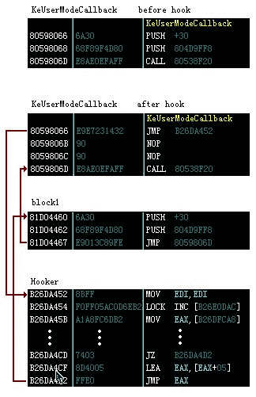

# 360 保险箱反注入分析

> 原文：[`www.pediy.com/kssd/pediy10/102940.html`](https://www.pediy.com/kssd/pediy10/102940.html)

分析版本：360 保险箱 v3.0 正式版（2009.12.1 下载）

分析工具：`syser debugger`、`ida`

使用平台：`XP sp2` 虚拟机

启动的注入进程在进入 `r0` 后总会执行到内核态函数 `KeUsermodeCallback`，而 DLL 注入代码的加载正是依赖此函数的回调机制得以实现。

只要通过 `hook` 方式对函数 `KeUsermodeCallback` 做参数检查，过滤掉 DLL 加载行为，就可以实现指定进程的反 DLL 注入之目的，这正是 360 保险箱反注入方法基础之一。

## 一、预备知识

`KeUsermodeCallback` 是一个未公开的函数，存在于 `ntoskrnl.exe`，被 `win32k.sys` 多处调用，该函数的特殊之处在于提供了一个从内核态调用用户态函数的方法。

函数原型如下：

```c
NTSTATUS KeUserModeCallback (
    IN ULONG ApiNumber,
    IN PVOID InputBuffer,
    IN ULONG InputLength,
    OUT PVOID *OutputBuffer,
    IN PULONG OutputLength
);
```

该函数会向用户态堆栈复制 `InputBuffer` 的内容，并最终通过 `KiUserCallbackDispatcher` 函数来调用用户态回调函数，该回调函数地址是通过 `ApiNumber` 索引值在 `PebKernelCallbackTable` 表中定位得到。当 `ApiNumber` 的值为 `0x42` 时（`XP` 平台），对应的回调函数为 `_ClientLoadLibrary`，该函数会调用 `LoadLibraryW` 来完成注入 DLL 的加载，而加载的 DLL 文件名在 `InputBuffer` 的偏移 `0x28` 处（`XP` 平台）。

## 二、反注入 Hook 安装

360 保险箱对函数 `KeUsermodeCallback` 的 `inline hook` 是在驱动 `safeboxkrnl.sys` 中实现的。本文通过 `syser debugger` 完成了在保险箱的安装和启动过程中对 `safeboxkrnl.sys` 驱动的加载和 `hook` 安装过程的分析。

以下为 `hook` 安装的基本流程：

1. 计算完成 `inline hook` 需要覆盖 `KeUsermodeCallback` 函数的最小长度。
2. 判断函数 `KeUserModeCallback` 是否已被其他软件 `hook`，如果已被 `hook`，则得到覆盖指令的最小长度为 5 字节。
3. 按计算出的长度分配两块空间，用于复制 `KeUserModeCallback` 函数中将被覆盖的指令。其中 `block1` 用于执行原始指令及向原函数跳转，`block2` 用于 `unhook` 时恢复原始指令。
4. 按是否给其他软件 `hook` 过来计算两种情形下 `hook` 流程用到各跳转地址。
5. 初始化并设置自旋锁，锁定内存页，写入 `KeUserModeCallback` 第一条指令，开自旋锁，解锁内存页，`hook` 生效。

在 `IDA` 中完成代码注释如下：

```asm
0135CA sub_135CA proc near
0135CA mov edi, edi
0135CC push ebp
0135CD mov ebp, esp
0135CF push 0FFFFFFFFh
0135D1 push offset unk_180D8
0135D6 push offset _except_handler3
0135DB mov eax, large fs:0
0135E1 push eax
0135E2 mov large fs:0, esp
0135E9 push ecx
0135EA push ecx
0135EB sub esp, 20h
0135EE push ebx
0135EF push esi
0135F0 push edi
0135F1 mov [ebp+var_18], esp
0135F4 mov [ebp+var_24], 0C0000001h
0135FB mov [ebp+var_28], 1
013602 and [ebp+var_4], 0
013606 cmp dword_19D9C, 0
01360D jz short loc_13618
01360F and [ebp+var_24], 0
013613 jmp loc_139A8
013618 loc_13618:
013618 cmp dword_19DB4, 0
01361F jz short loc_1362A
013621 and [ebp+var_24], 0
013625 jmp loc_139A8
01362A loc_1362A:
01362A mov dword_19DB4, 1
013634 cmp dword_1A448, 0FFFFFFFFh ; 用户态回调 ID 为-1 不进行 hook
01363B jnz short loc_13642
01363D jmp loc_139A8
013642 loc_13642:
013642 mov eax, dword_1A448
013647 mov dword_18CA8, eax ; 保存回调函数索引
01364C push 5 ; 不少于 5 字节
01364E push ds:KeUserModeCallback
013654 call sub_11A88 ; 使用 jmp xxxx 做替换时为避免在代码中间截断
013654 ; 需计算代码长度，此函数通过一个长度反汇编
013654 ; 引擎实现截取长度计算
013659 mov NumberOfBytes, eax
01365E cmp NumberOfBytes, 0
013665 jnz short loc_13691 ; 返回值不为 0 则计算长度成功
013667 mov eax, ds:KeUserModeCallback
01366C movzx eax, byte ptr [eax]
01366F cmp eax, 0E9h ; 如果返回值为 0 继续比较 KeUserModeCallback
01366F ; 第 1 条指令是否为 jmp,即判断是否被其他软件
01366F ; hook
013674 jnz short loc_1368C ; 不是 Jmp 则不装 hook
013676 mov NumberOfBytes, 5 ; 如果被 hook 过则需要替换的代码长度为 5
013680 mov dword_19DB0, 1 ; 置标志 KeUserModeCallback 已被其他 hook
01368A jmp short loc_13691
01368C loc_1368C:
01368C jmp loc_139A8
013691 loc_13691:
013691 cmp dword_19DB0, 0 ; hook 标志是否被置位
013698 jnz loc_13819 ; 被置位则转
01369E push 6F4D6153h ; Tag
0136A3 mov eax, NumberOfBytes
0136A8 add eax, 5
0136AB push eax ; NumberOfBytes
0136AC push 0 ; PoolType
0136AE call ds:ExAllocatePoolWithTag ; 按上面计算的长度+5 来申请内存
0136B4 mov dword_19DA0, eax ; 得到指针 dword_19DA0,以下称 block1
0136B9 push 6F4D6153h ; Tag
0136BE push NumberOfBytes ; NumberOfBytes
0136C4 push 0 ; PoolType
0136C6 call ds:ExAllocatePoolWithTag ; 再一次申请，用于复制将被覆盖的
0136C6 ; 代码，unhook 时用于回写
0136CC mov dword_19DA4, eax ; 得到指针 dword_19DA4,以下称 block2
0136D1 mov ecx, NumberOfBytes
0136D7 add ecx, 5
0136DA mov eax, 90909090h
0136DF mov edi, dword_19DA0
0136E5 mov edx, ecx
0136E7 shr ecx, 2
0136EA rep stosd
0136EC mov ecx, edx
0136EE and ecx, 3
0136F1 rep stosb ; block1 用 90h 填充
0136F3 mov ecx, NumberOfBytes
0136F9 mov esi, ds:KeUserModeCallback
0136FF mov edi, dword_19DA0
013705 mov eax, ecx
013707 shr ecx, 2
01370A rep movsd
01370C mov ecx, eax
01370E and ecx, 3
013711 rep movsb ; 复制指定长度 KeUserModeCallback 代码到 block1
013713 mov ecx, NumberOfBytes
013719 mov esi, ds:KeUserModeCallback
01371F mov edi, dword_19DA4
013725 mov eax, ecx
013727 shr ecx, 2
01372A rep movsd
01372C mov ecx, eax
01372E and ecx, 3
013731 rep movsb ; 复制指定长度 KeUserModeCallback 代码到 block2
013733 mov eax, dword_19DA0
013738 add eax, NumberOfBytes
01373E mov byte ptr [eax], 0E9h ; block1 后面的 5 字节中第 1 字节为 jmp 指令
013741 mov eax, ds:KeUserModeCallback
013746 add eax, NumberOfBytes
01374C mov ecx, NumberOfBytes
013752 mov edx, dword_19DA0
013758 lea ecx, [edx+ecx+5]
01375C sub eax, ecx
01375E mov ecx, dword_19DA0
013764 add ecx, NumberOfBytes
01376A mov [ecx+1], eax ; block1 的最后 4 字节为 jmp 指令的操作数
01376A ; 操作数指向 KeUserModeCallback+5
01376D mov eax, ds:KeUserModeCallback
013772 add eax, 5
013775 mov ecx, offset loc_13452 ; byte_13452 为 Hooker 函数地址
01377A sub ecx, eax
01377C mov dword_18CAD, ecx ; dword_18CAD 偏移量指向 Hooker 函数
013782 lea eax, [ebp+Mdl]
013785 push eax ; int
013786 push 10h ; Length
013788 push ds:KeUserModeCallback ; VirtualAddress
01378E call sub_134DA ; 锁定 KeUserModeCallback 前 10h 字节所在
01378E ; 内存页
013793 call ds:KeGetCurrentIrql
013799 movzx eax, al
01379C cmp eax, 2 ; DISPATCH_LEVEL
01379F jge short loc_137BE
0137A1 lea eax, [ebp+SpinLock]
0137A4 push eax ; SpinLock
0137A5 call ds:KeInitializeSpinLock ; 初始化自旋锁
0137AB lea ecx, [ebp+SpinLock] ; SpinLock
0137AE call ds:KfAcquireSpinLock ; 设置自旋锁
0137B4 mov [ebp+NewIrql], al
0137B7 mov [ebp+var_28], 1
0137BE loc_137BE:
0137BE cli
0137BF mov eax, cr0
0137C2 mov [ebp+var_2C], eax ; 存状态
0137C5 and eax, 0FFFEFFFFh
0137CA mov cr0, eax ; 允许写
0137CD mov edi, ds:KeUserModeCallback
0137D3 mov eax, 90h
0137D8 mov ecx, NumberOfBytes
0137DE rep stosb ; 用 nop 抹掉 KeUserModeCallback 前
0137DE ; NumberOfBytes 个字节
0137E0 mov edi, ds:KeUserModeCallback
0137E6 lea esi, unk_18CAC
0137EC mov ecx, 5
0137F1 rep movsb ; 复制 unk_18CAC 处 5 字节到 KeUserModeCallback
0137F3 mov eax, [ebp+var_2C]
0137F6 mov cr0, eax ; 恢复保存的状态
0137F9 sti
0137FA cmp [ebp+var_28], 0
0137FE jz short loc_1380C
013800 mov dl, [ebp+NewIrql] ; NewIrql
013803 lea ecx, [ebp+SpinLock] ; SpinLock
013806 call ds:KfReleaseSpinLock ; 打开自旋锁
01380C
01380C loc_1380C: ; CODE XREF: sub_135CA+234j
01380C push [ebp+Mdl] ; Mdl
01380F call sub_135AA ; 解锁内存页
013814 jmp loc_1399A
013819 ; ---------------------------------------------------------------------------
; KeUserModeCallback 已被其他软件 hook 过
; 函数的处理过程部分流程类似，但 block1 和
; Hooker 调用顺序发生改变
013819 push 6F4D6153h
01381E mov eax, NumberOfBytes
013823 add eax, 5
013826 push eax ; NumberOfBytes
013827 push 0 ; PoolType
013829 call ds:ExAllocatePoolWithTag ; 按计算过的长度+5 来申请 block1
01382F mov dword_19DA0, eax
013834 push 6F4D6153h ; Tag
013839 push NumberOfBytes ; NumberOfBytes
01383F push 0 ; PoolType
013841 call ds:ExAllocatePoolWithTag ; 按计算过的长度来申请 block2
013847 mov dword_19DA4, eax
01384C mov ecx, NumberOfBytes
013852 add ecx, 5
013855 mov eax, 90909090h
01385A mov edi, dword_19DA0
013860 mov edx, ecx
013862 shr ecx, 2
013865 rep stosd
013867 mov ecx, edx
013869 and ecx, 3
01386C rep stosb ; block1 用 90h 填充
01386E mov ecx, NumberOfBytes
013874 mov esi, ds:KeUserModeCallback
01387A mov edi, dword_19DA0


# 三、反注入流程

## 汇编代码

```
013880 mov eax, ecx
013882 shr ecx, 2
013885 rep movsd
013887 mov ecx, eax
013889 and ecx, 3
01388C rep movsb ; 复制指定长度 KeUserModeCallback 代码到 block1
01388E mov ecx, NumberOfBytes
013894 mov esi, ds:KeUserModeCallback
01389A mov edi, dword_19DA4
0138A0 mov eax, ecx
0138A2 shr ecx, 2
0138A5 rep movsd
0138A7 mov ecx, eax
0138A9 and ecx, 3
0138AC rep movsb ; 复制指定长度 KeUserModeCallback 代码到 block2
0138AE mov eax, dword_19DA0
0138B3 mov eax, [eax+1]
0138B6 mov ecx, ds:KeUserModeCallback
0138BC lea eax, [ecx+eax+5]
0138C0 mov [ebp+var_34], eax ; Hooker 函数的绝对地址
0138C3 mov eax, dword_19DA0
0138C8 mov byte ptr [eax], 0E9h ; block1 第 1 字节为 E9h
0138CB mov eax, dword_19DA0
0138D0 add eax, 5
0138D3 mov ecx, offset loc_13452 ; byte_13452 为 Hooker 函数地址
0138D8 sub ecx, eax
0138DA mov eax, dword_19DA0
0138DF mov [eax+1], ecx ; block1 开始的指令为跳转到 Hooker 函数
0138E2 mov eax, dword_19DA0
0138E7 add eax, NumberOfBytes
0138ED mov byte ptr [eax], 0E9h ; block1 第 6 字节为 E9h
0138F0 mov eax, dword_19DA0
0138F5 add eax, 0Ah
0138F8 mov ecx, [ebp+var_34]
0138FB sub ecx, eax
0138FD mov eax, dword_19DA0
013902 mov [eax+6], ecx ; block1 第 7-10 字节指向原来被 hook 过的地址
013905 mov eax, ds:KeUserModeCallback
01390A add eax, 5
01390D mov ecx, dword_19DA0
013913 sub ecx, eax
013915 mov dword_18CAD, ecx ; dword_18CAD 指向 block1
01391B lea eax, [ebp+var_38]
01391E push eax ; int
01391F push 10h ; Length
013921 push ds:KeUserModeCallback ; VirtualAddress
013927 call sub_134DA ; 锁定指定内存页
01392C call ds:KeGetCurrentIrql
013932 movzx eax, al
013935 cmp eax, 2 ; DISPATCH_LEVEL
013938 jge short loc_13957
01393A lea eax, [ebp+SpinLock]
01393D push eax ; SpinLock
01393E call ds:KeInitializeSpinLock ; 初始化自旋锁
013944 lea ecx, [ebp+SpinLock] ; SpinLock
013947 call ds:KfAcquireSpinLock ; 置自旋锁
01394D mov [ebp+NewIrql], al
013950 mov [ebp+var_28], 1
013957
013957 loc_13957: ; CODE XREF: sub_135CA+36Ej
013957 cli
013958 mov eax, cr0
01395B mov [ebp+var_2C], eax ; var_2C 存状态
01395E and eax, 0FFFEFFFFh
013963 mov cr0, eax ; 允许写
013966 mov edi, ds:KeUserModeCallback
01396C lea esi, unk_18CAC
013972 mov ecx, 5
013977 rep movsb ; 复制 unk_18CAC 处 5 字节到 KeUserModeCallback
013979 mov eax, [ebp+var_2C]
01397C mov cr0, eax ; 恢复保存的状态
01397F sti
013980 cmp [ebp+var_28], 0
013984 jz short loc_13992
013986 mov dl, [ebp+NewIrql] ; NewIrql
013989 lea ecx, [ebp+SpinLock] ; SpinLock
01398C call ds:KfReleaseSpinLock ; 解锁
013992
013992 loc_13992: ; CODE XREF: sub_135CA+3BAj
013992 push [ebp+var_38] ; Mdl
013995 call sub_135AA ; 解锁内存页
01399A
01399A loc_1399A: ; CODE XREF: sub_135CA+24Aj
01399A mov dword_19D9C, 1
0139A4 and [ebp+var_24], 0
0139A8
0139A8 loc_139A8: ; CODE XREF: sub_135CA+49j
0139A8 ; sub_135CA+5Bj ...
0139A8 or [ebp+var_4], 0FFFFFFFFh
0139AC jmp short loc_139C0
0139AE ; ---------------------------------------------------------------------------
0139AE
0139AE loc_139AE: ; DATA XREF: .rdata:000180DCo
0139AE xor eax, eax
0139B0 inc eax
0139B1 retn
0139B2 ; ---------------------------------------------------------------------------
0139B2
0139B2 loc_139B2: ; DATA XREF: .rdata:000180E0o
0139B2 mov esp, [ebp+var_18]
0139B5 mov [ebp+var_24], 0C0000001h
0139BC or [ebp+var_4], 0FFFFFFFFh
0139C0
0139C0 loc_139C0: ; CODE XREF: sub_135CA+3E2j
0139C0 and dword_19DB4, 0
0139C7 mov eax, [ebp+var_24]
0139CA mov ecx, [ebp+var_10]
0139CD mov large fs:0, ecx
0139D4 pop edi
0139D5 pop esi
0139D6 pop ebx
0139D7 leave
0139D8 retn
0139D8 sub_135CA endp
```

当驱动中完成反注入 hook 安装后，`KeUserModeCallback` 流程发生了哪些变化，从虚拟机的 `syser` `debugger` 中的截图可以更直观的看到这一改变。

请对比贴图中 `KeUserModeCallback` 函数被 hook 前后的流程，`Hooker` 为过滤函数，完成 `KeUserModeCallback` 参数检查及相关过滤。`Block1` 是 `KeUserModeCallback` 前 7 字节的复制，后 5 字节完成向原函数跳转。



注：如果在 hook 安装之前，`KeUserModeCallback` 曾被其他软件 hook，那么流程会与上图不同，`KeUserModeCallback` 的第一条指令会先指向 `block1`，然后再指向 `Hooker`。

## Hooker 代码注释

```
013452 loc_13452: ; DATA XREF: sub_135CA+1ABo
013452 ; sub_135CA+309o
013452 mov edi, edi
013454 lock inc dword_19DAC
01345B mov eax, dword_18CA8
013460 cmp eax, 0FFFFFFFFh ; 检查回调函数 ID 是否有效
013463 jz short loc_134BA ; 无效转原函数
013465 mov eax, [esp+4] ; 取堆栈中回调函数索引 ApiNumber
013469 cmp eax, dword_18CA8 ; 是否与回调 ID 相同
01346F jnz short loc_134BA ; 不同转原函数
013471 mov eax, [esp+0Ch] ; 取 InputBuffer 长度
013475 cmp eax, 0
013478 jz short loc_134BA ; InputBuffer 长度为 0 转原函数
01347A mov eax, [esp+8] ; 得到 InputBuffer 内容
01347E cmp eax, 0
013481 jz short loc_134BA ; 无内容转原函数
013483 push eax
013484 mov eax, ds:NtBuildNumber ; 取版本信息
013489 movzx eax, word ptr [eax]
01348C cmp eax, 1770h
013491 jb short loc_13499 ; 小于 1770h 是 XP。。
013493 pop eax
013494 lea eax, [eax+30h] ; vista 注入的文件名偏移:30h
013497 jmp short loc_1349D
013499 ; ---------------------------------------------------------------------------
013499
013499 loc_13499: ; CODE XREF: 013491j
013499 pop eax
01349A lea eax, [eax+28h] ; XP 注入的文件名偏移:28h
01349D
01349D loc_1349D: ; CODE XREF: 013497j
01349D test eax, eax
01349F jz short loc_134BA ; 文件名为空转原函数
0134A1 push eax
0134A2 call sub_132AA ; 进程 ID 及黑白名单的过滤
0134A7 test eax, eax
0134A9 jnz short loc_134BA ; 返回 1 不过滤 执行原函数
0134AB lock dec dword_19DAC
0134B2 mov eax, 0C0000001h ; 过滤掉，返回 STATUS_UNSUCCESSFUL
0134B7 retn 14h
0134BA ; ---------------------------------------------------------------------------
0134BA
0134BA loc_134BA: ; CODE XREF: 013463j
0134BA ; 01346Fj ...
0134BA lock dec dword_19DAC
0134C1 mov eax, dword_19DB0
0134C6 test eax, eax ; 被其他软件 hook 过吗
0134C8 mov eax, dword_19DA0 ; block1 地址
0134CD jz short loc_134D2
0134CF lea eax, [eax+5] ; 如果被 hook 过则转到 block1+5
0134D2
0134D2 loc_134D2: ; CODE XREF: 0134CDj
0134D2 jmp eax ; 没被 hook 过则转到 block1
```

`360` 保险箱反注入部分与其他模块仍有很多耦合，分析不够全面不可避免，还望高手指正。

`bambooooo` `2009.12.11`
