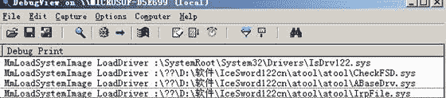

# 利用堆栈回溯来编写驱动防火墙

> 原文：[`www.pediy.com/kssd/pediy11/124938.html`](https://www.pediy.com/kssd/pediy11/124938.html)

通过堆栈回溯来挂钩未导出函数`MmLoadSystemImage`来进行拦截驱动，在这里感谢`sudami`大牛的帮助，本文已发在 2010《黑客防线》第 11 期杂志上，代码如下：

```
代码:
```


```
#include <ntddk.h>
#include <windef.h>
#include <stdio.h>
#include <string.h>
#include "MmLoadSystemImage.h"


#define pwszModuleName L"ntoskrnl.exe" //这里只考虑单核的情况

#define ObjectNameInformation  1

UCHAR oldcode[5]={0};
UCHAR jmpcode[5]={0xE9,0x00,0x00,0x00,0x00};

ULONG g_ntoskrnl_addr=0;

ULONG g_ntoskrnl_size=0;

ULONG oldExAllocatePoolWithTagaddr=0;

ULONG Address_MmLoadSystemImage=0;//通过栈回溯（技术难点）得到 MmLoadSystemImage 函数的地址

/*这里说明一下原先通过东方微点的 Mp110003 的驱动是通过 Hook KeWaitForSingleObject,然后通过栈回溯来找到 MmLoadSystemImage 的地址，但是通过我跟踪堆栈调用,发现要经过很多次 KeWaitForSingleObject 调用，才会进入到
KeWaitForSingleObject
MmLoadSystemImage
NtSetSystemInformation
nt!KiFastCallEntry
nt!ZwSetSystemInformation
反正是猥琐，我就更猥琐，大米兄就是这么干的，调用流程中来找到 MmLoadSystemImage 地址，调用过程如下：
ExAllocatePoolWithTag
MmLoadSystemImage
NtSetSystemInformation
nt!KiFastCallEntry
nt!ZwSetSystemInformation
因此我直接 HOOK ExAllocatePoolWithTag 来进行栈回溯
*/
__declspec(naked) PVOID fake_ExAllocatePoolWithTag(
                                                  IN POOL_TYPE  PoolType,
                                                  IN SIZE_T  NumberOfBytes,
                                                  IN ULONG  Tag)
{
      ULONG *PEBP;
   
      _asm{
         mov  edi,edi
         push ebp     
         mov  ebp,esp
         mov eax,[ebp+0xc] //参数是 NumberOfBytes
         cmp eax,0x100
         jnz end
         mov eax,[ebp+0x10] //第三个参数 Tag
         cmp eax,0x6E4C6D4D //标志为"nLmM",也就是 MmLoadSystemImage 装载的镜像标志
      jnz end
       
         mov eax,[ebp]  //堆栈回溯的原理
      mov eax,[eax+4]
         push eax        //上一个函数的地址
      call StackTrace_for_ExAllocatePoolWithTag     
end:
         mov  eax,oldExAllocatePoolWithTagaddr
         add  eax,5
         jmp  eax
    }
}


//通过栈回溯找到 
ULONG StackTrace_for_ExAllocatePoolWithTag(ULONG RetAddress)
{
  ULONG CallAddress=0;
  ULONG JmpOffset=0;
  
  if (RetAddress)
  {
  CallAddress=(ULONG)RetAddress-  5 ;//Ret ---->call Address
  //跳转的偏移量
  JmpOffset=*(ULONG*)((PUCHAR)CallAddress+1); //(PUCHAR)CallAddress+1--->指针 CallAddress 往后走一位,(PULONG)CallAddress+1,指针 CallAddress 往后走（sizeof(ULONG)=4）字节
  //MmLoadSystemImage 函数的地址
  Address_MmLoadSystemImage=(ULONG)CallAddress + 5 +JmpOffset;
  KdPrint(("MmLoadSystemImage Address=0x%x\n",Address_MmLoadSystemImage));
  //加入判定如果 ntoskrnl.Base<Address_MmLoadSystemImage<ntoskrnl.Base+size,则说明可以进行 inlineHook_MmLoadSystemImage()
  if (Address_MmLoadSystemImage>g_ntoskrnl_addr&&Address_MmLoadSystemImage<(g_ntoskrnl_addr+g_ntoskrnl_size))
  {
    unlineHook_ExAllocatePoolWithTag(); 
  inlineHook_MmLoadSystemImage(); 
    KdPrint(("inlineHook MmLoadSystemImage Success!")); 
  }    
  }
  return 0;     
}


__declspec(naked) NTSTATUS OrigimMmLoadSystemImage(
                                                  IN PUNICODE_STRING ImageFileName,
                                                  IN PUNICODE_STRING NamePrefix OPTIONAL,
                                                  IN PUNICODE_STRING LoadedBaseName OPTIONAL,
                                                  IN ULONG LoadFlags,
                                                  OUT PVOID *ImageHandle,
                                                  OUT PVOID *ImageBaseAddress)
{
  __asm{
            push 174h 
      mov eax,Address_MmLoadSystemImage
      add eax,5
      jmp eax 
  }
}


//拦截驱动的过程
NTSTATUS fake_MmLoadSystemImage(
                                                  IN PUNICODE_STRING ImageFileName,
                                                  IN PUNICODE_STRING NamePrefix OPTIONAL,
                                                  IN PUNICODE_STRING LoadedBaseName OPTIONAL,
                                                  IN ULONG LoadFlags,
                                                  OUT PVOID *ImageHandle,
                                                  OUT PVOID *ImageBaseAddress)
{
  ANSI_STRING ImageName;
 
  RtlUnicodeStringToAnsiString(&ImageName,ImageFileName,TRUE);

  KdPrint(("MmLoadSystemImage LoadDriver :%s\n",ImageName.Buffer));
  
  return OrigimMmLoadSystemImage(ImageFileName,
                                                  NamePrefix,
                                  LoadFlags,
                                  LoadFlags,
                                  ImageHandle,
                                  ImageBaseAddress);

}


NTSTATUS DriverEntry(IN PDRIVER_OBJECT DriverObject,IN PIRP Irp)
{
   NTSTATUS status;
    
   PEPROCESS crsEProc; 
   ANSI_STRING TestSysName;
   SYSTEM_LOAD_AND_CALL_IMAGE sysImage;

    
   DriverObject->DriverUnload=DriverUnload;
   status=PsLookupProcessByProcessId((ULONG)GetCsrPid(),&crsEProc); 
   if (!NT_SUCCESS(status))
   {
     KdPrint(("PsLookupProcessByProcessId() error\n"));
     return status;
   }    
    
   
   //通过 DriverObject->DriverSection 获得加载驱动的模块
   if (GetBase((ULONG)DriverObject)&&inlineHook_ExAllocatePoolWithTag())
  {
     //下面是调用 ZwSetSystemInformation 来加载驱动，从而引发跳转到 fake_ExAllocatePoolWithTag 中,先依附进 csrss.exe,再加载测试驱动
     KeAttachProcess(crsEProc);
     //加载测试驱动; 
     RtlInitAnsiString(&TestSysName,"\\??\\c:\\Hooksys.sys");
     RtlAnsiStringToUnicodeString(&(sysImage.ModuleName),&TestSysName,TRUE);
   status= ZwSetSystemInformation(SystemExtendServiceTableInformation,&sysImage,sizeof(sysImage));
     if (!NT_SUCCESS(status))
     {          
       KdPrint(("Driver STATUS=0X%x\n",status));
   }
  
  KeDetachProcess();   
  }
    
  return STATUS_SUCCESS;
}

NTSTATUS DriverUnload(IN PDRIVER_OBJECT DriverObject )
{

  unlineHook_MmLoadSystemImage();
  KdPrint(("DriverUnload!\n"));
  return   STATUS_SUCCESS;

}


//得到模块的基址和映像大小
int GetBase(IN ULONG  EntryAddress)
{
  ULONG  listHead;
  ULONG  currentList;
    ULONG  NameAddress;
  int reault=0;
    
   listHead=*(ULONG*)(EntryAddress+0x14);
   currentList=*(ULONG*)(listHead+0x4); //Blink
   
    
   if (currentList!=listHead)
   {
      while (1)
      {       
    NameAddress=*(ULONG*)(currentList+0x030); 
      if ((PCWSTR)NameAddress!=NULL)
      {
        KdPrint(("ModuleName=%ws\n",(PCWSTR)NameAddress));
    }
            
    if(!_wcsicmp((PCWSTR)NameAddress,pwszModuleName))
        {
           g_ntoskrnl_addr=*(ULONG*)(currentList+0x18);
       g_ntoskrnl_size=*(ULONG*)(currentList+0x20);
       KdPrint(("ntoskrnl.exe [base]=0x%X,[size]=0x%X\n",g_ntoskrnl_addr,g_ntoskrnl_size));
       reault=1;
       break;
    }
               
      currentList=*(DWORD*)(currentList + 0x4);//下一个 Blink 
      if (currentList == listHead)
    {
          KdPrint(("链表查询结束!\n"));
      break;
    }

    }       
   }
     
    return reault;
 
}

PVOID GetInfoTable(ULONG ATableType)
{
    ULONG mSize=0x4000;
  PVOID mPtr=NULL;
  NTSTATUS status;

    do 
    {
       mPtr=ExAllocatePool(PagedPool,mSize);
     memset(mPtr, 0, mSize);
     if (mPtr)
     {
       status = ZwQuerySystemInformation(ATableType,mPtr,mSize,NULL);
     }else
    return NULL;
     if (status == STATUS_INFO_LENGTH_MISMATCH)
     {
       ExFreePool(mPtr);
     mSize *=2;
     }   
  } while(status == STATUS_INFO_LENGTH_MISMATCH);
        
   if (status == STATUS_SUCCESS)
   return mPtr;
    
   ExFreePool(mPtr);
   return NULL;   
}


//得到 csrss.exe 的 PID
HANDLE GetCsrPid()
{
  HANDLE Process,hObject;
  HANDLE CsrssId=(HANDLE)0;
  OBJECT_ATTRIBUTES obj;
  CLIENT_ID cid;
  UCHAR buff[0x100];
  POBJECT_NAME_INFORMATION objName=(PVOID)&buff;
  PSYSTEM_HANDLE_INFORMATION_EX Handles;
  ULONG i;

   
   Handles=GetInfoTable(SystemHandleInformation);
   if (!Handles) return CsrssId;
    
   for (i=0;i<Handles->NumberOfHandles;i++)
   {
      if (Handles->Information[i].ObjectTypeNumber == 21)
      {
        InitializeObjectAttributes(&obj,NULL,OBJ_KERNEL_HANDLE,NULL,NULL);
      cid.UniqueProcess=(HANDLE)Handles->Information[i].ProcessId;
    cid.UniqueThread = 0;
       
    if (NT_SUCCESS(NtOpenProcess(&Process,PROCESS_DUP_HANDLE,&obj,&cid)))
    {
        if (NT_SUCCESS(ZwDuplicateObject(Process,(HANDLE)Handles->Information[i].Handle,NtCurrentProcess(),&hObject,0,0,DUPLICATE_SAME_ACCESS)))
        {
           if (NT_SUCCESS(ZwQueryObject(hObject, ObjectNameInformation, objName, 0x100, NULL)))
         {
                   if (objName->Name.Buffer&& !wcsncmp(L"\\Windows\\ApiPort",objName->Name.Buffer,20))
                   {
                     
      CsrssId=(HANDLE)Handles->Information[i].ProcessId;
            
           }

         }      
      ZwClose(hObject); 
      }

        ZwClose(Process);
    }     
    
    }
    
   }
  
ExFreePool(Handles);

return CsrssId;
}


//inline Hook ExAllocatePoolWithTag
BOOLEAN inlineHook_ExAllocatePoolWithTag()
{
    KIRQL  oldIrql;
  DWORD distance; 
  UNICODE_STRING unamestr;
    BOOLEAN result;

    RtlInitUnicodeString(&unamestr,L"ExAllocatePoolWithTag");
    oldExAllocatePoolWithTagaddr=(ULONG)MmGetSystemRoutineAddress(&unamestr);
    if (oldExAllocatePoolWithTagaddr)
    {
  //保存原来开始的 5 个字节
   RtlCopyMemory(oldcode,(BYTE*)oldExAllocatePoolWithTagaddr,5); 
   distance=(BYTE*)fake_ExAllocatePoolWithTag - (BYTE*)oldExAllocatePoolWithTagaddr -5;
   RtlCopyMemory(jmpcode+1,&distance,4);
   WPOff();
   oldIrql=KeRaiseIrqlToDpcLevel();
   RtlCopyMemory((BYTE*)oldExAllocatePoolWithTagaddr,jmpcode,5);
   KeLowerIrql(oldIrql);
   WPOn();
   result=TRUE;   
  }else
    result=FALSE;

   return result;
}


VOID unlineHook_ExAllocatePoolWithTag()
{
  KIRQL  oldIrql;
  
  WPOff();
  oldIrql=KeRaiseIrqlToDpcLevel();
  RtlCopyMemory((BYTE*)oldExAllocatePoolWithTagaddr,oldcode,5);
  KeLowerIrql(oldIrql);
  WPOn();

  return;
}


BOOLEAN inlineHook_MmLoadSystemImage()
{
   KIRQL  oldIrql;
   DWORD distance;   
   BOOLEAN result;

   if (Address_MmLoadSystemImage)
   {
   //保存原来开始的 5 个字节
   RtlCopyMemory(oldcode,(BYTE*)Address_MmLoadSystemImage,5);
   distance=(BYTE*)fake_MmLoadSystemImage - Address_MmLoadSystemImage -5;
   RtlCopyMemory(jmpcode+1,&distance,4);
   WPOff();
   oldIrql=KeRaiseIrqlToDpcLevel();
   RtlCopyMemory((BYTE*)Address_MmLoadSystemImage,jmpcode,5);
   KeLowerIrql(oldIrql);
   WPOn();
   result=TRUE;
    
   }else
    result=FALSE;
    
  return result;
}

VOID unlineHook_MmLoadSystemImage()
{
  KIRQL  oldIrql;
  
  WPOff();
  oldIrql=KeRaiseIrqlToDpcLevel();
  RtlCopyMemory((BYTE*)Address_MmLoadSystemImage,oldcode,5);
  KeLowerIrql(oldIrql);
  WPOn();

  return;


  
}


VOID WPOn()
{
     __asm{
         mov eax,cr0
         or eax,0x10000
         mov cr0,eax
         STI
  }
 
}

VOID WPOff()
{
  __asm{
         cli   
      mov eax, cr0
         and eax,not 0x10000
      mov cr0,eax
      }
  
}
```


效果示意图：


