# [翻译]操作系统编程导论

> 原文：[`www.pediy.com/kssd/pediy12/132964.html`](https://www.pediy.com/kssd/pediy12/132964.html)

这一系列文章的标题是叫做：`BosoKernel : une introduction a la programmation de systemes d'exploitation`，本想取个“靓”点的中文名，可惜标题原文实在太过质朴，且文章内容稍显单薄，遂放弃，后以“导论”二字引之(望各位看众贡献个更合适的名字)。

现在教习 `OS DIY` 的文章可谓满大街都是，那我为什么又把这篇文章从法国拐来？原因是最近学习法文，用来练手:)——因为是法文新手，望各位看众不吝指教一二。

今天先把翻译好的前两章放出来，因为最近事情多，可能后几章会小小的滞后，望各位谅解。

原文见：`http://www.pouet.free.fr/docs/boso/tutorial00.html` (有些地方可能访问不到)

`4.28` 更新第三章

`6.16` 更新第四章

已经把原文做成 `CHM` 格式上传

`BosoKernel.zip`

## 1. 前言

### 1.1 介绍

编写一个内核是一种了解操作系统如何运行的好方法。但这需要时间，耐心以及强有力的神经。

这份文档的目的在于引导这些像我一样的，有一天，我们想编写一个自己的内核，但是不知道从哪儿开始的人。

通过每一个例子，我将会一步步地，尽可能详尽地讲解一个基于 `Intel` 架构的内核如何运转以及如何编写。

我在系统编程上也是一个新手，并且这份文档是不完整的，或许还有一些错误。你们可以把你们的意见传达给我 `am@bocal.cs.univ-paris8.fr`。这个我开始着手开发的 Kernel 叫做“`BosoKernel`”(`Bocal Operating System Original Kernel`)。

### 1.2 先决条件

这个内核完全由汇编语言编写。我们不能忽视这种语言。对于那些不懂得用汇编编程的人，有许多网站提供了教程。有个相当不错的网站是 `"Art of Assembly Language"` (`webster.cs.ucr.edu`)。

`386` 的汇编语言并不难学。可惜的是，为了能够清楚认识并测试那些用汇编编写的小程序，据我所知，比较好的工具就是 `DOS` 下的 `"Debug"` 了。

想要理解这篇文档，熟悉 `i386` 处理器架构很重要。不过，那些重要的概念会逐步地在文档中被解释。

### 1.3 工具

当务之急，我们需要一个汇编程序。我用的是 `"nasm"`，`"http://www.web-sites.co.uk/nasm/"`，它具有开源以及跨平台的优势。因此，我在一台装有 `Solaris` 的机器上使用它没有任何问题。为了测试我们写好的程序，最好是使用一个 `PC` 模拟器。我用的是 `"Bochs"`，`"http://bochs.com/"`，它具有在多平台执行的优势。使用模拟器可以一步步跟踪程序的执行以及更容易除错。这个工具可以省下第二台 `PC`，也可以省下你不断地开机重启的时间，还可以使得调试变得非常简单。

## 2. 实现一个引导扇区

### 2.1 引导扇区是什么？

引导扇区是一个程序，它位于一个存储介质或者一个分区上的第一个扇区，并在 `PC` 启动时被装载。这个扇区上的程序的任务原则上是为了装载内核到内存并且执行。这个内核可能存在于软盘，硬盘，磁带或者所有其它磁性存储介质的开始部分。这份教程详述了发生在从软盘启动时的操作，然而这里阐明的基本概念对于其它所有磁性存储介质同样有效。

### 2.2 加载引导扇区到内存

在启动时，`PC` 初始化并测试处理器和外围设备。这个阶段是 `"Power On Self Test"`(`POST`)。接着，`PC` 执行了一个位于 `ROM` 的程序——`BIOS`，`BIOS` 试图读入并加载位于盘片上的第一个引导扇区到内存：`"Master Boot Record"`(`MBR`)。如果在软盘驱动器找到 `MBR`，它会被加载到内存地址 `0000:7C00` 处。否则，`BIOS` 在其他的存储介质查找 `MBR`(硬盘，`CDROM`,等等)。一旦 `MBR` 加载到内存，`BIOS` 将执行权转交给 `MBR` 包含的一小段代码。

`MBR` 包含了一段代码，同样也包含了一些数据。在这之中，有分区表。这个表包含了有关磁盘分区的信息(它们从哪里开始，大小，等等)。标准的 `MBR` 在分区表中查找活动分区，接着，如果存在这样的分区(活动分区)，加载这个分区的引导扇区到内存地址 `0000:7C00` 处。通常，第二个引导扇区用来加载内核并将执行权转交给内核。

例如，在 `Linux` 下，这更加复杂，因为为了能够启动一个操作系统的内核(可能是支持 `Multi-boot` 规范的)，经常加载三个引导扇区。`MBR` 在启动时首先被加载。如果检测到一个活动分区，则这个分区的引导扇区被加载并执行(因此我们加载了第二个引导扇区)。这个扇区包含一个程序`"LILO"`，`"LILO"` 以交互的形式，加载与用户选择的系统相关的第三个引导扇区。而这个最后的扇区加载并启动内核。

### 2.3 显示一条消息的引导扇区

我们设计了一个只显示一条消息的引导扇区。这个程序的代码很简单，它显示了一条欢迎消息：

```asm
;prog01 :
;--------
[BITS 16]  ; 告诉 nasm 程序工作在 16 位模式
[ORG 0x0]
; 初始化段寄存器为 0x07C0
    mov ax,0x07C0
    mov ds,ax
    mov es,ax
    mov ax,0x8000
    mov ss,ax
    mov sp, 0xf000
; 显示一条消息
    mov si,msgDebut
    call afficher
end:
    jmp end
;--- 变量---
msgDebut  db  "Hello world !",13,10,0
;-----------------
;---------------------------------------------------------
; 简介：显示一个以 0x0 结束的字符串
; 入口：DS:SI -> 指向字符串
;---------------------------------------------------------
afficher:
    push ax
    push bx
.debut:
    lodsb    ; ds:si -> al
    cmp al,0  ; 串的结束？
    jz .fin
    mov ah,0x0E  ; 调用 BIOS 中断 0x10 的 0x0E 号服务
    mov bx,0x07  ; bx -> 属性, al -> 字符的 ASCII 码
    int 0x10
          jmp .debut
.fin:
    pop bx
    pop ax
    ret
;--- 填充 NOP 直到 510 ---
times 510-($-$$) db 144
dw 0xAA55
```

这个程序做了什么？

首先指明所有的代码和数据的编码执行于 `16` 位模式，这是缺省的模式。这还不是程序的开头，它只不过是一个编译器指令，用来生成 `16` 位的可执行文件而不是 `32` 位的。

```asm
[BITS 16]  ; 告诉 nasm 程序工作在 16 位模式
```

程序由初始化段寄存器`'ds'`和`'es'`开始。这两个寄存器指定数据段位于哪个内存区域。必须将数据段初始化成从 `0x7C00` 开始，因为这是引导扇区被加载到内存的地址。

```asm
; 初始化段寄存器为 0x07C0
mov ax,0x07C0
mov ds,ax
mov es,ax
```

然后初始化堆栈段(`ss`)和堆栈指针(`sp`)，使堆栈从 `0x8F000` 开始，在 `0x80000` 结束。

```asm
mov ax,0x8000
mov ss,ax
mov sp, 0xf000
```

因此，我们：

*   堆栈从 `0x8F000` 开始，结束于 `0x80000`；
*   数据段从 `0x07C00` 开始，结束于 `0x17C00`；
*   引导扇区被加载到 `0x07C00` 至 `0x07CFF` 这段内存区域。

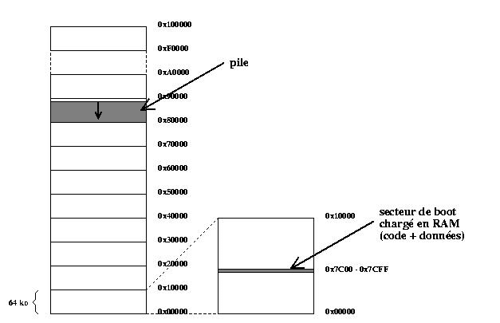

一旦主要的寄存器初始化完成，`'afficher'`函数被调用。它在显示屏上显示由`'msgDebut'`指向的消息。这个函数调用了 `BIOS` 中断 `0x10` 的 `0x0E` 号服务，这个服务能够显示一个字符到显示屏并明确的指定其属性(色彩，亮度……)。当然也可以直接写一条信息到显示屏而不使用 `BIOS` 提供的功能，但是目前的做法更容易让人理解。耐心点！

```asm
; 显示一条消息
mov si,msgDebut
call afficher
```

消息显示后，程序进入循环且不做任何事。

```asm
end:
    jmp end
```

在文件的末尾，我们定义了程序中用到的变量和函数。一开始显示的字符串就是`'msgDebut'`：

```asm
msgDebut  db  "Hello world !",13,10,0
```

随后，定义了`'afficher'`函数。它接收由寄存器 `DS` 和 `SI` 指向的字符串参数。`DS` 等同于数据段的地址，`SI` 是相对于这个段开始地址的一个偏移(偏移量)。

作为参数传递的字符串必须以等于 `0` 的字节结束(就像 `C` 语言那样)。

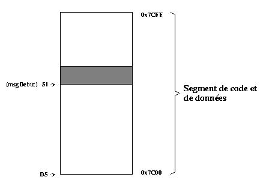

在文件结束的地方，有下述的编译器指令：

```asm
;--- 填充 NOP 直到 510 ---
times 510-($-$$) db 144
dw 0xAA55
```

这个指令以空指令(`NOP` 机器码为 `0x90` 即十进制的 `144`)填充剩下的文件空间并以字 `0xAA55` 结束，而且这个生成的二进制文件刚好 `512` 字节。扇区末尾的字 `0xAA55` 是公认的有效 `MBR` 的标记。

### 2.4 实践：编译并测试引导扇区程序

将这个程序写入一个命名为`"bootsect.asm"`的文件。为了用 `nasm` 编译并获得二进制文件`"bootsect"`，应该执行以下命令：

```bash
$ nasm -f bin -o bootsect bootsect.asm
```

为了启动引导扇区，我们应该把二进制文件拷贝到一个软盘：

```bash
$ dd if=bootsect of=/dev/fd0
```

接下来应该插入这个软盘并重启机器。这是相当痛苦的，因为 `PC` 在开机启动时或长或短地做了一堆的测试，并且调试功能非常有限。幸好，有一个可以运行于多平台的 `PC` 模拟器：`"bochs"`。

这个模拟器和一份明白易懂的文档一同发布，我希望你能够试一试它。

## 3. 加载内核

### 3.1 介绍

先前的章节展示了一个引导程序如何从一块软盘加载。而且先前见过的程序也仅仅显示了一条消息。

正常情况下，一个引导程序的最终目的是为了加载内核(或者更糟的是另外一个引导扇区)。这就是我们在这里看到的。

这章更加复杂，因为它涉及到实现两个程序：一个引导扇区和一个内核。占用了软盘第一个扇区的引导程序，显示了一条消息，将内核加载到内存中我们指定的地址并将执行权交给了内核。这个内核相当简陋，它只是显示了一条消息。

### 3.2 一个更加完整的引导程序

下面的程序是引导扇区的程序。它与先前章节内的代码相差不大。

```asm
%define BASE  0x100

%define KSIZE  1  ; 要加载的 512 字节的扇区的数目
[BITS 16]
[ORG 0x0]
jmp start
%include "UTIL.INC"

start:
  mov [bootdrv],dl  ; 保存启动设备的标识
; 初始化段地址为 0x07C0
  mov ax,0x07C0
  mov ds,ax
  mov es,ax
  mov ax,0x8000
  mov ss,ax
  mov sp, 0xf000
; 显示一条消息
  mov si,msgDebut
  call afficher
; 加载内核
  xor ax,ax
  int 0x13
  push es
  mov ax,BASE
  mov es,ax
  mov bx,0
  mov ah,2
  mov al,KSIZE
  mov ch,0
  mov cl,2
  mov dh,0
  mov dl,[bootdrv]
  int 0x13
  pop es
; 跳转到内核
  jmp dword BASE:0

msgDebut  db  "Chargement du kernel",13,10,0

bootdrv: db 0

;; 填充 NOP 直到 510
times 510-($-$$) db 144
dw 0xAA55
```

这个程序从一个跳转到地址`'start'`的指令开始。指令`'include'`在内核代码中增加了文件`'UTIL.INC'`的内容。这个文件包含了先前见过的函数`'afficher'`的代码：

```asm
    jmp start
    %include "UTIL.INC"
    start:
```

接下来，程序存储了一个数字到变量中，它用来识别外部引导设备(这里是软盘盘符)。这个变量后来还会被用来指明应当从哪类外部设备加载内核。

```asm
    mov [bootdrv],dl  ; 保存启动设备的标识
```

这个内核位于软盘开始处的第二个扇区。为了将内核加载到内存，我们使用 `BIOS` 中断 `0x13`。这个中断函数在`"The Art of Assembly"`(`webster.cs.ucr.edu/page_asm/artofassembly/ch13/ch13-2.html#HEADING2-73`)有详尽的解释。它可以从软盘复制一个或者多个扇区到内存。在本例中，我们拷贝了软盘的第二个扇区，即包含内核的扇区，到内存地址 `0x1000`。变量 `KSIZE` 定义了要加载的扇区数量，使完整的内核正确地加载到内存。随后的部分所描述的这个早期的内核的代码相当简短。在我的机器上，生成的相应二进制文件是 `69` 个字节，因此我们可以仅设置 `KSIZE` 的值为 `1` 来拷贝一个单独的扇区。

```asm
; 加载内核
  xor ax,ax
  int 0x13
  push es
  mov ax,BASE
  mov es,ax
  mov bx,0
  mov ah,2
  mov al,KSIZE
  mov ch,0
  mov cl,2
  mov dh,0
  mov dl,[bootdrv]
  int 0x13
  pop es
```

接下来，用一个跳转指令跳转到内核代码开始执行。定义了宏`'BASE'`使得指令指针指向地址 `0x1000`：

```asm
    ; 跳转到内核
    jmp dword BASE:0
```

### 3.3 相当简单的早期内核

这是内核程序：

```asm
[BITS 16]
[ORG 0x0]
jmp start
%include "UTIL.INC"

start:
; 初始化段地址为 0x100
  mov ax,0x100
  mov ds,ax
  mov es,ax
  mov ax,0x8000
  mov ss,ax
  mov sp, 0xf000
; 显示一条消息
  mov si,msg00
  call afficher

end:
  jmp end

msg00: db 'Kernel is speaking !',10,0
```

### 3.4 编译并测试

代码分成一个引导扇区代码文件和一个内核代码文件。文件 `UTIL.INC` 仅仅是一种包含了函数`'afficher'`的函数库：

```bash
    $ ls
    UTIL.INC bootsect.asm kernel.asm
```

分别编译各个程序：

```bash
$ nasm -f bin -o bootsect bootsect.asm
$ nasm -f bin -o kernel kernel.asm

$ ls -l
total 14
-rw-r--r--   1 am       users        492 Jan 17 17:20 UTIL.INC
-rw-r--r--   1 am       users        512 Jan 19 18:16 bootsect
-rw-r--r--   1 am       users        715 Jan 17 17:22 bootsect.asm
-rw-r--r--   1 am       users        297 Jan 17 17:50 kernel.asm
-rw-r--r--   1 am       users         69 Jan 19 18:16 kernel
```

我们注意到引导扇区的二进制文件刚好 `512` 字节，而生成的内核二进制文件只有 `69` 字节。我们制作的软盘将内核放进了第二个扇区。用以下命令生成软盘映像：

```bash
$ cat bootsect kernel /dev/zero | dd of=floppy bs=512 count=2880
$ ls -l floppy
-rw-r--r--   1 am       users    1474117 Jan 19 18:27 floppy
```


## 4. 进入保护模式

### 4.1 为什么要进入保护模式？

PC 的微处理器有三种运行模式：

- 实模式，微处理器的默认模式，提供与 `8086` 相同的功能。也因此，在这个模式下，不能对大于 `1MB` 的内存地址进行寻址。
- 保护模式能够发掘微处理器的更高性能。在这个模式下能够进行 `4G` 内存地址空间的寻址并提供了对多任务和多用户系统的实现的支持。
- 虚拟 `8086` 模式是一个能让为 `8086` 编写的程序运行于多用户系统的模式。

我们的目标是实现一个多用户，多任务并能够寻址整个内存的内核，这就必须把处理器切换到保护模式。这在编程方面有很大影响。首先，保护模式下的寻址机制(下面将详述)，不同于实模式下的(我们一直用到现在的)。部分因为这，不可能再依赖于 `BIOS` 的例程去访问外部设备，且所有的驱动程序需要重写。

### 4.2 如何从实模式切换到保护模式

从实模式切换到保护模式很简单，只要满足将寄存器 `CR0` 的 `bit0` 位置 `1`。

```
mov eax,cr0
or ax,1
mov cr0,eax    ; PE 位置 1 (CR0)
```

然而尽管这样做足以改变模式，可是一旦保护模式建立，这并不能让一个程序持续运行。

在改变模式前，一些结构体必须被正确的初始化。这些结构体使得我们能够正确的在内存中寻址，它们将会在下面的部分被详细介绍。

### 4.3 保护模式下的内存寻址

#### 4.3.1 不同类型的地址

对于程序员来说有三种地址：逻辑地址，线性地址和物理地址。

逻辑地址，由一个段选择子和一个偏移组成，它直接被程序员操作当程序员想要访问一个特定的内存区域时。选择子指向一块特定大小的内存区域(一个内存段)，偏移是这块内存区域中相对于其基地址的一个位移量。分段部件将逻辑地址转变为一个 `32` 位的线性地址。分页部件将线性地址转变为物理地址。如果分页没有被启用，线性地址便等同于物理地址。

一开始，我们只用分段机制。分页机制更加难以实现。此外，我们可以不使用虚拟内存，它并不是必需的。

下面的示意图说明了保护模式下寻址的原理：

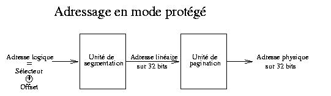

#### 4.3.2 分段机制

内存段由这些 `64bits` 的结构体来描述，称为段描述符，它们被存储在一个叫做 `GDT`(`Global Descriptor Table`)的表里。一个描述符明确指出一个段在内存中的的开始地址，结束地址，段属性(代码段，数据段，堆栈段，等等)以及其他信息。

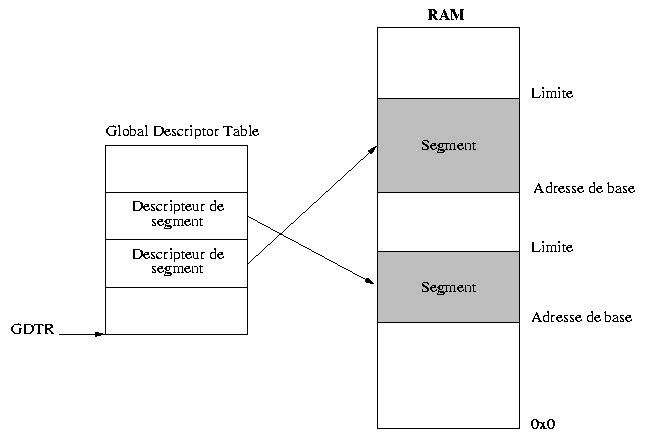

为了在一个特定的内存区域寻址，必须指明处于什么样的段中。选择子，由程序员直接使用，或许可以认为它是指向 `GDT` 中段描述符的指针。段描述符提供段的开始地址(段基址)和结束地址(段界限)。线性地址通过段基址和偏移相加获得。下面的示意图描述了这个机制：

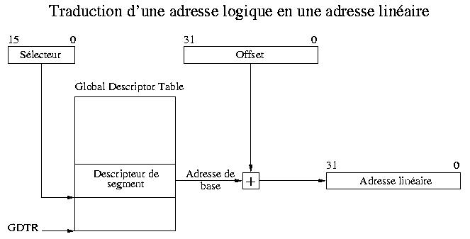

#### 4.3.3 段描述符

下面的示意图显示了一个段描述符的结构：

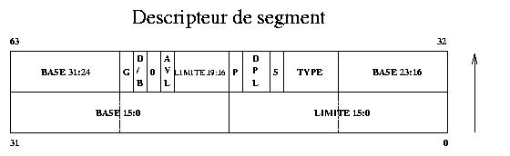

- `base`(基地址)，`32` 位，是内存中段的开始线性地址。
- `limite`(段界限)，`16` 位，定义段的长度。如果 `G` 位置 `0`，段界限表现为字节，否则，表现为 `4k` 页的数量。
- `type`(段类型)定义了段的类型，例如代码段，数据段以及堆栈段。
- `S` 位置 `1` 即为段描述符，置 `0` 即为系统段描述符(一种特殊的描述符，我们以后会见到)。
- `DPL` 指明段的权限级别。`0` 级别对应于超级用户模式。
- `P` 位用来确定段是否存在于物理内存中。如果存在则置 `1`。
- `D/B` 位指定指令和操作数长度。如果指定为 `32bits` 的话，置 `1`。
- `AVL` 位可以自由使用(译者：建议保留)。

下面的示意图描述了代码段描述符和数据段描述符的模型：

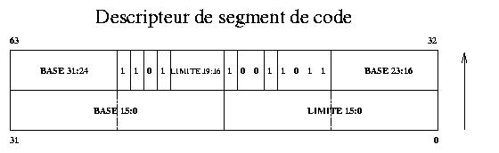

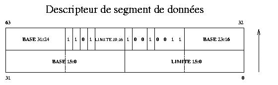

我们注意到 `G` 位被置为 `1`(界限表现为页)，代码是 `32` 的(`D/B` 位置 `1`)，`P` 位置 `1`(段在内存中存在)，权限级别为 `0`(超级用户模式)，`S` 位置为 `1` 指明是一个段描述符，`type` 的值表明我们处理的是代码段(更详细的可以查看 `Intel` 手册)。

为了能够在整个内存寻址，段基址必须是 `0x0`，使得段从内存的开始处开始，其段界限必须是 `0xFFFFF` 且粒度位(即 `G` 位)置 `1` 使其大小为 `4G`。

### 4.4 在什么时候进入保护模式

在启动引导的时候有几个时机可以切换到保护模式：引导扇区程序执行的时候或者当内核执行的时候。

原则上在内核未运行前切换到保护模式这种方式更加简单。这样内核就只需要用仅能在保护模式下运行的 `32` 位指令编写。如果是让内核来执行切换将会加大代码额外的复杂度：内核将必须由 `16` 位和 `32` 位代码两部分组成。

由于这个原因，我们在引导扇区代码执行到保护模式的切换。

### 4.5 切换到保护模式的引导程序

`'bootsect.asm'` 文件：

```asm
%define  BASE  0x100  ; 0x0100:0x0 = 0x1000
%define KSIZE  1

[BITS 16]
[ORG 0x0]
jmp start
%include "UTIL.INC"

start:
  mov [bootdrv],dl  ; recuperation de l'unite de boot

; initialisation des segments en 0x07C0
  mov ax,0x07C0
  mov ds,ax
  mov es,ax

  mov ax,0x8000  ; stack en 0xFFFF
  mov ss,ax
  mov sp, 0xf000

; affiche un msg
  mov si,msgDebut
  call afficher

; charger le noyau
  xor ax,ax
  int 0x13
  push es
  mov ax,BASE
  mov es,ax
  mov bx,0
  mov ah,2
  mov al,KSIZE
  mov ch,0
  mov cl,2
  mov dh,0
  mov dl,[bootdrv]
  int 0x13
  pop es

; initialisation du pointeur sur la GDT
  mov ax,gdtend  ; calcule la limite de GDT
  mov bx,gdt
  sub ax,bx
  mov word [gdtptr],ax
  xor eax,eax    ; calcule l'adresse lineaire de GDT
  xor ebx,ebx
  mov ax,ds
  mov ecx,eax
  shl ecx,4
  mov bx,gdt
  add ecx,ebx
  mov dword [gdtptr+2],ecx

; passage en modep
  cli
  lgdt [gdtptr]  ; charge la gdt
  mov eax,cr0
  or ax,1
  mov cr0,eax    ; PE mis a 1 (CR0)
  jmp next

next:
  mov ax,0x10    ; segment de donne
  mov ds,ax
  mov fs,ax
  mov gs,ax
  mov es,ax
  mov ss,ax
  mov esp,0x9F000

  jmp dword 0x8:0x1000    ; reinitialise le segment de code

;--------------------------------------------------------------------
bootdrv: db 0
msgDebut  db  "Chargement du kernel",13,10,0
;--------------------------------------------------------------------

gdt:
  db 0,0,0,0,0,0,0,0
gdt_cs:
  db 0xFF,0xFF,0x0,0x0,0x0,10011011b,11011111b,0x0
gdt_ds:
  db 0xFF,0xFF,0x0,0x0,0x0,10010011b,11011111b,0x0
gdtend:
;--------------------------------------------------------------------

gdtptr:
  dw  0  ; limite
  dd  0  ; base
;--------------------------------------------------------------------

;; NOP jusqu'a 510
times 510-($-$$) db 144
dw 0xAA55
```

这个引导扇区程序跟以前看到的很相似。

我们将外部引导设备的编号存进一个变量，接着初始化与代码段和数据段相关的寄存器，然后显示一条消息。接下来，把内核加载到内存地址 `0x1000` 处。

在切换到保护模式之前，必须先初始化 `GDT`，使得在进入新的模式之后没有寻址上的问题。`GDT` 应当包含代码段，数据段和堆栈段的描述符。下面的代码声明并初始化了 `GDT`：

```asm
gdt:
  db 0,0,0,0,0,0,0,0
gdt_cs:
  db 0xFF,0xFF,0x0,0x0,0x0,10011011b,11011111b,0x0
gdt_ds:
  db 0xFF,0xFF,0x0,0x0,0x0,10010011b,11011111b,0x0
gdtend:
```

标号 `'gdt:'` 是指向全局描述符表开头的指针。每个描述符为 `8` 字节。表头的 `8` 字节不使用(我并不知道准确的原因，但是 `386` 处理器手册很清楚的指明：第一个描述符不能使用)。第二个是代码段描述符，用标号 `'gdt_cs:'` 指向它，这样同时使得代码更清晰。

不同的描述符被初始化以便代码段描述符和数据段描述符能够在整个内存寻址。这里的只是个范例，它们的寻址空间在内存中是混合叠加的。

下面的图表显示了代码段和数据段描述符被初始化成能够寻址整个内存空间：

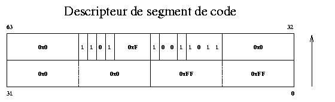

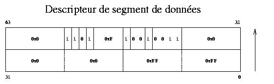

我们注意到这些段的基地址被设置为 `0`，段界限被设置为 `0xFFFFF`(由于 `G` 位被置为 `1`，这里的数字指的是页的数目)。

从头看这个程序。

程序在显示了一条消息以及将内核加载到内存地址 `0x1000` 后。接下来就开始进行实模式到保护模式的转换了！

首先禁止中断。这是必须的，因为当系统的寻址方式改变，中断调用的例程不再有效，它们需要重新编程。用指令 `'cli'` 禁止中断。

```asm
cli
```

代码段和数据段描述符已经定义好并且 `GDT` 已经被正确的初始化。接下来必须告诉处理器 `GDT` 已准备好。这时候轮到寄存器 `GDTR` 发挥作用了，寄存器 `GDTR` 有 `6` 个字节长，它包含了 `GDT` 在内存中的基地址以及 `GDT` 的界限。

在我们的例子中，`'gdtptr'` 是一个指针，它指向一个包含要装载到寄存器 `GDTR` 的内容的结构体。结构体 `'gdtptr'` 在文件的末尾声明并初始化：

```asm
gdtptr:
  dw  0  ; limite
  dd  0  ; base
```

接下来用 `GDT` 的基地址和界限来初始化这个结构：

```asm
; initialisation du pointeur sur la GDT
mov ax,gdtend  ; calcule la limite de GDT
mov bx,gdt
sub ax,bx
mov word [gdtptr],ax
xor eax,eax    ; calcule l'adresse lineaire de GDT
xor ebx,ebx
mov ax,ds
mov ecx,eax
shl ecx,4
mov bx,gdt
add ecx,ebx
mov dword [gdtptr+2],ecx
```

接下来用指令 `'lgdt'` 将结构加载到寄存器 `GDTR`：

```asm
lgdt [gdtptr]  ; charge la gdt
```

一旦寄存器 `GDTR` 被初始化，我们就能够进入保护模式。

切换到保护模式相当简单，只要修改寄存器 `CR0` 的 `bit 0`(置 `1`)：

```asm
; passage en modep
mov eax,cr0
or ax,1
mov cr0,eax    ; PE mis a 1 (CR0)
```

注意，切换到保护模式的处理器还剩下一个棘手的难题要解决：预置代码段及数据段选择子。

接下来的一条指令对于正确地清空处理器缓存是必要的：

```asm
jmp next
next:
```

接下来，我们打算预置数据段选择子。寄存器 `DS,ES,FS,GS` 是特殊的，它们默认是用来装载数据段的选择子(处理器的架构使得使用多个数据段成为可能，但在我们的例子中，我们让其指向相同的内存段)。

为了指向一个数据段，选择子必须指向 `GDT` 内相应的描述符。将其设置为对应描述符在表内的偏移。在我们的例子中，这个偏移是 `16` 字节(`16` 进制为 `0x10`)。将这些选择子初始化为这个值：

```asm
mov ax,0x10    ; segment de donne
mov ds,ax
mov fs,ax
mov gs,ax
mov es,ax
```

接下来初始化堆栈段寄存器及堆栈指针：

```asm
mov ss,ax
mov esp,0x9F000
```

随后的代码运行位于物理内存 `'0x1000'` 处的内核代码。这些指令是必要的，它们不仅能运行内核代码，而且能正确的设置代码段选择子并指向正确的描述符(`GDT` 表内偏移 `0x8` 处)以及初始化指令指针：

```asm
jmp dword 0x8:0x1000
```

就到这里了！引导扇区代码已经完成。再看看为数不多的内核代码吧……

### 4.6 一个简单的内核

#### 4.6.1 代码

```asm
[BITS 32]
[ORG 0x1000]

; Affichage d'un message par ecriture dans la RAM video
mov byte [0xB8000],'H'
mov byte [0xB8001],0x57
mov byte [0xB8002],'E'
mov byte [0xB8003],0x57
mov byte [0xB8004],'L'
mov byte [0xB8005],0x57
mov byte [0xB8006],'L'
mov byte [0xB8007],0x57
mov byte [0xB8008],'O'
mov byte [0xB8009],0x57
end:
  jmp end
```

这个内核显示一条消息后接着进入死循环。在这个时候，`BIOS` 的那些能够显示字符到屏幕的例程已经不能使用。要想在屏幕上显示消息，我们只有自己编写相应的显示例程。

#### 4.6.2 显示一些东西到屏幕上

显存被映射到物理内存地址 `0xB8000`。我们能够直接操作从这个地址开始的一系列字节来显示一些消息。

显示屏幕由 `25` 行，`80` 列组成。屏幕上的每个字符在内存中由 `2` 个字节来描述，一个字节包括显示字符的 `ASCII` 码，随后的字节包含其属性(颜色，闪烁……)。

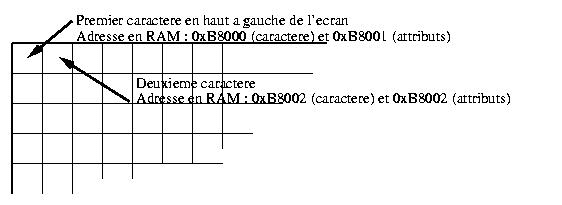

下面的示意图显示了一个字符的属性如何编码：


下面的代码在屏幕的左上方显示了一个白色前景色，品红色背景色的字符 `'H'`。

```asm
mov byte [0xB8000],'H'
mov byte [0xB8001],0x57
```

接下来，我们在屏幕的左上方显示一个单词 `'HELLO'`。下面是 `bochs` 运行得到的：

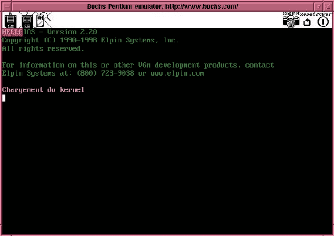
