# 数字基因组测图 - 高级二进制分析技术

> 原文：[`www.pediy.com/kssd/pediy08/pediy8-801.htm`](https://www.pediy.com/kssd/pediy08/pediy8-801.htm)

9 月专题第 029 号文章

原文标题：`digital genome mapping`

**数字基因组测图 - 二进制恶意软件高级分析**

| 项目 | 内容 |
| :--- | :--- |
| 文档编号 | `S002-F000` |
| 原作者 | Ero Carrera and Gergely Erdélyi |
| 译者 | 月中人 `[PTG]` |
| 审校 | |
| 发布时间 | `2007-01-11` |
| 原文 | `DIGITAL GENOME MAPPING - ADVANCED BINARY MALWARE ANALYSIS` |
| 关键词 | 逆向工程, `IDA`, `Python`, 插件, 可视化, 图形, 相似, 匹配, 算法 |
| 备注 | **`DIGITAL GENOME MAPPING` `CARRERA & ERDÉLYI` `VIRUS BULLETIN CONFERENCE SEPTEMBER 2004`** (P187-197) F-Secure Corporation Anti-Virus Research Team, Tammasaarenkatu 7, 00181, Helsinki, Finland. Tel +358 9 2520 0700 • Fax +358 9 2520 5001 • Email `ero.carrera@f-secure.com` • `gergely.erdelyi@f-secure.com` |

**摘要**

`Windows` 二进制恶意软件已经达到相当高的水平。现今一般的蠕虫经常是数十或数百 `KB` 的代码，其表现出的复杂性甚至超过一些操作系统。鉴于恶意软件达到这样的复杂程度以及势不可挡的推陈出新，迫切要求我们改进分析技术和工具。

本文详述如何使用图论帮助分析。我们希望通过使用图形和扩展通用的 `Interactive Disassembler Pro` 软件包，减少了解复杂恶意软件的结构所需要的时间。在寻找不同恶意软件变体以及变形的异同点当中已经证明这些方法是有帮助的。

通过把已知代码剔除，可以减少不必要的浪费并集中精力于它们的差异，以便进行快速分析和恶意软件分类。

# 1 简介

鉴别和分析二进制程序的逆向工程师们(特别是从事反病毒业和辩论界的)如今面临着一个挑战：其对手的数量正以难以想象的速度增长。

分析师面临的一些困难：

* 待检查样本的净数量。
* 每个样本需要分析的代码量。
* 从其他软件中识别出恶意软件版本及变体。

这些问题大部分能够用适当的自动化和算法来解决。本文将给出从原型提炼出来的构想和成果。我们将介绍一个基于 `Interactive Disassembler Pro` 和 `Python` 编程语言的新平台。其设计目标是帮助进一步研究原型和高级分析。

我们的工具成果将用来识别可执行文件结构中的相似功能。我们依赖的理论基础是图论，通过查看代码的图形表现形式来分析程序。利用它们达到必需的抽象层次，而且容易区分出二进制程序结构中的一般功能部分。

# 2 `IDA PRO` 编程

从事二进制代码分析者往往收集和使用一大堆不同工具。除了一个好用的十六进制编辑器之外，最常用的工具大概是 `Interactive Disassembler Pro` (`IDA`) ^([1])。`IDA` 由于它非常多功能、灵活和可扩展而受到欢迎。`IDA` 已经具备的卓越功能还能够通过内建的脚本语言和已编译插件进一步扩大。下一节我们将扼要地回顾一下这两种扩展方法。

## 2.1 `IDC`

从 `IDA` 的脚本语言--`IDC` 开始学习 `IDA` 编程是个好方法。`IDC` 语法与 `ANSI` 标准 `C` 语言非常相似的，有经验的 `C` 程序员不会觉得陌生。不同之处在于 `IDC` 是一个解释型语言，它不需要象 `C` 程序那样经历乏味的"写程序-编译-链接"开发周期。

`IDC` 附带的大量内建函数能够处理反汇编过程许多方面，包括目标程序的结构和数据。所有函数的语义学与常规的 `C` 函数很相近，能够从名称了解其大概功能。

下面这个简单程序是一个 `IDC` 代码范例。它是个普通的异或 `0xFF` 解密器，破译一个从光标当前位置开始并且以零结束的 `ASCII` 码字符串。

```c
#include <idc.idc>

static main ()
{
 auto baseaddr;
 auto key;
 auto c;
 baseaddr = ScreenEA();
 key = 0xFF;
 while (1)
 {
  c = Byte(baseaddr);
  if (c == 0) { break; }
  PatchByte(baseaddr, c ^ key);
  baseaddr++;
 }
}
```

## 2.2 插件

如果 `IDC` 不能满足代码的需要，我们还能求助于编写 `IDA` 插件。`IDA` 附带的 `SDK` 为插件定义了大量 `API`。与 `IDC` 不同的是，`API` 可以让你访问到 `IDA` 数据库最本质的细节以及反汇编的方方面面。由于这种深层的操纵权，`IDA` 插件可以具有难以置信的能力。

插件用 `C++` 语言开发，可以用 `Borland`、`Microsoft`、`Watcom` 或 `GNU C++` 编译器编译。

由于代码被编译成本地的二进制码，所以运行速度与一般的本地应用程序无异。需要编译同时也是它的主要缺点，这让开发过程变得乏味。另一个问题是一个小的隐错会使整个 `IDA` 应用程序崩溃，还可能会损坏数据库。下面的例子展示了异或解密器的插件实现（除了其中的插件管理代码）。

```cpp
void decode (void)
{
 ea_t baseaddr;
 uchar key;
 uchar c;
 baseaddr = get_screen_ea();
 key = 0xFF;
 while (1)
 {
  c = get_byte(baseaddr);
  if (c == 0) { break; }
  patch_byte(baseaddr, c ^ key);
  baseaddr++;
 }
}
```

代码的外观没有改变很多。跟相当的 `IDC` 函数比较，`IDA` 的 `API` 函数名字会略微长一点，而且目的性更明确。为了实现一些 `IDC` 函数的相当功能，常常需要使用几个 `IDA` `API` 调用和数据转换。

# 3 改变的必要性

`IDC` 和编写插件有什么问题吗？一般来讲没有。只要是 `IDA` 力所能及的，它们当中任何一个都能正确实现。但是这里要考虑其他情况。`C` 和 `C++` 语言无可争议的流行和优势并不自动意味着它们是每个任务的最佳选择。由于 `C` 语言缺少复杂、抽象的数据结构，它不适合做快速开发和原型制作。而在 `C` 语言上的 `C++` 扩展语法显然不是很容易记忆的。`C` 和 `C++` 语言的效率优于它的可表达性，在程序员要花时间追求计算能力的时候这是合理的。然而，随着机器的计算能力越来越廉价，花费人力节省时钟周期不再是解决问题的首选了。

那么，什么工具比较好呢？

下结论之前需要调查 `IDA` 扩展中最常用的实用程序。据我们所知，两种最常用的是：

* 实验性的逆向工程工具
* 恶意软件快速分析工具。

实验性工具更新换代很快，如果开发环境支持对代码和接口经常改变那么显然是有利的。编程语言和工具一定不能束缚研究人员的能力，只要是需要那样的代码就不要求做实质性修改。

出于分析恶意软件的目的而编写代码通常用来解决专一的问题，而且典型地不被重复利用。编写解密器破译不同的恶意软件字符串密码器就是这类好例子。依照我们的经验，这些工具不太经常能够充分地被重复利用，因为即便是同一系列的恶意软件也有很大变化。

这两种情形况下，开发所需时间都比运行速度更要紧。以上事实让我们得出一个结论，即我们需要一种表达能力强、允许快速原型制作和可嵌入应用程序的语言。现代的最高级脚本语言能够容易地满足这些需求。在评估了几种现代脚本语言之后我们选择了 `Python` 语言。

## 3.1 什么是 `Python` 语言？

引用自 `Python` 网站：

“`Python` 是一个解释的、交互式的、面向对象的程序语言。常与 `Tcl`、`Perl`、`Scheme` 或 `Java` 语言相比拟。

“`Python` 兼有卓越的能力和非常清晰的语法。它有模块、类、异常、很高层的动态数据类型、和动态类型定义。既有对许多系统调用和库的接口，又有对各种不同的窗口化系统(`X11`、`Motif`、`Tk`、`Mac`、`MFC`)的接口。新的内建模块容易地用 `C` 或 `C++` 语言编写。`Python` 也可用作某些应用程序的扩展语言提供一个可编程接口。” ^([2])

尽管 `Python` 的历史可追溯到十年前，但是它最近才得到主流认识。该语言正在不断地进化，而 `Python` 开发者们也能维持对旧有源程序代码优良的向后兼容性。

`Python` 运动的一句广告语是：“内含套件”。在标准发布里面包含有大多数任务必需的所有模块。这些模块的功能包括从简单的数据处理到服务器应用程序组件。从简单的实用工具到科学计算和数字捣弄，也有大量的第三方模块可用。

## 3.2 为什么用 `Python`？

`Python` 的许多特性使得它很适合我们的需要。它易学 - 任何先前有编程经验的人都能相当快地学会使用。在 `Python` 网站上有很好的新手教程 ^([3])。

该语言是面向对象的，而且支持不同的抽象代码和数据结构，这使得它可以容易地表达复杂算法。`Python` 内建支持列表、字典(散列)和元组。用 `C` 语言需要几页来实现的算法，使用它们只须几行就能够表达。这给测试构想提供了一个理想的实验场。如果构思当中有不对的东西只须丢弃代码，丝毫不必觉得可惜。而在一大段代码中改正了所有指针错误和拼写错误之后又丢弃这段代码则是相当痛苦的。

任何东西都会有缺点，当然 `Python` 也不例外。最显著的是运行速度。程序是解释型的，有时会比 `C/C++` 实现慢 2 到 20 倍。在运行速度是主要因素的地方，`Python` 可能不是最佳选择。但是，`Python` 非常容易用 `C/C++` 加以扩展。为了解决性能问题，多数情况是把计算密集部份谨慎地分离出来用 `C/C++` 扩展模块实现。`Python` 代码提速的另一个方法是使用即时(`JIT`)编译器 `Psyco` ^([4])，可以获得多明显的加速取决于代码的类型。

# 4 初识 `IDAPYTHON`

我们的努力促成 `IDAPython` 的出现，为使用 `IDA` 的原始能力提供了一个用户界面友好的最高级语言。智能型 `IDAPython` 是一个包装 `IDA` `API` 的 `IDA` 插件，作为一个扩展模块实现 `API` 到 `Python` 环境的连接。`IDA` 里面运行的脚本能够访问 `IDA` `API`，也能访问所有已安装的 `Python` 模块。

`IDAPython` 有若干模块，形成三个层：

1.  低级 `IDA` `API` 包装层
2.  有类定义的 `IDA` `API` 用户层
3.  `IDC` 兼容性和实用工具模块

下图解释 `IDAPython` 的结构：

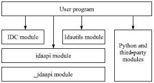

图 1. `IDAPython` 体系结构。

## 4.1 低级包装层

低级 `API` 层直接对 `IDA` `API` 进行 `Python` 包装。这个模块静态链接入 `IDAPython` 插件而且能够用 `'_idaapi'` 这个名字导入。包装代码由 `Simplified Wrapper Interface Generator` (`SWIG`) ^([5]) 生成。`_idaapi` 直接反映 `C++` `IDA` `API`，函数名字、参数和返回值不变。除了少许例外，`IDA` 的 `SDK` 文档也直接用于 `Python` 包装层 - 尽管在 `C++` 和 `Python` 语义学上有差别的地方修改是免不了的。在插件软件包里提供了与 `IDA` `API` 官方有差别的文档。差别主要涉及某些函数，它们的返回数据放在参数中、或者它们使用复杂的或例外的参数。例如：

`IDA` `C++` `API` version:

```cpp
char *get_func_name(
 ea_t ea,
 char *buf,
 size_t bufsize);
```

该函数的 `C++` 版本要求函数地址和一个指针大小为 `bufsize` 的输出缓冲区。如果成功返回输出缓冲区的地址，如果发生错误则返回 `NULL`。在 `Python` 里面没有输出缓冲区指针的概念，所以我们必须修改函数定义使之有意义。

`Python` `_idaapi` module version:

```python
_idaapi.get_name(from, ea)
```

该函数的 `Python` 版本中，如果成功，包装层为输出字符串分配内存并返回一个 `Python` 字符串，而如果函数失败则返回 `None`。其他函数也必须有类似的改变。

这个模块不应该被直接使用，所有函数和数据是供给在下一节讲述的更高层模块使用。

## 4.2 用户层

用户层模块名为 `'idaapi'`，是 `'_idaapi'` 模块顶上的一个弱层。它包含其下模块的所有函数和数据，而且为所包装的 `C++` 类、结构和联合增加 `Python` 的类定义。通过使用这些类，复杂数据结构能够用普通的 `class.member` 符号存取。

大多数需要访问 `IDA` `API` 的用户程序应该使用这个模块。

## 4.3 `IDC` 兼容性模块

既然大部分有经验的 `IDA` 用户熟悉 `IDC` 语言，所以开发一个兼容性模块。所有的 `IDC` 定义从 `'idc'` 模块自动被导入，给有 `IDC` 经验用户提供一个熟悉的环境。它也使得把 `IDC` 脚本移植到 `Python` 更加容易。`IDC` 模块的开发意图是要达到最大限度兼容，但某些函数因为在 `Python` 库中有本地实现而被移除。目前的情形是超过半数以上的 `IDC` 函数已经被实现，最终目标是实现所有在 `Python` 环境中可用的函数。

## 4.4 `Idautils` 模块

为了让关键地方使用低级函数变得轻松一点，建立一个新模块。`Idautils` 模块包含归类函数，它们包装最经常使用的低级代码。例子包括函数提供一系列结果表示法，这些结果可能是事先用 `*First()` 和 `*Next()` 类型的调用和复杂的循环条件收集的。`'idautils'` 正在开发当中，而且它将会扩展任何适合加入的功能。所有的函数一律用 `Python` `docstrings` 评注，因此容易用它们作试验。下一节中的一个简单的例子突出这个模块的好处。

# 5 示例

为了示范新方式的优点，我们将实现一个相对简短的程序。该程序的目的是列举一个给定代码段里面所有被定义的函数，并且列出是哪里调用它们的。这种工具典型的输出结果如下所示：

```text
Function _start at 0x8048520
Function call_gmon_start at 0x8048544
 called from _start(0x8048543)
 called from .init_proc(0x804848e)
Function __do_global_dtors_aux at 0x8048570
 called from .term_proc(0x8048741)
Function frame_dummy at 0x80485b0
 called from .init_proc(0x8048493)
Function main at 0x80485e4
Function __libc_csu_init at 0x8048658
Function __libc_csu_fini at 0x80486a0
Function __i686.get_pc_thunk.bx at 0x80486f2
 called from __libc_csu_init(0x8048660)
 called from __libc_csu_fini(0x80486ad)
Function __do_global_ctors_aux at 0x8048700
 called from .init_proc(0x8048498)
```

这个例子有意简单化，以便专注于实现而非算法性能。

## 5.1 `IDC` 版本

我们先用 `IDC` 实现这个小程序：

```c
#include <idc.idc>

static main()
{
 auto ea, func, ref;
 // Get current ea
 ea = ScreenEA();
 // Loop from start to end in the current segment
 for (func=SegStart(ea);
 func ! = BADADDR && func < SegEnd(ea);
 func=NextFunction(func))
 {
  // If the current address is function process it
  if (GetFunctionFlags(func) ! = -1)
  {
   Message('Function %s at 0x%x\n',
   GetFunctionName(func), func);
```


```
// Find all code references to func

for (ref=RfirstB(func);
ref ! = BADADDR;
ref=RnextB(func, ref))
{
    Message(' called from %s(0x%x)\n',
    GetFunctionName(ref), ref);
}
}
}
}
```

源程序代码完全满足我们的要求，但是看上去不太舒服。可能不是一眼就能看出它如何工作，甚至要花一个午餐时间了解。其中一个问题是循环通过列表的 C 语言方法，它涉及几个函数和复杂的循环条件。

## 5.2 Python 版本

第二个版本只用 Python 的 `idaapi` 模块实现：

```python
from idaapi import *

# Get current
ea = get_screen_ea()

# Get segment class
seg = getseg(ea)

# Loop from segment start to end
func = get_func(seg.startEA)
while func ! = None and func.startEA < seg.endEA:
    funcea = func.startEA
    print 'Function %s at 0x%x' % \
        (GetFunctionName(funcea), funcea)
    ref = get_first_cref_to(funcea)
    while ref ! = BADADDR:
        print ' called from %s(0x%x)' % \
            (get_func_name(ref), ref)
        ref = get_next_cref_to(funcea, ref)
    func = get_next_func(funcea)
```

语法已经被转换成 Python 的，使用行首缩进代替花括号标示代码块。这个程序作为一个例子，很好地证明了编程语言的高品质不保证能够写出易读的源代码。子程序的这个版本仍然达不到我们希望的那样明白易懂。

## 5.3 用'idautils'的 Python 版本

该脚本的最后一个版本完全重写，它既用到 IDC 也用到 `idautils` 模块。

```python
from idautils import *

# Get current ea
ea = ScreenEA()

# Loop from start to end in the current segment
for funcea in Functions(SegStart(ea), SegEnd(ea)):
    print 'Function %s at 0x%x' % \
        (GetFunctionName(funcea), funcea)
    # Find all code references to funcea
    for ref in CodeRefsTo(funcea, 1):
        print ' called from %s(0x%x)' % \
            (GetFunctionName(ref), ref)
```

该工具的这一版本有六行有效代码，而其他实现的代码量是它的两到三倍。同时它也比其他版本更容易理解。我们不能说所有的源代码尺寸都会缩小一半，但是我们确信，利用优良的最常用函数高级包装层能够让代码尺寸和开发时间减少。IDAPython 的主要优点是，只要周密计划，甚至可以在同一段代码中使用任何不同层。无须因为 IDC 或 `idautils` 软件包而牺牲直接数据库存取。

# 6 IDAPYTHON 插件

## 6.1 用法

插件的用法与 IDC 类似。运行 Python 代码既可以从文件装载，也可以在 Python 表达式窗口内输入。后者只适合用来试验简短的 Python 语句。如果有时间，将来会增加允许保存会话的功能。至于用户界面，将来可能添加在 IDA 中完全交互式 Python 会话之类的功能。遗憾的是，用目前的 IDA API 不可能实现这些功能。

下面的屏幕快照显示了 Python 表达式窗口：

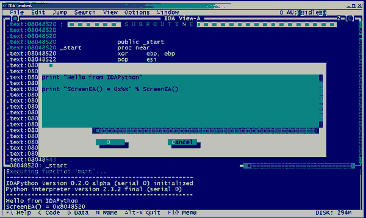

图 2. 会话示例。

## 6.2 状况与获取

尽管 IDAPython 的开发是艰巨的任务，但已经达到高级阶段。该插件在 F-Secure 反病毒团队内部使用正常。正在进行更多的改进和测试。在本论文出版的时候，IDAPython 插件第一个完全功能版本将会在 [`www.d-dome.net/idapython/`](http://www.d-dome.net/idapython/) 发布。该软件包将会包括完整的源代码而且能够作为任何目的免费使用。在此邀请读者参加试用并提供宝贵意见。改进设想、代码及其他贡献是最受欢迎的。

# 7 介绍图形

## 7.1 前期工作

本论文并不着眼于开创性工作，而是试图提醒关注明确的、可视的分析方法。Halvar Flake 是二进制逆向工程界的一位杰出人才，他曾经使用图形和相似比较规格（在我们算法的特定步骤中使用），旨在利用工具在一个给定二进制程序的不同版本之间的发现差异。Flake 的工作^(\[6\]) 详细说明了恶意软件分析中图形的使用，并揭示其某些优越性，我们将在本文中再次介绍。

## 7.2 入门建议

图形往往提供一个有条理的看问题方式。复杂的层次结构一旦使用人类容易消化的方式表现出来，就立即变得比较容易理解。图形就是一种这样的显示数据方法，相反地，有些表示法比如对一个传统的反汇编所提供数据和代码连续不断的引用和数字列表，则比较让人头痛。

此外，关于图论已有充足的研究文献提供处理和分析它们的算法。一旦我们把代码一致地用图形表现，对于分析以及进一步的主题如分类归并，数学方法的大门就向我们敞开了。

本论文中，我们将在全局和函数的层次上把代码表示为图形。

图形提供抽象，正是这东西帮助我们建立简单算法、高屋建瓴地工作。

## 7.3 为分析准备数据

### 7.3.1 输出数据

我们制作一个工具用于在一个给定的二进制程序装入 IDA 之后按照一种元语言表示法输出 IDA 数据库。这个工具没有输出 IDA 数据库格式所支持的整个信息集合，而是输出它的一个充分子集，它包括：

*   每个被定义的函数。
*   每条指令。IDA 所呈现给用户的完整二进制码表示法、助记符和操作数。
*   所有已定义所引用的字符串和名字。
*   所有的代码引用。
*   代码标志：该代码是不是顺序执行流 (用于连贯地提取一个函数的基本块)。
*   杂项标志：函数属于某个已知库或是一个 thunk（形实替换程序）。

看得出这个信息集已经为我们的研究提供一个足够丰富的试验场。为了增加尽可能多的高层可读信息，未来附加信息将会包括全部注释。

结果的元语言文件被命名为 `REML`，是 Reverse Engineering Meta-Language 或 RevEngML 的缩写表示。

### 7.3.2 接纳数据

下一步是产生一个面向对象的框架，专注于可用性和易用性，而给予性能问题较低的优先级。

一个 Python 模块被建立用来处理 `REML` 文件。该模块实现一个顶级 `Binary` 类，它提供方法以存取一般的二进制信息，如代码入口点及其函数列表。而且允许通过函数名字或函数体内的地址来查询函数。

其次，实现一个扩展的函数类。其中提供了下列各项：

*   存取所有指令。
*   向内的和向外的代码以及数据引用。
*   生成基本块的列表，据此生成一个 CFG(控制流程图)。

为了存取指令及其操作数我们增加一个三级的、较小的类，它的名字平实无奇就叫作 `Instruction`。

### 7.3.3 处理数据

我们的研究和原型建立于我们的数据存取接口之上。除了提供其他可能性之外，它让我们能够从二进制程序快速生成图形。只须用相当少的几行代码 (当与 IDA 的 IDC 语言相比时) 我们就能循环处理整个函数集合、收集它们的引用并创建一个图形对象 ^(\[7\])。

我们采用的方式是，二进制程序中的每个单一函数在图形中表现为一个顶点，而它们之间的调用转化成图形的边。

整个初始测试期间，直至我们对于相当复杂和大量的二进制程序取得可理解的表示法，绘制算法和风格都非常和谐统一。

两个主要的可视化模式效果都不错。层次表示法在二进制程序的函数数目不超出一定值的时候效果很好；这个布局由 `GraphViz` 软件的 `dot` 提供。

利用 `GraphViz` 软件的 `twopi` 获得一个辅助的径向布局 (图 3)，证明若要可视化较大的二进制程序则是这个布局好用。

除了利用图形固有的直观优点之外，我们还要设法利用它们的数学特性。这是下一节的主题。

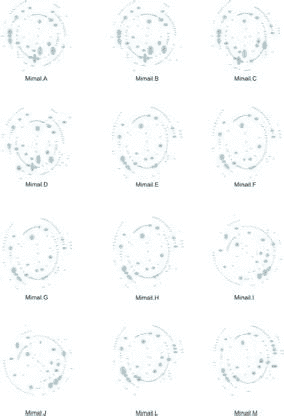

图 3 Mimail 系列图形。在这个系列的成员里存在某种模式。

# 8 基于二进制程序图形表现的算法

## 8.1 二进制比较，图形相似性

本节中我们将陈述确定两个二进制程序彼此接近程度的过程。我们的算法结果是一个数值，指出它们的调用流程图彼此重叠或相关程度。

一旦我们得到这些值，就可以根据它们的相似性进行恶意软件分类。我们借用系统发生学领域 ^(\[8\]) 的分类法，对恶意软件应用分类归并分析算法。这个方式的结果令人振奋，说明这个研究区域值得进一步探索。

### 8.1.1 比较算法

我们利用分析给出的二进制程序表现图形创建它的邻接矩阵。这个矩阵中，二进制程序里出现的每个函数表示为一行一列，而且在位置(I,J)上的元素表示 I 行这个函数是否执行一个对 J 列那个函数的调用。

我们追求的目标是在两个可运行文件中，由所有函数相互间的连接产生图形，而根据函数在图形中的位置建立它们之间的关联。一个发出调用并且被给定的一组函数调用的函数，匹配另一个文件中有相似的调用与被调用函数集合的函数。

确定图形同构被公认是一个非常复杂的任务，据了解还没有多项式时间算法能解决这个问题。幸运的是，在我们的模型里有较多的信息，所以这个问题在这里变得简单多了。

我们选择操作系统调用和库调用作为一个基本结点集出发。换句话说，这些函数没有调用该二进制程序中的其他代码，或者在不同的可执行文件中使用共用名字。通过这个办法，我们自动排除了不调用任何这类函数的二进制程序，尽管如此，研究人员仍然可以手动确定两个二进制程序的共用函数基本集并且相应地命名它们。

只要得到两个不同二进制程序的共名函数集，我们就可以组成一个邻接矩阵并假设该矩阵中同一行的函数是同一个函数。

我们反复地结合每一遍获得的信息然后再匹配，不断有效地改进整个图形，直至达到最大化的函数匹配。

函数依照从它们内部结构计算出的规格进行匹配，当出现歧义的时候，适当地进行额外的最优化。

在这一步骤完成后，我们得到两个二进制程序共有的一个函数集合。

### 8.1.2 算法的定义

*   我们想要比较两个可执行文件的图形。源程序 `S` 和目标程序 `T`。我们定义如下：
    *   `S[f]` = {构成 `S` 的所有函数集合}
    *   `T[f]` = {构成 `T` 的所有函数集合}
*   找出共同的原子函数集合 ^(\[9\])。即：`C={f:f∈S[f]∩T[f]}`
*   我们的匹配剩余函数集合定义为 `S[r]` = `S[f]` - `C` 和 `T[r]` = `T[f]` - `C`。
*   现在，对于函数 `f∈S[r]`，我们为 `f` 创建一个对 `C` 调用树签名 ^(\[10\])，如果为函数 `f’∈T[r]` 生成的对 `C` 调用树签名与之是同一的而且唯一的，那么就认为 `f` 与 `f’` 是同一的。
    *   如果发现这种匹配，就把 `f` 的签名添加到 `C` 矩阵。这使得我们不必依赖 API 函数，可以匹配更高层的函数。
*   到了这个算法没有产生任何匹配的时候，我们就得到一个包含所有匹配函数的矩阵 `C`，这些函数在 `S` 和 `T` 的图形均占据相同位置。在这个步骤结束时，我们将得到两种类型的不匹配函数。
    1.  不相同而不能匹配的那些函数。
    2.  没有唯一签名的那些函数。

在算法后来的改进中，我们使用一种新型签名，即在函数 CFG 中基本块连接边的列表 (CFG 签名)，提高了它的匹配能力。具有非唯一的调用树签名的函数如果存在唯一的 CFG 签名，也可以匹配。

我们实现这个增强，使之每当我们用完调用树签名的时候继续运行。找出函数之间某些相当之处常常会在算法后续步骤中让我们得到额外的匹配。这成功地加大了我们的方法的准确度。

### 8.1.3 相似性指标

我们得到两个二进制程序之间一个假设同意义函数的集合之后，依照下面求出相似性指标。

让我们把源二进制程序 `S` 中的同意义函数集合取名为 `S[e]\={在 S 中的那些同意义函数}` 并同样地定义 `T[e]\={在 T 中的那些同意义函数}`，注意，这两个集合都含有那些在两个二进制程序中均存在的 API 调用。令σ’(S[e], T[e])表示相似性指标函数并把它定义为：

|A|
σ’(A, B) = ─────
|A∪B|

由它得到非对称相似性指标 (或距离)：

|S[e]|
σ’(S[e], T[e]) = ─────
|S[e]∪T[e]|

和

|T[e]|
σ’(T[e], S[e]) = ─────
|T[e]∪S[e]|

我们定义最后结合的相似性为：

|A| ·|B|
σ(A, B) = ─────
|A∪B|²

这个函数σ(A, B)产生的数值将总是 0≤σ(A, B)≤1 （介于 0 和 1 之间）。由数值接近 0 表示低的相似程度，而且数值靠近 1 表示这双恶意软件几乎共用它们的全部代码。

### 8.1.4 个案研究

我们现在将给出不同系列恶意软件的距离矩阵，数值是百分比的，指示查明的恶意软件彼此接近程度。

这里，我们将依照在前面章节中所介绍的步骤。

Mimail

Mimail 系列表现出高的相似指标，如下面的距离矩阵中所示。

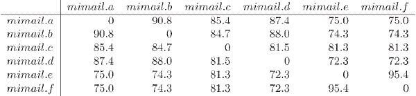

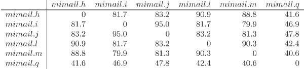

Klez

Klez 系列比较也产生好结果。分类结果把那些样本分成两支，一支包含 Klez 变体 A、B、C 和 D，而另一支含有 E、F、G、H、I 和 J，见图 4。

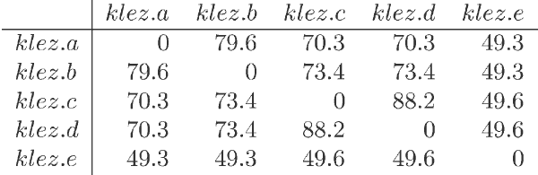

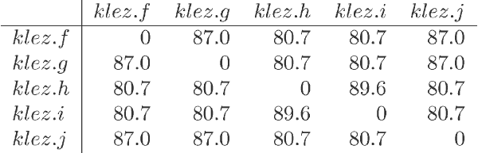

Netsky

Netsky 庞大的系列似乎也聚集在一起。值得一提的特征是对 Sasser 系列的接近，这两个系列有相同的创作者。对于这等相似，我们的算法产生出高的相似性指标，说明了创作者在两个系列中使用共同的代码这一事实。见图 4。

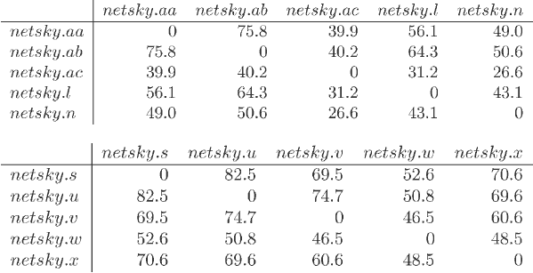

Roron

根据从图形生成的距离矩阵给出的数值，Roron 系列是紧紧地聚集在一起。见图 4。

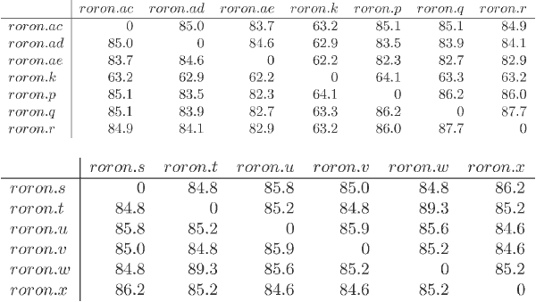

Bagle

Bagle 蠕虫提供了一个在特定变体之间低相似性的例子。这种结果的原因是一些变体仅仅投入后门而缺乏它们自己的复制系统，实际造成它们彼此很大的不同。该算法成功指出这种事实。

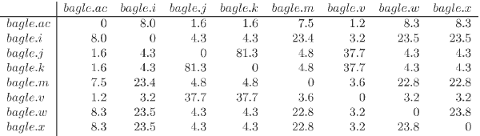

Sasser

Sasser 也是一个高度相似恶意软件的样本。

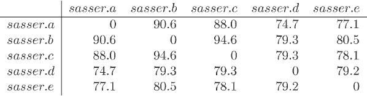

随机选择

我们现在将显示一些随机选择样本的距离矩阵。我们前面已经显示的恶意软件系列没有很好地说明样本彼此不同的情况。下面的数据显示不相关的样本间表现出低的相似性指标。

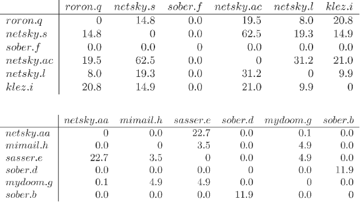

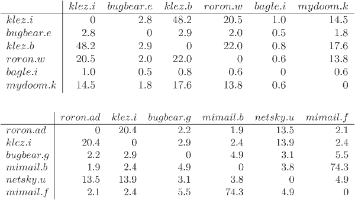

## 8.2 潜力，利用已有的知识

我们现在要讨论的几项技术受益于本论文第 8.1 节中引进的基础。我们将简短叙述一下，通过定义恶意软件之间相似性程度的规格，提高某几个方面的整体质量。它也关系到两个特定的二进制程序哪些部份相关联（证明是相似的或者有相同的功能性）。本节讨论的几个技术已经实现并取得初步成果；其它一些技术，虽然经过简单测试，但缺乏可靠的原型。

### 8.2.1 分类归并与划分类别

一旦我们创建了一个可靠方法来查找二进制程序之间的近似距离或相似性指标，就可以进入分类这个区域。Philippe Biondi 向我们一位作者展示了将分类归并算法（比如 X-树）应用在一个先前生成的恶意软件距离矩阵所得结果。那些令人振奋的结果鼓励我们对该主题深入研究。

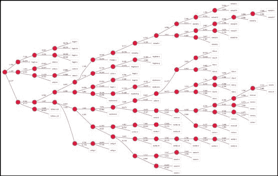

图 4. 一组恶意软件的系统发生分类结果。

最近 Stephanie Wehner 已经利用基于 Kolmogorov Complexity（复杂度）的技术在分类上做了些工作。她的初步成果 ^(\[11\]) 显示了没有对样本做过任何基础分析的蠕虫系列分类。当需要一个快速分类的时候，这个方式非常有意义。

我们的方式是基于系统发生学的。在分类单元的划分和分类归并分析这个领域有大量文献。存在一系列算法能被应用到距离矩阵（即提供数字表示两个 OTU ^(\[12\]) 或恶意软件彼此相似程度的方阵）。

比如 Neighbor Joining ^(\[13\]) 这些算法应用到这些矩阵产生出一个层次分类，这是恶意软件分类法的雏形。只要提供一个满足特定需求的样本，那么新样本能够马上得到分类 ^(\[14\])。


预先商议一个公共算法，将来会帮助分类工作并且减少因为任意命名恶意软件引起的混乱。生物科学里的已有方法可能值得一试，除了纯科学分类之外，流行的分类单元有通俗名字。

前人的工作 `^(\[15\])` 已经找到途径，用系统发生学方法帮助计算机病毒分类，尽管在那个案例中使用的规格是恶意软件文件里的字节序列。

我们认为那个方式没有对加壳/加密代码进行处理因此限制了它的能力，即使简单多态的恶意软件也可能导致该技术无法使用。

如果追求完全自动化分析，我们的方式目前也受到类似的限制，不过我们有良好的基础产生可接受的结果并有强壮的规格，比如由图形同构所提供的那个，见图 4。

### 8.2.2 帮助快速分析

我们了解到恶意软件两个不同变体中相同函数的有关信息，就可以利用它帮助相同系列威胁的快速分析。从一个已被分析的二进制程序出发，就有可能在里面标示出特定区域(虽然尚未实现)，即字符串引用、注册表键、端口号；并且从一个变体到下一个变体跟踪它们是否有改变。如果确有更改，我们可以获取新值并且自动生成相应信息的通用公共描述形式。

### 8.2.3 在代码版本之间移植分析信息

把已有的对某个变体分析所得知识移植到新近发现的变体，已经证明是一个实际的、有价值的工具。从二进制程序 `A` 到二进制程序 `B` 的函数映射知识让我们可以在有待分析的新变体中重新命名所有已知代码。有时候，在我们开始分析之前，程序所定义的函数已经有 80% - 90% 得到有意义命名。

这会减少最初的概览所需时间，而且让我们能够专注于更重要的代码和算法部份，不只是再次分析前面已看过的代码。

## 8.3 利用图形使代码可视化的其他方面

最近我们创建了一个工具，可以通过查看、滚动和缩放图形浏览一个反汇编。

界面主要部分显示二进制程序的整个已定义调用树，每个函数结点包含一个它所引用的字符串的列表。点击任何一个函数打开一个新窗口显示它的 `CFG` (控制流程图)，而点击一个基本块结点，则显示一个函数引用和字符串引用的列表。移鼠标到任何一个基本块上面，会显示相应的反汇编代码。

已经增加了更多的功能，即：

- 重命名函数
- 在图形中搜索函数
- 改变可视化模式 (层次的或径向的)
- 比较二进制程序的不同版本 (共同的代码表示为红色)
- 向一个 `IDC` 脚本输出被重新命名的函数，以便在 `IDA DB` 中重新命名它们。

到目前为止，该工具已经允许我们对一个二进制程序做快速的一般分析。有几个抽象层的二进制程序中，`API` 调用可能远离所调查的函数几级之外，该工具整体视图确实提供了方便。在一个反汇编器比如 `IDA` 中，想要理解二进制程序里面函数的逻辑位置和目的，如果没有看过所调用的全部代码这也许几乎是不可能的。而在一个图形中所有那些关联一眼就能看出来，所以就感觉平常了。

# 9 结论和未来方向

## 9.1 限制

完全自动化的图形生成、比较和分类方式受到一些限制。恶意软件通常被压缩和(或)加密。

这代表我们达到完全自动化的最终目标之前必须克服的一个主要麻烦。

图形生成和比较算法是与体系结构无关的。存在调用这种概念是唯一的必要条件 (只要 `IDA` 能够识别函数，分支可以接受)。

二进制程序必须使用由操作系统提供的 `API` 服务，而且必须达到有效的代码量。

## 9.2 未来方向

深入研究恶意软件的分类必将产生有价值的结果。本论文中讨论的一些基本概念还可以进一步展开。

### 9.2.1 图形数据库

图形数据库的建立还要做更多研究。需要在这样的资源库中储存二进制程序的特性和图形表示法。对于新发现的恶意软件到来，数据库查询特定的模式。如果搜索结果是肯定的，那么比较和后期的分类将会自动进行。

**参考与注解**

1.  `Datarescue IDA` 网页, [`www.datarescue.com/idabase/index.htm`](http://www.datarescue.com/idabase/index.htm).
2.  `Python` 网站, [`www.python.org/`](http://www.python.org/).
3.  Guido van Rossum and Fred L. Drake, Jr.: `Python` 教程, [`docs.python.org/tut/tut.html`](http://docs.python.org/tut/tut.html).
4.  `Psyco` 网站, [`psyco.sourceforge.net/`](http://psyco.sourceforge.net/).
5.  `SWIG` 网站, [`www.swig.org/`](http://www.swig.org/).
6.  Halvar Flake, 'Graph-Based Binary Analysis', Blackhat Briefings 2002.
7.  我们也创建了一个 `Python` 模块，即 `pydot`，利用 `AT&T` 著名的 `GraphViz` 软件快速交互式生成图形可视布局。`Python` 模块在作者个人网站之一上公开提供, [`dkbza.org/pydot.html`](http://dkbza.org/pydot.html).
8.  系统发生学：“系统发生学是基于在进化差异方面相关程度的生物分类法。”
9.  对于'atomic function'（原子函数），我们是指一个函数没有调用其他函数而且在不同的可执行文件里面使用一个公共名称。那么它可以被认为是一个基本组成块。在图论中它们是入度为 1、出度为 0 的叶子顶点。
10. 函数 `f` 的签名创建是通过检查原子函数的列表 `La` 产生一个二进制码串，如果 `f` 在串索引 `n` 调用原子函数，位置 `n` 就置 1 否则置 0。
11. S. Wehner, 'Analyzing Worms using Compression', [`homepages.cwi.nl/~wehner/worms/`](http://homepages.cwi.nl/~wehner/worms/)
12. 在系统发生学中，术语 `OTU` 表示 Operational Taxonomical Units (操作分类单位)，指的是不同种群的成员根据它们的进化差异来分类。
13. N. Saitou and M. Nei, 'The neighbor-joining method: a new method for reconstructing phylogenetic trees', Mol. Biol. Evol. 4, pp406–425.
14. 样本必须被解压/解密，并有一个正确重建的导入表。
15. L.A. Goldberg, P.W. Goldberg, C.A. Phillips, G. Sorkin, 'Constructing Computer Virus Phylogenies', Journal of Algorithms, Vol 26(1) (Jan. 98) pp.188–208.

`4dd466d0e1e0cc123afbe504da2462ca`
