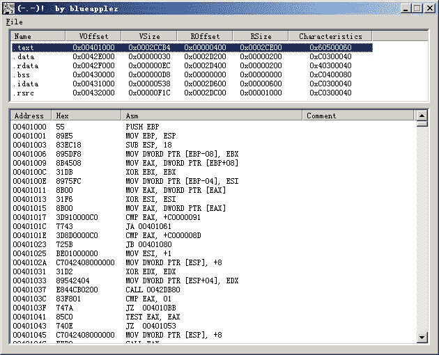
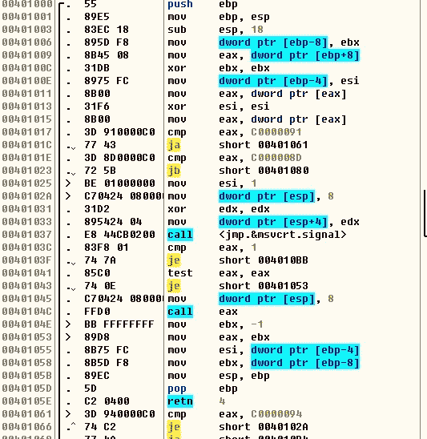

# 反汇编引擎的设计与实现(含源码)

> 原文：[`www.pediy.com/kssd/pediy11/114281.html`](https://www.pediy.com/kssd/pediy11/114281.html)

许久之前看到坛子里一位大牛搞了个虚拟机 CM，小弟十分钦佩，就琢磨虚拟机到底是啥，后来想了想  以为虚拟机得用到反汇编引擎（现在觉得貌似不用），于是乎就想设计一套反汇编引擎，于是坛子里的 egogg 大牛的资料就被我找到了，于是我开发试着翻译《The Art Of Dissassembly》，只翻译了 2 章   太累，未果。看完那本书就开始构架，然后编码了。把那本书上介绍的 mov 指令都解析完了，猛然发现根本就不全面，然后找到一个全面的 code table（egogg 大牛提供）。然后继续编码，后来卡住了。。。继续参考 egogg 大牛代码，继续编码。 后来发现 egogg 大牛把指令给分解的非常完美了，继续参考。。完成。  
  
本源码抄袭的地方很多 ，仅供他人参考。勿喷！ 最核心的 mod 域的解析  还有指令结构体的设计都是原创。  
  
egogg 大牛的反汇编引擎的地址 ：[`bbs.pediy.com/showthread.php?t=75094`](http://bbs.pediy.com/showthread.php?t=75094)  
  
如发现问题  跟帖说明一下   非常谢谢！  
  

上传的附件
|  || src.rar  
 |
|  || bin.rar  
 |