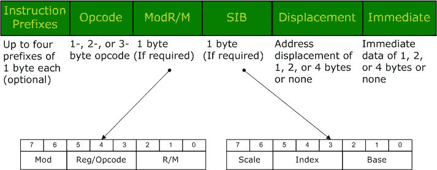
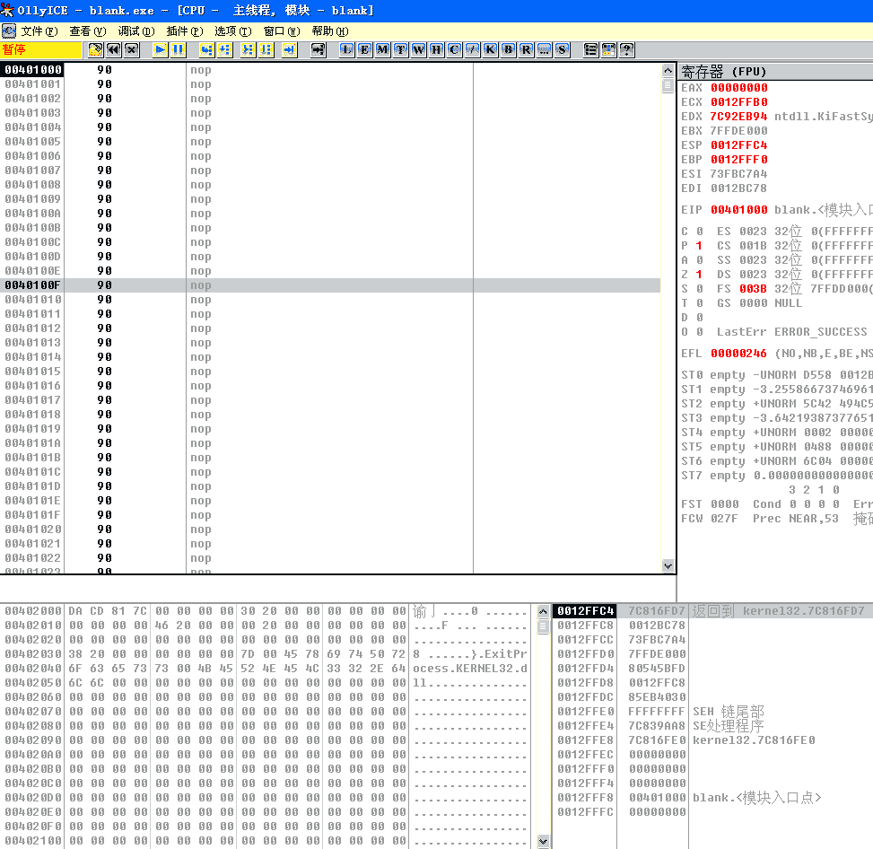
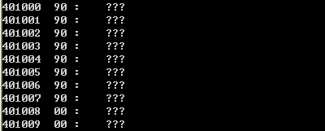

# 打造自己的反汇编引擎 Intel 指令编码学习报告（二）

> 原文：[`www.pediy.com/kssd/pediy10/75119.html`](https://www.pediy.com/kssd/pediy10/75119.html)

**第一部分：总体介绍**  
  
    反汇编引擎的目的就是要把机器码翻译成汇编语言的格式，主要的汇编格式有 Intel 格式、AT&T 格式，一般在 window 环境中使用的大多数都是 intel 格式的汇编语言。这里从官方手册的介绍中总体介绍这两部分的内容，只有知道机器码的格式，汇编指令的格式，才能在其上架起一座桥梁汇编或反汇编。这里我们习惯称汇编指令为 Intruction operand，而称机器码为 Intruction Opcode。  
      
1.1 Intel 汇编格式（Instruction operand）  
  
    在官方手册中 intel 汇编有着固定的格式：  
    label: mnemonic argument1, argument2, argument3  
      
    (1) lable：标签，表面意思就是这条指令的一个指代，实际代表着这条指令在内存中的起始位置。  
    (2) 助记符：用英语代表机器码的操作，汇编器会根据这个助记符寻找合适的机器码。  
    (3) argument1, argument2, argument3：实际上 intel 指令最多也只有三个操作码，当只有两个操作码的时候，第一个为目标操作码，第二个为源操作码。  
  
1.2 intel 机器码格式（Instruction Opcode）  
  
     汇编语言的格式反映了机器码的编码格式，直观地看，只要给汇编代码的每个部分都分配相应的字节就行了，例如：mnemonic 两个字节，argument1-3 分别 4 个字节，这样汇编语言与机器码之间真的就是直接对应的关系了，在这两个部分转换至需要维持一张简单的表就行了。但实际上，intel 的指令体系为复杂指令系统（CISC），它这里的复杂绝非浪得虚名，由于以往的机器上内存是个很昂贵的设备，因此，intel 的指令编码尽可能地利用了每一个 bit，再加上兼容性的考虑，使得整个 intel 指令结构异常复杂。远远不是一个部分和另一个部分简单的映射那么简单。  
  
     物理上，CPU 的逻辑运算单元只操作计算机中的两个对象：寄存器和内存。只要给每个寄存器一个编码，那么寄存器的辨别就很容易了，但是内存呢？物理上，内存是个一维的存储单元阵列，逻辑上内存被分成段，页之类的格式，要操作内存，那么指令就要给出操作内存的哪个（哪些）存储单元，这里“哪”指的是寻址模式，这里的“些”和“个”是指要操作的内存的大小，byte, word, dword……。除了这两个操作对象之外，还有一种对象，那就是立即数（immediate），物理上指令执行时，这个数字是在 CPU 中的，也就是 CPU 取得的指令中，这个数就已经在那里了。所有的指令编码都是围绕着这三个操作对象进行的，不同的是立即数不需要去找，寄存器简单的编码就行了，而内存不但需要指出其位置，还要指出其大小。此外，还有一些辅助的操作说明，比如是否重复一些操作等等。  
  
     看一下 intel 的确切的指令格式：  
       
  
     prefix 部分是指令操作的一些辅助说明，如果先不看 prefix 部分，其他部分的表面涵义是很明确的：opcode 编码了进行什么样的操作，跟汇编格式里面的 mnemonic 对应，CPU 知道了什么操作之后就会寻找操作的对象，是寄存器还是内存？ModR/M 部分就给出了操作的对象，R 是 register，M 是 memory，而 Mod 指示了到底是寄存器还是内存。如果 ModR/M 的字节数足够大的话，那么或许就不需要后面的两个部分了，实际上 ModR/M 只有一个字节，能编码所有的寄存器，却不能编码所有的内存寻址模式，intel 使用后面两个部分来辅助 ModR/M 完成确切的内存定位 SIB 和 displacement。寻址方式跟 CPU 对内存的管理密切相关，intel 的寻址方式很多，但全部都编码到了 SIB 和 displacement 之中。这部分到 SIB 部分再详细介绍。内存寻址后面就跟了最后一个操作对象 Immediate。  
  
     指令编码的整个结构还是很清楚的，但也可以看到，每一个部分都有小的子结构，代表着不同的涵义。反汇编就是要读懂机器码的每个部分，然后翻译成汇编格式。在后面的各个部分将把我对各个部分的了解都写出来。  
  
（简单说明一下，关于汇编指令和机器码之间的对应关系\[并非一一对应\]，可以看看 Svin 的教程 opcode#1 和罗聪的《学习 Opcode》，我想我主要关注的是反汇编引擎的实现细节，这些知识是重要的，但是既然前辈高手都已经写得很清楚了，就没有必要再重复了。如果真的想了解学习汇编指令格式，无论如何，这两份教程是一定要认真看的。）  
  
1.3 调试实验环境的简单说明：  
  
     就像 Svin 在教程的开头就写的那样，学习指令格式，最重要的就是实验，动手，看实际的效果。实际上，要写出反汇编程序出来，首先得学会自己查表手工翻译指令。不同反汇编引擎的结构不一样，但是都是建立在对 Intel 指令结构各个部分的理解之上的，而要想熟悉各个部分，必须亲自动手，要多动手（查找资料的时候看到论坛里有些朋友也想实现自己的反汇编引擎，但是不知什么原因却没有动手，其实动手后就会发现，一切都很简单，如果不求代码的优美，我这样的菜鸟都能写出一个）。  
     （1）指令察看：  
     如果想知道一个汇编指令对应的机器码，或者说一些机器码对应的汇编指令，最简单的办法就是使用现有的工具，首推 Ollydbg。Svin 给出了一个简单的程序，在 Ollydgb 中当作“白纸”来用（当然也可以随便打开一个 pe 文件），可以在上面随便输入汇编指令，或机器码，查看对应的翻译。（程序源代码和可执行程序下载：**blank.rar**）  
           
  
     可以在汇编栏双击随便输入一些指令，机器码部分就会显示相应的机器码。或者 Ctrl+E 在机器码部分随便输入一些机器码，可以在汇编栏看到对应的反汇编指令，大家可以动手做一下。  
  
      （2）反编译器测试框架：  
  
      用 C 语言构架吧，想要测试自己的反汇编引擎是否正确工作，首先得假设一个调试环境。  
      可以使用 shellcode 中的方式，假设待反编译的指令位于一个字符串中：Code\[\] = "\\X90\\X90\\X90\\X90"...然后在程序中现解析这些数据，看看效果。  
  
      目前，根据上图定义的指令格式可以写出指令的一个结构体来，所有的指令理论上都能解析并存放到这个指令结构的各个部分，这是最直观的定义。  
  

代码:

```
typedef struct \_INSTRUCTION
{
  /\* prefixes \*/

  char  RepeatPrefix;
  char  SegmentPrefix;
  char  OperandPrefix;
  char  AddressPrefix;

  /\* opcode \*/

  unsigned int  Opcode;

  /\* ModR/M \*/

  char  ModRM;

  /\* SIB \*/

  char  SIB;

  /\* Displacement \*/

  unsigned int  Displacement;

  /\* Immediate \*/

  unsigned int  Immediate;
  
  /\* Linear address of this instruction \*/

  unsigned int  LinearAddress;
} INSTRUCTION, \*PINSTRUCTION;

```

       各个部分的大小都是根据指令结构中最大的字节数定义的。  
       我们再定义一下，反汇编的程序 Disassemble()，最直观的就是输入指令的起始地址，返回下一条指令的起始地址（很多反汇编引擎都是返回指令的长度，但返回下一条指令的起始地址更直观），把指令的解析结果放在 INSTRUCTION 中，把反编译出来的字符串存放在一个缓冲区中。可以这样定义：  
       unsigned char \*Disassemble(unsigned char \*Code, PINSTRUCTION Instruction, char \*InstructionStr);  
       InstructionStr 为汇编指令格式，按照 intel 汇编指令格式的定义我们可以定义如下字符串 prefix mnemonic operand1, operand1, operand3，然后把解析的结果分别放入这些字符串中，最后把这些字符串组组合起来就得到了最后的指令。  
  
       我们可以仿照 The Art of Disassemlby 中介绍的，先写出一个字节读取显示的框架程序（源代码下载：**dasm\_frame.rar**）。  
       运行结果如图所示：  
  
  
       下面将按照 intel 指令格式分五个部分（Prefixes, Opcode, Mod/RM, SIB+Displacement, Immediate）分别介绍各个部分的结构和解析方法，最后再介绍如何利用这些部分的解析子程序解析不同的指令，最终实现一个反汇编引擎。