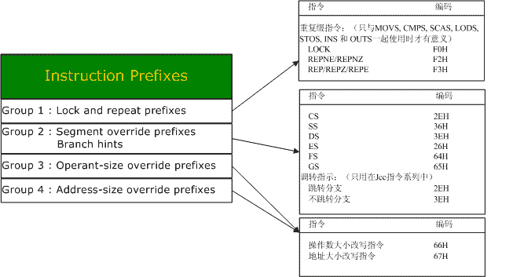
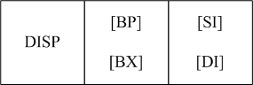

# 打造自己的反汇编引擎 Intel 指令编码学习报告（三）

> 原文：[`www.pediy.com/kssd/pediy10/75226.html`](https://www.pediy.com/kssd/pediy10/75226.html)

**第三部分：指令前缀（Prefixes）**  
  
    指令前缀是解析一条指令之前所要做的第一项工作。从某种意义上来说，指令前缀是指令操作的辅助说明信息。  
  
一、什么是指令前缀  
  
    指令前缀是作为指令的辅助说明信息的，指令前缀是独立于指令之外的，最熟悉的一个恐怕就是重复指令前缀了 repz, repnz...。这些前缀作用于链式指令之前，可以在一定条件下重复这些操作，看看一个实际的例子，首先打开 ollydbg，载入作为“空白纸”的 blank.exe，在汇编窗口 Ctrl + E 输入 A4 这时你可以看到：  
    00401000 >    A4            movs    byte ptr es:\[edi\], byte ptr \[esi\]  
    这是链式指令之中的一条 movsb 指令，现在再 Ctrl + E 输入：F3 A4 看到了吧：  
    00401001      F3:A4         rep     movs byte ptr es:\[edi\], byte ptr \[esi\]  
    这里 F3 就是指令前缀（rep）。链式指令前缀的位置和作用是很明显的，你也可以使用不同的指令（movsd, stosb 等指令和 repnz(F2)做一下测试。如果不知道指令的编码，可以在汇编窗口的汇编栏，双击鼠标，输入对应的汇编指令，就可以在右边的窗口中看到对应的指令编码了）。  
    早期的 intel 处理器对内存的管理是采用分段式的，不同的分段由段寄存器来索引，所有的寻址方式跟这种管理策略密切相关。但是如果把段寄存器信息也编入指令之中，将使寻址编码方式太过复杂，这里 intel 采用了一种比较简单的方法，那就是对每一种寻址方式都假设一个默认的段，这就是我们学习汇编语言初期所学到的：bx, si, di 等寄存器寻址默认的寄存器为 ds；bp,sp 等默认的寄存器为 ss，ip 默认的寄存器为 cs...等等（其实默认寄存器也用到了指令编码之中，比如 mul，div 等指令都默认结果或被除数等为算术寄存器，这样的好处就是，可以大大减少指令大小，然而也同样破坏了指令的一致性）。这里就存在一个问题，如果我想访问特定的段怎么办？比如我想用 bx, si, di 等索引 es, fs, gs 等怎么办（保护模式之下，段寄存器的内容为段选择子，一般其内容都是由操作系统维护，我们现在用到的机会大大减少）？intel 使用指令前缀来解决这个问题，输入以下指令（ctrl+e 输入编码，或双击输入汇编代码）：  
    00401004      8B07          mov     eax, dword ptr \[edi\]  
    \[edi\]默认的寻址寄存器为 ds，再输入：  
    00401006      2E:8B07       mov     eax, dword ptr cs:\[edi\]  
    2E 在这里就是段改写指令前缀(cs)，还有其他的 5 个段寄存器的改写指令前缀（ss-36H, ds-3EH, es-26H, fs-64H, gs-65H），你可以用这些前缀再任何有内存寻址操作的指令之前，看看效果。  
      
    当然还有其他一些指令前缀，后面将一一介绍，这里需要说明一下的是，指令前缀有一个特点，那就是它只针对特定的指令才有效。例如前面的重复指令，只有当它们用在链式指令之前的时候才有效，你也可以强行把它用在其他指令之前，做以下实验：  
    00401000 >    40            inc     eax  
    强行输入（Ctrl + E）：  
    00401001      F3:           prefix rep:                                        
    00401002      40            inc     eax  
    这里虽然 ollydbg 识别了这种前缀指令，但是其实 cpu 还是把它当作同一条指令来执行的，把 ollydbg 调试选项-〉异常-〉无效或特权指令关掉，运行这条指令。你会看到并没有重复事件发生。  
    再来看看段前缀指令，在没有内存寻址的指令中试验一下：  
    00401003      40            inc     eax  
    00401004      26:40         inc     eax  
    前缀指令被完全忽略。  
    intel 在官方文档有中这样描述：such use may cause unpredictable behavior。所以在解析段前缀指令的时候，一定要主要该段前缀指令使用在何种指令之前。  
  
二、指令前缀的分类：  
   
    在 intel 指令格式图中对指令前缀的字节数是这样说明的：Up to four prefixes of 1 byte each (optional)。很显然 rep 和 repnz 是不能同时使用的，intel 把这些分为了一组，同样上面介绍的段改写指令也分成了一组。一条指令之前可以同时包含多个不同的组，不同的组只能使用改组其中一条前缀。  
    intel 指令前缀目前总共有四类，除了前面介绍的两类，还有两类关于操作数大小的指令：操作数数大小改写指令和地址大小改写指令。如图：  
   
      
      
    2.1 重复指令前缀（lock repz repnz）  
  
    已经介绍了 repz, repnz，还有一条 lock 前缀，这个前缀是用在多处理器之中的，具体的用途大家可以可以查看 intel 官方文档的相关的说明。  
  
    2.2 段改写指令前缀(cs ds ss es fs gs)   
  
    除了上面的说明，还有一点，当指令中有两个默认段（一般会出现在指令中有两个操作对象都为内存的时候）的时候，段改写指令前缀改写哪一个？例如：  
    00401000 >    A5            movs    dword ptr es:\[edi\], dword ptr \[esi\]  
    加上段改写指令，到底哪个会变？  
    00401001      26:A5         movs    dword ptr es:\[edi\], dword ptr es:\[esi\]  
    结果很明显。大家可以用其他链式指令做做实验，然后详细读一下 svin 关于这部分的讲述（opcode6#）。  
  
    Svin 还有关于 win32 下段值的改变对寻址结果影响的实验（Opcode6#）。由于这跟指令编码没有什么关系，这里只是提一下实验结果：  
    （1）在 win32 下，所有的 cs, ds, ss 使用的是同一个端选择子（尽管值不一样？高手解释一下）。  
    （2）es 的值对一些默认使用该段的指令是有影响的。比如 movs 默认的源为：ds:\[esi\]目的为：es:\[edi\]，在执行这些指令之前，改变 es 的值，将会导致不正确的结果。  
    （3）用户模式下，唯一用得到的段寄存器就是 FS 了，FS:\[0\]指向 SEH 链，关于这个，研究过系统结构化异常处理的朋友可能都知道。  
  
    2.3 操作数大小改写指令：(66H)  
  
    首先做一下试验：  
    00401006      8B06          mov     eax, dword ptr \[esi\]  
    00401008      66:8B06       mov     ax, word ptr \[esi\]  
    可以看到，66H 使得指令的操作数从 32 位变到了 16 位。386 时，intel 把所有的通用寄存器都增加到了 32 位，但是 intel 并没有增加操作这些寄存器的指令，他们解决的办法就是直接使用同 16 位操作时相同的编码，同时使用操作数大小改写指令作为二者之间的区分。这里要注意改写的涵义：当目前 cpu 工作在 16 位模式时，66H 的出现将使操作变成 32 位。也就是 cpu 工作在 16 位的时候：  
    00401006      8B06          mov     ax, word ptr \[esi\]  
    00401008      66:8B06       mov     eax, dword ptr \[esi\]  
    而当 cpu 工作在 32 位模式的时候，66H 的出现就会直接使得操作数大小都变成 16 位。注意，66H 只是 16 位和 32 位之间的转化指令前缀。32 位和 64 位之间的区别我没有研究过（谁知道的话，可以说出来大家一起学习一下）。8 位和 16 位，32 位之间的区分就有着本质的区分了。对比一下：  
    00401010      8A06          mov     al, byte ptr \[esi\]  
    00401006      8B06          mov     eax, dword ptr \[esi\]  
    00401008      66:8B06       mov     ax, word ptr \[esi\]  
    可以看到 al 的指令编码都变化了。这里是一个概念的区分，al、 ah 在 intel 文档中统统成为部分寄存器（partial register），这跟 16 位和 32 位（full-register）是有着本质的区别的。部分寄存器和全寄存器之间的区分是用编码中的一个为称为 w 位的 bit 来区分的，在后面的指令编码的解释部分会有详细的说明。但是，这里概念的区分一定要清楚。  
  
    稍微总结一下，操作数改写指令是在 16 位和 32 位（full-register）之间转换的前缀指令，转化的结果跟目前 cpu 工作的模式有关。还有，就是要注意，全寄存器和部分寄存器之间的概念上的差别。  
  
    2.4 地址大小改写指令前缀：（67H）  
  
    还是先做一下试验：  
    00401000    8B03          mov     eax, dword ptr \[ebx\]  
    00401002      67:8B03       mov     eax, dword ptr \[bp+di\]  
    可以看到加上 67 指令前缀之后，寻址方式有变化由 32 位模式转变为 16 位模式。注意这里的转变不是 32 位到 16 位的转变，而是 32 位模式到 16 位模式的转变。  
    16 位模式下能用于寻址的只有 bp, bx, si, di 寄存器：  
  
           
  
    32 位模式之后，所有的通用寄存器都能用于寻址，而且 32 位模式中新增加了一种新的寻址方式（标量寻址）。关于寻址模式 The Art of Assembly 的第四章中有详细的介绍（下载：**Ch04.pdf**），SIB 部分会有详细说明。  
  
    同 66H 一样，67H 的作用是模式转换，也就是在 16 位环境中，67H 的出现意味着指令使用 32 位的寻址方式。  
  
    这些指令就是目前 intel 64 / IA32 结构体系中的所有指令前缀，这些四类指令前缀可以重复出现，但是同类指令中只能出现其中一种，看看下面的指令：  
    00401005      26:66:67:8B03       mov     ax, word ptr es:\[bp+di\]  
    这条指令中出现了 3 种指令前缀，这 3 中指令前缀出现的顺序可以随意，也就是说这些指令前缀都是平行的。  
  
三、指令前缀的解析代码。  
  
    指令前缀是解析一条指令之前所要做的首要的工作。看完上面的介绍，解析指令前缀时需要注意和解决的问题就很显然了：  
    (1) 保存当前的指令前缀，供后面的解析代码使用。  
    (2) 当碰到连续相同的指令前缀的时候，要判断这些指令前缀是不是属于同一组，不属于同一组的指令前缀可以并行存在，而如果出现同一组中的指令的时候，做出适当的处理。例如，从何处开始下一条指令等等。  
  
    这部分如何实现是很直观的，说下我的实现方法：  
    1、使用数组保存可能出现在指令中的字符串，把解析到的指令前缀的值赋为对应字符串的索引值。  
    例如：定义   
    

代码:

```
    const char \*RepeatPrefixes\[\] = {"lock", "rep", "repe", "repz", "repne", "repnz"};
    const char \*SegmentRegisters\[\] = {"es", "cs", "ss", "ds", "fs", "gs"};

```

    如果当前指令前缀的值为 F3H(rep 或者其等价的 repz)便可以把 INSTRUCTION 结构体中对应的 RepeatPrefix（初始值设为-1）设为 1 或者 3，这样解析指令的时候只要检查对应的前缀的值，小于零表示该指令不存在，否则所需要的字符串即为对应字符串数组中的值。  
  
    2、同组指令是否重复出现的检查：  
    使用上面的方案，只要检查到该组指令的值大于等于 0，则表示该组中已经出现一条指令前缀了。这里的问题是由于 4 组指令前缀的出现顺序是任意的，我们不能在检查到冲突的时候就简单地退出该条指令的解析，如果出现这样的组合：  
    group1 group2 group3 group1 Instruction。  
    这样的组合该解析成这样：  
    group1  
    group2 group3 group1 Instruction。  
    如果在检查到冲突的时候就结束本条指令的解析那么，就会出现下面错误的解析结果：  
    group1 group2 group3  
    group1 Instruction  
    而 CPU 实际上是按照前面的那种解析结果运行的。所以，我们必须重新确认当前指令的起始位置。  
    这里我采用了重新扫描的方法，设置重新扫描标记，如果发生冲突，那么重新解析指令，由于出现重复的组的指令已经设置了，再次解析的时候，就会停在出问题的指令前缀的位置了。例如这样的组合：  
    group2 group1 group3 group1 Instruction  
    解析到第二个 group1 时重新扫描，再次碰到 group1 的时候，就停下，这时候解析结果就会变成正确的：  
    group2  
    group1  
    group3 group1 Instruction  
  
这部分的实现代码：**prefix.rar**  
  
    测试方法：可以在 Code 部分随意输入各种指令前缀\\x123456789ABCDEF，看看上面的组合结果是否能正确出现。  
    运行结果：  
  
    401000  26 :    prefix es:  
    401001  F2 :    prefix repnz:  
    401002  66 F3 90 :      ???  
    401005  90 :    ???  
    401006  26 :    prefix es:  
    401007  F2 67 3E 90 :   ???  
    40100B  90 :    ???  
    40100C  90 :    ???  
    40100D  00 :    ???  
    40100E  00 :    ???  
  
    可以对照 ollydbg 检查运行结果。  
  
    00401000      26:               prefix es:  
    00401001      F2:               prefix repne:  
    00401002      66:F3:            prefix rep:                                
    00401004      90                nop  
    00401005      90                nop  
    00401006      26:               prefix es:  
    00401007      F2:67:3E:         prefix repne:  
    0040100A      90                nop  
  
（还是要再说一下，一些原理性的东西我可能讲不好，但是我会尽量把握掌握的资料跟大家分享，我主要关注的还是实现反汇编/汇编后端的实现细节，也希望感兴趣的朋友讨论这些细节。ps: 我记得在调试程序的时候曾经发现过 ollydbg 在上面我提到过的组合问题上有一个小小的 bug 只可惜当时没有记录下来，现在也重复不出来了，也或者是我的错觉？）