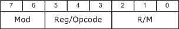
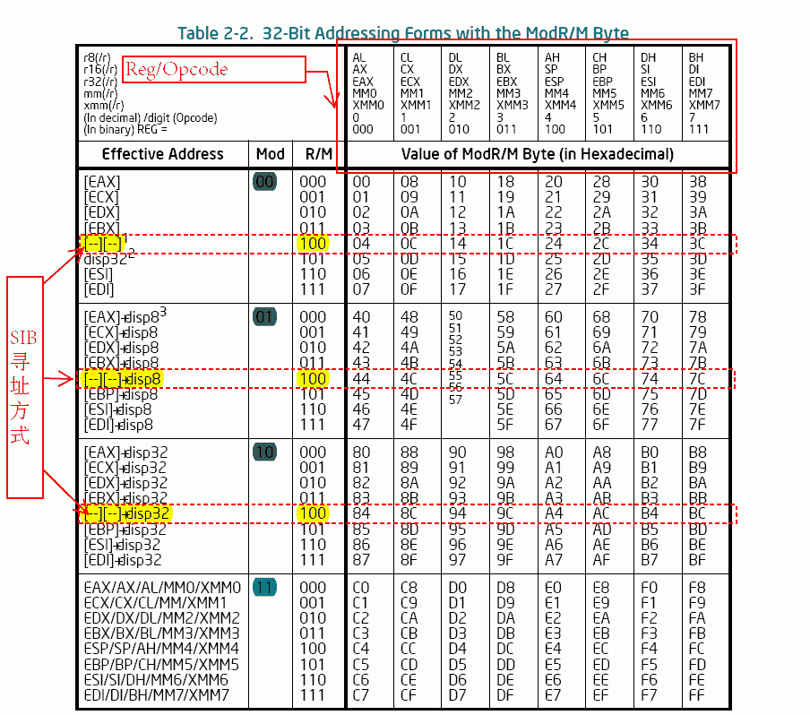
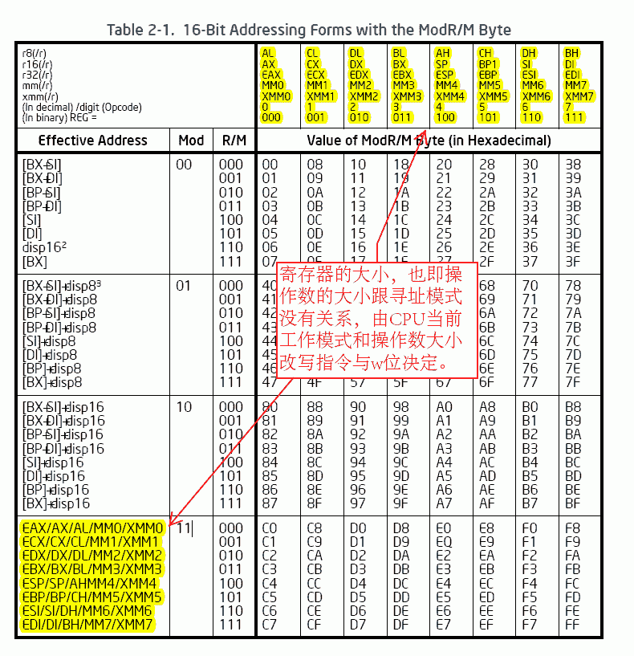
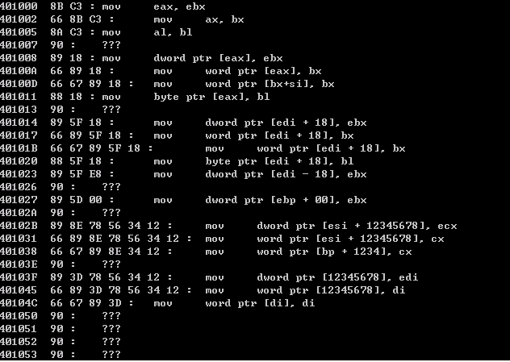
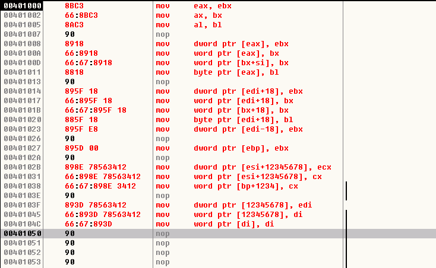

# 打造自己的反汇编引擎 Intel 指令编码学习报告（五）

> 原文：[`www.pediy.com/kssd/pediy10/75557.html`](https://www.pediy.com/kssd/pediy10/75557.html)

**第五部分 ModR/M**  
  
5.1 ModR/M 的涵义。  
    Opcode 之后就是 ModR/M。Opcode 部分是一条指令之中必不可少的部分，没有指令编码，CPU 就不知道该如何操作。前面提起过 Opcode 中有时候也用 3 个 bit 来编码寄存器，当指令只有这样一个寄存器操作对象，或者指令的操作对象默认已知的时候，那么指令只需要 Opcode 部分就行了（Prefix 可能也存在）。当指令中存在内存操作对象的时候，就需要 ModR/M 甚至后面的 SIB 来编码了。ModR/M 一般是用来对内存操作对象进行编码的。当指令中出现了两个寄存器操作对象，或者一个寄存器一个内存操作对象的时候，ModR/M 字节一般都会存在的。ModR/M 的长度是固定的 1 个字节，这个字节 8 个 bit 被分成了 3 个部分，Mod(6-7bit)，Reg/Opcode(3-5bit)，R/M(0-2bit)，如图所示：  
      
    Mod（2bits）：   
    ModR/M 共两个 bit 能编码 4 种对象，在 ModR/M 中这 4 种对象对应着 4 种不同的操作对象后面的 3 个 bit 的 R/M 部分到底是寄存器操作对象还是内存操作对象，如果是内存操作对象，内存寻址模式是什么。4 种对象中必需有一个用来定义 R/M 部分是寄存器，那么剩下的 3 种就编码内存的寻址方式。所以 Mod = 1 寄存器 + 3 寻址模式。  
  
    Reg/Opcode（3bits）：  
    这 3 个 bits 是用来编码寄存器的，编码方式前面提到过。这里还有（“/”）或 Opcode，前面已经提起过，这部分有可能用于辅助操作指令编码。大家可以想到，当这 3 个 bit 用到操作指令编码的时候，指令中就只能有寄存器和内存中的其中一个操作对象了，是内存还是寄存器，就看 Mod 的值了。  
  
    R/M(3bits)：  
    “R”是指 Register 寄存器，“M”是指 Memory 内存。这 3 个 bit 的涵义很明显，寄存器或者内存，具体这 3 个 bit 用来编码什么就要看 Mod 的值了。  
  
    从上面的描述可以看出来：  
    1、指令只能由两个寄存器操作对象，一个寄存器一个内存操作对象，而不可能同时出现两个内存操作对象（暂时先不考虑立即数操作对象）。这就是初学汇编的时候教科书告诫我们的，不能用 mov 内存 1，内存 2……，两个内存之间的操作，必须使用寄存器作为中转。其实原因很简单，intel 指令中只留了一个位置用作内存寻址编码（R/M 位置）。  
    2、ModR/M 编码了两种操作对象（3-5bit 用作 Opcode 的时候不太多，大部分情况，还是用来编码寄存器），其中一个一定是寄存器，另外一个是内存或者是寄存器。  
    3、当 R/M 部分用作内存寻址的时候，3 个 bit 共有 8 种编码，再乘以 Mod 的 3 种内存寻址模式，共有 3 \* 8 = 24 种寻址方式。386 以前，16 位的情况是，的确只有 24 种内存寻址方式。386（32 位）以后 intel 增加了一种新的寻址方式 SIB，新的寻址模式下一个部分再总结，这里要说的是，3 种寻址模式的每个 R/M 的 8 种编码中都有一个用来指示 SIB 寻址模式，这样我目前要考虑的就只有（386-32 位）24 - 3 = 21 中寻址方式了。  
  
5.1.1 32 位寻址模式  
    intel 把所有的寻址方式都列了一张表，现在我们对照这张表（先看 32 位寻址表），看看我们上面所说的情况：  
  
          
  
    先看 Mod 那一列：共 4 种，前 3 种（00， 01， 10）用绿色标记的表示内存寻址模式，最后一种（11）表示寄存器寻址。当 Mod = 11b 的时候，R/M 那一列的 3 个 bit 编码寄存器，编码方式跟前面我们提到过的，和表格上面 Reg/Opcode 部分对寄存器的编码一致。  
    我们再来看看寻址方式的编码（Effective Address 列）：00，01，10 这三种寻址模式的区别就在于后面有没有跟偏移地址，偏移地址的大小多少字节。这些寻址方式很简单\[寄存器 + 偏移地址\]的方式，其中寄存器的类型由 R/M 的值来决定，偏移地址的值则由后面的 Displacement 的值决定，偏移地址存不存在，多少字节则在 Mod 的类型中已经说明。  
  
    SIB 类型的寻址方式由黄色部分标记，Effective Address 列中用\[--\]\[--\]\[+disp8/32\]来表示。也就是说，当 Mod != 11b 并且 R/M 的值为 100b 的时候，表示指令后续有 SIB 字节，并且该内存操作对象由 SIB 编码。  
  
    上面大致已经把整个 ModR/M 的情况介绍了一下，还有一些特殊的情况需要特别地说明，我们先练习几个例子：  
  
    mov ebx, eax  
    mov \[esi\], ecx  
    mov \[edi + 8\], edx  
    mov \[ebx + 12345678\], ebp  
  
    我们只提取 ModR/M 的部分：  
    mov ebx, eax  
  
    Reg/Opcode 部分为 eax，编码为(000)，R/M 部分为 ebx 是一个寄存器，因此 Mod = 11，R/M 部分为 ebx 的编码（011）。由于并没有偏移地址部分，这条指令就该为：  
  
    mov  Mod  Reg/Opcode  R/M  
    89  (11  000    011) => 89 C3  
    -----------------------------------------------------------------------------------------------------  
    mov \[esi\], ecx  
  
    Reg/Opcode 部分为 ecx(001)，R/M 为内存寻址而且并没有偏移地址出现，Mod =　00，R/M 的编码为 esi(110)。则组合起来：  
      
    mov  Mod  Reg/Opcode  R/M  
    89  (00  001    110) => 89 0E  
    ------------------------------------------------------------------------------------------------------  
    mov \[edi + 8\], edx  
  
    Reg/Opcode 部分为 edx(010)，R/M 为内存寻址而且偏移地址为 8 位，Mod = 01，R/M 为 edi 的编码（111）。则组合起来：  
  
    mov  Mod  Reg/Opcode  R/M  Displacement(8)  
    89  (01  010    111)  8    => 89 57 08  
    -------------------------------------------------------------------------------------------------------  
    mov \[ebx + 12345678\], ebp  
  
    Reg/Opcode 部分为 ebp（101），R/M 为内存器寻址而且有 32 位的偏移地址，Mod = 10，R/M 为 ebx 的编码（011）。组合起来：  
  
    mov Mod  Reg/Opcode  R/M  Displacement(32)  
    89  (10  101    011)  78 56 34 12   => 89 AB 78 56 34 12  
  
    在 Od 中 Ctrl+E 输入这些机器码，检查一下结果。  
    也许你可以自己试着翻译一下下面的系列这些机器码指令：（01 对应的助记符为：add，31 对应的助记符为：xor，08 对应的助记符为：or）  
    01 DF 01 31 01 7D F8 01 A0 56 34 12 00  
    翻译完之后可以在 od 中检查一下最后的结果。  
  
    看完上面的例子并且亲自做了一下检验之后，你可能对 ModR/M 的各项的涵义有了大致的了解了。现在我们再仔细地看看这张表，看看黄色标记部分，这部分是用来说明 ModR/M 之后马上跟着一个 SIB 字节，并且这里的内存寻址编码由 SIB 字节完成，那么这个值（100-esp）以前编码的寄存器的寻址该怎么办，具体就是：\[esp\]\[+ disp8/32\]该怎么寻址? 看看下面的指令：  
  
    0040101D      890424              mov     dword ptr \[esp\], eax  
    00401020      894424 08           mov     dword ptr \[esp+8\], eax  
    00401024      898424 78563412     mov     dword ptr \[esp+12345678\], eax  
    mov 对应的编码为 89 所以 3 条指令的 ModR/M 位分别为 04，44，84 提取出 3 条指令的 R/Mbit 可以看到其都为 100，表示该内存寻址采用的是 SIB。所以\[esp\]\[+disp8/32\]都是由 SIB 的方式来寻址的。大家也可以看到，如果以这种方式来寻址，指令的长度将至少增加一个字节 SIB 字节。反编译的时候我们看到有的编译器用 mov \[esp\], xx，mov \[esp + xx\], xx 的方式进行参数入栈操作。查查手头的资料，push reg32 和 mov mem32, reg32 所需要的时钟周期都为 1。显然，用 mov 的方式指令长度要长很多（push 只需要一个字节）……  
  
    Intel 的表格中例外无处不在，大家也可能注意到了，Mod = 00 的时候的有效偏移地址中有一项 disp32(R/M = 101)。这个很容易理解，类似下面的指令  
    00401032      891D 78563412       mov     dword ptr \[12345678\], ebx  
    它的 Mod = 00 R/M = 101。但是被他替代的原来的项\[ebp\]该怎么办? Intel 是如何寻址\[ebp\]的?在 od 的汇编窗口中输入：  
    mov \[ebp\], edx（这里输入 Reg/Opcode 的部分的时候，尽量避免用 eax，因为 intel 针对 eax 有特殊的更短的指令，这也是为什么我们写汇编代码的时候能用 eax 尽量用 eax 的原因，大家可以亲手试验一下，用前面的 ModR/M 的方式编码 eax 相关指令和直接从汇编窗口输入，看看有什么不同。），看看对应的机器码：  
  
    00401039      8955 00             mov     dword ptr \[ebp\], edx  
  
　　将 55 分解成 Mod:Reg/Opcode:R/M 的格式 01:010:101，对照表格看一下，原来 intel 对这条指令采用了下面的方式来替代：  
　　mov \[ebp + 0\], edx  
　　这是第二种寻址方式\[寄存器＋disp8\]，这里的 disp8 = 0，相同的涵义，但是指令的长度增加了一个字节的长度。  
  
    只需要最后一点说明，那么整个 32 位的 ModR/M 寻址表的结构和一些特例就很清楚了。这一点就是 disp8 表示的是 8 位的符号数，加到 32 位的寄存器中的时候需要采用符号位扩展的方式扩展到 32 位，做过前面的指令翻译练习的朋友可能会发现这点。  
　　  
    00401012      017D F8             add     dword ptr \[ebp-8\], edi  
　　  
    这里的立即数 F8 表示的是一个负数，翻译指令的时候这点是需要考虑的。  
  
5.1.2 16 位寻址模式  
  
    前面在学习地址大小改写指令前缀（67H）的时候，曾经提到过地址大小改写指令的作用是改变寻址的模式，我想“地址大小”改写指令应该改成“寻址大小改写”才对。再在 od 中看看这条指令前缀的作用。  
  
    00401000      8918          mov     dword ptr \[eax\], ebx  
    00401002      67:8918       mov     dword ptr \[bx+si\], ebx  
      
    以 eax 为地址索引变成了以\[bx + si\]为索引。16 位寻址模式中，能用于寻址的寄存器只有 bx，bp，si，di 四个寄存器。bx，bp 称为基址寄存器，而 si，di 称为索引寄存器。寻址的时候只能是{\[基址寄存器\] + \[索引寄存器\]} + \[disp8/16\]这里的方括号是可选项的意思。16 位模式下，是不能出现\[ax\]，\[bx\]，\[cx\]等的寻址方式的。  
    16 位模式下，我们可以算一下可能出现的组合方式：只使用一种寄存器 4 种 + 使用两种寄存器 C2¹ \* C2¹ = 4 + 4 = 8 种，刚好能用 3 个 bit 来编码（这里的 C2¹ 表示组合的意思）。对这些寄存器（寄存器的组合）的编码跟 32 位下有着对应的关系（更准确地说应该是 32 位寻址模式对寄存器的编码与 16 位有着对应的关系）。看看下面的图，编码的对应方式一目了然：  
  
      
  
    了解了 32 位的 ModR/M 的解析方式 16 位的相对来说简单很多了。我想这里该注意的有一个问题，那就是操作码大小改写跟寻址方式改写指令的区别。再回头看看这小节开头的那个例子，除了寻址方式改变之外其它的都没有变化，寄存器还是 ebx，内存对象大小还是 dword。要想改变操作对象的大小，得使用操作码大小改写指令前缀，例如：  
  
    00401000      8918          mov     dword ptr \[eax\], ebx  
    00401002      67:8918       mov     dword ptr \[bx+si\], ebx  
    00401005      66:67:8918    mov     word ptr \[bx+si\], bx  
  
    这里哪个指令前缀影响指令的那个部分这问题一定要认清楚，只有这样才能在指令解析的时候，把不同指令前缀的作用翻译出来。  
  
  
    16 位和 32 位寻址模式表的涵义很容易理解，但大家也能发现，手工翻译一些机器码可能比较容易，但如果编写一个通用的解析程序，要考虑的问题还是比较多的，尤其是当考虑当前 CPU 是工作在什么模式的时候（16 位，32 位？）。下面再总结一下 Intel 对部分寄存器（8 位）及全寄存器(16 位/32 位)的区分方式以及 ModR/M 中的两个操作对象在汇编指令中出现的顺序的问题，就能比较全面地写出解析 ModR/M 的代码了。  
  
5.2 d 位和 w 位  
  
    前面对 d 位和 w 位提到过很多次了，我们来好好研究研究这两个 bit。  
  
5.2.1 w 位  
      
    Intel 通过操作码大小指令改写前缀来对操作对象在 16 位和 32 位之间进行转换，而使用这里要说的 w 位进行 8 位和上述两种长度的区分。还是先看例子：  
  
    0040100A      8918          mov     dword ptr \[eax\], ebx  
    0040100C      66:8918       mov     word ptr \[eax\], bx  
    0040100F      8818          mov     byte ptr \[eax\], bl  
  
    注意这里操作对象大小的变化（注意只有 32 位寻址模式和 16 位寻址模式，而没有 8 位寻址模式，所以是不可能出现\[al\]之类的情况的），内存对象由 dword 变成 word 再变成 byte，而对应当寄存器的大小也有相应的变化（Intel 指令中的操作对象的大小是必须一致的，否则就需要进行扩展，前面说到的 disp8 需要进行符号扩展就是这个原因）。16 位和 32 位的操作对象用 66H 来区分，那么 8 位跟上面两位的区别是什么呢？把 Opcode 的二进制写出来：  
  
    16/32 位：  89  1000 100\[1\]  
    8 位：  88  1000 100\[0\]  
  
    二者之间的不同就在于最后一位，Opcode 中的这一个 bit 位一般被称为 w 位，w 位的 set 于 clear 指示着指令在 8 位与 16/32 位之间转换。大家可以随便测试一些指令，比如：  
  
    00401012      03C3          add     eax, ebx  
  
    把 Opcode 的最后一位设为零，在 od 中看一下效果。也可以在指令前加上 66H 的改写指令前缀，看看它们之间的区别。  
  
    当 w = 0 的时候，66H 改写指令前缀是不起任何作用的。  
  
    并不是每一条指令的 Opcode 的最后一位都代表着 w 位，大家可能也能猜测出含有 w 位的指令类型指令的操作对象中至少有一个由 ModR/M 编码。所以在解析 ModR/M 前都需要提取 Opcode 中的 w 位来决定指令操作对象的大小。  
  
5.2.2 d 位  
  
    前面我们在翻译指令的时候，我武断地提出，mov eax, ebx 这条指令中 ebx 对应着 Reg/Opcode，而 eax 对应着 R/M。但为什么不是 eax 编码 Reg/Opcode，ebx 编码 R/M？ 是因为第一个操作数就一定对应着 R/M，而第二个操作数一定对应着 Reg/Opcode 吗？如果是，那么我想编码 mov ebx, \[eax\]又该怎么办？新增一条指令规定第一个操作数对应着 Reg/Opcode 而第二个数对应着 R/M？Intel 的确就是这么做的，它使用了两种不同的 Opcode 来分别进行这两类编码，而这两种 Opcode 的编码方式之间有着密切的关系，它们的区别只有一个 bit，这个 bit 就是 d 位。先看看例子：  
  
    00401019      89D9          mov     ecx, ebx  
    0040101B      8BD9          mov     ebx, ecx  
      
    0040101D      890B          mov     dword ptr \[ebx\], ecx  
    0040101F      8B0B          mov     ecx, dword ptr \[ebx\]  
      
    每组的两个指令之间的区别仅仅在于指令的两个操作对象的顺序不同。看看他们编码之间的区别：  
  
    89  1000 10\[0\]1  
    8B  1000 10\[1\]1  
  
    他们之间的唯一的不同在于 bit1，Opcode 中的这个位一般被称为 d 位，d 位可以在有着相同操作和操作对象的两条指令之间区分操作对象的顺序。（前面和一些朋友讨论过，Intel 汇编格式 Instruction arg1, arg2 中，arg1 代表着目的操作数，而 arg2 代表着源操作数。例如，mov arg1, arg2 就是要把 arg2 存放到 arg1 中去，这个规定是无法改变的，而这里的 d 位只是用于在两条指令之间进行区分，也就是你读了 Opcode 的这一位，不用看指令说明书，就知道 ModR/M 编码的两个操作对象，哪个是源操作数，哪个是目的操作数。）d 位只是在机器码识别中很有用的一个标志而已，一般一条指令 r/m 和 reg 的位置都是在指令说明书中明确规定了的。  
  
    d 位值的涵义是很明显的，当 d = 1 时，源操作数为 R/M 目的操作数为 Reg/Opcode；当 d = 0 时，源操作数为 Reg/Opcode 而目的操作数为 R/M。可以用 d 位来进行区分的指令范围也很明显指令的操作对象中必须有 ModR/M 编码的两个操作对象。d 位在指令识别过程中的作用跟第四部分中提到过的“规律”没有任何的区别，在 switch...case 式的 Opcode 识别方式中，d 位是必须要考虑的。在用翻译表的方式设计的实现方式中，由于操作对象的顺序可以预先存储在表格中，所以 d 位的解析一般是没有什么意义的（当然，如果把 d 位信息也编码到翻译表中，减少翻译表的信息冗余也是可以的）。  
  
    只要是用 ModR/M 编码的指令，大家可以在 od 中看看，d 位是不是能像上面说的那样，区分 R/M 和 Reg/Opcode 的顺序。  
  
5.3 ModR/M 的解析的代码实现  
  
    看了上面的总结，能手工翻译在机器码和汇编指令之间进行翻译，写出一个解析 ModR/M 的函数是一点也不困难的。要想加深对这部分的理解，自己动手写出这样一个函数是很有必要的。这里我把我理解的实现解析 ModR/M 代码的过程及其要注意的问题列在下边：（也可以在后面看完 SIB 的总结之后再动手写）  
  
    1. 提取 Opcode 中的 w 位，结合指令大小改写指令以及 CPU 当前的工作模式（16 位？32 位？），决定 ModR/M 编码的操作对象的大小；根据“地址大小改写”指令前缀是否出现以及 CPU 当前的工作模式决定寻址模式是 16 位还是 32 位。  
    2. 根据 d 位，或者指令说明，确定 ModR/M 中编码的两个操作对象哪个为源操作数，那个为目的操作数。  
    3. 读取 ModR/M 字节，解析成 Mod:Reg/Opcode:R/M 的形式。  
    4. 根据 Reg/Opcode 部分生成相应的寄存器字符串，存放在第 2 步中决定的（源/目的）操作数字符串中。  
    5. 根据寻址模式（16/32）以及 Mod 的值分别将 R/M 的编码解析成相应的字符串。（如果有 displacement 出现，而且是 8 位的，那么记得要对其进行符号为扩展，翻译给人看得话，就是把符号显示出来；碰到 SIB 的情况，对 SIB 进行解析；对一些特殊情况要进行特殊处理，比如 32 位模式下 Mod = 00, R/M = 101, 100 等情况，16 位模式下 Mod = 00, R/M = 110 的情况等等）。  
  
    我的实现方式，对寄存器的编码采用字符串数组的形式，把解析到的 Reg, R/M 等的值作为索引：  
  
    

代码:

```
const char \*Register32\[\] = {"eax", "ecx", "edx", "ebx", "esp", "ebp", "esi", "edi"};
    const char \*Register16\[\] = {"ax", "cx", "dx", "bx", "sp", "bp", "si", "di"};
    const char \*Register8\[\] = {"al", "cl", "dl", "bl", "ah", "ch", "dh", "bh"};
    const char \*Address16\[\] = {"bx+si", "bx+di", "bp+si", "bp+di", "si", "di", "bp", "bx"};

```

    这里还是采用各个部分分别解析然后再合成的策略：  
  
代码:

```
sprintf(OperandRM, "%s %s\[%s%s\]", SizeStr, SegmentPrefixStr, RMStr, DisplacementStr);

```

    先只考虑各个部分的解析，然后再按照一定格式合成起来。  
  
    这部分的代码（SIB 的解析也附加上）下载（默认了 CPU 工作在 32 位模式下）：**modrmsib.rar**  
  
    运行效果：  
  
  
  
    对照 od：  
  
