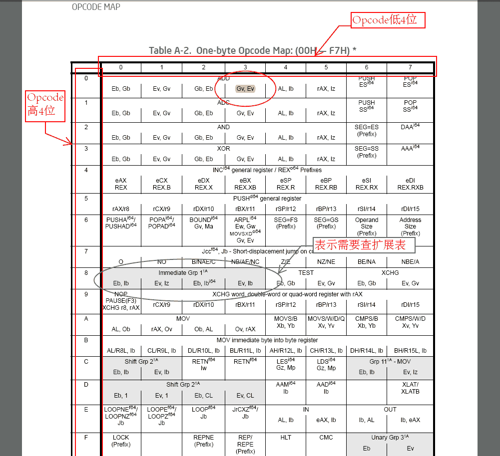
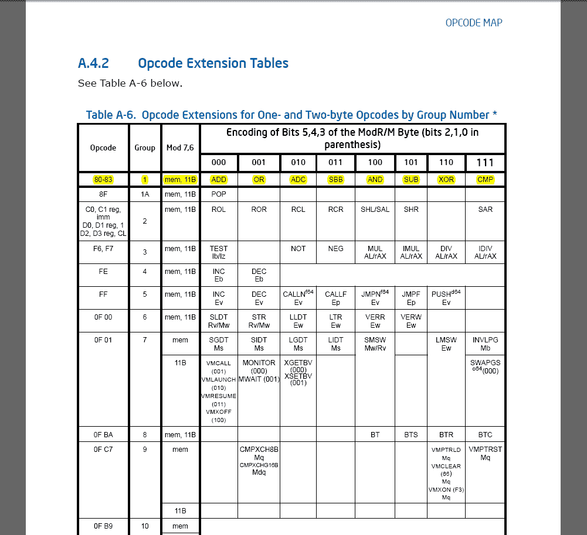

# 打造自己的反汇编引擎 Intel 指令编码学习报告（八）

> 原文：[`www.pediy.com/kssd/pediy10/77879.html`](https://www.pediy.com/kssd/pediy10/77879.html)

**最后一部分：指令识别**  
  
指令格式通过简单的实践是很容易搞明白的，但是指令识别就需要花费一番功夫了。这里的功夫并不是理解上的功夫而是数据结构设计、程序结构设计以及敲键盘的功夫。而不同的汇编引擎最主要的差别也是在指令识别这个部分。  
  
指令表是一张复杂的表，我看到有用“geek”来形容 intel 的指令表的。也的确，如果既要考虑效率，又要考虑编程方便或者说程序的优雅的话，的确得花一番功夫。下面我把我了解到的一些指令表的知识总结一下：  
  
8.1 switch...case  
  
很老土，很笨重，能理解的指令扩展和错误处理相对麻烦一点（一般反汇编引擎这种简单的代码也就是几个人在维护，这点倒不是最主要的硬伤，最最主要的硬伤个人愚见还是这种方式只能用于反汇编，汇编几乎不能从这些代码中获取任何有用的信息，而一般反汇编过程总需要一些汇编的功能），但效率高。所以如果单单想打造一个反汇编引擎（或虚拟机指令识别系统）的话，要我选择我铁定会选择 switch...case 这种架构方式。高级语言 switch...case 一般都用跳转表的方式实现，毋须查表系统，而且指令处理过程极其灵活，intel 指令中定义的所有技巧都可以在这种构建得到充分的体现。  
  
switch...case 很简单：  
  

代码:

```
switch(opcode)
{
    case 0xXX:
    {
       /\* 这里相当于已经知道了指令定义（什么指令，有些什么格式的参数），调用指令格式的各个解析部分，传入相应的参数就可以很容易解决了 \*/

       Mnemonic = "";
       operand1 = ParseModeRM(...)
       ....

       break;
    }

   default:
   {
      Mnemonic = "undefined";
   }
}

```

我总结在第四部分的各种规律，都可以很容易，很方便地应用在指令的解析过程中，这里给出我使用的运算操作和跳转操作的代码（解析过程有错误但是旨在表明思路）：  
  
首先是指令的规律，下面的指令组：  
  
00  00\[00 0\]000  add  r/m8   r8  
01  00\[00 0\]001  add  r/m16/32/64  r16/32/64  
02  00\[00 0\]010  add  r8  r/m8  
03  00\[00 0\]011  add  r16/32/64  r/m16/32/64  
04  00\[00 0\]100  add  al  imm8  
05  00\[00 0\]101  add  rax  imm16/32  
  
08  00\[00 1\]000  or  r/m8   r8  
09  00\[00 1\]001  or  r/m16/32/64  r16/32/64  
0A  00\[00 1\]010  or  r8  r/m8  
0B  00\[00 1\]011  or  r16/32/64  r/m16/32/64  
0C  00\[00 1\]100  or  al  imm8  
0D  00\[00 1\]101  or  rax  imm16/32  
  
10  00\[01 0\]000  adc  r/m8   r8  
11  00\[01 0\]001  adc  r/m16/32/64  r16/32/64  
12  00\[01 0\]010  adc  r8  r/m8  
13  00\[01 0\]011  adc  r16/32/64  r/m16/32/64  
14  00\[01 0\]100  adc  al  imm8  
15  00\[01 0\]101  adc  rax  imm16/32  
  
18  00\[01 1\]000  sbb  r/m8   r8  
19  00\[01 1\]001  sbb  r/m16/32/64  r16/32/64  
1A  00\[01 1\]010  sbb  r8  r/m8  
1B  00\[01 1\]011  sbb  r16/32/64  r/m16/32/64  
1C  00\[01 1\]100  sbb  al  imm8  
1D  00\[01 1\]101  sbb  rax  imm16/32  
  
20  00\[10 0\]000  and  r/m8   r8  
21  00\[10 0\]001  and  r/m16/32/64  r16/32/64  
22  00\[10 0\]010  and  r8  r/m8  
23  00\[10 0\]011  and  r16/32/64  r/m16/32/64  
24  00\[10 0\]100  and  al  imm8  
25  00\[10 0\]101  and  rax  imm16/32  
  
28  00\[10 1\]000  sub  r/m8   r8  
29  00\[10 1\]001  sub  r/m16/32/64  r16/32/64  
2A  00\[10 1\]010  sub  r8  r/m8  
2B  00\[10 1\]011  sub  r16/32/64  r/m16/32/64  
2C  00\[10 1\]100  sub  al  imm8  
2D  00\[10 1\]101  sub  rax  imm16/32  
  
30  00\[11 0\]000  xor  r/m8   r8  
31  00\[11 0\]001  xor  r/m16/32/64  r16/32/64  
32  00\[11 0\]010  xor  r8  r/m8  
33  00\[11 0\]011  xor  r16/32/64  r/m16/32/64  
34  00\[11 0\]100  xor  AL  imm8  
35  00\[11 0\]101  xor  rAX  imm16/32  
  
38  00\[11 1\]000  cmp  r/m8   r8  
39  00\[11 1\]001  cmp  r/m16/32/64  r16/32/64  
3A  00\[11 1\]010  cmp  r8  r/m8  
3B  00\[11 1\]011  cmp  r16/32/64  r/m16/32/64  
3C  00\[11 1\]100  cmp  AL  imm8  
3D  00\[11 1\]101  cmp  rAX  imm16/32  
  
这里我们先定义：  
  
代码:

```
const char \*ArithmeticMnemonic\[\] = {"add", "or", "adc", "sbb", "and", "sub", "xor", "cmp" };

```

可以看到指令的中间 3 个 bit 索引这上面数组中的指令名称，而每组织指令满足 d, w 位的条件（先不考虑 al, rax 的指令），这样我们很容易就解决掉这些指令：  
  
代码:

```
case 0x00: case 0x01: case 0x02: case 0x03: 
case 0x08: case 0x09: case 0x0A: case 0x0B: 
case 0x10: case 0x11: case 0x12: case 0x13: 
case 0x18: case 0x19: case 0x1A: case 0x1B: 
case 0x20: case 0x21: case 0x22: case 0x23: 
case 0x28: case 0x29: case 0x2A: case 0x2B: 
case 0x30: case 0x31: case 0x32: case 0x33: 
case 0x38: case 0x39: case 0x3A: case 0x3B: 
{
  Instruction->Opcode = \*currentCode;
  Instruction->dFlag = (\*currentCode >> 1) & 1;
  Instruction->wFlag = (\*currentCode) & 1;

  sprintf(mnemonic, ArithmeticMnemonic\[(\*currentCode >> 3) & 0x1F\]);
      
  currentCode++;
  currentCode = ParseRegModRM(currentCode, Instruction, operand1, operand2);
      
  break;
}

```

对反汇编引擎，这样就可以完成对这些指令的识别，对虚拟机系统，由于这些指令的操作是相同的（加法器），所以也可以用中间 3 个 bit 作指令操作的识别。  
  
同样对跳转指令：  
  
00401000 >  - 70 FE             jo      short 00401000  0111 \[000\]0  
00401002    - 72 FE             jb      short 00401002  0111 \[001\]0     
00401004    - 74 FE             je      short 00401004  0111 \[010\]0  
00401006    - 76 FE             jbe     short 00401006  0111 \[011\]0  
00401008    - 78 FE             js      short 00401008  0111 \[100\]0  
0040100A      7A FE             jpe     short 0040100A  0111 \[101\]0  
0040100C    - 7C FE             jl      short 0040100C  0111 \[110\]0                    
0040100E    - 7E FE             jle     short 0040100E  0111 \[111\]0                    
  
00401011    - 71 FE             jno     short 00401011  0111 \[000\]1  
00401013    - 73 FE             jnb     short 00401013  0111 \[001\]1             
00401015    - 75 FE             jnz     short 00401015  0111 \[010\]1  
00401017    - 77 FE             ja      short 00401017  0111 \[011\]1                    
00401019    - 79 FE             jns     short 00401019  0111 \[100\]1                    
0040101B      7B FE             jpo     short 0040101B  0111 \[101\]1              
0040101D    - 7D FE             jge     short 0040101D  0111 \[110\]1              
0040101F    - 7F FE             jg      short 0040101F  0111 \[111\]1   
  
我们也可以用相似的方法处理：  
  
代码:

```
const char \*JxxxMnemonic\[\] = {"jo", "jb", "jz", "jbe", "js", "jp", "jl", "jle"};
const char \*JnxxMnemonic\[\] = {"jno", "jnb", "jnz", "ja", "jns", "jnp", "jge", "jg"};

```

识别最后一个 bit 来看指令名称在那个数组中，识别接着的三个 nnn 来决定是什么指令。  
  
代码:

```
case 0x70: case 0x71: case 0x72: case 0x73: case 0x74: case 0x75: case 0x76: case 0x77:
case 0x78: case 0x79: case 0x7A: case 0x7B: case 0x7C: case 0x7D: case 0x7E: case 0x7F:
{
  Instruction->Opcode = \*currentCode;
  
  sprintf(mnemonic, "%s", \*currentCode & 1 ? JnxxMnemonic\[(\*currentCode >> 1) & 7\] : JxxxMnemonic\[(\*currentCode >> 1) & 7\]);
  currentCode++;
  sprintf(operand1, "short %X", Instruction->LinearAddress + \*((char\*)currentCode) + currentCode - Code + 1);
  currentCode++;

  break;
}

```

后面可以看到一些反汇编引擎使用的表格设计，添加表项内容的“努力”不会比写这样的代码简单到哪里去。这里还需要说明的是第四部分总结的“规律”其实在 Intel 64 and IA-32 Architectures Software Developer's Manual 2B Instruction Set Reference 的附录 B 中都有官方定义，而且 B 中总结地更全面（这里为前面的无知羞愧一下）。  
  
8.2 查表  
  
汇编/反汇编过程就是一个查表过程，这里不同的汇编/反汇编程序使用的方式各不相同。但是所有的指令表都来自于官方定义的那几张表格，我学习了这些怪异的表格（要说效率性，intel 把这张表设计得很高；说指令信息的完整性，无疑这些表最全；说指令范围，这些表覆盖了 intel 所有已定义和尚未定义的指令，但是这些的代价就是表格的诡异，把这些表格用通用的数据结构表示，是对数据结构设计的很好的考验），下面我把相关部分 Intel 64 and IA-32 Architectures Software Developer's Manual 2B Instruction Set Reference 附录 A 总结（翻译）一下：  
  
intel 的这些 Opcode map 按照 1-byte、2-byte、3-byte、Opcode extension(Mod/RM 的 reg 部分用于编码的情况 intel 单独提出来做了一张表)和 escape(0F)开头的浮点指令表这种方式组织的。  
  
8.2.1 1-byte, 2-byte, 3-byte 指令表   
  
先来看看 1byte 指令的查找：  
  
  
  
表格行用这一个 byte Opcode 的低 4 位来索引，列用高 4 位来索引：以 030500000000 为例子。  
(1) 找到上面表格的 0 行 3 列：ADD 指令的两个参数 Gv, Ev  
(2) 理解参数 Gv 和 Ev 的涵义：  
  
intel 对指令参数的设计了一种表示方式，格式是 Zz 一个大写字母加上一个小写字母。其中大写字母表示寻找方式编码（寄存器，ModR/M，跳转相对地址，16:32 地址格式等等），小写字母表示操作数的类型（byte，word，dword，不定根据 cpu 模式或改写指令决定，fword 等等），Z 总共从 A-Z 共 26 种模式，z 有大约十几种表示方式，他们的组合再加上纯寄存器表示了 intel 的所有操作对象。每个参数的具体涵义 intel 在附录的前面给出了详细地说明。从编写代码的角度，只要解析了所有的这些组合就可以实现所有指令的识别。  
  
对这个例子：  
G: 表示这个参数是 Mod/RM 部分的 reg 部分选择的寄存器。  
E: 表示这个参数是由该 Opcode 后面紧跟着的 Mod/RM 索引的寄存器或内存，实际的地址由当前段寄存器和 Mod/RM 或后续的 SIB 以及偏移地址决定。（总之，一句话这个参数由 Mod/RM 编码）  
  
v: word, dword 或 qword(64 位模式下)，由当前操作数属性决定（当前 CPU 模式，操作数大小改写指令前缀）。  
  
这样我们就能很容易地理解了这个 ADD 后面有两个参数，由 ModRM 决定。ModRM = 05, Gv = reg(ModRM) = reg(00\[00 0\]101) = 000 = EAX(由于没有 operand-prefix 出现，v 表示 32 位)。mod(ModRM) = 00 RM(ModRM) = 101 表示只有一个 32 位偏移地址因此 Ev = dword ptr\[0x00000000\]。因此 030500000000 表示：  
ADD EAX, dword ptr\[0x00000000\]  
  
2byte 和 3byte 指令的查找方法是相同的，所不同的只是 2byte 以 0x0F 开头，而 3byte 的以 0x0F38H 或 0x0F3AH 开头，去掉这些头部，Opcode 部分的查表示完全相同的。  
  
8.2.3 扩展表  
  
扩展表是指 ModRM 部分的 reg/opcode 部分也用来表示指令，这里 intel 把这些指令单独提出来做表。看上面 1-byte 指令表中的绿色部分，这里的 Grp 1（1A）就是表示查找扩展表的 Grp1。上标(1A)表示需要查扩展表，这里还有一些其他的上标定义，具体的涵义参考同一个附录的定义部分。  
  
  
  
可以看到这个扩展表示根据 ModRM 的各个部分来定义的，对有些 group 来说，Mod 的两个 bit 还有内存和 11b(寄存器)的区别，reg/opcode 部分当然是用来区分该组的不同指令了。  
  
比如下面的指令：80C012  
  
(1) 查找 1-byte 指令表 80 = Grp1(1A)，两个参数 Eb, Ib。  
(2) 查找扩展表 Group1\[reg(C0) = reg(11\[00 0\]000) = 000\]，为 ADD 指令。  
(2) E： 操作数由 ModRM 编码  
    I： 立即数  
  
    b： 不管 operand-size 属性是什么，都是 1byte。  
  
    这样 Eb = ModRM(C0) = ModRM(11\[00 0\]000) = al，Ib = 12  
  
所以 80C012 表示：ADD al, 12  
  
这里只列举这两种表格的查询，浮点表的格式也是类似的。总之，intel 的 Opcode Map 是指令最全，定义最完整的，也可以看到这里的指令查找是采用索引的方式，效率是没得说的。但是如果你仔细研究一下这些表格你就会发现，这些表是为手工查询设计的，比如有些指令由于前缀的出现会有不同的助记符（比如 90 = nop，而 F3 90 = pause 等等），而且有些上缀指令信息也必须包含进去，但是这些信息并没有统一的格式和位置。  
  
如果要写一个反汇编引擎，Intel 64 and IA-32 Architectures Software Developer's Manual 2B Instruction Set Reference 的附录 A 和 B 是必须完整地学习和了解的。水平有限（intel 手册上讲解得更专业明白），我就不再多指手划脚了。感兴趣的朋友看官方手册能更明白。  
  
8.3 “好”的反汇编引擎  
  
从机器码到汇编指令助记格式不是一个太难得过程（可能需要一些时间编码），但是打造一个“好”的反汇编引擎可能需要花费些心思，我理解的“好”如下：  
（1）能反编译个中各种 CPU 模式及子模式下的代码：IA-32， IA-32E(64 位和兼容模式)。为了过程的简化（其实是水平有限）在过去的一些总结报告中我并没有提到 IA-32E 的两种子模式，这部分的知识官方手册 Instruction Set Reference A 上讲解得很明白。一个完整的反汇编引擎是必须首先考虑到这些模式问题的。  
（2）效率高，绝对不能使“搜索”表。汇编（此法分析以后）和反汇编过程有相同性，指令表信息冗余小。  
（3）解析的结果中能包含所有的信息（指令各部分的值，各部分的属性等等），并能提供不同格式的反汇编串（intel 格式 AT&T 等）。  
  
**重要：**  
由于这只是本人水平有限，而且这只是在学习过程中的一些总结，肯定有很多描述不准确的地方，有问题请大家及时纠正。这些总结请结合前辈的一些教程（sivn, luocong, art of disassembly）来看，希望对那些对指令格式感兴趣的朋友入门能有些帮助。编写完整的反汇编引擎或虚拟机引擎，强烈建议认真学习官方手册。最后，欢迎大家批评讨论。