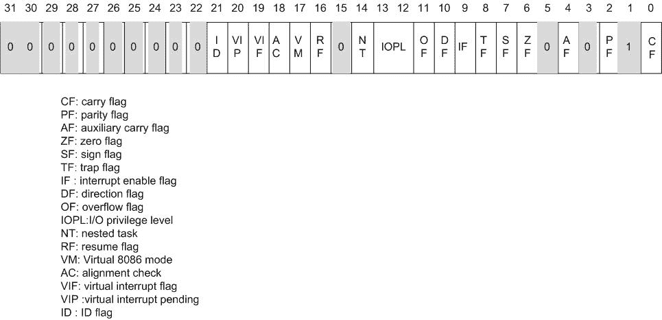

# 我和 CPU 之间关于 EFLAGS 的对话

> 原文：[`www.pediy.com/kssd/pediy10/99569.html`](https://www.pediy.com/kssd/pediy10/99569.html)

某日下午，偶为了学习《加密解密》正伏案研究汇编语言中涉及到的 CPU EFLAGS 相关内容.针对书本上的内容，整按照自己的理解写了几个测试程序，用 OD 调来调去，可是 EFLAGS 寄存器的变化和自己想的总是不一样。于是苦苦思索，百思不得其解，只好闭目养神。  
    不知道过了多久，在半睡半醒中来到一处陌生的地方。正四处张望的时候，前方突然出现一特大号 CPU，那 CPU 竟然还能开口说话。因此才有了下面这段谈话。  
   “CPU 兄，您好。小弟最近在研究您内部的 EFLAGS 寄存器，能请教您几个问题吗？”我赶紧上前打招呼。  
    “哦，你是 UKYOHY 吧。我正等你呢。就是你刚才老拿一个叫啥 OLLYDBG 的程序不停的在查看我的 EFLAGS 的值啊。有啥问题你说吧。” CPU 答到。  
我赶紧将正在思考的问题说出：“您能给我说说您的 EFLAGS 的结构吗？就是每个标志位都代表什么？”  
      CPU ：“BS 你哦，这个问题好多文档上不是都写了嘛。比如最权威的 intel 官方文档都有啊，只有你整部明白，不停的调试来调试去，弄的我一身汗。哎，看你可怜，我再说一遍吧。” 说完，CPU 一招手，凭空出现了一块黑板。他没有理睬我吃惊的表情，转身在黑板上画了如下的图：  
  
  
        CPU 画完之后看了看黑板满意的点点头，然后回过头来对我说：“先声明哦，灰色部分不要问我，因为我也不知道是干什么用的，也许只有我的父母才知道。”  
     我仔细看了看黑板上的图，越看越迷惑，因为我看的书上没有介绍这么多，只好继续问 CPU: “哦，我看的书上只介绍了 CF,PF,AF,ZF,SF,OF 六个标志位，即使除掉保留位，也还剩下好多啊，这么多标志位该怎么学习理解啊？“  
      CPU:  “CF,PF,AF,ZF,SF,OF 是最常用的 6 个标志啦，你作为一个初学者，先学习这 6 个标志就可以了，其他的暂时可以忽略。我来考考你，这 6 个进位标志你是怎么理解的？”  
       我： “哦，书上时这么说的： CF 标志位是当无符号加法运算的结果太大（或太小），目的操作数无法容纳的时候，CF 标志位将被设置为 1；PF 标志当结果数为 1 的 bit 位总数为偶数时设置为 1；AF 标志当操作导致 bit3 向 bit4 进位的时候设置为 1；ZF 标志当结果为 0 的时候设置为 1；SF 标志当结果为负时被设置；OF 标志当有符号数太大无法容纳于目的操作数时被设置为 1.”  
       CPU：“在评价你的答案之前，你能否回答我一个问题？你在答案中提到了无符号和有符号数，那么我是怎么判断一个数时有符号还是无符号的呢？”  
       “哦…….”,我想了一下，尝试的发问“根据补码？根据符号位？”  
        然后用求助的目光看着 CPU。  
        CPU 笑而不答。  
       “好吧，好吧…..我承认我不知道，还是请您告诉我吧。”我鼓足勇气说到。  
       “知之为知之，不知为不知是为知也。孺子可教啊”，CPU 得意的说。  
        在顿了顿之后，CPU 接着说道：“其实这个问题的答案是，作为 CPU 的我根本不知道一个数字到底是无符号还是有符号。我只知道这是个数字，或者精确的说，我的眼里只有这个数字的二进制表示形式。其实，从这个方面来说，我的设计逻辑没有想象的那么复杂，甚至可以说有点傻，我只关心二进制的加减（这里暂时忽略乘除）。我说的这些你能理解么？”  
       我：“哦，我想起来了，《intel 汇编程序设计》4.2.6 节曾经提到过这个问题。大意是说 CPU 不知道，只有程序员知道。哎，你刚才的问题我其实是可以回答的，都怪我看书太不仔细了。不过这个观点我不是很理解，你能详细解释下么？”  
       CPU：“当然可以。以下的内容要仔细听好哦。以一个字节为例，如果你分别向 AL 寄存器传送 1 和 -1. 那么指令执行之后，AL 里面的值究竟是什么呢？ 根据你刚才的回答，你应该知道，传送 1 之后，AL 的值是 0X1h。 传送 -1 ,AL 的值是 0XFFh  
 换句话说，1 是直接转换成 2 进制存储到 AL 中。而-1 是按照其补码存储到 AL 中的。可是这里的问题是，-1 的补码是编译器在编译的时候完成转换的。换句话说，程序开始执行的时候，传到 AL 的实际值就是 0xFFH. 在我眼里，它就是 11111111,究竟它代表-1 还是代表 255，我也不知道。只有作为程序员的你知道。这点你能理解么？”  
      CPU 说道这里，停了下来，然后看着我。我仔细思考了下，似乎有点理解了，然后点了点头。         
     “那好，继续刚才的话题。所以，所有的算术逻辑运算，在我眼里都是简单的二进制运算。  
现在回到刚才 EFLAGS 标志的问题，我从我的观点来阐述着几个标志位：  
      CF 标志：操作数的最高有效位发生进位或者借位的时候，这个标志位就是 1.  
         PF 标志：操作结果的最低有效字节，换句话说，最右边的 8 位中，如果 bit 为 1 的总数  
         是偶数，那么该标志就是 1.  
         AF 标志：如果操作结果 bit3 发生了进位，那么该标志就是 1.  
         ZF 标志：如果操作结果为 0，那么该标志就是 1。  
      SF 标志：就是操作数的最高有效位，就是说 SF 的值等于操作结果的最高有效位。  
      OF 标志：这个标志有点复杂，其结果是 CF 标志和次最高位是否发生进位（如果进位是 1，  
              没进位是 0）进行异或的结果。  
      以上是我设置标志位的规则，记住了哦。看你研究的那么辛苦，才告诉你。我要走了。”  
      我：“等等，我还有好多问题要问啊,别走啊。。。。。。”  
      一惊之下，突然醒来，口水流了一桌子原来是南柯一梦。  
      赶紧整理下梦中的记忆，写在纸上进行验证。谁知结果竟然是正确的，因此写出来大家共享。  
      