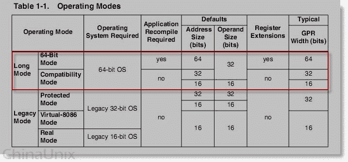
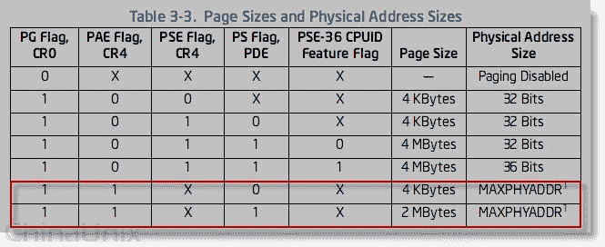
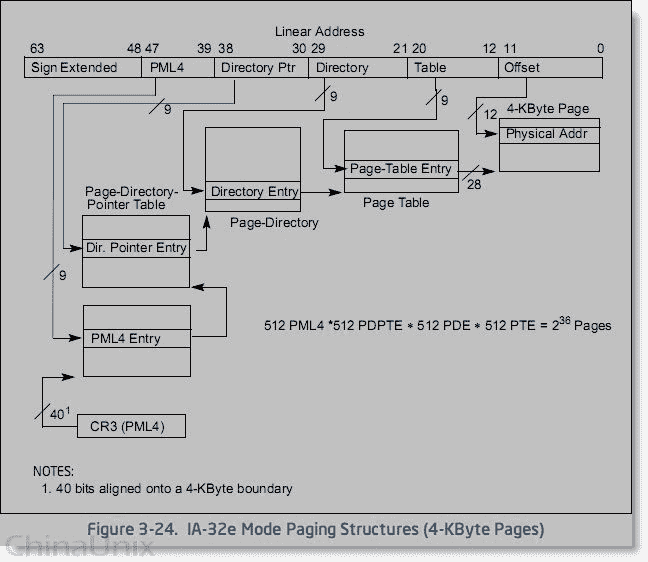
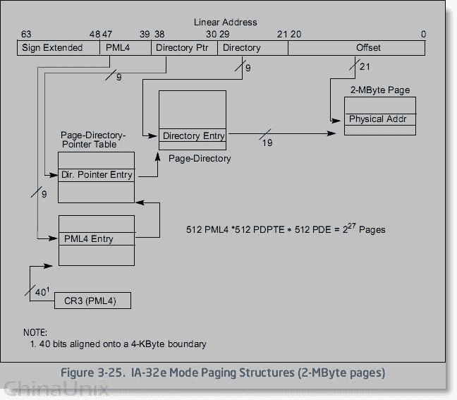
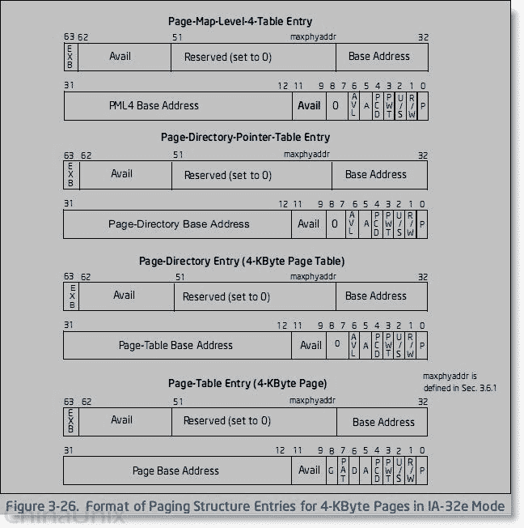
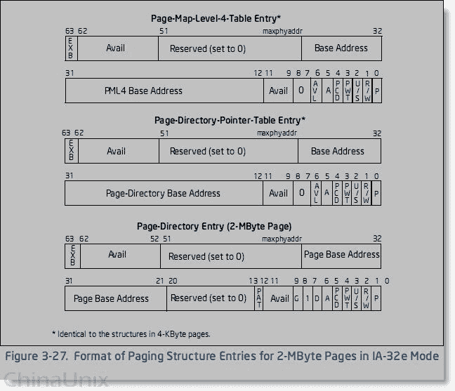
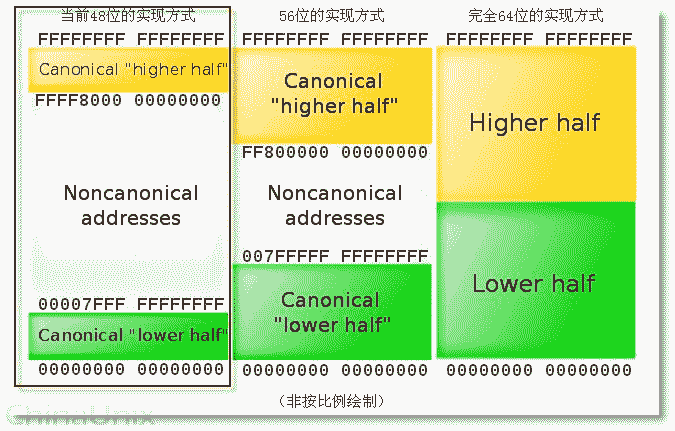

# x64 存储管理机制初窥

> 原文：[`www.pediy.com/kssd/pediy10/102410.html`](https://www.pediy.com/kssd/pediy10/102410.html)

【文章标题】: x64 存储管理机制初窥  
【文章作者】: childz  
【软件名称】: intel 手册 volume：3A 和 AMD 手册 volume：2  
【下载地址】: intel 官网和 AMD 官网  
【编写语言】: 汉语  
【操作平台】: Windows xp sp2  
【作者声明】: 没什么技术含量，主要来源于 intel 手册和 AMD 手册  
\--------------------------------------------------------------------------------  
【详细过程】  
  前几天，问 x64 存储管理机制，经 prolj 和 mik 指点，去找 intel 手册和 AMD 手册看，看完之后把我的理解  写下，  
  如有什么理解偏差之处，还望各位不要笑话，毕竟本人英语也是 cai 啊  
  1.长模式（long mode）  
  在 AMD64 架构的长模式中包括两个子模式：64bit 模式和 compatibility 模式。  
  ● 64bit 模式：在此模式中虚拟地址空间使用平坦（flat）模式，段寄存器包括 CS,DS,ES,SS 全部清零  
  
（FS,GS 除外，在线性地址计算时，提供额外的 base 寄存器寻址某些 OS 的系统数据结构），  
  能为 64bit 的 OS 和应用程序提供 64 位寻址支持。  
  ●compatiblity 模式：在此模式中使用与 lagecy 保护模式一样的存储管理模式，为的是平滑运行 32bit  
  和 16bit 的应用程序，无需重新编译  
  注意：在长模式中不支持实模式和虚拟 8086 模式！！  
   
  由于在 64bit 模式下使用 flat 模式，所以无 lagecy 保护模式下的分段管理模式，所以虚拟地址直接对应线性  
  
地址。所以 x64 的分页  
  管理模式才是 64bit 下的重头戏  
    
  2.x64 分页管理模式  
  如下图，是 x86-64 下的所有页大小和物理地址大小的汇总  
  
  在 x64 下，理论上可以通过使用 PAE（物理地址扩展）分页结构支持 64bit 的线性地址到 52bit 物理地址的映  
  
射的，但在对这一架构的首次实现中，  
  只实现了 48 位的线性地址到 40 位物理地址的映射。现在你可以通过 CPUID 指令查看自己的 cpu 所支持的最大  
  
物理地址（MAXPHYDDR）.  
  大家一定还记得在 lagecy 保护模式下通过 PAE 功能来访问超过 32bit(36bit)的物理地址，但是在 x64 模式下  
  
的 PAE 与先前的 PAE 是不一样的！！  
  从线性地址到物理地址的转换中用到了四级页数据结构，一个新的页表数据结构---PML4 被引入用来指向页  
  
目录指针表。PML4 表  
  只能在 x64 模式下使用。而且页目录表指针从原来的 4 个项增加到了 512 个，所以要从线性地址中分配 9bit 用  
  
来索引 PDP 表（原来是 2bit）。  
  PDE 和 PTE 的大小保持不变。所以我们可以看到 PML4+PDP+PDE+PTE+page offset=48bit，高 16bit 保留（其实  
  
是用以符号扩展，下面将看到  
  符号扩展的用途）。  
  CR3 指向了 PML4 的基地址。  
  需要注意的是在使用 x64 模式之前，必须使 CR4.PAE=1（PAE 用来扩展 PDE 和 PTE 至 64bit）。如果你在未使  
  
CR4.PAE=1 之前，企图开启  
  x64 模式的话，会引发#GP 异常。  
  我们从上图还可以看到页大小的选择完全取决于 PDE.PS（但我并没有在文档中看到 ps 位，是直接在文档中  
  
置 1 或 0），无视 CR4.PSE 的存在。  
  2.1x64 分页管理（4kb）  
  上图再说  
  
  ●sign extended--符号扩展位  
  ●PML4 entry--在线性地址 39～47bit 用于索引 PML4 entry，指向 PDP  
  ●PDP entry--在线性地址的 30～38bit 用来索引 PDP entry,指向 PDE  
  ●PDE entry--在线性地址的 21～29bit 用来索引 PDEentry,指向 PTE  
  ●PTE entry--在线性地址的 12～20bit 用来索引 PTE entry,指向 page offset  
  ●page offset--在线性地址的 0～11bit 提供在页中的 offset  
  2.2x64 分页管理（2mb）  
  
  我们可以看到与 4kb 的页相比少了 PTE,page offset 从原来的 12bit 增加到了 21bit  
    
  下面我们来看看各页表项的内部结构  
  
  上图看到，用上述方法可以得到 512×512×512×512=2³⁶ 个页面，2³⁶\*4kb=2⁴⁸ 个线性地址  
  
  上图看到，用上述方法可以得到 512×512×512=2²⁷ 个页面，2²⁷\*2mb=2⁴⁸ 个线性地址  
  0bit：P 位，即存在位，表示由项所指的页面或页表当前是否加载到了物理存储器中，如不存在，可以通过  
  
引发#PF 异常从磁盘中  
  加载到物理存储器中  
  1bit：R/W，即读写位，为页表指定读写特权，当置位时可读可写；清零是只读  
  2bit：用户/系统位，即为页表指定系统还是普通用户特权  
  3bit：页面通写，指定高速缓存写策略是回写还是通写  
  4bit：高速缓存禁止位，当置位时禁止相关的页面和页表进行高速缓存，反之，可以  
  5bit：访问位，当置位时表示已经被访问，反之，没有  
  6bit（非 PTE 或 PDE（2MB））：可用位  
  6bit（PTE 或 PDE（2MB））：D 位，dirty，即脏位，置位时表示页面被写过  
  7～8bit（非 PTE 或 PDE（2MB））：0  
  avail：系统程序员可用  
  G：全局标志  
  PAT：页表属性  
  各种 base address 是用来得到下一级表的基地址的，  
  最后的物理地址=page base address\*2¹²(2²¹),而 page base address 的大小取决于你的 cpu 的最大物理  
  
地址了。  
  3.最后，我来看一看 sign extended 会形成什么效果。  
  由于 sign extended 的作用会将线性地址分成相同大小的两段，从 0 至 00007FFF\`FFFFFFFF，  
  以及从 FFFF8000\`00000000 至 FFFFFFFF\`FFFFFFFF 总计 256TB 的地址范围，这非常符合操作系统的习惯。  
  这种“古怪”的规则为日后扩展到真正的 64 位寻址保留了一个重要的特性：很多的操作系统（包括但不限  
  
于 Windows NT 系列）  
  将地址空间的高半部分（被称作内核空间）留给自己，将低半部分（用户空间）留给应用程序代码、用户  
  
态栈、堆和其他数  
  据区。这种设计保证了每一个符合 AMD64 的实现都拥有两个内存片段：低半段从 00000000\`00000000 开始，  
  随着更多的虚拟地址位变得可用而“向上生长”；高半部分被“悬挂”在地址空间的顶部而“向下生长”  
  
。同样，  
  将未被使用的地址位内容固定下来防止被操作系统用作标志位、特权级标号等其他用途，是为了避免当架  
  
构扩展至 52,  
   56, 60 和 64 位的时候出现问题。  
  
  参考资料：  
  1.http://zh.wikipedia.org/zh-cn/X86-64  
  2.intel 手册  
  3AMD 手册  
    
    
    
    
\--------------------------------------------------------------------------------  
【经验总结】  
  我还很菜，继续努力，向 mik 大侠学习  
    
\--------------------------------------------------------------------------------  
【版权声明】: 本文原创于看雪技术论坛, 转载请注明作者并保持文章的完整, 谢谢!  
  
                                                       2009 年 12 月 03 日 14:53:35