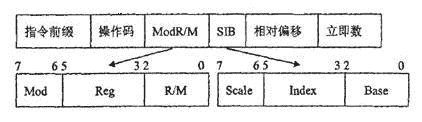

# 32 位机器指令(一)

> 原文：[`www.pediy.com/kssd/pediy12/129561.html`](https://www.pediy.com/kssd/pediy12/129561.html)

最近比较仔细地摸索了 32 位 Intel 机器指令格式，简单写了点文章，然而发现 egogg 做了同样的事情。所以我只好写的具体一点，他没细说的事情，我来说。  
     
一、机器指令概述  
    Intel 机器指令系统，指令长度是不固定的，这是因为在早期计算机时代，内存的每一个字节是相当珍贵的，这不止是钱的问题，在打孔带和软盘横行的时代，紧凑的代码能够有效地提高运行速度（当然这不是绝对的，但对早期终端设备和个人用户是正确的）。      
    因此，intel 指令系统为了缩减指令长度，采取的策略是这样的：只有在必要的时候，使用某些字节域，但是有一个域必须存在主操作码。  
（下图从左到右，内存地址是依次增大）  
    

指令前缀有 4 种，而且一条指令可以前有多种前缀，每一个前缀占一个字节，在 32 位指令里，前缀种类的排列顺序不作规定。它们的名称和机器码，分别是是：  
\[1\] 操作数长度前缀（66H）  
    对于 32 位指令系统而言，默认寄存器都是 32 位的，但是我们不可避免的会使用其他长度地寄存器。如果要使用 16 位长度的寄存器，只需在指令前加 66H，即用操作数长度前缀标记。然而对于 8 位长度的寄存器，不是通过操作数前缀标记的。后文将说明它和 32 位操作数长度如何区分的  
举例：  
mov eax,1 =     B8 01000000  
mov ax,1    =66 B8 0100  
mov al,1     =     B0 01  
  
    另外还有一点要说明，就是像 movzx 这样，操作数与被操作数长度不相等的指令。则我们以被操作数的长度为标准，选择是否添加前缀。  
举例：  
  movzx eax,ax  =  0FB7C0  
  movzx eax,al  =  0FB6C0  
  movzx ax,al  =66  0FB6C0  
\[2\] 地址长度前缀（67H）  
    这个前缀和上一个前缀用法差不多，只不过这个前缀是标记内存地址长度的。学过汇编的人，还应该知道操作数和被操作数中，至多一个是内存操作数。在 32 位指令系统下，如果内存操作数的长度为 16 位，则需在指令前加“地址长度前缀”，即 67H  
举例：  
mov eax,\[bx\]  =67 8B07    ;不要在 flat 模式下编译此句  
mov eax,\[ebx\]  =     8b07  
\[3\] 段超越前缀（2eH、3eH、26H、64H、65H、36H）  
    当使用内存操作数时，无论那种内存操作数寻址都有默认的段寄存器，然而至多一个的内存操作数不使用默认段寄存器时，我们就需要使用段超越前缀。各个段寄存器代码如下，  
cs=2eH  
ds=3eH  
es=26H  
fs=64H  
gs=65H  
ss=36H  
举例：  
mov eax,\[eax\]    =     8b00  
mov eax,cs:\[eax\]    =2e 8b00  
mov eax,es:\[eax\]    =26 8600  
mov eax,fs:\[eax\]    =64 8600    记得声明 assume   fs:nothing  
mov eax,gs:\[eax\]    =65 8600    记得声明 assume  gs:nothing  
mov eax,ss:\[eax\]    =36 8600    
\[4\] 锁定前缀和重复前缀  
    和协处理器有关，在指令前加 F0，表示访问独享。微机原理关于这部分，我基本没学，不知道干嘛用的，反正用的时候是这样的：  
举例：  
add \[eax\],eax    =     3100  
Lock add \[eax\],eax    =F0 3100  
    进行串操作时，经常使用重复指令，该指令就是在机器码前加重复前缀.,全部重复前缀编码如下：  
Rep=F3    
Repe=F3  
Repz=F3  
Repne=F2  
Repnz=F2  
举例：  
     stosb  =    AA  
  rep stosb  =F3 AA  
  
word 格式版本机器码探索 4 种指令前缀.doc