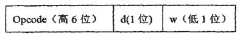
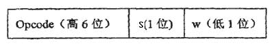
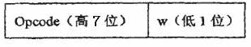
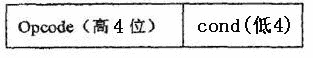
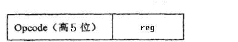
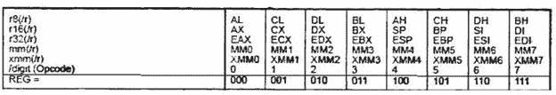

# 32 位机器指令(二)1 字节长度主操作数

> 原文：[`www.pediy.com/kssd/pediy12/130017.html`](https://www.pediy.com/kssd/pediy12/130017.html)

看了一遍 egogg 关于指令格式的文章，他对于主操作码的叙述明显不够，因此，我想把这个部分彻底讲明白。后几章我分别将，如下内容：  
1 字节长度主操作码  
1 字节长度主操作码+3bit 拓展操作码  
2 字节长度主操作码  
2 字节长度主操作码+3bit 拓展操作码  
  
     希望通过我的叙述，使你能明白，虽然机器指令与汇编不存在“一对一”的规律，但它们存在非常好的“多对多”的规律。  
  
一、1 字节长度主操作码  
　　本篇文章我的主要说一下“1 字节长度主操作码”，这也是各种长度操作码中最为复杂的。  
好吧，现在开始。  
  
**\[1\] opcode + d+ w**  
如图：  
  
    这种指令格式最为常见，因为它对应三种常见汇编形式：  
OP Reg,Mem  
OP Meg,Reg  
OP Reg,Reg  
    其中 d 位表示数据传送方向，这和后文将要说道的 Mod R/M 字节相关，当 d=l 时，数据从 R/M 字段流向 reg 字段，当 d=0 时，数据从 reg 字段流向 R/M 字段或立即数流向 reg。  
举例：  
  mov eax,\[eax\]  =8B00  →主操作码 8B  =10001011  
  mov \[eax\],eax  =8900  →主操作码 89  =10001001  
w 位用来区分指令 8 位操作数与 32/16 位操作数，w=1 表示使用 16/32 位操作数，w=2 表示使用 8 位操作数。  
举例：  
  Mov eax,eax  =8BC0  →主操作码 8B  =10001011  
  Mov al,al    =8AC0  →主操作码 8A  =10001010  
  
**\[2\] opcode + s+ w**  
如图：  
  
    这种机器指令也比较常见，它对应汇编格式：Op Reg/Mem,immed  
其中 s 位表示立即数是 8 位还是 16/32 位  
举例：  
  add ebx,12345678H  =83C1 78563412  →主操作码 83=10000011  
  
  add ebx,12H        =81C1 12    →主操作码 81=10000001  
  
**\[3\] opcode+w**  
如图：  
  
    这种形式比较常见，对应汇编形式：Op ACC,immed   
    ACC 代表 eax/ax/al,；immed 必须与 ACC 等长，且不能填 0 凑出等长  
  
**\[4\] opcode+cond**  
如图  
  
     这种形式专门对应非条件跳转汇编指令：jxx xxxx，比如 jxx disp8 占用主操作码从 01110000 至 01111111  
  
**\[5\] opcode+reg**  
  
    这种形式对应汇编格式：op reg  
举例：  
  Push eax  =50  →主操作码 50 =01010000  
  Push ecx  =51  →主操作码 51 =01010001  
  Push edx  =52  →主操作码 52 =01010010  
  其中 reg 代表寄存器。  
  
  
**\[6\]opcode（8 位）**  
    这种形式一般对应无操作数汇编指令。  
  
**\[7\]opcode(高 6)+s+opcode（低 1 位）**  
    这种形式一般对应只有一个立即数的汇编指令  
  
**\[8\]其他**  
  还有一些和段寄存器相关的指令格式，这里就不讲了