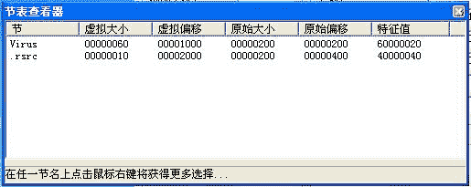

# 你可能不了解的汇编(上)（下）

> 原文：[`www.pediy.com/kssd/pediy12/129603.html`](https://www.pediy.com/kssd/pediy12/129603.html)

汇编学的还不错的人，基本上是从 16 位汇编起家的，后来学 32 位汇编时估计不会一字一句的看书，学 16 位汇编时也可能会遗漏不少东西。以下是我的体会，欢迎大家分享、指教。  
**0. 32 位基址和变址寄存器的限制**  
    很多学 32 位汇编的人，都以为内存寻址的基址和变址寄存器可以随便使用任何通用寄存器，这是不准确的，因为有个例外，\[esp+esp\]这样的组合是不能使用的。  
  
**1.从 PUSH 开始谈新指令**  
   你应该知道 push、pushad、pushfd 这三条指令，但是大部分人不知道还有 pushd、pushw、pusha、pushf 这四条指令;对应的还有 popa、popf，但没有 popd、popw。  
  
你不知道或不熟悉的指令还有很多很多，比如  
  
①xadd   交换并相加  
  
②bswap 指令指定的 32 位寄存器的字节次序变反③  
  
④cmpxchg 比较并交换  
  
⑤cmpxchg8 八字节比较并交换  
  
.....  
  
**2.AND、OR、XOR、NOT、SHL、SHR 既是指令助记符又是逻辑运算符**  
这里以 AND 为例：  
  
and EAX,DATA1 and DATA2  
  
另外说一句，关系运算符 EQ(等于)、NE(不等于)、LT(小于)、GT(大于)、LE(小于等于)、GE(大于等于)，也可以写入像上面指令一样写入指令里。比如：  
  
mov EAX,1 GT 0;关系成立，EAX=0FFFFFFFFH  
  
mov EAX,0 GT 1;关系不成立，EAX=0H  
  
**3.模块伪指令**  
  初学写 32 位汇编的大概都以为，“CODE SEGMEMT”是 16 位汇编的模块专用的，而 32 汇编模块只能使用“.code .data”这样的伪指令。  
  
事实上，“xxx SEGMEMT”在 32 位汇编里叫做“完整段定义伪指令”，可以继续使用，只是没有必要，因为 win 操作系统的内存分配管理比 DOS 的内存分配管理简单的多。而“.xxxx”的称为“简化段定义伪指令，被简化到只有一个参数，即段名称。  
  
举例：  
  
.code Virus  
  
   Start:  
  
   .....  
  
   .....  
  
end Start  
  
我们用 PEeditor 看一下：  
  
  
**4.数据定义伪指令**  
 估计大家一定知道常用的数据定义伪指令，来定义字节、字、双字、以及结构体即：  
  
DB/BYTE 和 SBYTE  
  
DW/WORD 和 SWORD  
  
DD/DWORD 和 SDWORD  
  
STRUC/STRUCT  
  
不过，这些还远远不够，请看下面：  
  
DF/FWORD 32 位偏移地址的远指针  
  
DQ/QWORD 4 字变量(8 字节)  
  
DT/TBYTE 十字节变量  
  
REAL4、REAL8、REAL10 定义单、双精度和十字节的浮点数  
  
EVEN 取偶偏移地址  
  
ALIGE 对齐边界地址  
  
RECODE 以及和它相关的 WIDTH、MASK  
  
**5.特殊的宏操作符&、%、！、<>、;;**  
&：替换操作符，强制将宏参数传入的变量名称替换该参数，来与其他字符组合结合。   
  
< > 字符串传递操作符，用于括起字符串。在宏调用中，如果传递的字符串实参数含有逗号、空格等间隔符号，则必须用这对操作符，以保证字符串的完整。  
  
!  转义操作符，用于指示其后的一个字符作为一般字符，而不含特殊意义。  
%表达式操作符，用在宏调用中，表示将后跟的一个表达式的值作为实参，而不是将表达式本身作为参数。  
;;宏注释符，用于表示在宏定义中的注释。采用这个符号的注释，在宏展开时不出现。  
举例：  
  
Test macro para  
  
TestStr db 'Hello,&para'  
  
endm  
  
Test world;展开后为 Test db ‘Hello,World’  
  
**6.".if .else"等流程控制伪指令与与状态标志符操作符**刚学.if 这类流程控制伪指令时，总是认为其不能替代跳转指令，究其原因是不了解“状态标志操作符”  
CARRY?  表示 CF 标志位  
OVERFLOW?  表示 OF 标志位  
ZERO?  表示 ZF 标志位  
SIGN?  表示 SF 标志位  
PARITY? 表示 PF 标志位  
举例：  
sub eax,ebx  
.if  ZERO?  
   dec ecx  
.endif 

1.ret 结束程序和 ExitProcess 的区别  
  
   
  
    在堆栈平衡的情况下，用 ret 结束程序，系统自然会调用 ExitThread 来结束线程；另外，如果是单线程进程，系统自然还会调用 ExitProcess。然而，在这里我要说尽量不要使用 ret 结束进程或线程，原因如下：  
  
    第一，汇编语言本身的特性使得我们，有可能因编程失误在结束程序前，堆栈并不平衡。  
  
    第二，一些壳可能不清理堆栈，或者某些对二进制代码的二次开发操作的不严谨，也会产生同样的问题。  
  
   
  
2.masn 怎么使用 unicode  
  
使用 masm 库 ucmacros.asm，在它里面有的两个宏：WSTR 和 uni$。自己看一看就明白了，非常容易理解。  
  
   
  
3.第四种工作模式  
  
Pentium 及其后继处理器在“实模式、保护模式、虚拟 86 模式”基础上，又增加了一个“系统管理模式”，目的是实现对系统供电和系统功能进行管理。  
  
   
  
4.以编程的角度用汇编实现 C 语言中的 switch  
    搞逆向的同志对这个问题再熟悉不过了，当然以编程的角度会略有不同。  
\[1\]分支数较少的实现多个 if  
  
一般来说如果分支数少于 4 个或者分支条件不连续分布，那么我们直接用多个.if 来实现就可以，如下：  
  
.code  
  
Start:  
  
  mov eax, xxxx  
  
  cmp eax,0  
  
  je  BRA0  
  
    
  
cmp eax,1  
  
  je  BRA1  
  
    
  
cmp eax,2  
  
  je  BRA2  
  
   
  
  cmp eax,3  
  
  je  BRA3  
  
BRA0:  
  
  .....  
  
BRA1:  
  
  .....  
  
BRA2:  
  
  .....  
  
BRA3:  
  
  .....  
  
End Start  
  
\[2\]分支数较多的实现跳转表法  
  
采用.if 条件二叉分支的方法，虽然简单，但随着分支数的增加，进入最后分支的等待平均时间越来越长，这极大的削弱了汇编语言的优势，为此提出了跳转表法。  
  
具体做法：在内存中开辟一块连续的存储单元作为跳转表，表中按顺序存放各分支的跳转地址，进入分支处理程序前，通过查询跳转表来确定跳转地址。如下：  
  
.Data  
  
BASET dw BAR0,BAR1,BAR2,BAR3,…  
  
.code  
  
mov eax, xxxx  
  
add eax,offset BASET  
  
jmp dword ptr \[eax\]  
  
BAR0:  
  
  .....  
  
BAR1:  
  
  .....  
  
BAR2:  
  
  .....  
  
BAR3:  
  
  .....  
  
       
  
5.用汇编实现函数递归调用   
  
 其实这个很简单了，看下面的代码就可以了  
  
fun proc   
  
  pushaf  
  
  .....  
  
  cmp  xxx,xxx ;判断是否达到递归终值  
  
  jz    Last  
  
  ..... ;在这里进行某些递归过程内运算  
  
  call  fun;递归调用  
  
  jmp Fun\_End  
  
Last：  
  
  .....  
  
  mov xxx,xxx;给递归条件赋予递归终值  
  
Fun\_End:  
  
  popaf  
  
  ret  
  
fun endp 

引用: *最初由 **yangbostar**发布*  第一问题不太好回答，简单讲是因为机器指令格式的 sid 字段，表示\[esp+esp\]的对应值被\[esp\]占用，原来位于 r/m 字段表示\[esp\]的值表示了其他意义。具体要明白这个问题得有比较深入的 32 位机器指令格式的基础。  
push/pop 有那么多形式估计是兼容以前 16 位指令的原因。 

你这样说不对，\[esp+esp\]确实存在而非不存在 你不能在一般的汇编器里过去那是汇编器的事情。事实上这个问题是 sib 的 index 如果为 esp 的话，就自动解释成 index 项无效。这样说比较抽象，举个例子来看。  
mov eax,\[esp+esp\]  
如果你在通常汇编器里面写是写不出来的 因为 sib.index 为 esp(=100)会被认为 index 错误  
但是这指令是存在编码的 32 位下 一般为  
8b 04 24  
为了说清楚这个事情 我们把后面的 24 给拆成二进制  
00  10 0   100  
红字的 1 0 0 就是 esp 作为 sib.index 的编码  在我的 VC6 下面要想看出效果    需要使用这样的  
嵌入汇编  
代码:

```
  \_\_asm
  {
    //mov eax,\[esp+esp\]
      \_emit 0x8b
      \_emit 0x04 
      \_emit 0x24
  }

```

你可以调试时候看看 vc 的反汇编代码 这句话 反汇编成了 mov eax,\[esp\] 也就是说 同样作为 index 的 esp 被忽略了 index\*scale 这一项没有了。 

引用: *最初由 **yangbostar**发布*  我不同意你的说法，我们来编译这一句 mov eax,\[esp\],编译的结果也是 8b 04 24,sib=24,我们可以看出事实上，是\[esp\]把\[esp+esp\]占用了，而不是存在所谓的\[esp+esp\]。  
  
为什么\[esp\]要占用\[esp+esp\]呢？  
原因是这样，原本\[esp\]只要在 Mod ... 

这个解释大有可说。我们从头开始看。  
modrm 提供 reg \[reg\] \[reg+disp\]三种寻址  
sib 本是可选字段 由 modrm 的 rm 字段=100\[esp\]来引导出来 这样用\[esp\]方式的寻址 就必须用 sib  然后用 sib.base 的为 esp 来实现  
sib 能够寻址的是\[base+index\*scale+dispXX\]  
难就难在这个 scale scale 只有两位 对应是四种编码 1 2 4 8 而没有对应 0 的编码 这样  
\[esp\]=\[esp+0\*index\]就没法表示   
走到这里我们发现 sib 没法表示\[esp\]寻址模式了 于是 intel 只能作出一个艰难的决定 当 esp 作为 sib 基址寄存器时候 通过某种方式直接把 scale 视为 0 也就是说 如果 sib.base=100 时候 如果 index 是=100 则视为 scale=0 实现了\[esp\]的寻址  
这样回头看  我们来看看 esp 为什么不能做 index 事实上 就算不是 esp 作为基址 当 index=100 时候 scale 同样也是视为 0 的 所以可以用 00XX100 作为 modrm 引导出 sib 然后裸用 sib 来编码\[GPR\]这种寻址模式  
比如 mov eax,\[ebx\] 既可以只用 modrm 来编码 8B 03  
也可以通过 sib 来编码 8B 04  63 只不多后面这种太蛋疼了  
注意这里的 scale 字段 特意设置成 01 实际上无所谓的 就算是 8B 04 E3 也是一样的 mov eax,\[ebx\] 所以我们在这里说 如果 index 为 100 则视 scale 为 0