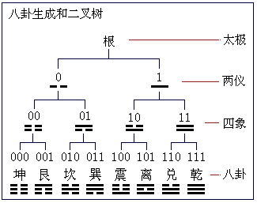

# 从二进制开始学汇编

> 原文：[`www.pediy.com/kssd/pediy10/84666.html`](https://www.pediy.com/kssd/pediy10/84666.html)

接触编程有几年了,基本上都是靠自学,最先开始接触电脑是因为对黑客的崇拜,当时无意中接触到了易语言(中文内核),开始学着写程序,通过易语言进入了编程的大门,之后就慢慢的熟悉熟练地运用 API,了解到语言只是一种规范,是死的,而各种高级语言最终是通过对象,API 等系统给的接口调用系统的各项功能的,之后就是停歇不前了,只到遇到了汇编,喜欢它的短小精悍,我直接学的 win32 ASM  
也写了点小东西,学到了点东西,但总感觉我付出的东西太小了,回过头来发现,原来是我忽略了基础的东西,比如说,二进制,八机制,十六机制之间的转换关系,高位,低位,各寄存器的使用等等我都模糊不清  
  
     所以,有了这个帖子,从今天开始我重新学习汇编,从二进制开始,我会在这里贴出一些我的学习资料,学习心得与大家分享,欢迎大家批评指正,谢谢!  
  
  
  
<1> 二进制概述以及其发展   
  
　　进制是逢 2 进位的进位制，0、1 是基本算符；计算机运算基础采用二进制。电脑的基础是二进制，那么，什么是二进制呢,为什么需要二进制呢？在早期设计的机械计算装置中,使用的不是二进制，而是十进制或者其他进制，利用齿轮的不同位置表示不同的数值，这种计算装置可能更加接近人类的思想方式。比如说一个计算设备有十个齿轮，它们级连起来，每一个齿轮有十格，小齿轮转一圈大齿轮走一格。这就是一个简单的十位十进制的数据表示设备了，可以表示 0 到 999999999 的数字。 配合其他的一些机械设备，这样一个简单的基于齿轮的装置就可以实现简单的十进制加减法了。这种通过不同的位置上面不同的符号表示数值的方法就是进制表示方法。常用的进制主要是十进制（因为我们有十个手指，所以十进制是比较合理的选择，用手指可以表示十个数字，0 的概念直到很久以后才出现，所以是 1－10 而不是 0－9）。 电子计算机出现以后，使用电子管来表示十种状态过于复杂，所以所有的电子计算机中只有两种基本的状态，开和关。也就是说，电子管的两种状态决定了以电子管为基础的电子计算机采用二进制来表示数字和数据。 常用的进制还有 8 进制和 16 进制，在电脑科学中，经常会用到 16 进制，而十进制的使用非常少，这是因为 16 进制和二进制有天然的联系：4 个二进制位可以表示从 0 到 15 的数字，这刚好是 1 个 16 进制位可以表示的数据，也就是说，将二进制转换成 16 进制只要每 4 位进行转换就可以了。二进制的“00111000”直接可以转换成 16 进制的“38”。 一个字是电脑中的基本存储单元，根据计算机字长的不同,字具有不同的位数，现代电脑的字长一般是 32 位的，也就是说，一个字的位数是 32。字节是 8 位的数据单元,一个字节可以表示 0－255 的数据。对于 32 位字长的现代电脑，一个字等于 4 个字节，对于早期的 16 位的电脑，一个字等于 2 个字节。   
  
  
<2>计算机内部采用二进制的原因  
　　（1）技术实现简单，计算机是由逻辑电路组成，逻辑电路通常只有两个状态，开关的接通与断开，这两种状态正好可以用“1”和“0”表示。   
　　（2）简化运算规则：两个二进制数和、积运算组合各有三种，运算规则简单，有利于简化计算机内部结构，提高运算速度。   
　　（3）适合逻辑运算：逻辑代数是逻辑运算的理论依据，二进制只有两个数码，正好与逻辑代数中的“真”和“假”相吻合。   
　　（4）易于进行转换，二进制与十进制数易于互相转换。   
　　（5）用二进制表示数据具有抗干扰能力强，可靠性高等优点。因为每位数据只有高低两个状态，当受到一定程度的干扰时，仍能可靠地分辨出它是高还是低。  
  
<3>二进制的算法：  
  
2\*2=?\*2=?\*2=?\*2=?\*2=?\*2=?\*2=?\*2=?\*2=?\*2=?\*2=?\*2=?\*2=?\*2=?\*2=?\*2=?\*2=?\*2=?\*2=?\*2=?\*2......  
　　101010101010101010101010101010101010101010101010101010101010101010101010101010101010101010101010101010101010101010101010101010101010......  
  
  
  
  进制         基数                                权          进数规律  
  
  
  十进制   0、1、2、3、4、5、6、7、8、9            10 i              逢十进一                      
  
  二进制   0、1                                                     2i                逢二进一  
  
  八进制   0、1、2、3、4、5、6、7                        8i                逢八进一  
    
十六进制   0、1、2、3、4、5、6、7、8、9、A、B、C、D、E、F  逢十六进一  
  
                                        
十进制数转换为二进制数、八进制数、十六进制数的方法：  
　　二进制数、八进制数、十六进制数转换为十进制数的方法：按权展开求和法  
　　1．二进制与十进制间的相互转换：  
　　（1）二进制转十进制  
　　方法：“按权展开求和”  
　　例： （1011.01）2 ＝（1×2³＋0×2²＋1×2¹＋1×2⁰＋0×2^(-1)＋1×2^(-2) ）10  
　　＝（8＋0＋2＋1＋0＋0.25）10  
　　＝（11.25）10  
　　规律：个位上的数字的次数是 0，十位上的数字的次数是 1，......，依奖递增，而十  
　　分位的数字的次数是-1，百分位上数字的次数是-2，......，依次递减。  
　　注意：不是任何一个十进制小数都能转换成有限位的二进制数。  
　　（2）十进制转二进制  
　　 十进制整数转二进制数：“除以 2 取余，逆序排列”（短除反取余法  
　　例： （89）10 ＝（1011001）2  
　　2 89  
　　2 44 ……1  
　　2 22 ……0  
　　2 11 ……0  
　　2 5 ……1  
　　2 2 ……1  
　　2 1 ……0  
　　0 ……1  
　　 十进制小数转二进制数：“乘以 2 取整，顺序排列”（乘 2 取整法）  
　　例： (0．625)10= (0．101)2  
　　0．625  
　　X 2   
　　1．25 1  
　　X 2   
　　0．5 0  
　　X 2   
　　1．0 1  
　　2．八进制与二进制的转换：  
　　二进制数转换成八进制数：从小数点开始，整数部分向左、小数部分向右，每 3 位为一组用一位八进制数的数字表示，不足 3 位的要用“0”补足 3 位，就得到一个八进制数。  
　　八进制数转换成二进制数：把每一个八进制数转换成 3 位的二进制数，就得到一个二进制数。  
　　八进制数字与二进制数字对应关系如下：  
　　000 -> 0 100 -> 4   
　　001 -> 1 101 -> 5   
　　010 -> 2 110 -> 6   
　　011 -> 3 111 -> 7  
　　例：将八进制的 37.416 转换成二进制数：  
　　3 7 ． 4 1 6  
　　011 111 ．100 001 110  
　　即：（37.416）8 ＝（11111.10000111）2   
　　例：将二进制的 10110.0011 转换成八进制：  
　　0 1 0 1 1 0 . 0 0 1 1 0 0   
　　2 6 . 1 4   
　　即：（10110.011）2 ＝ （26.14）8  
　　3．十六进制与二进制的转换：  
　　二进制数转换成十六进制数：从小数点开始，整数部分向左、小数部分向右，每 4 位为一组用一位十六进制数的数字表示，不足 4 位的要用“0”补足 4 位，就得到一个十六进制数。  
　　十六进制数转换成二进制数：把每一个八进制数转换成 4 位的二进制数，就得到一个二进制数。  
　　十六进制数字与二进制数字的对应关系如下：  
　　0000 -> 0 0100 -> 4 1000 -> 8 1100 -> C  
　　0001 -> 1 0101 -> 5 1001 -> 9 1101 -> D   
　　0010 -> 2 0110 -> 6 1010 -> A 1110 -> E  
　　0011 -> 3 0111 -> 7 1011 -> B 1111 -> F  
　　例：将十六进制数 5DF.9 转换成二进制：  
　　5 D F ． 9  
　　0101 1101 1111 ．1001  
　　即：（5DF.9）16 ＝（10111011111.1001）2   
　　例：将二进制数 1100001.111 转换成十六进制：  
　　0110 0001 ． 1110  
　　6 1 ． E  
　　即：（1100001.111）2 ＝（61.E）16  
  
选读内容:  
  
  二进制与八卦  
  
    二进制的重要性世人皆知，没有二进制就没有当代的数理逻辑，就没有数字化技术，没有电脑、网络技术等。  
    二进制的发明人是德国思想家莱布尼茨（1646-1716 年），他大约在 20 岁时就已经知道了最初由欧洲来华传教士所介绍的中国《易经》。后来他虽然率先发明出二进制，但由于没有找到对其可靠性及意义的有力支持，因此迟迟没有发表其论文，直到 1697 年他与法国传教士白晋相识、随后通信交流对《易经》的看法之后，才使他看到古老《易经》的六十四卦和二进制的数码相对应，给予他极大的启发和鼓舞，并于 1705 年把论文发表出来，题为《关于仅用 0 和 1 两个符号的二进制算术的说明，并以此解释古代中国伏羲图的探讨》。  
  
　　二进制这一划时代的发明终于被世人所知。  
  
　　20 世纪被称作第三次科技革命的重要标志之一的计算机的发明与应用，它不但证明了莱布尼兹的原理是正确的，同时也证明了《易经》数理学是很了不起的。  
