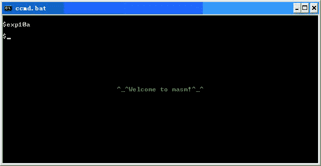
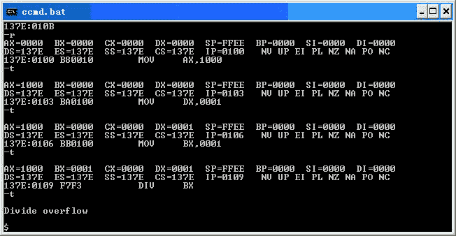
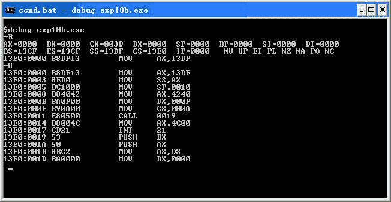
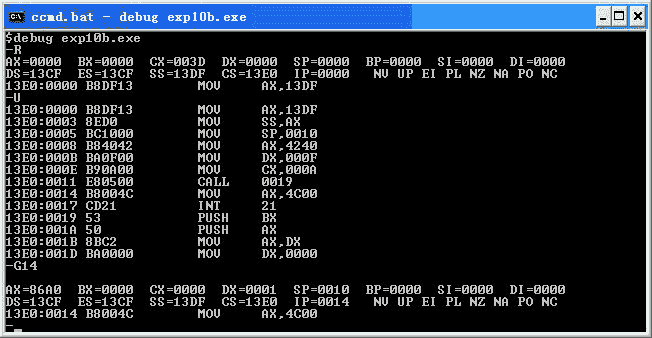
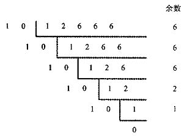
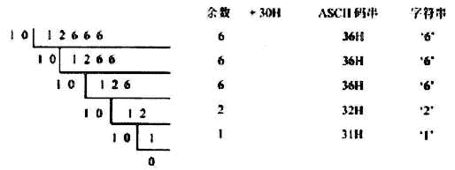
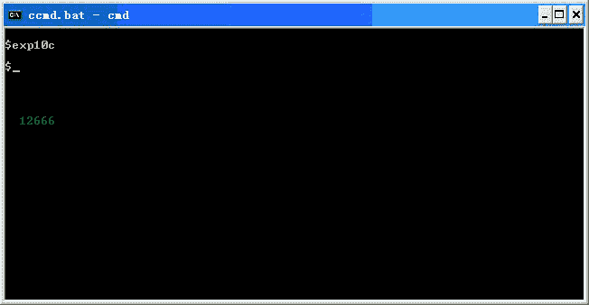

# “没有风”的汇编实验报告专题(更新至 10)

> 原文：[`www.pediy.com/kssd/pediy10/53710.html`](https://www.pediy.com/kssd/pediy10/53710.html)

///////////////////////////////////////////////////////////////////////////////////////////  
北极星 2003 注： 把多个实验报告合为一个专题  
实验 1：1 楼  
实验 2：10/11 楼  
实验 3：无  
实验 4：18 楼  
实验 5：23/24 楼  
实验 6：29 楼  
实验 7：34 楼  
实验 8：40 楼  
实验 9：42 楼  
///////////////////////////////////////////////////////////////////////////////////////////  
  
实验 1  查看 CPU 和内存，用机器指令和汇编指令编程  
1.预备知识：DEBUG 的使用  
   在以后所有的实验中，都将用到 DEBUG 程序，首先学习一下它的用法。  
（1）什么是 DEBUG  
    DEBUG 是 DOS、WINDOWS 都提供的实模式（8086 方式）程序的调试工具。使用它，可以查看 CPU 各种寄存器中的内容，内存的情况和在机器码跟踪程序的运行。  
（2）我们用到的 DEBUG 功能  
  用 DEBUG 的 R 命令查看、改变 CPU 寄存器的内容：  
  用 DEBUG 的 D 命令查看内存中的内容：  
  用 DEBUG 的 E 命令改写内存中的内容：  
  用 DEBUG 的 U 命令将内存中的机器指令翻译成汇编指令：  
  用 DEBUG 的 T 命令执行一条机器指令：  
  用 DEBUG 的 A 命令以汇编指令的格式在内存中写入一条机器指令：  
DEBUG 命令比较多，共有 20 多个，但上述 6 个命令是和汇编语言学习密切相关的。在以后的实验中，我们还会用到一个 P 命令。  
（3）进入 DEBUG  
  DEBUG 是在 DOS 方式下使用的程序。我们在进入 DEBUG 前，应先进入到 DOS 方式。用以下方式可以进入 DOS：  
  ①重启计算机后，进入 DOS 方式，此时我们进入的是实模式的 DOS。  
  ②在 WINDOWS 中进入 DOS 方式，此时进入的是虚拟 8086 模式的 DOS。  
（4）用 R 命令查看、改变 CPU 寄存器的内容  
  我们已知道了 AX、BX、CX、DX、SS、IP 这 6 个寄存器，现在看一下它们之中的内容，如图 2.1 所示。其他寄存器 SP、BP、SI、DI、DS、ES、SS、FLAGS（标志寄存器）  等先不予理会。  
  
  
图 2.31　使用 R 命令查看 CPU 中各个寄存器中的内容  
  
注意 CS 和 IP 的值，CS＝0CA2，IP＝0100，也就是说，0CA2＝0100 处的指令为 CPU 当前要读取、执行的指令。在所有的寄存器的下方，DEBUG 还列出了 CS：IP 所指向的内存单元处的所存放的机器码，并将它翻译为汇编指令。可以看到，CS：IP 所指向的内存单元为 0CA2：0100 此处存放的机器码为 027548，对应的汇编指令为 ADD　DH，\DI+48\。  
DEBUG 输出的右下角还有一个信息：“DS：0048＝0”，以后会进行说明，这里同样不必深究。  
还可以用 R 命令来改变寄存器中的内容，如图 2.32 所示。  
  
图 2.32  用 R 命令修改寄存器 AX 中的内容  
若要修改一个寄存器中的值，比如 AX 中的值，可以用 R 命令后加寄存器名来进行，输入“R　AX”后按 ENTER 键，将出现“：”作为输出提示，在后面输入要写入的数据后按 ENTER 键，即完成了对 AX 中内容的修改。若想查看一下修改的结果，可再用 R 命令查看，如图 2.33 所示。  
  
图 2.33　用 R 命令修改 CS 和 IP 中的内容  
在图 2.33 中，一进入 DEBUG，用 R 命令查看，CS：IP 指向 0B39：0100，此处存放的机器码为 40，对应的汇编指令是 INC AX.  
接着，用 R 命令将 CS 修改为 FF00，则 CS：IP 指向 FF00：0200，此处存储的机器码为 51，对应的汇编指令是 PUSH　CX。  
（5）用 DEBUG 的 R 命令查看内存中的内容  
  用 DEBUG 的 D 命令，可以查看内存中的内容，D 命令的格式较多。我们这里只介绍在以本次实验中用到的格式。  
  如果想知道内存 10000H 处的内容，可以用“D　段地址：偏移地址”的格式来查看，如图 2.34 所示。  
  
      图 2.34  用 D 命令查看内存 1000：0 处的内容  
  
  使用“D　段地址：偏移地址”的格式，DEBUG 将列出从指定的内存单元开始的 128 个内存单元的内容，图 2.34 中，在使用 D　1000：0 后，DEBUG 列出了 1000：0~1000:7F 中的内容。  
  使用 D 命令，DEBUG 将输出 3 部分内容，如图 2.34 所示。  
  中间是部分从指定地址开始的 128 个内存单元的内容，用十六进制的格式输出，每行的输出从 16 的整数倍的地址开始，最多输出 16 个单元的内容。从图中，我们可以知道，内存 1000：0 的内容是 61：内存 1000：10~1000:1F 中的内容全部在第一行：内存 1000：10 中的内容是 6D，内存 1000：1 处的内容是 61：内存 1000：10~1000:1F 中的内容全部在第二行。注意在每行的中间有一个“－”，它将每行的输出分为两部分，这样便于查看。比如，要想从图中找出，1000：6B 单元中内容，可以从 1000：60 找到行，“－”前面是 1000：60~1000:67 的 8 个单元，后面是 1000：68~1000:6F 的 8 个单元，这样我们就可以从 1000：68 单元向后数 3 个单元找到 1000：6B 单元，可以看到，1000：6B 中的内容为 67H。  
  左边是每行的起始地址。  
  右边是每个内存单元中的数据对应的可以显示的 ASCII 码字符。比如内存单元 1000：0、1000：1、1000：2 中存放的数据是 72H、64H、73H，它对应的 ASCII 字符分别是”r”、”d”、”s”;内存单元 1000：36 中的数据是 0AH，它没有对应可显示的 ASCII 字符，DEBUG 应用”.”来代替。  
注意：我们看到的内存中的内容，在不同的计算机中是不一样的;也可能每次用 DEBUG 看到的内容都不相同，因为我们用 DEBUG 看到的都是原来就在内存中的内容，这些内容受随时都有可能心迹的系统环境的影响。当然，我们也可以改变内存，寄存器中的内容。  
  使用 D　1000：9 查看 1000：9 处的内容，DEBUG 将怎样输出呢？如图 2.35 所示。  
  
        图 2.35　查看 1000：9 处的内容  
  
  DEBUG 从 1000：9 开始显示，一直到 1000：88，一共是 128 个字节。第一行中的 1000：0~1000:8 单元中的内容不显示。  
  在一进入 DEUBG 后，用 D 命令直接查看，将列出 DEBUG 预设的地址的内容，如图 2.36。  
  在使用“D　段地址：偏移地址”之后，接着使用 D 命令，可以列出后续的内容，如图 2.37 所示。  
      
图 2.36  列出 DEBUG 预设的地址处的内容  
图 2.37  列出后续的内容  
    
  也可以指定 D 命令的查看范围，此时采用“D　段地址：起始偏移地址　结尾偏移地址“的格式。比如要看 1000：0~1000:9 中的内容，可以用”D　1000：0　9“实现。如图 2.38 所示。  
    
图 2.38  查看 1000：0~1000:9 单元中的内容  
    
  如果我们就想查看内存单元 10000H 中的内容，可用图 2.39 中的任何一种方法看到，因为图中的所有“段地址：偏移地址“都表示了 10000H 这一物理地址。  
  
图 2.39  用三种不同的段地址和偏移地址查看同一个物理地址中的内容  
  
（6）用 DEBUG 的 E 命令改写内存中的内容  
  可以用 E 命令改写内存中的内容，比如，要将内容 1000：0~1000:9 单元中的内容分别写为 0、1、2、3、4、5、6、7、8、9，可以用它“E　起始地址　数据　数据　数据。。。“的格式来进行，如图 2.40 所示。  
  
图 2.40　用 E 命令修改从 1000：0 开始的 10 个单元的内容  
  
  图 2.40 中，先用 D 命令查看 1000：0~1000:F 单元的内容，再用 E 命令修改从 1000：0 开始的 10 个单元的内容，最后用 D 命令查看 1000：0~1000:F 中的内容的变化。  
  也可以采用提高的方式来一个一个地改写内存中的内容，如图 2.41 所示。  
  
图 2.41  用 E 命令修改从 1000：0 开始的 4 个单元  
  
  如图 2.41 中，可以用 E 命令提高的方式来逐个地修改从某一地址开始的内存单元中的内容，以从 1000:10 单元开始为例，步骤如下：  
  ①输入 E　1000：10，按 ENTER 键。  
  ②DEBUG 显示起始地址 1000：0010，和第一单元（即 1000：0010 单元）的原始内容：6D，然后光标停在“。“的后面提示输入想要写入数据，此时可以有两个选择：其一为输入数据（我们输入的是 D），然后按空格键，则不对当前内存单元进行改写。  
  ③当前单元处理完成后（不论是改写或没有改写，只要按了空格键，就表示处理完成），DEBUG 将接着显示一个内存单元的原始内容，并提示读者进行修改，读者可以用同样的方法处理。  
  可以用 E 命令向内存中写入字符，比如：用 E 命令从内存 1000：0 开始　写入：数值 1、字符‘a’、数值 3、字符‘c’,可采用图 2.42 中所示的方法进行：  
  从图中 2.42 中可以看出，DEBUG 对 E 命令的执行结果是，向 1000：0、1000：2、1000：4 单元中写入数值 1,2，3，向 1000：1、1000：3、1000：5 单元中写入字符”a”,”b”,”c”的 ASCII 码值：61H，62H，63H。  
  也可以用 E 命令向内存中写入字符串，比如：用 E 命令从内存 1000：0 开始写入：数值 1、字符串”a+b”、数值 2、字符串”c++”、数值 3、字符串”IBM”.如图 2.43 所示。  
  
图 2.42  用 E 命令向内存中写入字符  
  
（7）用 E 命令向内存中写入机器码，用 U 命令查看内存中机器码的含义，用 T 命令执行内存中的机器码。  
  
  如何向内存中写入机器码呢？我们知道，机器码了是数据，当然可以用 E 命令将机器码写入内存。比如要从内存 1000：0 单元开始写入这样一段机器码：  
  机器码    对应的汇编指令  
  B8 01 00    MOV AX,0001  
  B9 02 00    MOV CX,0002  
  01C8    ADD AX,CX  
  
可用如图 2.44 中所示的方式进行。  
  
图 2.44  用 E 命令将机器码写入内存  
  
如何查看我们写入的或内存中原有的机器码所对应的汇编指令呢？可以用 U 命令进行。比如可以用 U 命令将从 1000：0 开始的内存单元中的内容翻译为汇编指令，并显示出来。如图 2.45 所示。  
  
  图 2.45 中，首先用 E 命令向从 10000：0 开始的内存单元中写入了 8 个字节的机器码：然后用 D 命令查看内存 1000：0~1000:1F 数据（从数据的角度看一下我们写入的内容）：最后用 U 命令查看从 1000：0 开始内存单元中的机器指令和它们所对应的汇编指令。  
  
    U 命令的显示输出分为 3 部分：第一条机器指令的地址、机器指令所对应的汇编指令。我们可以看到：  
1000：0 处存放的是我们写入的机器码 B80100 所组成的机器指令，对应的汇编指令是 MOV　AX，1：  
1000：3 处存放的是我们写入的机器码 B80C00 所组成的机器指令、对应的汇编指令是 ADD　CX，2：  
1000：6 处存放的是我们写入的机器码 01C8 所组成的机器指令、对应的汇编指令是 ADD　AX，CX：  
1000：8 处存放　的是内存中的机器码是 034942 所组成的机器指令、对应的汇编指令是 ADD　CX，\[BX+DI+42\].  
  
图 2.45  用 U 命令将内存单元中的内容翻译为汇编指令显示  
  
由此，我们可以再次看到内存中的数据和代码没有任何区别，关键在于如何解释。  
如何执行我们写入的机器指令？使用 DEBUG 的 T 命令可以执行一条或多条指令，简单使用 T 命令，可以执行 CS：IP 指向的指令。如图 2.46 所示。  
  
图 2.46  使用 T 命令执行 CS：IP 指向的指令  
  
图 2.46 中，首先用 E 命令向从 1000：0 开始的内存单元中写入了 8 个字节的机器码：然后 R 命令查看 CPU 中寄存器的状，可以看到 CS＝0B39H，IP＝0100H，指向内存 0B39：0100 若要用 T 从控制 CPU 执行我们写到 1000：0 的指令，必须先让 CS：IP 指向 1000：0；用 R 命令修改 CS、IP 中的内容，使 CS：IP 指向 1000：0  
完成上面的步骤后，就可以使用 T 命令来执行我们写入的指令了（此时，CS：IP 指向我们的指令所在的内存单元）。执行 T 命令后，CPU 执行 CS：IP 指向的指令，则 1000：0 处的指令 B8　01　00（MOV　AX，0001）得到执行，指令执行后，DEBUG 显示输出 CPU 中寄存器的状态。  
注意，指令执行后，AX 中的内容被改写为 1，IP 改变为 IP＋3（因为 MOV　AX，0001 的指令长度为 3 个单元），CS：IP 指向下一条指令。  
接着图 2.46，我们可以继续使用 T 命令执行下面的指令。如图 2.47 所示。  
  
图 2.47　用 T 命令继续执行  
  
在图 2.47 中，用 T 命令继续执行后面的指令，注意每条指令执行后 CPU 相关寄存器内容的变化。  
  
  
（8）用 DEBUG 的 A 命令以汇编指令的形式在内存中写入机器指令，直接以汇编指令的形式写入指令。为此，DEBUG 提供了 A 命令。A 命令的使用方法如图 2.48 所示。  
  
      图 2.48　用 A 命令向从 1000：0 开始的内存单元中写入指令  
  
  图 2.48 中，首先用 A 命令，以汇编语言向从 1000：0 开始的内存单元中写入了几条指令，然后用 D 命令查看 A 命令的执行结果，可以看到，在使用 A 命令写入指令时，我们输入的是汇编指令，DEBUG 将这些汇编指令翻译为对应的机器指令，将它们的机器码写入内存。  
  在使用 A 命令写入汇编指令时，在给出的起始地址后面直接按 ENTER 键表示操作结束。  
  如图 2.49 中，简单地用 A 命令，从一个预设的地址开始输入指令。  
  
图 2.49  从一个预设的地址开始输入指令  
  
      
  
          
本次实验中需要用到的命令  
  查看、修改 CPU 中寄存器的内容：R 命令  
  查看内存中的内容：D 命令  
  修改内存中的内容：E 命令（可以写入数据、指令、在内存中，它们实际上没有区别）  
  将内存中的内容解释为机器指令和对应的汇编指令：U 命令  
  执行 CS：IP 指向的内存单元处的指令：T 命令  
  以汇编指令的形式向内存中写入指令：A 命令  
  
  在预备知识中，详细讲解了 DEBGU 基本功能和用法，在汇编语言的学习中，DEBGU 是一个经常用到的工具，在预备知识中，应该一边看书，一边在机器上操作。  
  
  前面提到，我们的原则是：以后的，以后再说，所以在这里只讲了一些在本次实验需要用到的命令的相关使用方法，以后根据需要，我们会讲解其它的用法。  
    
2．实验任务  
（1）使用 DEBGU，将下面的程序段写入内存，逐条执行，观察每条指令执行后，CPU 中相关寄存器中的内容的变化。  
  
  机器码      汇编指令  
  B8　20　40    MOV　AX，4E20H  
  05　16　14    ADD　AX，1416H  
  BB　00　20    MOV　BX，2000H  
  01　DB      ADD　AX，BX  
  89　C3      MOV　BX，AX  
  01　D8      ADD　AX，BX  
  B8　1A　00    MOV　AX，001AH  
  BB　26　00    MOV　BX，0026H  
00　D8      ADD　AL，BL  
00　DC      ADD　AH，BL  
00　C7      AD　AH，AL  
64　00      MOV　AH，0  
00　D8      ADD　AL，BL  
04　9C      ADD　AL，9CH  
  
提示：可以用 E 命令和 A 命令，以两种方式将指令写入内存。注意用 T 命令执行时，CS：IP 的指向。  
  
（2）将下面的 3 条指令写入从 2000：0 开始的内存单元中，利用这 3 条指令计算 2 的 8 次方。  
  MOV　AX，1  
  ADD　AX，AX  
  JMP  2000：0003  
  
（3）查看内存中的内容  
  PC 机主板中的 ROM 中写有一个生产日期，在内存 FFF00H~FFFFFH 的某几个单元中，请找到这个生产日期并试图改变它。  
  提示：如果读者对实验的结果不理解，请仔细阅读第一章的 1.15 节。  
  
（4）向内存从 B8100H 开始的单元中填写数据，如：  
  －E  B810：0000　01　01　02　02　03　03　04　04　  
  请读者：先填写不同的数据，观察产生的现象：再改变填写的地址，观察产生的现象。  
  提示：如果读者对实验结果不理解，请仔细阅读第一章中的 1.15 节。  
  
  
  
总结：经过这次实验，我学到了许多宝贵的知识，现列举如下：  
1．  学会了使用 R 命令查看 CPU 中的各个寄存器的内容  
2．  学会了使用 R 命令修改各个寄存器中的内容  
3．  学会了使用 D 命令查看某寄存器中的内容  
4．  学会了使用 D 命令来列出 DEBUG 预设的地址及其后续地址内容  
5．  学会了使用多种不同的段地址和偏移地址查看同一物理地址中的内容的方法  
6．  学会了使用 E 命令修改从某地址开始的存储单元的内容  
7．  学会了使用 E 命令向内存中写入字符、字符串、机器码的方法  
8．  学会了使用 U 命令将内存单元中的内容翻译为汇编指令显示的方法  
9．  学会了使用 T 命令执行 CS：IP 指向的指令的方法  
10.学会了使用 A 命令向某地址开始的单元写入指令的方法  
11．学会了使用 A 命令向一个预设的地址输入指令的方法  
12．学会了向内存中输入一段指令并执行以及观察相应寄存器的内容的变化的方法  
13．学会了使用 3 条指令计算 2 的 N 次方的方法  
14.学会了使用通过查看 ROM 中数据来了解自己主板的生产日期的方法  
15．更深入的了解了 8086 将各类存储器看作一个逻辑存储器的概念  
16．更深入的了解了 8086 机内存地址空间分配原理。  
这次实验，使我受益非常大。以上是我在做实验后的一点总结心得。 

实验 2  用机器指令和汇编指令编程  
1.  预备知识：DEBUG 的使用  
前面实验中，讲了 DEBUG 一些主要命令的用法，这里，我们再补充一些关于 DEBUG 的知识。  
  
（1）  关于 D 命令  
  
从上次实验中，我们知道，D 命令是查看内存单元的命令，可以用：  
D　段地址：偏移地址的格式查看指定的内存单元的内容，上次实验中，D 命令后面的段地址和偏移地址都是直接给出的。  
  
现在，我们知道段地址是放在段寄存器中的，在 D 命令后面直接给出段地址，是 DEBUG 提供的一种直观的操作方式。D 命令是由 DEBUG 执行的，DEBUG 在执行“D　1000：0”这样的命令时，也会先将段地址 1000 送入段寄存器中。  
  
DEBUG 是靠什么来执行 D 命令的？当然是一段程序。  
  
谁来执行这段程序？当然是 CPU。  
  
所以，DEBUG 在其处理 D 命令的程序段中，必须有将段地址送入段寄存器中的代码。  
  
段寄存器有 4 个：CS、DS、SS、ES，将段地址送入哪个段寄存器呢？  
  
首先不能是 CS，因为 CS：IP 必须指向 DEBUG 处理 D 命令的代码，也不能是 SS，因为 SS：SP 要指向栈顶。这样只剩下 DS 和 ES 可以选择，放在哪里呢？我们知道，访问内存的指令如“MOV　AX，\[0\]”等一般都默认段地址在 DS 中，所以 DEBUG 在执行如：“D　段地址：偏移地址”这种 D 命令时，将段地址送入 DS 中比较方便。  
  
D 命令也提供了一种符合 CPU 机理的格式：“D　段寄存器：偏移地址”，以段寄存器中的数据为段地址 SA，列出从 SA：偏移地址开始的内存区间中的数据。以下是 4 个例子：  
  
①－R　DS  
　：1000  
－D　DS：0        ；查看从 1000：0 开始的内存区间中的内容  
②－R DS  
  :1000  
　－D　DS：10　18　　　；查看从 1000：10~1000:18 中的内容  
③－D　CS：0        ；查看当前代码段中的指令代码  
④－D　SS：0        ；查看当前栈段中的内容  
  
（2）  在 E、A、U 命令中使用段寄存器  
  
在 E、A、U 这些可以带有内存单元地址的命令中，也可以同 D 命令一样，用段寄存器表示内存单元的段地址。以下是 3 个例子：  
  
①－R　DS  
　：1000  
　－E　DS：0 11 22 33 44 55 6   ;在从 1000：0 开始的内存区间中写入数据  
②－U　CS：0    ；以汇编指令的形式，显示当前代码段中的代码，0 代码的偏移地址  
③－R　DS  
　：1000  
　－A　DS：0　　；以汇编指令的形式，向从 1000:0 开始的内存单元中写入指令  
  
（3）  下一条指令执行了吗？  
  
在 DEBUG 中，用 A 命令写一段程序：  
  
MOV AX,2000  
MOV SS,AX  
MOV SP,10        ;安排 2000：0~2000:F 为栈空间，初始化栈顶。  
  
MOV AX,3123  
PUSH  AX  
MOV AX,3366  
PUSH AX        ;在栈中压入两个数据  
  
仔细看一下图 3.18 中单步执行的结果，读者发现了什么问题？  
  
在用 T 命令单步执行 MOV　AX，2000 后，显示出当前 CPU 各个寄存器的状态和下一步要执行的指令：MOV　SS，AX；  
  
在用 T 命令单步执行 MOV　SS，AX 后，显示出当前 CPU 各个寄存器的状态和下一步要执行的指令。。。。。，在这里我们发现了一个问题：MOV　SS，AX 的下一条指令应该是 MOV　SP，10，怎么变成了 MOV　AX，3123H  
  
   
  
MOV SP,10 到哪里去了？它被执行了吗？  
  
我们再仔细观察，发现：  
  
在程序执行前，AX＝0000，SS＝0B39，SP＝FFEE  
在用 T 命令单步执行 MOV　AX，2000 后，AX＝2000；SS＝0B39；SP＝FFEE  
在用 T 命令单步执行 MOV　SS，AX 后，AX＝2000；SS＝2000；SP＝0010  
  
注意，在用 T 命令单步执行 MOV　SS，AX 前，SS＝0B39，SP＝FFEE，而执行后 SS＝2000，SP＝0010，SS 变为 2000 是正常的，这正是 MOV　SS，AX 的执行结果。可是 SP 变为 0010 是怎么回事？在这期间，能够将 SP 设为 0010 的只有指令 MOV　SP，10，看来，MOV　SP，10 一定是得到了执行。  
  
那么，MOV　SP，10 是在什么时候被执行的呢？当然是在 MOV　SS，AX 之后，因为它就是 MOV　SS，AX 的下一条指令。显然，在用 T 命令执行 MOV　SS，AX 的时候，它的下一条指令 MOV　SP，10 也紧接着被执行了。  
  
整理一下我们分析的结果：在用 T 命令执行 MOV　SS，AX 的时候，它的下一条指令 MOV　SP，10 也紧接着执行了。一般情况下，用 T 命令执行一条指令后，会停止继续执行，显示出当前 CPU 各个寄存器的状态和下一步要执行的指令，但 T 命令执行 MOV　SS，AX 的时候，没有做到这一点。  
  
不单是 MOV　SS，AX，对于如：MOV　SS，BX，MOV　SS，\[0\],POP　SS 等指令都会发生上面的情况，这些指令有哪些共性呢？它们都是修改栈段寄存器 SS 的指令。  
  
为什么会这样呢？要想彻底说清楚这里面来龙去脉，在这里还为时过早，因为这涉及到我们在以后的课程中要深入研究的内容：中断机制，它是我们后半部分课程中的一个主题。现在我们只要知道这一点就可以了：DEBUG 的 T 命令在执行修改寄存器 SS 的指令时，一条指令也紧接着被执行。  
  
2  实验任务  
  
（1）  使用 DEBUG，将上面的程序段写入内存，逐条执行，根据指令执行后的实际运行情况填空。  
  
MOV AX,FFFF  
MOV DS,AX  
MOV AX,2200  
MOV SS,AX  
MOV SP,0100  
MOV AX,\[0\]    AX=5BEAH  
ADD AX,\[2\]   AX=5CCAH  
MOV BX,\[4\]   BX=30FCH  
ADD BX,\[6\]   BX=6022H  
PUSH AX    SP=00FEH,修改的是字单元 2200：00FE  
PUSH BX    SP=00FCH,修改的是字单元 2200：00FC  
POP AX      SP＝00FEH，AX＝6022H    
POP BX      SP＝0100H，BX＝5CCAH  
PUSH \[4\]      SP＝00FEH，修改的是字单元 2200：00FE，内容是 30F0H  
PUSH \[6\]      SP＝00FCH，修改的是字单元 2200：00FC，内容是 2F32H  
   
  
（2）  仔细观察图 3.19 中的实验过程，然后分析：为什么 2000：0~2000:F 中的内容会发生改变？  
  
可能要再便有些实验才能发现其中的规律。如果读者在这里就正确回答了这个问题，那么要恭喜读者，因为读者有很好的惜玉怜香。大多数的读者对这个问题还是比较迷惑的，不过不要紧，因为随着课程的进行，这个问题的答案将逐渐变得显而易见。  
   
  
        图 3.19 用 DEBUG 进行实验的示例 

总结：经过这次实验我学到了许多有用的东西：分别是：  
　　　1．我掌握了使用 D、U、E、A 命令中可以直接使用段寄存器作为表示段地址    　2。我明白了在使用 T 命令执行修改 SS 段寄存器的指令时，它会紧接着执行后面的一条指令，即是说执行一次 T 命令将会连续执行两条指令。  
    不过有一点不明白的就是，为什么在定义一个堆栈段的时候，堆栈的内容会发生变化，难道是因为系统自动对它进行初始化了吗？有人可以告诉我吗？我的 QQ 是 420716701. 

\[SIZE="4"\]实验 4  \[BX\]和 loop 的使用  
（1）  编程，向内存 0:200~0:23F 依次传送数据 0~63(3FH).    
      ;----------------------------------------------  
      ;ex5-1.asm  
      ;-----------------------------------------------  
      ;;;;;;;;;;;;;;;;;;;;;;;;;;;;;;;;;;;;;;  
      assume cs:code      ;;  
      code segment      ;;  
              mov ax,20h        ;;  
                 mov ds,ax        ;;  
              mov bx,0        ;;  
      mov ax,0      ;;  
              mov cx,0ffh      ;;  
              s: mov \[bx\],ax      ;;  
               inc bx        ;;  
      inc ax        ;;  
                loop s        ;;  
                  mov ax,4c00h      ;;  
                 int 21h        ;;  
      code ends        ;;  
      end            ;;  
      ;;;;;;;;;;;;;;;;;;;;;;;;;;;;;;;;;;;;;;  
（2）  编程，向内存 0:200~0:23F 依次传送数据 0~63(3FH),程序中只能使用 9 条指令，9 条指令中包括“MOV　AX，4C00H”和“INT　21H”。  
    ;-------------------------------------------  
    ;ex5-2.asm  
    ;-------------------------------------------  
    ;;;;;;;;;;;;;;;;;;;;;;;;;;;;;;;;;;;;;;;;;;;  
    assume cs:code        ;  
    code segment          ;  
            mov ax,20h        ;  
              mov ds,ax        ;  
               mov bx,0          ;  
              mov cx,0ffh        ;  
          s: mov \[bx\],bx        ;  
              inc bx          ;  
              loop s          ;  
              mov ax,4c00h        ;  
              int 21h          ;  
    code ends          ;  
    end              ;  
    ;;;;;;;;;;;;;;;;;;;;;;;;;;;;;;;;;;;;;;;;;;;;  
  
（3）  下面的程序的功能是将“MOV　AX，4C00H”之前的指令复制到内存 0:200 处，补全程序。上机调试，跟踪运行结果。  
;------------------------------------------------  
;;ex5-3.asm  
;------------------------------------------------  
;;;;;;;;;;;;;;;;;;;;;;;;;;;;;;;;;;;;;;;;;;;  
assume cs:code        ;;;;;  
code segment        ;;;;;  
  mov ax,code      ;;;;;  
  mov ds,ax      ;;;;;  
  mov ax,0020h      ;;;;;  
  mov es,ax      ;;;;;  
  mov bx,0        ;;;;;  
  mov cx,18h      ;;;;;  
  s:mov al,\[bx\]      ;;;;;  
  mov es:\[bx\],al      ;;;;;  
  inc bx        ;;;;;  
  loop s        ;;;;;  
  mov ax,4c00h      ;;;;;  
  int 21h        ;;;;;  
code ends          ;;;;;  
end            ;;;;;  
;;;;;;;;;;;;;;;;;;;;;;;;;;;;;;;;;;;;;;;;;;  
              1.把 EX5-3.EXE 加载入内存中  
$debug ex5-3.exe  
\-r  
AX=0000 BX=0000 CX=001D DX=0000 SP=0000 BP=0000 SI=0000 DI=0000  
DS=13C7 ES=13C7 SS=13D7 CS=13D7 IP=0000  NV UP EI PL NZ NA PO NC  
13D7:0000 B8D713     MOV AX,13D7  
\-u   
13D7:0000 B8D713    MOV   AX,13D7  
13D7:0003   8ED8    MOV   DS,AX  
13D7:0005 B82000    MOV   AX,0020    
13D7:0008 8EC0      MOV   ES,AX  
13D7:000A BB0000    MOV   BX,0000  
13D7:000D B91800    MOV   CX,0018  
13D7:0010 8A07      MOV   AL,\[BX\]  
13D7:0012 26      ES:  
13D7:0013 8807      MOV   \[BX\],AL  
13D7:0015 43      INC   BX  
13D7:0016 E2F8      LOOP  21  
13D7:0018 B8004C    MOV   AX,4C00  
13D7:001D 00FF      ADD  BH,BH  
13D7:001F 50      PUSH  AX  
  
            2.把 0:200 的内容反汇编结果如下：  
13D7:000D B91800    MOV   CX,0018  
13D7:0010 8A07      MOV   AL,\[BX\]  
13D7:0012 26      ES:  
13D7:0013 8807      MOV   \[BX\],AL  
13D7:0015 43      INC   BX  
13D7:0016 E2F8      LOOP   0010  
13D7:0018 B8004C  MOV   AX,4C00  
13D7:001B CD21         INT          21  
13D7:001D 00FF       ADD      BH,BH  
13D7:001F 50      PUSH    AX  
\-u 0:200  
0000:0200 46      INC    SI  
0000:0201 07      POP    ES  
0000:0202 07      ADC  \[BP+SI\],AL  
0000:0204 0A04        OR    AL,\[SI\]  
0000:0206 1002        ADC  \[BP+SI\],AL  
0000:0208 3A00       CMP  AL,\[BX+SI\]  
0000:020A A30354      MOV  \[5403\],AX  
0000:020D 00A3036E  ADD   \[BP+DI+6E03\],AH      
0000:0301 00A30388  ADD  \[BP+DI+8803\],AH  
0000:0305 00A303A2  ADD  \[BP+DI+A203\],AH  
0000:0309 00A303FF  ADD  \[BP+DI+FF03\],AH  
0000:0303 0310      ADD  DX,\[BX+SI\]  
0000:030F 02A90810  ADD   CH,\[BX+DI+1008\]  
\-  
  
              3.运行程序至正常结束  
13D7:001D 00FF         ADD  BH,BH  
13D7:001F 50        PUSH    AX  
\-u 0:200  
0000:0200 46        INC    SI  
0000:0201 07        POP    ES  
0000:0202 07        ADC  \[BP+SI\],AL  
0000:0204 0A04          OR    AL,\[SI\]  
0000:0206 1002         ADC  \[BP+SI\],AL  
0000:0208 3A00         CMP  AL,\[BX+SI\]  
0000:020A A30354    MOV  \[5403\],AX  
0000:020D 00A3036E    ADD   \[BP+DI+6E03\],AH      
0000:0301 00A30388    ADD  \[BP+DI+8803\],AH  
0000:0305 00A303A2    ADD  \[BP+DI+A203\],AH  
0000:0309 00A303FF    ADD  \[BP+DI+FF03\],AH  
0000:0303 0310         ADD  DX,\[BX+SI\]  
0000:030F 02A90810    ADD   CH,\[BX+DI+1008\]  
\-g 1d  
  
Program terminated normally  
\-  
  
  
          4.再次将 0:200 的内容反汇编结果如下：  
0000:0301 00A30388    ADD  \[BP+DI+8803\],AH  
0000:0305 00A303A2    ADD  \[BP+DI+A203\],AH  
0000:0309 00A303FF    ADD  \[BP+DI+FF03\],AH  
0000:0303 0310         ADD  DX,\[BX+SI\]  
0000:030F 02A90810    ADD   CH,\[BX+DI+1008\]  
\-g 1d  
  
Program terminated normally  
\-u 0:200  
0000:0200 B8D713     MOV  AX,13D7  
0000:0203 8ED8      MOV  DS,AX  
0000:0205 B82000    MOV  AX,0020  
0000:0208 8EC0      MOV  ES,AX  
0000:020A BB0000     MOV  BX,0000  
0000:020D B91800     MOV  CX,0018  
0000:0210 8A07      MOV  AL,\[BX\]  
0000:0212 26      ES:      
0000:0213 8807      MOV  \[BX\],AL  
0000:0215 41       INC    BX  
0000:0216   E2F8    LOOP   0210  
0000:021B CD21      INT    21  
0000:021D 0AC4      OR    AL,AH  
0000:021F 5E      POP    SI  
  
  
对比图 1 和图 4，我们可以看出 mov ax,4c00h 前的指令序列已经被复制到了 0:200 处  
  
实验总结：经过这次实验，我掌握了如何将一段内存的数据复制到另一段内存中去，以及如何将程序自身的指令序列复制到另一段内存中去.掌握了如何优化程序来将内存的内容复制到另一段内存去。  
这次实验，花费我大量的时间和心血，终于完成了。 

实验 5　　编写、调试具有多个段的程序  
  
（1）  将下面的程序编译连接，用 debug 加载、跟踪，然后回答问题：  
　　　　 ;----------------------------------------------------------  
      ;ex5a1.asm  
      ;------------------------------------------------------------  
      ;AUTHOR:IT007  
      ;DATE:2007/11/11  
      ;;;;;;;;;;;;;;;;;;;;;;;;;;;;;;;;;;;;;;;;;;;;;;;;;;;;;;;;;;;;;;;;;;;;;;;;;;;   
      assume cs:code,ds:data,ss:stack  
          data      segment  
            dw  0123h,0456h,0789h,0abch,0defh,0fedh,0cbah,0987h  
      data     ends  
      stack    segment  
            dw    0,0,0,0,0,0,0,0  
      stack    ends  
        
      code    segment  
      start:    mov    ax,stack  
            mov    ss,ax  
            mov    sp,16  
            mov    ax,data  
            mov    ds,ax  
            push    ds:\[0\]  
            push    ds:\[2\]  
            pop    ds:\[2\]  
            pop    ds:\[0\]  
            mov    ax,4c00h  
            int     21h  
      code    ends  
      end      start  
①cpu 执行程序，程序返回前，data 段中的数据为多少？  
  答：  0123h,0456h,0789h,0abch,0defh,0fedh,0cabh,0987h  
  
②CPU 执行程序，程序返回前，cs=13D5,ss=13D4,ds=13D3.  
③设程序加载后，code 段的段地址为 x,则 data 段的段地址为 x-12h,stack 段的段地址为 x-2h.  
  
（2）  将下面的程序编译连接，用 debug 加载、跟踪，然后回答问题：  
        ;----------------------------------------------------------  
      ;ex5a2.asm  
      ;------------------------------------------------------------  
      ;AUTHOR:IT007  
      ;DATE:2007/11/11  
      ;;;;;;;;;;;;;;;;;;;;;;;;;;;;;;;;;;;;;;;;;;;;;;;;;;;;;;;;;;;;;;;;;;;;;;;;;;;  
      assume    cs:code,ds:data,ss:stack  
      data    segment  
          dw  0123h,0456h  
      data    ends  
      stack  segment  
          dw 0,0  
      stack  ends  
        
      code  segment  
      start:  mov    ax,stack  
          mov    ss,ax  
          mov    sp,16  
          mov    ax,data  
          push    ds:\[0\]  
          mov    ax,4c00h  
          int    21h  
      code  ends  
      end    start  
①cpu 执行程序，程序返回前，data 段中的数据为多少？  
  答：23 01 56 04  
  
②cpu 执行程序，程序返回前，  cs=13D5,ss=13D4,ds=13D3  
.  
③设程序加载后，code 段的段地址为 x,则 data 段的段地址为 x-12h,stack 段的段地址为 x-2h.    
  
④对于如下定义的段：  
      name  segment  
      ………  
      name  ends  
  如果段中的数据占 n 个字节，则程序加载后，该段实际占有的空间为 n 个字节.  
  
（3）  将下面的程序编译连接，用 debug 加载、跟踪，然后回答问题：  
       ;----------------------------------------------------------  
      ;ex5a3.asm  
      ;------------------------------------------------------------  
      ;AUTHOR:IT007  
      ;DATE:2007/11/11  
      ;;;;;;;;;;;;;;;;;;;;;;;;;;;;;;;;;;;;;;;;;;;;;;;;;;;;;;;;;;;;;;;;;;;;;;;;;;;  
      assume  cs:code,ds:data,ss:stack  
      code  segment  
      start:  mov    ax,stack  
          mov    ss,ax  
          mov    sp,16  
          mov    ax,data  
          push    ds:\[0\]  
          push    ds:\[2\]  
          pop    ds:\[2\]  
          pop    ds:\[0\]  
          mov    ax,4c00h  
          int    21h  
      code  ends  
      data    segment  
          dw  0123h,0456h  
      data    ends  
      stack  segment  
          dw  0,0  
      stack  ends  
      end    start  
①cpu 执行程序，程序返回前，data 段中的数据为多少？  
  答：23 01 56 04  
②cpu 执行程序，程序返回前，cs=13D3H,ss=13D7H,ds=13D6H.  
③设程序加载后，code 段的段地址为 x,则段的段地址为 x-10h,stack 段的段地址为 x-10h。  
  
（4）  如果将 1、2、3 题中的最后一条伪指令”end start”改为”end”（也就是说，不指明程序的入口），则哪个程序仍然可以正确执行？请说明原因。  
答：第 3 个程序可以正常运行，因为在前两个程序都未指定程序的入口，   
    而程序的前面一部分为数据，即非程序，当程序被加载入内存时，CS：   
    IP 指 向这些数据，即把这些数据当作指令来执行，这样可能会引发   
    意想 不到的后果， 严重的甚至可能导致死机。而第 3 个程序 CS：   
    IP 指向程序的第一条指令，因 为数据段定义在程序的末尾，因而程   
    序可以正常执行。  
  
（5）  程序如下，编写 code 段中的代码，将 a 段和 b 段中的数据依次相加，将结果存到 c 段中。  
         ;----------------------------------------------------------  
      ;ex5a5.asm  
      ;------------------------------------------------------------  
      ;AUTHOR:IT007  
      ;DATE:2007/11/11  
      ;;;;;;;;;;;;;;;;;;;;;;;;;;;;;;;;;;;;;;;;;;;;;;;;;;;;;;;;;;;;;;;;;;;;;;;;;;;  
　　　  assuem  cs:code,ds:a,es:b  
      a  segment  
        db  1,2,3,4,5,6,7,8  
                       a  ends  
  
      b  segment  
        db  1,2,3,4,5,6,7,8  
      b  ends  
  
      c  segment  
        db  0,0,0,0,0,0,0,0  
      c  ends  
  
      code  segment  
        start:  
          ;;;;;;;;;;;;;;;;;;;;;;;;;;;;;;;;;  
          ;以下为我添加的代码  
          ;;;;;;;;;;;;;;;;;;;;;;;;;;;;;;;;;    
                mov     ax,a      
                mov     ds,ax  
                mov     ax,b  
                mov     es,ax  
          mov     bx,0  
                mov     di,0  
                mov     cx,8  
          mov     ax,0  
            s:  mov     al,\[bx\]  
                add     al,es:\[bx\]  
                mov     \[bx+32\],al  
                inc     bx  
                loop    s  
          mov       ax,4c00h  
          int  21h  
      code  ends  
      end    start  
  
（6）  程序如下，编写 code 段中的代码，用 push 指令将 a 段中 word 数据，逆序存储到 b 段中。  
      ;----------------------------------------------------------  
      ;ex5a6.asm  
      ;------------------------------------------------------------  
      ;AUTHOR:IT007  
      ;DATE:2007/11/11  
      ;;;;;;;;;;;;;;;;;;;;;;;;;;;;;;;;;;;;;;;;;;;;;;;;;;;;;;;;;;;;;;;;;;;;;;;;;;;  
      assume  cs:code  
      a  segment  
        dw  1,2,3,4,5,6,7,8  
      a  ends  
      b  segment  
        dw  0,0,0,0,0,0,0,0  
      b  ends  
      code  segment  
        start:  
      ;;;;;;;;;;;;;;;;;;;;;;;;;;;;;;;;;  
      ;以下为我添加的代码  
      ;;;;;;;;;;;;;;;;;;;;;;;;;;;;;;;;;  
          mov     ax,a  
                mov     ds,ax  
  
                mov     ax,b  
                mov     ss,ax  
                mov     sp,10h  
  
                mov     bx,0  
                mov     cx,8  
            s:  
                push    \[bx\]  
                add     bx,2  
                loop    s  
  
                mov     ax,4c00h  
                int     21h  
        
      code  ends  
      end    start  
  
  
总结：经过实验 5，我掌握了以下知识：  
①我学会了如何将一个段和附加寄存器关联，并将之设置为附加数据段  
②我学会了如何使用 END 伪指令设置 IP 为一个程序的入口的偏移地址  
③我学会了如何程序的数据的段并不是一定要放在程序的前面，它也可以放在程序的末尾，只是这时程序的 IP 即为程序的入口的偏移地址。  
　④我学会了如何依次将两个数组的元素相加，并把结果依次存储到另一个数组中去。  
　⑤我学会了如何使用 MOV 指令将一个字节单元的内存传送到 8 位寄存器中去。  
　⑥我学会了如何使用 ADD 指令将一个字节型单元的内容加到一个 8 位寄存器中去。  
　⑦我学会了如何读取附加段字节型单元的内容到一个 8 位寄存器中去。  
　⑧我学会了如何使用循环（至少执行一次的循环）。  
　⑨我学会了如何使用 PUSH 指令将一个数组的元素逆序 COPY 到一个堆栈（或说为数组应该也没什么大碍吧）中去。  
　  
心得：在这次实验当中，可以说作为一个初学者该犯的错误我都犯了，比如：试图将一个字型单元的内容读取到一个堆栈中去（这明显是不支持的嘛，PUSH 指令怎么说也是一个字操作指令：），还有就是试图使用字操作指令进行字节操作（这明显是不能实现的嘛：），不过只要想相应的寄存器改为 8 位寄存器就支持了，还有就是忘了在程序的最后加上返回系统的指令（一个程序运行结束之后如果不返回调用它的程序，或操作系统或 DEBUG，那么它该去哪里呢？我不知道，也许会发生意想不到的事情吧：）。  
这次实验最大的收获就是终于掌握了独立编写一个汇编程序的能力，能解决一些日常遇到的小问题，如将一个数组逆序，将一个数组的元素 COPY 到另一个数组中去。在使用 PUSH 指令的过程中也让我更加深刻理解了堆栈的运行机制。 

总结：经过实验 5，我掌握了以下知识：  
①我学会了如何将一个段和附加寄存器关联，并将之设置为附加数据段  
②我学会了如何使用 END 伪指令设置 IP 为一个程序的入口的偏移地址  
③我学会了如何程序的数据的段并不是一定要放在程序的前面，它也可以放在程序的末尾，只是这时程序的 IP 即为程序的入口的偏移地址。  
　④我学会了如何依次将两个数组的元素相加，并把结果依次存储到另一个数组中去。  
　⑤我学会了如何使用 MOV 指令将一个字节单元的内存传送到 8 位寄存器中去。  
　⑥我学会了如何使用 ADD 指令将一个字节型单元的内容加到一个 8 位寄存器中去。  
　⑦我学会了如何读取附加段字节型单元的内容到一个 8 位寄存器中去。  
　⑧我学会了如何使用循环（至少执行一次的循环）。  
　⑨我学会了如何使用 PUSH 指令将一个数组的元素逆序 COPY 到一个堆栈（或说为数组应该也没什么大碍吧）中去。  
　  
心得：在这次实验当中，可以说作为一个初学者该犯的错误我都犯了，比如：试图将一个字型单元的内容读取到一个堆栈中去（这明显是不支持的嘛，PUSH 指令怎么说也是一个字操作指令：），还有就是试图使用字操作指令进行字节操作（这明显是不能实现的嘛：），不过只要想相应的寄存器改为 8 位寄存器就支持了，还有就是忘了在程序的最后加上返回系统的指令（一个程序运行结束之后如果不返回调用它的程序，或操作系统或 DEBUG，那么它该去哪里呢？我不知道，也许会发生意想不到的事情吧：）。  
这次实验最大的收获就是终于掌握了独立编写一个汇编程序的能力，能解决一些日常遇到的小问题，如将一个数组逆序，将一个数组的元素 COPY 到另一个数组中去。在使用 PUSH 指令的过程中也让我更加深刻理解了堆栈的运行机制。 

实验 6　　实践课程中的程序  
（1）  将课程中所有讲解过的程序上机调试，用 DEBUG 跟踪其执行过程，并在过程中进一步理解所讲内容。  
（2）  编程：完成问题中的程序。  
    问题：编程，将 datasg 段中的每个单词的前四个字母改为大写字母：  
;---------------------------  
;pro9.asm  
;---------------------------  
;AUTHOR:没有风  
;DATE:2007/11/18  
;;;;;;;;;;;;;;;;;;;;;;;;;;;;;;;;;;;;;;;;;;;;;;  
;功能：将 4 个单词的前 4 个字母转换为大写字母  
;;;;;;;;;;;;;;;;;;;;;;;;;;;;;;;;;;;;;;;;;;;;;;  
;  
;语言：8086，编译工具：masm5.00  
;  
;;;;;;;;;;;;;;;;;;;;;;;;;;;;;;;;;;;;;;;;;;;;;;  
assume  cs:codesg,ss:stacksg,ds:datasg  
  
  
stacksg segment  
  
        dw      0,0,0,0,0,0,0,0  
  
stacksg ends  
  
  
datasg  segment  
  
   str0 db      '1. display      '  
   str1 db      '2. brows        '  
   str2 db      '3. replace      '  
   str3 db      '4. modify       '  
  
datasg  ends  
  
  
codesg  segment  
  
        start:  mov     ax,stacksg  
  
                mov     ss,ax  
  
                mov     sp,16  
  
  
                mov     ax,datasg  
  
                mov     ds,ax  
  
  
                mov     bx,0  
  
                mov     cx,4  
  
  
           s0:  push    cx  
  
                mov     si,0  
  
                mov     cx,4  
  
  
            s:  mov     al,\[bx+3+si\]  
  
                and     al,11011111b  
  
                mov     \[bx+3+si\],al  
  
                inc     si  
  
                loop    s  
  
  
                add     bx,16  
  
                pop     cx  
  
                loop    s0  
  
  
                mov     ax,4c00h  
  
                int     21h  
  
codesg  ends  
  
end     start  
;;;;;;;;;;;;;;;;;;;;;;;;;;;;;;;;;;;;;;  
;总结：经过实战编写上面的程序，我  
;1。学会了如何使用二重循环  
;2。学会了如何定义并使用二维数组  
;3。学会了如何使用行指针和列指针来遍历所要遍历的数组元素  
;4。更深入的了解了如何使用一个寄存器来作为二重循环的计算器  
;5。更深入的懂得了堆栈的原理及功能（用来暂存数据）  
;6。学会了使用 MOV 指令逐字节的读取数组的元素来对数组赋值  
;7。希望在上面的程序里加入三个功能：（1）把数组转换 4 个字母修改为全部字母（2）在转换字母前打印菜单（3）在转换字母后打印菜单  
;8。希望日后往这个程序里添加里一些具体的有实际意义的功能，比如将它修改为一个学生管理系统，可以存储一定数量学生数据，并可以  
;　　将数据保存到硬盘中，以及从硬盘中读取这些数据，同时可以对这些数据进行增加、修改、删除等操作。  
;;;;;;;;;;;;;;;;;;;;;;;;;;;;;;;;;;;;;;;;  
;日期：2007/11/18 20:28  
;;;;;;;;;;;;;;;;;;;;;;;;;;;;;;;;;;;;;;;; 

汇编实验报告七  
由于内容太多,在此仅给出源代码。想详细阅读报告的朋友可以下载附件。  

代码:

```
;-----------------------------------------------------------------------------------
;exp7b.asm
;-----------------------------------------------------------------------------------
;AUTHOR:没有风
;DATE:2007/12/3
;-----------------------------------------------------------------------------------
assume  cs:code,ds:data,ss:stack,es:table

stack segment        ;定义一个堆栈段，用来暂存寄存器的值
  dw 16 dup(?)    
stack ends

data segment
  year    db '1975','1976','1977','1978','1979','1980','1981','1982','1983'
          db '1984','1985','1986','1987','1988','1989','1990','1991','1992'
          db '1993','1994','1995'
  income  dd 16,22,382,1356,2390,8000,16000,24486,50065,97479,140417,197514
          dd 345980,590827,803530,1183000,1843000,2759000,3753000,4649000,5937000

  employeenum dw 3,7,9,13,28,38,130,220,476,778,1001,1442,2258,2793,4037,5635,8226
              dw 11542,14430,15257,17800
data ends

table segment
 list db 21 dup ('year summ ne ?? ')  ;定义一个长度为 21 的结构体数组，每个结构体有 4 个成员
table ends        ;分别是年份、总收入、人数、人均收入

code segment
       start: mov   ax,data
              mov   ds,ax
        
          mov   ax,table
              mov   es,ax
                              
              mov   ax,stack
              mov   ss,ax
        mov   sp,32

              mov   bx,0
              mov   si,0
              mov   di,0
              mov   cx,21


           s: mov   ax,84\[di\]    ;取 84 地址开始的元素，即被除数的低 16 位
              mov   dx,86\[di\]    ;取 86 地址开始的元素，即被除数的高 16 位

              div   word ptr 168\[si\]  ;求公司里每年的人均收入

              push  ax
              mov   ax,\[di\]    ;send the year to table segment
              mov   es:\[bx\],ax     
        mov   ax,\[di\].2
              mov   es:\[bx\].2,ax
       
              mov   ax,84\[di\]    ;send the income to the table segment
              mov   es:\[bx\].5,ax      
        mov   ax,84\[di+2\]
              mov   es:\[bx\].7,ax
       
              mov   ax,168\[si\]          ;send the employee number to the table segment
              mov   es:\[bx+10\],ax
                      
              pop   ax
              mov   es:\[bx\].13,ax       ;把商传送到 table 段中相应内存去，以 C 的风格访问结构体元素
       
              add   di,4       
        add   si,2
              add   bx,16

              loop  s

              mov   ax,4c00h
              int   21h
code ends
end start
;;;;;;;;;;;;;;;;;;;;;;;;;;;;;;;;;;;;;;;;;;;;;;;;;;;;;;;;;;;;;;;;;;;;;;;;;;;;;;;;;;;;;;;;;;;;;;;;

```

上传的附件
|  || 王爽汇编实验报告 7.rar  
 |

实验 8　分析一个奇怪的程序  
分析下面的程序，在运行前思考:这个程序可以正确返回吗？  
通过这个程序加深对相关内容的理解。  
;-------------------------------------------------------------------------------  
;exp8.asm                    
;DATE:2007/12/13                    
;-------------------------------------------------------------------------------  
assume cs:codesg       
           
codesg segment         
           
      mov ax,4c00h       
           
      int 21h         
           
start:mov ax,0         
        ; 占用一个字节的空间，关键，用来添加指令用  
    s:nop         
        ;  占用一个字节的空间，关键，用来添加指令用  
      nop         
        ;把标号 s 处的偏移地址（0008H）传送到 DI 寄存器  
      mov di,offset s       
           
      mov si,offset s2    ;把标号 S2 处的偏移地址（0020H）传送到 SI 寄存器  
           
      mov ax,cs:\[si\]    ;把代码段处偏移地址为(si)的内容（0F6EBH,即指令 JMP　SHORT　S 翻译后为 JMP 0008H）传送到 AX 寄存器，即把标号 S2 处的指令传送到 AX 寄存器（关键）  
           
      mov cs:\[di\],ax    ;把 AX 内容传送到标号 S 处（S 处有两个字节空间可以用来存入一条指令，关键）,相当于在 S 处添加一条指令 JMP SHORT S,机器码为 0F6EBH,不过翻译后变为 JMP 0000H（好奇怪哦，由原来的 JMP 00008H 变成这个样子了）  
           
   s0:jmp short s    ;跳转到标号 S 处执行指令，实际上在上面已经把指令 jmp short s 复制到了标号 S 处，因为 S 为位移值，而不是一个偏移地址，所以执行该指令时，IP 寄存器的内容被修改为：S 处第二条指令的地址  
           
   s1:mov ax,0         
           
      int 21h      ;（此处指令求被执行）  
           
      mov ax,0      ;（此处指令求被执行）  
           
   s2:jmp short s1    ;跳转到标号 S1 处执行指令,汇编为机器码为 0EBF6H,经编译器翻译后为 JMP 0018H,关键  
           
      nop          
           
codesg ends         
           
end start             
  
;;;;;;;;;;;;;;;;;;;;;;;;;;;;  
mov di,offset s  
mov si,offset s2  
这两条指令的功能是把源内存单元的和目的内存单元的偏移地址传送到相应寄存器中去  
  
mov ax,cs:\[si\]  
mov cs:\[di\],ax  
这两条指令的功能是将源内存单元的指令传送到目的内存单元中去  
  
将源内存单元的指令 jmp short s1 传送到目的去，确切的说应该是将机器指令 EBF6H（jmp short s1 被 DEBUG 翻译后的机器码）传送到目的内存单元去.这时，DEBUG 把这个机器指令解释出来后，并不是我们原来看到的 jmp short s1,因为 F6H 对应的有符号数为-10D,即当执行 jmp short s 返回 s 处执行 EBF6H 指令时，IP 的内容加上 JMP 指令的长度为 10，此时再减去 10D，正好 CS：IP 指向 mov ax,4c00h 这条指令，接着往下执行程序顺利结束。因此程序可以正常返回。  
  
学了好久，才终于将实验 8 写完，感觉问题是弄明白了，可是说出来又要让懂的人明白却不是那么容易的一回事。 

实验 9　根据材料编程这个编程任务必须在进行下面的课程之前独立完成，因为后面的课程中，需要通过这个实验而获得的编程经验。  
编程：在屏幕中间分别显示绿色、绿底红色、白底蓝色的字符串’welcome to masm!’.  
编程所需的知识通过阅读、分析下面的材料获得。  
80＊25 彩色字符模式显示缓冲区（以下简称为显示缓冲区）的结构：  
内存地址空间中，B8000H~BFFFFH 共 32KB 的空间，为 80＊25 彩色字符模式的显示缓冲区。向这个地址空间写入数据，写入的内容将立即出现在显示器上。  
在 80＊25 彩色字符模式下，显示器可以显示 25 行，每行 80 个字符，每个字符可以有 256 种属性（背景色、背景色、闪烁、高亮等组合信息）。  
这样，一个字符在显示缓冲区中就要占两个字节，分别存放字符的的 ASCII 码属性。  
80＊25 模式下，一屏的内容在显示缓冲区中共占 4000 个字节。  
  显示缓冲区分为 8 页，每页 4KB（约等于 4000B），显示器可以显示任意一页的内容。一般情况下，显示第 0 页的内容。了就是说通常情况下，B8000H~B8F9F 中的 4000 个字节的内容将出现在显示器上。  
  在一页显示缓冲区中：  
  偏移 000~09F 对应显示器上的第 1 行（80 个字符占 160 个字节）：  
  偏移 0A0~13F 对应显示器上的第 2 行：  
  偏移 140~1DF 对应显示器上的第 3 行。  
  依此类推，可以偏移 F00~F9F 对应显示器上的第 25 行。  
即在一行中：  
00~01 单元对应显示器上的第 1 列。  
02~03 单元对应显示器上的第 2 列。  
04~05 单元对应显示器上的第 3 列。  
依此类推，可知，9E~9F 单元对应显示器上的第 80 列。  
例如：在显示器的 0 行 0 列显示黑底绿色的字符串‘ABCDEF’  
（‘A’的 ASCII 码值为 41H，02H 表示黑底绿色）  
显示缓冲区里的内容为：  
00  01　02　03　04　05　06　07　08　09　0A　0B　。。。0E　0F  
B800:0000  41　02　42　02　43　02　44　02　45　02　46　02　。。。　　。。  
。  
。  
B800:00A0  。。  。。　。。　。。　。。　。。　。。　。。　。。　。。　。。　。。　。。  
可以看出，在显示缓冲区中，偶地址存放字符，奇地址存放字符的颜色属性。  
一个在屏幕上显示的字符，具有前景（字符色）和背景（底色）两种颜色，字符还可以以高亮度和闪烁的方式显示。前景色、背景色、闪烁、高亮等信息被记录在属性字节中。  
属性字节的格式：  
    7    6  5  4  3    2  1  0  
含义  BL    R  G  B  1    R  G  B  
      闪烁     背景     高亮       前景  
R：红色  
G：绿色  
B：蓝色  
我们可以按位设置属性字节，从而配出各种不同的前景色和背景色。  
比如：  红底绿字，属性字节为：01000010B；  
    红底闪烁绿字，属性字节为：11000010B；  
    红底高亮绿字，属性字节为：01001010B；  
    黑底白字，属性字节为：00000111B；  
    白底蓝字，属性字节为：01110001B；  
例：在显示器的 0 行 0 列显示红底高亮闪烁绿色的字符串‘ABCDEF’  
  （红底高亮闪烁绿色，属性字节为：11001010B，CAH）  
显示缓冲区里的内容为：  
00  01　 02　03　 04　05　06　 07　08　09　0A　0B　。。9E　9F  
B800：0000  41　CA　42　CA　43　44　CA　45　46　CA　。。。　。。　。。。。。  
　。  
　。  
B800：00A0　。。　。。　。。　。。　。。　。。　。。　。。　。。　。。　。。　。。　。。  
注意：闪烁的效果必须在全屏 DOS 方式下才能看到。  
  
  
解决方案一：  
代码:

```
;----------
;exp9.asm
;----------

;---------
;purpose:print 3 strings in the middle of screen by different colors
;---------

assume cs:code,ds:data

data segment
 string0 dw 0277h,0265h,026ch,0263h,026fh,026dh,0265h,0220h,0274h,026fh,0220h,026dh,0261h,0273h,026dh,0221h
 string1 dw 2477h,2465h,246ch,2463h,246fh,246dh,2465h,2420h,2474h,246fh,2420h,246dh,2461h,2473h,246dh,2421h
 string2 dw 7177h,7165h,716ch,7163h,716fh,716dh,7165h,7120h,7174h,716fh,7120h,716dh,7161h,7173h,716dh,7121h
data ends

code segment
 start:  
  mov ax,data
  mov ds,ax
        mov ax,0b800h
  mov es,ax

        lea si,string0  
  mov di,071Eh  
        mov cx,16  
    s0: 
  mov bx,\[si\]
  mov es:\[di\],bx
  add di,2
  add si,2
  loop s0

        lea si,string1
  mov di,07BEh
        mov cx,16
    s1: 
  mov bx,\[si\]
  mov es:\[di\],bx
  add di,2
  add si,2
  loop s1

        lea si,string2
  mov di,085Eh
        mov cx,16
    s2: 
  mov bx,\[si\]
  mov es:\[di\],bx
  add di,2
  add si,2
  loop s2
 
        mov ax,4c00h
  int 21h
code ends
end  start

```

实验总结：  
  实验总共花了我十多天的时间才完成(中间断断续续的写了改，改了写程序，最近有太多事要忙了 )，中间除了思索用什么方式完成功能之外，也在不断的调试 BUG。程序要求用自己的方式将彩色字符串输出来，而不是调用中断输出。我考虑过在字符串后面加上一个终止符（随意一个特殊点的字符都行，读取到该字符时停止就行），不用说这个程序肯定要用循环来实现的，刚开始我想用一个循环将三个字符串输出，可是调试时 BUG 不断，原来保存字符串的方式也不太对，因为是一个字符对应一个属性，较好的方式就是将用字型数组来保存这三个字符串，这样我们要做的工作就是不断的读取这些字符并传送到显存中去即可。  
  中间走了一些弯路，如最后发觉用比较简单的方式就是用三个循环实现，前面我想用一个循环发觉不是不行，只是有一点点难度，要考虑变换段地址，判断是否读取完一个字符串，考虑条件跳转等因素。  
  为了尽快完成实验，我采取了我最能接受的方式，就是用三个循环来实现实验要求的功能，这样要做的变换只是每一次循环前要做的工作就是改变一下输出字符串开始的行和列就可以了。 

实验 5.4 我写的程序  
assume cs:code  
a segment  
     db 1,2,3,4,5,6,7,8  
a ends  
b segment  
     db 1,2,3,4,5,6,7,8  
b ends  
  
ca segment  
     db 0,0,0,0,0,0,0,0  
ca ends  
  
code segment  
start:  
     mov ax,a   ;用两个循环实现  
     mov es,ax  
     mov ax,ca   ;最终数据放到 ds 段中  
     mov ds,ax  
     mov bx,0  
     mov cx,8  
      
 s1: mov al,es:\[bx\]   ;将 a 段中的先加到 c 段中去  
     add \[bx\],al  
     inc bx  
     loop s1  
       
     mov ax,b  
     mov es,ax  
     mov bx,0  
     mov cx,8  
   
 s2:mov al,es:\[bx\]  ;将 b 段中的先加到 c 段中去  
     add \[bx\],al  
     inc bx  
     loop s2  
    
mov ax,4c00h  
int 21           
  
code ends  
end start  
\-----------------------  
请问楼主的程序中 di 是用来干什么的？ 

引用: *最初由 **没有风**发布* 实验 9　根据材料编程  
这个编程任务必须在进行下面的课程之前独立完成，因为后面的课程中，需要通过这个实验而获得的编程经验。  
编程：在屏幕中间分别显示绿色、绿底红色、白底蓝色的字符串’welcome to masm!’.  
编程所需的知识通过阅读、分析下面的材料获得。  
80＊25 彩色字符模式显示缓... 

我的试验 9 代码：  
代码:

```
assume cs:code,ds:data
data segment
  db 'W','e','l','c','o','m','e',' ','t','o',' ','m','a','s','m','!'
data ends
code segment
start:
  mov ax,data
  mov ds,ax
  
  mov ax,0b800h
  mov es,ax
  mov bx,071eh
  
  mov bp,0
  mov cx,15
s:  mov al,ds:\[bp\]
  mov ah,2h
  mov es:\[bx\],ax
  
  mov al,ds:\[bp\]
  mov ah,24h
  mov es:\[bx+160\],ax 
  
  mov al,ds:\[bp\]
  mov ah,71h
  mov es:\[bx+320\],ax 
  
  add bx,2
  inc bp
  loop s
code ends
end start

```

**实验 10 编写子程序**  
  在这次实验中，我们将要编写 3 个子程序，通过它们来认识几个常见的问题和掌握解决这些问题的方法。同前面的所有实验一样，这个实验是必须要独立完成的，在后面的课程中，将要用到这个实验中编写的 3 个子程序。  
**1．  显示字符串**  
问题  
显示字符串是现实工作中经常要用到的功能，应该编写一个通用的子程序来实现这个功能。我们应该提供灵活的调用接口，使调用者可以决定显示的位置（行、列）、内容和颜色。  
  
提示  
（1）  子程序的入口参数是屏幕上的行号和列号，注意在子程序内部要将它们转化为显存中的地址，首先要分析一下屏幕上的行列位置和显存地址的对应关系：  
（2）  注意保存子程序中用到的相关寄存器：  
（3）  这个子程序的内部处理和显存的结构密切相关，但是向外提供了与显存结构无关的接口。通过调用这个子程序，进行字符串的显示时可以不必了解显存的结构，为编程提供了方便。在实验中，注意体会这种设计思想。  
**  
子程序描述  
名称：show\_str  
功能：在指定的位置，用指定的颜色，显示一个用 0 结束的字符串。  
参数：(dh)=行号（取值范围 0~24）,(dl)=列号(取值范围 0~79),  
    (cl)=颜色，ds:si 指向字符串的首地址  
返回：无  
就用举例：在屏幕的 8 行 3 列，用绿色显示 data 段中的字符串。**  

代码:

```
;==========================================================================
;文件名：exp10a.asm
;目的：完成并测试在指定的位置，用指定的颜色，显示一个用 0 结束的字符串的子程序
;==========================================================================
assume cs:code,ds:data
data segment
 str db '^\_^Welcome to masm! ^\_^',0
data ends
code segment
start:
  mov ax,data
  mov ds,ax
  mov dh,12
  mov dl,30
  mov cl,10001010b
  mov si,0
  call show\_str
  mov ax,4c00h
  int 21h
;==============================================================
;名称：show\_str
;功能：在指定的位置，用指定的颜色，显示一个用 0 结束的字符串
;参数：(dh)=行号(取值范围 0~24),(dl)=列号(取值范围 0~79),
;  (cl)=颜色,ds:si 指向字符串的首地址
;返回：无
;==============================================================
show\_str: 
  push dx
  push si
  push di
  push cx
  push ax
        mov ax,0b800h
        mov es,ax
  mov ax,160
  mul dh
        mov dh,0
        add ax,dx
        add ax,dx
  sub ax,2
  mov di,ax
        mov ah,cl
output:  
        mov ch,ds:\[si\]
        mov cl,0
  jcxz ok
        mov byte ptr es:\[di\],ch
        mov byte ptr es:\[di+1\],ah
  inc si
  inc di
  inc di
        jmp short output
ok:
  pop ax
  pop cx
  pop di
  pop si
  pop dx
  ret
code ends
end start

```

测试结果：  
  
图 10\_1.1 在指定位置以指定颜色显示字符串  
**2．  解决除法溢出的问题**  
问题  
前面讲过，div 指令可以做除法。当进行 8 位除法的时候，用 al 存储结果的商，ah 存储结果的余数：进行 16 位除法的时候，用 ax 存储结果的商，dx 存储结果的余数。可是，现在有一个问题，如果结果的商大于 ah 或 ax 所能存储的最大值，那么将如何？  
比如，下面的程序段：  
 mov bh,1  
 mov ax,1000  
 div bh  
进行的是 8 位除法，结果的商为 1000，而 1000 在 ah 中放不下，  
又比如，下面的程序段：  
mov ax,1000h  
mov dx,1  
mov bx,1  
div bx  
进行的是 16 位除法，结果的商为 11000H,而 11000H 在 ax 中存放不下。  
我们在用 div 指令做除法的时候，很可能发生上面的情况：结果的商过大，超出了寄存器所能存储的范围。当 CPU 执行 div 等除法指令的时候。如果发生这样的情况，将引发 CPU 的一个内部错误。这个错误被称为：除法溢出。我们可以通过特殊的程序来处理这个错误，　这里我们不讨论这个错误的处理，这是后面的课程中要涉及的内容。下面我们仅仅来看一下除法溢出发生时的一些现象，参考图 10.1  
  
 图 10.1 除法溢出  
图 10.1 中展示了在 windowsXP 中使用 DEBUG 执行相关程序段的结果，div 指令引发了 CPU 的除法溢出，系统对其进行了相关的处理。  
  好了，我们已经清楚了问题的所在：用 div 指令做除法的时候可能产生除法溢出。由于有这样的问题，在进行除法运算的时候要注意除数和被除数的值，比如 1000000/10 就不能用 div 指令来计算。那么怎么办呢？我们用下面的子程序 divdw 解决。  
  
  
**子程序描述  
名称：divdw  
功能：进行不会产生溢出的除法运算，被除数为 dword 型，除数为 word 型，结果为 dword 型。  
参数：(ax)=dword 型数据的低 16 位  
    (dx)=dword 型数据的高 16 位  
    (cx)=除数  
返回：(dx)=结果的高 16 位，(ax)=结果的低 16 位  
    (cx)=余数  
应用举例：计算 1000000/10(F4240H/0AH)**  
  mov ax,4240h  
  mov v dx,000fh  
  mov cx,0ah  
  call divdw  
  
  
提示  
给出一个公式：  
X：被除数，范围：\[0,FFFF FFFF\]  
N：除数，范围：\[0,FFFF\]  
H：X 高 16 位，范围：\[0,FFFF\]  
L：X 低 16 位，范围：\[0,FFFF\]  
int()：描述性运算符，取商，比如：rem(38/10)=8  
rem()：描述性运算符，取答数，比如：rem(38/10)=8  
公式：X/N=int(H/N)\*65536+\[rem(H/N)\*65536+L\]/N  
这个公式将可能产生溢出的除法运算：X/N，转变为多个不会产生溢出的除法运算。  
公式中，等号右边的所有除法运算都可以用 div 指令来做，肯定不会导致除法溢出。  
  
  
程序如下：  
代码:

```
;=================================================================
;文件名：exp10b.asm
;目的：8086 下实现 32 位除法功能，解决 16 位除法溢出的问题
;=================================================================
assume cs:code,ss:stack
stack segment
dw 8 dup(0)
stack ends
code segment
start:
  mov ax,stack
  mov ss,ax
  mov sp,16
  mov ax,4c40h
  mov dx,0fh
  mov cx,0ah
  call divdw2
  mov ax,4c00h
  int 21h
;=================================================================================
;名称：divdw
;功能：进行不会产生溢出的除法运算，被除数为 dword 型，除数为 word 型，结果为 dword 型
;参数：(ax)=dword 型数据的低 16 位
;      (dx)=dword 型数据的高 16 位
;      (cx)=除数
;返回：(dx)=结果的高 16 位，(ax)=结果的低 16 位
;      (cx)=余数
;==================================================================================
divdw:
  push bx
  push ax
  mov ax,dx
  mov dx,0
  div cx
  mov bx,ax
  pop ax
  div cx
  mov cx,dx
  mov dx,bx
  pop bx
   ret
code ends
end start

```

分析：  
  
  
图 10\_2.1 加载程序到内存并查看相关寄存器的内容  
  
   
  
图 10\_2.2 运行程序并查看结果(DX)=0001H,(AX)=86A0H,(CX)=0,和题目所给结果一致  
  
**3.数值显示**  
问题  
编程，将 data 段中的数据以十进制的形式显示出来。  
data segment  
dw 123,12666,1,8,3,38  
data ends  
  这些数据在内存中都是二进制信息，标记了数值的大小。要把它们显示到屏幕上，成为我们能够读懂的信息，需要进行信息的转化。比如，数值 12666，在机器中存储为二进制信息：0011000101111010B(317AH)，计算机可以理解它。而我们要在显示器上读到可以理解的数值 12666，我们看到的应该是一串字符：“12666”。由于　显卡遵循的是 ASCII 编码，为了让我们能在显示器上看到这串字符，它在机器中应以 ASCII 码的形式存储为：31H、32H、36H、36H、36H（字符“0”~“9”对应的 ASCII 码为 30H~39H）。  
  通过上面的分析可以看到，在概念世界中，有一个抽象的数据 12666，它表示了一个数值的大小。在现实世界中它可以有多种表示形式，可以在电子机器中以高低电平（二进制）的形式存储，也可以在纸上、黑板上、屏幕上以人类的语言“12666”来书写。现在，我们面临的问题就是，要将同一抽象的数据，从一种表示形式转化为另一种表示形式。  
  可见，要将数据用十进制形式显示到屏幕上，要进行两步工作：  
（1）  将用二进制信息存储的数据转变为十进制形式的字符串：  
（2）  显示十进制形式的字符串。  
第二步我们在本次实验的第一个子程序中已经实现，在这里只要调用一下 show\_str 即可。我们来讨论第一步，因为将二进制信息转变为十进制形式的字符串也是经常要用到的功能，我们应该为它编写一个通用的子程序。  
  
**  
子程序描述  
名称：dtoc  
功能：将 word 型数据转变为表示十进制数的字符串，字符串以 0 为结尾符。  
参数：(ax)=word 型数据  
    ds:si 指向字符串的首地址  
返回：无  
应用举例：编程，将数据 12666 以十进制的形式在屏幕的 8 行 3 列，用绿色显示出来。  
在显示时我们调用本次实验中的第一个子程序 show-str。  
**  
  
提示  
  下面我们对这个问题进行一下简单地分析。  
（1）  要得到字符串“12666”，就是要得到一列表示该字符的 ASCII 码：31H、32H、36H、36H、36H。  
十进制数码字符对应的 ASCII 码＝十进制数码值＋30H  
要得到表示十进制数的字符串，先求十进制数每位的值。  
例：对于 12666，先求得每位的值：1、2、6、6、6。再将这些数分别加上 30H，便得到了表示 12666 的 ASCII 码串：31H、32H、36H、36H、36H。  
（2）  那么，怎样得到每位的值呢？采用如图 10.2 所示的方法。  
  
  
  
图 10.2 除 10 取余法示意  
  
  可见，用 10 除 12666，共除 5 次，记下每次的余数，就得到了每位的值。  
（3）  综合以上分析，可得出处理过程如下：  
用 12666 除以 10，循环 5 次，记下每次的余数；将每次的余数分别加 30H，便得到了表示十进制数的 ASCII 码串，如图 10.3 所示。  
  
   
  
图 10.3 得到十进制每位数字字符的方法示意  
  
（4）  对（3）的质疑：  
在已知数据是 12666 的情况下，知道进行 5 次循环。可在实际问题中，数据的值是多少  
程序员并不知道，也就是说，程序员不能事先确定循环次数。  
  那么，如何确定数据各位的值已经全部求出了呢？我们可以看出，只要是除到商为 0，各位的值就已经全部求出。可以使用 jcxz 指令来实现相关的功能。  
  
  
代码:

```
;=====================================================
;文件名：exp10c.asm
;目的：实现一通用的将十进制数输出到屏幕的子程序
;=====================================================

assume cs:code,ds:data,ss:stack

data segment
 db 10 dup(0)
data ends

stack segment
 dw 128 dup(0)
stack ends

code segment
start:
  mov ax,stack
  mov ss,ax
  mov sp,128

  mov ax,12666
  mov bx,data
  mov ds,bx
  mov si,0
  call dtoc

  mov dh,8
  mov dl,3
  mov cl,2
  call show\_str
  
  mov ax,4c00h
  int 21h

;=================================================================
;名称：dtoc
;功能：将 word 型数据转变为表示十进制数的字符串，字符串以 0 为结尾符
;参数：(ax)=word 型数据
;  ds:si 指向字符串的首地址
;返回：无
;=================================================================
dtoc:
  push ax
  push bx
  push cx
  push si  
  push di

  mov di,si
  mov bx,10  
  mov cx,0
s:
  push cx
  mov cx,ax
  jcxz enddtoc
  pop cx
  mov dx,0
  div bx
  mov ds:\[di\],dl
  add byte ptr ds:\[di\],30h 
  inc di
  inc cx
  jmp short s
enddtoc:
  pop cx
  mov ds:\[di\],0
  dec di
  mov ax,cx
  mov bl,2
  div bl
  mov cl,al
s1:
  mov al,ds:\[di\]
  mov bl,ds:\[si\]
  mov ds:\[di\],bl
  mov ds:\[si\],al
  inc si
  dec di
  loop s1
  
  pop di
  pop si
  pop cx
  pop bx
  pop ax
  ret  

;===========================================================
;名称：show\_str
;功能：在指定的位置，用指定的颜色，显示一个用 0 结束的字符串
;参数：(dh)=行号(取值范围 0~24),(dl)=列号(取值范围 0~79),
;  (cl)=颜色,ds:si 指向字符串的首地址
;返回：无
;===========================================================

show\_str: 
  push dx
  push si
  push di
  push cx
  push ax

        mov ax,0b800h
        mov es,ax
  mov ax,160
  mul dh
        mov dh,0
        add ax,dx
        add ax,dx
  sub ax,2
  mov di,ax
        mov ah,cl
output:  
        mov ch,ds:\[si\]
        mov cl,0
  jcxz ok

        mov byte ptr es:\[di\],ch
        mov byte ptr es:\[di+1\],ah
  inc si
  inc di
  inc di
        jmp short output
ok:
  pop ax
  pop cx
  pop di
  pop si
  pop dx
  ret
code ends
end start

```

运行结果：  
  
  
 图 10\_3.1 结果为 12666，处于 8 行 3 列，符合题目要求  
总结：设计第一个子程序相当顺利，可能是前一个实验做得认真吧，所以没遇到什么大问题。  
这次实验，感觉难度最大的就是做 2 个子程序的设计，在网上向好友请教了 N 回，可是最后也只是能把那个 32 位除法公式弄懂，而无法领悟使用 div 指令来实现那个 32 位除法公式。 最后不得不参考了一下正确的答案,才总算弄明白是怎么实现的.  
  设计最后一个子程序 dtoc 的时候，没想过要写成现在这么长的，真正求余数的指令序列就几条，等我设计好之后，发现输出来的数字串和原来的数是倒过来的，晕啊！！我苦想了一下，想里面应该添加将转换后的数字串逆序排序的操作，这又涉及到了很多东西啊，最后我决定使用 LOOP 指令,在添加这个功能里去的时候，遇到了好多的问题啊，我还是犯了一些低级的错误，如将 16 位的寄存器的内容传送到字符型数字串里去，这很明显是不对的啊，在逆序时寄存器的高 16 位会直接把正常的数字字符冲掉，还有就是将当我直接将字型单元的内容传送字型单元时，编译器会报错，不过提示是它后面的指令错误，好郁闷啊！  
好不容易才添加进这个功能，终于松一口气了。想到转换后的数字串的末尾如果不是 0 的话，在调用输出子程序时会出现 BUG，于是又在转换子程序里加了条指令，在第一次转换出来后，在数字串的末尾添加一个终止标志 0。  
  
题外话：这次实验从开始到结束花了我两天的时间做完，继续加油!