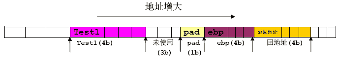
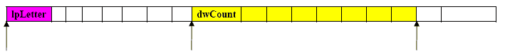
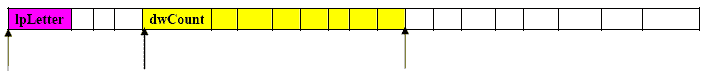
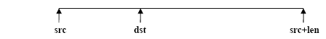
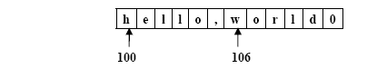
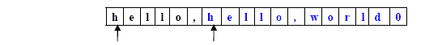
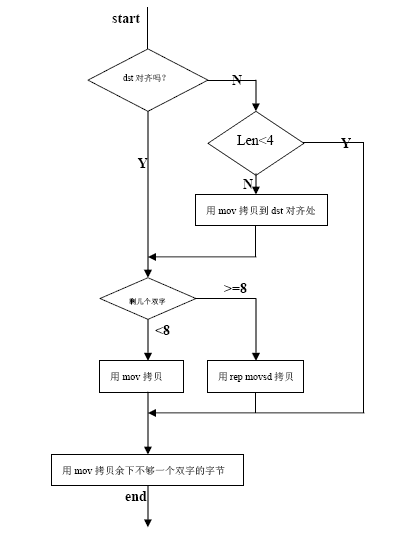

# 数据对齐

> 原文：[`www.pediy.com/kssd/pediy07/pediy7-739.htm`](https://www.pediy.com/kssd/pediy07/pediy7-739.htm)

  我眼中的数据对齐   
                    作者：溟初   
  
    在看雪论坛关于 memcpy 的帖子 (<memcpy 应该怎样写，同时庆祝新版开张>http://bbs.pediy.com/showthread.php?s=&threadid=14128) 中谈及了数据对齐的话题，重新唤起了我对它的思考(以前一直都似懂非懂，逐渐淡忘了^\_^)，纯属个人见解，请批评指正！   
相关附件下载。  
   
一、什么是数据对齐？请看官方的解释：   
Note that words need not be aligned at even-numbered addresses and doublewords need not be aligned at addresses evenly divisible by four. This allows maximum   
  
flexibility in data structures (e.g., records containing mixed byte, word, and doubleword items) and efficiency in memory utilization. When used in a   
  
configuration with a 32-bit bus, actual transfers of data between processor and memory take place in units of doublewords beginning at addresses evenly   
  
divisible by four; however, the processor converts requests for misaligned words or doublewords into the appropriate sequences of requests acceptable to the   
  
memory interface. Such misaligned data transfers reduce performance by requiring extra memory cycles. For maximum performance, data structures (including   
  
stacks) should be designed in such a way that, whenever possible, word operands are aligned at even addresses and doubleword operands are aligned at   
  
addresses evenly divisible by four.   
    数据对齐是指 W O R D 变量应该总是存放在 2 的倍数的地址处，而 D W O R D 变量应该总是存放在 4 的倍数的地址处，等等。   
   
二、数据对齐随处理器和编译器的不同而不同，处理好数据对齐可以提高程序的时空效率（节省空间，提高效率），特别是在汇编程序中。   
  
1、在处理器方面：   
从 486 起 EFLAGS 寄存器的第 18 位（AC），CR0 寄存器的第 18 位（AM）用于数据对齐检查，只有当 AC=1,AM=1,处理器工作在保护模式或者虚拟 86 模式的 Ring3 时，才进行数据对齐检查，  
  
若不对齐发中断 0x11。windows 系列没有设置 AC(AC=0)位，所以无论数据对齐与否均不会发中断，总是可以存取到正确的数据，但是存取不对齐的数据要比对齐的慢，因为 80386dx  
  
之后处理器的地址线只接受 4 的倍数的地址（数据线为 32 位），如果提供的地址不是 4 的倍数，处理器会转化为若干个 4 的倍数的地址去存取，每次存取 4 个字节的数据。比如：   
（1）Mov ax,word ptr\[3\],会先把 dword ptr \[0\]提取出来，然后从 dword ptr\[4\]提取出来，把所需数据组装后放到数据线，如下图。  
   
   
  
（2）Mov eax,dword ptr\[2\],与上面一样的提取，只是组装的数据不同。   
  
2、在编译器方面（以微软的 ml、link 为例）：    
  
（1）全局变量：   
在.data，.data?，.const，.code 中存放的数据都是紧挨在一起的，变量之间不会留有任何空隙，所以极易发生数据不对齐的现象，特别是定义数组，数据不对齐更会降低存取效  
  
率。   
VC 编译器的全局变量使用 COMM，（好像能自动 align,谁知道 COMM 的具体细节请告知谢谢） .c 文件全局变量反汇编后是这样的：   
\_DATA SEGMENT   
COMM \_x:BYTE   
COMM \_y:DWORD   
\_DATA ENDS   
  
当然我们也可以在 MASM 中显示的使用 COMM。   
   
建议：根据变量的大小合理的安排它们之间的前后关系，使之对齐，必要时可使用 align，even，org，$等强制执行对齐，特别是结构体变量和数组。   
比如：   
.code   
test1 db ?   
test2 dw ?   
test3 db ?   
改为:   
test1 db ?   
test3 db ?   
test2 dw ?   
   
（2）函数参数和局部变量：   
函数参数和局部变量存放在堆栈中，以 ebp(mov ebp,esp,其实是 esp)为基准，自动进行偏移量的对齐（相对于 ebp 的偏移量），而恰好 ebp 的值都是 4 的倍数，所以这些变量都是自动  
  
对齐的。   
经测验，dq,dd, real8,real4 以双字对齐，dw,df,dt,real10 以字对齐，db 以字节对齐。   
我是根据下图测验的：            
  
   
  
TestAlign proc   
 local pad:byte,test1:real4   
 ret   
TestAlign endp   
   
建议：在调用一个函数前，最好别使用 PUSH AX 等使 ESP-2 的指令，这会影响数据对齐。如这样调用：   
push bx   
call TestAlign   
pop  bx   
就会使 ESP 是 2 的倍数而不是 4 的倍数，导致数据不对齐。   
   
（3）结构体字段对齐（在移植程序时需要特别考虑，写网络程序好像也很重要）：  
WORD\_COUNT struct   
lpLetter      db     ?   
dwCount  dQ     ?   
WORD\_COUNT ends   
wordCount WORD\_COUNT <>   
这些字段在内存中是怎样布置的？这要根据编译器的设置即 ml 的 Zp 选项。   
ML /Zp\[n\],其中 n 为 1，2，4，8，16。   
在 vc 中相应的设置为：   
  
<1>:project->setting->c/c++标签->code generation 分类->struct member alignment 中。   
其实就是在 cl 中设置 Zp 的值。   
<2>:在程序中多次使用#paragram pack(n)语句，改变某部分结构体的对齐设置。   
   
这些选项只能设置结构体字段的对齐情况（偏移量对齐），它（ml）不能保证结构体变量的对齐（地址是最大字段的倍数，wordCount 存放在 8 的倍数的地址），vc 好像可以自动把  
  
结构体变量放在对齐的地方（爽），如果设置的对齐模数（n）小于最大字段的倍数，则以设置的模数为准，如设置为 1，字段之间不会有任何空隙（实际上是压缩了结构体）。   
上述结构体：   
当设置为为 8、16 时（浪费 7b）：   
  
   
   
当为 4 时(浪费 3b)：   
  
   
  
设置为 2 哪？你可以自己画一下^\_^   
结构体变量的开始地址：全局变量之间是无间隙排列的，因此需要手工对齐（align），局部变量会自动对齐。   
建议：根据字段类型的大小合理安排字段之间的前后关系，使字段无空隙对齐以减少浪费空间，使用 align 使全局结构体变量对齐在结构体最大字段类型大小倍数的地址处。   
   
（4）指令对齐：   
.code 中 align、even 只是对指令对齐（请察看 memcpy.asm 使用指令对齐的情况），在局部变量之间插入 align,even 将不起作用，在指令之间使用它们可能会自动插入一些不可预  
  
知的指令（为了达到对齐编译器可能会留一些空隙）。   
  
官方的解释：   
    Due to instruction prefetching and queuing within the CPU, there is no requirement for instructions to be aligned on word or doubleword boundaries.   
  
(However, a slight increase in speed results if the target addresses of control transfers are evenly divisible by four.)   
   
(5)段的对齐类型：   
在 MASM 中.code、.data、.data?、.const 段属性对齐类型为 dword(另外还有 byte,word,para,pag 对齐类型) (谁知道怎样改变.code 等的对齐方式，请告知谢谢！),即这些段以 4 的倍  
  
数地址开始定位，因此在这些段中不能使用 alin 8,align 16，align 32 等等。如果要使用别其它对齐类型，请使用 segment 自定义段。   
   
(6)PE 文件中的 SectionAlignment、FileAlignment：   
好像与本文无关，不要啥都往这里堆!!!.   
三、尝试分析\\VC98\\CRT\\SRC\\PLATFORM \\memcpy.asm（VC6.0 安装盘上, vc7. 0 在安装盘 crt\\src\\intel\\下，你也可以从网上找到）   
参见 C 语言版：CRT\\SRC\\MEMMOVE.C   
Memcpy.asm 总的思想是：当不覆盖时从前往后拷贝，覆盖时从后往前拷贝。   
1、覆盖的情况：dst>src && dst < src + len 时，如下图：   
  
   
  
比如：src 地址为 100，dst 为 106，拷贝 12 个字符。   
  
   
  
不处理覆盖情况（从前往后拷）：   
  
   
   
处理覆盖的情况（从后往前拷）：   
  
   
   
2、memcpy.asm 代码分析。   
（1）对目标地址对齐拷贝，以提高效率。   
（2）利用了处理器的流水线操作（U、V、N）。   
（3）在指令中使用了 align   @WordSize，对指令对齐。   
注：@WordSize：Two for a 16-bit segment or four for a 32-bit segment (numeric equate).   
（4）当对齐后少于 8 个双字，使用 mov 指令，否则的话配合 rep movsd，这里主要是考虑到时钟周期。   
 (5)试着画一下流程图。   
从后拷和从前拷都是一样的流程   
  
    
  
四、结束语：   
这篇心得终于完成了，感觉自己的表达能力还是很有限，请批评指正，我的 e\_mail：hejiwen2001@sohu.com，如果它能给你带来帮助，我将很欣慰！，至少没有白忙活.   
   
   
Reference：   
1、《The art of assemle language》         来自 http://asm.yeah.net/   
2、《windows 核心编程》           来自 http://www.infoxa.com/   
3、《INTEL 80386 PROGRAMMER'S REFERENCE MANUAL 1986 》 来自 http://purec.binghua.com/   
4、http://blog.dreambrook.com/soloist/archive/2004/12/12/388.aspx   
5、http://wncj.vicp.net/course/hep/huibianyuyan/04-3.htm   
6、http://msdn.microsoft.com/library   
还有其他一些相关的网络资源，在此一一谢过。  

 4dd466d0e1e0cc123afbe504da2462ca