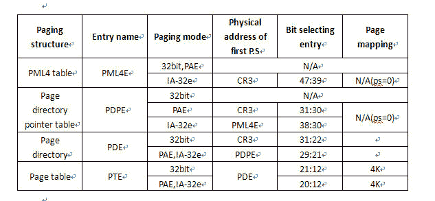
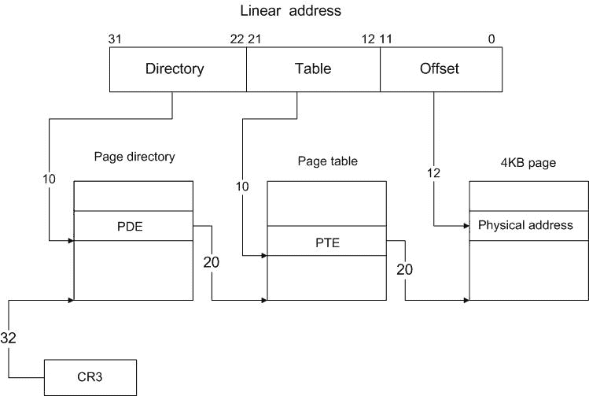

# IA-32 保护模式学习小结

> 原文：[`www.pediy.com/kssd/pediy10/99209.html`](https://www.pediy.com/kssd/pediy10/99209.html)

**1.概述**  
在学习《Intel 汇编语言程序设计（第四版）》保护模式内存管理部分的时候，感觉该部分涉及的内容比较多，而且杂，很难一次全部理解清楚，因此针对理解部分做个总结，并列出暂时不理解的部分。  
   
**2.CPU 的工作模式**  
IA-32 家族的 CPU 支持三种工作模式和一种准工作模式：

*   **保护模式**

    这是从 intel 286 引入的工作模式，是 286 之后 CPU 工作的主要模式，可以使用 cpu 的全部特性。

*   **实模式**

     和 intel 8086 完全兼容的工作模式，和 8086 相比增强了一些特性，比如可以切换到保护模式或者系统管理模式

*   **系统管理模式**

      80386 引入，主要用于操作系统进行电源管理以及 OEM 厂商定制。

*   **虚拟 8086 模式**

执行在保护模式下的一种虚拟 8086 工作模式，允许多个任务同时运行。  
  
**3.CPU 支持的内存模型**  
  
**     IA-32 主要支持三种内存模型**  
  
**l  平面内存模型**  
  
每个程序都独享连续的 4GB 线性地址空间。所有的代码数据都包含在该空间内。  
实际上程序在运行的时候依然存在两个段：代码段和数据段。  
  
**l  段内存模型**  
  
将线性地址分割成独立的小内存空间，用来保存对应代码，数据或者堆栈。  
这些小的内存空间叫做段。每个程序由不同的段集合组成。所有的段映射到线性地址空间中。程序通过逻辑地址访问相应的数据，CPU 将逻辑地址转换成对应的物理地址。  
逻辑地址由段选择子和一个 32 位的偏移量组成。  
此时的段保存的是段选择子。  
  
**l  实模式内存模型**  
  
采用段+偏移量的模式进行寻址，同 DOS 下汇编。此时的段保存的是段的地址。

终于传上去了，后续部分请看附件了，共同学习，请大家有空的时候帮忙指导下其中的遗留问题，谢谢

上传的附件
|  || IA-32 保护模式内存管理小结.rar  
 |

5 CPU 页机制  
IA-32 cpu 支持分页机制，分页功能是可选功能。  
5.1 三种分页模型  
      IA-32 目前支持三种分页模型  
      如果 CR0 寄存器的 PG 位=0，那么不启用分页功能。  
      如果要启用分页模式，CR0.PE 必须等于 1  
  32 位页模式  
CR0.PG=1 , CR4.PAE=0  
  PAE 页模式  
CR0.PG=1,CR4.PAE=1,IA-32\_EFER.LME=0  
  IA-32E 页模式  
CR0.PG=1,CR4.PAE=1,IA-32\_EFER.LME=0  
64 位 CPU 使用  
5.2 分页逻辑  
    各种模式下的分页功能基于集中分层页结构（hierarchical paging structures）实现。  
每种页结构的大小是 4KB，其中包含一系列的逻辑记录。  
    32 bit 页模式：每条记录大小 4 byte，所以总共可以包含 1024 条记录  
    PAE 页模式，IA-32e：每条记录 8 byte，所以总共包含 512 条记录  
每条页结构中的记录包含了一个物理地址，它指向另外一个页结构或者映射一个具体的内存页（page frame）。  
IA-32 最多支持 4 层页结构逻辑，第一个页结构的地址通常保存在 CR3 中，第二个页结构由第一个页结构索引得出。因此，如果采用 2 级结构，32 bit 的线性地址，从逻辑上可以拆成 3 部分 31：22 表示第一个页结构的索引，21：12 表示第二个页结构的索引，11：0 表示页内的偏移量。  
关于各种模式下的页结构名称以及页结构中的记录名称可以参考下表：  
  
由该表可以归纳出  
   32bit 模式：用了 2 级数据结构 PD----PT  
   PAE 模式：用了 3 级数据结构 PDPT-PD-PT  
   IA-32e 模式：用了 4 级 数据结构： PML4T ----PDPT----PD----PT  
第一级页结构都是由 CR3 保存其地址。    
5.2.1 32 bit 页模式  
  
5.2.2 PAE 页模式  
   暂时用不到，用到的时候再研究  
5.2.3 IA-32e 页模式  
   暂时用不到，用到的时候再研究  
6.逻辑地址转换到物理地址  
   在页功能没打开的时候，逻辑地址通过段逻辑转换到线性地址，直接映射到物理地址。  
   在页功能打开的时候，线性地址经过页逻辑转换到物理地址。  
