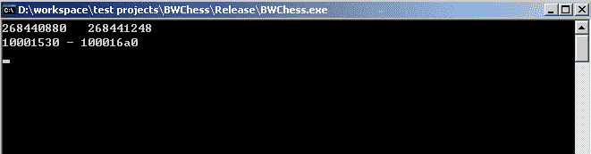
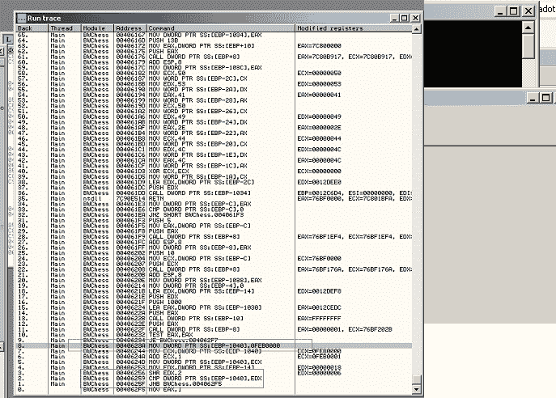
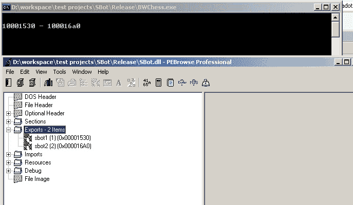

# 我的第一次 vc 转 shellcode 历程

> 原文：[`www.pediy.com/kssd/pediy12/142657.html`](https://www.pediy.com/kssd/pediy12/142657.html)

## C++转 shellcode 的曲折历程

没有人响应,看来写的太滥了, 自己重新排一下版, 把原代码都粘上, 希望招徕几个看客...

第一次写类似的东西，实在是没有经验，历程非常坎坷，先后用了大约两个月时间，主要是因为我之前的电脑台垃圾了，6 年前的笔记本 512MB 内存，随便抛个调试器就快死机了，也没有太多心情搞那个，就一直拖了下来，直到换了新机才来完成这一遗留问题。

开始的目的是，我这里有一个 dll 里面会暴露出两个方法， 同样进程中有多个这样的 dll， 我的目的是获得其他 dll 对应函数的地址。 正常高级语言应该是没有这样的功能的，所以选择用 pe 表查询的方式。

```cpp
// BWChess.cpp : Defines the entry point for the console application.
//  
引用: #include "stdafx.h"
#include <windows.h>
#include <winnt.h>
#include <stdio.h>
#include <Psapi.h>
#include <atlstr.h>
#include <iostream>
using namespace std;
typedef BOOL (*PENUMPROCESSMODS)( HANDLE, HMODULE*, DWORD, LPDWORD );
typedef HANDLE (*PGETCURRENTPROC)( VOID );
typedef int  (*PGETPROCADDR)(HANDLE, LPCTSTR);
typedef BOOL (WINAPI *PEnumProcessModules)( HANDLE, HMODULE *, DWORD, LPDWORD );
typedef WINBASEAPI HMODULE (WINAPI *PGetModuleHandleW)( IN LPCWSTR lpModuleName );
typedef WINBASEAPI HANDLE (WINAPI *PGetCurrentProcess)( VOID );
typedef DWORD (WINAPI *PGetModuleFileNameExW)( HANDLE hProcess, HMODULE hModule, LPSTR lpFilename, DWORD nSize );
typedef WINBASEAPI HMODULE (WINAPI *PLoadLibraryW)( IN LPCWSTR lpLibFileName );
typedef WINBASEAPI DWORD (WINAPI *PGetCurrentDirectoryW)( IN DWORD nBufferLength, OUT LPSTR lpBuffer );
typedef BOOL (*PIsTheSameDir)(TCHAR* pszPath ,HMODULE hMod, void* pfn);
typedef void* ( *PGetMethod)( BYTE *hMod, DWORD dwidx );
typedef BOOL  ( *PGetMethodEx)( BYTE *hMod, void* pfn1, void* pfn2 );
typedef __declspec(dllexport) void ( *PEXPORT1)(int x, int y);
typedef __declspec(dllexport) void ( *PEXPORT2)(int& x, int& y, int& color);
HMODULE g_hModule;
void Relocate(void* pfnissame, void* pfnsch)
{
  DWORD* phead = (DWORD*)(((BYTE*)pfnissame) + 0x1f);
  DWORD* phead2 = (DWORD*)(((BYTE*)pfnsch) + 0x0e);
  *phead2 = *phead;
  DWORD dwPos = (DWORD)(((BYTE*)pfnissame) + 0x15b);
  DWORD* dwVal = (DWORD*)(((BYTE*)pfnissame) + 0x157);
  DWORD dwPos2 = (DWORD)(((BYTE*)pfnsch) + 0x1f5);
  DWORD* dwVal2 = (DWORD*)(((BYTE*)pfnsch) + 0x1f1);
  *dwVal2 = dwPos + *dwVal - dwPos2;
}
void* GetMethod( BYTE *hMod, DWORD dwidx )
{
  if( !hMod )  
    return NULL;
  IMAGE_NT_HEADERS *pnt = (IMAGE_NT_HEADERS*)&hMod[PIMAGE_DOS_HEADER(hMod)->e_lfanew];
  IMAGE_EXPORT_DIRECTORY *exp = (IMAGE_EXPORT_DIRECTORY*)&hMod[pnt->OptionalHeader.DataDirectory->VirtualAddress];
  if( !exp->AddressOfNames )
    return NULL;
  DWORD *dwFunAddr = (DWORD*)&hMod[exp->AddressOfFunctions];
  DWORD *dwFunctions = (DWORD*)&hMod[exp->AddressOfNames];
  if( dwidx > exp->NumberOfFunctions )
    return NULL;
  return (void*)&hMod[dwFunAddr[dwidx-1]];
}
BOOL GetMethodEx( BYTE *hMod, void** pfn1, void** pfn2)
{
  if( !hMod )  
    return NULL;
  if( !pfn1 || ! pfn2)
    return FALSE;
  IMAGE_NT_HEADERS *pnt = (IMAGE_NT_HEADERS*)&hMod[PIMAGE_DOS_HEADER(hMod)->e_lfanew];
  IMAGE_EXPORT_DIRECTORY *exp = (IMAGE_EXPORT_DIRECTORY*)&hMod[pnt->OptionalHeader.DataDirectory->VirtualAddress];
  if( !exp->AddressOfNames )
    return NULL;
  DWORD *dwFunAddr = (DWORD*)&hMod[exp->AddressOfFunctions];
  DWORD *dwFunctions = (DWORD*)&hMod[exp->AddressOfNames];
  if( 2 != exp->NumberOfFunctions )
    return FALSE;
  *pfn1 = (void*)&hMod[dwFunAddr[0]];
  *pfn2 = (void*)&hMod[dwFunAddr[1]];
    return TRUE;
};
BOOL IsTheSameDir(TCHAR* pszPath ,HMODULE hMod, void* pfn)
{
  if( hMod == g_hModule )
    return FALSE;    
  TCHAR szDir[MAX_PATH] = {0};
  DWORD dw = (*(PGetCurrentDirectoryW)pfn)( (DWORD)MAX_PATH, (LPSTR)szDir );
  CString str(pszPath);
  if( 0 == str.CompareNoCase( szDir ) )
    return FALSE; //not an dll   
  str = str.Left( str.ReverseFind(_T('\\')) );
  return (0==str.CompareNoCase(szDir));
}
BOOL Searching(void* pfn1, void* pfn2, HANDLE hknl, DWORD& dwCnt, DWORD* pdwfn1, DWORD* pdwfn2, void* pfnis)
{
  if(!pfn1 || !pfn2 )
    return FALSE;
  if( !hknl )
    return FALSE;
  HMODULE hModule[1024];
  DWORD dwTotalSize=0;
  PGetCurrentProcess pgetcurrproc = (PGetCurrentProcess)(void*)(*(PGetMethod)pfn1)((BYTE*)hknl, 316);
  PGetModuleHandleW pgetmodhandle = (PGetModuleHandleW)(*(PGetMethod)pfn1)((BYTE*)hknl, 378);
  PLoadLibraryW ploadlib = (PLoadLibraryW)(*(PGetMethod)pfn1)((BYTE*)hknl, 584);
  PGetCurrentDirectoryW pgetcurrentdir = (PGetCurrentDirectoryW)(*(PGetMethod)pfn1)((BYTE*)hknl, 315);
  TCHAR szpsapi[] = { 0x50, 0x53, 0x41, 0x50, 0x49, 0x2e, 0x44, 0x4c, 0x4c, 0x00 };
  HANDLE hpsapi = (*ploadlib)( szpsapi );
  if(!hpsapi)
    return FALSE;
  PEnumProcessModules penumprocmod = (PEnumProcessModules)(*(PGetMethod)pfn1)((BYTE*)hpsapi, 5);
  PGetModuleFileNameExW pgetmodfilenameexw = (PGetModuleFileNameExW) (*(PGetMethod)pfn1)((BYTE*)hpsapi, 16);
  int nidx = 0;
  if( (*penumprocmod)((*pgetcurrproc)(), hModule, sizeof(hModule), &dwTotalSize) )
  {
    for ( int i = 0; i < (dwTotalSize / sizeof(HMODULE)); i++ )
    {
      TCHAR szModName[MAX_PATH];
      if ( (*pgetmodfilenameexw)( (HMODULE)(*pgetcurrproc)(), hModule[i], (LPSTR)szModName,
        sizeof(szModName)))
      {
        if( (*(PIsTheSameDir)pfnis)(szModName, hModule[i], (void*)pgetcurrentdir) )
          if( (*(PGetMethodEx)pfn2)( (BYTE*)hModule[i], &pdwfn1[dwCnt], &pdwfn2[dwCnt] ) )
          {
            ++dwCnt;
          }
      }
    }
  }
  return TRUE;
}
DWORD GetFunc( DWORD* pdwfn1, DWORD* pdwfn2 )
{
  TCHAR szkernel32[] = { 0x4B, 0x45, 0x52, 0x4E, 0x45, 0x4C, 0x33, 0x32, 0x2e, 0x44, 0x4c, 0x4c, 0x00 };
  HANDLE hknl = GetModuleHandle( szkernel32 );
  DWORD dwCnt = 0;
  Searching( (void*)GetMethod, (void*)GetMethodEx, hknl, dwCnt, pdwfn1, pdwfn2, IsTheSameDir );
  for( int x=0; x<dwCnt; ++x )
  {
    cout << pdwfn1[x] << "   " << pdwfn2[x] << endl;
  }
  return dwCnt;
}
int _tmain(int argc, _TCHAR* argv[])
{
  LoadLibrary( _T("D:\\workspace\\test projects\\BWChess\\Release\\sbot.dll") );  
  DWORD dwfn1[1024] = {0} ;
  DWORD dwfn2[1024] = {0} ;
  DWORD dwCnt = GetFunc(dwfn1, dwfn2);
  for( int x=0; x<dwCnt; ++x )
  {
    PEXPORT1 pfn1 = (PEXPORT1)(void*)dwfn1[x];
    PEXPORT2 pfn2 = (PEXPORT2)(void*)dwfn2[x];
    printf( "%08x - %08x\n", pfn1, pfn2 );
  }   
  getchar();
  return 0;
}
```

上面代码执行是没有问题的:

结果如图:



但是这些肯定不是最终目的,目的是用 `shellcode` 形式表达, 利用 `windbg` 反汇编指令 `uf` 对 `Searching` 函数反汇编结果如下：

引用:
```
0:000> uf searching  
BWChess!Searching [d:\\testproject\\bwchess\\bwchess.cpp @ 157]:  
  157 004011f0 55              push    ebp  
  157 004011f1 8bec            mov     ebp,esp  
  157 004011f3 b848120000      mov     eax,1248h  
  157 004011f8 e803160000     ** call    BWChess!_chkstk (00402800) **  
  157 004011fd a138434000     ** mov     eax,dword ptr [BWChess!__security_cookie (00404338)] **  
  157 00401202 33c5            xor     eax,ebp  
  157 00401204 8945e4          mov     dword ptr [ebp-1Ch],eax  
  158 00401207 837d0800        cmp     dword ptr [ebp+8],0  
  158 0040120b 7406            je      BWChess!Searching+0x23 (00401213)  
BWChess!Searching+0x1d [d:\\testproject\\bwchess\\bwchess.cpp @ 158]:  
  158 0040120d 837d0c00        cmp     dword ptr [ebp+0Ch],0  
  158 00401211 7507            jne     BWChess!Searching+0x2a (0040121a)  
BWChess!Searching+0x23 [d:\\testproject\\bwchess\\bwchess.cpp @ 159]:  
  159 00401213 33c0            xor     eax,eax  
```


# `BWChess!Searching` 反汇编列表

```
159 00401215 e9c1010000      jmp     BWChess!Searching+0x1eb (004013db)

BWChess!Searching+0x2a [d:\\testproject\\bwchess\\bwchess.cpp @ 161]:
161 0040121a 837d1000        cmp     dword ptr [ebp+10h],0
161 0040121e 7507            jne     BWChess!Searching+0x37 (00401227)

BWChess!Searching+0x30 [d:\\testproject\\bwchess\\bwchess.cpp @ 162]:
162 00401220 33c0            xor     eax,eax
162 00401222 e9b4010000      jmp     BWChess!Searching+0x1eb (004013db)

BWChess!Searching+0x37 [d:\\testproject\\bwchess\\bwchess.cpp @ 165]:
165 00401227 c745ec00000000  mov     dword ptr [ebp-14h],0
167 0040122e 683c010000      push    13Ch
167 00401233 8b4510          mov     eax,dword ptr [ebp+10h]
167 00401236 50              push    eax
167 00401237 ff5508          call    dword ptr [ebp+8]
167 0040123a 83c408          add     esp,8
167 0040123d 8945f0          mov     dword ptr [ebp-10h],eax
168 00401240 687a010000      push    17Ah
168 00401245 8b4d10          mov     ecx,dword ptr [ebp+10h]
168 00401248 51              push    ecx
168 00401249 ff5508          call    dword ptr [ebp+8]
168 0040124c 83c408          add     esp,8
168 0040124f 8945e8          mov     dword ptr [ebp-18h],eax
169 00401252 6848020000      push    248h
169 00401257 8b5510          mov     edx,dword ptr [ebp+10h]
169 0040125a 52              push    edx
169 0040125b ff5508          call    dword ptr [ebp+8]
169 0040125e 83c408          add     esp,8
169 00401261 8985ccefffff    mov     dword ptr [ebp-1034h],eax
170 00401267 683b010000      push    13Bh
170 0040126c 8b4510          mov     eax,dword ptr [ebp+10h]
170 0040126f 50              push    eax
170 00401270 ff5508          call    dword ptr [ebp+8]
170 00401273 83c408          add     esp,8
170 00401276 8985c4efffff    mov     dword ptr [ebp-103Ch],eax
171 0040127c 66c745d05000    mov     word ptr [ebp-30h],50h
171 00401282 66c745d25300    mov     word ptr [ebp-2Eh],53h
171 00401288 66c745d44100    mov     word ptr [ebp-2Ch],41h
171 0040128e 66c745d65000    mov     word ptr [ebp-2Ah],50h
171 00401294 66c745d84900    mov     word ptr [ebp-28h],49h
171 0040129a 66c745da2e00    mov     word ptr [ebp-26h],2Eh
171 004012a0 66c745dc4400    mov     word ptr [ebp-24h],44h
171 004012a6 66c745de4c00    mov     word ptr [ebp-22h],4Ch
171 004012ac 66c745e04c00    mov     word ptr [ebp-20h],4Ch
171 004012b2 66c745e20000    mov     word ptr [ebp-1Eh],0
172 004012b8 8d4dd0          lea     ecx,[ebp-30h]
172 004012bb 51              push    ecx
172 004012bc ff95ccefffff    call    dword ptr [ebp-1034h]
172 004012c2 8945f4          mov     dword ptr [ebp-0Ch],eax
174 004012c5 837df400        cmp     dword ptr [ebp-0Ch],0
174 004012c9 7507            jne     BWChess!Searching+0xe2 (004012d2)

BWChess!Searching+0xdb [d:\\testproject\\bwchess\\bwchess.cpp @ 175]:
175 004012cb 33c0            xor     eax,eax
175 004012cd e909010000      jmp     BWChess!Searching+0x1eb (004013db)

BWChess!Searching+0xe2 [d:\\testproject\\bwchess\\bwchess.cpp @ 177]:
177 004012d2 6a05            push    5
177 004012d4 8b55f4          mov     edx,dword ptr [ebp-0Ch]
177 004012d7 52              push    edx
177 004012d8 ff5508          call    dword ptr [ebp+8]
177 004012db 83c408          add     esp,8
177 004012de 8945f8          mov     dword ptr [ebp-8],eax
179 004012e1 6a10            push    10h
179 004012e3 8b45f4          mov     eax,dword ptr [ebp-0Ch]
179 004012e6 50              push    eax
179 004012e7 ff5508          call    dword ptr [ebp+8]
179 004012ea 83c408          add     esp,8
179 004012ed 8985c8efffff    mov     dword ptr [ebp-1038h],eax
180 004012f3 c745fc00000000  mov     dword ptr [ebp-4],0
181 004012fa 8d4dec          lea     ecx,[ebp-14h]
181 004012fd 51              push    ecx
181 004012fe 6800100000      push    1000h
181 00401303 8d95d0efffff    lea     edx,[ebp-1030h]
181 00401309 52              push    edx
181 0040130a ff55f0          call    dword ptr [ebp-10h]
181 0040130d 50              push    eax
181 0040130e ff55f8          call    dword ptr [ebp-8]
181 00401311 85c0            test    eax,eax
181 00401313 0f84bd000000    je      BWChess!Searching+0x1e6 (004013d6)

BWChess!Searching+0x129 [d:\\testproject\\bwchess\\bwchess.cpp @ 183]:
183 00401319 c785c0efffff00000000 mov dword ptr [ebp-1040h],0
183 00401323 eb0f            jmp     BWChess!Searching+0x144 (00401334)

BWChess!Searching+0x135 [d:\\testproject\\bwchess\\bwchess.cpp @ 183]:
183 00401325 8b85c0efffff    mov     eax,dword ptr [ebp-1040h]
183 0040132b 83c001          add     eax,1
183 0040132e 8985c0efffff    mov     dword ptr [ebp-1040h],eax

BWChess!Searching+0x144 [d:\\testproject\\bwchess\\bwchess.cpp @ 183]:
183 00401334 8b4dec          mov     ecx,dword ptr [ebp-14h]
183 00401337 c1e902          shr     ecx,2
183 0040133a 398dc0efffff    cmp     dword ptr [ebp-1040h],ecx
183 00401340 0f8390000000    jae     BWChess!Searching+0x1e6 (004013d6)

BWChess!Searching+0x156 [d:\\testproject\\bwchess\\bwchess.cpp @ 188]:
188 00401346 6808020000      push    208h
188 0040134b 8d95b8edffff    lea     edx,[ebp-1248h]
188 00401351 52              push    edx
188 00401352 8b85c0efffff    mov     eax,dword ptr [ebp-1040h]
188 00401358 8b8c85d0efffff  mov     ecx,dword ptr [ebp+eax*4-1030h]
188 0040135f 51              push    ecx
188 00401360 ff55f0          call    dword ptr [ebp-10h]
188 00401363 50              push    eax
188 00401364 ff95c8efffff    call    dword ptr [ebp-1038h]
188 0040136a 85c0            test    eax,eax
188 0040136c 7463            je      BWChess!Searching+0x1e1 (004013d1)

BWChess!Searching+0x17e [d:\\testproject\\bwchess\\bwchess.cpp @ 191]:
191 0040136e 8b95c4efffff    mov     edx,dword ptr [ebp-103Ch]
191 00401374 52              push    edx
191 00401375 8b85c0efffff    mov     eax,dword ptr [ebp-1040h]
191 0040137b 8b8c85d0efffff  mov     ecx,dword ptr [ebp+eax*4-1030h]
191 00401382 51              push    ecx
191 00401383 8d95b8edffff    lea     edx,[ebp-1248h]
191 00401389 52              push    edx
191 0040138a ff5520          call    dword ptr [ebp+20h]
191 0040138d 83c40c          add     esp,0Ch
191 00401390 85c0            test    eax,eax
191 00401392 743d            je      BWChess!Searching+0x1e1 (004013d1)

BWChess!Searching+0x1a4 [d:\\testproject\\bwchess\\bwchess.cpp @ 192]:
192 00401394 8b4514          mov     eax,dword ptr [ebp+14h]
192 00401397 8b08            mov     ecx,dword ptr [eax]
192 00401399 8b551c          mov     edx,dword ptr [ebp+1Ch]
192 0040139c 8d048a          lea     eax,[edx+ecx*4]
192 0040139f 50              push    eax
192 004013a0 8b4d14          mov     ecx,dword ptr [ebp+14h]
192 004013a3 8b11            mov     edx,dword ptr [ecx]
192 004013a5 8b4518          mov     eax,dword ptr [ebp+18h]
192 004013a8 8d0c90          lea     ecx,[eax+edx*4]
192 004013ab 51              push    ecx
192 004013ac 8b95c0efffff    mov     edx,dword ptr [ebp-1040h]
192 004013b2 8b8495d0efffff  mov     eax,dword ptr [ebp+edx*4-1030h]
192 004013b9 50              push    eax
192 004013ba ff550c          call    dword ptr [ebp+0Ch]
```


`192` `004013bd` `83c40c`          `add`     `esp,0Ch`  

`192` `004013c0` `85c0`            `test`    `eax,eax`  

`192` `004013c2` `740d`            `je`      `BWChess!Searching+0x1e1` `(004013d1)`  

`BWChess!Searching+0x1d4` `[d:\\testproject\\bwchess\\bwchess.cpp @ 194]`:  

`194` `004013c4` `8b4d14`          `mov`     `ecx,dword ptr [ebp+14h]`  

`194` `004013c7` `8b11`            `mov`     `edx,dword ptr [ecx]`  

`194` `004013c9` `83c201`          `add`     `edx,1`  

`194` `004013cc` `8b4514`          `mov`     `eax,dword ptr [ebp+14h]`  

`194` `004013cf` `8910`            `mov`     `dword ptr [eax],edx`  

`BWChess!Searching+0x1e1` `[d:\\testproject\\bwchess\\bwchess.cpp @ 197]`:  

`197` `004013d1` `e94fffffff`      `jmp`     `BWChess!Searching+0x135` `(00401325)`  

`BWChess!Searching+0x1e6` `[d:\\testproject\\bwchess\\bwchess.cpp @ 201]`:  

`201` `004013d6` `b801000000`      `mov`     `eax,1`  

`BWChess!Searching+0x1eb` `[d:\\testproject\\bwchess\\bwchess.cpp @ 202]`:  

`202` `004013db` `8b4de4`          `mov`     `ecx,dword ptr [ebp-1Ch]`  

`202` `004013de` `33cd`            `xor`     `ecx,ebp`  

`202` `004013e0` `e8f9130000`      `call`    `BWChess!__security_check_cookie` `(004027de)`  

`202` `004013e5` `8be5`            `mov`     `esp,ebp`  

`202` `004013e7` `5d`              `pop`     `ebp`  

`202` `004013e8` `c3`              `ret` 

利用 `ultraedit` 很容易将机器码提取出来，放入 `char` 数组 `chsch` 中，

引用:
```
char chsch[] = {
0x55,0x8b,0xec,0xb8,0x48,0x12,0x00,0x00,0xe8,0xf3,0x15,0x00,0x00,
    0xa1,0xe0,0x43,0x40,0x00,0x33,0xc5,0x89,0x45,0xe4,0x83,0x7d,0x08,
    0x00,0x74,0x06,0x83,0x7d,0x0c,0x00,0x75,0x07,0x33,0xc0,0xe9,0xc1,
    0x01,0x00,0x00,0x83,0x7d,0x10,0x00,0x75,0x07,0x33,0xc0,0xe9,0xb4,
    0x01,0x00,0x00,0xc7,0x45,0xec,0x00,0x00,0x00,0x00,0x68,0x3c,0x01,
    0x00,0x00,0x8b,0x45,0x10,0x50,0xff,0x55,0x08,0x83,0xc4,0x08,0x89,
    0x45,0xf0,0x68,0x7a,0x01,0x00,0x00,0x8b,0x4d,0x10,0x51,0xff,0x55,
    0x08,0x83,0xc4,0x08,0x89,0x45,0xe8,0x68,0x48,0x02,0x00,0x00,0x8b,
    0x55,0x10,0x52,0xff,0x55,0x08,0x83,0xc4,0x08,0x89,0x85,0xcc,0xef,
    0xff,0xff,0x68,0x3b,0x01,0x00,0x00,0x8b,0x45,0x10,0x50,0xff,0x55,
    0x08,0x83,0xc4,0x08,0x89,0x85,0xc4,0xef,0xff,0xff,0x66,0xc7,0x45,
    0xd0,0x50,0x00,0x66,0xc7,0x45,0xd2,0x53,0x00,0x66,0xc7,0x45,0xd4,
    0x41,0x00,0x66,0xc7,0x45,0xd6,0x50,0x00,0x66,0xc7,0x45,0xd8,0x49,
    0x00,0x66,0xc7,0x45,0xda,0x2e,0x00,0x66,0xc7,0x45,0xdc,0x44,0x00,
    0x66,0xc7,0x45,0xde,0x4c,0x00,0x66,0xc7,0x45,0xe0,0x4c,0x00,0x66,
    0xc7,0x45,0xe2,0x00,0x00,0x8d,0x4d,0xd0,0x51,0xff,0x95,0xcc,0xef,
    0xff,0xff,0x89,0x45,0xf4,0x83,0x7d,0xf4,0x00,0x75,0x07,0x33,0xc0,
    0xe9,0x09,0x01,0x00,0x00,0x6a,0x05,0x8b,0x55,0xf4,0x52,0xff,0x55,
    0x08,0x83,0xc4,0x08,0x89,0x45,0xf8,0x6a,0x10,0x8b,0x45,0xf4,0x50,
    0xff,0x55,0x08,0x83,0xc4,0x08,0x89,0x85,0xc8,0xef,0xff,0xff,0xc7,
    0x45,0xfc,0x00,0x00,0x00,0x00,0x8d,0x4d,0xec,0x51,0x68,0x00,0x10,
    0x00,0x00,0x8d,0x95,0xd0,0xef,0xff,0xff,0x52,0xff,0x55,0xf0,0x50,
    0xff,0x55,0xf8,0x85,0xc0,0x0f,0x84,0xbd,0x00,0x00,0x00,0xc7,0x85,
    0xc0,0xef,0xff,0xff,0x00,0x00,0xeb,0x0f,0x8b,0x85,0xc0,0xef,0xff,
    0xff,0x83,0xc0,0x01,0x89,0x85,0xc0,0xef,0xff,0xff,0x8b,0x4d,0xec,
    0xc1,0xe9,0x02,0x39,0x8d,0xc0,0xef,0xff,0xff,0x0f,0x83,0x90,0x00,
    0x00,0x00,0x68,0x08,0x02,0x00,0x00,0x8d,0x95,0xb8,0xed,0xff,0xff,
    0x52,0x8b,0x85,0xc0,0xef,0xff,0xff,0x8b,0x8c,0x85,0xd0,0xef,0xff,
    0xff,0x51,0xff,0x55,0xf0,0x50,0xff,0x95,0xc8,0xef,0xff,0xff,0x85,
    0xc0,0x74,0x63,0x8b,0x95,0xc4,0xef,0xff,0xff,0x52,0x8b,0x85,0xc0,
    0xef,0xff,0xff,0x8b,0x8c,0x85,0xd0,0xef,0xff,0xff,0x51,0x8d,0x95,
    0xb8,0xed,0xff,0xff,0x52,0xff,0x55,0x20,0x83,0xc4,0x0c,0x85,0xc0,
    0x74,0x3d,0x8b,0x45,0x14,0x8b,0x08,0x8b,0x55,0x1c,0x8d,0x04,0x8a,
    0x50,0x8b,0x4d,0x14,0x8b,0x11,0x8b,0x45,0x18,0x8d,0x0c,0x90,0x51,
    0x8b,0x95,0xc0,0xef,0xff,0xff,0x8b,0x84,0x95,0xd0,0xef,0xff,0xff,
    0x50,0xff,0x55,0x0c,0x83,0xc4,0x0c,0x85,0xc0,0x74,0x0d,0x8b,0x4d,
    0x14,0x8b,0x11,0x83,0xc2,0x01,0x8b,0x45,0x14,0x89,0x10,0xe9,0x4f,
    0xff,0xff,0xff,0xb8,0x01,0x00,0x00,0x00,0x8b,0x4d,0xe4,0x33,0xcd,
    0xe8,0xe9,0x13,0x00,0x00,0x8b,0xe5,0x5d,0xc3 };
```

注释添加函数指针定义

引用:
```
typedef BOOL (*PSCH)(void* pfn1, void* pfn2, HANDLE hknl, DWORD& dwCnt, DWORD* pdwfn1, DWORD* pdwfn2, void*);
```

然后编译执行，发现程序崩溃，仔细检查代码发现 `Searching` 函数中被编译器插入了若干安全检查函数：`__security_cookie` / `!__security_check_cookie` 和 `_chkstk`.

观察发现 `_chkstk` 是以简单源码形式存在的只要将原代码 dump 出来放入特定位置并在运行时适当修改 `chsch` 的内容即可，于是有了下面两个 `char` 数组

引用:
```
char chkstk1[] = {
0x3d,0x00,0x10,0x00,0x00,0x73,0x0e,0xf7,0xd8,0x03,0xc4,
0x83,0xc0,0x04,0x85,0x00,0x94,0x8b,0x00,0x50,0xc3,0x51,
0x8d,0x4c,0x24,0x08,0x81,0xe9,0x00,0x10,0x00,0x00,0x2d,
0x00,0x10,0x00,0x00,0x85,0x01,0x3d,0x00,0x10,0x00,0x00,
0x73,0xec,0x2b,0xc8,0x8b,0xc4,0x85,0x01,0x8b,0xe1,0x8b,
0x08,0x8b,0x40,0x04,0x50,0xc3};
```
该数组为 `_chkstk` 的完全 dump

还需要一个函数在运行时修改 `chsch`：

引用:
```
void Relocate(void* pfnissame, void* pfnsch, void* pchkstk)
{
  //DWORD* phead = (DWORD*)(((BYTE*)pfnissame) + 0x1f);
  //DWORD* phead2 = (DWORD*)(((BYTE*)pfnsch) + 0x0e);
  //*phead2 = *phead;
  //DWORD dwPos = (DWORD)(((BYTE*)pfnissame) + 0x15b);
  //DWORD* dwVal = (DWORD*)(((BYTE*)pfnissame) + 0x157);
  //
  //DWORD dwtmp = dwPos + *dwVal;
  //DWORD dwPos2 = (DWORD)(((BYTE*)pfnsch) + 0x1f5-2);
  //DWORD* dwVal2 = (DWORD*)(((BYTE*)pfnsch) + 0x1f1-2);
  //*dwVal2 = /* *(dwPos + *dwVal) */dwtmp - dwPos2;  //以上代码本来是用来修改：__security_cookie / !__security_check_cookie 调用偏移的，后来证明这两个函数可以去掉，就注释掉了，其实_chkstk 应该也可以省略
  (*(DWORD*)((BYTE*)pfnsch+9)) = (DWORD)((DWORD)pchkstk - (DWORD)((BYTE*)pfnsch+0x0d));
}
```

作了以上操作后，程序不在崩溃，但是也得不到希望的结果，于是开始了相对漫长的调试过程，由于先前的电脑实在不给力，工作就一直搁置了下来。。。

经过研究发现，编译器添加的关于安全 cookie 的代码可以删除，`_chkstk` 应该也可以删除不过比较简单就没处理它，然后开始调试程序，一直没什么进展，直到使用 `od` 里面的 `runtrace` 功能，获得了下面结果：



代码在执行地址 `0040625f` 时退出，而导致该处退出的是在 `0040623a` 处对 `ebp-1040` 位置的赋值 `0feb0000` 所导致。

而这部分正对应的是原代码中的

引用:
```
for (int i = 0; i < (dwTotalSize / sizeof(HMODULE)); i++)
    {
      TCHAR szModName[MAX_PATH];
      if ((*pgetmodfilenameexw)((HMODULE)(*pgetcurrproc)(), hModule[i], (LPSTR)szModName,
```

`for(int i =0;`

将 `chsch` 修改如下，则问题解决

引用:
```
char chsch[] = {
    0x55,0x8b,0xec,0xb8,0x48,0x12,0x00,0x00,0xe8,0x73,0x18,0x00,0x00,0x83,0x7d,0x08,0x00,0x74,0x06,
  0x83,0x7d,0x0c,0x00,0x75,0x07,0x33,0xc0,0xe9,0xdc,0x01,0x00,0x00,0x83,0x7d,0x10,0x00,0x75,0x07,
  0x33,0xc0,0xe9,0xcf,0x01,0x00,0x00,0xc7,0x45,0xec,0x00,0x00,0x00,0x00,0x68,0x3c,0x01,0x00,0x00,
  0x8b,0x45,0x10,0x50,0xff,0x55,0x08,0x83,0xc4,0x08,0x89,0x45,0xf0,0x68,0x7a,0x01,0x00,0x00,0x8b,
  0x4d,0x10,0x51,0xff,0x55,0x08,0x83,0xc4,0x08,0x89,0x45,0xe8,0x68,0x48,0x02,0x00,0x00,0x8b,0x55,
  0x10,0x52,0xff,0x55,0x08,0x83,0xc4,0x08,0x89,0x85,0xcc,0xef,0xff,0xff,0x68,0x3b,0x01,0x00,0x00,
  0x8b,0x45,0x10,0x50,0xff,0x55,0x08,0x83,0xc4,0x08,0x89,0x85,0xc4,0xef,0xff,0xff,0xb9,0x50,0x00,
  0x00,0x00,0x66,0x89,0x4d,0xd4,0xba,0x53,0x00,0x00,0x00,0x66,0x89,0x55,0xd6,0xb8,0x41,0x00,0x00,
  0x00,0x66,0x89,0x45,0xd8,0xb9,0x50,0x00,0x00,0x00,0x66,0x89,0x4d,0xda,0xba,0x49,0x00,0x00,0x00,
  0x66,0x89,0x55,0xdc,0xb8,0x2e,0x00,0x00,0x00,0x66,0x89,0x45,0xde,0xb9,0x44,0x00,0x00,0x00,0x66,
  0x89,0x4d,0xe0,0xba,0x4c,0x00,0x00,0x00,0x66,0x89,0x55,0xe2,0xb8,0x4c,0x00,0x00,0x00,0x66,0x89,
  0x45,0xe4,0x33,0xc9,0x66,0x89,0x4d,0xe6,0x8d,0x55,0xd4,0x52,0xff,0x95,0xcc,0xef,0xff,0xff,0x89,
  0x45,0xf4,0x83,0x7d,0xf4,0x00,0x75,0x07,0x33,0xc0,0xe9,0x09,0x01,0x00,0x00,0x6a,0x05,0x8b,0x45,
  0xf4,0x50,0xff,0x55,0x08,0x83,0xc4,0x08,0x89,0x45,0xf8,0x6a,0x10,0x8b,0x4d,0xf4,0x51,0xff,0x55,
  0x08,0x83,0xc4,0x08,0x89,0x85,0xc8,0xef,0xff,0xff,0xc7,0x45,0xfc,0x00,0x00,0x00,0x00,0x8d,0x55,
  0xec,0x52,0x68,0x00,0x10,0x00,0x00,0x8d,0x85,0xd0,0xef,0xff,0xff,0x50,0xff,0x55,0xf0,0x50,0xff,
```


0x55,0xf8,0x85,0xc0,0x0f,0x84,0xbd,0x00,0x00,0x00,0xc7,0x85,0xc0,0xef,0xff,0xff,0x00,0x00,**0x00/\*eb\*/,  
0x00/\*0f\*/**,0x8b,0x8d,0xc0,0xef,0xff,0xff,0x83,0xc1,0x01,0x89,0x8d,0xc0,0xef,0xff,0xff,0x8b,0x55,0xec,  
0xc1,0xea,0x02,0x39,0x95,0xc0,0xef,0xff,0xff,0x0f,0x83,0x90,0x00,0x00,0x00,0x68,0x08,0x02,0x00,  
0x00,0x8d,0x85,0xb8,0xed,0xff,0xff,0x50,0x8b,0x8d,0xc0,0xef,0xff,0xff,0x8b,0x94,0x8d,0xd0,0xef,  
0xff,0xff,0x52,0xff,0x55,0xf0,0x50,0xff,0x95,0xc8,0xef,0xff,0xff,0x85,0xc0,0x74,0x63,0x8b,0x85,  
0xc4,0xef,0xff,0xff,0x50,0x8b,0x8d,0xc0,0xef,0xff,0xff,0x8b,0x94,0x8d,0xd0,0xef,0xff,0xff,0x52,  
0x8d,0x85,0xb8,0xed,0xff,0xff,0x50,0xff,0x55,0x20,0x83,0xc4,0x0c,0x85,0xc0,0x74,0x3d,0x8b,0x4d,  
0x14,0x8b,0x11,0x8b,0x45,0x1c,0x8d,0x0c,0x90,0x51,0x8b,0x55,0x14,0x8b,0x02,0x8b,0x4d,0x18,0x8d,  
0x14,0x81,0x52,0x8b,0x85,0xc0,0xef,0xff,0xff,0x8b,0x8c,0x85,0xd0,0xef,0xff,0xff,0x51,0xff,0x55,  
0x0c,0x83,0xc4,0x0c,0x85,0xc0,0x74,0x0d,0x8b,0x55,0x14,0x8b,0x02,0x83,0xc0,0x01,0x8b,0x4d,0x14,  
0x89,0x01,0xe9,0x4f,0xff,0xff,0xff,0xb8,0x01,0x00,0x00,0x00,0x8b,0xe5,0x5d,0xc3  
}; 

结果:  

  

最终整理后的代码大致如下  

引用: // BWChess.cpp : Defines the entry point for the console application.  

//  

#pragma pack(1)  

#include "stdafx.h"  

#include <windows.h>  

#include <winnt.h>  

#include <Psapi.h>  

#include <atlstr.h>  

typedef void\* (\*PGetMethod)( BYTE \*hMod, DWORD dwidx );  

typedef BOOL (\*PGetMethodEx)( BYTE \*hMod, void\* pfn1, void\* pfn2 );  

typedef BOOL (\*PIsTheSameDir)(TCHAR\* pszPath ,HMODULE hMod, void\* pfn);  

typedef WINBASEAPI DWORD (WINAPI \*PGetCurrentDirectoryW)( IN DWORD nBufferLength, OUT LPSTR lpBuffer );  

typedef BOOL (\*PSCH)(void\* pfn1, void\* pfn2, HANDLE hknl, DWORD& dwCnt, DWORD\* pdwfn1, DWORD\* pdwfn2, void\*);  

typedef __declspec(dllexport) void (\*PEXPORT1)(int x, int y);  

typedef __declspec(dllexport) void (\*PEXPORT2)(int& x, int& y, int& color);  

HMODULE g\_hModule;  

char chm1\[\] = {  

0x55,0x8b,0xec,0x83,0xec,0x10,0x83,0x7d,0x08,0x00,0x75,0x04,  
0x33,0xc0,0xeb,0x5b,0x8b,0x45,0x08,0x8b,0x4d,0x08,0x03,0x48,  
0x3c,0x89,0x4d,0xf4,0x8b,0x55,0xf4,0x8b,0x45,0x08,0x03,0x42,  
0x78,0x89,0x45,0xfc,0x8b,0x4d,0xfc,0x83,0x79,0x20,0x00,0x75,  
0x04,0x33,0xc0,0xeb,0x36,0x8b,0x55,0xfc,0x8b,0x45,0x08,0x03,  
0x42,0x1c,0x89,0x45,0xf8,0x8b,0x4d,0xfc,0x8b,0x55,0x08,0x03,  
0x51,0x20,0x89,0x55,0xf0,0x8b,0x45,0xfc,0x8b,0x4d,0x0c,0x3b,  
0x48,0x14,0x76,0x04,0x33,0xc0,0xeb,0x0f,0x8b,0x55,0x0c,0x8b,  
0x45,0xf8,0x8b,0x4d,0x08,0x03,0x4c,0x90,0xfc,0x8b,0xc1,0x8b,  
0xe5,0x5d,0xc3  
};  

char chmex\[\] = {  
0x55,0x8b,0xec,0x83,0xec,0x10,0x83,0x7d,0x08,0x00,  
0x75,0x04,0x33,0xc0,0xeb,0x7a,0x83,0x7d,0x0c,0x00,  
0x74,0x06,0x83,0x7d,0x10,0x00,0x75,0x04,0x33,0xc0,  
0xeb,0x6a,0x8b,0x45,0x08,0x8b,0x4d,0x08,0x03,0x48,  
0x3c,0x89,0x4d,0xf4,0x8b,0x55,0xf4,0x8b,0x45,0x08,  
0x03,0x42,0x78,0x89,0x45,0xfc,0x8b,0x4d,0xfc,0x83,  
0x79,0x20,0x00,0x75,0x04,0x33,0xc0,0xeb,0x45,0x8b,  
0x55,0xfc,0x8b,0x45,0x08,0x03,0x42,0x1c,0x89,0x45,  
0xf8,0x8b,0x4d,0xfc,0x8b,0x55,0x08,0x03,0x51,0x20,  
0x89,0x55,0xf0,0x8b,0x45,0xfc,0x83,0x78,0x14,0x02,  
0x74,0x04,0x33,0xc0,0xeb,0x20,0x8b,0x4d,0xf8,0x8b,  
0x55,0x08,0x03,0x11,0x8b,0x45,0x0c,0x89,0x10,0x8b,  
0x4d,0xf8,0x8b,0x55,0x08,0x03,0x51,0x04,0x8b,0x45,  
0x10,0x89,0x10,0xb8,0x01,0x00,0x00,0x00,0x8b,0xe5,  
0x5d,0xc3  
};  

BOOL IsTheSameDir(TCHAR\* pszPath ,HMODULE hMod, void\* pfn)  
{  
if( hMod == g\_hModule )  
return FALSE;    
TCHAR szDir\[MAX\_PATH\] = {0};  
DWORD dw = (\*(PGetCurrentDirectoryW)pfn)( (DWORD)MAX\_PATH, (LPSTR)szDir );  
CString str(pszPath);  
if( 0 == str.CompareNoCase( szDir ) )  
return FALSE; //not an dll    
str = str.Left( str.ReverseFind(\_T('\\\\')) );  
return (0==str.CompareNoCase(szDir));  
return TRUE;  
}  

char chsch\[\] = {  
0x55,0x8b,0xec,0xb8,0x48,0x12,0x00,0x00,0xe8,0x73,0x18,0x00,0x00,0x83,0x7d,0x08,0x00,0x74,0x06,  
0x83,0x7d,0x0c,0x00,0x75,0x07,0x33,0xc0,0xe9,0xdc,0x01,0x00,0x00,0x83,0x7d,0x10,0x00,0x75,0x07,  
0x33,0xc0,0xe9,0xcf,0x01,0x00,0x00,0xc7,0x45,0xec,0x00,0x00,0x00,0x00,0x68,0x3c,0x01,0x00,0x00,  
0x8b,0x45,0x10,0x50,0xff,0x55,0x08,0x83,0xc4,0x08,0x89,0x45,0xf0,0x68,0x7a,0x01,0x00,0x00,0x8b,  
0x4d,0x10,0x51,0xff,0x55,0x08,0x83,0xc4,0x08,0x89,0x45,0xe8,0x68,0x48,0x02,0x00,0x00,0x8b,0x55,  
0x10,0x52,0xff,0x55,0x08,0x83,0xc4,0x08,0x89,0x85,0xcc,0xef,0xff,0xff,0x68,0x3b,0x01,0x00,0x00,  
0x8b,0x45,0x10,0x50,0xff,0x55,0x08,0x83,0xc4,0x08,0x89,0x85,0xc4,0xef,0xff,0xff,0xb9,0x50,0x00,  
0x00,0x00,0x66,0x89,0x4d,0xd4,0xba,0x53,0x00,0x00,0x00,0x66,0x89,0x55,0xd6,0xb8,0x41,0x00,0x00,  
0x00,0x66,0x89,0x45,0xd8,0xb9,0x50,0x00,0x00,0x00,0x66,0x89,0x4d,0xda,0xba,0x49,0x00,0x00,0x00,  
0x66,0x89,0x55,0xdc,0xb8,0x2e,0x00,0x00,0x00,0x66,0x89,0x45,0xde,0xb9,0x44,0x00,0x00,0x00,0x66,  
0x89,0x4d,0xe0,0xba,0x4c,0x00,0x00,0x00,0x66,0x89,0x55,0xe2,0xb8,0x4c,0x00,0x00,0x00,0x66,0x89,  
0x45,0xe4,0x33,0xc9,0x66,0x89,0x4d,0xe6,0x8d,0x55,0xd4,0x52,0xff,0x95,0xcc,0xef,0xff,0xff,0x89,  
0x45,0xf4,0x83,0x7d,0xf4,0x00,0x75,0x07,0x33,0xc0,0xe9,0x09,0x01,0x00,0x00,0x6a,0x05,0x8b,0x45,  
0xf4,0x50,0xff,0x55,0x08,0x83,0xc4,0x08,0x89,0x45,0xf8,0x6a,0x10,0x8b,0x4d,0xf4,0x51,0xff,0x55,  
0x08,0x83,0xc4,0x08,0x89,0x85,0xc8,0xef,0xff,0xff,0xc7,0x45,0xfc,0x00,0x00,0x00,0x00,0x8d,0x55,  
0xec,0x52,0x68,0x00,0x10,0x00,0x00,0x8d,0x85,0xd0,0xef,0xff,0xff,0x50,0xff,0x55,0xf0,0x50,0xff,  
0x55,0xf8,0x85,0xc0,0x0f,0x84,0xbd,0x00,0x00,0x00,0xc7,0x85,0xc0,0xef,0xff,0xff,0x00,0x00,**0x00/\*eb\*/,  
0x00/\*0f\*/**,0x8b,0x8d,0xc0,0xef,0xff,0xff,0x83,0xc1,0x01,0x89,0x8d,0xc0,0xef,0xff,0xff,0x8b,0x55,0xec,  
0xc1,0xea,0x02,0x39,0x95,0xc0,0xef,0xff,0xff,0x0f,0x83,0x90,0x00,0x00,0x00,0x68,0x08,0x02,0x00,  
0x00,0x8d,0x85,0xb8,0xed,0xff,0xff,0x50,0x8b,0x8d,0xc0,0xef,0xff,0xff,0x8b,0x94,0x8d,0xd0,0xef,  
0xff,0xff,0x52,0xff,0x55,0xf0,0x50,0xff,0x95,0xc8,0xef,0xff,0xff,0x85,0xc0,0x74,0x63,0x8b,0x85,  
0xc4,0xef,0xff,0xff,0x50,0x8b,0x8d,0xc0,0xef,0xff,0xff,0x8b,0x94,0x8d,0xd0,0xef,0xff,0xff,0x52,  
0x8d,0x85,0xb8,0xed,0xff,0xff,0x50,0xff,0x55,0x20,0x83,0xc4,0x0c,0x85,0xc0,0x74,0x3d,0x8b,0x4d,  
0x14,0x8b,0x11,0x8b,0x45,0x1c,0x8d,0x0c,0x90,0x51,0x8b,0x55,0x14,0x8b,0x02,0x8b,0x4d,0x18,0x8d,  
0x14,0x81,0x52,0x8b,0x85,0xc0,0xef,0xff,0xff,0x8b,0x8c,0x85,0xd0,0xef,0xff,0xff,0x51,0xff,0x55,  
0x0c,0x83,0xc4,0x0c,0x85,0xc0,0x74,0x0d,0x8b,0x55,0x14,0x8b,0x02,0x83,0xc0,0x01,0x8b,0x4d,0x14,  
0x89,0x01,0xe9,0x4f,0xff,0xff,0xff,0xb8,0x01,0x00,0x00,0x00,0x8b,0xe5,0x5d,0xc3  
};  

char chkstk1\[\] = {  
0x3d,0x00,0x10,0x00,0x00,0x73,0x0e,0xf7,0xd8,0x03,0xc4,  
0x83,0xc0,0x04,0x85,0x00,0x94,0x8b,0x00,0x50,0xc3,0x51,  
0x8d,0x4c,0x24,0x08,0x81,0xe9,0x00,0x10,0x00,0x00,0x2d,  
0x00,0x10,0x00,0x00,0x85,0x01,0x3d,0x00,0x10,0x00,0x00,  
0x73,0xec,0x2b,0xc8,0x8b,0xc4,0x85,0x01,0x8b,0xe1,0x8b,  
0x08,0x8b,0x40,0x04,0x50,0xc3};  

char chrel\[\] = //该数组是函数 Relocate 的 shellcode 代码，包含 securitycookie 调整部分的，这里没用上{0x55,0x8b,0xec,0x83,0xec,0x18,0x8b,0x45,0x08,0x83,0xc0,0x1f,0x89,0x45,0xf4,  
0x8b,0x4d,0x0c,0x83,0xc1,0x0e,0x89,0x4d,0xf8,0x8b,0x55,0xf8,0x8b,0x45,0xf4,  
0x8b,0x08,0x89,0x0a,0x8b,0x55,0x08,0x81,0xc2,0x5b,0x01,0x00,0x00,0x89,0x55,  
0xec,0x8b,0x45,0x08,0x05,0x57,0x01,0x00,0x00,0x89,0x45,0xfc,0x8b,0x4d,0x0c,  
0x81,0xc1,0xf5,0x01,0x00,0x00,0x89,0x4d,0xf0,0x8b,0x55,0x0c,0x81,0xc2,0xf1,  
0x01,0x00,0x00,0x89,0x55,0xe8,0x8b,0x45,0xfc,0x8b,0x4d,0xec,0x03,0x08,0x2b,  
0x4d,0xf0,0x8b,0x55,0xe8,0x89,0x0a,0x8b,0xe5,0x5d,0xc3};  

void Relocate(void\* pfnissame, void\* pfnsch, void\* pchkstk)  
{  
(\*((DWORD\*)((BYTE\*)pfnsch+9))) = (DWORD)((DWORD)pchkstk - (DWORD)((BYTE\*)pfnsch+0x0d));  
}  

DWORD GetFunc( DWORD\* pdwfn1, DWORD\* pdwfn2 )  
{  


```
TCHAR szknl32[] = { 0x4B, 0x45, 0x52, 0x4E, 0x4C, 0x33, 0x32, 0x2e, 0x44, 0x4c, 0x4c, 0x00 };

HANDLE hknl = GetModuleHandle( szknl32 );

DWORD dwCnt = 0;

PSCH pfn = (PSCH)(void*)chsch;

(*pfn)( (void*)chm1, (void*)chmex, hknl, dwCnt, pdwfn1, pdwfn2, (void*)IsTheSameDir );

return dwCnt;
}

int _tmain(int argc, _TCHAR* argv[])
{

getchar();

LoadLibrary( _T("D:\\workspace\\Test projects\\SBot\\Release\\sbot.dll") );

DWORD dwfn1[1024] = {0} ;

DWORD dwfn2[1024] = {0} ;

Relocate((void*)IsTheSameDir, (void*)chsch, (void*)chkstk1);

DWORD dwCnt = GetFunc(dwfn1, dwfn2);

for( int x=0; x<dwCnt; ++x )
{
PEXPORT1 pfn1 = (PEXPORT1)(void*)dwfn1[x];
PEXPORT2 pfn2 = (PEXPORT2)(void*)dwfn2[x];
if( pfn1 && pfn2 )
{
(*pfn1)( 1, 1 );
printf( "%08x - %08x\n", pfn1, pfn2 );
getchar();
}
}

getchar();

return 0;

}
```

谢谢收看
