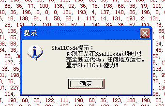

# VC8 编写 ShellCode 以及辅助工具

> 原文：[`www.pediy.com/kssd/pediy08/pediy8-219.htm`](https://www.pediy.com/kssd/pediy08/pediy8-219.htm)

.地球人都知道 `ShellCode` 的用处。就不多说了

例程演示了一个 `ShellCode` 的 `MessageBox`

包括完整代码即：手动获取输出表
嵌入字符串等操作

工具包括，一个字符串潜入辅助工具，以及 `OD` 汇编码到易语言数据代码的工具

演示了如何嵌入代码到易语言。

`DFCG// ShellCodeTest.cpp : 定义控制台应用程序的入口点。`

```
// 
/*  
ＶＣ　ＳｈｅｌｌＣｏｄｅ代码例子  
ｆｏｘ原创  
*/  
#include "stdafx.h"  
#include <Windows.h>  
#include <WinBase.h>  
#include <WinUser.h>  
int main()  
  {  
  //Get Kernel32 base addr  
  int Kernel32Base;  
  int a,b,c;  
  char *p;  
  __asm  
    {  
    mov eax,fs:[0] //唯一用到的汇编指令  
    mov b,eax;  
    }  
  while (b!=-1)  
    {  
    a=b;  
    b=*(int *)b;  
    }  
  b=*(int *)(a+4);  
  p=(char *)b;  
  while (*p!='M' || *(p+1)!='Z')  
    {  
    p--;  
    }  
  Kernel32Base=int(p);  
  //找到 GetProcAddress 的地址；  
  _IMAGE_EXPORT_DIRECTORY *k32Export;  
  //IMAGE_EXPORT_DIRECTORY::  
  k32Export=(IMAGE_EXPORT_DIRECTORY *)(Kernel32Base+int(*(int *)(Kernel32Base+0x160)));  
  c=k32Export->NumberOfNames;  
  int i=-1;  
  char *name;  
  char NameOfGetProcAddress[]={0x47,0x65,0x74,0x50,0x72,0x6F,0x63,0x41,0x64,0x64,0x72,0x65,0x73,0x73,0x00};  
  do  
    {  
    i++;  
    int tmp;  
    tmp=Kernel32Base+ k32Export->AddressOfNames+i*4;  
    tmp=*(int *)tmp;  
    tmp+=Kernel32Base;  
    name=(char *)tmp;  
    } while(strcmp(name,NameOfGetProcAddress)!=0);  
    //获取 GetProcAddress 地址  
    DWORD AddressOfGetProcAddress;  
    AddressOfGetProcAddress=*(int *)(Kernel32Base+k32Export->AddressOfFunctions+i*4);  
    AddressOfGetProcAddress=(Kernel32Base+AddressOfGetProcAddress);  
    //typedef void DRAWF( int, int );  
    FARPROC typedef WINAPI **GetProcAddress** (__in HMODULE hModule,__in LPCSTR lpProcName);  
    **GetProcAddress** *HGetProcAddress;  
    HGetProcAddress=*(**GetProcAddress** *)AddressOfGetProcAddress;  
    //找到 LoadLibrary 的地址  
    char str_LoadLibraryA[]={0x4C,0x6F,0x61,0x64,0x4C\  
      ,0x69,0x62,0x72,0x61,0x72,0x79\  
      ,0x41,0x00};//字符串:LoadLibraryA  
    FARPROC AddressOfLoadLibrary;  
    AddressOfLoadLibrary=HGetProcAddress(HMODULE(Kernel32Base),str_LoadLibraryA);  
    char str_user32_dll[]={0x75,0x73,0x65,0x72,0x33\  
      ,0x32,0x2E,0x64,0x6C,0x6C,0x00};//字符串:user32.dll;  
    HMODULE typedef WINAPI LoadLibraryA(  
      LPCTSTR lpFileName  
      );  
    //HMODULE AddressOfLoadLibrary;  
    LoadLibraryA *HLoadLibrary;  
    HLoadLibrary=(LoadLibraryA *)AddressOfLoadLibrary;  
    HMODULE USER32;  
    USER32=HLoadLibrary(str_user32_dll);  
    FARPROC HMessageBox;  
    char str_MessageBoxA[]={0x4D,0x65,0x73,0x73,0x61\  
      ,0x67,0x65,0x42,0x6F,0x78,0x41,0x00};//字符串:MessageBoxA;  
    HMessageBox= HGetProcAddress(USER32,str_MessageBoxA);  
    char str_Title[]={0xCC,0xE1,0xCA,0xBE,0x00};//字符串:提示;  
    char str_Data[]={0x53,0x68,0x65,0x6C,0x6C\  
      ,0x43,0x6F,0x64,0x65,0xCC,0xE1\  
      ,0xCA,0xBE,0xA3,0xBA,0xD,0xA\  
      ,0x20,0x20,0x20,0x20,0x20,0xC4\  
      ,0xE3,0xCF,0xD6,0xD4,0xDA,0xCA\  
      ,0xC7,0xD4,0xDA,0x53,0x68,0x65\  
      ,0x6C,0x6C,0x43,0x6F,0x64,0x65\  
      ,0xB9,0xFD,0xB3,0xCC,0xD6,0xD0\  
      ,0xA3,0xA1,0xD,0xA,0x20,0x20\  
      ,0x20,0x20,0x20,0xCD,0xEA,0xC8\  
      ,0xAB,0xB6,0xC0,0xC1,0xA2,0xB4\  
      ,0xFA,0xC2,0xEB,0xA3,0xAC,0xC8\  
      ,0xCE,0xBA,0xCE,0xB5,0xD8,0xB7\  
      ,0xBD,0xD4,0xCB,0xD0,0xD0,0xA1\  
      ,0xA3,0xD,0xA,0x20,0x20,0x20\  
      ,0x20,0x20,0xCF,0xD4,0xCA,0xBE\  
      ,0x53,0x68,0x65,0x6C,0x6C,0x43\  
      ,0x6F,0x64,0x65,0xF7,0xC8,0xC1\  
      ,0xA6,0xA3,0xA1,0x00};//字符串:ShellCode 提示：  
    //你现在是在 ShellCode 过程中！  
    //完全独立代码，任何地方运行。  
    //显示 ShellCode 魅力！;  
    int typedef WINAPI **MessageBox**(          HWND hWnd,  
      LPCTSTR lpText,  
      LPCTSTR lpCaption,  
      UINT uType  
      );  
    **MessageBox** *FMessageBox;  
    FMessageBox=(**MessageBox** *)HMessageBox;  
    FMessageBox(NULL,str_Data,str_Title,MB_ICONINFORMATION);  
    //return AddressOfGetProcAddress;  
    //如果是要潜入纯汇编代码　也就是不返回的　可以手动将后面的 Retn 去掉  
  }  
```

把代码嵌入易语言以及字符串转换工具原代码：

`.版本 2`

`.支持库 spec`

`.子程序 __ 启动窗口_ 创建完毕`


置入代码 `{ 129, 236, 184, 0, 0, 0, 100, 161, 0, 0, 0, 0, 137, 68, 36, 32, 139, 68, 36, 32, 131, 248, 255, 116, 22, 141, 164, 36, 0, 0, 0, 0, 139, 200, 139, 0, 131, 248, 255, 137, 68, 36, 32, 117, 243, 235, 7, 139, 140, 36, 180, 0, 0, 0, 139, 65, 4, 137, 68, 36, 32, 177, 90, 144, 128, 56, 77, 117, 5, 56, 72, 1, 116, 5, 131, 232, 1, 235, 241, 83, 85, 86, 87, 139, 184, 96, 1, 0, 0, 139, 76, 7, 32, 3, 248, 179, 114, 131, 205, 255, 198, 68, 36, 68, 71, 198, 68, 36, 69, 101, 198, 68, 36, 70, 116, 198, 68, 36, 71, 80, 136, 92, 36, 72, 198, 68, 36, 73, 111, 198, 68, 36, 74, 99, 198, 68, 36, 75, 65, 198, 68, 36, 76, 100, 198, 68, 36, 77, 100, 136, 92, 36, 78, 198, 68, 36, 79, 101, 198, 68, 36, 80, 115, 198, 68, 36, 81, 115, 198, 68, 36, 82, 0, 141, 76, 1, 252, 235, 7, 139, 140, 36, 196, 0, 0, 0, 131, 193, 4, 137, 140, 36, 196, 0, 0, 0, 139, 9, 131, 197, 1, 141, 116, 36, 68, 3, 200, 144, 138, 17, 58, 22, 117, 26, 132, 210, 116, 18, 138, 81, 1, 58, 86, 1, 117, 14, 131, 193, 2, 131, 198, 2, 132, 210, 117, 228, 51, 201, 235, 5, 27, 201, 131, 217, 255, 133, 201, 117, 186, 139, 87, 28, 141, 12, 170, 139, 52, 1, 141, 84, 36, 52, 177, 76, 82, 3, 240, 80, 136, 76, 36, 60, 198, 68, 36, 61, 111, 198, 68, 36, 62, 97, 198, 68, 36, 63, 100, 136, 76, 36, 64, 198, 68, 36, 65, 105, 198, 68, 36, 66, 98, 136, 92, 36, 67, 198, 68, 36, 68, 97, 136, 92, 36, 69, 198, 68, 36, 70, 121, 198, 68, 36, 71, 65, 198, 68, 36, 72, 0, 255, 214, 136, 92, 36, 27, 141, 76, 36, 24, 179, 108, 81, 198, 68, 36, 28, 117, 198, 68, 36, 29, 115, 198, 68, 36, 30, 101, 198, 68, 36, 32, 51, 198, 68, 36, 33, 50, 198, 68, 36, 34, 46, 198, 68, 36, 35, 100, 136, 92, 36, 36, 136, 92, 36, 37, 198, 68, 36, 38, 0, 255, 208, 141, 84, 36, 36, 82, 80, 198, 68, 36, 44, 77, 198, 68, 36, 45, 101, 198, 68, 36, 46, 115, 198, 68, 36, 47, 115, 198, 68, 36, 48, 97, 198, 68, 36, 49, 103, 198, 68, 36, 50, 101, 198, 68, 36, 51, 66, 198, 68, 36, 52, 111, 198, 68, 36, 53, 120, 198, 68, 36, 54, 65, 198, 68, 36, 55, 0, 255, 214, 139, 248, 176, 225, 177, 32, 178, 163, 198, 68, 36, 16, 204, 136, 68, 36, 17, 198, 68, 36, 18, 202, 198, 68, 36, 19, 190, 198, 68, 36, 20, 0, 198, 68, 36, 84, 83, 198, 68, 36, 85, 104, 198, 68, 36, 86, 101, 136, 92, 36, 87, 136, 92, 36, 88, 198, 68, 36, 89, 67, 198, 68, 36, 90, 111, 198, 68, 36, 91, 100, 198, 68, 36, 92, 101, 198, 68, 36, 93, 204, 136, 68, 36, 94, 198, 68, 36, 95, 202, 198, 68, 36, 96, 190, 136, 84, 36, 97, 198, 68, 36, 98, 186, 198, 68, 36, 99, 13, 198, 68, 36, 100, 10, 136, 76, 36, 101, 136, 76, 36, 102, 176, 212, 136, 76, 36, 103, 136, 76, 36, 104, 136, 76, 36, 105, 198, 68, 36, 106, 196, 198, 68, 36, 107, 227, 198, 68, 36, 108, 207, 198, 68, 36, 109, 214, 136, 68, 36, 110, 198, 68, 36, 111, 218, 198, 68, 36, 112, 202, 198, 68, 36, 113, 199, 136, 68, 36, 114, 198, 68, 36, 115, 218, 198, 68, 36, 116, 83, 198, 68, 36, 117, 104, 198, 68, 36, 118, 101, 136, 92, 36, 119, 136, 92, 36, 120, 198, 68, 36, 121, 67, 198, 68, 36, 122, 111, 198, 68, 36, 123, 100, 198, 68, 36, 124, 101, 198, 68, 36, 125, 185, 198, 68, 36, 126, 253, 198, 68, 36, 127, 179, 198, 132, 36, 128, 0, 0, 0, 204, 198, 132, 36, 129, 0, 0, 0, 214, 198, 132, 36, 130, 0, 0, 0, 208, 136, 148, 36, 131, 0, 0, 0, 198, 132, 36, 132, 0, 0, 0, 161, 198, 132, 36, 133, 0, 0, 0, 13, 198, 132, 36, 134, 0, 0, 0, 10, 136, 140, 36, 135, 0, 0, 0, 136, 140, 36, 136, 0, 0, 0, 136, 140, 36, 137, 0, 0, 0, 136, 140, 36, 138, 0, 0, 0, 136, 140, 36, 139, 0, 0, 0, 198, 132, 36, 140, 0, 0, 0, 205, 198, 132, 36, 141, 0, 0, 0, 234, 198, 132, 36, 142, 0, 0, 0, 200, 198, 132, 36, 143, 0, 0, 0, 171, 198, 132, 36, 144, 0, 0, 0, 182, 198, 132, 36, 145, 0, 0, 0, 192, 198, 132, 36, 146, 0, 0, 0, 193, 198, 132, 36, 147, 0, 0, 0, 162, 198, 132, 36, 148, 0, 0, 0, 180, 198, 132, 36, 149, 0, 0, 0, 250, 198, 132, 36, 150, 0, 0, 0, 194, 198, 132, 36, 151, 0, 0, 0, 235, 136, 148, 36, 152, 0, 0, 0, 198, 132, 36, 153, 0, 0, 0, 172, 198, 132, 36, 154, 0, 0, 0, 200, 198, 132, 36, 155, 0, 0, 0, 206, 198, 132, 36, 156, 0, 0, 0, 186, 198, 132, 36, 157, 0, 0, 0, 206, 198, 132, 36, 158, 0, 0, 0, 181, 198, 132, 36, 159, 0, 0, 0, 216, 198, 132, 36, 160, 0, 0, 0, 183, 198, 132, 36, 161, 0, 0, 0, 189, 136, 132, 36, 162, 0, 0, 0, 198, 132, 36, 163, 0, 0, 0, 203, 198, 132, 36, 164, 0, 0, 0, 208, 198, 132, 36, 165, 0, 0, 0, 208, 198, 132, 36, 166, 0, 0, 0, 161, 136, 148, 36, 167, 0, 0, 0, 198, 132, 36, 168, 0, 0, 0, 13, 198, 132, 36, 169, 0, 0, 0, 10, 136, 140, 36, 170, 0, 0, 0, 136, 140, 36, 171, 0, 0, 0, 136, 140, 36, 172, 0, 0, 0, 136, 140, 36, 173, 0, 0, 0, 136, 140, 36, 174, 0, 0, 0, 198, 132, 36, 175, 0, 0, 0, 207, 136, 132, 36, 176, 0, 0, 0, 198, 132, 36, 177, 0, 0, 0, 202, 198, 132, 36, 178, 0, 0, 0, 190, 198, 132, 36, 179, 0, 0, 0, 83, 198, 132, 36, 180, 0, 0, 0, 104, 198, 132, 36, 181, 0, 0, 0, 101, 136, 156, 36, 182, 0, 0, 0, 106, 64, 141, 68, 36, 20, 80, 141, 76, 36, 92, 81, 106, 0, 136, 156, 36, 199, 0, 0, 0, 198, 132, 36, 200, 0, 0, 0, 67, 198, 132, 36, 201, 0, 0, 0, 111, 198, 132, 36, 202, 0, 0, 0, 100, 198, 132, 36, 203, 0, 0, 0, 101, 198, 132, 36, 204, 0, 0, 0, 247, 198, 132, 36, 205, 0, 0, 0, 200, 198, 132, 36, 206, 0, 0, 0, 193, 198, 132, 36, 207, 0, 0, 0, 166, 136, 148, 36, 208, 0, 0, 0, 198, 132, 36, 209, 0, 0, 0, 161, 198, 132, 36, 210, 0, 0, 0, 0, 255, 215, 95, 139, 198, 94, 93, 91, 129, 196, 184, 0, 0, 0 }`

子程序 `_ 按钮 1_ 被单击`

```
.局部变量 n, 整数型
.局部变量 字节集, 字节集
.局部变量 输出, 文本型

字节集 ＝ 到字节集 (编辑框 1.内容)
.计次循环首 (取字节集长度 (字节集), n)
    .如果真 (输出 ≠ “” 且 n % 6 ＝ 0)
        输出 ＝ 输出 ＋ “\\” ＋ #换行符
    .如果真结束
    .如果 (输出 ＝ “”)
        输出 ＝ 输出 ＋ “0x” ＋ 取十六进制文本 (字节集 \[n\])
    .否则
        输出 ＝ 输出 ＋ “,0x” ＋ 取十六进制文本 (字节集 \[n\])
    .如果结束
.计次循环尾 ()

输出 ＝ “{” ＋ 输出 ＋ “,0x00}” ＋ “;”
' 输出 ＝ 子文本替换 (输出, “.”, “\_”, , , 真)
' 输出 ＝ 子文本替换 (输出, “->”, “\_”, , , 真)

输出 ＝ 输出 ＋ “/*字符串:” ＋ 编辑框 1.内容 ＋ “*/”
.如果真 (选择框 1.选中)
    输出 ＝ “char” ＋ “str\_” ＋ 取文本左边 (子文本替换 (编辑框 1.内容, “.”, “\_”, , , 真), 10) ＋ “\[\]=” ＋ 输出
.如果真结束

编辑框 2.内容 ＝ 输出
置剪辑板文本 (输出)
```

执行效果：



压缩包内含了完整的 VC 工程文件，点击打开。

4dd466d0e1e0cc123afbe504da2462ca
