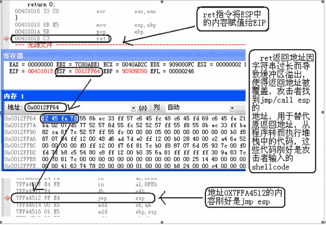

# OD 下分析缓冲区溢出

> 原文：[`www.pediy.com/kssd/pediy11/125521.html`](https://www.pediy.com/kssd/pediy11/125521.html)

ret 返回地址因字符串过长而导致缓冲区溢出，使得返回地址被覆盖，攻击者找到 jmp/call esp 的地址，用于替代原返回地址，从程序转而执行堆栈中的代码，这些代码刚好是攻击者输入的 shellcode  
  
