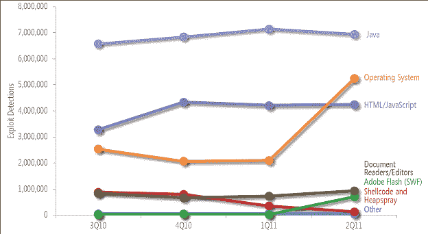
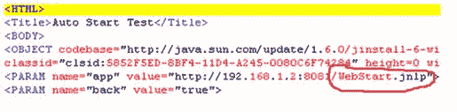
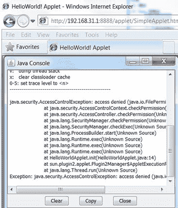
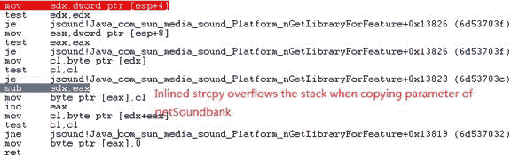
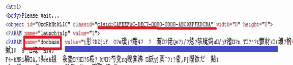
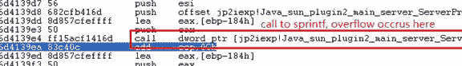

# 简单谈谈 Java Exploit

> 原文：[`www.pediy.com/kssd/pediy12/143826.html`](https://www.pediy.com/kssd/pediy12/143826.html)

1.  目的  
  
写这篇帖子的主要目的是，在下看到看雪论坛上已经有很多高质量的分析和探讨 native code exploit 的帖子，但是关注 Java Exploit 的好像不多。  
前几天在论坛上发了 CVE-2011-3544 的 java 代码，也有一些同学问我如何测试该 POC，怎么通过浏览器触发。  
其实现在安全研究者和各大厂商已经越来越重视 Java Exploit，由于一个好的 Java 漏洞（不是所有的）往往可以不用担心操作系统平台以及 DEP 和 ASLR，  
稳定性远远好于一些 IE, flash 漏洞，因此也越来越受到一些 Exploit Kit(漏洞利用工具箱)的开发者的青睐。  
下图是微软 2011 上半年安全公告中检测到的 Exploit 统计，可以看到 Java 一直处于领先地位。  
  
  
基于 Java Exploit 在漏洞研究领域越来越重要的地位，在下本着抛砖引玉的态度，写下了这篇文章，希望对大家了解 Java Exploit 能有一定帮助。  
  
  
2.  网页中的 Java  
  
目前主要有两种方式在网页中启动 Java 代码: Applet 和 Java Web Launch。其中 Java Web Launch 是 Java 1.5 之后新加入的，而 Applet 则是早就存在。  
记得当年学校教 Java 的时候，最后大作业就是写一个功能复杂的 Applet。不过现在 Applet 已经不流行了  
  
在 Html 里加入如下代码就可以嵌入 Applet:  
  

代码:

```
<APPLET CODE="HelloWorldApplet.class" WIDTH=200 HEIGHT=100> </APPLET>

```

  
或者如果打包成 jar 的话:  
  
代码:

```
<APPLET archive=”HelloWorldApplet.jar”  CODE="HelloWorldApplet.class"   WIDTH=200 HEIGHT=100> </APPLET>

```

和 Applet 相对的，Java Web Launch 用来从 web 上启动 Java Application。需要遵循 Java Network Launch Protocol (jnlp)。  
  
  
  
  
3.安全性和 Sandbox  
  
看到这里，大家可能会想，既然我们可以随意地在 html 中调用 Java 小程序，而 Java 语言的功能又非常强大，那直接写个包含恶意代码的 Java 小程序放到网上，不就相当于挂马了吗？  
比如，你可能会想写下如下代码:  
  
代码:

```
import java.awt.\*;
import java.applet.\*;
import java.io.\*;

public class HelloWorldApplet extends Applet {
  
  public void init()
  {
    try {
      Runtime.getRuntime().exec("calc.exe");
    } catch (IOException e) {
      e.printStackTrace();
    }
  }
  
  public void paint(Graphics g )
  {
    g.drawString("Hello World!",5,35);
  }
}

```

然后在自己的网页中加入如下代码调用这个 applet:  
  
代码:

```
<APPLET CODE="HelloWorldApplet.class" WIDTH=200 HEIGHT=100> </APPLET>

```

  
接着把网页挂到某个服务器上，开始守株待兔，  
泡杯茶，期望所有通过浏览器访问这个页面的同学都被突然弹出的计算器吓了一跳  
然而人生不如意，十有八九，我们来看看实际效果如何吧：  
  
  
  
  
呃，出错了，我们得到了一个 AccessControlException，提示没有权限。  
  
其实 Java 的设计者早就考虑了安全问题，并提出了 Sandbox 的概念。  
简单来讲这个 sandbox 的意思就是：Java 虚拟机在执行所有系统资源相关的操作（读写文件，运行命令，网络通信。。。）时，都会检查当前代码是否有权限来进行这些操作，如果没有权限，就会抛出异常。  
整个 Sandbox 机制非常复杂，无法用很短的篇幅讲清楚，下面只介绍一些要点:  
  
  
1.  在 Java 虚拟机中运行的代码，有受信任(Trusted Code)代码和不被信任代码(Untrusted Code)之分。  
默认情况下，Java 自带的库中的代码都是受信任的代码，而来自其他地方（比如来自网络）的代码是不受信任的。受信任代码默认可以对任何系统资源进行操作而不受限制，而不受信任的代码权限很低。  
比如我们前面这个例子，由于 HelloWorldApplet.class 的代码来自于网络上，因此它是不受信任的代码。  
于是在试图创建进程（ProcessBuilder.start()函数）时，Java 虚拟机检查到当前的代码不受信任，于是抛出一个权限异常。  
我们可以通过定义一些手段来让自己的代码受信任（比如添加 Policy，代码签名等等）。  
  
2.  在 Java 虚拟机进行权限检查时，会检查整个调用栈上的代码，而不是只检查当前函数（这里会有一些例外，如 doPrivilaged 和 AccessControlContext，暂时可以忽略之）。  
整个调用栈上只要有任何一个调用来自不受信任的代码，就判定为没有权限。  
  
还是上面这个例子，当最终检查权限时，调用栈如下：  
  
代码:

```
Java.AccessControlContext.checkPermission                   (信任代码)
Java.AccessController.checkPermission                               (信任代码)
Java.SecurityManager.checkPermission                                (信任代码)
Java.SecurityManager.checkExec                                                (信任代码)
Java.lang.ProcessBuilder.start                                                    (信任代码)
Java.lang.Runtime.exec                                                               (信任代码)
Java.lang.Runtime.exec                                                              (信任代码)
Java.lang.Runtime.exec                                                              (信任代码)
HelloWorldApplet.init                                         (非信任代码)
sun.plugin2.applet.Plugin2Manager$AppletExecutionRunnable.run   (信任代码)
Java.lang.Thread.Run                                                                  (信任代码)

```

  
用于我们自己的 HelloWorldApplet 代码是不受信任的，于是整个检查失败，异常被抛出。  
  
3.  权限检查代码是穿插在相关的 Java API 里面的，还是我们上面的例子, Runtime.exec 调用了 ProcessBuilder.start，代码如下:  
  
  
  
代码:

```
public Process start() throws IOException {
        // Must convert to array first -- a malicious user-supplied
        // list might try to circumvent the security check.
        String\[\] cmdarray = command.toArray(new String\[command.size()\]);
        cmdarray = cmdarray.clone();

        for (String arg : cmdarray)
            if (arg == null)
                throw new NullPointerException();
        // Throws IndexOutOfBoundsException if command is empty
        String prog = cmdarray\[0\];

        SecurityManager security = System.getSecurityManager();
        if (security != null)
            security.checkExec(prog);
        String dir = directory == null ? null : directory.toString();

        try {
            return ProcessImpl.start(cmdarray,
                                     environment,
                                     dir,
                                     redirects,
                                     redirectErrorStream);
        } catch (IOException e) {
            // It's much easier for us to create a high-quality error
            // message than the low-level C code which found the problem.
            throw new IOException(
                "Cannot run program \\"" + prog + "\\""
                + (dir == null ? "" : " (in directory \\"" + dir + "\\")")
                + ": " + e.getMessage(),
                e);
        }
    }
}

```

  
注意里面的 SecurityManager.checkExec 就是权限检查代码了。  
SecurityManager 是 Java 安全机制的核心，一个运行中的 Java Virtual Machine 可以有 SecurityManager，也可以没有，但是一旦设置了 SecurityManager 就不能再更改。  
如果没有 SecurityManager，很多权限检查都不会发生。如果在本地运行一个 Java 程序，默认是没有 SecurityManager 的，  
但是如果是通过浏览器启动一个 Applet，那相应的浏览器是一定会设置一个 SecurityManager。  
  
  
4.几种类型的 Java Exploit  
  
通过前面的介绍，我们知道由于 Sandbox 机制的保护，正常情况下是不能用 Java 程序挂马做坏事的，于是 Java Exploit 要做的事情就很明显了：突破 Java Sandbox 的保护机制。  
  
设想一下我们现在被关在一个封闭的房子里，想要逃出去，那么我们可能可以有两种思路：  
1.直接把墙给砸了。 2.找找看房子里面有没有没关严实的门窗，或者地道什么的。  
  
在已有的 Java 漏洞中，第一种方法对应于那些针对 Java 虚拟机实现（主要是包括运行库）和插件进行 exploit 的漏洞，典型的有 CVE-2009-3867，CVE-2009-3869，CVE-2010-3552，CVE-2010-0886 等。  
这类漏洞的主要思想是：Java 程序虽然运行在虚拟机中，但是整个虚拟机（包括运行时库）的实现需要平台相关的本地代码来支撑（在 windows 上，就有诸如 awt.dll,java.dll 等本地代码）。  
  
如果这些代码中存在漏洞，并且可以通过 java 代码来触发，我们就可以利用这些漏洞来运行 shellcode，此时 Sandbox 机制就无能为力了（因为 Sandbox 针对的是 Java 代码）。  
  
我们来看一个例子，CVE-2009-3867。这是一个栈溢出漏洞，存在于 Java MidiSystem 类的 getSoundbank 函数中  
我们可以通过传一个超长的 URL 来触发这个漏洞，请看代码：  
  
代码:

```
String str1 = repeat(‘/’, 30200);
MidiSystem.getSoundbank(new URL(str1));

```

  
Java 运行库中的一个 strcpy 操作引发了这个漏洞：  
  
  
非常典型的栈溢出，大家可以自己调试一下。  
值得注意的是如果通过 IE 浏览访问 exploit 并调试，IE 在隔了一段时间得不到响应后会终止 Java 虚拟机，可以通过在 IE 的 Terminate Process 上下断来防止 Java 被关闭。  
  
再看 CVE-2010-3552，同样是栈溢出，但是这次的攻击目标是 java 的浏览器插件：  
  
  
  
  
就是大家喜闻乐见的浏览器插件溢出啦。当 docbase 这个参数超长时，漏洞被触发。  
  
  
第二种突破 Java Sandbox 的方法是“绕”：  
  
用 Sandbox 来保障安全的想法是非常好的，但是人非圣贤，孰能无过，真正到了代码实现的时候，开发 Java 的大牛们还是偶尔会出一些小差错，导致在某些情况下 Sandbox 机制可以被绕过。  
  
典型的有 CVE-2010-0840  和前几天的 CVE-2011-3554。  
  
我个人感觉比起第一类“暴力攻击 Java 虚拟机”的漏洞，这类漏洞的危害更大一点。  
因为攻击者不需要费劲心思考虑如何让自己的 exploit 变得稳定，不需要考虑烦人的 DEP 和 ASLR，只要写一段做坏事的 Java 代码就好了。  
  
下面看一下 CVE-2010-0840:  
大牛的 blog 已经讲的非常详细了：  
  
  
[`slightlyrandombrokenthoughts....-cve-2010.html`](http://slightlyrandombrokenthoughts.blogspot.com/2010/04/java-trusted-method-chaining-cve-2010.html)  
  
  
我这边总结一下，这个漏洞的核心思想如下：  
  
前面提到过，当 Java  Sandbox 权限检查时，会检查整个栈上的代码，只要有任何非信任的代码，检查就失败。  
而 CVE-2010-0840 通过构造一个表达式(Expression)，该表达式将执行 setSecurityManager(null)来关闭 Sandbox 的安全机制。  
调用 setSecurityManager 将触发权限检查，因此如果在我们自己的代码中直接执行这个表达式是没有权限的。  
但是通过将这个表达式加入一个 JList 容器，让 Applet 的 UI 线程来执行这个表达式，则可以做到权限检查时，整个调用栈上都是 Java 自己的受信任库代码。于是成功绕过的 Java Sandbox。  
  
5.总结  
  
终于写完了，希望本文能帮助大家了解一些 Java 安全的相关知识。大家可以下载 word 版的文档，排版好一些。  
  
简单谈谈 Java Exploit.doc