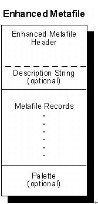
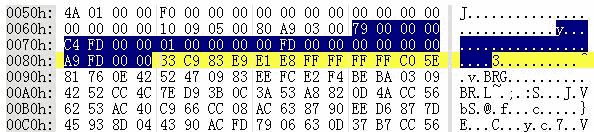

# MS08-021 漏洞分析

> 原文：[`www.pediy.com/kssd/pediy10/78412.html`](https://www.pediy.com/kssd/pediy10/78412.html)

Author:dge  

我从分析这个漏洞的过程中重新认识到一些东西，写下来分享给像我一样的人们。

在分析文件格式漏洞时只用调试工具跟踪有时候很费劲。如果 POC 可以顺利执行 shellcode，跟踪比较简单，但如果 POC 执行不到 shellcode，就很难去解决，当然我们可以通过补丁比较确定出几个可疑函数进行重点跟踪，当然前提是你得能确定出来，如果补丁对代码的改动很大，要确定出可疑函数实非易事，即使能确定出几个来，对他们跟踪也是非常麻烦的事情，让复杂的问题变的简单，那肯定是最理想的。

认识 `PaiMei` 这个工具是在 `failwest` 的书里，虽然读完那本书已经很久了，但一直没用过这个工具，直到前几天分析这个漏洞，在分析未果的情况下，我想起了 `PaiMei`,这才体会到了它的强大，这也是我想写这篇文章的原因。

`MS08-021` 有两个漏洞，这是其中的一个，这个漏洞的 POC 在很久之前就有人公布了，这是 POC 的地址：http://www.milw0rm.com/exploits/5442，有了 POC 和 `PaiMei`，分析这个漏洞就变得简单了，这个漏洞发生在 `gdi32.dll` 中，是典型的栈溢出。

用 `PaiMei` 和 `od` 我们可以轻松地确定出漏洞触发路径。

`PlayEnhMetaFileRecord`  
  |\_\_MRCOLORMATCHTOTARGET::bPlay  
       |\_\_IcmCreateColorSpaceByName  
            |\_\_lstrcpyW  

先简单了解下 EMF 文件格式



Header 结构：

```c
typedef struct tagENHMETAHEADER {  
  DWORD iType;  
  DWORD nSize;  
  RECTl rclBounds;  
  RECTl rclFrame;  
  DWORD dSignature;  
  DWORD nVersion;  
  DWORD nBytes;  
  DWORD nRecords;  
  WORD  nHandles;  
  WORD  sReserved;  
  DWORD nDescription;  
  DWORD offDescription;  
  DWORD nPalEntries;  
  SIZEl szlDevice;  
  SIZEl szlMillimeters;  
#if (WINVER >= 0x0400)  
  DWORD cbPixelFormat;  
  DWORD offPixelFormat;  
  DWORD bOpenGL;  
#endif /* WINVER >= 0x0400 */  
#if (WINVER >= 0x0500)  
  SIZEl szlMicrometers;  
#endif /* WINVER >= 0x0500 */  
} ENHMETAHEADER, *PENHMETAHEADER;  
```

RECORD 结构

```c
typedef struct tagENHMETARECORD  
{  
    DWORD   iType;              // Record type EMR_XXX  
    DWORD   nSize;              // Record size in bytes  
    DWORD   dParm[1];           // DWORD Array of parameters  
} ENHMETARECORD;  
```

函数原型：

```c
BOOL PlayEnhMetaFileRecord(
  HDC hdc,                              // handle to DC  
  LPHANDLETABLE lpHandletable,          // metafile handle table  
  CONST ENHMETARECORD *lpEnhMetaRecord, // metafile record  
  UINT nHandles                         // count of handles  
);
```

POC 截图：



下边分析下这个漏洞：

```asm
.text:77EFEF66 __stdcall PlayEnhMetaFileRecord(x, x, x, x) proc near
.text:77EFEF66                                        ; CODE XREF: bInternalPlayEMF(x,x,x,x,x)+6A2 p
.text:77EFEF66                                        ; bInternalPlayEMF(x,x,x,x,x)+13B2 p ...
.text:77EFEF66

.text:77EFEF66 var_58          = dword ptr -58h
.text:77EFEF66 var_54          = dword ptr -54h
...
.text:77EFEF66 hdc             = dword ptr  8
.text:77EFEF66 lphandletable   = dword ptr  0Ch
.text:77EFEF66 lpenhmetarecord = dword ptr  10h
.text:77EFEF66 nhandles        = dword ptr  14h

.text:77EFEF66 ; FUNCTION CHUNK AT .text:77F18A61 SIZE 0000028A BYTES

.text:77EFEF66                 mov     edi, edi
.text:77EFEF68                 push    ebp
.text:77EFEF69                 mov     ebp, esp
.text:77EFEF6B                 sub     esp, 58h
.text:77EFEF6E                 push    ebx
.text:77EFEF6F                 mov     ebx, [ebp+lpenhmetarecord]
.text:77EFEF72                 mov     eax, [ebx]
.text:77EFEF74                 cmp     eax, 1
.text:77EFEF77                 push    esi
.text:77EFEF78                 push    edi
.text:77EFEF79                 jb      short loc_77EFEF99
.text:77EFEF7B                 cmp     eax, 122
.text:77EFEF7E                 ja      short loc_77EFEF99
.text:77EFEF80                 push    [ebp+nhandles]
.text:77EFEF83                 mov     ecx, ebx
.text:77EFEF85                 push    [ebp+lphandletable]
.text:77EFEF88                 push    [ebp+hdc]
.text:77EFEF8B                 call    _fpStartDocDlgW[eax*4] ; eax 必须是 79,这样才可以调用虚函数 MRCOLORMATCHTOTARGET::bPlay
.text:77EFEF92

.text:77EFEF92 loc_77EFEF92:                           ; CODE XREF: PlayEnhMetaFileRecord(x,x,x,x)+19D72 j
.text:77EFEF92                                         ; PlayEnhMetaFileRecord(x,x,x,x)+19D80 j
.text:77EFEF92                 pop     edi
.text:77EFEF93                 pop     esi
.text:77EFEF94                 pop     ebx
.text:77EFEF95                 leave
.text:77EFEF96                 retn    10h
.text:77EFEF99 ; ---------------------------------------------------------------------------

.text:77EFEF99
.text:77EFEF99 loc_77EFEF99:                           ; CODE XREF: PlayEnhMetaFileRecord(x,x,x,x)+13 j
.text:77EFEF99                                         ; PlayEnhMetaFileRecord(x,x,x,x)+18 j
.text:77EFEF99                 test    eax, eax
.text:77EFEF9B                 js      loc_77F18CD5
.text:77EFEFA1                 jmp     loc_77F18A61
.text:77EFEFA1 __stdcall PlayEnhMetaFileRecord(x, x, x, x) endp
```

上图中的 6Ch 偏移处的四字节必须是 `79000000`，这样才可以让数据流到达 `MRCOLORMATCHTOTARGET::bPlay`。

```asm
text:77F2EBB5 public: int __thiscall MRCOLORMATCHTOTARGET::bPlay(void *, struct tagHANDLETABLE *, unsigned int) proc near
.text:77F2EBB5                                        ; CODE XREF: PlayEnhMetaFileRecord(x,x,x,x)+25 P
.text:77F2EBB5                                        ; DATA XREF: .data:77F327C0 o
.text:77F2EBB5

.text:77F2EBB5 var_264         = dword ptr -264h
...
.text:77F2EBB5 hdc             = dword ptr  8
.text:77F2EBB5 lphandletable   = dword ptr  0Ch

.text:77F2EBB5                 mov     edi, edi
.text:77F2EBB7                 push    ebp
.text:77F2EBB8                 mov     ebp, esp
.text:77F2EBBA                 sub     esp, 264h
.text:77F2EBC0                 mov     eax, ___security_cookie
.text:77F2EBC5                 push    ebx
.text:77F2EBC6                 mov     ebx, [ebp+hdc]
.text:77F2EBC9                 mov     [ebp+var_4], eax
.text:77F2EBCC                 mov     eax, [ebp+lphandletable]
.text:77F2EBCF                 push    esi
.text:77F2EBD0                 push    eax
.text:77F2EBD1                 mov     esi, ecx
.text:77F2EBD3                 mov     [ebp+var_258], ebx
.text:77F2EBD9                 call    MRCOLORMATCHTOTARGET::bCheckRecord(tagHANDLETABLE *) ;这个函数里规定[esi+0x14]+[esi+0x10]+0x1B==[esi+0x4]
```


`.text:77F2EBDE`                 `test`    `eax`, `eax`

`.text:77F2EBE0`                 `jz`      `loc_77F2ED19`

`.text:77F2EBE6`                 `mov`     `eax`, `[esi+8]`

`.text:77F2EBE9`                 `xor`     `ecx`, `ecx`

`.text:77F2EBEB`                 `inc`     `ecx`

`.text:77F2EBEC`                 `cmp`     `eax`, `ecx`

`.text:77F2EBEE`                 `push`    `edi`

`.text:77F2EBEF`                 `mov`     `[ebp+var_254]`, `ecx`

`.text:77F2EBF5`                 `jnz`     `loc_77F2ED03`    ; `ENHMETARECORD.iType==EMR_HEADER` ?

`.text:77F2EBFB`                 `test`    `[esi+0Ch]`, `cl`

`.text:77F2EBFE`                 `jz`      `loc_77F2ECB2`    ; Record size 是否是偶数

从上边的代码知道要触发漏洞必须符合的几个条件：

1）  `ENHMETARECORD.iType==EMR_HEADER`，也就是第一个 RECORD。
2）  当 `esi` 指向上图蓝色位置时，(`[esi+0x14]+[esi+0x10]+0x1B)&0FFFFFFFCh==[esi+0x4]`。
3）  Record size 必须是偶数。

```
.text:77F2ECB2 loc_77F2ECB2:                           ; CODE XREF: MRCOLORMATCHTOTARGET::bPlay(void *,tagHANDLETABLE *,uint)+49 j
.text:77F2ECB2                 mov     edi, 10002h
.text:77F2ECB7                 push    edi             ; const_10002
.text:77F2ECB8                 push    4               ; const_4
.text:77F2ECBA                 lea     eax, [esi+18h]
.text:77F2ECBD                 push    eax             ; lp_sz
.text:77F2ECBE                 push    ebx             ; hdc
.text:77F2ECBF                 call    IcmGetColorSpaceByName(x,x,x,x)
.text:77F2ECC4                 mov     ebx, eax        ;必须返回 0
.text:77F2ECC6                 test    ebx, ebx
.text:77F2ECC8                 jnz     short loc_77F2ECE2  
.text:77F2ECCA                 push    edi             ; int
.text:77F2ECCB                 push    4               ; int
.text:77F2ECCD                 lea     eax, [esi+18h]   
.text:77F2ECD0                 push    eax             ; 指向 RECORD 的内容
.text:77F2ECD1                 push    [ebp+var_258]    ; int
.text:77F2ECD7                 call    IcmCreateColorSpaceByName(x,x,x,x)  ;有漏洞的函数
```

`IcmGetColorSpaceByName` 必须返回 `0`。

```
.text:77F0335B __stdcall IcmCreateColorSpaceByName(x, x, x, x) proc near
.text:77F0335B                                         ; CODE XREF: IcmUpdateLocalDCColorSpace(x,x)+1043 p
.text:77F0335B                                         ; IcmUpdateLocalDCColorSpace(x,x)+150B7 p ...
.text:77F0335B

.text:77F0335B var_250         = dword ptr -250h
.text:77F0335B var_24C         = dword ptr -24Ch
.text:77F0335B var_248         = dword ptr -248h
.text:77F0335B var_244         = dword ptr -244h
.text:77F0335B var_240         = dword ptr -240h
.text:77F0335B String1         = word ptr -20Ch
.text:77F0335B var_4           = dword ptr -4
.text:77F0335B arg_0           = dword ptr  8
.text:77F0335B lpString2       = dword ptr  0Ch
.text:77F0335B arg_8           = dword ptr  10h
.text:77F0335B arg_C           = dword ptr  14h

.text:77F0335B                 mov     edi, edi
.text:77F0335D                 push    ebp
.text:77F0335E                 mov     ebp, esp
.text:77F03360                 sub     esp, 250h
.text:77F03366                 mov     eax, ___security_cookie ;使用了 GS
.text:77F0336B                 mov     edx, [ebp+lpString2]
.text:77F0336E                 push    esi
.text:77F0336F                 mov     esi, [ebp+arg_0]
.text:77F03372                 mov     [ebp+var_4], eax
.text:77F03375                 push    edi
.text:77F03376                 xor     eax, eax
.text:77F03378                 mov     ecx, 93h
.text:77F0337D                 lea     edi, [ebp+var_250]
.text:77F03383                 rep     stosd
.text:77F03385                 and     [ebp+var_244], eax
.text:77F0338B                 mov     eax, [ebp+arg_8]
.text:77F0338E                 mov     [ebp+var_240], eax
.text:77F03394                 push    edx             ; lpString2
.text:77F03395                 lea     eax, [ebp+String1]
.text:77F0339B                 push    eax             ; lpString1
.text:77F0339C                 mov     [ebp+var_250], 50534F43h
.text:77F033A6                 mov     [ebp+var_24C], 400h
.text:77F033B0                 mov     [ebp+var_248], 24Ch
.text:77F033BA                 call    ds:lstrcpyW(x,x)  ; 如果第一个 RECORD 的内容足够大就可以溢出。
.text:77F033C0                 push    [ebp+arg_C]
.text:77F033C3                 lea     eax, [ebp+var_250]
.text:77F033C9                 push    0
.text:77F033CB                 push    eax
.text:77F033CC                 push    esi
.text:77F033CD                 call    IcmCreateColorSpaceByColorSpace(x,x,x,x)
.text:77F033D2                 mov     ecx, [ebp+var_4]
.text:77F033D5                 pop     edi
.text:77F033D6                 pop     esi
.text:77F033D7                 call    ___security_check_cookie(x)
.text:77F033DC                 leave
.text:77F033DD                 retn    10h
.text:77F033DD __stdcall IcmCreateColorSpaceByName(x, x, x, x) endp
```

本人菜鸟一只，请指教，谢谢。
