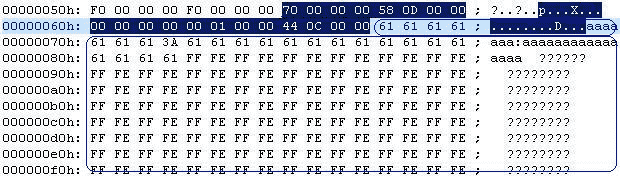

# MS08-046 漏洞分析

> 原文：[`www.pediy.com/kssd/pediy10/78756.html`](https://www.pediy.com/kssd/pediy10/78756.html)

Author:dge

通过阅读微软安全公告和 `CVE-2008-2245`，我们可以知道这是个发生在 `MSCMS` 模块里的堆溢出，`CVE` 甚至给出了漏洞函数 `InternalOpenColorProfile`。这个漏洞也是跟 `EMF` 图片有关，`POC` 地址在这里：`http://milw0rm.com/sploits/2008-emf_MS08-046.rar`。

本来可以直接对 `InternalOpenColorProfile` 函数进行分析，并且对其进行设断的，不过我在 `IDA` 里没找到这个函数，用 `PAIMEI` 定位到溢出点后才知道，`IDA` 识别出了这个符号，只不过没把它放到 `FUNCTIONS` 列表里面，我们可以在 `NAMES` 列表里找到它，不过没关系，用 `PAIMEI` 找它也很简单。

## 说下跟踪步骤

先用 `PAIMEI` 跟踪，在跟踪记录中从后望前找，既然是堆溢出，那肯定得有堆分配的函数，而且在其附近代码中很可能有指向输入数据的寄存器和拷贝函数，这样很容易可以定位到溢出点，下一步就是在 `OD` 中对发生溢出的函数设断，中断后查看调用栈就可以获得漏洞触发路径了，如果这样不行的话，那就只能继续向上翻看 `PAIMEI` 的跟踪记录了，因为它记录的内容超多，所以有点麻烦，当然也可以只对函数进行跟踪，不过 `IDA` 在识别函数上经常出现问题，所以 `PAIMEI` 也会跟着倒霉。

## 漏洞产生路径

`PlayEnhMetaFileRecord`

  |\_ `MRSETICMPROFILE::bPlay`

        |\_ `SetICMProfileInternalA`

              |\_ `IcmSetDestinationColorSpace`

                   |\_ `IcmCreateColorSpaceByName`

                        |\_ `IcmCreateColorSpaceByColorSpace`

                             |\_ `IcmRealizeColorProfile`

                                  |\_ `OpenColorProfileW`

                                        |\_ `lstrcatW`

## POC 截图



蓝框就是 `RECORD` 的内容，当程序把它拷贝到小的堆中导致了溢出。

下边就仔细分析下这个漏洞：

```
.text:77EFEF66	__stdcall PlayEnhMetaFileRecord(x, x, x, x) proc near
.text:77EFEF66	; CODE XREF: bInternalPlayEMF(x,x,x,x,x)+6A2 p
.text:77EFEF66	; bInternalPlayEMF(x,x,x,x,x)+13B2 p ...
.text:77EFEF66
.text:77EFEF66 var_58          = dword ptr -58h
.text:77EFEF66 var_54          = dword ptr -54h
.text:77EFEF66 var_50          = dword ptr -50h
.text:77EFEF66 var_4C          = dword ptr -4Ch
.text:77EFEF66 var_48          = dword ptr -48h
.text:77EFEF66 var_44          = dword ptr -44h
.text:77EFEF66 var_40          = dword ptr -40h
.text:77EFEF66 var_3C          = dword ptr -3Ch
.text:77EFEF66 var_38          = dword ptr -38h
.text:77EFEF66 var_34          = dword ptr -34h
.text:77EFEF66 var_30          = dword ptr -30h
.text:77EFEF66 var_2C          = dword ptr -2Ch
.text:77EFEF66 var_28          = dword ptr -28h
.text:77EFEF66 var_24          = dword ptr -24h
.text:77EFEF66 var_20          = dword ptr -20h
.text:77EFEF66 var_1C          = dword ptr -1Ch
.text:77EFEF66 var_18          = dword ptr -18h
.text:77EFEF66 var_14          = dword ptr -14h
.text:77EFEF66 var_10          = dword ptr -10h
.text:77EFEF66 var_C           = dword ptr -0Ch
.text:77EFEF66 var_8           = dword ptr -8
.text:77EFEF66 var_4           = dword ptr -4
.text:77EFEF66 arg_0           = dword ptr  8
.text:77EFEF66 arg_4           = dword ptr  0Ch
.text:77EFEF66 arg_8           = dword ptr  10h
.text:77EFEF66 arg_C           = dword ptr  14h
.text:77EFEF66
.text:77EFEF66 ; FUNCTION CHUNK AT .text:77F18A61 SIZE 0000028A BYTES
.text:77EFEF66
.text:77EFEF66 mov     edi, edi
.text:77EFEF68 push    ebp
.text:77EFEF69 mov     ebp, esp
.text:77EFEF6B sub     esp, 58h
.text:77EFEF6E push    ebx
.text:77EFEF6F mov     ebx, [ebp+arg_8]
.text:77EFEF72 mov     eax, [ebx]
.text:77EFEF74 cmp     eax, 1
.text:77EFEF77 push    esi
.text:77EFEF78 push    edi
.text:77EFEF79 jb      short loc_77EFEF99
.text:77EFEF7B cmp     eax, 7Ah
.text:77EFEF7E ja      short loc_77EFEF99
.text:77EFEF80 push    [ebp+arg_C]
.text:77EFEF83 mov     ecx, ebx
.text:77EFEF85 push    [ebp+arg_4]
.text:77EFEF88 push    [ebp+arg_0]
.text:77EFEF8B call    _fpStartDocDlgW[eax*4] ; eax 必须是 70
.text:77EFEF92
.text:77EFEF92 loc_77EFEF92:	; CODE XREF: PlayEnhMetaFileRecord(x,x,x,x)+19D72 j
.text:77EFEF92	; PlayEnhMetaFileRecord(x,x,x,x)+19D80 j
.text:77EFEF92 pop     edi
.text:77EFEF93 pop     esi
.text:77EFEF94 pop     ebx
.text:77EFEF95 leave
.text:77EFEF96 retn    10h
.text:77EFEF99 ; ---------------------------------------------------------------------------
```

上图中的红线上边必须是 `0x70`，这样才可以让数据流到达 `MRSETICMPROFILE::bPlay`。

```
.text:77F2EA1B public: int __thiscall MRSETICMPROFILE::bPlay(void *, struct tagHANDLETABLE *, unsigned int) proc near
.text:77F2EA1B	; DATA XREF: .data:77F3279C o
.text:77F2EA1B	; .data:77F327A0 o
.text:77F2EA1B
.text:77F2EA1B var_46C         = dword ptr -46Ch
.text:77F2EA1B var_468         = dword ptr -468h
.text:77F2EA1B var_464         = dword ptr -464h
.text:77F2EA1B var_460         = dword ptr -460h
.text:77F2EA1B var_45C         = dword ptr -45Ch
.text:77F2EA1B var_458         = dword ptr -458h
.text:77F2EA1B var_454         = dword ptr -454h
.text:77F2EA1B var_450         = dword ptr -450h
.text:77F2EA1B var_44C         = dword ptr -44Ch
.text:77F2EA1B var_448         = dword ptr -448h
.text:77F2EA1B var_414         = dword ptr -414h
.text:77F2EA1B var_20C         = byte ptr -20Ch
.text:77F2EA1B var_4           = dword ptr -4
.text:77F2EA1B arg_0           = dword ptr  8
.text:77F2EA1B arg_4           = dword ptr  0Ch
.text:77F2EA1B
.text:77F2EA1B mov     edi, edi
.text:77F2EA1D push    ebp
.text:77F2EA1E mov     ebp, esp
.text:77F2EA20 sub     esp, 46Ch
.text:77F2EA26 mov     eax, ___security_cookie
.text:77F2EA2B push    esi
.text:77F2EA2C mov     [ebp+var_4], eax
.text:77F2EA2F mov     eax, [ebp+arg_4]
.text:77F2EA32 push    edi
.text:77F2EA33 mov     edi, [ebp+arg_0]
.text:77F2EA36 push    eax
.text:77F2EA37 mov     esi, ecx
.text:77F2EA39 mov     [ebp+var_460], edi
.text:77F2EA3F call    MRNAMEDESCAPE::bCheckRecord(tagHANDLETABLE *) ; 这里必须符合[esi+10h]+[esi+c]&0FFFFFFFCh==[esi+4h]
.text:77F2EA44 test    eax, eax
.text:77F2EA46 jz      loc_77F2EBA2
.text:77F2EA4C push    ebx
.text:77F2EA4D xor     ebx, ebx
.text:77F2EA4F test    byte ptr [esi+8], 1 ; [esi+8h]必须等于 0
.text:77F2EA53 mov     [ebp+var_45C], ebx
.text:77F2EA59 jz      loc_77F2EB74
```

当 `esi` 指向上图蓝色的位置时，`[esi+10h]+[esi+c]&0FFFFFFFCh==[esi+4h]`，`[esi+8h]`必须等于 `0`。

```
.text:77F2EB74 loc_77F2EB74:	; CODE XREF: MRSETICMPROFILE::bPlay(void *,tagHANDLETABLE *,uint)+3E j
.text:77F2EB74 cmp     dword ptr [esi], 70h
.text:77F2EB77 push    10002h	; int
.text:77F2EB7C push    ebx	; int
.text:77F2EB7D jnz     short loc_77F2EB8B
.text:77F2EB7F add     esi, 14h
.text:77F2EB82 push    esi	; lpString
.text:77F2EB83 push    edi	; HDC
.text:77F2EB84 call    SetICMProfileInternalA(x,x,x,x)
.text:77F2EB89 jmp     short loc_77F2EB95
.text:77F2EB8B ; ---------------------------------------------------------------------------
```

```
.text:77F20F7F __stdcall SetICMProfileInternalA(x, x, x, x) proc near
```


.text:77F20F7F                                         ; CODE XREF: `SetICMProfileA(x,x)+F` p  

.text:77F20F7F                                         ; `MRSETICMPROFILE::bPlay(void *,tagHANDLETABLE *,uint)+169` p  

.text:77F20F7F  

.text:77F20F7F `var_210`         = dword ptr -210h  

.text:77F20F7F `u_string`        = byte ptr -20Ch  

.text:77F20F7F `var_4`           = dword ptr -4  

.text:77F20F7F `hdc`             = dword ptr  8  

.text:77F20F7F `lpString`        = dword ptr  0Ch  

.text:77F20F7F `const_0`         = dword ptr  10h  

.text:77F20F7F `const_10002`     = dword ptr  14h  

```
.text:77F20F7F                 mov     edi, edi  
.text:77F20F81                 push    ebp  
.text:77F20F82                 mov     ebp, esp  
.text:77F20F84                 sub     esp, 210h  
.text:77F20F8A                 mov     eax, __security_cookie  
.text:77F20F8F                 and     [ebp+var_210], 0  
.text:77F20F96                 push    ebx  
.text:77F20F97                 mov     ebx, [ebp+const_0]  
.text:77F20F9A                 test    ebx, ebx  
.text:77F20F9C                 push    esi  
.text:77F20F9D                 mov     esi, [ebp+hdc]  
.text:77F20FA0                 push    edi  
.text:77F20FA1                 mov     edi, [ebp+lpString]  
.text:77F20FA4                 mov     [ebp+var_4], eax  
.text:77F20FA7                 jnz     short loc_77F20FB1  
.text:77F20FA9                 test    edi, edi  
.text:77F20FAB                 jz      loc_77F2104E
```

.text:77F21004                 test    edi, edi  
.text:77F21006                 jz      short loc_77F21046  
.text:77F21008                 push    edi             ; lpString  
.text:77F21009                 call    ds:lstrlenA(x)  
.text:77F2100F                 test    eax, eax  
.text:77F21011                 jz      short loc_77F2103F  
.text:77F21013                 cmp     eax, 104h       ; 如果 RECORD 的长度大于等于 0x104 就失败，所以最长是 103 字节  
.text:77F21018                 jnb     short loc_77F2103F  
.text:77F2101A                 inc     eax             ; 加上\0，最大长度为 104 字节  
.text:77F2101B                 push    eax  
.text:77F2101C                 push    edi  
.text:77F2101D                 push    0  
.text:77F2101F                 push    208h  
.text:77F21024                 lea     eax, [ebp+u_string]  
.text:77F2102A                 push    eax  
.text:77F2102B                 call    ds:RtlMultiByteToUnicodeN(x,x,x,x,x) ; 把字符串转换成 Unicode 编码格式  
.text:77F21031                 push    [ebp+const_10002]  
.text:77F21034                 lea     eax, [ebp+u_string]  
.text:77F2103A                 push    0  
.text:77F2103C                 push    eax  
.text:77F2103D                 jmp     short loc_77F20FF2

由上边的分析可知字符串最大长度为 0x103 字节。

```
.text:77F20FF2 loc_77F20FF2:                           ; CODE XREF: SetICMProfileInternalA(x,x,x,x)+BE j  
.text:77F20FF2                 push    esi             ; hdc  
.text:77F20FF3                 call    IcmSetDestinationColorSpace(x,x,x,x)  
.text:77F20FF8 ; ---------------------------------------------------------------------------  
```

.text:77F20CD3 `__stdcall` `IcmSetDestinationColorSpace(x, x, x, x)` proc near  
.text:77F20CD3                                         ; CODE XREF: `SetICMProfileInternalA(x,x,x,x)+74` p  
.text:77F20CD3                                         ; `SetICMProfileInternalW(x,x,x,x)+56` p ...  
.text:77F20CD3  

.text:77F20CD3 `var_4`           = dword ptr -4  
.text:77F20CD3 `hdc`             = dword ptr  8  
.text:77F20CD3 `lpString2`       = dword ptr  0Ch  
.text:77F20CD3 `const_0`         = dword ptr  10h  
.text:77F20CD3 `const_10002`     = dword ptr  14h  

```
.text:77F20CD3                 mov     edi, edi  
.text:77F20CD5                 push    ebp  
.text:77F20CD6                 mov     ebp, esp  
.text:77F20CD8                 push    ecx  
.text:77F20CD9                 push    ebx  
.text:77F20CDA                 push    esi  
.text:77F20CDB                 xor     esi, esi  
.text:77F20CDD                 cmp     [ebp+const_0], esi  
.text:77F20CE0                 push    edi  
.text:77F20CE1                 jnz     short loc_77F20D08  
.text:77F20CE3                 cmp     [ebp+lpString2], esi  
.text:77F20CE6                 jz      loc_77F20F71  
.text:77F20CEC                 push    [ebp+lpString2] ; lpString  
.text:77F20CEF                 call    ds:lstrlenW(x)  
.text:77F20CF5                 cmp     eax, esi  
.text:77F20CF7                 jz      loc_77F20F71  
.text:77F20CFD                 cmp     eax, 104h  
.text:77F20D02                 ja      loc_77F20F71
```

.text:77F20D97 loc_77F20D97:                           ; CODE XREF: `IcmSetDestinationColorSpace(x,x,x,x)+B5` j  
.text:77F20D97                 cmp     [ebp+const_0], 0  
.text:77F20D9B                 jnz     short loc_77F20DC4  
.text:77F20D9D                 push    [ebp+const_10002] ; int  
.text:77F20DA0                 push    dword ptr [esi+30h] ; int  
.text:77F20DA3                 push    [ebp+lpString2] ; wchar_t *  
.text:77F20DA6                 push    ebx             ; int  
.text:77F20DA7                 call    `IcmGetColorSpaceByName(x,x,x,x)`  
.text:77F20DAC                 test    eax, eax  
.text:77F20DAE                 mov     [ebp+const_0], eax  
.text:77F20DB1                 jnz     short loc_77F20DEE  
.text:77F20DB3                 push    [ebp+const_10002] ; int  
.text:77F20DB6                 push    dword ptr [esi+30h] ; int  
.text:77F20DB9                 push    [ebp+lpString2] ; lpString2  
.text:77F20DBC                 push    ebx             ; hdc  
.text:77F20DBD                 call    `IcmCreateColorSpaceByName(x,x,x,x)`  
.text:77F20DC2                 jmp     short loc_77F20DE3  
.text:77F20DC4 ; ---------------------------------------------------------------------------  

.text:77F0335B `__stdcall` `IcmCreateColorSpaceByName(x, x, x, x)` proc near  
.text:77F0335B                                         ; CODE XREF: `IcmUpdateLocalDCColorSpace(x,x)+1043` p  
.text:77F0335B                                         ; `IcmUpdateLocalDCColorSpace(x,x)+150B7` p ...  
.text:77F0335B  

.text:77F0335B `struct_`         = byte ptr -250h  
.text:77F0335B `var_4`           = dword ptr -4  
.text:77F0335B `hdc`             = dword ptr  8  
.text:77F0335B `lpString2`       = dword ptr  0Ch  
.text:77F0335B `arg_8`           = dword ptr  10h  
.text:77F0335B `const_10002`     = dword ptr  14h  

```
.text:77F0335B                 mov     edi, edi  
.text:77F0335D                 push    ebp  
.text:77F0335E                 mov     ebp, esp  
.text:77F03360                 sub     esp, 250h  
.text:77F03366                 mov     eax, __security_cookie  
.text:77F0336B                 mov     edx, [ebp+lpString2]  
.text:77F0336E                 push    esi  
.text:77F0336F                 mov     esi, [ebp+hdc]  
.text:77F03372                 mov     [ebp+var_4], eax  
.text:77F03375                 push    edi  
.text:77F03376                 xor     eax, eax  
.text:77F03378                 mov     ecx, 93h  
.text:77F0337D                 lea     edi, [ebp+struct_]  
.text:77F03383                 rep stosd  
.text:77F03385                 and     dword ptr [ebp+struct_+0Ch], eax  
.text:77F0338B                 mov     eax, [ebp+arg_8]  
.text:77F0338E                 mov     dword ptr [ebp+struct_+10h], eax  
.text:77F03394                 push    edx             ; lpString2  
.text:77F03395                 lea     eax, [ebp+struct_+44h]  
.text:77F0339B                 push    eax             ; lpString1  
.text:77F0339C                 mov     dword ptr [ebp+struct_], 50534F43h ;装填结构变量
```


`.text:77F033A6` `mov` `dword ptr [ebp+struct_+4]`, `400h`

`.text:77F033B0` `mov` `dword ptr [ebp+struct_+8]`, `24Ch`

`.text:77F033BA` `call` `ds:lstrcpyW(x,x)` ; 把字符串拷贝到 `struct_+0x44`

`.text:77F033C0` `push` `[ebp+const_10002]`

`.text:77F033C3` `lea` `eax`, `[ebp+struct_]`

`.text:77F033C9` `push` `0`

`.text:77F033CB` `push` `eax` ; 结构指针

`.text:77F033CC` `push` `esi` ; `hdc`

`.text:77F033CD` `call` `IcmCreateColorSpaceByColorSpace(x,x,x,x)`

`.text:77F033D2` `mov` `ecx`, `[ebp+var_4]`

`.text:77F033D5` `pop` `edi`

`.text:77F033D6` `pop` `esi`

`.text:77F033D7` `call` `__security_check_cookie(x)`

`.text:77F033DC` `leave`

`.text:77F033DD` `retn` `10h`

`.text:77F033DD` `__stdcall IcmCreateColorSpaceByName(x, x, x, x) endp`

构造一个结构体变量做为参数传入，在这个结构体 `0x44` 偏移处包含 `RECORD` 的字符串。

`.text:77F033E5` `__stdcall IcmCreateColorSpaceByColorSpace(x, x, x, x) proc near`

`; CODE XREF: IcmCreateColorSpaceByName(x,x,x,x)+72 p`
`; IcmCreateColorTransform(x,x,x,x)+DDD p ...`

`hdc` = `dword ptr` `8`
`lp_struct` = `dword ptr` `0Ch`
`const_0` = `dword ptr` `10h`
`const_10002` = `dword ptr` `14h`

`; FUNCTION CHUNK AT .text:77F037FC SIZE 00000039 BYTES`
`; FUNCTION CHUNK AT .text:77F1684C SIZE 00000126 BYTES`

```
mov edi, edi
push ebp
mov ebp, esp
push ebx
push esi
mov esi, [ebp+lp_struct]
xor ebx, ebx
test esi, esi
push edi
jz loc_77F03529
cmp _ghICM, ebx
jz loc_77F1684C
```

`.text:77F03493` `; IcmCreateColorSpaceByColorSpace(x,x,x,x)+134B7 j ...`

```
mov eax, [ebp+lp_struct]
cmp [eax+44h], cx ; 检查 RECORD 的第一个字节内容是否为 0
jz loc_77F1690E
push edi ; size_t
lea esi, [ebx+70h]
push esi ; int
push esi ; wchar_t *
call BuildIcmProfilePath(x,x,x)
push offset aSrgbColorSpace ; "sRGB Color Space Profile.icm"
push eax ; wchar_t *
call ds:__imp___wcsicmp
test eax, eax
pop ecx
pop ecx
jnz short loc_77F034C1
or dword ptr [ebx+0Ch], 1
```

`loc_77F034C1:` `; CODE XREF: IcmCreateColorSpaceByColorSpace(x,x,x,x)+D6 j`
```
mov dword ptr [ebx+20h], 1
mov [ebx+24h], esi
mov dword ptr [ebx+28h], 208h
```

`loc_77F034D2:` `; CODE XREF: IcmCreateColorSpaceByColorSpace(x,x,x,x)+13514 j`
`; IcmCreateColorSpaceByColorSpace(x,x,x,x)+13524 j ...`
```
push 0
push ebx ; ebx 指向新的堆
call IcmRealizeColorProfile(x,x)
```

程序新建了个堆，并把前边构造的结构体变量复制到其中。

`.text:77F032DD` `__stdcall IcmRealizeColorProfile(x, x) proc near`
`; CODE XREF: IcmCreateColorSpaceByColorSpace(x,x,x,x)+F0 p`
`; IcmCreateColorTransform(x,x,x,x)+E4D p ...`

`lp_st` = `dword ptr` `8`
`const_0` = `dword ptr` `0Ch`

`; FUNCTION CHUNK AT .text:77F037E0 SIZE 0000001C BYTES`
`; FUNCTION CHUNK AT .text:77F162CE SIZE 0000000C BYTES`

```
mov edi, edi
push ebp
mov ebp, esp
push esi
mov esi, [ebp+lp_st]
test esi, esi
jz loc_77F037F4
cmp dword ptr [esi+14h], 0
jnz short loc_77F0331F
cmp dword ptr [esi+24h], 0
jz short loc_77F0331F
push edi
push 3
push 3
push 1
lea eax, [esi+20h]
push eax
call _fpOpenColorProfileW ; 这里调用 mscms 模块里的 OpenColorProfileW 函数
mov edi, eax
test edi, edi
jz short loc_77F0331E
cmp [ebp+const_0], 0
jnz loc_77F037E0
```

`loc_77F0331B:` `; CODE XREF: IcmRealizeColorProfile(x,x)+50C j`
```
mov [esi+14h], edi
```

`loc_77F0331E:` `; CODE XREF: IcmRealizeColorProfile(x,x)+32 j`
`; IcmRealizeColorProfile(x,x)+12FF8 j`
```
pop edi
```

`loc_77F0331F:` `; CODE XREF: IcmRealizeColorProfile(x,x)+15 j`
`; IcmRealizeColorProfile(x,x)+1B j`
```
xor eax, eax
cmp [esi+14h], eax
setnz al
```

`loc_77F03327:` `; CODE XREF: IcmRealizeColorProfile(x,x)+51A j`
```
pop esi
pop ebp
retn 8
```

`__stdcall IcmRealizeColorProfile(x, x) endp`

上边调用 `MSCMS` 模块里的函数 `OpenColorProfileW`。

`.text:73AA1D96` `__stdcall OpenColorProfileW(x, x, x, x) proc near`
`; CODE XREF: DoesProfileMatchEnumRecord(x,x)+49 p`
`; GetProfileClassString(x,x,x)+58 p`

`SecurityAttributes=` `_SECURITY_ATTRIBUTES ptr -18h`


`.text:73AA1D96` `var_C`           `= dword ptr -0Ch`  
`.text:73AA1D96` `var_8`           `= dword ptr -8`  
`.text:73AA1D96` `var_4`           `= dword ptr -4`  
`.text:73AA1D96` `lpString1`       `= dword ptr  8`  
`.text:73AA1D96` `const_1`         `= dword ptr  0Ch`  
`.text:73AA1D96` `dwShareMode`     `= dword ptr  10h`  
`.text:73AA1D96` `dwCreationDisposition` `= dword ptr  14h`  

`.text:73AA1D96` `; FUNCTION CHUNK AT .text:73AA2559 SIZE 00000051 BYTES`  
`.text:73AA1D96` `; FUNCTION CHUNK AT .text:73AA3A77 SIZE 00000163 BYTES`  

```
.text:73AA1D96                 mov     edi, edi
.text:73AA1D98                 push    ebp
.text:73AA1D99                 mov     ebp, esp
.text:73AA1D9B                 pop     ebp
.text:73AA1D9C                 nop
.text:73AA1D9D                 nop
.text:73AA1D9E                 nop
.text:73AA1D9F                 nop
.text:73AA1DA0                 nop
.text:73AA1DA1
```

`.text:73AA1DA1` `__stdcall InternalOpenColorProfile(x, x, x, x):`  
`; CODE XREF: OpenColorProfileA(x,x,x,x)+70 p`  

```
.text:73AA1DA1                 mov     edi, edi
.text:73AA1DA3                 push    ebp
.text:73AA1DA4                 mov     ebp, esp
.text:73AA1DA6                 sub     esp, 18h
.text:73AA1DA9                 push    ebx
.text:73AA1DAA                 push    esi
.text:73AA1DAB                 mov     esi, [ebp+lpString1]
.text:73AA1DAE                 xor     ebx, ebx
.text:73AA1DB0                 cmp     esi, ebx
.text:73AA1DB2                 push    edi
.text:73AA1DB3                 mov     [ebp+var_8], ebx
.text:73AA1DB6                 jz      loc_73AA2577
.text:73AA1DBC                 mov     edi, ds:IsBadReadPtr(x,x)
...
.text:73AA1E67                 mov     eax, [edi+4]    ; 指向输入串
.text:73AA1E6A                 test    eax, eax
.text:73AA1E6C                 jz      loc_73AA2563
.text:73AA1E72                 cmp     dword ptr [edi+8], 0
.text:73AA1E76                 jz      loc_73AA2563
.text:73AA1E7C                 push    eax             ; lpString
.text:73AA1E7D                 call    ds:lstrlenW(x)
.text:73AA1E83                 mov     esi, 104h
.text:73AA1E88                 cmp     eax, esi
.text:73AA1E8A                 jg      loc_73AA2563    ; 串长度必须小于等于 208 字节
.text:73AA1E90                 cmp     dword ptr [edi+8], 208h
.text:73AA1E97                 ja      loc_73AA2563
.text:73AA1E9D                 push    dword ptr [ebx+0Ch] ; lpszStart
.text:73AA1EA0                 call    GetFilenameFromPath(x)
.text:73AA1EA5                 cmp     eax, [ebx+0Ch]
.text:73AA1EA8                 jz      loc_73AA3AA2
...
```

`.text:73AA3AA2` `loc_73AA3AA2:` `; CODE XREF: OpenColorProfileW(x,x,x,x)+112 j`  

```
.text:73AA3AA2                 push    esi             ; dwBytes
.text:73AA3AA3                 mov     [ebp+var_C], esi
.text:73AA3AA6                 call    MemAlloc(x)     ; 分配固定长度 0x104 字节的堆
.text:73AA3AAB                 mov     edi, eax
.text:73AA3AAD                 test    edi, edi
.text:73AA3AAF                 mov     [ebp+lpString1], edi
.text:73AA3AB2                 jz      short loc_73AA3A9B
.text:73AA3AB4                 lea     eax, [ebp+var_C]
.text:73AA3AB7                 push    eax             ; PDWORD
.text:73AA3AB8                 push    edi             ; PWSTR
.text:73AA3AB9                 push    0               ; PCWSTR
.text:73AA3ABB                 call    GetColorDirectoryW(x,x,x) ; 获取路径
.text:73AA3AC0                 push    offset _gszBackslash ; "\\"
.text:73AA3AC5                 push    edi             ; lpString1
.text:73AA3AC6                 mov     edi, ds:lstrcatW(x,x)
.text:73AA3ACC                 call    edi ; lstrcatW(x,x)
.text:73AA3ACE                 push    dword ptr [ebx+0Ch] ; 这里就是蓝框中的字符串，只不过变成了 UNICODE 格式，所以长度成了原来的 2 倍。
.text:73AA3AD1                 push    [ebp+lpString1] ; lpString1
.text:73AA3AD4                 call    edi ; lstrcatW(x,x) ;这里可以溢出堆
.text:73AA3AD6                 push    dword ptr [ebx+0Ch] ; pMem
.text:73AA3AD9                 call    MemFree(x)
.text:73AA3ADE                 mov     eax, [ebp+lpString1]
.text:73AA3AE1                 mov     [ebx+0Ch], eax
.text:73AA3AE4                 mov     [ebx+10h], esi
.text:73AA3AE7                 jmp     loc_73AA1EAE
.text:73AA3AEC ; ------------------------------------------------------------------------
```

上边的拷贝函数可以把 `0x208` 字节的字符串拷贝到 `0x104` 字节的堆中，因此可以覆盖下一个堆块的管理结构。

总结下：这个漏洞产生的根本原因是程序员对 Unicode 字符串长度进行了错误的理解，这让我想起了 `MS06-040`。

本人菜鸟一只，请指教，谢谢。
