# ExploitMe 第四题，关于 safeSEH 和/GS 技术

> 原文：[`www.pediy.com/kssd/pediy12/134754.html`](https://www.pediy.com/kssd/pediy12/134754.html)

ExploitMe 大赛：[`bbs.pediy.com/showthread.php?t=133692`](http://bbs.pediy.com/showthread.php?t=133692)  
  
通过 ExploitMe 第四题为引，详细分析了/GS 和 safeSEH 在汇编代码中的具体实现过程，并在最后给出几种绕过的办法。  
  
Pre1，之前的一些分析：  
    程序会根据输入的 block size 来确定每一分割块所占用的字节数，进而将读取的文件数据分割成固定大小的分割块，而其在读取文件内容后，会在读取的内容末尾添加终止符 NULL，然后将读取的总字节数除以 block size，得到的就是分割块块数。  
    我们可以搜索常见的溢出函数，比如 strcpy，strcat 之类的函数分析程序对它的调用过程，从而发现可能存在的栈溢出。通过 IDA 搜索，很容易就发现了这样的一个可能的溢出点：  
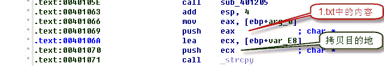  
  
Pre2，实时的调试：  
    我们随意在 1.txt 中添加一些字符串，使用 Immdbg 来调试运行，随意输入一个非零的 block size 来使程序执行到 strcpy 的调用处。  
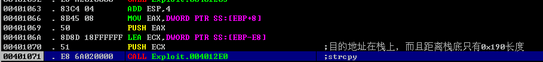  
    由于程序由/GS 编译开关生成，很难用覆盖返回地址的方法。故而采用覆盖 SEH 的方法，必须在 GS\_cookie 检测之前产生异常来调用 SEH hanler。本人想到的是除零异常或者是把字符串长度超过 0x194，拷贝越过栈底，产生访问异常。  
  
下面对调用 strcpy 的函数体进行，探究微软/gs 和 safeSEH 在汇编级别的实现细节。  
  
1，/GS 技术的实际操作办法  
/GS 编译选项会在函数的开头和结尾添加代码来阻止对典型的栈溢出漏洞（字符串缓冲区）的利用。 当应用程序启动时，程序的 cookie（4 字节（dword），无符号整型）被计算出来（伪随机数）并保存在 加载模块的.data 节中,在函数的开头这个 cookie 被拷贝到栈中，位于 EBP 和返回地址的正前方（位于返回地址和局部变量的中间）。  
\[buffer\]\[cookie\]\[savedEBP\]\[savedEIP\]  
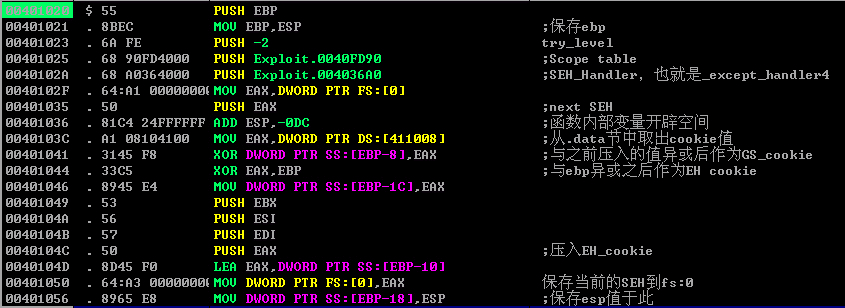  
其中 Scope table 的结构是  
    struct \_EH4\_SCOPETABLE {  
        DWORD GSCookieOffset;  
        DWORD GSCookieXOROffset;  
        DWORD EHCookieOffset;  
        DWORD EHCookieXOROffset;  
        \_EH4\_SCOPETABLE\_RECORD ScopeRecord\[1\];  
    };  
  
    struct \_EH4\_SCOPETABLE\_RECORD {  
        DWORD EnclosingLevel;  
        long (\*FilterFunc)();  
            union {  
            void (\*HandlerAddress)();  
            void (\*FinallyFunc)();  
        };  
    };  
我们可以在内存窗口查看：  
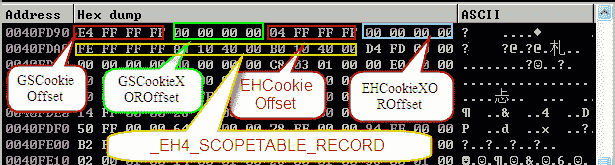  
可以猜测，004010aa 正好是\_\_except(EXCEPTION\_EXECUTE\_HANDLER)的指令地址，  
而 004010b0 正好是\_\_except 开始的{}内的地址。  
  
在函数的结尾处，程序会把这个 cookie 和保存在.data 节中的 cookie 进行比较。  
如果不相等，就说明进程栈被破坏，进程必须被终止。   
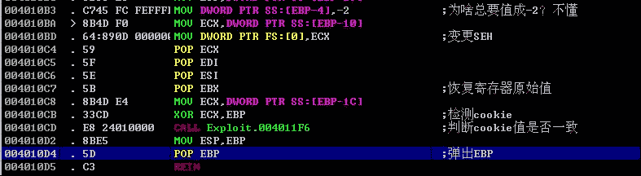  
在 cookie 检测函数里面，其实就是一个简单的判断：  
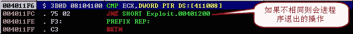  
  
2，safeSEH 技术的实际操作办法  
  
在调试 exploit.exe 时，异常发生时，我们按 shift+F7 就能进入异常刚发生的系统代码处，KiUserExceptionDispatcher()函数的开始处。（类此的软件异常是通过直接或者间接调用内核服务 NtRaiseException 而产生的。而用户态中可以通过 RaiseException API，或者 Try-catch 等高级语言来调用这个内核服务，而通过 RaiseException 来登记软件异常的过程可以简单表述如下：RaiseException 在初始化一个 EXCEPTION\_RECORD 结构体之后，开始调用 NTDLL 中的 RtlRaiseException; RtlRaiseException 在初始化 CONTEXT 结构体之后，开始调用内核中 NtRaiseException, NtRaiseException 再调用另外一个内核函数 KiRaiseException。接下来 KiRaiseException 会调用 KiDispatchException 开始异常的分发）  
  
这个时候其实系统已经帮你做了很多工作了；比如 EXCEPTION\_POINTERS 就在栈顶，如下图：  
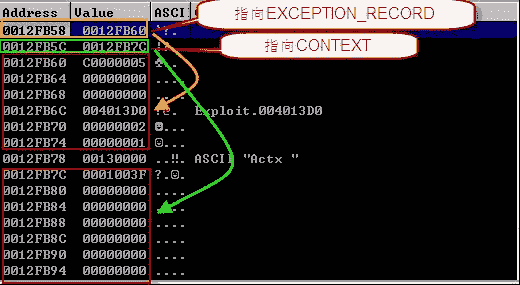  
这里我们给上 KiUserExceptionDispatcher 函数的伪代码：  
  
KiUserExceptionDispatcher( PEXCEPTION\_RECORD pExcptRec, CONTEXT \* pContext )    
{    
    DWORD retValue;     
    // 注意：如果异常被处理，那么 RtlDispatchException 函数就不会返回    
    if ( RtlDispatchException( pExceptRec, pContext ) )    
        retValue = NtContinue( pContext, 0 );    
    else    
        retValue = NtRaiseException( pExceptRec, pContext, 0 );     
    EXCEPTION\_RECORD excptRec2;    
    excptRec2.ExceptionCode = retValue;    
    excptRec2.ExceptionFlags = EXCEPTION\_NONCONTINUABLE;    
    excptRec2.ExceptionRecord = pExcptRec;    
    excptRec2.NumberParameters = 0;     
    RtlRaiseException( &excptRec2 );    
  
}    
  
我们 safeSEH 检测的工作就在 RtlDispatchException 中完成。  
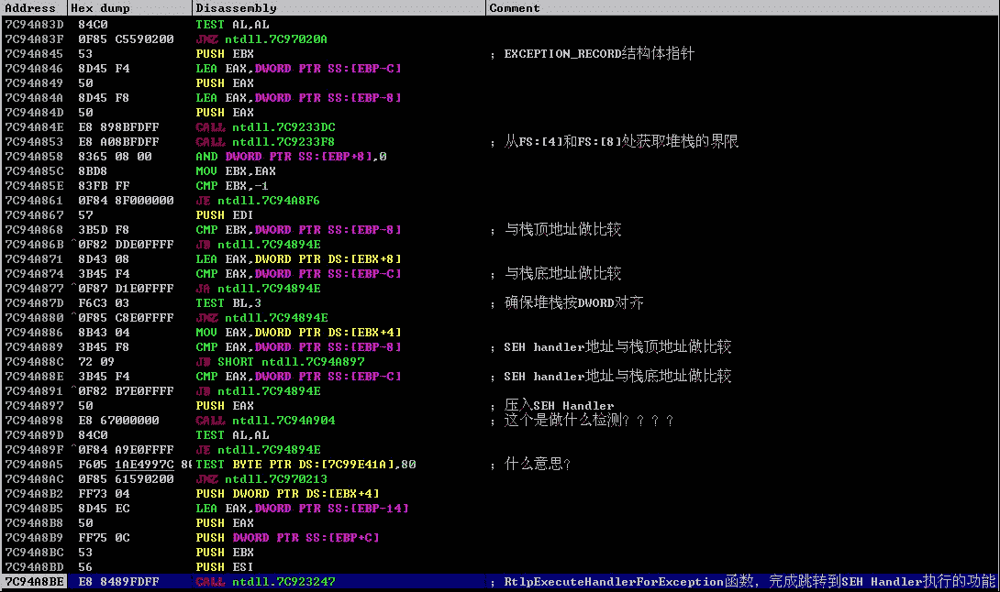  
当异常发生时，异常分发器创建自己的栈帧。它会把 SEH Handler 成员压入新创的栈帧中（作为函数起始的一部分）在 SEH 结构中有一个域是 Establisher Frame 。这个域指向异常注册记录 （next  SEH ）的地址并被压入栈中，当一个例程被调用的时候被压入的这个值都是位于 ESP+8 的地方。  
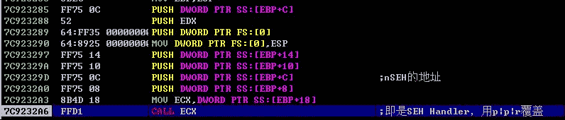  
我们经常用 pop pop ret 串的地址覆盖 SE Handler 来达到跳转栈上的目的：  
\-第一个 pop 将弹出栈顶的 4 bytes  
\-接下来的 pop 继续从栈中弹出 4bytes  
\-最后的 ret 将把此时 ESP 所指栈顶中的值（next SEH 的地址）放到 EIP 中。  
  
3，绕过方法  
  
绕过/GS 的方法基本上都通过覆盖 SEH 来实现，在 cookie 未检测之前实现溢出。而覆盖 SEH 有两种，一种是 2 中所述；直接用 pop|pop|retn 指令地址来覆盖 SEH Handler，从而跳到栈上执行。另外一种就是硬编码 shellcode 的开始地址，植入 SEH Handler，在异常处理函数执行时，直接执行 shellcode。  
  
    a，可以用 pvefindaddr 插件跑，来获取加载模块之外的地址  
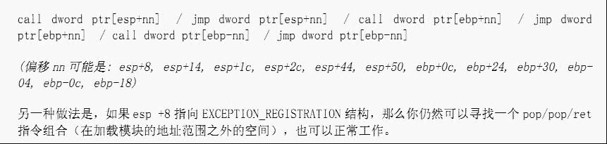  
    b，可以采用 shellcode 地址硬编码，当然不能用栈地址里面的 shellcode。搜索我们发现 ctype.nls 里面有 1.txt 文件内容的复制品，我们硬编码地址设成这个模块里的 shellcode 的起始地址，就能绕过 safeSEH。缺点就是通用性极差。  
  
    c，在这里强调一点，插件搜索出来的结果可能是不全的，也可能存在其他的地址上有 pop|pop|retn 满足条件。比如本例可以发现：  
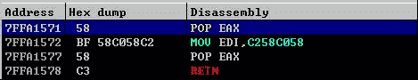  
 在高地址处，不受 safeSEH 的限制。  
  
4，小结  
  
     /GS 和 safeSEH 都有较成熟的绕过机制，甚至有插件来进行傻瓜式的搜索。但是我们仍然需要详细了解微软设置这两个机制的详细实现过程，需要我们耐心的调试分析。最后，插件不是万能的。方法知道的越多才会越灵活。懂得原理才是王道！