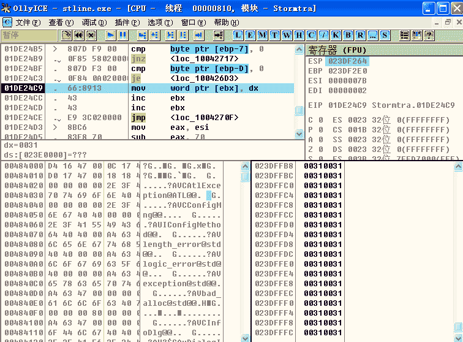
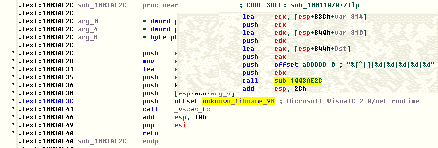
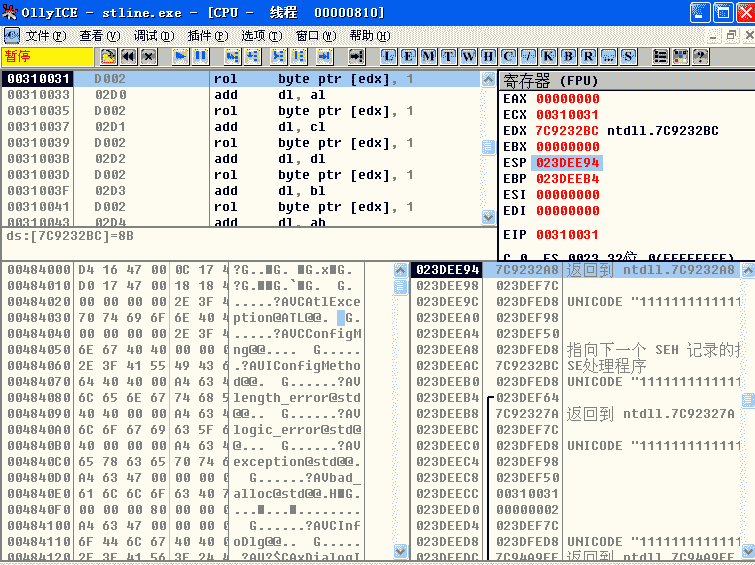

# 暴风影音 2008Beta1 最新远程溢出 0day 分析

> 原文：[`www.pediy.com/kssd/pediy10/68817.html`](https://www.pediy.com/kssd/pediy10/68817.html)

已近将此漏洞报给暴风.  
  
声明：纯技术研究，禁止将本文相关代码非法用途！后果自负！  
下载地址: http://dl.baofeng.com/storm3/storm2008-beta1.exe  
  
暴风影音 2008Beta1 最新远程溢出 0day 分析 

dummy@ph4nt0m.org

一、漏洞分析

今天下午帮同事查找一个软件和新版本暴风兼容性的问题，发现其新增了新的模块，回来就试了一下，运气真好被我到一个远程溢出。

问题模块是暴风的视频加速程序，暴风的视频加速功能是通过设置浏览器代理实现的，这个代理服务器（HttpServer.dll）会在本机开 8089 端口监听处理请求，因为此端口绑定的地址不是 localhost, 从而导致此溢出可以被远程利用。

使用 od 打开暴风安装目录下的 box/Stline.exe，这个程序记视频加速模块的主程序文件，按下 F9 让 Stline.exe 跑起来，然后打开 IE 在地址栏中输入 http://baidu.com/111...11.flv (长度必须大于 1000) 回车。Od 在 stormtra.dll 因为异常暂停下来，如下图:  

Ebx = 堆栈的栈顶，dx 是我们输入的 1, 把堆栈窗口拉到最高处，看到堆栈中填满了我们的输入的 URL 拷贝。使用 ida 打开这个 stormtra.dll 进行上下文分析，如下图：  

发生异常的函数是在 unknown\_libname\_98 里，而 unknown\_libname\_98 是 \_vscan\_fn 的回调，通过 sub\_1003AE2C 参数判断这个是正则表达式 search 函数，溢出正是在这个函数里面发生，具体为什么这个 search 过程发生溢出暂时可以不用管。

然后在 od 中 shift+f8 忽略异常，接着 od 再次断下，如下图，这时 eip = 0x00310031, 这是因为溢出后，操作系统从堆栈取异常处理函数，但是堆栈中被填满了我们的输入。

  

到这里已近可以看到我们的输入成功控制了 eip，那我们离成功也更进了一步了。

二、编写 shellcode

在 od 中注意我们的输入显示的 unicode 串，以前没有搞过此类的溢出，只知道比 ascii 麻烦很多，请教了 123 大牛，他给我了一个同类溢出程序的 webdav (参考四)，试着改了一下，但是不打算继续放相关代码了，有兴趣自己调吧:)。

四、参考资料

Webdav 远程溢出漏洞分析 http://www.xfocus.net/articles/200303/500.html